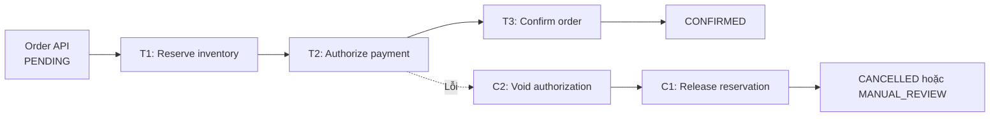
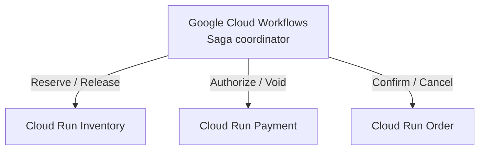
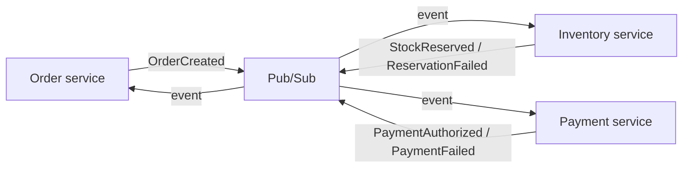
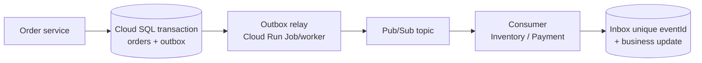

# Thiết kế saga và xử lý lỗi từng phần trên GCP

## 1. Bài toán: một đơn hàng đi qua nhiều dịch vụ

Giả sử ứng dụng thương mại điện tử sử dụng **Cloud Run** cho Order API, Inventory API và Payment API; các dịch vụ lưu dữ liệu riêng trong **Cloud SQL** hoặc Firestore. Khi khách đặt hàng, hệ thống phải:

1. Giữ hàng trong kho.
2. Giữ hạn mức hoặc **ủy quyền thanh toán** (authorization), **chưa capture tiền**.
3. Xác nhận đơn hàng và chỉ sau đó thực hiện những tác dụng phụ như gửi thông báo.

Nếu Inventory giữ hàng thành công nhưng Payment lỗi, một database transaction của Order API **không thể rollback thay đổi trên Inventory**. Nếu Payment đã xử lý yêu cầu nhưng HTTP response bị mất, Order API còn không biết việc thanh toán đã diễn ra hay chưa. Đây là **lỗi từng phần** (*partial failure*) của hệ phân tán.

**Saga** là mẫu thiết kế phối hợp nhiều **giao dịch cục bộ** (*local transactions*). Sau mỗi bước thành công, hệ thống ghi nhận tiến độ; khi bước sau thất bại, nó thực hiện những **hành động bù trừ** (*compensating actions*) để đưa nghiệp vụ về một trạng thái chấp nhận được. Saga **không phải** một transaction ACID trải trên nhiều Cloud SQL databases, Cloud Run services hoặc Pub/Sub topics.

Bài học thuộc chương **Điều phối và tích hợp ứng dụng** của module **CLOUD_PROVIDERS_GCP**, áp dụng kiến thức Project/IAM, VPC, Cloud Run, GKE, lưu trữ và database để xây dựng workflow có khả năng phục hồi, kiểm soát quyền truy cập, tự động hóa phát hành và đo lường độ tin cậy cùng chi phí.

**Sau bài học, bạn có thể:**

- Thiết kế các bước **forward**, **compensation**, trạng thái bền vững và business invariants.
- So sánh **orchestration** bằng Google Cloud Workflows với **choreography** qua Pub/Sub/Eventarc.
- Xử lý timeout, retry, thông điệp trùng, cập nhật đã commit nhưng ACK bị mất và compensation thất bại.
- Đọc/viết một workflow YAML gọi Cloud Run bằng OIDC và có `try/retry/except`.
- Kết hợp Cloud Tasks, transactional outbox/inbox, Cloud Logging/Monitoring và runbook phục hồi.
- Lựa chọn phương án theo SLO, tính nhất quán, độ phức tạp và chi phí.

> **An toàn:** URL, project, service account và order ID bên dưới là giả định. Các lệnh deploy/execute có thể phát sinh phí hoặc thay đổi dữ liệu. Chỉ chạy trên dự án thử nghiệm được phép; không dùng payment thật, không log dữ liệu thẻ, token hoặc PII.

## 2. Hiểu đúng saga, local transaction và compensation



Mỗi bước `Tn` là transaction **trong một service/nguồn dữ liệu**. Nếu đã thực hiện `T1` rồi `T2` không hoàn thành, `C1` được yêu cầu giải phóng reservation. Nếu `T2` đã ủy quyền tiền rồi `T3` thất bại, thường phải làm `C2` **trước** `C1`, tức bù trừ theo **thứ tự đảo**.

| Khái niệm | Ý nghĩa | Ví dụ |
| --- | --- | --- |
| **Forward action** | Thao tác nghiệp vụ tiến tới mục tiêu | `ReserveStock(orderId)` |
| **Compensation** | Thao tác mới nhằm đảo/bù hiệu ứng nghiệp vụ | `ReleaseStock(reservationId)` |
| **Local transaction** | Commit atomic trong một service/data store | Insert reservation + update stock trong một DB transaction |
| **Saga state** | Dấu mốc tiến độ đã commit, được lưu bền vững | `PAYMENT_AUTHORIZED`, `COMPENSATING` |
| **Business invariant** | Điều luôn phải đúng theo nghiệp vụ | Không tạo hai lần capture cho cùng payment intent |
| **Reconciliation** | Kiểm tra và sửa bất nhất khi trạng thái chưa chắc chắn | Đối chiếu trạng thái Payment với order ledger |

**Compensation không phải quay ngược thời gian.** Nếu đã gửi email, người nhận vẫn có thể đọc dù sau đó hệ thống gửi thư đính chính. Nếu đã capture tiền, **refund** là một giao dịch tài chính mới, có thể mất thời gian/phí và không tương đương với hủy authorization chưa capture. Với tác động không thể đảo, thiết kế **forward recovery**, quy trình bù trừ nghiệp vụ hoặc chuyển **manual review**.

### Chọn thứ tự để giảm rủi ro

Ưu tiên các bước **dễ bù trừ trước**, ví dụ **reserve inventory → authorize payment → confirm**. Tránh “ship hàng rồi mới kiểm tra thanh toán” nếu không có quy trình hoàn trả/thu hồi. Luôn chỉ rõ thời hạn reservation, thời gian authorization hết hạn và điều kiện timeout để không giữ tài nguyên vô thời hạn.

## 3. Saga khác transaction ACID và 2-phase commit

| Tiêu chí | Một local ACID transaction | Saga | Two-phase commit (2PC) |
| --- | --- | --- | --- |
| Phạm vi | Một database/resource hỗ trợ giao dịch | Nhiều services, mỗi service commit riêng | Các resource managers cùng tham gia protocol |
| Atomicity toàn hệ | Có trong phạm vi DB | **Không**; trạng thái tạm có thể quan sát được | Có theo cơ chế 2PC, nhưng chịu coordinator/availability trade-offs |
| Phục hồi lỗi | DB rollback | Retry, compensation, reconciliation | Commit/abort giữa các participants |
| Thời gian chạy | Thường ngắn | Có thể dài, asynchronous | Khóa/giai đoạn prepare có thể gây contention |
| Tương tác hệ ngoài | Khó bao quát email, payment, Pub/Sub | Thiết kế tác dụng phụ rõ ràng | Không áp dụng đơn giản cho mọi Google Cloud API |

Saga là lựa chọn kiến trúc khi cần **eventual consistency** và xử lý thất bại giữa những dịch vụ sở hữu dữ liệu độc lập. **Không phải mọi thao tác cần saga**: nếu toàn bộ thay đổi có thể thực hiện trong một Cloud SQL transaction, đừng tách thành nhiều dịch vụ chỉ để dùng saga.

## 4. Orchestration hay choreography?

### 4.1. Orchestration: một bộ điều phối quyết định bước tiếp theo



**Google Cloud Workflows** phù hợp khi có thứ tự bước rõ ràng, nhánh điều kiện, timeout, retry, compensation và cần theo dõi một execution. Nó gọi Cloud Run qua HTTPS/OIDC hoặc Google APIs qua connectors. Workflows **lưu tiến độ thực thi**, nhưng **không thay database nghiệp vụ bền vững** cho lịch sử order, idempotency, reconciliation và yêu cầu retention lâu dài.

### 4.2. Choreography: các dịch vụ phản ứng với sự kiện



**Pub/Sub** phù hợp fan-out, loosely coupled consumers và xử lý sự kiện bất đồng bộ. Tuy nhiên luồng nghiệp vụ, compensation và trạng thái phân tán giữa nhiều consumer; rất dễ hình thành các vòng sự kiện khó đọc nếu không có **correlation ID**, state machine, outbox/inbox, timeout và tracing.

| Tiêu chí | Workflows orchestration | Pub/Sub choreography |
| --- | --- | --- |
| Ai định nghĩa luồng? | Workflow trung tâm | Các services theo event contracts |
| Quan sát tiến độ | Execution steps tập trung, cần liên kết business ledger | Trace/correlation trải nhiều topics/subscribers |
| Retry và compensation | `try/retry/except`, gọi compensating endpoints | Consumers xử lý lỗi, phát compensation events |
| Phụ thuộc | Coordinator biết các bước | Dịch vụ ít biết trực tiếp nhau nhưng phụ thuộc contracts |
| Phù hợp | Quy trình có thứ tự và rollback rõ | Fan-out, nhiều consumer độc lập |
| Rủi ro | Workflow quá lớn, bottleneck ở downstream | Event loop, trùng lặp, khó xác định completion |

**Không buộc phải chọn duy nhất một.** Một saga Workflows có thể phát `OrderConfirmed` qua outbox/Pub/Sub **sau khi transaction confirm đã commit**, để các dịch vụ phụ trợ gửi email hoặc cập nhật analytics.

## 5. Trạng thái saga phải được lưu bền vững

Ví dụ state machine của một đơn hàng:

```text
PENDING
   → STOCK_RESERVED
   → PAYMENT_AUTHORIZED
   → CONFIRMED
hoặc
   → COMPENSATING
   → CANCELLED
hoặc
   → MANUAL_REVIEW
```

**Chốt invariant trước khi viết YAML:**

1. Một `orderId` có **tối đa một saga active**, được kiểm soát bằng unique constraint/transaction.
2. Mỗi bước có **operationId** ổn định như `<sagaId>:reserve` hoặc `<sagaId>:authorize`, dùng lại khi retry.
3. Không chuyển `CANCELLED` về `CONFIRMED` do một message/lệnh đến muộn nếu chưa có nghiệp vụ mới hợp lệ.
4. Không gửi `OrderConfirmed` cho consumer downstream trước khi order state thực sự commit.
5. Một saga không thể hoàn tất bù trừ phải vào `MANUAL_REVIEW` kèm owner, deadline và bằng chứng.

### Bảng ledger tối giản (thiết kế tham khảo)

```sql
CREATE TABLE sagas (
    saga_id           TEXT PRIMARY KEY,
    order_id          TEXT NOT NULL UNIQUE,
    status            TEXT NOT NULL,
    current_step      TEXT,
    updated_at        TIMESTAMPTZ NOT NULL DEFAULT now(),
    version           BIGINT NOT NULL DEFAULT 0
);

CREATE TABLE saga_operations (
    operation_id      TEXT PRIMARY KEY,
    saga_id           TEXT NOT NULL REFERENCES sagas(saga_id),
    step_name         TEXT NOT NULL,
    status            TEXT NOT NULL,
    external_ref      TEXT,
    updated_at        TIMESTAMPTZ NOT NULL DEFAULT now()
);
```

Đây là **schema khởi điểm**, không phải implementation hoàn chỉnh. Chuyển trạng thái phải dùng **transaction và optimistic locking** (`version`/conditional update) để tránh hai executions cùng xác nhận đơn. Nên lưu mã lỗi đã được **phân loại** và thời gian hết hạn, **không** lưu credentials hoặc raw payment details.

### API contract của từng service

| Endpoint giả định | Forward/compensation | Điều kiện bắt buộc |
| --- | --- | --- |
| `POST /reservations` | Reserve stock | Cùng `operationId` phải trả lại kết quả cũ; thiếu hàng trả lỗi nghiệp vụ |
| `POST /reservations/release` | Release stock | Idempotent; release 2 lần không cộng tồn kho 2 lần |
| `POST /authorizations` | Authorize payment | Cùng payment intent/idempotency key không ủy quyền hai lần |
| `POST /authorizations/void` | Void authorization | Idempotent; không được void hai lần như hai giao dịch độc lập |
| `POST /orders/confirm` | Xác nhận order | Chỉ confirm sau stock + payment success theo business state |
| `GET /operations/{operationId}` | Reconcile kết quả | Trả trạng thái durable khi HTTP response bị mất |

**Timeout không chứng minh transaction đã rollback.** Backend có thể commit ngay trước lúc kết nối bị ngắt. Các endpoints cần hỗ trợ **query by operationId**, idempotency và quy tắc xử lý *late arrival* sau khi saga đã chuyển sang compensation.

## 6. Lỗi từng phần: phân loại trước khi retry hay bù trừ

| Tình huống | Điều ta biết | Cách xử lý an toàn |
| --- | --- | --- |
| Inventory trả `409 OUT_OF_STOCK` | Lỗi nghiệp vụ rõ, không reserve được | Hủy đơn hoặc báo hết hàng; không retry vô hạn |
| Payment trả `429` hoặc `503` | Có thể tạm thời | Retry có giới hạn với backoff/jitter; luôn dùng operationId |
| HTTP timeout sau `POST` | **Không biết đã commit hay chưa** | Query status theo operationId; retry idempotent, không tạo payment intent mới |
| Workflows nhận `200` với JSON `status: FAILED` | Transport thành công, **nghiệp vụ thất bại** | Kiểm tra response.body; raise lỗi nghiệp vụ có chủ đích |
| Payment đã authorize, confirm order lỗi | Có side effect cần bù trừ | Void authorization, release stock, sau đó mark CANCELLED |
| Compensation cũng timeout | Không biết compensation đã hoàn thành | Reconcile; chuyển MANUAL_REVIEW, retry có giới hạn |
| Workflows crash trước khi ghi saga state | Có thể có bước đã commit | Durable ledger + operation status để phục hồi/restart |
| Hai requests cùng `orderId` | Race/duplicate initiation | Unique constraint/lock/fencing; trả cùng saga hoặc 409 |

**Quy tắc thực dụng:** Chỉ retry tự động khi hành động **idempotent**, hoặc được bảo vệ bởi **idempotency key được lưu bền vững**. Google Cloud Workflows có `http.default_retry` cho HTTP lỗi tạm thời, nhưng dùng retry trên một `POST` không idempotent có thể tạo giao dịch trùng. Cloud Run, Pub/Sub hoặc Cloud Tasks **không tự làm thao tác ghi database trở nên idempotent**.

## 7. Ví dụ Workflows YAML: reserve và authorize, bù trừ khi lỗi

Ví dụ dưới đây là **saga tối giản** gồm hai bước forward (**reserve stock**, **authorize payment**) và hai compensators (**void authorization**, **release stock**). Sau khi cả hai thành công, workflow trả `AUTHORIZED`; một hệ thống production còn phải **commit order confirmation**, phát event qua outbox và định nghĩa phục hồi nếu confirm lỗi.

### Tiền điều kiện quan trọng

- Hai Cloud Run services đã tồn tại, **yêu cầu xác thực**, endpoint trả **2xx chỉ khi transaction local đã commit**, trả **4xx/5xx đúng ngữ nghĩa**.
- Endpoints **idempotent** theo `operationId`; compensators chấp nhận lời gọi ngay cả khi bước forward chưa chạy, đã hoàn tất trước đó hoặc kết quả chưa rõ, và ngăn **late forward** ghi đè một saga đã cancelled.
- Workflows service account có `roles/run.invoker` trên **cả hai** services; dùng **OIDC** với audience là root URL của từng Cloud Run service.
- Thay hai URL giả định bằng HTTPS URLs thực; **không** nhận tùy tiện URL do client gửi (tránh dùng Workflows identity gọi endpoint ngoài ý muốn).
- `orderId` và `sagaId` phải được **tạo và ràng buộc duy nhất trong ledger**; không dùng random ID mỗi lần retry một bước.

**`order-saga.yaml` (workflow DSL YAML, không phải Kubernetes YAML):**

```yaml
main:
  params: [args]
  steps:
    - init:
        assign:
          - orderId: ${args.orderId}
          - sagaId: ${args.sagaId}
          - inventoryRoot: "https://inventory-PLACEHOLDER-uc.a.run.app"
          - paymentRoot: "https://payment-PLACEHOLDER-uc.a.run.app"
          - compensationFailed: false

    - forward:
        try:
          steps:
            - reserve_stock:
                try:
                  call: http.post
                  args:
                    url: ${inventoryRoot + "/reservations"}
                    auth:
                      type: OIDC
                      audience: ${inventoryRoot}
                    body:
                      orderId: ${orderId}
                      operationId: ${sagaId + ":reserve"}
                  result: reserveResult
                retry: ${http.default_retry}

            - authorize_payment:
                try:
                  call: http.post
                  args:
                    url: ${paymentRoot + "/authorizations"}
                    auth:
                      type: OIDC
                      audience: ${paymentRoot}
                    body:
                      orderId: ${orderId}
                      operationId: ${sagaId + ":authorize"}
                  result: paymentResult
                retry: ${http.default_retry}

        except:
          as: originalError
          steps:
            - void_payment:
                try:
                  call: http.post
                  args:
                    url: ${paymentRoot + "/authorizations/void"}
                    auth:
                      type: OIDC
                      audience: ${paymentRoot}
                    body:
                      orderId: ${orderId}
                      operationId: ${sagaId + ":void"}
                      forwardOperationId: ${sagaId + ":authorize"}
                retry: ${http.default_retry}
                except:
                  as: voidError
                  steps:
                    - flag_payment_compensation:
                        assign:
                          - compensationFailed: true

            - release_stock:
                try:
                  call: http.post
                  args:
                    url: ${inventoryRoot + "/reservations/release"}
                    auth:
                      type: OIDC
                      audience: ${inventoryRoot}
                    body:
                      orderId: ${orderId}
                      operationId: ${sagaId + ":release"}
                      forwardOperationId: ${sagaId + ":reserve"}
                retry: ${http.default_retry}
                except:
                  as: releaseError
                  steps:
                    - flag_stock_compensation:
                        assign:
                          - compensationFailed: true

            - choose_failure_status:
                switch:
                  - condition: ${compensationFailed}
                    return:
                      sagaId: ${sagaId}
                      state: "MANUAL_REVIEW"
                      reason: "COMPENSATION_NOT_CONFIRMED"
                  - condition: true
                    return:
                      sagaId: ${sagaId}
                      state: "COMPENSATED"
                      reason: "FORWARD_FAILED"

    - forward_succeeded:
        return:
          sagaId: ${sagaId}
          state: "AUTHORIZED"
          orderId: ${orderId}
```

### Điều ví dụ minh họa và những gì nó chưa làm

1. `try/except` ngoài bắt lỗi từ bước forward; hai compensators được gọi **theo thứ tự đảo**.
2. Mỗi compensator có `try/retry/except` riêng nên **void lỗi vẫn cố release stock**; nếu ít nhất một compensation chưa được xác nhận, trả `MANUAL_REVIEW`.
3. Với `http.default_retry`, Workflows retry HTTP `429`, `502`, `503`, `504` cùng một số lỗi kết nối/timeout theo policy; **không mặc định retry mọi `400`/`403`/`409`.
4. **Có thể nhận `200` và một body nghiệp vụ `FAILED`**: YAML này giả định các backend **không** dùng cách đó. Nếu dùng, cần kiểm tra `result.body` và `raise` một lỗi để kích hoạt compensation.
5. **HTTP success/timeout vẫn có race.** Các endpoints và ledger phải thực thi idempotency, terminal-state fencing và reconciliation; riêng YAML không thể chứng minh hai transactions đã đảo hết.
6. Workflow **trả map `COMPENSATED` hoặc `MANUAL_REVIEW` và có thể được Workflows đánh dấu execution thành công về mặt kỹ thuật**. Caller phải đọc **business state**, và backend phải ghi nó vào **durable saga ledger**, phát alert cho `MANUAL_REVIEW`; không coi HTTP 200 của API chạy workflow là “order đã hoàn tất”.
7. Không dùng lệnh này trên payment thật cho đến khi có tích hợp gateway hỗ trợ idempotency/void/refund, transaction và compliance phù hợp.

**Nâng cấp lên saga đầy đủ:** Sau `AUTHORIZED`, dùng Order service để **confirm order** trong local transaction và ghi **outbox OrderConfirmed**. Nếu confirm bị lỗi/timeout, **query operation status trước khi void**; chỉ bù trừ nếu xác nhận order chưa commit hoặc có cơ chế chuyển order sang trạng thái cancellation hợp lệ. Mỗi transition phải được ghi vào ledger để phục hồi sau crash.

## 8. Deploy và chạy thử Workflows an toàn

Giả định `acme-saga-lab` có Workflow API và Cloud Run API đã bật, hai services mock **đã triển khai** và có HTTP contracts như trên.

### 8.1. Quyền tối thiểu

```text
Deployer / CI:
  workflows.workflows.create/update (qua role phù hợp)
  iam.serviceAccounts.actAs trên workflows-sa

Workflow runtime SA:
  roles/run.invoker trên inventory service
  roles/run.invoker trên payment service
  quyền logs/connector cụ thể nếu cần

Caller:
  workflows.executions.create trên workflow
  quyền đọc execution theo nhu cầu theo dõi
```

Không cấp `roles/owner` cho Workflows SA; nó **không** cần quyền đọc trực tiếp toàn bộ Cloud SQL database nếu chỉ gọi Cloud Run APIs đã được bảo vệ. Với các Google Cloud API connectors, dùng **OAuth2** theo hướng dẫn sản phẩm; với **Cloud Run HTTPS endpoint**, dùng **OIDC**.

### 8.2. Cú pháp lệnh

```bash
# THAY ĐỔI: chỉ sau khi thay URLs và đã tạo service account đúng
gcloud workflows deploy order-saga-lab \
  --project=acme-saga-lab \
  --location=asia-southeast1 \
  --source=order-saga.yaml \
  --service-account=workflows-sa@acme-saga-lab.iam.gserviceaccount.com

# THAY ĐỔI: tạo một execution (dùng fake payment/backends trong lab)
gcloud workflows run order-saga-lab \
  --project=acme-saga-lab \
  --location=asia-southeast1 \
  --data='{"orderId":"LAB-ORDER-1001","sagaId":"LAB-SAGA-1001"}'

# CHỈ ĐỌC
gcloud workflows describe order-saga-lab \
  --project=acme-saga-lab --location=asia-southeast1

gcloud workflows executions list \
  --workflow=order-saga-lab \
  --project=acme-saga-lab --location=asia-southeast1
```

`gcloud workflows run` chờ execution hoàn tất và trả kết quả, trong khi `gcloud workflows execute` khởi tạo không nhất thiết chờ. Nếu chạy lại với **cùng** `sagaId`, mock backend phải chứng minh không reserve/authorize thêm lần nữa. Nếu triển khai workflow có bước trả map `MANUAL_REVIEW`, caller cần kiểm tra trường `state`, không chỉ exit code của CLI.

### 8.3. Kiểm thử failure injection

Mỗi tình huống dưới đây cần mock backend **chủ động trả kết quả**, không gây lỗi trên hệ thống thật:

| Kịch bản | Inventory | Payment | Kết quả mong đợi |
| --- | --- | --- | --- |
| Happy path | Reserve 2xx | Authorize 2xx | `AUTHORIZED`, chưa capture |
| Hết hàng | `409` | Chưa gọi | Compensation là no-op, `COMPENSATED`/cancelled |
| Payment tạm lỗi | Reserve 2xx | `503` rồi 2xx | Retry cùng operationId, chỉ một authorization |
| Payment lỗi lâu | Reserve 2xx | Lỗi hết retries | Void nếu cần + release; không giữ stock |
| Response bị mất sau commit | Reserve 2xx | Timeout sau khi authorize | Query/retry idempotent, không authorise hai lần |
| Void/release lỗi | Forward lỗi | Một compensator lỗi | `MANUAL_REVIEW` và alert/on-call |
| Gọi lại cùng sagaId | Các calls lặp | Các calls lặp | Kết quả từ ledger, không nhân đôi effect |

**Một lần test thành công chưa đủ:** test cả retry, eventual consistency, concurrent requests, process crash giữa **commit và response**, và case compensation đến trước một forward request bị chậm.

## 9. Choreography: Pub/Sub, outbox và inbox

Khi chọn choreography, không nên triển khai:

```text
COMMIT orders DB
PUBLISH Pub/Sub OrderCreated
```

như hai hành động rời rạc mà không có cơ chế phục hồi. Nếu database commit thành công nhưng publisher crash trước khi publish, **event bị mất**. Nếu publish trước rồi database rollback, consumer có thể xử lý **order không tồn tại**.

### Transactional outbox

Trong **một local database transaction**, Order service ghi cả:

1. Bản ghi `orders(status=PENDING)`.
2. Bản ghi `outbox(eventId, type, payload, status=NEW)`.

Một **outbox relay** đọc bảng outbox rồi publish lên Pub/Sub. Nếu publish thành công nhưng relay crash trước khi mark `SENT`, relay sẽ publish lại: **duplicates là điều dự kiến**, consumer phải có **inbox/dedup**.



**Inbox pattern:** Consumer lưu `eventId` vào bảng khóa duy nhất **cùng transaction** với nghiệp vụ cục bộ. Khi Pub/Sub message được redeliver, insert conflict được xem là event đã xử lý và consumer ack theo trạng thái durable. Pub/Sub **exactly-once delivery** (khi được hỗ trợ) không loại bỏ duplicate **do publisher phát hai events** hoặc side effect qua nhiều data stores.

### Hệ quả của ordering và fan-out

- Pub/Sub bảo đảm **at-least-once** theo mặc định; subscribers có thể gặp redelivery.
- **Ordering keys** chỉ cung cấp ordering theo key khi cấu hình và điều kiện sản phẩm được đáp ứng; không có global ordering giữa tất cả orders/topics.
- Correlate event bằng `sagaId`, `orderId`, `eventId`, `stepVersion`; consumer dùng version/fencing để bỏ qua event tới muộn.
- Đặt **timeout watchdog** (Cloud Scheduler/Workflows/Cloud Tasks theo nhu cầu) cho những saga bị kẹt; chỉ dựa event chains có thể để orphan reservations tồn tại mãi.

## 10. Cloud Tasks, Eventarc và Cloud Run Jobs nằm ở đâu?

Saga không bắt buộc mọi bước phải là HTTP đồng bộ. Chọn công cụ dựa trên **tính chất tác vụ**:

| Dịch vụ GCP | Vai trò phù hợp trong saga | Giới hạn cần nhớ |
| --- | --- | --- |
| **Workflows** | Điều phối nhiều bước, state machine, retries, nhánh lỗi, bù trừ và chờ | Không biến local commits thành atomic transaction |
| **Cloud Run services/functions** | Chạy local transactions và expose API idempotent | HTTP timeout không cho biết DB đã commit hay chưa |
| **Pub/Sub** | Phát sự kiện, fan-out, asynchronous choreography, DLQ | At-least-once; publisher/consumer cần outbox/inbox |
| **Eventarc** | Route CloudEvents từ nguồn Google Cloud tới consumer | Không thay thế saga ledger hoặc compensation |
| **Cloud Tasks** | Gọi HTTP endpoint **có lịch/giới hạn tốc độ/retry** theo task | At-least-once; enqueue thành công không phải business success |
| **Cloud Run Jobs** | Batch hữu hạn/backfill, xử lý nhiều tasks | Task retry và execution trùng phải idempotent |
| **Cloud Scheduler** | Khởi động run/watchdog định kỳ | ACK trigger chỉ báo request đã chấp nhận, không xác nhận saga thành công |
| **Cloud SQL / Firestore / Spanner** | Local transactions, saga ledger, dedup/outbox | Mỗi hệ thống có transaction model và giới hạn riêng |

### Cloud Tasks khác Pub/Sub trong saga

**Cloud Tasks** hợp khi một bước cần **gọi một HTTP handler cụ thể** với hạn mức dispatch và chính sách retry/backoff, ví dụ hẹn kiểm tra một authorization sau 10 phút. Task name giúp **giảm enqueue trùng** trong giới hạn dịch vụ, nhưng không bảo đảm exactly-once business execution; handler vẫn phải idempotent.

**Pub/Sub** hợp khi **nhiều consumers độc lập** cần nhận cùng sự kiện như `OrderConfirmed`. Đừng dùng Pub/Sub chỉ để giả lập workflow tuần tự dài với hàng chục topics mà không có state machine/rules phục hồi.

### Long-running steps

Nếu một bước xử lý ảnh hoặc backfill mất nhiều phút/giờ, thay vì giữ HTTP request chờ quá lâu:

1. Tạo **Cloud Run job** hoặc một operation có trạng thái bền vững.
2. Lưu `operationId` và trạng thái `STARTED`.
3. Workflows theo dõi **operation completion** bằng polling có giới hạn hoặc callback theo dịch vụ hỗ trợ.
4. Nếu bước thất bại, chọn retry/compensation theo business state đã được commit.

Phân biệt **request timeout** của Workflows/Cloud Run với **business deadline** của toàn saga; không chỉ tăng HTTP timeout để che thiết kế thiếu cơ chế theo dõi tác vụ dài.

## 11. Xử lý trạng thái không chắc chắn (*unknown outcome*)

Một lỗi nguy hiểm:

```text
T0 Workflows POST /authorizations(operationId=SG-1:authorize)
T1 Payment service commit AUTHORIZED
T2 Kết nối bị cắt trước khi response tới Workflows
T3 Workflows thấy TimeoutError
```

Tại T3, việc “Payment đã thất bại” **chưa được chứng minh**. Nếu retry dùng **operationId khác**, có thể authorize hai lần. Nếu chạy compensation khi operation đang tiếp tục, **void có thể đến trước authorize** rồi authorize đến muộn — dẫn tới tiền bị giữ lại.

### Thiết kế phòng thủ

- **Operation ID cố định** cho mỗi business step, dùng lại qua mọi retries.
- **Ledger trạng thái trong backend**: `PENDING/COMMITTED/COMPENSATED/FAILED`, đọc bằng `GET /operations/{operationId}`.
- **Fencing/tombstone**: khi saga đã chuyển `CANCELLING` hoặc `CANCELLED`, một forward request đến muộn không được commit trái terminal state.
- **Compensation idempotent**: void/release nhiều lần cho cùng operation chỉ có một hiệu ứng.
- **Recovery worker** kiểm tra trạng thái UNKNOWN theo lịch và đưa vào **MANUAL_REVIEW** khi deadline hết hoặc đối tác trả trạng thái mâu thuẫn.
- **Correlation/tracing**: log `sagaId`, `operationId`, `orderId` được băm/ẩn theo chính sách; không log payload thẻ/PII.

### API contract rõ ràng hơn

```text
POST /authorizations
  request:  {operationId, orderId, amount, currency}
  response: {operationId, state: AUTHORIZED | DECLINED}

GET /operations/{operationId}
  response: {state: PENDING | AUTHORIZED | DECLINED | VOIDED}

POST /authorizations/void
  request: {operationId: "SG-1:void", forwardOperationId: "SG-1:authorize"}
  response: {state: VOIDED | NOOP}
```

**Mỗi service phải thực thi trạng thái bằng transaction/compare-and-set**, không chỉ dùng `if` trên dữ liệu đang cache trong bộ nhớ. Với Payment bên thứ ba, ưu tiên **idempotency API chính thức của nhà cung cấp**, đối chiếu webhook và reconciliation. Không phát sinh giao dịch tiền thật trong lab.

## 12. Thiết kế compensation theo mức độ đảo ngược

Không phải bước nào cũng có thao tác rollback chính xác:

| Bước đã làm | Compensation có thể dùng | Phần không thể “undo” hoàn toàn |
| --- | --- | --- |
| Giữ một đơn vị tồn kho | Release reservation cùng ID | Trong thời gian giữ, mặt hàng đã không sẵn cho đơn khác |
| Authorize payment (chưa capture) | Void authorization | Ngân hàng có thể vẫn hiển thị khoản hold tạm |
| Capture payment | Refund theo payment ID | Hoàn tiền mất thời gian, phí và audit vẫn tồn tại |
| Đặt shipment | Cancel shipment nếu chưa giao | Nếu đã giao, cần quy trình return/reverse logistics |
| Gửi email/SMS | Gửi thông báo đính chính | Không thể thu hồi việc người nhận đã đọc |
| Tạo báo cáo hoặc ghi Cloud Storage | Ghi phiên bản/sửa manifest, đánh dấu superseded | Versioning và audit lưu lịch sử |

### Khi compensation cũng lỗi

Tạo một **compensation queue/ledger** với trạng thái và số lần thử:

```text
SG-1: RESERVE_COMPLETED
SG-1: PAYMENT_AUTHORIZED
SG-1: COMPENSATING
SG-1:void:   RETRY_PENDING
SG-1:release: DONE
SG-1: MANUAL_REVIEW
```

**Đừng đánh dấu `CANCELLED` khi mới gửi yêu cầu void mà chưa xác minh**. Một compensation thất bại có thể được retry có giới hạn, sau đó escalation cho on-call/human operator. Giữ đầy đủ liên kết chứng cứ và thời hạn nghiệp vụ (ví dụ thời điểm authorization tự hết hiệu lực) trong ledger.

### Trường hợp nên ưu tiên *forward recovery*

Nếu đã giao hàng hoặc thanh toán không còn void được, thay vì cố chạy phương thức `releaseStock`, chuyển sang quy trình **refund/return**, không xóa lịch sử dữ liệu đã phát sinh. Cấu trúc saga phải cho phép kết thúc bằng trạng thái **`PARTIALLY_COMPLETED`** hoặc **`REQUIRES_INTERVENTION`** có ý nghĩa nghiệp vụ; không ép mọi nhánh vào `SUCCESS/FAILED`.

## 13. Thiết kế IAM và bảo mật cho saga

Trong GCP, **Workflows service account** là danh tính chạy workflow, khác với **Cloud Run runtime service account** của Inventory/Payment/Order. Phân quyền tối thiểu theo chiều gọi:

| Danh tính | Quyền mẫu | Tránh |
| --- | --- | --- |
| CI/deployer | Workflows deploy/update và `iam.serviceAccounts.actAs` theo nhu cầu | Owner trên project |
| Workflows runtime SA | `roles/run.invoker` trên từng Cloud Run service cần gọi | Quyền truy cập trực tiếp mọi database nếu chỉ cần gọi API |
| Inventory runtime SA | Quyền DB/kho của Inventory service | Quyền payment secrets |
| Payment runtime SA | Quyền truy cập payment provider secret qua Secret Manager và local DB | Ghi/đọc toàn bộ order DB |
| Caller/trigger | Quyền `workflows.executions.create` trên workflow được phép | Tùy ý đổi service URLs/roles |
| Operator | Đọc executions, logs và ledger có kiểm soát | Tự duyệt refund/compensation không có audit |

**OIDC** dùng cho Workflows gọi Cloud Run HTTPS; audience phải phù hợp Cloud Run service root URL hoặc custom audience được cấu hình. Một `401/403` từ Cloud Run **không tự chứng minh lỗi mạng**; kiểm tra principal, `run.invoker`, token audience và ingress. Với Google APIs/connectors có thể dùng OAuth2 và quyền API riêng.

### Bảo vệ dữ liệu

- Không đưa secrets vào workflow YAML, query strings hoặc logs; dùng **Secret Manager** và Workflows/Cloud Run runtime identity.
- Sử dụng HTTPS/TLS, IAM/RBAC và policies cho ingress; phân tích **VPC routing, firewall/egress** khi backend private.
- Không cho người gọi workflow tự truyền URL tuỳ ý để tránh biến Workflows SA thành **confused deputy** gọi tài nguyên ngoài phạm vi.
- Kiểm tra authorization ở **mỗi service**; có quyền invoke Inventory không có nghĩa được phép sửa mọi đơn hàng.
- Cẩn trọng với **workflow execution history** và call logging: có thể ghi input/output chứa dữ liệu nghiệp vụ. Chọn mức logging theo chính sách và redact PII.
- Tách môi trường **dev/test/prod** bằng projects/SA/data stores, sử dụng Terraform/IaC và review quyền thay đổi.

## 14. Observability: đừng chỉ theo dõi Workflows success

Một execution Workflows kết thúc không có exception chưa chắc đơn hàng `CONFIRMED`. Nếu YAML trả map `{state: "MANUAL_REVIEW"}`, Workflows có thể tính **execution thành công**, trong khi nghiệp vụ **chưa hoàn tất**.

### Telemetry tối thiểu

| Tín hiệu | Nguồn | Ý nghĩa |
| --- | --- | --- |
| Workflows executions `SUCCEEDED/FAILED/CANCELLED` | Workflows API/Cloud Monitoring | Trạng thái kỹ thuật |
| Saga business state `CONFIRMED/CANCELLED/MANUAL_REVIEW` | Saga ledger | Kết quả thực tế |
| Saga age/time in state | Database/Monitoring custom metric | Phát hiện saga kẹt |
| Compensation attempts/success/failure | Saga operations + structured logs | Rủi ro chưa dọn side effects |
| HTTP 429/5xx/timeout theo step | Cloud Run request logs/Workflows step history | Cần retry hay mở rộng backend? |
| Pub/Sub unacked backlog/oldest age | Cloud Monitoring | Choreography có consumer tụt lại? |
| Cloud Tasks queue rate/retries | Cloud Tasks/Monitoring | Đang nghẽn dispatcher hay endpoint? |
| Cloud SQL errors/locks/connections | Cloud SQL metrics/logs | Local transactions có đang tắc? |
| Bất nhất số tiền/tồn kho | Reconciliation job | Đo correctness, không chỉ availability |

**Structured log mẫu (không chứa PII):**

```json
{
  "event": "saga_step",
  "sagaId": "SG-1001",
  "operationId": "SG-1001:authorize",
  "step": "authorize_payment",
  "result": "RETRY_PENDING",
  "attempt": 2,
  "errorClass": "HTTP_503",
  "correlationId": "req-abc123"
}
```

Liên kết Workflows execution ID với `sagaId` trong logs, business ledger và trace span attributes. **Không log full payment provider response, access tokens, credit card details hoặc body chứa PII**. Với Cloud Logging, đặt retention và quyền truy cập phù hợp.

### SLO và alert

Ví dụ ngưỡng **do đội ứng dụng tự đặt**:

```text
Tối thiểu 99,9% saga có terminal business state trong 5 phút
Không có payment authorization tồn tại quá 15 phút khi order CANCELLED
Tỷ lệ saga MANUAL_REVIEW < 0,1% trên cửa sổ đo phù hợp
Mọi compensation FAILED quá 2 phút phải alert cho on-call
```

Đây **không phải SLA của Google Cloud**. Đặt SLO dựa trên yêu cầu nghiệp vụ, thời hạn refund, tốc độ backend và chi phí bù trừ. Mỗi lần deploy, theo dõi **error budget**, manual review rate và số thao tác duplicate bị ngăn.

## 15. Chi phí và capacity của saga

Các thành phần tính phí có thể gồm:

- **Workflows** theo bước thực thi, connector/internal/external steps và số executions; **retry** tạo thêm bước tính phí.
- **Cloud Run** requests, vCPU/RAM và instance duration theo cấu hình.
- **Pub/Sub** publish/delivery/storage nếu dùng choreography/outbox.
- **Cloud Tasks** task operations/dispatch; **Cloud Scheduler** triggers nếu có.
- **Cloud SQL/Firestore/Spanner**, network egress, Cloud Logging/Monitoring và Secret Manager.
- Các chi phí nghiệp vụ quan trọng hơn: **payment gateway fees**, tồn kho bị giữ, thao tác hoàn tiền, bồi thường khách hàng.

### Ví dụ dự toán sơ bộ

```text
Một saga:
  2 forward HTTP calls
  2 compensation HTTP calls nếu thất bại
  3 retries cho Payment khi gặp 503

1.000 saga/ngày, 2% phải compensation:
  ít nhất 2.000 forward calls/ngày trong trường hợp không retry
  và khoảng 40 compensation calls/ngày nếu mỗi failure cần 2 calls
  chưa kể query trạng thái, outbox, logs, retries và reconciliation.
```

Đây **không phải hóa đơn chuẩn** vì Workflows steps, Cloud Run billing, DB transactions và retries có cách tính riêng. Khi chọn **parallel** workflows để giảm latency, kiểm tra backend rate limits và năng lực Cloud SQL; **tăng song song không cải thiện** nếu tất cả đụng một khóa tồn kho hoặc payment provider giới hạn QPS.

## 16. Troubleshooting theo điểm lỗi

| Triệu chứng | Nghi vấn trước | Cách xác minh |
| --- | --- | --- |
| Workflows không deploy | YAML DSL/step syntax hoặc IAM | `gcloud workflows deploy` error, syntax docs |
| Workflows gọi Cloud Run 401/403 | Thiếu `roles/run.invoker` hoặc OIDC audience/ingress | SA của workflow, Cloud Run request logs |
| HTTP 503 liên tục | Backend overload, downstream DB unavailable | Retry policy, Cloud Run latency, DB metrics |
| Timeout rồi Payment xuất hiện hai authorizations | POST không idempotent hoặc retry đổi operationId | Payment ledger, request IDs, idempotency logs |
| Workflows trả `COMPENSATED` nhưng vẫn giữ stock | Release endpoint báo 2xx trước commit hoặc race late forward | Reservation state/operation status |
| Status `CANCELLED` nhưng có capture | Compensation sai thứ tự hoặc operation đến muộn | Business ledger, payment provider reconciliation |
| Saga mắc `COMPENSATING` nhiều giờ | Compensator retry loop, thiếu watchdog | Saga age, failed operations, DLQ |
| Pub/Sub event thiếu sau DB commit | Dual-write không có outbox | Orders/outbox DB, relay logs |
| Pub/Sub xử lý hai lần | Redelivery/duplicate publisher, inbox thiếu | `messageId`, business `eventId`, DB unique constraint |
| Workflows kỹ thuật `SUCCEEDED` nhưng order chưa hoàn tất | Trả `MANUAL_REVIEW` như business result | Kiểm tra saga ledger và response body |
| Chi phí tăng sau retry storm | Max retries quá lớn hoặc DLQ/reconciliation lặp | Workflows steps, Cloud Run, DB, Billing |
| Compensation bị từ chối 409 | Business state/transition không hợp lệ | Query operation, phân biệt conflict với lỗi tạm |

### Runbook điều tra incident

1. Xác nhận `sagaId`, `orderId`, Workflows execution ID, thời điểm UTC và phiên bản triển khai.
2. Đọc **business ledger** trước: bước nào thực sự commit, bước nào `UNKNOWN` hoặc `COMPENSATION_PENDING`?
3. Đối chiếu Workflows step history, Cloud Run logs, Cloud SQL transaction outcome và payment provider state bằng **operationId**.
4. Tạm ngừng **new initiations** hoặc giảm concurrency nếu có nguy cơ tăng thiệt hại; **không tự xóa saga state**.
5. Chọn **retry idempotent**, compensation, forward recovery hay manual review theo invariant.
6. Kiểm chứng cả các side effects phụ: email, Pub/Sub events, stock release, charge/refund và business metrics.
7. Ghi incident timeline, root cause, impacted IDs (bảo mật), owner, actions và biện pháp phòng ngừa.

**Không thay câu hỏi “giao dịch đã commit chưa?” bằng “HTTP có trả 200 không?”.** Chỉ có trạng thái bền vững và reconciliation mới đủ cơ sở để quyết định bù trừ.

## 17. Ba tình huống thiết kế thực tế

### 17.1. Đặt vé hoặc giữ chỗ

**Luồng:** hold seat → authorize payment → issue ticket. Hold có **TTL** để tự giải phóng nếu workflow chết. Payment authorization dùng idempotency key; issue ticket ghi vé và outbox event trong transaction. Nếu ticket issuance lỗi, void authorization và release seat, nhưng nếu issuance đã commit mà response mất, phải **query ticket status trước**.

**Rủi ro trọng tâm:** hai saga cùng giữ một ghế. Cần unique key/conditional update theo seat ID, không chỉ kiểm tra `available=true` rồi ghi ở hai requests riêng biệt.

### 17.2. Provision tenant SaaS

**Luồng:** tạo tenant record → provision database/schema → cấu hình IAM/secrets → enable subscription → gửi welcome email.

**Compensation:** thu hồi tài nguyên IAM và xóa tài nguyên thử nghiệm nếu thất bại trước khi tenant có dữ liệu. Khi tenant đã tạo dữ liệu thật, **xóa database** không còn là rollback phù hợp; chuyển sang suspended/manual review và retention theo chính sách.

**Rủi ro trọng tâm:** cleanup job có quyền rộng. Dùng service account quyền tối thiểu, giới hạn thao tác theo tenant ID, confirmation step và audit.

### 17.3. Xử lý media pipeline

**Luồng:** Cloud Storage upload → Eventarc → Workflows → Cloud Run job encode → ghi output manifest → phát `MediaReady` qua outbox/Pub/Sub.

**Compensation:** đánh dấu output `FAILED`, xóa/ẩn các artifacts tạm bằng generation preconditions, không xóa input gốc. Nếu encoding đã hoàn tất nhưng callback mất, query job execution/manifest trước khi chạy lại công việc tốn chi phí.

**Rủi ro trọng tâm:** không để output object phát Eventarc trigger trở lại chính pipeline vô hạn; tách bucket/prefix và dùng idempotency key theo object generation.

## 18. Bài tập củng cố

1. **Chọn kiến trúc:** Khi quy trình 4 bước có bù trừ rõ, cần debug mỗi bước, nên ưu tiên Workflows hay Pub/Sub? **Gợi ý:** Workflows orchestration; có thể phát Pub/Sub event sau khi hoàn tất.
2. **Bù trừ theo thứ tự:** T1 reserve stock, T2 authorize payment, T3 confirm order. T3 lỗi rõ ràng trước khi commit; thứ tự bù trừ thường là gì? **Đáp án:** void authorization rồi release reservation, sau đó mark cancelled theo ledger.
3. **Timeout mơ hồ:** Payment đã commit nhưng response timeout. Vì sao gọi lại `POST /authorize` với ID mới nguy hiểm? **Đáp án:** có thể giữ tiền hai lần; dùng cùng operationId, query trạng thái.
4. **HTTP 200 nhưng business FAILED:** Workflows có tự chạy `except` không? **Đáp án:** Không; cần kiểm tra body và `raise` lỗi nghiệp vụ.
5. **Idempotency:** Hai requests cùng `orderId` nhưng khác `sagaId` đi vào hai workflow executions. Chặn bằng gì? **Gợi ý:** unique constraint/lock theo order, map tới một saga active.
6. **Outbox:** Vì sao `COMMIT order` rồi `PUBLISH Pub/Sub` không atomic? Nêu lỗi nếu app crash giữa hai lệnh và mẫu giải quyết. **Đáp án:** dual-write gap, dùng transactional outbox + relay.
7. **Exactly-once:** Pub/Sub pull subscriber bật exactly-once. Có cần inbox/dedup không? **Có**, vì publisher có thể publish duplicate events khác message IDs, consumer có side effects ngoài Pub/Sub.
8. **Compensation lỗi:** Void payment thành công, release stock 503 mãi. Trạng thái cuối nên là `CANCELLED` hay `MANUAL_REVIEW`? **Gợi ý:** manual review/compensation pending đến khi release xác nhận.
9. **Cloud Tasks hay Pub/Sub:** Một bước cần retry webhook vào đúng service với rate limit 5 QPS; chọn dịch vụ nào? **Gợi ý:** Cloud Tasks. Nếu nhiều nhóm consumer độc lập cùng nhận event, Pub/Sub phù hợp hơn.
10. **Giải thích IAM:** Workflow có `roles/workflows.invoker` nhưng gọi Cloud Run nhận 403. Cần sửa role nào ở đâu? **Gợi ý:** `roles/run.invoker` trên service cho Workflows runtime SA, kiểm tra OIDC audience.
11. **Chi phí:** 1.000 sagas, 5% lỗi Payment, mỗi lỗi retry thêm 3 calls. Tính số calls tăng vì retry trong ngày. **Đáp án:** 50 × 3 = 150 calls bổ sung, chưa tính compensation và state queries.
12. **Thiết kế runbook:** Một saga `PENDING` 30 phút, Inventory `RESERVED`, Payment `UNKNOWN`. Viết thứ tự truy vấn, decision/compensation, hạn xử lý và reconciliation; giải thích vì sao không được bắt đầu bằng release stock mù quáng.

## 19. Checklist trước khi triển khai production

- [ ] Mỗi bước có **local transaction** và business invariant rõ ràng.
- [ ] Phân loại bước **reversible**, compensatable, irreversible; tránh tác dụng phụ không đảo được quá sớm.
- [ ] Đã chọn orchestration/choreography dựa trên quan sát, coupling, vận hành và độ phức tạp.
- [ ] Có **saga ledger** bền vững, transition validation, optimistic locking và terminal states.
- [ ] Có `sagaId`, `operationId` cố định, idempotency, duplicate initiations guard.
- [ ] Xử lý **unknown outcome**, response timeout, late forward request và compensation race.
- [ ] Các compensators idempotent, có giới hạn retries/backoff và deadline.
- [ ] Có watchdog/reconciliation và `MANUAL_REVIEW` với owner/escalation.
- [ ] Nếu choreography: dùng outbox/inbox hoặc giải pháp tương đương tránh dual-write gap.
- [ ] Đã kiểm tra Pub/Sub at-least-once, DLQ, Cloud Tasks retries và ordering requirements.
- [ ] Workflows runtime SA, Cloud Run runtime SAs, IAM/data permissions được phân tách.
- [ ] OIDC audience đúng; không nhận arbitrary callback URLs bằng danh tính đặc quyền.
- [ ] Secrets/PII/payment data không vào code, input logs hoặc execution history thiếu bảo vệ.
- [ ] Có integration tests và failure injection: 409, 429, 503, timeout-after-commit, duplicate, concurrent, compensation failure.
- [ ] Có dashboard **business terminal state**, saga age, compensations, backend latency và downstream failures.
- [ ] Có giới hạn concurrency/rate, quotas, timeouts, Billing alerts và ước tính retry cost.
- [ ] Có canary/rollback, data reconciliation, postmortem và chính sách giữ lịch sử phù hợp.

## 20. Tài liệu Google Cloud chính thức

1. [Google Cloud Workflows overview](https://cloud.google.com/workflows/docs/overview).
2. [Workflows syntax overview](https://cloud.google.com/workflows/docs/reference/syntax).
3. [Catch errors in Workflows](https://cloud.google.com/workflows/docs/reference/syntax/catching-errors).
4. [Retry Workflows steps](https://cloud.google.com/workflows/docs/reference/syntax/retrying).
5. [Invoke Cloud Run services/functions from Workflows](https://cloud.google.com/workflows/docs/calling-run-functions).
6. [Authenticate from Workflows](https://cloud.google.com/workflows/docs/authenticate-from-workflow).
7. [Execute a workflow](https://cloud.google.com/workflows/docs/executing-workflow).
8. [Workflows callbacks](https://cloud.google.com/workflows/docs/creating-callback-endpoints).
9. [Workflows quotas and limits](https://cloud.google.com/workflows/quotas).
10. [Workflows pricing](https://cloud.google.com/workflows/pricing).
11. [Pub/Sub subscriber best practices](https://cloud.google.com/pubsub/docs/subscribe-best-practices).
12. [Pub/Sub exactly-once delivery](https://cloud.google.com/pubsub/docs/exactly-once-delivery).
13. [Compare Cloud Tasks and Pub/Sub](https://cloud.google.com/tasks/docs/comp-pub-sub).
14. [Cloud Tasks retry configuration](https://cloud.google.com/tasks/docs/configuring-queues).
15. [Cloud Run authentication](https://cloud.google.com/run/docs/authenticating/service-to-service).
16. [Eventarc Standard overview](https://cloud.google.com/eventarc/standard/docs/overview).
17. [Cloud Run jobs](https://cloud.google.com/run/docs/create-jobs).

**Ghi nhớ:** Saga là **chuỗi local transactions có compensation**, không phải một giao dịch toàn cục tự rollback. Trên GCP, **Workflows** giúp điều phối có trạng thái, còn **Pub/Sub/Eventarc** hỗ trợ choreography và fan-out. Để xử lý lỗi từng phần an toàn, điều quan trọng nhất là **idempotency, trạng thái bền vững, đối chiếu kết quả không chắc chắn, bù trừ có kiểm chứng và giám sát business outcome** — chứ không chỉ bật retry.
