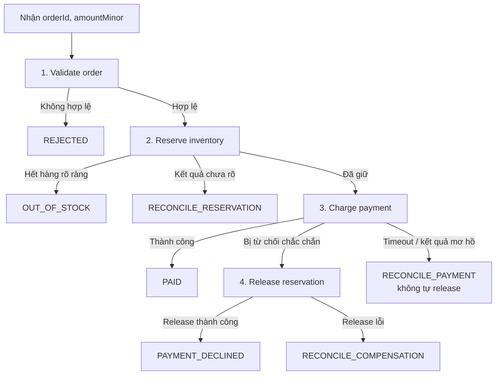

# Thực hành quy trình xử lý đơn hàng có điều phối

Một API Java nhận đơn hàng cần **kiểm tra đơn**, **giữ tồn kho**, **thu tiền** rồi **xác nhận kết quả**. Nếu controller gọi nối tiếp các dịch vụ mà không lưu trạng thái, timeout ở cổng thanh toán có thể khiến hàng đã giữ nhưng giao dịch chưa rõ, hoặc người dùng gửi lại request và bị tính tiền hai lần. **Google Cloud Workflows** cho phép mô tả chuỗi bước, điều kiện, retry và nhánh lỗi trong một execution có thể theo dõi. Khi giao dịch trải qua nhiều hệ thống, ta bổ sung **Saga/compensation** và **idempotency**.

Bài thuộc chương **Điều phối và tích hợp ứng dụng** trong module **CLOUD_PROVIDERS_GCP**, nối kiến thức project/IAM, VPC, Cloud Run, GKE, dữ liệu, giám sát và chi phí với một luồng thương mại điện tử. Lab dùng **Workflows + một Cloud Run function Java 21 giả lập bốn thao tác**, không gọi dịch vụ thanh toán hoặc tồn kho thật.

> Tên project, service account và đơn hàng đều là ví dụ. Deploy và chạy Workflows/Cloud Run có thể phát sinh phí. Chỉ thực hiện trên project lab được ủy quyền. Đoạn Java giả lập **không lưu trạng thái bền vững, không giữ hàng và không thu tiền**; mục cuối mô tả những điều phải bổ sung khi làm production.

## Mục tiêu

Sau bài học, bạn có thể:

1. Phân biệt **orchestration** với **choreography**, lựa chọn Workflows so với Cloud Tasks/Pub/Sub.
2. Xây chuỗi **validate → reserve → charge → complete**, có **release** để bù trừ khi thanh toán bị từ chối chắc chắn.
3. Gọi Cloud Run riêng tư bằng `http.post` với `auth.type: OIDC`, cấp IAM `roles/run.invoker` đúng scope.
4. Viết Workflows YAML với `params`, `assign`, `switch`, `try/retry/except` và `return`.
5. Phân biệt lỗi nghiệp vụ **chắc chắn không thu tiền** với **trạng thái thanh toán chưa biết**; xử lý bằng đối soát thay vì hoàn tác mù.
6. Triển khai, chạy, kiểm tra execution history/metrics và xây retry/idempotency/rollback.

## 1. Thiết kế nghiệp vụ và Saga



**Orchestration:** Workflows giữ thứ tự và điều kiện. **Choreography:** các dịch vụ tự phản ứng với events trên Pub/Sub/Eventarc. Chúng có thể phối hợp: Workflows xử lý giao dịch cốt lõi, Pub/Sub phát `OrderPaid` sau khi ghi trạng thái bền vững để email/analytics xử lý độc lập.

| Dịch vụ | Vai trò | Không tự đảm bảo |
| --- | --- | --- |
| **Workflows** | Điều phối bước, rẽ nhánh, retry, chờ callback, bù trừ | Transaction nguyên tử xuyên các dịch vụ |
| **Cloud Run** | Chạy API Java cho validate/reserve/charge/release | Exactly-once nếu backend không lưu idempotency |
| **Cloud Tasks** | Giao HTTP task có retry/thời hạn | Logic Saga đa bước tùy ý |
| **Pub/Sub/Eventarc** | Phân phối events và fan-out | Thứ tự toàn cục hoặc side effect exactly-once |
| **Cloud SQL/Firestore** | Lưu order state, ledger, outbox và receipts | Tự xử lý side effect ở hệ thống khác |

**Bù trừ (compensation) không phải database rollback.** Ví dụ gọi `release` chỉ có thể trả lại chỗ giữ tồn kho, không xóa việc khách đã nhìn thấy thông báo hay hủy tiền chắc chắn đã thu. Vì vậy phải phân biệt trạng thái lỗi rõ ràng và trạng thái không chắc chắn.

### Hợp đồng API lab

Một Cloud Run function nhận `POST` với JSON gồm `action`, `orderId`, `amountMinor` và `idempotencyKey`. Bốn action trả:

| `action` | Phản hồi thành công | Lỗi mô phỏng | Có side effect thật? |
| --- | --- | --- | --- |
| `validate` | `{"valid":true}` | Amount ≤ 0 → HTTP 422 | Không |
| `reserve` | `{"reservationId":"res-..."}` | `orderId` kết thúc `-soldout` → 409 | Không |
| `charge` | `{"paymentId":"pay-..."}` | `-payfail` → 402; `-payunknown` → 504 | Không |
| `release` | `{"released":true}` | Không mô phỏng lỗi ở bản đầu | Không |

**Quy ước lab:** HTTP 402 là **bị từ chối dứt khoát, chưa thu tiền**, nên có thể release. HTTP 504 chỉ là **không biết kết quả**, không được release trước khi đối soát với payment provider. Mã lỗi thực tế phụ thuộc hợp đồng API của từng nhà cung cấp.

## 2. Chuẩn bị Google Cloud và phân quyền

Điều kiện: Google Cloud project có billing, CLI, quyền tạo Workflows/Cloud Run, sử dụng service accounts (`iam.serviceAccounts.actAs`) và enable APIs. Người gọi workflow cần `workflows.executions.create` (ví dụ `roles/workflows.invoker`). Không dùng Owner/Editor rộng cho runtime identities.

```bash
# Ví dụ lệnh trong Bash / Cloud Shell.
PROJECT_ID="retail-dev-01"
REGION="asia-southeast1"
BACKEND="order-step-mock"
WORKFLOW="order-saga-lab"
WF_SA="orders-workflow@${PROJECT_ID}.iam.gserviceaccount.com"
BACKEND_SA="orders-backend@${PROJECT_ID}.iam.gserviceaccount.com"

gcloud auth list
gcloud config get-value project
gcloud workflows list --project="$PROJECT_ID" --location="$REGION"
gcloud run services list --project="$PROJECT_ID" --region="$REGION"
```

Thay các biến bằng project thực và kiểm tra chưa có service trùng tên. Thao tác sau **thay đổi project và có thể tạo chi phí**:

```bash
gcloud services enable \
  run.googleapis.com workflows.googleapis.com \
  cloudbuild.googleapis.com artifactregistry.googleapis.com \
  --project="$PROJECT_ID"

gcloud iam service-accounts create orders-workflow \
  --project="$PROJECT_ID" \
  --display-name="Order workflow invoker lab"

gcloud iam service-accounts create orders-backend \
  --project="$PROJECT_ID" \
  --display-name="Order backend runtime lab"
```

Nếu SA đã tồn tại, không tạo trùng. Tách **identity của Workflows** khỏi **identity Cloud Run runtime**, chỉ cấp quyền từng vai trò thực sự cần.

## 3. Backend Java 21 giả lập bốn thao tác

Để tập trung vào điều phối, backend chỉ trả kết quả từ `orderId`, không kết nối database/payment provider. Ví dụ cấu trúc lab trên **máy của người học**:

```text
order-backend/
  pom.xml
  src/main/java/demo/OrderAction.java
order-saga.yaml
```

### Maven (tệp `order-backend/pom.xml`)

```xml
<project xmlns="http://maven.apache.org/POM/4.0.0"
         xmlns:xsi="http://www.w3.org/2001/XMLSchema-instance"
         xsi:schemaLocation="http://maven.apache.org/POM/4.0.0
           https://maven.apache.org/xsd/maven-4.0.0.xsd">
  <modelVersion>4.0.0</modelVersion>
  <groupId>demo</groupId>
  <artifactId>order-step-mock</artifactId>
  <version>1.0.0</version>
  <properties>
    <maven.compiler.release>21</maven.compiler.release>
    <project.build.sourceEncoding>UTF-8</project.build.sourceEncoding>
  </properties>
  <dependencies>
    <dependency>
      <groupId>com.google.cloud.functions</groupId>
      <artifactId>functions-framework-api</artifactId>
      <version>1.1.0</version>
      <scope>provided</scope>
    </dependency>
    <dependency>
      <groupId>com.google.code.gson</groupId>
      <artifactId>gson</artifactId>
      <version>2.11.0</version>
    </dependency>
  </dependencies>
</project>
```

### Java function (tệp `order-backend/src/main/java/demo/OrderAction.java`)

```java
package demo;

import com.google.cloud.functions.HttpFunction;
import com.google.cloud.functions.HttpRequest;
import com.google.cloud.functions.HttpResponse;
import com.google.gson.Gson;
import com.google.gson.JsonObject;
import com.google.gson.JsonParser;
import java.io.IOException;
import java.util.Map;
import java.util.Set;

public final class OrderAction implements HttpFunction {
  private static final Gson JSON = new Gson();
  private static final Set<String> ACTIONS =
      Set.of("validate", "reserve", "charge", "release");

  @Override
  public void service(HttpRequest req, HttpResponse res) throws Exception {
    if (!"POST".equalsIgnoreCase(req.getMethod())) {
      send(res, 405, Map.of("error", "POST required"));
      return;
    }
    try {
      JsonObject body = JsonParser.parseReader(req.getReader()).getAsJsonObject();
      String action = field(body, "action");
      String orderId = field(body, "orderId");
      long amount = body.has("amountMinor")
          ? body.get("amountMinor").getAsLong() : 0L;
      if (!ACTIONS.contains(action) || !orderId.matches("[a-zA-Z0-9-]{1,60}")) {
        send(res, 400, Map.of("error", "Invalid action or orderId"));
        return;
      }
      switch (action) {
        case "validate" -> {
          if (amount <= 0) send(res, 422, Map.of("error", "Invalid amount"));
          else send(res, 200, Map.of("valid", true));
        }
        case "reserve" -> {
          if (orderId.endsWith("-soldout"))
            send(res, 409, Map.of("error", "Out of stock"));
          else send(res, 200, Map.of("reservationId", "res-" + orderId));
        }
        case "charge" -> {
          if (orderId.endsWith("-payfail"))
            send(res, 402, Map.of("error", "Payment declined"));
          else if (orderId.endsWith("-payunknown"))
            send(res, 504, Map.of("error", "Payment outcome unknown"));
          else send(res, 200, Map.of("paymentId", "pay-" + orderId));
        }
        case "release" -> send(res, 200, Map.of("released", true));
        default -> send(res, 400, Map.of("error", "Unknown action"));
      }
    } catch (RuntimeException invalidPayload) {
      send(res, 400, Map.of("error", "Malformed request"));
    }
  }

  private static String field(JsonObject json, String key) {
    return json.has(key) && !json.get(key).isJsonNull()
        ? json.get(key).getAsString() : "";
  }

  private static void send(HttpResponse res, int code,
                           Map<String, ?> value) throws IOException {
    res.setStatusCode(code);
    res.appendHeader("Content-Type", "application/json");
    res.getWriter().write(JSON.toJson(value));
  }
}
```

Mã Java trả phản hồi xác định, **không** giữ hàng, gọi payment, lưu receipt hay thực thi `idempotencyKey`. Production phải dùng transaction/state machine, xác thực caller và idempotency ở từng service. Nếu Cloud Run buildpack đã thay đổi cách quản lý dependencies/runtimes, cần kiểm tra pipeline và tests trước deploy.

### Deploy Cloud Run function riêng tư

```bash
# Chạy từ thư mục chứa order-backend/ và order-saga.yaml.
# THAY ĐỔI HẠ TẦNG / CÓ PHÍ.
gcloud run deploy "$BACKEND" \
  --project="$PROJECT_ID" --region="$REGION" \
  --source=order-backend \
  --function=demo.OrderAction \
  --base-image=java21 \
  --service-account="$BACKEND_SA" \
  --no-allow-unauthenticated \
  --ingress=all

BACKEND_URL="$(gcloud run services describe "$BACKEND" \
  --project="$PROJECT_ID" --region="$REGION" \
  --format='value(status.url)')"
echo "$BACKEND_URL"
```

`--no-allow-unauthenticated` bảo vệ bằng **IAM**, nhưng `--ingress=all` không tạo mạng private: endpoint vẫn có thể được truy cập từ Internet **nếu caller có quyền**. Production cần review ingress, VPC và service perimeter riêng.

### IAM để Workflows gọi backend

```bash
# Chỉ grant trên Cloud Run service lab, không trên project.
gcloud run services add-iam-policy-binding "$BACKEND" \
  --project="$PROJECT_ID" --region="$REGION" \
  --member="serviceAccount:$WF_SA" \
  --role="roles/run.invoker"
```

Workflows cần `roles/run.invoker` để gọi Cloud Run. Người deploy workflow cần quyền tạo/update Workflows và `iam.serviceAccounts.actAs` trên `WF_SA`. **Không mở `allUsers` hoặc cấp Editor để chữa lỗi 403.**

## 4. Viết Workflows YAML: điều phối và bù trừ

Tạo `order-saga.yaml` tại thư mục lab:

```yaml
main:
  params: [input]
  steps:
    - init:
        assign:
          - backend: ${sys.get_env("ORDER_BACKEND_URL")}
          - orderId: ${input.orderId}
          - amountMinor: ${input.amountMinor}

    - validateOrder:
        try:
          call: http.post
          args:
            url: ${backend}
            auth:
              type: OIDC
              audience: ${backend}
            headers:
              Content-Type: application/json
            body:
              action: validate
              orderId: ${orderId}
              amountMinor: ${amountMinor}
          result: validationResult
        retry: ${http.default_retry}
        except:
          as: validationError
          steps:
            - rejectOrReview:
                return:
                  orderId: ${orderId}
                  status: VALIDATION_NOT_CONFIRMED
                  # Trường hợp 422 là reject; mạng/IAM cần điều tra khác.
                  code: ${map.get(validationError, "code")}

    - reserveInventory:
        try:
          call: http.post
          args:
            url: ${backend}
            auth:
              type: OIDC
              audience: ${backend}
            headers:
              Content-Type: application/json
            body:
              action: reserve
              orderId: ${orderId}
              amountMinor: ${amountMinor}
              idempotencyKey: '${orderId + ":reserve"}'
          result: reservationResult
        retry: ${http.default_retry_non_idempotent}
        except:
          as: reservationError
          steps:
            - stockDecision:
                switch:
                  - condition: ${map.get(reservationError, "code") == 409}
                    return:
                      orderId: ${orderId}
                      status: OUT_OF_STOCK
            - unknownReserve:
                return:
                  orderId: ${orderId}
                  status: RECONCILE_RESERVATION

    - chargePayment:
        try:
          call: http.post
          args:
            url: ${backend}
            auth:
              type: OIDC
              audience: ${backend}
            headers:
              Content-Type: application/json
            body:
              action: charge
              orderId: ${orderId}
              amountMinor: ${amountMinor}
              idempotencyKey: '${orderId + ":charge"}'
          result: paymentResult
        retry: ${http.default_retry_non_idempotent}
        except:
          as: paymentError
          steps:
            - decidePayment:
                switch:
                  - condition: ${map.get(paymentError, "code") == 402}
                    steps:
                      - releaseReservation:
                          try:
                            call: http.post
                            args:
                              url: ${backend}
                              auth:
                                type: OIDC
                                audience: ${backend}
                              headers:
                                Content-Type: application/json
                              body:
                                action: release
                                orderId: ${orderId}
                                idempotencyKey: '${orderId + ":release"}'
                            result: releaseResult
                          retry: ${http.default_retry_non_idempotent}
                          except:
                            as: releaseError
                            steps:
                              - compensationPending:
                                  return:
                                    orderId: ${orderId}
                                    status: RECONCILE_COMPENSATION
                      - paymentDeclined:
                          return:
                            orderId: ${orderId}
                            status: PAYMENT_DECLINED
                            inventoryReleased: true

            # Timeout/502/503/504: không biết payment đã thu tiền chưa.
            - uncertainPayment:
                return:
                  orderId: ${orderId}
                  status: RECONCILE_PAYMENT
                  inventoryReleased: false

    - complete:
        return:
          orderId: ${orderId}
          status: PAID
          reservationId: ${reservationResult.body.reservationId}
          paymentId: ${paymentResult.body.paymentId}
```

### Cách đọc các cấu trúc quan trọng

| Thành phần | Ý nghĩa |
| --- | --- |
| `params: [input]` | Mỗi execution nhận một JSON map, ở đây có `orderId` và `amountMinor` |
| `sys.get_env("ORDER_BACKEND_URL")` | Nhận Cloud Run URL qua cấu hình deploy, tránh hardcode endpoint |
| `http.post` | Gọi Cloud Run backend; `result.body` là JSON response đã parse |
| `auth.type: OIDC` | Workflows gửi Google-signed ID token bằng identity `WF_SA` |
| `try / retry / except` | Retry có kiểm soát và bắt lỗi khi HTTP trả 4xx/5xx hoặc request thất bại |
| `switch` | Chỉ release sau khi nhận **402 = chắc chắn chưa thu tiền** trong hợp đồng mock |
| `return` | Trả trạng thái cuối của execution; không tự tạo bản ghi order |

**Quan trọng về retries:** `http.default_retry` áp cho bước **idempotent** và mặc định thử thêm tối đa 5 lần với một số lỗi 429/502/503/504 hoặc kết nối/timeout. `http.default_retry_non_idempotent` chỉ retry một số lỗi như 429/503/lỗi thiết lập kết nối, nhưng **vẫn có thể gửi request lặp**. Trong lab mọi action là giả lập không tác động dữ liệu. Ở production, chỉ dùng retry cho `reserve/charge/release` khi backend **thực sự lưu và thực thi idempotency key**, hoặc thay bằng chính sách an toàn hơn.

**Phân biệt trạng thái:** nếu `validate` trả 422, đầu vào không hợp lệ; nếu lỗi là 401/403 hoặc timeout, đó không phải đơn hàng “sai nghiệp vụ”. Lab gom chúng thành `VALIDATION_NOT_CONFIRMED` và trả `code` để người học phân tích. Production nên phân tách `REJECTED`, `RETRYABLE_FAILURE` và `SYSTEM_MISCONFIGURATION` rõ hơn.

### Vì sao không release nếu charge timeout?

Một payment provider có thể **đã thu tiền** nhưng response bị mất. Nếu Workflow nhận 504 rồi ngay lập tức release inventory, đơn có thể thành **đã trừ tiền nhưng không còn hàng**. Thay vào đó, trả `RECONCILE_PAYMENT`, tra cứu trạng thái từ provider theo **business idempotency key** và chỉ tiếp tục một khi đã có kết quả chắc chắn. Một Workflows execution kết thúc `SUCCEEDED` với `status=RECONCILE_PAYMENT` **không đồng nghĩa đơn hàng đã thành công**.

## 5. Deploy workflow và chạy bốn nhánh kiểm thử

### 5.1 Deploy với identity và URL đã xác minh

```bash
# THAY ĐỔI tài nguyên Workflows; file order-saga.yaml đã lưu ở thư mục lab.
gcloud workflows deploy "$WORKFLOW" \
  --project="$PROJECT_ID" \
  --location="$REGION" \
  --source=order-saga.yaml \
  --service-account="$WF_SA" \
  --set-env-vars="ORDER_BACKEND_URL=$BACKEND_URL"

# Chỉ đọc config sau deploy.
gcloud workflows describe "$WORKFLOW" \
  --project="$PROJECT_ID" --location="$REGION"
```

**Không bỏ dấu ngoặc quanh URL biến môi trường khi chứa ký tự đặc biệt**, và không đặt JWT/password trong Workflows environment variables. Nếu backend URL thay đổi, cập nhật workflow và kiểm tra revision mới; các executions đã bắt đầu có cấu hình của deployment tương ứng.

### 5.2 Đơn hàng thành công

```bash
gcloud workflows run "$WORKFLOW" \
  --project="$PROJECT_ID" --location="$REGION" \
  --data='{"orderId":"ord-1001","amountMinor":145000}'
```

Kỳ vọng Workflow hoàn tất với result tương tự:

```json
{
  "orderId": "ord-1001",
  "status": "PAID",
  "reservationId": "res-ord-1001",
  "paymentId": "pay-ord-1001"
}
```

### 5.3 Hết hàng

```bash
gcloud workflows run "$WORKFLOW" \
  --project="$PROJECT_ID" --location="$REGION" \
  --data='{"orderId":"ord-1002-soldout","amountMinor":145000}'
```

Kỳ vọng `status: OUT_OF_STOCK`; không gọi bước `charge`. Lưu ý: nếu `reserve` timeout mà chưa chắc đã giữ được hàng, workflow trả `RECONCILE_RESERVATION` chứ không tự báo hết hàng.

### 5.4 Payment bị từ chối chắc chắn

```bash
gcloud workflows run "$WORKFLOW" \
  --project="$PROJECT_ID" --location="$REGION" \
  --data='{"orderId":"ord-1003-payfail","amountMinor":145000}'
```

Kỳ vọng `PAYMENT_DECLINED` và `inventoryReleased: true`. Trong thực tế phải chờ **release đã commit bền vững** mới đánh dấu hoàn tác thành công.

### 5.5 Không rõ payment thành công hay chưa

```bash
gcloud workflows run "$WORKFLOW" \
  --project="$PROJECT_ID" --location="$REGION" \
  --data='{"orderId":"ord-1004-payunknown","amountMinor":145000}'
```

Kỳ vọng `RECONCILE_PAYMENT` với `inventoryReleased: false`. Đây là trạng thái **cần đối soát**, không phải thành công hay từ chối thanh toán.

### 5.6 Kiểm tra execution history

```bash
# Xem executions và chọn ID phù hợp:
gcloud workflows executions list "$WORKFLOW" \
  --project="$PROJECT_ID" --location="$REGION"

EXECUTION_ID="REPLACE_WITH_REAL_EXECUTION_ID"
gcloud workflows executions describe "$EXECUTION_ID" \
  --workflow="$WORKFLOW" \
  --project="$PROJECT_ID" --location="$REGION"

# Xem log Cloud Run backend:
gcloud run services logs read "$BACKEND" \
  --project="$PROJECT_ID" --region="$REGION" --limit=30
```

Trong Console → **Workflows → Executions**, chọn execution để xem đường đi của các bước và lỗi. Không bật `log-all-calls`/detailed history trên dữ liệu production nhạy cảm một cách mặc định, vì request body, response và biến có thể chứa thông tin khách hàng.

## 6. Các nguyên tắc đúng đắn cần thêm trước production

**Một execution Workflows không phải transaction xuyên ba dịch vụ.** Hệ thống thật phải thiết kế state machine bền vững:

```text
NEW -> VALIDATED -> RESERVED -> PAID
                  |         |
                  |         +-> PAYMENT_UNKNOWN -> RECONCILE -> PAID/CANCELLED
                  +-> OUT_OF_STOCK
RESERVED -> PAYMENT_DECLINED -> RELEASE_PENDING -> CANCELLED
                                        |
                                        +-> RELEASE_FAILED -> RECONCILE
```

| Vấn đề | Cách làm production |
| --- | --- |
| Cùng order được xử lý bởi hai executions | Dùng `orderId + operationId` làm business idempotency key, CAS/transaction để claim trạng thái |
| Retry `reserve` tạo hai reservations | Backend lưu receipt theo `orderId:reserve`; yêu cầu lặp trả cùng reservation |
| Timeout `charge` nhưng provider đã trừ tiền | Dùng **provider idempotency key** và API query status; không charge lần thứ hai bằng key khác |
| Crash sau DB commit nhưng trước publish `OrderPaid` | **Transactional outbox** ghi cùng transaction; worker publish/retry với event key cố định |
| Bù trừ thất bại | Lưu `RELEASE_PENDING`, retry và cảnh báo; tránh trả “CANCELLED” trước khi release chắc chắn |
| Order changed while saga pending | Lock optimistic/version checks, TTL giữ hàng, trạng thái terminal bất biến |
| Sự kiện đến trễ/duplicate | Subscriber idempotent, kiểm tra `eventId` + business key, không giả định exactly-once |
| Bảo mật dữ liệu/tenant | IAM/OIDC giữa services; xác thực user ở ingress và authorization mỗi order trong backend |

### Phân biệt workflow success và business success

Workflows execution có thể có trạng thái nền tảng `SUCCEEDED` trong khi JSON return là `PAYMENT_DECLINED` hoặc `RECONCILE_PAYMENT`. Vì workflow đã **xử lý đúng nhánh lỗi**, điều phối có thể kết thúc bình thường. Dashboard/alert phải theo dõi **business status** riêng, không đếm mọi `SUCCEEDED` thành đơn hàng thanh toán thành công.

### Tùy chọn bất đồng bộ

Nếu xử lý lâu, không giữ HTTP request từ người dùng cho tới khi mọi bước hoàn tất. API có thể ghi `PENDING` và khởi chạy Workflow, trả `202 Accepted` kèm `orderId`/status URL. Workflows có thể dùng **callbacks** cho manual approval hoặc webhook thanh toán, và **Cloud Tasks/Pub/Sub** cho các bước nền. Callback endpoint cũng cần bảo vệ IAM và thời hạn; không dùng URL callback như mật khẩu vô hạn.

## 7. Độ tin cậy, quota, logging và chi phí

| Tín hiệu | Nguồn | Điều cần phát hiện |
| --- | --- | --- |
| `Workflows executions`: state, latency, errors | Workflows/Cloud Monitoring | Chạy lỗi, kéo dài, vượt concurrency/quotas |
| Business states: `PAID`/`RECONCILE_*` | Database/application metrics | Đơn cần can thiệp dù execution `SUCCEEDED` |
| Cloud Run HTTP `401/403` | Cloud Logging | Workflows SA, OIDC audience, IAM invoker sai |
| `429/503/504` và retry count | Workflows steps/Cloud Run | Quota, cold starts, downstream overload |
| Payment reconciliation age | Worker/DB dashboard | Giao dịch mơ hồ chưa được xử lý |
| Stock reservation TTL và pending compensation | Inventory datastore | Hàng bị giữ quá lâu, release fail |
| Billable steps và active executions | Workflows/Billing | Retry quá nhiều, chờ dài, tăng phí |

Workflows tính phí theo số **steps được thực thi** (internal/external), gồm những bước bị lỗi và thử lại; **không tính phí chỉ vì workflow đang chờ hoặc nhàn rỗi**. Chờ lâu vẫn ảnh hưởng latency, giới hạn thời gian/concurrency của execution và kiến trúc vận hành. Cloud Run, Cloud Logging, Cloud Tasks và database có phí riêng. Với thanh toán bất đồng bộ, **callback** hoặc event trigger thường phù hợp hơn polling dày đặc; hãy dự toán theo khối lượng thực tế.

**Bảo mật:** runtime service accounts khác nhau cho Workflows và Cloud Run; IAM scope hẹp, không ghi token vào logs hoặc execution result. Cloud Run private-by-IAM không tự xác minh user gọi `GET /orders/{id}`; backend cần authZ theo tenant. Dùng Secret Manager cho payment credentials; không nhúng vào workflow YAML, labels hoặc input JSON.

## 8. Runbook xử lý lỗi theo từng lớp

| Triệu chứng | Nguyên nhân thường gặp | Cách kiểm tra |
| --- | --- | --- |
| Deploy Workflows bị 400 | YAML expression/indent sai, biến chưa khai báo | `gcloud workflows deploy` error line, kiểm tra `main.steps` |
| `401` khi gọi Cloud Run | OIDC token/audience không đúng | `auth.type: OIDC`, URL và token audience |
| `403` khi gọi Cloud Run | Workflows SA thiếu `roles/run.invoker` | IAM policy đúng Cloud Run service, không cấp ở project bừa bãi |
| `404` từ Cloud Run | Sai service URL/path/region | `services describe`, Workflows `ORDER_BACKEND_URL` |
| `OUT_OF_STOCK` | Mock trả 409 rõ ràng | Không gọi charge; kiểm tra business status |
| `RECONCILE_RESERVATION` | Reserve timeout/5xx sau retry | Truy vấn inventory receipt thay vì thử order key mới |
| `RECONCILE_PAYMENT` | Payment 504/timeout hoặc kết quả không rõ | Tra provider với cùng idempotency key; không release ngay |
| `RECONCILE_COMPENSATION` | Release lỗi sau payment decline | Retry release idempotently, alert đội vận hành |
| Giao dịch đôi | Hai executions/order hoặc side effect lặp | DB idempotency transaction + payment provider key |
| Billing/latency tăng | Retry storm, sleep/poll, Cloud Run cold start | Step metrics, trace, Cloud Run/DB capacity |

### Quy trình khắc phục có kiểm soát

1. Ghi project, region, Workflow revision/execution ID, orderId (đã ẩn PII) và thời điểm.
2. Xác nhận IAM/OIDC, HTTP code và trạng thái **đã commit hay chưa** của từng service.
3. Phân loại lỗi **chắc chắn** và **chưa chắc**, không gọi lại payment khi chưa xác định key/trạng thái.
4. Thử sửa trên lab/canary; đo `PAID`/`RECONCILE_*`, latencies và retries.
5. Deploy revision mới có approval; giữ rollback plan cho workflow/backend và kiểm tra old executions.

## 9. Bài tập thực hành

### Bài 1 — Thành công và thứ tự

Với `ord-1001`, liệt kê bốn trạng thái xử lý theo thứ tự và kết quả return.

<details>
<summary>Đáp án</summary>

Validate → Reserve → Charge → trả `PAID` với `reservationId` và `paymentId`. `Release` không được gọi trên happy path.
</details>

### Bài 2 — Hết hàng

Tại sao khi `reserve` trả 409 “hết hàng chắc chắn” workflow không cần bù trừ `release`?

<details>
<summary>Đáp án</summary>

Theo hợp đồng mock, 409 cho biết reservation chưa được tạo. Không có side effect đã commit để đảo ngược; workflow kết thúc `OUT_OF_STOCK`. Với backend thật phải xác minh ý nghĩa của 409.
</details>

### Bài 3 — 504 sau thanh toán

Nếu payment provider trả 504, vì sao không tự động release stock và báo khách `CANCELLED`?

<details>
<summary>Đáp án</summary>

Provider có thể đã thu tiền nhưng response mất. Release trước khi đối soát làm trạng thái thanh toán và tồn kho bất nhất. Trả `RECONCILE_PAYMENT`, query payment bằng idempotency key cũ.
</details>

### Bài 4 — OIDC và IAM

Workflows YAML đã khai `auth.type: OIDC` nhưng Cloud Run vẫn 403. Nêu hai điểm cần kiểm tra.

<details>
<summary>Đáp án</summary>

Kiểm tra workflow đang chạy dưới service account nào và principal đó có `roles/run.invoker` trên **đúng Cloud Run service** không; kiểm tra audience URL và ingress policy. Không bật public invoker.
</details>

### Bài 5 — Retry non-idempotent

Chỉ đổi retry sang `http.default_retry_non_idempotent` có bảo đảm không thu tiền hai lần không?

<details>
<summary>Đáp án</summary>

Không. Policy này vẫn có thể retry 429/503 và connection failures; client cũng có thể khởi chạy execution mới. Payment API phải **lưu và thực thi idempotency key** để một giao dịch nghiệp vụ chỉ bị thu tiền một lần.
</details>

### Bài 6 — Hai executions cho cùng order

Hai HTTP requests từ người dùng đồng thời tạo hai Workflows executions cùng `orderId`. Phải bổ sung gì?

<details>
<summary>Đáp án</summary>

Dùng database transaction/conditional update claim `orderId + operationId`; workflow lặp phải trả/đọc cùng kết quả. Phần mock không có bảo đảm này.
</details>

### Bài 7 — Bù trừ thất bại

Payment bị từ chối rõ ràng nhưng `release` timeout. Có được trả `inventoryReleased: true` không?

<details>
<summary>Đáp án</summary>

Không. Trả `RECONCILE_COMPENSATION` và ghi `RELEASE_PENDING` bền vững; retry an toàn theo reservation ID, theo dõi tới khi xác nhận.
</details>

### Bài 8 — Khi nào dùng Pub/Sub?

Sau khi `PAID`, ba hệ thống email, kho dữ liệu và CRM cần phản ứng độc lập. Nên đưa hết vào cùng critical-path Workflows hay phát event?

<details>
<summary>Gợi ý đáp án</summary>

Để tránh kéo dài critical path, sau khi ghi `PAID`/outbox bền vững nên publish `OrderPaid` qua Pub/Sub, để subscribers xử lý riêng, có retry/DLQ và idempotency. Workflows vẫn hợp lý cho transaction/Saga trước đó.
</details>

## 10. Dọn tài nguyên lab và checklist

Chỉ dọn sau khi chắc chắn service/workflow thuộc **đúng project lab** và không còn dữ liệu cần giữ:

```bash
# THAY ĐỔI/DELETE TÀI NGUYÊN; không dùng trong production.
gcloud workflows delete "$WORKFLOW" \
  --project="$PROJECT_ID" --location="$REGION" --quiet

gcloud run services delete "$BACKEND" \
  --project="$PROJECT_ID" --region="$REGION" --quiet

# Chỉ xóa service accounts nếu chúng được tạo riêng cho bài lab,
# không được chia sẻ cho dịch vụ khác.
```

Checklist trước khi áp dụng kiến trúc thật:

- [ ] Đã xác định Saga states, bước nào có side effect, bước nào có compensation.
- [ ] API định nghĩa **business errors chắc chắn** khác **timeout/kết quả mơ hồ**.
- [ ] Workflows gọi Cloud Run bằng OIDC; IAM invoker đúng service, runtime SA không có quyền dư.
- [ ] Mỗi thao tác reserve/charge/release có idempotency key bền vững và xử lý cạnh tranh.
- [ ] State machine/order ledger ở database, không chỉ nằm trong Workflows variables.
- [ ] Payment status query và reconciliation worker xử lý `PAYMENT_UNKNOWN`.
- [ ] Release/compensation có retry an toàn, alert và TTL/quy trình thủ công.
- [ ] Có tests happy path, 409, payment decline, 504, duplicate, compensation failure.
- [ ] Cloud Logging/Monitoring có phân biệt workflow `SUCCEEDED` và business `PAID`.
- [ ] Có giới hạn retry, quotas, downstream timeouts, budget và rollback plan.
- [ ] Tác vụ dài/không cần đồng bộ được chuyển sang callbacks, Cloud Tasks hoặc Pub/Sub phù hợp.
- [ ] Dữ liệu, tokens, payment credentials và PII được bảo vệ, không xuất vào execution history/log.

## Tài liệu tham khảo chính thức

- [Workflows overview](https://cloud.google.com/workflows/docs/overview): mô hình điều phối và executions.
- [Using Workflows to connect Cloud Run services](https://cloud.google.com/run/docs/tutorials/workflows): ví dụ HTTP calls và IAM.
- [Invoke Cloud Run from Workflows](https://cloud.google.com/workflows/docs/calling-run-functions): HTTP + OIDC authentication.
- [Grant Workflows permissions](https://cloud.google.com/workflows/docs/authentication): service accounts, `roles/run.invoker` và `iam.serviceAccounts.actAs`.
- [Workflows syntax overview](https://cloud.google.com/workflows/docs/reference/syntax): `params`, `assign`, `switch`, `return`.
- [Catch errors](https://cloud.google.com/workflows/docs/reference/syntax/catching-errors): `try/except` và HTTP error maps.
- [Retry steps](https://cloud.google.com/workflows/docs/reference/syntax/retrying): `http.default_retry` vs `http.default_retry_non_idempotent`.
- [Workflows environment variables](https://cloud.google.com/workflows/docs/use-environment-variables): `--set-env-vars` và `sys.get_env`.
- [Execute a workflow](https://cloud.google.com/workflows/docs/executing-workflow): `gcloud workflows run` và executions.
- [Best practices for Workflows](https://cloud.google.com/workflows/docs/best-practice): Saga, callbacks, step budgets và reliability.
- [Implementing Saga pattern in Workflows](https://cloud.google.com/blog/topics/developers-practitioners/implementing-saga-pattern-workflows): rollback/compensation across services.
- [Deploy Cloud Run functions](https://cloud.google.com/run/docs/deploy-functions): Java runtime và `gcloud run deploy --function`.
- [Cloud Run authentication](https://cloud.google.com/run/docs/authenticating/service-to-service): OIDC token và Cloud Run Invoker.
- [Workflows pricing](https://cloud.google.com/workflows/pricing) và [Cloud Run pricing](https://cloud.google.com/run/pricing): tính phí execution/step và compute.


