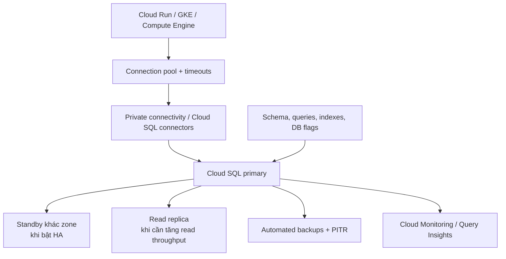

# Cloud SQL instance sizing, storage và cấu hình cơ sở dữ liệu

Một ứng dụng đặt hàng đang chạy trên Cloud Run có độ trễ tăng từ 80 ms lên 900 ms vào giờ cao điểm. Nhóm phát triển muốn nâng Cloud SQL từ 2 lên 8 vCPU. Nhưng nguyên nhân có thể là **truy vấn thiếu index, quá nhiều kết nối, CPU bão hòa, thiếu bộ nhớ, I/O chậm hoặc disk sắp đầy**. Nâng CPU không tự giải quyết mọi vấn đề và có thể làm chi phí tăng mà SLO vẫn không đạt.

Bài thuộc chương **Cloud SQL và AlloyDB** của mô-đun `CLOUD_PROVIDERS_GCP`. Trong hành trình học Google Cloud từ tổ chức project/IAM/VPC đến Compute Engine, GKE, Cloud Run, dịch vụ lưu trữ, cơ sở dữ liệu và vận hành độ tin cậy/chi phí, bài này trình bày cách **định cỡ Cloud SQL theo workload đo được**, chọn edition/machine/storage, cấu hình engine, giám sát và thay đổi tài nguyên có kiểm soát.

Bài dùng **Cloud SQL for PostgreSQL** làm ví dụ lệnh và SQL; các nguyên tắc sizing áp dụng cho MySQL và SQL Server nhưng **tên flag, machine series, edition, giới hạn và cách tuning khác nhau theo engine**. Kiểm tra tài liệu tương ứng trước khi áp dụng sang engine khác.

## 1. Mục tiêu học tập

Sau bài học, bạn có thể:

1. Phân biệt **vCPU, RAM, disk capacity, IOPS, throughput, latency, số kết nối và query workload**.
2. Chọn **Cloud SQL Enterprise/Enterprise Plus**, machine series và cấu hình có sẵn theo engine/region.
3. Ước lượng tài nguyên từ dữ liệu thực, không chọn size chỉ dựa vào số người dùng đăng ký.
4. Thiết kế storage với **headroom**, tự tăng dung lượng và giới hạn ngân sách; hiểu tăng dung lượng không đồng nghĩa tăng hiệu năng vô hạn.
5. Cấu hình PostgreSQL flags và connection pool an toàn; phân biệt connection limit với concurrency hữu ích.
6. Đánh giá **HA regional, read replica, backup, PITR, maintenance, private connectivity** trong thiết kế.
7. Kiểm kê và giám sát instance bằng `gcloud`, Query Insights và SQL chỉ đọc.
8. Lập kế hoạch resize có baseline, thử tải, rollback/khôi phục và kiểm soát downtime.
9. Giải bài tập sizing, tính lưu trữ và nhận diện bottleneck từ metrics.

**Phạm vi an toàn:** preflight/SQL chỉ đọc có thể làm trên **Cloud SQL instance lab đã có** và được cấp quyền. Các lệnh `create`/`patch`/`delete` chỉ để minh họa cách thay đổi, **không chạy trên production hoặc instance dùng chung** nếu chưa có change approval, backup/restore plan và người chịu trách nhiệm. Việc tạo instance phát sinh phí CPU, RAM, storage và network kể cả khi chưa có traffic.

## 2. Cloud SQL quản lý gì, ứng dụng vẫn phải quản lý gì?



Google Cloud vận hành hệ điều hành, phần mềm database và hạ tầng lưu trữ trong giới hạn sản phẩm. **Nhóm ứng dụng vẫn chịu trách nhiệm** schema/indexes, connection pooling, SQL transactions, chọn size/cấu hình, data retention, phân quyền database, SLO và thử khôi phục.

| Lựa chọn | Giải quyết | Không thay thế |
| --- | --- | --- |
| **Tăng vCPU** | CPU-bound queries, nhiều xử lý đồng thời khi query hiệu quả | Index, query plan, giảm lock contention |
| **Tăng RAM** | Memory pressure, cache hit thấp, OOM | Thiết kế pool và giới hạn memory mỗi query |
| **Tăng disk capacity** | Dung lượng lưu trữ, có thể tác động performance theo loại disk | Chẩn đoán IOPS/throughput/latency |
| **Hyperdisk IOPS/throughput** | I/O bottleneck khi machine/edition hỗ trợ | Sửa full table scans hoặc khóa giao dịch |
| **Read replica** | Phân tán truy vấn đọc, báo cáo | Mở rộng write capacity của primary; HA tự động giống standby |
| **HA regional** | Failover khi instance/zone lỗi | Backup/PITR, DR liên vùng |
| **Backup/PITR** | Phục hồi lỗi logic hoặc thao tác sai | Chịu lỗi tức thời cho truy cập production |
| **AlloyDB** | Phương án PostgreSQL managed cho workload có yêu cầu hiệu năng/kiến trúc cao hơn | Đánh giá benchmark, khả năng tương thích và TCO |

**Cơ sở quan trọng:** instance `RUNNABLE` nghĩa là máy đang hoạt động, **không bảo đảm** truy vấn nhanh hoặc không có operation đang chạy.

## 3. Chọn engine, edition và region trước khi chọn vCPU

Cloud SQL hỗ trợ **PostgreSQL, MySQL và SQL Server**. Chọn engine theo ứng dụng, extension, hệ sinh thái, license và yêu cầu compatibility. Ví dụ `jsonb`, MVCC, extension của PostgreSQL không tự chuyển thành cú pháp MySQL/SQL Server.

### 3.1. Enterprise và Enterprise Plus

| Tiêu chí | Enterprise | Enterprise Plus |
| --- | --- | --- |
| Mục tiêu | Database nghiệp vụ thông thường, chi phí cân đối | Workload đòi hiệu năng, availability và observability cao hơn |
| Machine series | Các dòng general purpose/dedicated; **N4** ở trường hợp hỗ trợ | Các dòng hiệu năng cao như **N2, C4/C4A/C4D** tùy engine và region |
| Storage | SSD/HDD với một số machine classes, **Hyperdisk Balanced** trên dòng phù hợp | SSD hoặc Hyperdisk Balanced theo machine series |
| Data cache | Phụ thuộc edition/tính năng | Có ở cấu hình hỗ trợ, giúp tăng hiệu quả đọc |
| HA/SLA | Theo điều kiện edition/HA | Khả năng và SLA cao hơn trong các cấu hình đủ điều kiện |
| Chi phí | Phù hợp nhiều hệ thống nhỏ/trung bình | Giá tài nguyên cao hơn nhưng có thể tốt hơn theo throughput/SLO |

**Không coi bảng là mapping tuyệt đối.** Ví dụ Enterprise N4 gắn với Hyperdisk Balanced, trong khi general-purpose dedicated có thể dùng SSD; Enterprise Plus N2 và C4 không nhất thiết cùng loại disk. **Machine series, database version, region và edition quyết định tổ hợp hợp lệ**. Dùng giao diện Cloud SQL và tài liệu machine-series hiện hành để chốt cấu hình.

### 3.2. Cần quyết định region như thế nào?

- Đặt database gần ứng dụng chính để giảm **network RTT** và chi phí truyền dữ liệu.
- Kiểm tra tính khả dụng của edition/machine series/engine trong region.
- Với ứng dụng có HA, chọn **regional availability** nếu cần chịu lỗi zone; primary và standby nằm trong cùng region.
- Với **data residency/DR**, đối chiếu chính sách lưu backup và kế hoạch phục hồi ở region khác.

**Không dùng location của người vận hành để chọn region**; chọn theo vị trí workload, dữ liệu, regulatory constraints và availability.

## 4. Thu thập baseline workload trước khi sizing

Cần quan sát **peak**, không chỉ trung bình. Ghi ít nhất 1–2 chu kỳ nghiệp vụ đại diện nếu khả thi (giờ cao điểm, batch cuối ngày, chiến dịch); với sản phẩm mới có thể dùng ước lượng rồi **load test**.

| Nhóm dữ liệu | Cần đo | Vì sao |
| --- | --- | --- |
| Truy cập | Queries/s, transaction/s, write/read ratio, concurrency | Xác định nhu cầu CPU và throughput |
| CPU | Utilization, CPU wait, query load | Phân biệt CPU-bound với đang chờ I/O/lock |
| Bộ nhớ | Memory usage, total usage, cache behavior, OOM/restarts | Kiểm tra headroom và page cache |
| Disk | Used/provisioned size, growth rate, IOPS, throughput, latency | Chọn capacity/performance |
| Kết nối | Active/idle connections, peaks, connection errors | Thiết kế pool và `max_connections` |
| Câu SQL | p50/p95/p99, top query, rows scanned, locks, temp files | Tối ưu trước khi scale |
| HA | RTO/RPO, backup duration, replica lag, maintenance | Đặt tiêu chí độ tin cậy |
| Chi phí | CPU/RAM hours, storage, backups, network, replicas | Tính TCO theo SLO |

Ví dụ: CPU 30% nhưng p99 tăng, `pg_stat_activity` có nhiều `wait_event_type=Lock` và disk read thấp → **điều tra transaction/lock**, chưa có bằng chứng cần tăng vCPU.

### 4.1. Các chỉ báo không nên diễn giải riêng lẻ

- **CPU 85% liên tục + query load CPU cao:** có cơ sở tăng CPU sau khi kiểm tra query plans.
- **Memory total usage cao:** có thể gồm OS page cache; đối chiếu memory usage, OOM và swap/thrashing thay vì kết luận sắp hết RAM chỉ từ một số.
- **Disk utilization >80%:** là ngưỡng cảnh báo ban đầu thường dùng, không phải tiêu chí outage duy nhất; theo dõi thời gian còn lại trước khi đầy.
- **Connections nhiều:** không có nghĩa throughput cao. Hàng trăm sessions idle có thể ngốn RAM nhưng không làm thêm việc.
- **Read replica lag:** phản ánh áp lực ghi/apply và tình trạng replica; replica không phù hợp mọi truy vấn cần read-after-write consistency.

## 5. Sizing CPU và RAM

Với Cloud SQL Enterprise general-purpose dedicated CPU, có thể chọn **custom vCPU và memory** trong giới hạn engine/edition. Một cấu hình ví dụ hợp lệ để bắt đầu đánh giá là **2 vCPU + 7.5 GiB RAM**, nhưng không nên mặc định nó đủ cho workload cụ thể.

### 5.1. Quy trình chọn kích thước

1. Chọn engine/version/edition/region phù hợp trước.
2. Với workload mới, đặt baseline nhỏ **có khả năng nâng cấp** và load test dưới tải peak.
3. Nếu CPU liên tục cao, xác định top SQL và xem query plan/indexes trước khi thêm core.
4. Nếu có OOM, cache misses và memory pressure, tăng RAM hoặc giảm connections/`work_mem` không cần thiết.
5. Đặt buffer cho batch jobs, vacuum, backups, schema migration và failover.
6. Đánh giá số liệu sau thay đổi: throughput, p95/p99, errors, CPU/RAM, billing; nếu không cải thiện phải điều tra tiếp.

**Không có phép suy tỷ lệ cố định** “N người dùng = M vCPU” vì một dashboard chạy query nặng có thể tốn hơn hàng nghìn HTTP requests đơn giản.

### 5.2. Ví dụ về CPU budget (ước lượng)

Giả sử mỗi transaction mất trung bình **15 ms CPU time** trên server, nhu cầu peak **120 transactions/s**:

```text
CPU-seconds cần mỗi giây = 120 × 0,015 = 1,8 CPU-s/s
CPU tương đương tại 100% ≈ 1,8 vCPU
Nếu nhắm CPU mục tiêu 60%:
  1,8 / 0,60 = 3,0 vCPU → cân nhắc cấu hình >= 4 vCPU
```

Đây chỉ là **mô hình sơ bộ**: hiệu năng core khác nhau theo machine series, workload có parallel query, I/O wait, context switch, connection overhead và replication. Chỉ chốt size sau khi benchmark trên cấu hình thực.

## 6. Storage: capacity, SSD/HDD và Hyperdisk Balanced

### 6.1. Chọn loại storage theo machine series

| Loại | Đặc điểm | Khi dùng |
| --- | --- | --- |
| **SSD** | Độ trễ và IOPS phù hợp nhiều workload OLTP | Lựa chọn mặc định cho nhiều cấu hình Cloud SQL |
| **HDD** | Chi phí theo GB thấp hơn nhưng latency/random I/O kém | Chỉ ở các edition/machine series hỗ trợ và workload ít random I/O |
| **Hyperdisk Balanced** | Cấp phát storage cùng **provisioned IOPS/throughput**, giới hạn phụ thuộc machine/disk | Khi machine series hỗ trợ, cần chọn performance theo workload |

Không chọn HDD để giảm phí cho OLTP có nhiều random read/write rồi kỳ vọng tăng CPU giải quyết độ trễ I/O.

Với **Hyperdisk Balanced**, các trường `storage-provisioned-iops` và `storage-provisioned-throughput` có thể điều chỉnh trong khoảng hợp lệ của machine type, disk size và region. Không copy giá trị từ một loại VM khác mà bỏ qua giới hạn của Cloud SQL.

### 6.2. Dung lượng cấp phát khác dữ liệu thực

Dung lượng Cloud SQL chứa bảng/indexes, WAL hoặc binary logs, temporary data, bloat và overhead. Đừng chọn storage bằng kích thước file SQL dump nén.

Ví dụ tính 90 ngày:

```text
Data + indexes hiện tại       = 80 GiB
Tăng ròng dự kiến             = 1 GiB/ngày
Trong 90 ngày                 = 90 GiB
Tổng dữ liệu dự kiến          = 170 GiB
Dự phòng 25%                  = 42,5 GiB
Dung lượng mục tiêu xấp xỉ    = 212,5 GiB
```

Có thể lập kế hoạch **220 GiB** hoặc hơn tùy temp/WAL, backup operations và độ biến thiên. Đây là **capacity estimate**, không phải phép tính IOPS. Nếu quota hoặc chi phí không cho phép, phải giảm data growth bằng retention/archive hoặc chia workload, không đơn thuần bỏ hết headroom.

### 6.3. Tự tăng storage và giới hạn

Cloud SQL có **automatic storage increase** (thường bật mặc định). Khi free space xuống dưới ngưỡng, dịch vụ cấp thêm storage tới giới hạn được phép.

- **Auto-increase chỉ tăng**, không tự co disk sau khi spike biến mất. Một số cấu hình hỗ trợ **giảm dung lượng thủ công** theo điều kiện hiện hành, nhưng không được coi là bước rollback tức thì; kiểm tra tính đủ điều kiện, dữ liệu và downtime trước.
- `storage-auto-increase-limit` đặt **trần tự tăng** theo GB. Nếu đặt quá thấp, instance vẫn có thể hết dung lượng và mất khả năng phục vụ.
- Theo hướng dẫn best practice, nếu không bật auto-increase hoặc đặt giới hạn chặt, nên duy trì **ít nhất 20% free space** cho các thao tác bảo trì quan trọng.
- Storage limit cần lớn hơn dung lượng hiện tại và đủ cho growth dự kiến, logs/PITR, maintenance.
- Disk capacity tăng có thể tác động giá, backup time và performance nhưng **không thay thế giám sát storage utilization**.

**Đừng chọn `unlimited` mà không có budget alert/growth forecast**; cũng đừng đặt limit sát size hiện tại để “khóa chi phí”, vì hết disk có thể gây outage.

## 7. PostgreSQL flags và bài toán memory

PostgreSQL cần RAM cho shared buffers, backend processes, sorts/hashes, maintenance và OS cache. Tăng tất cả flags lên đồng thời có thể dẫn đến out-of-memory.

| Flag | Ý nghĩa | Rủi ro nếu sai |
| --- | --- | --- |
| `max_connections` | Giới hạn backend sessions | Quá cao làm tốn memory/context switching; quá thấp gây từ chối kết nối |
| `shared_buffers` | Bộ nhớ cache chia sẻ | Quá cao giảm headroom cho OS/processes; thường cần restart |
| `work_mem` | Bộ nhớ tối đa cho **mỗi sort/hash operation**; một query có thể dùng nhiều lần | `work_mem × sessions` là ước lượng chưa đủ; parallel queries có thể tăng mạnh RAM |
| `maintenance_work_mem` | Bộ nhớ cho VACUUM/index maintenance | Có thể tăng áp lực RAM trong tác vụ bảo trì |
| `log_min_duration_statement` | Ghi log truy vấn vượt ngưỡng (ms) | Log volume và chi phí tăng; nguy cơ xuất thông tin nhạy cảm |
| `statement_timeout` | Ngắt truy vấn chạy quá thời hạn | Giá trị quá thấp có thể hủy migration/batch hợp lệ |
| `autovacuum_*` | Dọn dead tuples, hạn chế bloat | Điều chỉnh sai gây bloat hoặc tải nền quá lớn |

**Cloud SQL chỉ cho phép các database flags trong danh sách được hỗ trợ**; range/đơn vị có thể khác PostgreSQL tự host. Một số flag cần restart, có thể kéo replicas restart. Thay đổi flag tại Cloud SQL level là thay đổi **cấu hình instance**, không chỉ phiên SQL session.

### 7.1. Đếm connection pool trước khi tăng max_connections

Ví dụ: Cloud Run chạy tối đa **20 instances**, mỗi instance có pool tối đa **10 database connections**:

```text
20 app instances × 10 connections = 200
+ background jobs / migrations    = 20
+ admin / monitoring / failover    = 10
Tổng nhu cầu ước tính             = 230 connections
```

Mục tiêu ở đây **không phải lập tức set `max_connections=1000`**. Hãy đánh giá:

- Tăng `max_connections` sẽ tiêu tốn RAM và không làm CPU/IO mạnh hơn.
- Giảm pool size, dùng queue/backpressure, giới hạn ứng dụng scale-out có thể hiệu quả hơn.
- App kết nối qua Cloud SQL Auth Proxy/Connectors vẫn cần **DB connection pool**; proxy không tự giải quyết tất cả session limits.
- **Managed Connection Pooling** cho PostgreSQL có điều kiện edition/architecture riêng (hiện tại **Enterprise Plus** và các yêu cầu networking/maintenance version); chỉ cân nhắc nếu phù hợp, vì session vs transaction pooling khác semantics.

### 7.2. Lệnh SQL đọc cấu hình thực tế

Sau khi kết nối vào **PostgreSQL lab** bằng công cụ được cấp quyền:

```sql
SELECT current_setting('server_version') AS server_version;
SHOW max_connections;
SHOW shared_buffers;
SHOW work_mem;
SHOW maintenance_work_mem;
SHOW statement_timeout;

SELECT state, count(*) AS sessions
FROM pg_stat_activity
GROUP BY state
ORDER BY sessions DESC;

SELECT datname, numbackends, xact_commit, xact_rollback,
       deadlocks, temp_bytes
FROM pg_stat_database
ORDER BY temp_bytes DESC;
```

**Không chạy `ALTER SYSTEM` trong Cloud SQL** như trên máy tự quản lý: dùng **Cloud SQL database flags** được hỗ trợ qua Console/`gcloud sql instances patch` để điều chỉnh instance. Có thể dùng `SET LOCAL`/`SET` cho phép ở phạm vi session/transaction khi engine hỗ trợ, nhưng không thay thế change management.

## 8. Kiểm tra kích thước bảng/index và query

Ví dụ PostgreSQL SQL **chỉ đọc**:

```sql
-- Dung lượng database đang kết nối.
SELECT current_database() AS db,
       pg_size_pretty(pg_database_size(current_database())) AS db_size;

-- 10 bảng lớn nhất, gồm cả index và TOAST.
SELECT schemaname, relname,
       pg_size_pretty(pg_total_relation_size(
         format('%I.%I', schemaname, relname)::regclass
       )) AS total_size
FROM pg_stat_user_tables
ORDER BY pg_total_relation_size(
  format('%I.%I', schemaname, relname)::regclass
) DESC
LIMIT 10;

-- Số session thực sự đang làm việc.
SELECT count(*) FILTER (WHERE state = 'active') AS active,
       count(*) FILTER (WHERE state = 'idle') AS idle
FROM pg_stat_activity;
```

Để tìm query chậm, dùng **Query Insights** và `EXPLAIN (ANALYZE, BUFFERS)` trên staging/query an toàn. `EXPLAIN ANALYZE` **thực sự chạy câu SQL**: với `UPDATE/DELETE` có side effects, cần transaction rollback và phê duyệt; đừng thử trực tiếp trên production.

Phân biệt:
- Bảng dữ liệu lớn + full scan nhiều → index/query design.
- Temp files tăng → có thể sort/hash spill; xem `work_mem` và execution plan.
- CPU thấp nhưng `Lock` wait cao → giảm transaction length/hot rows.
- Disk I/O saturation dù RAM còn → xem cache hit, index và storage performance.

## 9. HA, backup, PITR và replicas ảnh hưởng đến sizing

### 9.1. High availability (regional)

Cloud SQL **Regional HA** có primary và standby ở các zone khác nhau cùng region; failover khi instance/zone lỗi. Trong các tình huống hỗ trợ, standby nhận trách nhiệm primary, nhưng **connection vẫn bị gián đoạn**; ứng dụng cần retry/reconnect có backoff.

HA giúp availability nhưng **không thay thế backup/PITR**. Lệnh xóa nhầm bảng hoặc schema thay đổi sai có thể được phản ánh sang standby.

### 9.2. Backup và PITR

- **Automated backups:** tạo điểm khôi phục định kỳ; kiểm tra retention/location.
- **PITR:** dùng logs (WAL cho PostgreSQL) cùng backup để khôi phục về thời điểm được hỗ trợ; phát sinh storage/log overhead.
- **Restore drill:** kiểm tra ứng dụng có khôi phục được schema, roles, dữ liệu và thời gian RTO phù hợp không.
- Với instance tạo bằng CLI/API, **không mặc định PITR luôn bật**. Cấu hình/kiểm tra tường minh.

Đừng chọn disk nhỏ tới mức WAL/PITR và tác vụ bảo trì làm hết chỗ, cũng đừng lưu toàn bộ backups ở một chiến lược không đáp ứng DR.

### 9.3. Read replica

Read replica là bản sao phục vụ **read workloads** và có độ trễ đồng bộ tùy hệ thống; không phải write sharding. Application phải chủ động route truy vấn read-only sang replica và chấp nhận **replication lag** khi yêu cầu đọc mới ghi.

| Vấn đề | Cách xử lý phù hợp |
| --- | --- |
| CPU primary tăng do báo cáo đọc | Index/optimize trước, sau đó xem read replica |
| Write transactions/lock contention | Tối ưu khóa/query/partition/architecture |
| Mất zone | HA regional và client retry |
| Xóa dữ liệu logic | Backup/PITR restore |
| Cần giữ dữ liệu khi mất cả region | DR cross-region, backup/replication/test |
| Đọc ngay sau ghi cần nhất quán | Dùng primary hoặc chiến lược consistency phù hợp |

**Sizing tổng:** tính tài nguyên **primary + standby HA + read replicas + storage + backup + network**; HA regional có thể gần gấp đôi chi phí thành phần compute/storage của cấu hình standalone theo sản phẩm, và replica là phần chi phí bổ sung.

## 10. Network, IAM và bảo vệ database

- **Ưu tiên Private IP** cho ứng dụng trong Google Cloud; cần cấu hình Private Services Access/Private Service Connect và routing thích hợp.
- Không thêm `0.0.0.0/0` vào **authorized networks** chỉ để demo.
- **Cloud SQL Auth Proxy/Language Connectors** giúp thiết lập kết nối và sử dụng IAM để kiểm soát quyền kết nối; **không tự cấp** quyền SQL tới tables.
- Một service account thường cần `roles/cloudsql.client` để kết nối qua connector/proxy; app vẫn cần **database authentication** (DB user/password hoặc IAM DB authentication khi engine/cấu hình hỗ trợ).
- Giữ credentials trong **Secret Manager**, không trong Dockerfile, `app.yaml` hay Git.
- Cấu hình TLS/SSL và firewall/network theo mô hình kết nối; tách principal có quyền quản trị instance khỏi database user ứng dụng.
- Bật audit/logging thích hợp, tránh ghi nguyên câu SQL chứa PII/secrets khi bật slow query logs.

**Ranh giới:** IAM quyết định ai có thể **quản lý/kết nối qua Google Cloud API**; PostgreSQL GRANT/roles quyết định ai có quyền `SELECT/INSERT/UPDATE` trong database.

## 11. Lab A: kiểm kê một instance đã tồn tại

Lab chính dùng **instance test đã được cấp phép**. Không cần tạo instance hoặc thay đổi workload để hiểu sizing.

### 11.1. Biến và preflight

```bash
PROJECT_ID="YOUR_AUTHORIZED_LAB_PROJECT"
INSTANCE="YOUR_EXISTING_POSTGRES_INSTANCE"

gcloud --version
gcloud auth list
gcloud projects describe "$PROJECT_ID" \
  --format="yaml(projectId,lifecycleState)"

gcloud sql instances list \
  --project="$PROJECT_ID"
```

Nếu instance không thuộc lab hoặc người học chỉ được xem, **không chạy lệnh patch/delete**. Nếu không có instance test, vẫn làm các bài sizing tính toán trên giấy; không tạo mới để “hoàn thành” bài mà chưa có phê duyệt ngân sách.

### 11.2. Đọc cấu hình toàn diện

```bash
gcloud sql instances describe "$INSTANCE" \
  --project="$PROJECT_ID" \
  --format="yaml(name,region,databaseVersion,state,settings.edition,settings.tier,settings.dataDiskType,settings.dataDiskSizeGb,settings.storageAutoResize,settings.storageAutoResizeLimit,settings.availabilityType,settings.backupConfiguration,settings.databaseFlags,settings.ipConfiguration)"

# Kiểm tra trạng thái operation, không chỉ RUNNABLE.
gcloud sql operations list \
  --project="$PROJECT_ID" \
  --instance="$INSTANCE"

gcloud sql backups list \
  --project="$PROJECT_ID" \
  --instance="$INSTANCE"
```

Các giá trị cần ghi: engine/version, edition/series/tier, vCPU/RAM, disk type/provisioned size, auto-grow/limit, HA, backup/PITR, IP config, flags và operation mới nhất.

**Lưu ý:** tên field của Cloud SQL API/CLI có thể khác tên hiển thị trong Console. Nếu `--format` không trả một trường trong CLI hiện có, xem output `describe` đầy đủ (chỉ đọc) để đối chiếu chính xác.

## 12. Lab B: đo database từ bên trong bằng psql

Với PostgreSQL lab có kết nối được từ máy đã ở VPC đúng, **Cloud SQL Auth Proxy** có thể dùng kết nối private IP. Ví dụ:

```bash
# Kết nối tới instance LAB từ máy có đường mạng private phù hợp.
# CONNECTION_NAME có dạng PROJECT:REGION:INSTANCE.
CONNECTION_NAME="YOUR_PROJECT:YOUR_REGION:YOUR_INSTANCE"

cloud-sql-proxy --private-ip \
  --port=5432 \
  "$CONNECTION_NAME"
```

Ở terminal khác:

```bash
# Dùng DB user/password hoặc IAM DB auth theo quyền đã cấp.
# Local psql -> local proxy trên loopback; proxy mã hóa kết nối lên Cloud SQL.
psql "host=127.0.0.1 port=5432 dbname=postgres user=YOUR_DB_USER" \
  -c "SELECT current_database(), now();"
```

Phải có `roles/cloudsql.client` trên identity dùng cho proxy, quyền mạng tới private IP, user database hợp lệ và cài **Cloud SQL Auth Proxy v2**. Nếu VM/Cloud Shell không có đường private network, **không mở public IP hay authorized networks** để vượt lỗi. Liên hệ admin hoặc dùng máy lab đã kết nối VPC.

### 12.1. Quan sát bốn chỉ số SQL

```sql
SELECT pg_size_pretty(pg_database_size(current_database())) AS db_size;

SELECT state, count(*)
FROM pg_stat_activity
GROUP BY state
ORDER BY count(*) DESC;

SELECT count(*) FILTER (WHERE wait_event_type = 'Lock') AS waiting_for_lock,
       count(*) FILTER (WHERE state = 'active') AS active_sessions
FROM pg_stat_activity;

SHOW max_connections;
```

Dựa vào metrics và queries trên, lập bảng baseline **thời gian peak/off-peak**. Không sử dụng một snapshot ngắn để quyết định resize production.

## 13. Lab C: dùng Query Insights và Monitoring tìm bottleneck

Trong Cloud Console:

1. **Cloud SQL → Instance → Monitoring**: CPU, memory (usage và total usage), disk utilization, throughput, connections, network, operations.
2. **Query Insights** (nếu đã bật và có quyền): top queries theo CPU/IO/lock wait, thời gian, số lần gọi và query plans; dùng sample thời gian peak.
3. **Cloud Logging**: errors, restarts, failover và slow query logs theo quyền truy cập.
4. **Cloud Billing**: compute, storage, backups, data transfer, HA/replicas; phân biệt baseline cost với spike traffic.

### 13.1. Ma trận hành động theo metrics

| Quan sát | Giả thuyết đầu | Hành động nên thử trước |
| --- | --- | --- |
| CPU >80% nhiều giờ, p95 tăng | CPU-bound hoặc query plan xấu | Top SQL/index, test 2→4 vCPU sau tối ưu |
| CPU thấp, I/O wait cao | Disk / full scans / cache misses | EXPLAIN, indexes, disk performance/cache |
| Memory process cao, OOM | Quá nhiều sessions hoặc query memory | Pool, `work_mem`, sizing RAM |
| Disk >80% và tăng đều | Hết capacity sớm | Dự báo growth, auto-grow, archive |
| High connections + low CPU | Connections idle, pool quá lớn | Giảm pool, reuse sessions |
| Lock wait cao, CPU thấp | Long transactions/hot rows | Giảm transaction duration, index |
| Read replica lag tăng | Replica apply chậm, write spikes | Monitor replica CPU/IO và workload |
| p99 tăng khi scale Cloud Run | Connection storms | Pool caps, max instances, managed pooling nếu đủ điều kiện |

Ngưỡng **80%** là điểm bắt đầu quan sát, **không phải quy tắc tự động resize**. Cần thời lượng, tác động SLO và đo sau thay đổi.

## 14. Lab D: ví dụ tạo instance mới — chỉ khi được duyệt

**Không bắt buộc cho bài.** Nếu tổ chức dành một **project lab rỗng có billing, Private Services Access đã cấu hình, quota và budget đủ**, ví dụ PostgreSQL Enterprise tạo instance chuyên dụng:

```bash
# GHI TÀI NGUYÊN TÍNH PHÍ: KHÔNG CHẠY trên production!
NEW_INSTANCE="sql-sizing-lab"
REGION="asia-southeast1"
NETWORK="projects/$PROJECT_ID/global/networks/YOUR_PREPARED_VPC"

gcloud sql instances create "$NEW_INSTANCE" \
  --project="$PROJECT_ID" \
  --region="$REGION" \
  --database-version=POSTGRES_17 \
  --edition=enterprise \
  --cpu=2 \
  --memory=7680MB \
  --storage-type=SSD \
  --storage-size=50 \
  --storage-auto-increase \
  --storage-auto-increase-limit=100 \
  --availability-type=zonal \
  --backup-start-time=02:00 \
  --enable-point-in-time-recovery \
  --network="$NETWORK" \
  --no-assign-ip \
  --deletion-protection
```

**Giải thích lựa chọn:** 2 vCPU/7.5 GiB là baseline lab, SSD 50 GB và auto-grow tối đa 100 GB, chỉ private IP, PITR/backup bật tường minh, deletion protection để tránh xóa nhầm. `zonal` tiết kiệm chi phí so với HA regional nhưng **không có automatic zonal failover**; chỉ chấp nhận trên lab. Production cần xác định availability phù hợp SLO trước khi tạo.

**Điều kiện bắt buộc:** PostgreSQL 17, edition/machine/region/storage options phải có sẵn; VPC đã cấu hình **Private Services Access**; service networking, SQL Admin API và permissions phải được cấp trước. Nếu thiếu hạ tầng mạng, **không** chuyển sang public IP/`0.0.0.0/0` chỉ cho lệnh chạy được.

Readback:

```bash
gcloud sql instances describe "$NEW_INSTANCE" \
  --project="$PROJECT_ID" \
  --format="yaml(name,state,region,databaseVersion,settings)"

gcloud sql operations list \
  --project="$PROJECT_ID" \
  --instance="$NEW_INSTANCE"
```

Nếu project có policy yêu cầu regional HA, CMEK hoặc edition cụ thể, **dừng** và dùng cấu hình tuân thủ; không hạ tiêu chuẩn chỉ để lab rẻ hơn.

## 15. Lab E: patch storage/CPU và flags trên instance lab

**Thao tác patch có thể restart instance, ngắt kết nối hoặc thay đổi giá dài hạn.** Chỉ thực hiện sau khi baseline/readback đạt, có backup và change ticket.

### 15.1. Tăng CPU/RAM

```bash
# GHI: ví dụ sửa instance LAB lên 4 vCPU và 15 GiB RAM.
gcloud sql instances patch "$NEW_INSTANCE" \
  --project="$PROJECT_ID" \
  --cpu=4 \
  --memory=15360MB
```

Điều này **có thể gây restart/downtime**, connection reset và thay đổi billing. Không đồng thời thay CPU và database flags trên production nếu muốn cô lập nguyên nhân hiệu năng. Machine series có **preset tiers** có thể yêu cầu `--tier` hợp lệ thay vì cặp custom `--cpu`/`--memory`.

### 15.2. Bật auto-grow hoặc đặt trần tăng

```bash
# GHI: cấu hình thay đổi khả năng mở rộng storage của instance LAB.
gcloud sql instances patch "$NEW_INSTANCE" \
  --project="$PROJECT_ID" \
  --storage-auto-increase \
  --storage-auto-increase-limit=200
```

Đặt trần **200 GB** không phải storage lập tức lên 200 GB; chỉ cho phép Cloud SQL tự tăng tới đó. Nếu instance đã đạt 50 GB và muốn tăng lên 100 GB ngay, dùng `--storage-size=100` theo tài liệu/giới hạn hiện hành. Tăng capacity không tự co về 50 GB khi chuyển tải.

### 15.3. Thay database flags: đọc tất cả trước

```bash
# CHỈ ĐỌC danh sách flag hiện có.
gcloud sql instances describe "$NEW_INSTANCE" \
  --project="$PROJECT_ID" \
  --format="yaml(settings.databaseFlags)"
```

`gcloud sql instances patch --database-flags` có thể **thay thế toàn bộ danh sách flags hiện tại**, không chỉ thêm một phần tử. Vì vậy phải lưu bộ flag hiện có, bảo toàn các thiết lập cần thiết, kiểm tra tài liệu flag/đơn vị và downtime; sau đó mới patch trong change đã được duyệt.

Ví dụ **chỉ minh họa với instance lab chưa có flag tùy chỉnh nào khác**:

```bash
# GHI: có thể gây restart, tăng log volume; không chạy trên shared instance.
gcloud sql instances patch "$NEW_INSTANCE" \
  --project="$PROJECT_ID" \
  --database-flags=log_min_duration_statement=500
```

Readback các thay đổi bằng `gcloud sql instances describe` và SQL `SHOW log_min_duration_statement`. 500 ms chỉ là ngưỡng thử nghiệm; lựa chọn cuối phụ thuộc SLO và khả năng trả phí log ingestion. Không chạy các lệnh này nếu `NEW_INSTANCE` chưa được tạo riêng và xác nhận ownership.

## 16. Kiểm chứng thay đổi theo SLO, không chỉ status

Sau mỗi lần điều chỉnh:

1. Chờ operation hoàn tất và instance `RUNNABLE`.
2. Xác minh DB connections khôi phục, ứng dụng nhận được request và truy vấn CRUD smoke test.
3. So CPU, memory, disk I/O, connections, p95/p99, error rate, throughput **cùng mức tải** trước/sau.
4. Theo dõi 1 chu kỳ peak, không chỉ 5 phút idle.
5. Ghi chênh lệch chi phí compute/storage/network và điều kiện rollback.
6. Nếu resize không giúp, phân tích locks, query plan, connections, replica lag hoặc downstream services.

### 16.1. Thế nào là “rollback” đúng?

- **CPU/RAM:** có thể patch về cấu hình cũ **nếu vẫn được hỗ trợ**, nhưng sẽ có restart/chi phí và cần window.
- **Storage tăng:** không giả định có thể giảm lại ngay; quy trình manual shrink (nếu được hỗ trợ) có điều kiện riêng.
- **Database flags:** hoàn nguyên danh sách cũ, có thể yêu cầu restart.
- **Schema/data:** không phục hồi bằng đổi machine size; cần backup/PITR/restore/migration rollback.
- **Edition/machine-series:** chuyển đổi có thể ảnh hưởng storage/feature compatibility, không phải một nút “undo”.

**Không thử rollback trên production để kiểm tra xem có được không.** Thử trước trên staging và ghi rõ fallback bằng restored instance/traffic failover khi cần.

## 17. Cloud SQL hay AlloyDB cho PostgreSQL?

Cùng chương học có **AlloyDB for PostgreSQL**. Đừng suy rằng AlloyDB luôn rẻ hơn/nhanh hơn cho mọi workload.

| Câu hỏi | Cloud SQL for PostgreSQL | AlloyDB for PostgreSQL |
| --- | --- | --- |
| Workload | OLTP phổ thông, chi phí linh hoạt, engine managed | Workload PostgreSQL cần throughput/analytics và HA/scale theo thiết kế AlloyDB |
| Sizing | Chọn edition, machine series, storage và flags | Chọn primary instances, read pools, cluster/storage theo mô hình AlloyDB |
| SQL compatibility | PostgreSQL được quản lý với extensions/flags hỗ trợ | PostgreSQL-compatible, không đồng nghĩa hỗ trợ mọi extension/flag |
| Giá | CPU/RAM/storage/HA/replica/backup/network | Cluster compute/storage/read pools/backup/network |
| Quyết định | Benchmark và mức vận hành phù hợp | Benchmark p95/p99, throughput, tính năng và TCO |

Khi Cloud SQL đạt SLO, không cần chuyển AlloyDB chỉ vì quảng cáo tốc độ. Khi query throughput/scale hoặc giới hạn Cloud SQL không đáp ứng, so sánh AlloyDB trên **cùng dataset, query mix và concurrency**, cùng yêu cầu HA/RPO/RTO.

## 18. Tình huống thực tế: Cloud Run đột biến 5xx

Một API xử lý thanh toán có cấu hình:

| Chỉ số peak | Giá trị quan sát |
| --- | --- |
| Cloud Run max instances | 50 |
| Pool size trên mỗi instance | 12 |
| PostgreSQL CPU | 45% |
| RAM process | 75% |
| Số connections | 560/600 |
| p99 | 1,2 s |
| Lỗi | `too many clients already` |

**Chẩn đoán:** 50 × 12 = **600 potential connections**, gần bằng `max_connections` của database. CPU còn dư, vậy **tăng CPU không phải bước đầu**. 

Kế hoạch:

1. Giảm pool max theo service (ví dụ từ 12 về 4–6), đặt connection acquisition timeout và backpressure.
2. Cân nhắc giới hạn Cloud Run max instances/concurrency phù hợp tải và transaction cost.
3. Theo dõi idle/active sessions, connection errors và DB memory.
4. Với Enterprise Plus/PostgreSQL đủ điều kiện, đánh giá **Managed Connection Pooling**; hiểu transaction pooling và hạn chế session semantics.
5. Nếu sau tối ưu vẫn CPU-bound, mới benchmark máy nhiều vCPU/RAM hơn.

**Điều kiện thành công:** p99 và 5xx giảm dưới SLO ở tải peak, không gây queue wait quá lớn và chi phí ổn định.

## 19. Troubleshooting theo triệu chứng

| Triệu chứng | Nguyên nhân khả dĩ | Hành động ưu tiên |
| --- | --- | --- |
| CPU cao, query chậm | Full scan, thiếu index, query plan hoặc CPU thiếu | Query Insights/EXPLAIN, thử index trước resize |
| RAM cao, OOM/restart | Session pools quá lớn, `work_mem`/query memory | Pool, memory metrics, flags, RAM sizing |
| `too many connections` | Nhiều app instances/pool lớn | Tính tổng pool, giảm idle, scale limit |
| Storage gần đầy | WAL/temp/index bloat, data growth, auto-grow limit | Retention, VACUUM, archive, storage headroom |
| Disk latency cao | IOPS/throughput limit hoặc full scans | Monitoring I/O, index, storage option |
| Resize không giảm p99 | Lock/network/downstream bottleneck | Tracing, DB locks, query mix |
| Read replica chậm | Lag/apply bottleneck | Replica CPU/IO, primary writes, routing |
| Failover gây 5xx | Reconnect/retry chưa được xử lý | Connection pool retries/backoff, health checks |
| Bật PITR rồi chi phí tăng | WAL/log retention, backups | Kiểm tra backup/log storage, RPO requirement |
| Instance RUNNABLE nhưng patch fail | Operation khác đang chạy | `gcloud sql operations list` |
| Public connectivity rủi ro | Authorized networks quá rộng | Private IP/connector, IAM/DB roles |
| Tăng disk nhưng không giảm được | Auto-grow không tự shrink; điều kiện manual shrink | Xem current docs, planning/restore |
| Đổi flags khiến downtime | Flag restart required/replica restart | Change window, baseline flags, rollback |
| Cloud SQL không đáp ứng write throughput | Primary bottleneck, contention | Query/index/sharding/AlloyDB evaluation |

**Thứ tự điều tra:** request SLO → top SQL/locks → connections → CPU/RAM → disk/storage → network → sizing/edition → phí. Không cấp quyền IAM rộng hoặc tắt backup để chữa vấn đề chưa xác định.

## 20. Bài tập tự luyện

### Bài 1 — CPU sizing

Workload chạy 200 transactions/s, mỗi transaction dùng trung bình 10 ms CPU. Muốn CPU target 50%, cần tối thiểu bao nhiêu vCPU ở mô hình lý tưởng?

**Đáp án:** 200 × 0,010 = 2 CPU-s/s; 2/0,5 = **4 vCPU** trước buffer và benchmark thực.

### Bài 2 — storage growth

Database hiện có 100 GiB logical, tăng 2 GiB/ngày. Dự báo 60 ngày với buffer 20% là bao nhiêu?

**Đáp án:** (100 + 2 × 60) × 1,20 = **264 GiB**. Cần tính temp/WAL, loại disk và auto-grow limit, không lấy 264 GiB làm trần quá sát.

### Bài 3 — hiểu memory

Cloud SQL memory total usage 92% nhưng process usage 60%, không có OOM hay cache miss bất thường. Có cần tăng RAM ngay?

**Đáp án:** Không kết luận chỉ từ total usage vì có OS page cache. Đối chiếu memory usage, query cache/latency, OOM và peak trước khi resize.

### Bài 4 — connection pool

Cloud Run max 30 instances, pool max 20; Cloud SQL max_connections 400. Điều gì xảy ra ở peak?

**Đáp án:** 30 × 20 = **600 potential connections**, vượt 400 chưa tính admin/background. Giảm pool/mở pooling hợp lệ và thiết kế backpressure trước khi tăng max_connections.

### Bài 5 — storage auto-increase

Storage 200 GiB, auto-increase limit 210 GiB, disk utilization đã 94%. Limit có giúp tránh outage vì “khóa chi phí” không?

**Đáp án:** Không. Khi không thể tự tăng, instance có thể hết dung lượng và ngừng phục vụ. Cần tăng headroom/limit theo dự báo hoặc giảm data usage và có alert.

### Bài 6 — dùng read replica thay HA?

Một team muốn chịu lỗi zone bằng cách chỉ tạo read replica, không bật regional HA.

**Đáp án:** Read replica phục vụ read scale/DR theo thiết kế, **không tương đương** HA standby tự failover của primary. Cần RTO/RPO, promotion/failover runbook và kiểm chứng.

### Bài 7 — Query Insights

CPU 35%, I/O wait cao, query `SELECT * FROM orders WHERE account_id = ?` đọc hàng triệu rows.

**Đáp án:** Kiểm tra query plan, chỉ chọn cột cần dùng, đánh giá index `account_id`, statistics và partition strategy trước khi tăng vCPU.

### Bài 8 — flags

Người vận hành chạy `gcloud sql instances patch --database-flags=statement_timeout=5000` trên instance đang có 4 flags tùy chỉnh.

**Đáp án:** Có thể làm **mất những flags khác** vì lệnh thay thế danh sách; cần đọc toàn bộ và truyền lại tập cờ được duyệt, kiểm tra restart/replicas.

### Bài 9 — chi phí

Hai phương án: (A) Enterprise 2 vCPU với 2 read replicas, (B) Enterprise Plus 4 vCPU không replica. Chọn phương án rẻ hơn bằng cách nào?

**Đáp án:** Không suy từ vCPU đơn lẻ. Tính pricing theo region/edition, HA, replica compute/storage, backups, I/O/network, theo SLO, benchmark query mix; có thể cần replica khi read-heavy, còn write-heavy lại khác.

### Bài 10 — PITR và deletion protection

Một người xóa nhầm 10.000 dòng trong bảng. Instance có HA regional nhưng chưa kiểm tra PITR.

**Đáp án:** HA không quay lại dữ liệu trước thao tác logic. Phải xem backups/PITR retention thực và diễn tập restore. Deletion protection ngăn xóa instance ngoài ý muốn, không ngăn `DELETE` dữ liệu.

## 21. Checklist chọn cấu hình

- [ ] Đã chọn engine/version/region theo workload và compatibility.
- [ ] Đã kiểm tra edition/machine series/region/storage hợp lệ theo Cloud SQL docs.
- [ ] Có baseline peak của CPU, RAM, connections, queries, I/O, storage growth và SLO.
- [ ] Không nâng CPU khi bottleneck là locks/index/connection storms.
- [ ] Storage capacity có headroom, đã tính WAL/temp/index/backup workload.
- [ ] Bật auto-increase hoặc có kế hoạch tăng có cảnh báo; limit không tạo nguy cơ đầy disk.
- [ ] Hyperdisk IOPS/throughput (nếu dùng) đủ cho workload và machine giới hạn.
- [ ] `max_connections`/pool size đáp ứng concurrency mà không làm cạn RAM.
- [ ] Database flags được quản lý như cấu hình có version/approval/restart plan.
- [ ] Có backup/PITR và restore drill tương ứng RPO/RTO; HA/replicas đúng mục đích.
- [ ] Private connectivity/TLS/IAM và DB roles theo nguyên tắc tối thiểu.
- [ ] Query Insights, alerts disk/CPU/memory/connections và Billing budgets đã cấu hình.
- [ ] Resize có baseline, smoke test, đo lại p95/p99 và rollback plan.
- [ ] Có người sở hữu việc duy trì capacity, nâng engine version và chi phí.

## 22. Dọn lab an toàn

**Nếu chỉ thực hành preflight và SQL read-only, không có tài nguyên cần xóa.** Nếu bạn đã tạo **`sql-sizing-lab`** trong project lab chuyên dụng, chỉ xóa khi chắc chắn không có app, user hoặc backup/replica quan trọng phụ thuộc:

```bash
# CHỈ ĐỌC: xem instance, operations và backups.
gcloud sql instances describe "$NEW_INSTANCE" \
  --project="$PROJECT_ID"

gcloud sql operations list \
  --project="$PROJECT_ID" --instance="$NEW_INSTANCE"

gcloud sql backups list \
  --project="$PROJECT_ID" --instance="$NEW_INSTANCE"
```

Nếu instance được tạo trong bài với deletion protection, việc xóa yêu cầu **người quản trị có quyền** chủ động gỡ protection; đây là biện pháp an toàn, **không nên tự động vô hiệu hóa** để dọn. Với một instance **hoàn toàn thuộc lab và đã có phê duyệt xóa**:

```bash
# CÓ TÁC ĐỘNG: gỡ deletion protection trên instance LAB CHÍNH CHỦ.
gcloud sql instances patch "$NEW_INSTANCE" \
  --project="$PROJECT_ID" \
  --no-deletion-protection

# PHÁ HỦY: chỉ sau khi xác minh không có dữ liệu/workload cần giữ.
gcloud sql instances delete "$NEW_INSTANCE" \
  --project="$PROJECT_ID"
```

Xóa instance có thể kéo theo xóa dữ liệu hoặc chịu quy tắc retained backups/final backup; không mặc định mọi chi phí lập tức biến mất. Không xóa VPC, Service Networking, Cloud SQL service accounts, CMEK hoặc backups dùng chung. Kiểm tra **Cloud Billing**, backup retention, logs và network resources sau cleanup.

## 23. Tài liệu Google Cloud chính thức

- [Cloud SQL best practices](https://cloud.google.com/sql/docs/best-practices): CPU/memory/disk/utilization, operations và security.
- [Cloud SQL PostgreSQL instance settings](https://cloud.google.com/sql/docs/postgres/instance-settings): edition, storage, automatic increases, backup, maintenance.
- [Choose Cloud SQL machine series](https://cloud.google.com/sql/docs/postgres/machine-series-overview): Enterprise/Enterprise Plus và vùng hỗ trợ.
- [Choose Cloud SQL storage](https://cloud.google.com/sql/docs/postgres/storage-options-overview): SSD/HDD/Hyperdisk Balanced, IOPS và throughput.
- [Create Cloud SQL PostgreSQL instances](https://cloud.google.com/sql/docs/postgres/create-instance): `gcloud sql instances create` và các lựa chọn.
- [gcloud sql instances patch](https://cloud.google.com/sdk/gcloud/reference/sql/instances/patch): thay machine/storage/flags.
- [PostgreSQL database flags](https://cloud.google.com/sql/docs/postgres/flags): flags được hỗ trợ, range và restart.
- [Best practices for PostgreSQL memory](https://cloud.google.com/sql/docs/postgres/manage-memory-usage-best-practices): shared/local memory và rủi ro OOM.
- [Cloud SQL Managed Connection Pooling](https://cloud.google.com/sql/docs/postgres/managed-connection-pooling): điều kiện Enterprise Plus và session/transaction semantics.
- [Monitor Cloud SQL PostgreSQL](https://cloud.google.com/sql/docs/postgres/monitor-instance): CPU, memory, disk, connection metrics.
- [Cloud SQL Query Insights](https://cloud.google.com/sql/docs/postgres/using-query-insights): truy vấn chậm và query load.
- [Cloud SQL HA](https://cloud.google.com/sql/docs/postgres/high-availability): regional standby và failover.
- [Cloud SQL point-in-time recovery](https://cloud.google.com/sql/docs/postgres/backup-recovery/pitr): backup/WAL retention và restore.
- [Connect using Cloud SQL Auth Proxy](https://cloud.google.com/sql/docs/postgres/connect-auth-proxy): IAM/network và proxy v2.
- [Cloud SQL pricing](https://cloud.google.com/sql/pricing): CPU, memory, HA, storage, backup và egress.
- [AlloyDB documentation](https://cloud.google.com/alloydb/docs/overview): kiến trúc và trade-offs so với Cloud SQL.

**Kết luận:** định cỡ Cloud SQL hiệu quả là một **vòng lặp đo → chẩn đoán → chọn edition/machine/storage → điều chỉnh có kiểm soát → đo lại SLO và chi phí**. CPU/RAM, capacity/IOPS, PostgreSQL flags, connection pooling, HA/backup và network là những nút điều chỉnh **khác nhau**. Chọn đúng bottleneck và chuẩn bị rollback/restore sẽ hiệu quả hơn nâng cấu hình lên mức lớn nhất mà không biết nguyên nhân.
