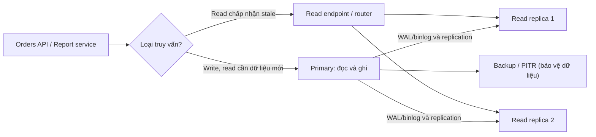
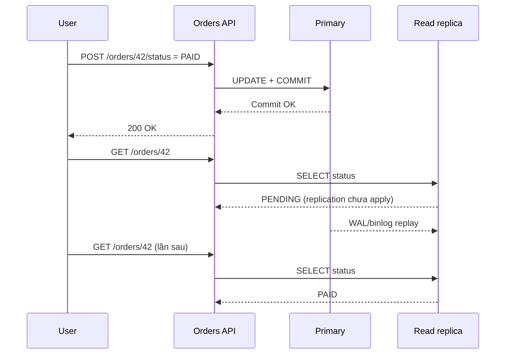
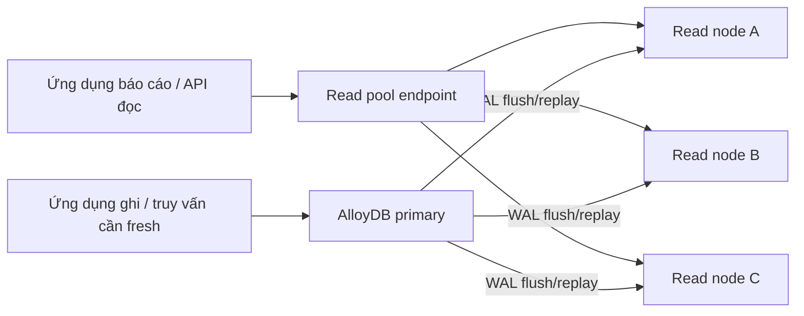

# Read replicas và mở rộng nhu cầu đọc

Một hệ thống đặt hàng có 1.000 yêu cầu đọc trạng thái đơn mỗi giây nhưng chỉ 50 giao dịch ghi. Khi tất cả truy vấn đều dùng một database primary, CPU và số kết nối có thể tăng khiến thao tác đặt hàng chậm theo. **Read replica** hoặc **read pool** cho phép chuyển một phần truy vấn đọc ra khỏi primary, nhưng đổi lại phải quản lý **độ trễ đồng bộ, định tuyến đọc–ghi và các tài nguyên phát sinh phí**.

Bài thuộc chương **Cloud SQL và AlloyDB** của module `CLOUD_PROVIDERS_GCP`. Kiến thức kết nối lựa chọn dịch vụ Google Cloud, IAM/VPC, ứng dụng Cloud Run/GKE, lưu trữ và cơ sở dữ liệu, quan sát SLO và chi phí. Trọng tâm là kiến trúc đọc mở rộng có thể kiểm chứng, không phải tạo thêm database rồi giả định hệ thống tự nhanh hơn.

> Các project, instance và truy vấn bên dưới chỉ là ví dụ. Lệnh tạo replica/read pool, thay cấu hình hoặc promote **có thể phát sinh phí hoặc làm thay đổi đường ghi**; chỉ chạy trên sandbox được ủy quyền. Bài dùng Cloud SQL **PostgreSQL** cho phần lab, sau đó đối chiếu MySQL/SQL Server và AlloyDB.

## 1. Kết quả học tập

Sau bài này, bạn có thể:

1. Phân biệt primary, read replica, Cloud SQL read pool, AlloyDB read pool và HA standby.
2. Giải thích **asynchronous replication**, replication lag và giới hạn **read-after-write**.
3. Tạo và kết nối read replica của Cloud SQL PostgreSQL, kiểm tra dữ liệu, trạng thái và quyền chỉ đọc.
4. Hiểu endpoint cân bằng tải của **Cloud SQL Enterprise Plus read pool** và **AlloyDB read pool**.
5. Thiết kế read/write routing cho Spring Boot/Cloud Run/GKE có connection pooling và fallback an toàn.
6. Phân biệt **tăng năng lực đọc**, **high availability**, **backup** và **disaster recovery**.
7. Theo dõi metrics, xử lý replica lag, lựa chọn kích thước/chi phí và xây dựng bài kiểm thử tính nhất quán.

## 2. Mô hình primary, replica và read pool



**Primary** thực thi transactions ghi, đảm bảo commit theo cơ chế database. **Replica** nhận thay đổi từ primary và phục vụ SELECT, thường qua **replication bất đồng bộ**. Thời điểm nhận/replay có thể chậm so với commit; vì thế dữ liệu ở replica **không bảo đảm luôn mới nhất**.

| Thành phần | Chức năng | Điều không được giả định |
| --- | --- | --- |
| Primary | Đọc/ghi; nguồn giao dịch chuẩn | Tự tăng throughput ghi khi thêm replicas |
| Read replica riêng | Một database instance chỉ đọc, endpoint/connection name riêng | Tự cân bằng truy vấn giữa nhiều replicas |
| **Cloud SQL read pool** | Enterprise Plus, một read endpoint cân bằng **kết nối** trên nhiều read pool nodes | Tự chọn node có replication lag thấp nhất |
| **AlloyDB read pool** | Instance chỉ đọc có nhiều nodes sau một endpoint cân bằng tải | Tự đáp ứng strong consistency cho mọi request |
| HA standby | Dự phòng/failover primary theo chế độ HA | Là endpoint đọc ứng dụng được tự do sử dụng |
| Backup/PITR | Khôi phục sau xóa sai, corruption hoặc sự cố dữ liệu | Read replica thay được backup |

**Read replica không phải bản sao đồng bộ để đảm bảo read-your-writes.** Đối với Cloud SQL, read replicas riêng **không tự có load balancer**; ứng dụng hoặc proxy phải chọn endpoint. Tuy nhiên **Cloud SQL Enterprise Plus hiện còn hỗ trợ read pool tích hợp với endpoint cân bằng tải** trên cấu hình được hỗ trợ. Không nên nhầm hai tính năng này.

## 3. Độ nhất quán và replication lag

### 3.1. Vì sao SELECT có thể trả dữ liệu cũ?



Cloud SQL PostgreSQL truyền **Write-Ahead Log (WAL)**, MySQL dùng binary log/GTID và SQL Server dùng cơ chế replication của SQL Server. AlloyDB có cơ chế storage/log riêng, nhưng read pool nodes vẫn có thể có **replay lag**. Hai giá trị cần phân biệt:

- **Network/receive lag:** thay đổi đã commit nhưng chưa đến replica.
- **Apply/replay lag:** thay đổi đã nhận nhưng chưa áp dụng cho kết quả query.

Kết quả có thể cũ trong một khoảng thời gian; không có bảo đảm cố định “luôn dưới 1 giây”. Ở replica quá tải, thay đổi schema, transaction lớn hoặc đường cross-region, độ trễ có thể tăng mạnh. Ngay cả khi metric báo gần 0, phải xét tần suất lấy mẫu và tình trạng replication đang chạy.

### 3.2. Định tuyến theo yêu cầu nhất quán

| Loại truy vấn | Endpoint nên dùng | Lý do |
| --- | --- | --- |
| `INSERT/UPDATE/DELETE`, transaction nghiệp vụ | Primary | Replica/read pool là read-only |
| Đọc ngay sau thanh toán/đổi trạng thái, kiểm tra tồn kho còn đúng | **Primary** hoặc cơ chế xác nhận replica đã bắt kịp | Tránh đọc trạng thái cũ |
| Danh sách sản phẩm, trang báo cáo hoặc dashboards cho phép trễ vài giây | Replica/read pool | Giảm tải read cho primary |
| Phân tích dữ liệu dài, truy vấn nhiều bảng | Replica riêng hoặc BigQuery tùy yêu cầu | Cô lập tài nguyên, không cạnh tranh với OLTP |
| Read pool có lag cao/mất kết nối | Theo chính sách failover/bảo vệ primary | Không tự đẩy toàn bộ lưu lượng đọc về primary vô giới hạn |

Một số cách đảm bảo **read-your-writes**: giữ truy vấn tiếp sau write trên primary, ghi cache kết quả vừa commit, hoặc dùng watermark/LSN với giới hạn chờ tới khi replica bắt kịp. Với ứng dụng đơn giản, **primary cho các request cần nhất quán** thường dễ kiểm chứng nhất. Không xem HTTP 200 của API write là dấu hiệu mọi replicas đã replay xong.

## 4. So sánh ba cách mở rộng đọc trên Google Cloud

| Tiêu chí | Cloud SQL read replica riêng | Cloud SQL Enterprise Plus read pool | AlloyDB read pool |
| --- | --- | --- | --- |
| Cơ sở | Cloud SQL MySQL/PostgreSQL/SQL Server theo hỗ trợ | Cloud SQL **Enterprise Plus**, new network architecture | **AlloyDB for PostgreSQL** cluster |
| Thực thể | Một read replica là một instance | Một read pool gồm nhiều read nodes | Một read pool instance gồm nhiều nodes |
| Phân phối kết nối | **Ứng dụng/proxy tự chọn replica** | **Một read endpoint** tự phân phối connections | **Một instance endpoint** tự phân phối connections |
| Năng lực đọc | Tạo nhiều replica, scale từng instance | Thêm/bớt nodes, scale machine type; autoscaler theo hỗ trợ | Thêm/bớt nodes và scale machine type, có autoscaler |
| Data freshness | Asynchronous, có lag | Replication bất đồng bộ, có thể đọc ở node chậm | WAL/replay lag có thể xuất hiện |
| Khả năng HA | Không thay thế HA primary; replica có lựa chọn HA riêng | Pool ≥2 nodes tăng availability theo tài liệu | Pool ≥2 nodes phân tán đa zone |
| Khi ưu tiên | Dễ triển khai 1–2 read workloads, cần endpoint riêng | Đã dùng Enterprise Plus và muốn endpoint đọc thống nhất | PostgreSQL workload cần nhiều compute đọc và kiến trúc AlloyDB |

**Cloud SQL read pools là tính năng khác với read replicas truyền thống.** Với PostgreSQL, yêu cầu Enterprise Plus và **new network architecture**, primary cũng phải Enterprise Plus; pool có **1–20 nodes** trong giới hạn tài liệu. Cloud SQL có pool cho các engines khác nhưng hạn mức/năng lực khác nhau (chẳng hạn SQL Server), nên không áp cùng số nodes hoặc CLI flags cho mọi engine.

AlloyDB có thể tạo nhiều read pools; tổng số nodes đọc trong cluster bị giới hạn bởi cấu hình và quotas (tài liệu hiện mô tả tổng tối đa **20 read pool nodes**). Đừng đưa read pool node IP riêng vào ứng dụng: các nodes có thể được thay thế trong quá trình scale/maintenance.

## 5. Lab Cloud SQL PostgreSQL: tạo một read replica

Giả định có Cloud SQL primary PostgreSQL `orders-pg-primary` trong project `orders-lab`, region `asia-southeast1`, có dữ liệu demo và được phép tạo instance. Việc tạo replica có thể cần backup/khởi tạo từ primary; với primary nhiều dữ liệu hoặc đang có transactions dài, thao tác cần thêm thời gian và resources.

### 5.1. Kiểm tra primary trước (chỉ đọc)

```bash
PROJECT_ID="orders-lab"
PRIMARY="orders-pg-primary"
REPLICA="orders-pg-reader-1"
REGION="asia-southeast1"

gcloud sql instances describe "$PRIMARY" \
  --project="$PROJECT_ID" \
  --format="yaml(name,region,state,databaseVersion,settings.edition,settings.tier,settings.availabilityType,settings.ipConfiguration,ipAddresses,replicaNames)"

gcloud sql instances list --project="$PROJECT_ID"
```

Xác minh PostgreSQL version/edition, private IP hoặc Private Service Connect (PSC), network, region, backup/recovery requirements, disk capacity và quyền. **Replica phải dùng connectivity type tương thích với primary**: với PSC phải cấu hình allowed projects và PSC endpoint/DNS riêng theo quy trình; không sao chép lệnh dành cho private service access sang PSC mà không điều chỉnh.

### 5.2. Tạo replica trong sandbox

```bash
# THAY ĐỔI HẠ TẦNG + PHÁT SINH PHÍ.
# Lệnh cơ bản; edition/tier/network flags có thể bắt buộc tùy primary.
gcloud sql instances create "$REPLICA" \
  --master-instance-name="$PRIMARY" \
  --region="$REGION" \
  --project="$PROJECT_ID"

# CHỈ ĐỌC: chờ trạng thái RUNNABLE, xác minh quan hệ với primary.
gcloud sql instances describe "$REPLICA" \
  --project="$PROJECT_ID" \
  --format="yaml(name,region,state,masterInstanceName,ipAddresses,connectionName,settings.tier,settings.edition)"
```

Lệnh cơ bản phù hợp khi loại instance/edition có thể kế thừa theo tài liệu. **Một số Enterprise Plus PostgreSQL phiên bản cũ hơn và cấu hình MySQL/SQL Server cần truyền `--tier`/`--edition`**, còn replica PSC cần thêm flags và endpoint riêng. Không thử nhiều lần tạo khi operation còn đang provisioning.

### 5.3. Kiểm tra replica chỉ đọc và đồng bộ

Kết nối bằng `psql` tới **replica endpoint thực tế** qua Cloud SQL Auth Proxy/Cloud SQL Language Connector hoặc private IP và TLS theo thiết kế. Không public database chỉ để chạy lab.

```sql
-- Chạy trong session đang kết nối tới READ REPLICA PostgreSQL.
SELECT pg_is_in_recovery() AS is_replica;
SHOW transaction_read_only;

-- Kiểm tra trạng thái nhận WAL; thường trả status='streaming'.
SELECT status, last_msg_receipt_time
FROM pg_stat_wal_receiver;

-- Đối chiếu WAL receive/replay, không tự coi timestamp là lag tuyệt đối.
SELECT pg_last_wal_receive_lsn(), pg_last_wal_replay_lsn();
```

Một replica có thể không có giao dịch mới nên `now() - pg_last_xact_replay_timestamp()` trông **rất lớn dù không bị backlog**; hãy kết hợp **replication state, network_lag, replica_lag và WAL LSN**. Nếu query receiver trống, phải phân biệt connection tạm gián đoạn, tình trạng maintenance và replication lỗi trước khi kết luận.

### 5.4. Bài thử read-after-write

Trên DB sandbox, tạo một bảng nhỏ có primary key và dữ liệu demo (đây là **thay đổi dữ liệu**, không thực hiện trên production):

```sql
-- CHỈ CHẠY TRÊN PRIMARY SANDBOX:
CREATE TABLE IF NOT EXISTS demo_order_status (
    order_id text PRIMARY KEY,
    status text NOT NULL,
    updated_at timestamptz NOT NULL DEFAULT now()
);
INSERT INTO demo_order_status(order_id, status)
VALUES ('ord-42', 'PAID')
ON CONFLICT (order_id)
DO UPDATE SET status = EXCLUDED.status, updated_at = now();

-- TRÊN REPLICA: chỉ đọc, có thể chưa thấy ngay commit mới.
SELECT order_id, status, updated_at
FROM demo_order_status WHERE order_id = 'ord-42';
```

**Tạo table và write chỉ ở primary; lệnh SELECT ở replica phải dùng một session/endpoint khác.** Đừng viết script giả định lỗi SELECT ngay sau commit là bug; đó có thể là lag, nhưng nếu kéo dài phải điều tra replication health.

## 6. Cloud SQL Enterprise Plus read pool: endpoint đọc thống nhất

Khác với từng read replica riêng, **Cloud SQL read pool** gom các replica nodes vào một instance logic và cung cấp **một read endpoint có IP ổn định**. Các kết nối mới được phân phối đến node khỏe; ứng dụng không phải lưu danh sách IP từng node khi mở rộng/thu nhỏ pool. Điều này đặc biệt hữu ích khi nhiều ứng dụng cùng cần đọc và platform team muốn quản lý số nodes tập trung.

**Điều kiện:** theo tài liệu Cloud SQL, read pools yêu cầu **Enterprise Plus** và **new network architecture** ở primary/read pool. Với PostgreSQL, pool có từ 1 đến 20 nodes; ở SQL Server số node tối đa khác nên **kiểm tra theo engine và edition**.

### 6.1. Ví dụ tạo read pool PostgreSQL

Giả sử `orders-pg-primary` đã là Enterprise Plus và đáp ứng yêu cầu network architecture, có kết nối private IP phù hợp:

```bash
# THAY ĐỔI / CÓ PHÍ: dùng primary đã tồn tại, không chạy trên production tùy tiện.
gcloud sql instances create orders-pg-readpool \
  --project=orders-lab \
  --region=asia-southeast1 \
  --master-instance-name=orders-pg-primary \
  --instance-type=READ_POOL_INSTANCE \
  --node-count=2 \
  --tier=db-perf-optimized-N-4 \
  --edition=ENTERPRISE_PLUS \
  --no-assign-ip

# CHỈ ĐỌC: lấy IP/connectionName của POOL, không chọn node IP thủ công.
gcloud sql instances describe orders-pg-readpool \
  --project=orders-lab \
  --format="yaml(name,region,state,instanceType,nodeCount,connectionName,ipAddresses,nodes)"
```

Các flag network có thể cần điều chỉnh cho VPC/PSC của primary. Lệnh trên là **lab cho Enterprise Plus PostgreSQL**, không áp cho một primary Enterprise thường. Một read pool nằm **cùng region với primary**; không coi nó là mô hình DR cross-region.

### 6.2. Scale read pool

```bash
# THAY ĐỔI CẤU HÌNH VÀ PHÍ: tăng từ 2 lên 3 read nodes.
gcloud sql instances patch orders-pg-readpool \
  --project=orders-lab \
  --node-count=3
```

Đây là mở rộng **horizontal read capacity**. Cloud SQL read pools có thể có autoscaling theo phiên bản và điều kiện được hỗ trợ; xem cấu hình/quota trước khi bật. Scale không làm tăng tốc queries vốn thiếu index, không giải quyết transaction lock và không làm writes vào primary nhanh hơn.

**Bẫy nhất quán:** Cloud SQL read pool **cân bằng kết nối theo trạng thái khỏe của node, không chọn theo replication lag**. Một node vẫn trả query được nhưng dữ liệu chậm có thể nhận kết nối; session được reconnect sang node khác có thể nhìn thấy **replication position cũ hơn session trước**. Vì vậy chỉ dùng read endpoint cho truy vấn cho phép eventual consistency.

**Bẫy giới hạn quản trị:** read pool không giống replica độc lập để promote. Không dựa vào read pool như một DR primary hoặc nguồn cascading replication nếu tài liệu engine không hỗ trợ. Giữ HA, backups/PITR và DR tách riêng.

## 7. AlloyDB: read pool instances và scaling theo nodes

**AlloyDB for PostgreSQL** tách compute và storage theo kiến trúc riêng. Cluster có **primary instance** để xử lý write và một hoặc nhiều **read pool instances** phục vụ read-only queries. Trong mỗi read pool, Google Cloud cân bằng kết nối giữa các nodes qua **địa chỉ IP/endpoint cấp cho instance**. Nodes riêng lẻ là tài nguyên có thể thay thế.



Với read pool có **hai nodes trở lên**, nodes được phân bổ qua các zones, tăng khả năng phục vụ khi một node/zone lỗi. **Một node read pool** không có cùng khả năng sẵn sàng đa zone. Trong failover primary, read pool có thể tiếp tục trả reads nhưng quá trình đồng bộ WAL có thể tạm dừng, làm dữ liệu chậm hơn; cần quan sát replication lag.

### 7.1. Kiểm tra và tạo AlloyDB read pool

Giả định cluster `orders-alloydb` đã tồn tại, có primary và vùng mạng truy cập được:

```bash
# CHỈ ĐỌC: xem cluster và các instances đang có.
gcloud alloydb clusters describe orders-alloydb \
  --project=orders-lab \
  --region=asia-southeast1

gcloud alloydb instances list \
  --project=orders-lab \
  --cluster=orders-alloydb \
  --region=asia-southeast1

# THAY ĐỔI / CÓ PHÍ: tạo read pool hai nodes.
gcloud alloydb instances create orders-readpool \
  --project=orders-lab \
  --cluster=orders-alloydb \
  --region=asia-southeast1 \
  --instance-type=READ_POOL \
  --read-pool-node-count=2 \
  --cpu-count=4

# CHỈ ĐỌC: kiểm tra IP/endpoint do instance cung cấp.
gcloud alloydb instances describe orders-readpool \
  --project=orders-lab \
  --cluster=orders-alloydb \
  --region=asia-southeast1
```

Quy mô 2 nodes × 4 vCPU chỉ minh họa. Từng node trong cùng read pool có machine series/type giống nhau; primary có thể dùng cấu hình khác. Nếu dùng **Private Service Connect** hoặc public IP, lệnh cần thêm networking flags và IAM tương ứng; không dùng ví dụ tạo pool rồi suy rằng có thể kết nối từ laptop Internet.

### 7.2. Scale và autoscaling

AlloyDB cho phép **scale up** (đổi machine type của read pool) hoặc **scale out** (thêm nodes), với giới hạn tổng read pool nodes của cluster (tài liệu hiện nêu **tối đa 20**). Truy cập qua **instance-level endpoint** để khi nodes thay đổi, ứng dụng không phải cập nhật địa chỉ.

```bash
# THAY ĐỔI: ví dụ tăng lên 3 read nodes.
gcloud alloydb instances update orders-readpool \
  --project=orders-lab \
  --cluster=orders-alloydb \
  --region=asia-southeast1 \
  --read-pool-node-count=3
```

AlloyDB còn hỗ trợ **read pool autoscaling** theo CPU, số connections hoặc lịch theo khả năng hiện hành. Ví dụ cấu hình bằng gcloud cho một pool đã tồn tại:

```bash
# THAY ĐỔI + CHI PHÍ: chỉ thử khi tính năng/autoscaler khả dụng.
gcloud alloydb instances update orders-readpool \
  --project=orders-lab \
  --cluster=orders-alloydb \
  --region=asia-southeast1 \
  --enable-autoscaler \
  --autoscaler-max-node-count=6 \
  --autoscaler-target-cpu-usage=0.65
```

Những cấu hình này không có nghĩa pool sẽ tăng tức thời khi traffic tăng: autoscaler có thời gian đánh giá và provision, có thể bị quota/machine availability giới hạn. Một node bị remove có thể khiến connections đang nối trực tiếp tới node đó bị ngắt; khi kết nối qua **pool endpoint**, driver phải có retry/reconnect phù hợp.

### 7.3. AlloyDB lag không biến mất vì shared storage

AlloyDB primary gửi WAL tới read pool nodes; quá trình nhận/replay vẫn có thể bị nghẽn bởi CPU, memory, long-running queries hoặc write bursts. Trong **System insights**, theo dõi flush/replay lag và tài nguyên ở cả primary/read pool. Dịch vụ có cơ chế điều tiết queries theo lag để bảo vệ freshness trong một số trường hợp, nhưng **không coi đó là bảo đảm strong read-after-write**. Nếu ứng dụng phải đọc trạng thái vừa commit, gửi query tới primary hoặc dùng cơ chế xác nhận vị trí đồng bộ phù hợp.

## 8. Tách đường đọc/ghi trong Cloud Run hoặc GKE

Replica chỉ hữu dụng khi ứng dụng **thực sự chuyển SELECT sang reader**, thay vì tạo pool rồi vẫn dùng primary. Mô hình đơn giản là hai database connection pools:

```text
Orders API (Cloud Run / GKE)
  ├─ WRITE datasource  --> primary endpoint
  │   └─ POST /orders, POST /payments, GET /orders/{id} ngay sau write
  └─ READ datasource   --> read replica / read pool endpoint
      └─ GET /catalog, GET /reports, dashboard chấp nhận lag
```

Ví dụ cấu hình Spring Boot **minh họa**, giả định ứng dụng đã khai báo hai `DataSource` riêng bằng Java configuration/HikariCP:

```yaml
# application.yaml - chỉ mô tả logical datasource properties.
orders:
  db:
    write:
      jdbc-url: ${ORDERS_WRITE_JDBC_URL}
      username: ${ORDERS_DB_USER}
      password: ${ORDERS_DB_PASSWORD}
      maximum-pool-size: 6
    read:
      jdbc-url: ${ORDERS_READ_JDBC_URL}
      username: ${ORDERS_DB_READER_USER}
      password: ${ORDERS_DB_READER_PASSWORD}
      maximum-pool-size: 8
```

Đây **không phải auto-configuration chuẩn `spring.datasource.*`**: cần mã tạo HikariDataSource/JdbcTemplate hoặc routing datasource và ánh xạ đúng prefixes. Hai URLs phải lấy từ connection name/IP/endpoint thực; không bao giờ đưa mật khẩu thật vào Git. Dùng Secret Manager/Workload Identity/Cloud SQL connectors theo kiến trúc.

**Bẫy Spring:** `@Transactional(readOnly = true)` **không tự chuyển JDBC connection sang replica** nếu application chưa cấu hình AbstractRoutingDataSource hoặc tách repositories/JdbcTemplates rõ ràng. Thay đổi datasource giữa chừng trong một transaction cũng có thể khiến connection đã được lấy từ primary vẫn được sử dụng. Thiết kế routing **trước khi transaction bắt đầu** và test bằng queries trên hai endpoints.

### 8.1. Kiểm tra không ghi nhầm vào reader

```sql
-- Chạy trên session kết nối read-only endpoint PostgreSQL.
SHOW transaction_read_only;
SELECT pg_is_in_recovery();

-- CHỈ chạy trên database sandbox riêng khi muốn thử lỗi write:
-- INSERT INTO demo_order_status(order_id,status)
-- VALUES ('ord-test','CREATED');
```

App cũng phải có **DB user chỉ có quyền SELECT** theo phạm vi dữ liệu khi phù hợp; IAM cấp quyền gọi Cloud SQL/AlloyDB APIs **không thay quyền database**. Một endpoint replica/read pool chỉ đọc vẫn có thể tiết lộ dữ liệu nếu user có quá nhiều quyền SELECT.

### 8.2. Quản lý connection pools với serverless

Cloud Run/GKE có thể scale lên nhiều instances/Pods; mỗi instance tạo một HikariCP read/write pool riêng. Tính giới hạn connections theo cả hai đường:

```text
Potential connections:
  app_instances × (write_pool_max + read_pool_max)
  + admin/jobs/monitoring connections

Ví dụ: 12 Cloud Run instances × (6 + 8) + 10 ≈ 178 connections
```

Đây là **giới hạn ước lượng**, không phải lượng connections luôn đang mở. Nếu traffic đột biến làm Cloud Run scale quá nhanh, CPU database hoặc max_connections có thể quá tải dù read pool có nhiều nodes. Thiết lập HikariCP max pool, Cloud Run max instances/concurrency, connection idle timeouts và database managed pooling (nếu được hỗ trợ) theo **đo đạc thực tế**, không chỉ theo giá trị mặc định.

### 8.3. Fallback về primary phải có giới hạn

Nếu reader lỗi hoặc lag quá cao, các lựa chọn gồm **trả lỗi/giảm chất lượng cho truy vấn ít quan trọng**, chờ reader hồi phục hoặc **tạm đọc từ primary với rate limiting**. Tuyệt đối không chuyển **100% reporting traffic** sang primary không hạn mức, vì có thể làm primary nghẽn khiến **write path của Orders** cũng ngừng hoạt động. Dùng circuit breaker, timeout, retry có backoff và feature flags để bảo vệ giao dịch chính.

## 9. Theo dõi replica lag và hiệu năng truy vấn

Tạo dashboard tách **primary, replica/read pool** và nếu có nhiều nodes, quan sát từng node khi cần. Chỉ nhìn CPU là chưa đủ: mục tiêu là **giảm độ trễ đọc mà không gây dữ liệu stale vượt ngân sách cho phép**.

| Tín hiệu | Ý nghĩa | Ngưỡng hành động minh họa |
| --- | --- | --- |
| Cloud SQL `database/replication/replica_lag` | Độ trễ replay tương đối, đơn vị giây; mang tính xấp xỉ | Điều tra nếu liên tục vượt 5 giây |
| Cloud SQL `database/replication/network_lag` | Độ trễ WAL đi từ primary tới replica | Nếu cao: kiểm tra primary/network/cross-region |
| Cloud SQL replication state | Đồng bộ `Running/Stopped/Error` | Không gửi thêm truy vấn đọc vào replica ngừng đồng bộ |
| PostgreSQL replica WAL lag bytes | Chênh lệch WAL sent/write/flush/replay | Tách receive bottleneck và replay bottleneck |
| AlloyDB read pool flush/replay lag | Dữ liệu đã tới node chưa và đã replay chưa | Cảnh báo theo yêu cầu freshness của workload |
| CPU, memory, disk I/O, DB connections | Khả năng đáp ứng load của primary và reader | Scale hoặc tối ưu query khi quá tải kéo dài |
| p95 query latency, QPS, errors | Chất lượng từ phía người dùng | So sánh trước/sau chuyển traffic |

Ngưỡng **5 giây là giả định của bài tập**, không phải SLA Google Cloud. Một hệ thống hiển thị báo cáo có thể chấp nhận lag nhiều hơn; xác nhận thanh toán có thể cần đọc primary. Cloud Monitoring metrics thường có **độ trễ thu thập/hiển thị**, không nên dùng một điểm dữ liệu rỗng làm bằng chứng replica đồng bộ.

### 9.1. Gợi ý chẩn đoán Cloud SQL PostgreSQL

Tại **primary**, kiểm tra transaction/write pressure và những query giữ locks lâu. Tại **replica**, kiểm tra:

```sql
-- CHỈ ĐỌC: chạy trên PostgreSQL read replica.
SELECT pg_is_in_recovery();
SELECT status, last_msg_receipt_time
FROM pg_stat_wal_receiver;
SELECT pg_last_wal_receive_lsn(), pg_last_wal_replay_lsn();
SELECT datname, confl_lock, confl_snapshot, confl_bufferpin
FROM pg_stat_database_conflicts;
```

Replica lag cao nhưng network lag thấp thường chỉ ra **replica nhận WAL rồi replay không kịp**: đọc quá tải, CPU/I/O giới hạn, queries dài hoặc DDL/VACUUM conflict. Với PostgreSQL, cấu hình standby delays hoặc `hot_standby_feedback` có thể thay đổi mức xung đột, **nhưng cũng có nguy cơ giữ row versions lâu và làm primary bloat**. Không bật flags máy móc; phải xem tác động lên OLTP, vacuum và SLO.

Với MySQL, kiểm tra binary log/GTID replication metrics và tình trạng apply; SQL Server dùng metrics/replication views riêng, **không chạy các câu `pg_stat_*` vào engine khác**. Trong AlloyDB, dùng System insights/Query insights để tìm long-running queries và wait events trên read pool nodes.

### 9.2. Load testing đúng

1. Chọn một workload đọc thực tế (catalog, order lookup, reporting), ghi lại baseline **primary-only**.
2. Tạo replica/pool trong sandbox hoặc staging tương tự production; đợi đồng bộ và xác nhận metrics.
3. Chuyển dần 10% → 50% → 100% **những reads cho phép stale**, giữ writes trên primary.
4. Đo QPS, p95/p99 latency, error rate, pool utilization, connections, WAL lag và primary CPU.
5. Kiểm tra read-after-write riêng, read consistency ở nhiều connections, và lỗi khi node/replica mất kết nối.
6. Chỉ mở rộng khi bottleneck đã rõ; ưu tiên query tuning, indexes và giảm N+1 queries trước khi thêm quá nhiều nodes.

**Đừng tạo load test ghi/đọc hàng loạt trên production không được cho phép.** Queries không giới hạn và connections bùng nổ có thể tăng replication lag lẫn gây gián đoạn writes.

## 10. High availability, promotion và disaster recovery

| Cơ chế | Bài toán | Có thay read replica để scale read? |
| --- | --- | --- |
| **Cloud SQL HA (regional)** | Failover primary khi lỗi zone/instance theo cấu hình | Không; HA standby phục vụ dự phòng, không phải read pool |
| **Cloud SQL read replica** | Offload read; có thể đặt khác region | Có, nhưng không tự failover primary khi lỗi |
| **Cloud SQL cross-region DR replica** | Kịch bản phục hồi/thay primary qua quy trình failover/promotion được hỗ trợ | Đọc được trong phạm vi hỗ trợ, nhưng ưu tiên RPO/RTO và topology |
| **Cloud SQL read pool** | Load-balanced reads ở cùng region | Có, nhưng không hỗ trợ promote thành primary như replica độc lập |
| **AlloyDB primary HA** | Failover giữa primary/standby nodes | Không phải read pool |
| **AlloyDB read pool** | Scale/read availability trong region | Không thay thế secondary cluster/backup/PITR cho DR |

Một **cross-region read replica** của Cloud SQL có thể được **promote** thành standalone primary theo quy trình, nhưng hành động này thay đổi quan hệ replication và có thể khiến **RPO không bằng 0** vì dữ liệu chưa kịp đồng bộ. Cần backup, quiesce writes khi khả thi, đối chiếu lag và cập nhật kết nối ứng dụng/DNS/secrets trước khi đổi hướng ghi. Không bấm promote chỉ để giải quyết replica lag.

Với AlloyDB, DR multi-region sử dụng **secondary clusters** hoặc các cơ chế backup/restore phù hợp, không phải thêm một read pool cùng cluster rồi coi là đã có DR. Khi AlloyDB primary failover, read pool có thể vẫn phục vụ đọc cũ; ứng dụng vẫn cần reconnect và kiểm tra freshness. **Replica không thay thế backups/PITR** vì thay đổi/xóa nhầm trên primary cũng có thể được replicate.

## 11. IAM, mạng và bảo vệ dữ liệu

| Danh tính | Quyền/vùng trách nhiệm | Điều cần tránh |
| --- | --- | --- |
| DB/platform operator | Cloud SQL Admin/AlloyDB Admin để tạo/scale theo quyền thực tế | Cấp Admin cho mọi application Pod |
| Cloud Run/GKE app identity | `roles/cloudsql.client` hoặc `roles/alloydb.client` khi dùng connector/proxy tương ứng | Dùng service account key JSON tĩnh trong image |
| Database writer user | DML/DDL tối thiểu cho schema nghiệp vụ | Grant SUPER hoặc owner toàn DB |
| Database reader user | `SELECT` trên tables/views được phép | Cấp INSERT/UPDATE hoặc quyền xem PII không cần |
| On-call viewer | Viewer/Monitoring/Logs đúng phạm vi | Editor chỉ để xem replica lag |

**Cloud IAM và database privileges là hai lớp khác nhau.** Kết nối thành công qua Cloud SQL Auth Proxy không có nghĩa SQL user được quyền đọc mọi bảng; IAM cho phép truy cập dịch vụ và DB xác thực/ủy quyền tiếp.

Lựa chọn kết nối:

- Cloud SQL private IP/Private Service Access hoặc **Private Service Connect**, đi cùng VPC routing, DNS, firewall và Cloud SQL Auth Proxy/Language Connector khi phù hợp;
- AlloyDB private networking/PSC với cluster, read pool instance IP/DNS tương ứng, AlloyDB Auth Proxy hoặc language connector;
- Cloud Run **Direct VPC egress** hoặc Serverless VPC Access để tới private endpoint; GKE cần VPC reachability và Workload Identity.

Không mở public IP và authorized networks rộng chỉ để lab kết nối. Với read pool gồm nhiều nodes, dùng **địa chỉ pool**, không lưu addresses của node tạm thời. Khi dùng cross-region, kiểm tra network latency, residency, egress và quyền ở project/VPC tương ứng.

## 12. Tối ưu truy vấn và chi phí trước khi scale

Đọc nhiều không đồng nghĩa replica luôn là giải pháp đầu tiên. Trước khi tăng máy:

1. Dùng Query insights/`EXPLAIN (ANALYZE, BUFFERS)` trên **sandbox hoặc truy vấn được phép** để tìm slow queries, sequential scans, N+1 và indexes thiếu.
2. Đặt pagination, giới hạn hàng trả về, batch queries và giảm các truy vấn lặp không cần thiết.
3. Cache dữ liệu catalog/reference có TTL hợp lý; xác định cách invalidation khi dữ liệu thay đổi.
4. Cô lập reporting queries nặng khỏi OLTP, hoặc đưa phân tích dài sang BigQuery theo mục đích.
5. Sau tối ưu, mới đo khả năng cần thêm readers/scale up/scale out.

| Thành phần chi phí | Điều cần dự toán |
| --- | --- |
| Cloud SQL replicas | CPU/RAM, storage và I/O của **từng instance**, HA option, backup/logs |
| Cloud SQL read pool | Machine type × số nodes, storage/network, autoscaler capacity |
| AlloyDB read pool | Số nodes × machine type, storage/network/IO và các tính năng bật thêm |
| Cross-region replica | Inter-region transfer/egress, storage, latency, DR testing |
| Kết nối ứng dụng | Cloud Run/GKE instances và connection pooling/proxy resources |
| Quan sát | Monitoring, Query Insights, Logging ingestion/retention |

**Lợi ích phải so bằng SLO và giá:** thêm hai readers có thể giảm latency vào giờ cao điểm nhưng tốn tiền cả khi idle, trong khi một index/caching tốt có thể rẻ hơn. Autoscaling nodes giúp điều chỉnh theo tải nhưng không miễn phí; giới hạn min/max nodes, quotas và lịch budget alerts cần được review. Giá mới nhất xem bảng giá chính thức theo region/edition.

## 13. Tình huống Orders: giảm tải đọc nhưng giữ nhất quán thanh toán

Giả định workload ngày thường có 300 reads/s và 50 writes/s, giờ flash sale tăng lên **2.000 reads/s**. Primary CPU 90%, p95 đọc 850 ms và p95 đặt hàng tăng theo, dù số writes không tăng nhiều.

### 13.1. Phân loại endpoint

| Endpoint nghiệp vụ | Freshness | Đường đề xuất |
| --- | --- | --- |
| `POST /orders` và `POST /payments` | Phải commit đúng | Primary |
| `GET /orders/{id}` sau thanh toán | Phải thấy trạng thái mới | Primary |
| `GET /catalog`, `GET /product-list` | Chấp nhận stale vài giây | Cache + read replica/read pool |
| Dashboard xu hướng 15 phút | Chấp nhận stale ngắn | Read pool/reporting reader |
| Báo cáo kế toán cuối kỳ | Cần snapshot đã đối soát | Database snapshot/BigQuery hoặc quy trình consistency rõ |

Team đo lại sau khi thêm một Cloud SQL read replica hoặc Enterprise Plus read pool (tùy edition): giả sử primary CPU xuống 55%, p95 catalog còn 220 ms. **Số liệu là giả định cho bài tập**, không phải benchmark. Kết quả chỉ được coi là đạt khi tỷ lệ lỗi không tăng, reader lag trong giới hạn, và read-after-write vẫn đúng.

### 13.2. Sự cố “đã thanh toán nhưng hiển thị chưa thanh toán”

Sau rollout, một route `GET /orders/{id}` bị đưa nhầm sang replica. Người dùng thanh toán thành công rồi refresh lập tức, nhận `PENDING`. Cách xử lý:

1. Dừng/rollback feature flag định tuyến endpoint cần dữ liệu mới về **primary**.
2. Kiểm tra write transaction commit, read routing logs, replica lag và connection pool.
3. Xác minh trạng thái thực tế từ primary; **không retry thanh toán** chỉ vì replica trả dữ liệu cũ.
4. Tạo integration test “write commit → immediate GET” và alert cho stale-read vượt ngưỡng.
5. Rà soát các endpoints tạo/huỷ đơn, xác nhận tồn kho, thanh toán và quyền đọc PII.

Nếu read pool lag tăng trong flash sale, giới hạn các queries ít quan trọng và kiểm tra pressure trên reader/primary; đừng tự chuyển toàn bộ traffic về primary làm writes nghẽn.

## 14. Troubleshooting nhanh

| Triệu chứng | Nguyên nhân khả dĩ | Kiểm tra/khắc phục |
| --- | --- | --- |
| Replica tạo thành công nhưng app vẫn chậm | Ứng dụng chưa route SELECT qua reader, query thiếu index | Kiểm tra datasource endpoints, query plan, metrics |
| `INSERT` trên reader lỗi | Replica/pool read-only | Chuyển transaction ghi sang primary, test read-only routing |
| Read-after-write trả dữ liệu cũ | Replication bất đồng bộ | Dùng primary cho endpoint cần fresh, đo lag |
| Replica lag cao, network lag thấp | Replay bị nghẽn bởi CPU/I/O/long query | Kiểm tra `pg_stat_database_conflicts`, CPU, Query insights |
| Network lag cao | Primary WAL sender, network/cross-region hoặc tài nguyên quá tải | Theo dõi metrics primary/network, workload, region |
| Cloud SQL read pool trả dữ liệu “lùi thời gian” sau reconnect | Kết nối mới vào node có WAL position thấp hơn | Không dùng pool để đảm bảo monotonic reads; dùng primary |
| Cloud SQL `read pool create` thất bại | Primary không Enterprise Plus/new network architecture, tier không hợp | Kiểm tra edition, network architecture, CLI support |
| AlloyDB read pool không scale được | Cluster đang maintenance, quota/max nodes hoặc policy | Kiểm tra cluster status, limit tổng nodes, autoscaler |
| Kết nối đến pool thất bại | Private VPC/PSC/DNS/IAM/DB auth sai | Đối chiếu endpoint, routing, service account, credentials |
| Cloud Run bị `too many connections` | Nhiều instances × pool size vượt DB limit | Giảm pool max, giới hạn instances, managed pooling nếu phù hợp |
| Read traffic không chia đều giữa nodes | Connections sống lâu, load balancer cấp theo kết nối | Kiểm tra connections per node, connection lifetime |
| Reader unhealthy khi primary vẫn OK | Replica lag/disk đầy, network hoặc node failure | Cách ly reader, giảm reporting, không dội tải primary |
| Sau promotion không ghi được | Chưa đổi datasource, quyền user, fencing/route sai | Runbook DR, xác minh một writer hợp lệ và DNS |
| Bill tăng mạnh | Readers/nodes vẫn chạy dù low traffic, cross-region fees | Billing theo SKU, autoscale limits, cleanup theo phê duyệt |

## 15. Bài tập thực hành

### Bài A — Phân biệt mục tiêu

Cloud SQL primary trong region A đã bật HA; team định tạo read replica ở region B để tăng đọc và nói nó tự động failover khi primary mất. Hãy chỉ ra phần đúng/sai và phác thảo riêng phương án **read scaling**, **HA** và **DR**.

### Bài B — Cloud SQL PostgreSQL replica

Tại sandbox, dùng `gcloud sql instances describe` xác định edition/network của primary. Tạo replica theo mục 5, chạy `pg_is_in_recovery()`, `transaction_read_only`, `pg_stat_wal_receiver` và thử SELECT sau một UPDATE trên primary. Ghi điều kiện để kết luận replication đang hoạt động.

### Bài C — So sánh read pools

Đội dùng Cloud SQL Enterprise Plus và muốn tăng từ 2 lên 4 read nodes mà không sửa endpoint ứng dụng. Chọn **Cloud SQL read pool** hoặc replicas riêng; giải thích network architecture, endpoint, giới hạn read consistency và vì sao một node lagging vẫn có thể nhận kết nối.

### Bài D — AlloyDB autoscaling

Một AlloyDB read pool có 2 nodes × 4 vCPU, traffic tăng 3 lần. Đề xuất ngưỡng CPU/connection autoscaler, min/max nodes, SLO giám sát và kiểm tra quota/tổng 20 nodes. Vì sao không thể giả định autoscaler phản ứng tức thì?

### Bài E — Routing Spring Boot

Thiết kế hai datasources cho Cloud Run Orders API: write primary và read replica/pool. Nêu rõ `@Transactional(readOnly = true)` không tự đổi endpoint. Endpoint nào bắt buộc đọc primary và bạn sẽ test như thế nào?

### Bài F — Khắc phục lag

Dashboard báo `replica_lag=20s` nhưng `network_lag≈0s`. Đưa ra ba giả thuyết liên quan replay, long-running query và CPU/I/O; chọn SQL views/metrics để kiểm chứng. Nếu hệ thống chỉ có 20 reads/s, vì sao không nên scale ngay?

### Bài G — Đọc dưới flash sale

Orders có 2.000 reads/s, 50 writes/s. Đề xuất phân loại truy vấn, cache TTL, read pool size, primary protection, consistency gates và đánh giá hiệu quả theo p95/5xx/lag. Nếu reader chết, fallback thế nào để writes không sụp?

### Bài H — Dự toán chi phí

So sánh (1) một replica riêng 8 vCPU, (2) một read pool 3 nodes × 4 vCPU và (3) AlloyDB read pool autoscaling 2–6 nodes. Liệt kê CPU/memory, storage, network/egress, Monitoring và chi phí idle. Vì sao chỉ so tổng vCPU không đủ để quyết định?

### Câu hỏi tự kiểm tra

1. Replica bất đồng bộ có thể trả dữ liệu cũ sau commit không?
2. Cloud SQL read replica riêng có tự cân bằng reads giữa nhiều replicas không?
3. Cloud SQL Enterprise Plus read pool khác gì với read replica riêng?
4. AlloyDB read pool nên kết nối qua node IP hay instance endpoint?
5. HA standby và read replica có cùng nhiệm vụ không?
6. Read pool endpoint có tự loại node replication lag cao không?
7. Vì sao SQL `@Transactional(readOnly=true)` chưa đủ để route sang reader?
8. Metric `replica_lag` có luôn phản ánh lag chính xác khi primary hoàn toàn idle không?
9. Khi primary lỗi, cross-region replica có tự thành writer mới không?
10. Thêm readers có tự giảm thời gian xử lý một SELECT thiếu index không?

## 16. Checklist và tài liệu chính thức

- [ ] Đã xác định queries chấp nhận stale và queries cần primary.
- [ ] Cloud SQL edition/network hoặc AlloyDB cluster đáp ứng điều kiện read pool.
- [ ] Connections dùng đúng reader endpoint; không ghi node IP tạm vào cấu hình.
- [ ] DB user read-only và IAM/VPC/PSC/Secret Manager đúng quyền.
- [ ] Đã kiểm thử read-after-write, connection reconnect và reader failure.
- [ ] Metrics có replication lag, network/replay, QPS, p95, CPU/I/O, connections.
- [ ] Có circuit breaker, giới hạn fallback, SLO và DR/backup runbook độc lập.
- [ ] Đã benchmark sau query optimization; tính phí nodes, storage và egress.

Tài liệu chính thức để kiểm tra khi áp dụng:

- [Cloud SQL PostgreSQL replication overview](https://cloud.google.com/sql/docs/postgres/replication)
- [Create PostgreSQL read replicas](https://cloud.google.com/sql/docs/postgres/replication/create-replica)
- [Manage PostgreSQL replicas](https://cloud.google.com/sql/docs/postgres/replication/manage-replicas)
- [Cloud SQL PostgreSQL replication lag](https://cloud.google.com/sql/docs/postgres/replication/replication-lag)
- [Cloud SQL Enterprise Plus read pools](https://cloud.google.com/sql/docs/postgres/about-read-pools)
- [Create/manage Cloud SQL read pools](https://cloud.google.com/sql/docs/postgres/create-read-pool)
- [Cloud SQL for MySQL replication](https://cloud.google.com/sql/docs/mysql/replication)
- [Cloud SQL high availability](https://cloud.google.com/sql/docs/postgres/high-availability)
- [AlloyDB overview](https://cloud.google.com/alloydb/docs/overview)
- [Create AlloyDB read pool](https://cloud.google.com/alloydb/docs/instance-read-pool-create)
- [Scale AlloyDB read pool/autoscaler](https://cloud.google.com/alloydb/docs/instance-read-pool-scale)
- [AlloyDB replication troubleshooting](https://cloud.google.com/alloydb/docs/troubleshoot/replication-issues)
- [Cloud SQL pricing](https://cloud.google.com/sql/pricing)
- [AlloyDB pricing](https://cloud.google.com/alloydb/pricing)

**Ghi nhớ:** Primary là nguồn ghi và đọc nhất quán; replica/read pool tăng khả năng phục vụ **reads chấp nhận độ trễ**. Cloud SQL replicas riêng cần ứng dụng phân phối kết nối, còn Cloud SQL Enterprise Plus read pools và AlloyDB read pools có endpoint cân bằng tải. Luôn phân tuyến theo mức độ mới của dữ liệu, giám sát lag, bảo vệ primary và giữ HA/backup/DR như những cơ chế riêng biệt.
