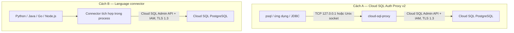
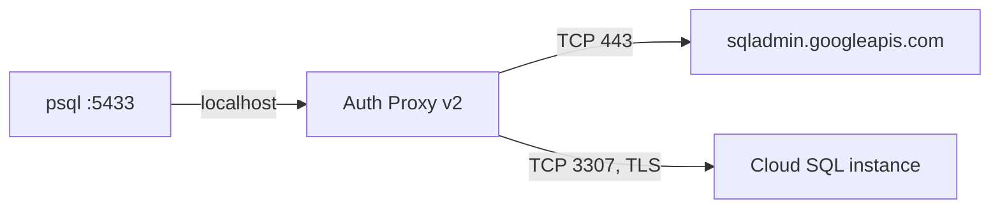

# Cloud SQL Auth Proxy và language connectors

> **Chương:** Cloud SQL và AlloyDB  
> **Module:** CLOUD_PROVIDERS_GCP  
> **Phạm vi module:** Khám phá Google Cloud từ tổ chức project, IAM và VPC đến Compute Engine, GKE, Cloud Run, dịch vụ lưu trữ và cơ sở dữ liệu. Qua các tình huống triển khai, người học biết lựa chọn dịch vụ, bảo vệ tài nguyên, tự động hóa phát hành và theo dõi độ tin cậy cùng chi phí.

Một ứng dụng Python trên Cloud Run cần kết nối PostgreSQL, còn kỹ sư trên máy cá nhân muốn dùng `psql` để kiểm tra dữ liệu. Cả hai phải xác thực với Google Cloud, mã hóa dữ liệu và tuân thủ chính sách mạng. **Cloud SQL Auth Proxy v2** giải quyết đường kết nối được ủy quyền bằng một tiến trình chạy cạnh client; **Cloud SQL Language Connectors** đưa chức năng tương tự vào mã Java, Python, Go hoặc Node.js. Chúng **không thay thế quyền của database user, connection pooling hay kết nối VPC**.

Bài này dùng **Cloud SQL for PostgreSQL đã tồn tại trong project sandbox** để minh họa hai cách kết nối. Không tạo instance mới, không mở IP public, không đổi IAM hoặc sửa dữ liệu production. Cuối bài có phân biệt nhanh **AlloyDB Auth Proxy** vì hai sản phẩm không dùng chung proxy và định danh instance.

## Mục tiêu học tập

Sau bài này, bạn có thể:

1. Giải thích cơ chế **ADC → IAM Cloud SQL Client → chứng chỉ ngắn hạn/mTLS → SQL database login**.
2. Chọn Cloud SQL Auth Proxy v2 hay Python/Java/Go/Node.js connector theo môi trường, driver và cách vận hành.
3. Phân biệt **IAM kết nối Cloud SQL**, **database user/password** và **IAM database authentication**.
4. Kiểm tra kết nối public/private IP/Private Service Connect (PSC), các yêu cầu egress `443` và `3307`.
5. Kết nối thử qua proxy + `psql` và Python Connector + SQLAlchemy, không lộ mật khẩu trong mã.
6. Thiết lập connection pool, giới hạn kết nối, quan sát lỗi và dọn đúng phạm vi lab.

## 1. Vị trí của Auth Proxy và language connector



**Cả hai đều** dùng danh tính Google Cloud để xin phép kết nối và quản lý mã hóa/định danh máy chủ. Sau khi đi qua lớp connector, **PostgreSQL/MySQL/SQL Server vẫn kiểm tra tài khoản database** theo cơ chế cấu hình. Không phải cứ có `roles/cloudsql.client` là có thể `SELECT` mọi bảng.

| Tiêu chí | Cloud SQL Auth Proxy v2 | Cloud SQL Language Connectors |
|---|---|---|
| Cách triển khai | **Tiến trình riêng**, container sidecar hoặc thành phần managed integration | **Thư viện** được ứng dụng gọi trực tiếp |
| Client | `psql`, `mysql`, `sqlcmd` và mọi ứng dụng nói DB protocol | Ứng dụng ngôn ngữ/driver được hỗ trợ |
| Mã hóa/IAM | Tự lấy chứng chỉ ngắn hạn và xác thực IAM | Chức năng tương đương, tích hợp trong mã |
| TCP/Unix socket cục bộ | Có; Windows không hỗ trợ Unix socket | Kết nối qua driver trong process; không cần local proxy socket |
| Database password/privileges | Vẫn cần trừ khi dùng IAM DB authentication được hỗ trợ | Tương tự |
| Pooling | **Không có connection pool** trong proxy | Connector không thay pool của SQLAlchemy/HikariCP/pgx... |
| Vận hành | Quản lý tiến trình, lifecycle, port, socket và logs | Quản lý dependency/refresh strategy/connection lifecycle |
| Phù hợp | Local `psql`, ứng dụng không thể dùng thư viện, chia sẻ listener cục bộ đáng tin | Ứng dụng Java, Python, Go, Node.js kiểm soát code và pool |

**Không sử dụng Cloud SQL Auth Proxy v1 cũ** (`cloud_sql_proxy`) cho lab mới; bản hiện hành gọi là `cloud-sql-proxy` (v2). Ví dụ cấu hình v1 và flag `--enable_iam_login` không áp dụng trực tiếp cho v2.

## 2. Hai lớp xác thực độc lập

```text
Danh tính chạy ứng dụng/proxy (IAM principal)
    ├── Application Default Credentials (ADC)
    ├── cloudsql.instances.connect → roles/cloudsql.client
    └── Cloud SQL Admin API: lấy thông tin kết nối + chứng chỉ ngắn hạn
                        │
                        ▼
                 Kênh TLS được bảo vệ
                        │
                        ▼
Database login PostgreSQL/MySQL/SQL Server
    ├── Database user + password   hoặc
    └── IAM database authentication (khi engine/instance hỗ trợ)
                        │
                        ▼
          GRANT/role ở cấp database/schema/table
```

| Lớp | Dùng để làm gì? | Lỗi điển hình |
|---|---|---|
| **ADC** | Chọn principal mà proxy/connector dùng | Không tìm thấy credentials hoặc token hết hạn |
| **Cloud SQL IAM** | Cho phép principal kết nối đến instance | `403`, thiếu `cloudsql.instances.connect` |
| **Database authentication** | Đăng nhập thành DB user | PostgreSQL `FATAL: password authentication failed` |
| **Database authorization** | Cho phép dùng schema/table cụ thể | `permission denied for table ...` |

### 2.1. Quyền tối thiểu

- **Ứng dụng thông thường:** principal chạy proxy/connector cần `roles/cloudsql.client` trong project chứa **Cloud SQL instance** (hoặc custom role có permission tương đương).
- **Nếu dùng IAM database authentication:** cần thêm `roles/cloudsql.instanceUser`, bật/cấu hình IAM database authentication cho instance, tạo DB user IAM hoặc cấu hình IAM group phù hợp; sau đó **GRANT quyền database**.
- **Môi trường hai project:** Cloud SQL Admin API thường cần bật ở project client **và** project instance, và cấp role cho principal ở **project chứa instance**.
- **Compute Engine:** ngoài IAM, access scopes của VM phải cho phép token phục vụ Cloud SQL; workload mới nên dùng `cloud-platform` scope và giới hạn quyền bằng IAM.

Không cấp `roles/editor` cho runtime SA và không nhúng service account **JSON key** vào image. Trên Cloud Run/GKE/VM dùng runtime/Workload Identity phù hợp; trên máy phát triển dùng **ADC của developer** hoặc impersonation được phê duyệt.

### 2.2. ADC không đồng nghĩa tài khoản `gcloud auth login`

`gcloud auth login` điều khiển danh tính của nhiều lệnh `gcloud`; thư viện Python và proxy mặc định tìm **Application Default Credentials**. Trên máy local, thường cần:

```bash
# Chỉ kiểm tra danh tính đang chọn, không in access token.
gcloud auth list --filter="status:ACTIVE"
gcloud auth application-default --help

# Nếu tổ chức cho phép đăng nhập tương tác và cần tạo local ADC:
# gcloud auth application-default login
```

Đừng đưa token, private key hoặc nội dung file ADC vào tài liệu/issue. Nếu dùng **service account impersonation** cho local ADC, người dùng cần quyền Token Creator trên đúng SA và chính sách tổ chức cho phép.

## 3. Network: proxy/connector KHÔNG tự tạo đường vào VPC

Cloud SQL Auth Proxy và connectors **bảo mật kết nối trên đường mạng đã tồn tại**; chúng không tạo VPN, VPC peering, PSC endpoint hoặc route:

| Kiểu IP/đường kết nối | Điều kiện mạng | Lựa chọn trong proxy/connector |
|---|---|---|
| **Public IP** | Instance cho phép public IP; host ra Internet và cổng cần thiết được mở | Proxy mặc định có thể chọn public IPv4; Python `IPTypes.PUBLIC` |
| **Private IP** | Client nằm trong VPC có route/đường kết nối phù hợp đến private IP instance | Proxy `--private-ip`; Python `IPTypes.PRIVATE` |
| **Private Service Connect (PSC)** | Client VPC có PSC endpoint và DNS mapping đúng; vùng/kiểu instance hỗ trợ | Proxy `--psc`; connector chọn cấu hình PSC phù hợp theo phiên bản |

**Cloud Shell không tự nằm trong VPC private của bạn.** Nếu instance chỉ có private IP, chạy proxy trên máy cá nhân/Cloud Shell mà không có VPN/route sẽ không kết nối được, dù IAM đúng.

### 3.1. Egress ports

Cloud SQL Auth Proxy/Language Connectors cần đường ra:

- **TCP 443** tới `sqladmin.googleapis.com` để gọi Cloud SQL Admin API; endpoint này không có một IP cố định.
- **TCP 3307** tới IP Cloud SQL instance cho tunnel TLS, **không phải port SQL phía ứng dụng**.
- Ở phía local, proxy có thể nghe `127.0.0.1:5432` cho PostgreSQL, `3306` cho MySQL hoặc `1433` cho SQL Server; có thể đổi sang port tùy chọn khi xung đột.



**Port 5433 trong hình là local listener ví dụ**, không có nghĩa phải mở 5433 inbound ở VPC. Firewall/egress/NAT/DNS của môi trường vẫn phải cho phép đường tới API và instance. Với PSC còn cần DNS và endpoint chính xác.

### 3.2. Loopback là biên giới bảo mật quan trọng

Proxy lắng nghe trên **`127.0.0.1` mặc định**. Đoạn **client → proxy trên máy cục bộ không được proxy tự mã hóa**; kênh **proxy → Cloud SQL** mới được tự động mã hóa. Vì vậy:

- **Không** chạy `--address=0.0.0.0` trên VM/host chia sẻ để mở proxy cho Internet.
- Nếu dùng container sidecar, chỉ cho ứng dụng đáng tin truy cập socket/port qua network namespace hoặc Unix socket permissions.
- Không coi listener proxy là API bảo vệ bằng IAM per-connection: proxy đã dùng principal của **chính process** để ủy quyền tunnel.
- Đặt giới hạn quyền ở DB user/GRANT, host OS, namespace và IAM để giảm blast radius.

## 4. Cloud SQL Auth Proxy v2: cách hoạt động và hạn chế

Proxy là binary Go phát triển cho Cloud SQL. Khi khởi động, nó xác thực principal bằng ADC hoặc cấu hình được chỉ định, lấy metadata/certificate ngắn hạn từ Cloud SQL Admin API, tạo listener cục bộ, sau đó chuyển DB traffic qua đường TLS được quản lý. Chứng chỉ được **làm mới tự động**; ứng dụng không cần tự cấp SSL client certificate.

**Những việc proxy không làm:** tạo đường VPC, kiểm tra SQL GRANT thay DB, tự pool connections, mã hóa đoạn local client→proxy, bảo đảm không bao giờ rớt kết nối khi failover, hay giữ instance luôn bật.

### 4.1. TCP và Unix socket

```bash
# TCP: listener chỉ trên localhost (phù hợp cho local lab).
cloud-sql-proxy --address 127.0.0.1 --port 5433 \
  "PROJECT_ID:REGION:INSTANCE_ID"

# Linux/macOS: Unix socket, directory phải có quyền phù hợp.
# cloud-sql-proxy --unix-socket /path/to/private-sockets \
#   "PROJECT_ID:REGION:INSTANCE_ID"
```

**Unix sockets không được hỗ trợ trên Windows** và có giới hạn chiều dài đường dẫn (Linux thường khoảng 108 bytes). Với PostgreSQL, client có thể cần suffix `.s.PGSQL.5432`; socket path khác với TCP host/port. Ưu tiên thư mục socket riêng có permissions chặt, không dùng `chmod 777` trên hệ thống chia sẻ.

### 4.2. Public IP, private IP và PSC

```bash
# Chỉ khi host thực sự truy cập được private VPC của instance:
# cloud-sql-proxy --private-ip --port 5433 "$INSTANCE_CONNECTION_NAME"

# Khi instance dùng PSC và đã có endpoint/DNS thích hợp:
# cloud-sql-proxy --psc --port 5433 "$INSTANCE_CONNECTION_NAME"
```

Nếu proxy chạy với `--private-ip` nhưng mất đường vào VPC, thông báo timeout/network unreachable **không phải bằng chứng thiếu IAM**. Với PSC, xác nhận tên DNS được Cloud SQL cung cấp và phiên bản proxy hỗ trợ; không tự sửa DNS production cho lab.

## 5. Language connectors: khi ứng dụng muốn tích hợp trực tiếp

Cloud SQL có connector cho **Java, Python, Go, Node.js**. Chúng dùng IAM authorization và kết nối TLS theo cách tương tự proxy, nhưng được quản lý trong lifecycle của ứng dụng.

| Ngôn ngữ | Library/kiểu tích hợp | Pool/driver hay dùng |
|---|---|---|
| **Python** | `cloud-sql-python-connector` | `pg8000`/`asyncpg` + SQLAlchemy |
| **Java** | Cloud SQL Java Connector, Socket Factory/JDBC | HikariCP với JDBC driver |
| **Go** | `cloud.google.com/go/cloudsqlconn` | `database/sql`/pgx |
| **Node.js** | `@google-cloud/cloud-sql-connector` | `pg`/`mysql2` và pool tương ứng |

**Chọn theo ngôn ngữ/driver được hỗ trợ**, không tự giả định mọi connector hỗ trợ cùng một DB engine hoặc cùng một tùy chọn IAM DB auth. Với Python PostgreSQL, ví dụ sau dùng **pg8000** và **SQLAlchemy**. Nếu dùng `asyncpg`, phải viết pool/engine async phù hợp; không tráo driver trong cùng đoạn mã.

### 5.1. Tại sao serverless nên để ý refresh?

Một số connectors giữ background thread để làm mới certificate/token. Trên môi trường **CPU được cấp chủ yếu lúc xử lý request** (một số cấu hình Cloud Run), background refresh có thể không chạy đúng kỳ vọng. Python Connector hỗ trợ `refresh_strategy="LAZY"`, lấy metadata/certificate khi cần trong đường xử lý. Không khởi tạo connector mới trên **mỗi HTTP request**: tái sử dụng connector và pool ở cấp application instance.

### 5.2. Connection pooling là trách nhiệm riêng

Auth Proxy **không gộp nhiều client connections thành một DB session**. Nếu ứng dụng chạy 20 Cloud Run instances, mỗi instance mở pool size=5 và max overflow=5, tải cực đại về lý thuyết có thể gần **20 × (5+5) = 200 database connections**, chưa kể admin tools/cron/ứng dụng khác.

Hãy dùng pool nhỏ có giới hạn, `pool_pre_ping`, connection lifetime/recycle phù hợp, close/dispose khi shutdown, và dự trù database connection limit. Khi instance scale-out, bài toán connection count thường quan trọng hơn việc chọn binary proxy hay language connector.

## 6. IAM database authentication: tùy chọn, không tự bật

**Cloud SQL IAM database authentication** trên các engine hỗ trợ (chủ yếu PostgreSQL/MySQL theo tài liệu tính năng) cho phép database login bằng IAM identity. Khi dùng **automatic IAM DB auth**, connector/proxy tự lấy access token ngắn hạn thay cho việc ứng dụng lưu DB password.

| Cách | Google Cloud IAM | Login vào database |
|---|---|---|
| **Password DB thông thường** | `roles/cloudsql.client` | DB username/password đã được provision |
| **Automatic IAM DB auth** | `roles/cloudsql.client` **và** `roles/cloudsql.instanceUser` | IAM DB username (user/SA đã thêm vào instance), token do connector/proxy tự quản lý |

**Điều kiện bổ sung:** instance phải bật IAM DB authentication; IAM user/service account hoặc group phải có cấu hình DB account phù hợp; SQL GRANT/roles vẫn phải được cấp. **IAM identity khởi động connector phải là cùng identity đăng nhập DB** khi dùng automatic IAM auth.

### 6.1. Định dạng database username

Ví dụ PostgreSQL:

```text
Google user:       analyst@example.com
PostgreSQL DB user: analyst@example.com  (chữ thường)

Service account:    app-sa@my-project.iam.gserviceaccount.com
PostgreSQL DB user: app-sa@my-project.iam
```

**Tên database user của service account bỏ hậu tố `.gserviceaccount.com`** và phải phù hợp giới hạn độ dài PostgreSQL. Không lấy nguyên email SA làm DB username nếu tài liệu engine yêu cầu dạng rút gọn.

### 6.2. Ví dụ proxy auto IAM auth (chỉ khi đã provision)

```bash
# Chỉ chạy nếu instance đã bật IAM DB auth, IAM principal
# đã được thêm làm DB user và có Cloud SQL Client + Instance User.
cloud-sql-proxy --auto-iam-authn --port 5433 \
  "$INSTANCE_CONNECTION_NAME"

# Terminal khác: IAM_DB_USER phải đúng PostgreSQL DB username của ADC.
psql -h 127.0.0.1 -p 5433 \
  -U "$IAM_DB_USER" -d "$DB_NAME" -c 'SELECT current_user;'
```

Không tự dùng IAM DB auth ở SQL Server hoặc bật flag `cloudsql.iam_authentication` trên production chỉ để thử. Với long-lived pools, **automatic IAM auth** thường an toàn hơn việc tự phát access token rồi hardcode vào password; OAuth token ngắn hạn cần được làm mới.

## 7. Lab A — Kiểm kê instance Cloud SQL PostgreSQL đã có

> **Điều kiện:** người học có một **Cloud SQL PostgreSQL instance sandbox đang chạy**, một database và DB user chỉ đọc đã được owner cấp. Nếu chưa có instance, **dừng tại bài tập thiết kế**, không tự tạo instance tính phí hoặc sửa IAM production. Những lệnh trong tài liệu là hướng dẫn, không được thực thi lúc viết bài.

### 7.1. Biến lab và kiểm kê chỉ đọc

Chạy trong **Cloud Shell/Bash** hoặc máy phát triển được phép dùng `gcloud`:

```bash
PROJECT_ID="my-cloudsql-sandbox"
INSTANCE_ID="pg-learning-lab"
DB_NAME="app_demo"
DB_USER="reader_lab"

gcloud auth list --filter="status:ACTIVE"
gcloud projects describe "$PROJECT_ID" \
  --format="table(projectId,name,lifecycleState)"
gcloud sql instances list --project="$PROJECT_ID"
gcloud sql instances describe "$INSTANCE_ID" \
  --project="$PROJECT_ID" \
  --format="yaml(name,region,databaseVersion,state,connectionName,ipAddresses)"
```

**Chỉ tiếp tục nếu** instance đúng project/region, là PostgreSQL, đang ở trạng thái chạy, có đường mạng và quyền truy cập đã được cấp. Kết nối database có thể phát sinh phí egress/instance load; tuyệt đối không thực hiện migration hoặc tạo bảng trong bài này.

### 7.2. Lấy tên kết nối chính xác

```bash
INSTANCE_CONNECTION_NAME="$(gcloud sql instances describe "$INSTANCE_ID" \
  --project="$PROJECT_ID" --format='value(connectionName)')"
printf 'Connection name: %s\n' "$INSTANCE_CONNECTION_NAME"
```

`INSTANCE_CONNECTION_NAME` có dạng **`PROJECT_ID:REGION:INSTANCE_ID`**. Đây **không phải hostname, private IP, database name hoặc tên AlloyDB instance URI**. Không tự thay bằng một chuỗi tùy ý.

### 7.3. Kiểm tra IAM/API và network trước khi mở proxy

Các bước xác minh với owner:

1. Principal đang sử dụng ADC có `roles/cloudsql.client` trên project chứa instance hoặc permission tương đương.
2. `sqladmin.googleapis.com` đã bật cho các project liên quan; nếu chưa, owner xem xét bật theo chính sách.
3. Nếu dùng public IP, instance hỗ trợ đường public; nếu dùng private IP, **máy chạy proxy nằm trong VPC có kết nối**.
4. Egress từ client tới Cloud SQL Admin API **443** và instance **3307** không bị chặn.
5. DB user `reader_lab` được cấp quyền chỉ đọc cần thiết trong database thử nghiệm; mật khẩu do Secret Manager hoặc kênh an toàn cung cấp.

Không thêm `authorized networks 0.0.0.0/0` để kết nối qua proxy. Không mở firewall inbound DB chỉ để chạy thử nếu proxy và IAM đã đủ.

## 8. Lab B — Dùng Auth Proxy v2 với `psql`

### 8.1. Cài binary chính thức

Cài **Cloud SQL Auth Proxy v2** cho Linux/macOS/Windows từ trang hướng dẫn chính thức, xác minh binary đã trong `PATH`. Tránh tải bản không rõ nguồn hoặc dùng binary v1 từ hướng dẫn cũ.

```bash
cloud-sql-proxy --version
cloud-sql-proxy --help
```

Trên máy local, nếu chưa có ADC và policy cho phép, thực hiện đăng nhập ADC tương tác; trên môi trường managed dùng attached identity. **Không dùng file key riêng để né thiếu quyền**.

### 8.2. Chạy proxy ở terminal A

```bash
# Dùng port 5433 để không trùng PostgreSQL local ở 5432.
# Default network: public IP nếu instance có đường đó.
cloud-sql-proxy --address 127.0.0.1 --port 5433 \
  "$INSTANCE_CONNECTION_NAME"
```

Kỳ vọng log có **Listening on 127.0.0.1:5433**, **Ready for new connections**. Terminal phải còn chạy; dừng proxy sẽ làm client không thể tạo kết nối mới. Nếu instance chỉ private IP, thay bằng `--private-ip` **sau khi bảo đảm host có VPC access**. Không chuyển sang `--address=0.0.0.0` để giải quyết lỗi VPC.

### 8.3. Kết nối ở terminal B

```bash
# Libpq sẽ yêu cầu DB password qua prompt nếu server cần.
# sslmode=disable CHỈ áp dụng cho đoạn localhost -> proxy.
psql "host=127.0.0.1 port=5433 dbname=$DB_NAME user=$DB_USER sslmode=disable" \
  -c 'SELECT current_database(), current_user, now();'
```

**Kỳ vọng:** một hàng có đúng database name, DB user và thời gian. Nếu `psql` báo `password authentication failed`, đó là lớp **database login**; không xử lý bằng cách cấp `roles/editor` cho Google Cloud identity.

**Vì sao `sslmode=disable` ở local vẫn có thể an toàn?** Client nối **loopback** của chính máy đang chạy proxy; **proxy → Cloud SQL được bảo vệ bằng TLS**. Không dùng `sslmode=disable` cho một kết nối trực tiếp qua Internet/VPC không qua proxy chỉ vì thấy nó trong ví dụ.

### 8.4. Dừng proxy sau khi test

Trong terminal A nhấn **Ctrl+C**, xác minh không có ứng dụng nào vẫn phụ thuộc port `5433`. Không kill một proxy của hệ thống dùng chung. Không xóa instance hoặc thay password chỉ để dọn lab này.

## 9. Lab C — Python Connector và SQLAlchemy (PostgreSQL)

Mục tiêu: **không chạy proxy sidecar**, không hardcode IP hay certificate; dùng **Python Connector** kết hợp `pg8000` và SQLAlchemy. Dùng cùng Cloud SQL sandbox/DB user đã có ở Lab A.

### 9.1. Thư viện

```bash
# Thực hiện trên máy người học trong một venv riêng.
python -m venv .venv
source .venv/bin/activate
python -m pip install "cloud-sql-python-connector[pg8000]" "SQLAlchemy>=2,<3"

# Cấu hình biến ở terminal lab; không đưa DB password vào shell history.
export INSTANCE_CONNECTION_NAME DB_NAME DB_USER
```

**Lưu ý:** Đoạn lệnh trên chỉ để người học tự thực hành; khi viết nội dung STEP 4 không chạy Python, không cài thư viện và không đụng Cloud SQL.

### 9.2. File mẫu `connector_demo.py`

```python
import getpass
import os

import sqlalchemy
from sqlalchemy import text
from google.cloud.sql.connector import Connector, IPTypes

instance = os.environ["INSTANCE_CONNECTION_NAME"]
db_name = os.environ["DB_NAME"]
db_user = os.environ["DB_USER"]

# Chỉ cho lab tương tác: production phải dùng Secret Manager/
# workload identity và quản lý secret theo quy trình tổ chức.
db_password = getpass.getpass("Database password: ")

# PUBLIC chỉ phù hợp nếu instance và mạng cho phép.
# Nếu chạy trong VPC có private access, có thể chọn IPTypes.PRIVATE.
ip_type = IPTypes.PUBLIC

connector = Connector(refresh_strategy="LAZY")


def getconn():
    return connector.connect(
        instance,
        "pg8000",
        user=db_user,
        password=db_password,
        db=db_name,
        ip_type=ip_type,
    )


# Tạo engine MỘT LẦN cho ứng dụng; pool giới hạn số DB sessions.
engine = sqlalchemy.create_engine(
    "postgresql+pg8000://",
    creator=getconn,
    pool_size=2,
    max_overflow=0,
    pool_timeout=30,
    pool_recycle=1800,
    pool_pre_ping=True,
)

try:
    with engine.connect() as connection:
        row = connection.execute(
            text("SELECT current_database(), current_user")
        ).one()
        print("Database:", row[0], "DB user:", row[1])
finally:
    engine.dispose()
    connector.close()
```

**Kết quả mong đợi:** in database và DB user, không in password hay token. Code demo **chỉ đọc metadata**; dù vậy tài khoản SQL nên là **read-only** và không dùng một instance production. Nếu client nằm ngoài VPC của private-only instance, đổi `IPTypes.PRIVATE` **không tự tạo route**.

### 9.3. Tại sao cần cả connector lẫn SQLAlchemy?

- **Connector:** quyết định cách tới instance, IAM, certificate và IP type.
- **pg8000:** nói PostgreSQL wire protocol và thực hiện DB login.
- **SQLAlchemy:** tạo connection pool, quản lý checkout/checkin/transaction.
- **DB user/GRANT:** quyết định được phép chạy SQL gì sau khi kết nối.

Một kết nối thành công với `SELECT 1` không chứng minh user có quyền truy cập mọi schema; đó là đặc điểm tốt của **least privilege**.

## 10. Kết nối trên Cloud Run, VM và GKE

| Môi trường | Lựa chọn thực tế | Điểm cần kiểm tra |
|---|---|---|
| **Máy phát triển** | Auth Proxy v2 + DB client, hoặc language connector | Local ADC, port/sockets, network path |
| **Cloud Run service** | Managed Cloud SQL integration qua Unix socket hoặc language connector | Runtime SA Cloud SQL Client, Cloud SQL instance connection, pool/max instances |
| **Compute Engine VM** | Auth Proxy chạy như dịch vụ/sidecar hoặc connector | VM SA/scopes, firewall egress và OS permissions |
| **GKE** | Sidecar Auth Proxy hoặc connector trong process | Workload Identity Federation for GKE, NetworkPolicy/egress, pod lifecycle |

### 10.1. Cloud Run managed integration (ví dụ tùy chọn)

Cloud Run có thể khai báo Cloud SQL instance để tạo socket `/cloudsql/INSTANCE_CONNECTION_NAME` cho app theo đường managed integration:

```bash
# Chỉ xem cách cấu hình; KHÔNG chạy trên service thật khi chưa được phê duyệt.
# gcloud run services update "$SERVICE" \
#   --project="$PROJECT_ID" --region="$RUN_REGION" \
#   --add-cloudsql-instances="$INSTANCE_CONNECTION_NAME"
```

Với PostgreSQL socket, driver có thể cần path `/cloudsql/INSTANCE_CONNECTION_NAME/.s.PGSQL.5432`. Cloud Run **execution environment thế hệ thứ nhất** có giới hạn liên quan Cloud SQL Auth Proxy v1 và server CA mode; kiểm tra thế hệ runtime/certificate policy trước khi kết nối instance dùng CA model mới. Nếu private IP, cần VPC egress/routing phù hợp; việc “gắn Cloud SQL” không thay thế IAM hoặc VPC connectivity.

### 10.2. Không tăng pool một cách tuyến tính khi scale out

Ví dụ service có `max-instances=20` và mỗi instance dùng `pool_size=5, max_overflow=0`: cần dự trù tới **100 connections** cho riêng service, chưa kể migrations, Cloud Run jobs và admin tools. Khi instance tăng nhanh, có thể chạm `max_connections` hoặc quota dẫn đến `too many connections`, chậm kết nối, restart/failover.

Đặt pool nhỏ, backpressure, timeout, đo **active connections** và test load thực tế. Với transaction dài, giảm thời gian giữ connection; không mở connection cho mỗi request rồi bỏ quên. Proxy/connector đều không sửa được một database đã hết connection slots.

## 11. AlloyDB: cùng mục tiêu nhưng dùng công cụ riêng

**AlloyDB for PostgreSQL không sử dụng `cloud-sql-proxy` hay Cloud SQL Python Connector.** AlloyDB có **AlloyDB Auth Proxy** và AlloyDB-specific language connectors; cú pháp resource và IAM khác Cloud SQL.

| Tiêu chí | Cloud SQL PostgreSQL | AlloyDB for PostgreSQL |
|---|---|---|
| Proxy | `cloud-sql-proxy` | `alloydb-auth-proxy` |
| Tên kết nối | `PROJECT_ID:REGION:INSTANCE_ID` | `projects/PROJECT/locations/REGION/clusters/CLUSTER/instances/INSTANCE` |
| IAM kết nối | `roles/cloudsql.client` | `roles/alloydb.client` và `roles/serviceusage.serviceUsageConsumer` |
| API control | `sqladmin.googleapis.com` | `alloydb.googleapis.com` |
| Outbound proxy đến DB | TCP **3307** | TCP **5433** |
| HTTPS API | TCP **443** | TCP **443** |
| Language connector Python | `cloud-sql-python-connector` | `google-cloud-alloydb-connector` |
| Private path | VPC/PSC riêng theo Cloud SQL | VPC/PSC riêng theo AlloyDB |

AlloyDB Auth Proxy cũng mặc định lắng nghe `127.0.0.1:5432`, dùng mTLS và có `--psc` hoặc `--public-ip` khi cấu hình tương ứng; không có lý do để **thay tên binary** trong các lệnh Cloud SQL rồi mặc định chúng tương thích. Trước khi thử AlloyDB, kiểm tra instance URI, VPC, IAM, engine/user, chi phí và **tài liệu AlloyDB riêng**.

## 12. Bảo mật và vận hành production

### 12.1. Least privilege ở từng tầng

- **Principal của proxy/connector:** `roles/cloudsql.client` chỉ ở phạm vi cần thiết; tránh SA Editor/Owner.
- **IAM DB auth (nếu dùng):** `roles/cloudsql.instanceUser`, DB user/IAM group được provision, PostgreSQL GRANT tối thiểu.
- **Database account thông thường:** mật khẩu được quản lý bằng Secret Manager, xoay vòng; không đưa vào Dockerfile, Git, image layers, CLI history hoặc logs.
- **Network:** private IP/PSC/VPC khi policy yêu cầu; public path qua connector vẫn cần IAM và có egress được cho phép.
- **Local listener:** chỉ loopback hoặc Unix socket với quyền OS chặt; không vô tình tạo “DB gateway công khai” từ proxy.

### 12.2. Hoạt động khi instance failover

Proxy/connector quản lý certificate và đường kết nối nhưng **không giữ nguyên một transaction khi database failover**. Những kết nối cũ có thể bị đóng; app cần retry **idempotent**, tạo kết nối mới, giới hạn retry/backoff và cảnh báo. Không retry nguyên transaction có side effect mù quáng sau network timeout nếu không rõ commit đã thành công chưa.

### 12.3. Quan sát đúng lớp

| Tín hiệu | Dùng để xác định |
|---|---|
| Proxy/connector logs | ADC/token, Admin API, TLS handshake, IP type, network errors |
| Cloud SQL connection metrics | Connection count, CPU/memory, saturation, max connections |
| PostgreSQL logs | `FATAL` auth, permission denied, SQL errors, slow queries |
| Application traces | Checkout connection từ pool, query latency, retry count, failover |
| Cloud Audit Logs | Thay đổi IAM, instance config, role grants và thao tác quản trị |

Không bật debug log có chứa URL/identity/payload trên production vô thời hạn. Cloud SQL proxy logs **không thay thế** database audit hoặc application tracing. Giới hạn egress/logging và số kết nối giúp tránh tăng phí instance, network và observability.

## 13. Troubleshooting theo nguyên nhân gốc

| Triệu chứng | Tầng liên quan | Kiểm tra/khắc phục |
|---|---|---|
| `cloud-sql-proxy: command not found` | Local tool | Cài binary v2 từ nguồn chính thức, kiểm tra `PATH` và `--version` |
| `could not find default credentials` | ADC | `gcloud auth application-default login` (local) hoặc runtime identity |
| `403`/`cloudsql.instances.connect` thiếu | Cloud SQL IAM | Cấp `roles/cloudsql.client` đúng principal ở project chứa instance |
| `Cloud SQL Admin API not enabled` | API/project | Xem API enabled ở client và instance projects; owner bật nếu được duyệt |
| `connection timed out` với `--private-ip` | Network/VPC | Kiểm tra route, VPC, DNS, port 3307; không sửa IAM tùy tiện |
| `dial tcp ...:3307 timeout` | Egress network | Firewall/NAT/route tới instance; khác local port 5433 |
| `dial tcp ...:443 timeout` | API egress | Egress HTTPS tới Cloud SQL Admin API và DNS resolution |
| `bind: address already in use` | Local listener | Dùng `--port 5433` hoặc đóng dịch vụ local cạnh tranh hợp lệ |
| `FATAL: password authentication failed` | DB login | DB user/password, instance/database đúng; IAM Client không thay password |
| `FATAL: role does not exist` | DB user provisioning | Tạo đúng DB user hoặc IAM DB user qua quy trình owner |
| `permission denied for relation` | DB GRANT | DB owner cấp quyền bảng/schema tối thiểu |
| `IAM database authentication failed` | IAM DB auth | Instance flag, `instanceUser`, user format, identity connector, token |
| `too many connections` | Capacity/pool | Tính tổng pool × instances, giới hạn overflow và truy vấn dài |
| Socket `.s.PGSQL.5432` không tìm thấy | Unix socket | Proxy còn chạy, path/permissions, không dùng Unix socket trên Windows |
| Kết nối đứt khi failover | DB lifecycle | Reconnect, retry có giới hạn và idempotency; theo dõi recovery |
| PSC resolve sai IP | PSC/DNS | Xác minh endpoint và DNS theo doc, không tự đổi DNS của project dùng chung |

### 13.1. Quy trình chẩn đoán tối giản

```text
Không kết nối được?
  ├─ Proxy/connector không khởi tạo? → binary/version/ADC/Admin API/IAM
  ├─ Đã có IAM nhưng timeout?        → IP type, VPC/PSC, egress 443/3307
  ├─ Đã tới PostgreSQL nhưng FATAL?  → DB user/password hoặc IAM DB auth
  ├─ Query báo permission denied?    → SQL GRANT/schema/table
  └─ Query lúc được lúc không?       → pool, max_connections, restart/failover
```

**Không “sửa” mọi lỗi bằng mở public IP hoặc cấp Owner.** Phân biệt lỗi từ Google Cloud IAM, đường mạng, login PostgreSQL và database privileges.

## 14. Bài tập và đáp án gợi ý

### Bài 1 — Chọn công cụ

Một người dùng `psql` trên laptop; một API Python trên Cloud Run dùng SQLAlchemy; một app Java có HikariCP. Chọn cách kết nối phù hợp cho từng trường hợp.

**Đáp án:** `psql` → Cloud SQL Auth Proxy v2; Python → Python Connector với `pg8000`/SQLAlchemy hoặc Cloud Run managed integration; Java → Java Connector với JDBC/HikariCP. Xác minh network, IAM và pool cho cả ba.

### Bài 2 — IAM đủ nhưng DB vẫn từ chối

Runtime SA có `roles/cloudsql.client`. Proxy log “Ready for new connections”, nhưng `psql` báo `FATAL: password authentication failed`. Thiếu gì?

**Đáp án:** kiểm tra **database user/password** (hoặc IAM DB auth đã cấu hình), không phải tự động tăng role IAM. Google Cloud connector auth khác DB login.

### Bài 3 — Private IP từ Cloud Shell

Instance chỉ có private IP. Developer bật `--private-ip` trên Cloud Shell nhưng bị timeout. IAM hợp lệ. Hướng xử lý?

**Đáp án:** Cloud Shell không tự có route đến VPC private; dùng VM/Cloud Run có VPC egress, VPN hoặc cách kết nối được phê duyệt. `--private-ip` không tạo tunnel VPC.

### Bài 4 — Tính tổng số kết nối

Cloud Run tối đa 30 instances, mỗi instance `pool_size=4` và `max_overflow=2`. Cận trên từ riêng service là bao nhiêu connections?

**Đáp án:** **30 × (4+2) = 180** DB connections đồng thời theo lý thuyết, chưa kể connections khác. Cần so với `max_connections` và dự trù headroom.

### Bài 5 — IAM DB authentication

Ứng dụng muốn tránh password dài hạn. Chỉ bật `--auto-iam-authn` trên proxy là đủ chưa?

**Đáp án:** chưa. Instance phải bật IAM DB auth, principal có **Client + Instance User**, DB account IAM phù hợp, đúng database username và **SQL GRANT**. Với proxy tự động, identity chạy proxy phải là identity đăng nhập database.

### Bài 6 — Local listener lộ mạng

Một VM dùng `cloud-sql-proxy --address 0.0.0.0` để nhiều máy khác gọi; VM có IAM Cloud SQL Client. Có rủi ro gì?

**Đáp án:** đoạn client→proxy có thể không được mã hóa và listener không kiểm tra IAM cho từng remote client. Ai tới được port có thể thử DB login qua identity của proxy. Chuyển về loopback/socket riêng hoặc thiết kế network/access layer được phê duyệt.

### Bài 7 — Cloud SQL và AlloyDB

Nhóm chuyển PostgreSQL từ Cloud SQL sang AlloyDB. Có thể giữ nguyên `cloud-sql-proxy` và `PROJECT:REGION:INSTANCE` không?

**Đáp án:** không. AlloyDB có `alloydb-auth-proxy`, resource URI `projects/.../clusters/.../instances/...`, IAM/ports/API khác; cần thiết kế lại connection config và test.

## 15. Dọn lab và checklist

### 15.1. Dọn đúng tài nguyên

Lab này **chỉ đọc một Cloud SQL PostgreSQL instance đã có** và mở kết nối từ client; không tạo instance/DB/user. Sau test:

1. Đóng `psql`/Python app, nhấn `Ctrl+C` ở proxy do mình khởi động.
2. `engine.dispose()` và `connector.close()` trong Python; kiểm tra kết nối đã được trả về pool/DB.
3. Xóa virtual environment/file code **chỉ nếu tự tạo trong thư mục lab cá nhân**; không xóa thư mục chung.
4. Không xóa database, instance, Cloud SQL Admin API, service account, Cloud SQL IAM binding hoặc Secret Manager secret đang dùng chung.
5. Kiểm tra Cloud SQL metrics, Cloud Logging và Billing Reports để nhận biết tải/chi phí phát sinh; report chi phí có thể chậm.

### 15.2. Checklist production

| Hạng mục | Tiêu chí đạt |
|---|---|
| **Lựa chọn công cụ** | Proxy v2 hoặc connector phù hợp driver, runtime và CA policy |
| **IAM** | ADC đúng principal, Cloud SQL Client; Instance User nếu IAM DB auth |
| **DB account** | User tồn tại, login đúng và GRANT tối thiểu |
| **Network** | IP type chính xác, VPC/PSC/route, egress TCP 443 và 3307 |
| **Local security** | Listener loopback/Unix socket giới hạn quyền; không mở `0.0.0.0` tùy tiện |
| **Secrets** | Không hardcode password/SA key; Secret Manager hoặc IAM DB auth |
| **Pooling** | Tổng pool × instance phù hợp `max_connections`, có timeout và recycle |
| **Reliability** | Reconnect/failover, retry idempotent, tránh SQL transactions dài |
| **Observability** | Proxy logs, Cloud SQL connection metrics, SQL logs, SLO và alert |
| **Chi phí** | Instance/network/logging được đo, có budget và owner |
| **Cleanup** | Chỉ dừng tài nguyên do lab tạo, không động vào database chung |

## Ghi nhớ

**Cloud SQL Auth Proxy v2** và **Cloud SQL Language Connectors** giúp xác thực IAM và mã hóa đường kết nối đến Cloud SQL, nhưng **không thay network path, database login/GRANT hoặc connection pooling**. Với PostgreSQL, phân biệt `roles/cloudsql.client` và `roles/cloudsql.instanceUser`; dùng `--auto-iam-authn` chỉ khi IAM DB authentication đã được thiết lập. Giữ proxy trên loopback, kiểm soát pool khi scale out, và nhớ rằng **AlloyDB có proxy/connector riêng**.

## Tài liệu tham khảo chính thức

- [Cloud SQL for PostgreSQL — About the Cloud SQL Auth Proxy](https://cloud.google.com/sql/docs/postgres/sql-proxy)
- [Cloud SQL for PostgreSQL — Connect using Auth Proxy](https://cloud.google.com/sql/docs/postgres/connect-auth-proxy)
- [Cloud SQL — Auth Proxy quickstart](https://cloud.google.com/sql/docs/postgres/connect-instance-auth-proxy)
- [Cloud SQL — Language Connectors](https://cloud.google.com/sql/docs/postgres/connect-connectors)
- [Cloud SQL — Python Connector + SQLAlchemy sample](https://cloud.google.com/sql/docs/postgres/samples/cloud-sql-postgres-sqlalchemy-connect-connector)
- [Cloud SQL — IAM database authentication](https://cloud.google.com/sql/docs/postgres/iam-authentication)
- [Cloud SQL — Automatic IAM logins](https://cloud.google.com/sql/docs/postgres/iam-logins)
- [Cloud SQL — Add/manage IAM database users](https://cloud.google.com/sql/docs/postgres/add-manage-iam-users)
- [Cloud SQL — Connect from Cloud Run](https://cloud.google.com/sql/docs/postgres/connect-run)
- [Cloud SQL — Private Service Connect connectivity](https://cloud.google.com/sql/docs/postgres/configure-private-service-connect)
- [AlloyDB — About the AlloyDB Auth Proxy](https://cloud.google.com/alloydb/docs/auth-proxy/overview)
- [AlloyDB — Connect with AlloyDB Auth Proxy](https://cloud.google.com/alloydb/docs/auth-proxy/connect)
- [AlloyDB — Language Connectors](https://cloud.google.com/alloydb/docs/connect-language-connectors)
