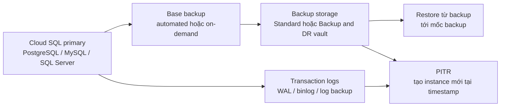
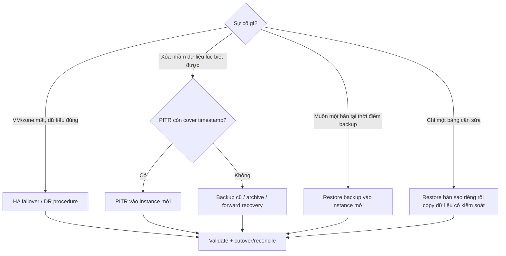

# Backups, point-in-time recovery và phục hồi Cloud SQL

## 1. Khi database gặp sự cố, cần khôi phục điều gì?

Một dịch vụ đặt hàng trên **Cloud Run** ghi dữ liệu vào **Cloud SQL for PostgreSQL**. Lúc 09:15, một bản migration sai xóa nhiều hàng trong bảng `orders`. High availability (HA) không cứu được dữ liệu này: instance dự phòng cũng nhận thay đổi hợp lệ ở mức database. Nếu bản backup gần nhất được tạo lúc 02:00, chỉ restore backup có thể làm mất các giao dịch phát sinh sau 02:00.

**Cloud SQL backups** và **point-in-time recovery (PITR)** giải quyết những mục tiêu khác nhau:

- **Backup restore:** đưa database về trạng thái của một bản backup đã có.
- **PITR:** sử dụng backup nền cùng các **transaction logs** để tạo một **instance mới** tại thời điểm cụ thể trước sự cố, trong khoảng thời gian thực sự còn được bảo vệ.
- **High availability / failover:** giảm downtime khi hỏng node/zone; **không** đảo ngược lệnh `DELETE`, `DROP TABLE` hoặc lỗi ứng dụng đã được commit.

Bài thuộc chương **Cloud SQL và AlloyDB** trong module **CLOUD_PROVIDERS_GCP**. Kiến thức áp dụng cùng Project/IAM, VPC, Compute Engine/GKE/Cloud Run, lưu trữ và các dịch vụ dữ liệu để thiết kế backup, phục hồi, phát hành và vận hành với **độ tin cậy, bảo mật và chi phí** được kiểm soát.

Sau bài học, bạn có thể:

1. Phân biệt **automated/on-demand backups, Standard/Enhanced tier, PITR, HA, replica và export**.
2. Đọc cấu hình backup, transaction logs và thời hạn khôi phục của **PostgreSQL, MySQL, SQL Server**.
3. Tạo backup trong lab và thực hiện PITR tới **instance mới**, không ghi đè instance nguồn.
4. Thiết kế quy trình **restore → kiểm tra dữ liệu → cutover → đối soát** phù hợp RPO/RTO.
5. Quản lý retained/final backups, backup vault, CMEK, IAM, giám sát và chi phí.

> **An toàn:** Mọi project, instance và thông tin kết nối trong bài là **giả định**. Lệnh thay backup/PITR settings có thể làm **restart instance** và phát sinh phí; lệnh restore tới **instance hiện hữu có thể ghi đè toàn bộ dữ liệu**. Chỉ thao tác ở project lab với quyền được cấp, không chạy lệnh restore production khi chưa phê duyệt và có bản sao an toàn.

## 2. RPO và RTO: hai câu hỏi khác nhau

| Chỉ tiêu | Câu hỏi nghiệp vụ | Ví dụ giả định |
| --- | --- | --- |
| **RPO – Recovery Point Objective** | Chấp nhận mất dữ liệu gần nhất tối đa bao lâu? | Tối đa 5 phút giao dịch |
| **RTO – Recovery Time Objective** | Chấp nhận dịch vụ chưa khôi phục tối đa bao lâu? | Trong vòng 60 phút |
| **Recovery window** | Hiện còn dữ liệu/log để PITR về những thời điểm nào? | 7 ngày gần nhất, tùy edition/cấu hình |
| **Retention** | Backup/log được giữ bao lâu theo policy? | Backup 30 ngày, transaction logs 7 ngày |
| **Restore test** | Đã chứng minh backup có thể dùng để phục hồi chưa? | Tạo instance riêng và xác minh dữ liệu |

**Retention 30 ngày không có nghĩa RPO bằng 30 ngày.** Một backup được chụp mỗi ngày chỉ cung cấp các mốc backup; nếu bật PITR và log đầy đủ, có thể chọn thời điểm gần sự cố hơn. **RTO cũng không bằng thời gian chạy lệnh restore**: còn kiểm tra dữ liệu, cập nhật kết nối, chạy migration tương thích, warmup ứng dụng và xác nhận nghiệp vụ.

```text
02:00                 09:14:50   09:15               09:40
 | Backup thành công      | PITR target | Xóa nhầm dữ liệu   | Bắt đầu phục hồi
 |------------------------|------------X----------------|
              Transaction logs được giữ liên tục
                               ↓
                    Instance phục hồi mới
```

Chỉ chọn thời điểm `09:14:50` nếu nó nằm trong **PITR recovery window** thực tế và trước thao tác xóa nhầm. Không đoán target từ thời gian người dùng báo lỗi: xem application logs, database audit và thời điểm commit.

## 3. Cloud SQL backup và transaction logs phối hợp ra sao?



**Bản backup nền và log phải cùng chuỗi dữ liệu hợp lệ** để PITR hoạt động. Tên log khác theo engine:

| Engine | Loại log dùng cho PITR | Ghi chú |
| --- | --- | --- |
| **PostgreSQL** | Write-ahead log (**WAL**) | Cloud SQL quản lý backup/log archiving |
| **MySQL** | Binary log (**binlog**) | Flag `binaryLogEnabled` phản ánh cấu hình liên quan PITR |
| **SQL Server** | Transaction log backups | Có yêu cầu/giới hạn theo database và edition |

Không nhầm **transaction logs dùng PITR** với **Cloud Logging application/database error logs**. Cloud Logging giúp điều tra nhưng không thay thế WAL/binlog/transaction log backup để phục hồi dữ liệu.

### Phân biệt 5 giải pháp hay bị nhầm

| Cơ chế | Phù hợp | Không bảo đảm |
| --- | --- | --- |
| **HA / automatic failover** | Hỏng VM/zone, tăng availability | Khôi phục dữ liệu trước một lệnh ghi sai |
| **Read replica** | Scale reads, hỗ trợ một số kịch bản DR | Backup độc lập; replica cũng có thể nhận dữ liệu xóa nhầm |
| **Automated backup** | Phục hồi về mốc backup, DR | Đúng từng giây giữa hai bản backup |
| **PITR** | Trở về một timestamp trong recovery window | Phục hồi tới ngoài retention/log window |
| **Logical export/import** | Chọn lọc bảng/database, di chuyển định dạng dữ liệu | Snapshot nhất quán toàn instance nếu không chuẩn bị |

## 4. Standard backups và Enhanced backups

Cloud SQL hiện cung cấp hai **backup options**. **Đừng mặc định tất cả instances dùng cùng CLI/cơ chế lưu trữ**, nhất là khi tổ chức chuyển sang **Backup and DR Service**.

| Đặc điểm | **Standard backup tier** | **Enhanced backup tier** |
| --- | --- | --- |
| Quản lý | Cloud SQL native backup settings | **Backup and DR**: backup plan + backup vault |
| Automated/on-demand | Có | Có, theo backup plan |
| Retention | Quy tắc của Cloud SQL; số lượng/mức giới hạn tùy edition | Chính sách backup plan/vault, **enforced retention** |
| Cô lập quản trị | Trong phạm vi Cloud SQL/project và các kiểm soát tương ứng | Có thể dùng **backup management project** tách biệt |
| Cross-region backup | Theo khả năng/loại backup của Cloud SQL | Backup vault có thể nằm vùng khác theo điều kiện hỗ trợ |
| PITR | Dùng recovery window/logs của instance | Có thể dùng **backup vault/data source** để PITR |
| Chi phí | Cloud SQL backup và logs theo SKU | Backup and DR storage/management, có thể cộng data transfer |

**Enhanced backup** không đồng nghĩa dữ liệu có thể luôn restore ngay khi cả vùng nguồn bị mất. Nếu instance được mã hóa bằng **CMEK** và backup vault ở vùng khác nhưng dùng **KMS key tại vùng nguồn**, khi vùng nguồn không hoạt động có thể **không giải mã được backup** cho đến khi key trở lại. Kiến trúc disaster recovery cần kiểm thử cả **key availability**, region placement và quyền KMS.

### Automated, on-demand, final và retained backups

| Loại backup | Khi được tạo | Điểm cần nhớ |
| --- | --- | --- |
| **Automated** | Theo lịch từ backup config/plan | Phải giám sát bản backup **thực sự thành công** |
| **On-demand** | Người vận hành/automation yêu cầu | Trước migration lớn hoặc một thay đổi nguy cơ cao |
| **Final backup** | Được tạo lúc xóa instance nếu tính năng được cấu hình/yêu cầu | Khác với retained backup; có retention riêng |
| **Retained backup** | Backup đang có được giữ sau khi instance bị xóa theo thiết lập | Không phải mặc định toàn bộ backups sống mãi |

Theo tài liệu hiện hành, **Standard on-demand backup** có thể được giữ đến khi chủ động xóa, trong khi **Enhanced on-demand backups** tuân retention rule của backup plan, tối đa theo quy tắc vault. Final backups cũng có thời hạn riêng (Standard thường cấu hình trong khoảng **1–365 ngày**, Enhanced theo backup plan/vault tối đa **10 năm**). **Không lấy một con số mặc định làm chính sách lưu trữ của công ty**: đọc cấu hình instance/plan và tổ chức thực tế.

## 5. PITR: điều kiện và giới hạn theo edition/engine

### 5.1. Điều kiện cần

1. Instance có **automated backups** và **PITR enabled**.
2. Transaction logs được lưu cho khoảng thời gian cần phục hồi, không có khoảng trống làm mất khả năng khôi phục.
3. Timestamp được chọn nằm giữa **earliest recovery time** và **latest recovery time** thực tế.
4. Có quota, quyền IAM/KMS, region và machine configuration phù hợp để **tạo instance mới**.
5. Đội vận hành đã chuẩn bị **cutover và kiểm tra dữ liệu**, không chỉ lệnh clone.

**Quan trọng:** PITR **luôn tạo instance mới**, không thể thực hiện PITR trực tiếp đè lên instance đang tồn tại. Đừng nhầm với **restore từ backup**, thao tác có thể chọn instance đích hiện hữu và **ghi đè dữ liệu của instance đó**.

### 5.2. PITR defaults khác theo cách tạo instance

Với **Cloud SQL Enterprise Plus**, PITR thường **enabled mặc định** trên instance mới. Với **Enterprise**, tạo qua **Google Cloud Console** thường bật PITR mặc định, nhưng tạo qua **gcloud/Terraform/API** có thể chưa bật; riêng MySQL HA có thêm điều kiện mặc định. **Luôn kiểm tra config thực tế**, không dựa trên câu “Cloud SQL tự có PITR”.

**PITR log retention**:

| Edition | Khoảng cho phép | Mặc định thường gặp |
| --- | --- | --- |
| **Cloud SQL Enterprise** | 1–7 ngày | 7 ngày |
| **Cloud SQL Enterprise Plus** | 1–35 ngày | 14 ngày |

Đây là **cấu hình số ngày lưu transaction logs**, không phải cam kết mọi giây trong khoảng đều phục hồi được. Kiểm tra **earliest/latest recovery times** trước khi thực hiện.

### 5.3. Khác biệt lệnh enable PITR

- PostgreSQL và SQL Server: `gcloud sql instances patch INSTANCE --enable-point-in-time-recovery`.
- MySQL: `gcloud sql instances patch INSTANCE --enable-bin-log` (và kiểm tra `backupConfiguration.binaryLogEnabled`).
- Với PostgreSQL/SQL Server, cấu hình được phản ánh ở `backupConfiguration.pointInTimeRecoveryEnabled`.

**Bật PITR trên instance hiện hữu có thể khiến instance restart.** Thay đổi backup tier, retention hoặc vị trí log cũng có thể ảnh hưởng availability/chi phí; lên lịch change window và backup trước. **Tắt rồi bật PITR để xử lý log có thể làm mất khả năng khôi phục thời gian trước đó.**

## 6. Chọn đúng cách phục hồi



**Không phục hồi toàn bộ production chỉ để lấy lại một bảng** nếu có thể phục hồi vào **instance cách ly**, trích dữ liệu đúng rồi merge bằng transaction/đối soát. PITR thường phục hồi **toàn instance**; một số khả năng chọn database riêng chỉ áp dụng theo engine/tính năng (ví dụ SQL Server có tùy chọn), không được suy rộng sang PostgreSQL/MySQL.

## 7. Preflight: kiểm tra backup/PITR trước sự cố (chỉ đọc)

Giả định lab có:

```text
Project:    acme-db-lab
Instance:   orders-pg-lab
Region:     asia-southeast1
Engine:     PostgreSQL
Backup:     Standard tier trong lab
```

### Kiểm tra cấu hình instance

```bash
# CHỈ ĐỌC – xác nhận đúng project và instance
gcloud sql instances list --project=acme-db-lab

gcloud sql instances describe orders-pg-lab \
  --project=acme-db-lab \
  --format="yaml(name,region,databaseVersion,state,settings.edition,settings.backupConfiguration,settings.availabilityType,settings.ipConfiguration)"

# Standard backups: danh sách và chi tiết bản backup
gcloud sql backups list \
  --instance=orders-pg-lab \
  --project=acme-db-lab

gcloud sql backups describe BACKUP_ID \
  --instance=orders-pg-lab \
  --project=acme-db-lab
```

**`BACKUP_ID`** phải lấy từ kết quả list của instance thực; không suy từ ngày hoặc tự đặt. Trong kết quả, xem `status`, `type`, `startTime`, `endTime`, retention và vị trí. Với **Enhanced backup**, xem **Cloud SQL Backups → Enhanced tier → Backup vault/Backup plan**, vì `gcloud sql backups list` không đại diện đầy đủ mọi backup managed trong vault.

### Kiểm tra khả năng phục hồi tại thời điểm cụ thể

```bash
# CHỈ ĐỌC: xem thời điểm mới nhất còn có thể PITR khi instance không sẵn sàng
gcloud sql instances get-latest-recovery-time orders-pg-lab \
  --project=acme-db-lab
```

Lệnh trên đặc biệt hữu ích trong kịch bản instance **unavailable/deleted**; với instance còn hoạt động, Console và thông tin PITR window giúp xác nhận mốc. **Không lấy timestamp của backup gần nhất thay cho latest log recovery time.** Nếu instance còn khỏe, đừng kết luận fail chỉ vì một lệnh truy vấn dành cho unavailable case không trả dữ liệu theo mong đợi.

**Cần kiểm tra thêm:** Cloud SQL Admin API, `settings.backupConfiguration.enabled`, PITR flag, transactionLogRetentionDays, time zone UTC, instance storage, IAM và KMS. Xác định instance đang sử dụng **Standard hay Enhanced**, không đoán từ tên.

## 8. Lab A — bật automated backup/PITR và tạo on-demand backup

Lab sử dụng **PostgreSQL instance có sẵn**, tránh tạo một production-class instance chỉ để học. **Các lệnh sau thay cấu hình và có thể restart instance**, chỉ thực hiện trên `orders-pg-lab` sau khi đã xác nhận quyền và tài nguyên.

### 8.1. Automated backups

```bash
# THAY ĐỔI INSTANCE lab: chọn backup window bắt đầu 02:00 UTC
gcloud sql instances patch orders-pg-lab \
  --project=acme-db-lab \
  --backup-start-time=02:00
```

`--backup-start-time=HH:MM` là **thời điểm bắt đầu backup window theo UTC**, không phải bảo đảm backup hoàn tất đúng HH:MM. Thực tế Cloud SQL lên lịch backup trong cửa sổ tương ứng, cần giám sát lần backup thành công.

### 8.2. Bật PITR với retention phù hợp

```bash
# THAY ĐỔI INSTANCE PostgreSQL lab: có thể restart
gcloud sql instances patch orders-pg-lab \
  --project=acme-db-lab \
  --enable-point-in-time-recovery \
  --retained-transaction-log-days=7

# CHỈ ĐỌC: kiểm tra cấu hình đã thực sự áp dụng
gcloud sql instances describe orders-pg-lab \
  --project=acme-db-lab \
  --format="yaml(settings.backupConfiguration)"
```

Với MySQL, dùng `--enable-bin-log` thay vì copy `--enable-point-in-time-recovery`. Với Enterprise Plus, retention có thể dài hơn; đừng đặt 35 ngày cho Enterprise rồi ngạc nhiên vì API từ chối.

### 8.3. On-demand backup trước migration

```bash
# THAY ĐỔI: tạo backup trong Standard tier, có thể phát sinh phí
gcloud sql backups create \
  --instance=orders-pg-lab \
  --project=acme-db-lab \
  --description="lab-before-schema-change"

# CHỈ ĐỌC: xác minh backup status sau khi operation hoàn tất
gcloud sql backups list \
  --instance=orders-pg-lab \
  --project=acme-db-lab
```

**Chỉ bắt đầu migration khi backup thực sự có trạng thái thành công.** Một lệnh tạo backup trả về operation ID hoặc đang `RUNNING` chưa phải bằng chứng dữ liệu đã có thể restore.

## 9. Lab B — kiểm tra PITR bằng instance mới

Thực hiện một phép thử **không đụng dữ liệu production**. Với lab PostgreSQL, tạo dữ liệu trong schema riêng và xác định timestamp trước thao tác gây lỗi.

### 9.1. Chuẩn bị dữ liệu mẫu

Kết nối vào PostgreSQL lab bằng Cloud SQL Auth Proxy/Cloud SQL connector hoặc đường kết nối được IAM/VPC cho phép, sau đó chạy:

```sql
-- CHỈ chạy trên database thử nghiệm, tạo schema riêng
CREATE SCHEMA IF NOT EXISTS recovery_lab;

CREATE TABLE IF NOT EXISTS recovery_lab.orders (
    order_id TEXT PRIMARY KEY,
    amount NUMERIC(12, 2) NOT NULL,
    status TEXT NOT NULL
);

INSERT INTO recovery_lab.orders(order_id, amount, status)
VALUES ('ORDER-LAB-1001', 125.00, 'PAID')
ON CONFLICT (order_id) DO NOTHING;

SELECT * FROM recovery_lab.orders ORDER BY order_id;
```

Đợi transaction commit và bảo đảm recovery window bao trùm dữ liệu vừa tạo. Ghi nhận **timestamp UTC chính xác** từ PostgreSQL, đồng thời đối chiếu Cloud SQL PITR window:

```sql
-- CHỈ ĐỌC; thời điểm của server, không phải client laptop
SELECT clock_timestamp() AT TIME ZONE 'UTC' AS utc_now;
```

Ghi timestamp này làm mốc tham khảo, đợi vài giây rồi mới chạy thao tác xóa test.

### 9.2. Giả lập xóa nhầm có kiểm soát

```sql
-- CẢNH BÁO: thao tác PHÁ DỮ LIỆU LAB trong schema recovery_lab
DELETE FROM recovery_lab.orders
WHERE order_id = 'ORDER-LAB-1001';

SELECT * FROM recovery_lab.orders WHERE order_id = 'ORDER-LAB-1001';
```

Không dùng bảng `public.orders` hoặc `DELETE FROM orders` thiếu điều kiện. Không tạo mẫu destructive test trên instance production, kể cả khi bảng có tên gần giống.

### 9.3. PITR tạo một instance mới

**Chọn timestamp trong recovery window, sau INSERT commit nhưng trước DELETE commit.** Ví dụ sau chỉ minh họa cú pháp; `2026-11-19T02:31:00Z` phải **thay bằng mốc UTC thật của lab**, không chạy nguyên văn:

```bash
# THAY ĐỔI: tạo Cloud SQL instance MỚI, phát sinh phí
# Chỉ chạy sau khi timestamp đã được xác minh nằm trong PITR window
gcloud sql instances clone orders-pg-lab orders-pg-recovery-lab \
  --project=acme-db-lab \
  --point-in-time="2026-11-19T02:31:00Z"
```

Cloud SQL **không sửa instance nguồn** trong thao tác PITR; instance mới `orders-pg-recovery-lab` có thể cần IP/network/SA/backup settings/cấu hình kết nối được kiểm tra lại trước khi dùng. **Không mặc định clone có IP hoặc mọi integration giống hệt nguồn**.

### 9.4. Xác minh kết quả

```bash
# CHỈ ĐỌC
gcloud sql instances describe orders-pg-recovery-lab \
  --project=acme-db-lab \
  --format="yaml(name,region,databaseVersion,state,ipAddresses,settings)"
```

Kết nối **đích recovery** bằng tài khoản test và chạy:

```sql
SELECT order_id, amount, status
FROM recovery_lab.orders
WHERE order_id = 'ORDER-LAB-1001';
```

**Kỳ vọng:** hàng `ORDER-LAB-1001` vẫn tồn tại trên instance recovery, còn instance nguồn sau DELETE không có hàng đó. Kiểm tra thêm `COUNT(*)`, constraints, indexes, extensions, user permissions và log của workload test để xác minh phục hồi toàn vẹn.

Đây mới là **test dữ liệu**, chưa phải cutover. **Đừng đổi connection string production** chỉ vì có một hàng xuất hiện trên clone.

## 10. Restore từ một backup cụ thể: an toàn khi chọn đích

**Restore backup và PITR không giống nhau**: backup restore về trạng thái **lúc backup được chụp**, còn PITR chọn một mốc nằm trong khoảng transaction logs. Với Standard backups, bạn có thể chọn **instance mới** hoặc **instance hiện hữu**, tùy phương thức/điều kiện sản phẩm.

### 10.1. Phương án khuyến nghị: restore sang instance mới

Để tránh ghi đè dữ liệu đang chạy, ở **Google Cloud Console → Cloud SQL → Backups → Standard tier**:

1. Chọn đúng **source instance**, engine, project và bản backup có `SUCCESSFUL`.
2. Nhấn **Restore**, xem **backup ID**, thời điểm backup và vùng chứa.
3. Trong phần destination, chọn **Restore to a new instance**.
4. Đặt ID mới, ví dụ `orders-pg-from-backup-lab`, xem database version/region, storage capacity, encryption và network.
5. Xác nhận tạo instance mới, theo dõi `Operations` đến khi hoàn tất.
6. Kết nối **instance đích**, xác minh row count, constraints, schema và dữ liệu trước khi đưa vào luồng ứng dụng.

Cloud SQL yêu cầu database version của destination phù hợp source backup. Khi restore sang instance mới, storage size được thiết lập dựa trên dung lượng đã cấu hình và dung lượng backup theo quy tắc Cloud SQL; chi phí instance mới phát sinh ngay khi tồn tại.

### 10.2. Lệnh restore vào instance hiện hữu — chỉ để nhận diện nguy cơ

```bash
# NGUY HIỂM: ví dụ CÚ PHÁP restore vào instance ĐÃ TỒN TẠI.
# KHÔNG THỰC THI trên production hoặc nếu chưa có approval/backup đích.
gcloud sql backups restore BACKUP_ID \
  --project=acme-db-lab \
  --backup-instance=orders-pg-lab \
  --restore-instance=orders-pg-restore-target-lab
```

**Đây không phải lệnh tạo một instance mới tùy ý từ backup ID.** Với cách dùng backup ID truyền thống, target phải được chuẩn bị theo điều kiện của lệnh; các phương thức mới dùng **backup resource name** có thể tạo target mới theo các tùy chọn tương ứng. Hãy đọc `gcloud sql backups restore --help`/tài liệu engine và **không tự thay target bằng instance production**.

**Restore vào instance hiện hữu ghi đè toàn bộ dữ liệu hiện có của target, bao gồm PITR logs trước đó.** Các read replicas của target phải được xử lý theo yêu cầu restore; không xóa replicas production một cách tùy tiện. Backup cũ vẫn có thể còn được giữ theo retention, nhưng không coi đó là giấy phép phục hồi mà không có kế hoạch.

### 10.3. “Sao chép một bảng” không cần restore production

Khi xóa nhầm một bảng nhỏ, thường an toàn hơn khi:

1. PITR/restore sang **instance riêng**.
2. Trích dữ liệu bảng đó bằng công cụ PostgreSQL như `pg_dump` hoặc export đã được bảo vệ.
3. Đưa vào **staging table** trên instance hiện hành.
4. So sánh primary keys, rows bị thiếu và những updates đã xảy ra sau sự cố.
5. Chỉ sau review mới **merge có điều kiện** và commit transaction.

**Không copy đè nguyên bảng** nếu các bản ghi khác đã được cập nhật hợp lệ kể từ mốc recovery. Recovery cần bảo toàn cả thay đổi đúng đã diễn ra sau lỗi.

## 11. Enhanced backups và trường hợp instance đã bị xóa

Với **Enhanced backup tier**, Cloud SQL dùng một **Backup and DR backup plan** và **backup vault**. Backup plan được tạo ở cùng region với instance, trong khi vault có thể nằm vùng khác theo điều kiện được hỗ trợ; backup management project có thể tách biệt project ứng dụng.

### 11.1. Trình tự phục hồi từ vault

1. Vào **Cloud SQL → Backups → Enhanced tier** và chọn backup vault của project quản trị.
2. Xác định source instance/data source, backup có trạng thái hợp lệ, lịch/retention và CMEK.
3. Chọn **Restore to new instance** để kiểm tra trước; nếu PITR, xác nhận target timestamp trong recovery window.
4. Xem location constraints, project đích, IAM Backup and DR và KMS; kiểm tra cross-region backup **không mặc nhiên cho phép cross-region PITR target**.
5. Sau khi restore, đối chiếu cấu hình, dữ liệu và kết nối mới trước khi cutover.

Đối với **PITR bằng enhanced backup vault**, Cloud SQL cung cấp lệnh riêng theo **data source resource**, ví dụ:

```bash
# THAY ĐỔI: chỉ minh họa cú pháp, KHÔNG chạy với placeholder
# DATA_SOURCE phải lấy từ backup vault thực tế sau khi validate
gcloud sql instances point-in-time-restore DATA_SOURCE \
  orders-pg-enhanced-recovery-lab \
  "2026-11-19T02:31:00Z" \
  --project=acme-db-lab \
  --region=asia-southeast1
```

Nếu vault ở region khác, **PITR có thể vẫn bị giới hạn target về region của source**. Đọc **Cloud SQL PITR using backup vault** cho edition/engine và backup plan cụ thể; không hoán đổi `gcloud sql instances clone` với `point-in-time-restore` khi data source nằm trong vault.

### 11.2. Cloud SQL instance đã bị xóa

Trường hợp xóa nhầm instance có ba đường phục hồi cần phân biệt:

- **Retained backups:** bản backup trước đó được cấu hình giữ lại sau khi instance bị xóa.
- **Final backup:** bản được tạo tại lúc xóa nếu chính sách cho phép/đã bật.
- **PITR deleted instance:** có thể phục hồi trong recovery window khi dữ liệu/log và metadata cần thiết vẫn còn theo điều kiện engine/backup option.

Với **Standard tier**, các bản retained backups có metadata về **source instance deletion time**. Một lệnh PITR instance đã xóa có dạng:

```bash
# CÚ PHÁP THAM KHẢO - yêu cầu deletion timestamp và PITR window thật.
# Không thực thi với mốc ví dụ hoặc tên instance đã tái sử dụng.
gcloud sql instances clone DELETED_SOURCE_INSTANCE \
  recovered-from-deletion-lab \
  --project=acme-db-lab \
  --point-in-time="2026-11-19T02:31:00Z" \
  --source-instance-deletion-time="2026-11-19T02:40:00Z"
```

Với **Enhanced tier**, thay vì cách trên thường cần tìm **backup vault data source** và gọi `point-in-time-restore`. Nếu thiếu `source-instance-deletion-time` hoặc chọn nhầm bản backup của một instance ID được tái sử dụng, có nguy cơ restore sai nguồn.

**Không dựa vào mặc định “Cloud SQL giữ backup sau xóa”**. Kiểm tra retained/final backup policy **trước khi xóa instance**, vì dữ liệu có thể bị xóa vĩnh viễn khi không được bảo vệ. Đừng xem backup là phương án đảm bảo luôn giữ lại IP/endpoint cũ của một instance đã xóa; chuẩn bị cập nhật cấu hình ứng dụng.

## 12. RPO/RTO thực tế và quy trình cutover sang instance phục hồi

Sau khi clone/PITR tạo instance mới, **nguồn vẫn có thể nhận writes mới**. Nếu chuyển ứng dụng sang clone ở thời điểm quá khứ mà không điều phối, dữ liệu hợp lệ ghi sau target timestamp sẽ **không xuất hiện** trên clone. Đây là quyết định nghiệp vụ cần được ghi rõ.

### Runbook cutover 8 bước

1. **Khoanh vùng sự cố:** xác định chính xác thời điểm thay đổi sai, những database/bảng và các dịch vụ liên quan.
2. **Giữ bằng chứng:** audit/logs/transaction IDs, backup ID, PITR window; **không xóa nguồn hiện tại**.
3. **Chặn hoặc điều tiết writes** ở ứng dụng bị ảnh hưởng, hoặc thiết kế event queue/reconciliation nếu không thể dừng.
4. **Restore/PITR sang instance mới** trong môi trường cô lập, không mở kết nối Internet/authorized networks tùy tiện.
5. **Kiểm tra data correctness**: row count, checksums, khóa ngoại, indexes, extension, users/roles, dữ liệu nhạy cảm.
6. **Reconcile** writes hợp lệ sau PITR target bằng nguồn nghiệp vụ độc lập: outbox, Pub/Sub, payment ledger, Cloud Storage audit hoặc business logs.
7. **Cutover có kiểm soát**: cập nhật connection name/IP/secret/Cloud SQL connector cho Cloud Run/GKE, kiểm tra IAM, network, pool connections, read replicas và readiness.
8. **Giám sát và rollback plan**: kiểm tra API success rate, p95 latency, số order hợp lệ, error logs; giữ nguồn cũ ở trạng thái an toàn cho đến hết giai đoạn xác minh.

**RTO** bao gồm tất cả các bước, không chỉ thời gian Cloud SQL restore. Nếu ứng dụng có nhiều services cùng truy cập database, đổi connection string phải đi kèm rollout/secret versioning phù hợp; không cho một phần services ghi vào nguồn cũ, phần khác ghi vào clone mà không có cơ chế đồng bộ.

### Ví dụ bảng đối soát

| Đối tượng | Kiểm tra trên recovery | Hậu quả nếu bỏ qua |
| --- | --- | --- |
| `orders` | PKs, count theo trạng thái, payment references | Đơn hàng hợp lệ bị mất hoặc duplicate |
| `inventory_reservations` | Reservation IDs, TTL, stock balance | Bán vượt tồn kho hoặc giữ hàng mãi |
| `payments` | Đối chiếu gateway transaction IDs | Double charge/refund sai |
| `schema_migrations` | Version của application và database | App mới không tương thích schema cũ |
| IAM/users | Service account/db users/connectivity | Cutover thành công trên DB nhưng app 403/connection failed |

**Không gọi rollback schema bằng cách xóa bừa migration history**. Nếu PITR về schema trước migration, ứng dụng đang chạy phiên bản mới có thể không tương thích; cần điều phối rollback/deploy version phù hợp.

## 13. Bảo mật: IAM, mạng, CMEK và backup isolation

### 13.1. Quyền phục hồi là quyền nhạy cảm

Không cấp role `roles/cloudsql.admin` cho mọi developer hoặc CI. Các thao tác chính gồm quyền **Cloud SQL instances get/clone/update**, **backup create/list/restore**, cùng quyền ở **Backup and DR vault** nếu dùng Enhanced; IAM cần tra theo phương thức API thực tế. Người chỉ cần xem backups có thể dùng các quyền read-only phù hợp.

Tách vai trò:

| Danh tính | Nhiệm vụ | Guardrail |
| --- | --- | --- |
| **Operator đọc tình trạng** | Xem backup status/retention/monitoring | Không có quyền restore hoặc xóa |
| **Backup automation** | Tạo backup, kiểm tra thành công | Không cần quyền root DB |
| **Recovery operator** | Clone/PITR/restore vào target đã phê duyệt | Approval, audit, giới hạn project đích |
| **Runtime Cloud Run/GKE SA** | Kết nối database nghiệp vụ | Không có quyền xóa backups |
| **Cloud SQL service agent** | Hoạt động dịch vụ/KMS theo sản phẩm | Không nhầm với tài khoản ứng dụng |

### 13.2. VPC, Private IP và kết nối mới

Instance phục hồi **không mặc nhiên có cùng IP hoặc DNS** của nguồn. Kiểm tra **private services access/PSC**, VPC network, firewall/route, Cloud SQL Auth Proxy/connector và allowed network policies theo cách kết nối đã chọn. Đừng mở `0.0.0.0/0` để test; ưu tiên private networking và IAM database credentials.

### 13.3. Customer-managed encryption keys (CMEK)

Khi dùng CMEK, Cloud SQL/Backup and DR có thể cần quyền `roles/cloudkms.cryptoKeyEncrypterDecrypter` cho **Cloud SQL service agent của project đích** trên key phù hợp. Khi restore sang region khác, cần **KMS key cùng region đích** nếu cấu hình CMEK đích. Với cross-region enhanced backup, một backup vault vùng khác **vẫn có thể phụ thuộc key gốc ở vùng nguồn**: đây là rủi ro khi thiết kế DR.

**Đừng xóa/disable KMS key version** chỉ vì instance gốc đã xóa. Nếu không còn key, backup được mã hóa bằng key ấy có thể trở nên không thể khôi phục.

### 13.4. Bảo vệ backup khỏi xóa nhầm/ransomware

- Dùng **Backup and DR enforced retention/backup vault** khi cần phân tách quyền xóa và thời gian bảo vệ.
- Cân nhắc backup management project riêng, KMS governance, logging và organization policy.
- Kiểm tra khả năng phục hồi khi **workload project bị xóa/compromised**, không chỉ khi một DBA xóa bảng.
- Đánh giá quyền Cloud SQL/Backup and DR/Cloud KMS/VPC Service Controls khi phục hồi cross-project.
- Giữ dữ liệu test/backup ở vùng phù hợp **residency, retention và chính sách PII**.

## 14. Monitoring, alert và diễn tập phục hồi

Backup **được bật** không có nghĩa luôn **đã có backup dùng được**. Cần kiểm tra cả cấu hình lẫn bằng chứng restore.

| Tín hiệu | Nguồn kiểm tra | Nên cảnh báo khi |
| --- | --- | --- |
| Backup job success/failure | Cloud SQL backups/operations, Cloud Monitoring/Logging | Scheduled backup thất bại hoặc không có bản thành công mới |
| Tuổi bản backup gần nhất | Backup metadata + dashboard | Quá ngưỡng RPO/backup policy |
| PITR enabled + log retention | `backupConfiguration` / Backup plan | Tắt ngoài kế hoạch hoặc thay retention |
| Earliest/latest recovery time | PITR tools/Console | Không bao phủ thời điểm cần bảo vệ |
| Restore drill duration | Thời điểm bắt đầu/hoàn tất + app validation | Vượt RTO mục tiêu |
| Free disk/transaction-log usage | Cloud SQL storage metrics | Log/disk gần đầy, auto-increase chưa phù hợp |
| Backup vault/retained backup | Backup and DR policy/metadata | Retention thay đổi, vault bị xóa/không có backup |
| KMS key availability | Cloud KMS/IAM/Audit Logs | Key disabled, IAM revoke hoặc vùng key không sẵn |
| Business reconciliation | Cloud SQL queries/application ledger | Số liệu sai sau restore/cutover |

### Một diễn tập tốt phải chứng minh 4 điều

1. **Có bản backup/log hợp lệ** cho recovery objective.
2. **Có quyền và network** để tạo target mới.
3. **Có quy trình xác minh dữ liệu** và cutover mà không nhân đôi hoặc mất giao dịch hợp lệ.
4. **Thời gian toàn bộ quá trình** nằm trong RTO và tài liệu runbook còn dùng được.

Ghi báo cáo diễn tập: backup ID, recovery target, recovery window, duration, số bản ghi đối soát, lỗi/khác biệt IAM, các bước làm thủ công, phí phát sinh và owner. Lên lịch diễn tập định kỳ, không chỉ kiểm tra backup status từ dashboard.

## 15. Chi phí và tối ưu chính sách backup

Các thành phần có thể phát sinh phí:

- **Standard backup storage**, retained/final backups và transaction logs, tùy edition/region.
- **Enhanced backup/Backup and DR**: backup storage/management, vault retention và **inter-region data transfer** khi vault ở vùng khác.
- **PITR logs** lâu hơn dẫn tới lưu trữ nhiều hơn; một số cấu hình lưu log trên disk có thể ảnh hưởng dung lượng instance.
- **Instance restore mới**: CPU/RAM/storage và các tính năng tương ứng được tính phí trong suốt thời gian chạy.
- **Cloud KMS**, network egress, Cloud Logging và workload đọc/kiểm chứng dữ liệu nếu có.

### Bài toán sizing ví dụ

Giả định một database có **200 GiB dữ liệu**, logs phát sinh **15 GiB/ngày**, chọn lưu logs **7 ngày**. Khối lượng log thô ước tính:

```text
15 GiB/ngày × 7 ngày = 105 GiB
```

**Đây không phải dung lượng lưu hoặc hóa đơn chính xác**: nén, backup incrementals, retention policy, changes rate, engine và SKU ảnh hưởng phí thực tế. Dùng **Cloud SQL pricing**, **Backup and DR pricing** và **Cloud Billing export** để xây ngân sách. Đừng giảm PITR retention chỉ vì phí tăng mà chưa so lại RPO/compliance.

### Giới hạn tài nguyên cần kiểm tra

- Khả năng provision một **instance thứ hai** trong project/region: quota, edition, region availability.
- Kích thước database/transaction logs và thời gian restore thực tế.
- Lệnh restore bị giới hạn tần suất theo project/instance/region; **không retry tạo clone hàng loạt** để “tăng tốc” recovery.
- Nếu recovery nằm ở region khác, tính cross-region support, network connectivity, KMS và chi phí data transfer trước khi cần dùng.

## 16. Troubleshooting: từ triệu chứng đến quyết định

| Triệu chứng | Nguyên nhân thường gặp | Cách xử lý |
| --- | --- | --- |
| Không thấy backup gần nhất | Automated backup tắt, job lỗi hoặc đang chạy | `instances describe`, `backups list`, Operations |
| Backup tạo nhưng chưa restore được | Status chưa `SUCCESSFUL` | Đợi operation hoàn tất, kiểm tra lỗi |
| PITR không khả dụng | Feature chưa bật, chưa có backup/log chain | Bật theo engine/edition, không kỳ vọng log quá khứ hồi sinh |
| Không chọn được mốc PITR mong muốn | Ngoài earliest/latest recovery time | Chọn mốc được hỗ trợ hoặc restore backup/archive |
| `gcloud sql instances clone --point-in-time` lỗi | Timestamp sai timezone/format hoặc hết window | Dùng UTC RFC 3339, xem instance/backup config |
| Đã dùng `--enable-point-in-time-recovery` trên MySQL nhưng không như kỳ vọng | MySQL dùng binlog flag | Xem `binaryLogEnabled` và hướng dẫn MySQL |
| Enhanced PITR không tìm thấy backup | Sai vault/data source hoặc region/project | Xác minh backup plan/vault và `DATA_SOURCE` |
| Backup có nhưng instance đích không tạo được | Quota, database version, storage/KMS/region | Kiểm tra cụ thể từng điều kiện |
| Restore hiện hữu bị chặn bởi read replicas | Target có replicas chưa được xử lý | Lên kế hoạch riêng; không xóa replica production tùy tiện |
| Phục hồi xong ứng dụng bị lỗi 401/403/TCP | IAM/service account/VPC/connector/credentials | Kiểm tra endpoint mới và quyền liên quan |
| Dữ liệu đúng ở thời điểm PITR nhưng thiếu giao dịch mới | Recovery target trước các writes hợp lệ | Reconcile từ business ledger/CDC/outbox |
| Cross-region vault có backup nhưng không giải mã được | CMEK key vùng nguồn không khả dụng | KMS/region DR design, không disable key |
| Backup storage tăng cao | Retention dài, backups giữ sau delete, logs nhiều | Billing SKU, backup plan, retained/final backups |

### Runbook khi xảy ra xóa nhầm dữ liệu

1. Xác định **thời điểm commit lỗi**, instance, database, bảng và dữ liệu chịu ảnh hưởng.
2. **Tạm dừng writes gây hại** (không tự xóa instance), thông báo incident owner.
3. Xem backup/PITR option, window và IAM/KMS; chọn **instance phục hồi mới**.
4. PITR về mốc trước lỗi; kiểm tra bản sao và xác minh data correctness.
5. Đối chiếu các writes hợp lệ sau mốc khôi phục; quyết định **merge chọn lọc** hay cutover.
6. Cập nhật kết nối Cloud Run/GKE, chạy integration/health/SLO checks, theo dõi quota/cost.
7. Giữ bằng chứng, tổng kết RPO/RTO thực đo, root cause, rollback và biện pháp ngăn lỗi lặp.

## 17. Ba tình huống thiết kế thực tế

### 17.1. Migration xóa nhầm bảng trên Cloud SQL for PostgreSQL

Sự cố xảy ra lúc 14:05, PITR enabled và recovery window vẫn chứa 14:04. **Ưu tiên PITR sang instance riêng** tại 14:04, trích dữ liệu bảng mất rồi **merge** vào database hiện tại. Nếu database có những transactions đúng sau 14:04, **không** đổi toàn bộ production về bản clone mà chưa đối soát.

**Bằng chứng hoàn thành:** row counts, PK consistency, payment/order ledger và không có lỗi app tăng thêm sau merge.

### 17.2. Cloud SQL primary bị mất khả năng phục vụ

Một VM/zone của Cloud SQL HA bị lỗi nhưng dữ liệu nhất quán. Trước hết dùng **HA/failover** theo runbook sản phẩm, không chạy PITR về một mốc cũ để chữa lỗi availability. Nếu cả vùng không còn phục vụ và có backup ngoài vùng, kiểm tra **cross-region restore/PITR restrictions, CMEK, KMS, connectivity và thời gian provision**.

**Bằng chứng hoàn thành:** API phục vụ trở lại, replication/HA đạt trạng thái mong đợi, dữ liệu đã được kiểm tra và RTO ghi nhận.

### 17.3. Xóa nhầm instance đang dùng Enhanced backups

Một admin xóa instance nhưng backup plan đã cấu hình **vault ở project quản trị riêng**. Đội khôi phục kiểm tra retained/final backup, data source và quyền KMS; tạo instance mới thay vì tái sử dụng tên cũ vội vàng, sau đó cập nhật connectors và app secrets. Nếu yêu cầu PITR về trước thời điểm xóa, phải kiểm tra **PITR window và data source**, không chỉ tìm bản backup gần nhất.

**Bằng chứng hoàn thành:** có thể phục hồi dù workload project bị gián đoạn, dữ liệu đầy đủ và không mất quyền truy cập backup vault.

## 18. Bài tập và câu hỏi kiểm chứng

1. **Phân biệt HA/PITR:** Một `DELETE` sai đã commit trên primary và xuất hiện ở standby. Chuyển sang standby có khôi phục dữ liệu trước `DELETE` không? **Không**; cần backup/PITR hoặc logic recovery.
2. **RPO:** Backup hằng ngày lúc 02:00, lỗi lúc 09:00, không có PITR. Trong trường hợp xấu, khoảng dữ liệu hợp lệ có thể mất là bao lâu? **Đáp án:** xấp xỉ 7 giờ, chưa tính những sai khác mốc backup.
3. **PITR target:** Bug bắt đầu 14:05:15 UTC; earliest recovery 2 ngày trước, latest 14:10. Chọn mốc nào? **Gợi ý:** trước transaction commit lỗi, ví dụ 14:05:00 nếu xác minh không có cập nhật sai trước đó.
4. **Restore method:** Vì sao `gcloud sql backups restore` vào instance hiện hữu nguy hiểm hơn PITR tạo instance mới? **Đáp án:** có thể ghi đè toàn bộ dữ liệu/PITR logs của target.
5. **Default khác nhau:** Một PostgreSQL Enterprise tạo qua Terraform chưa bật PITR. Có nên mặc định 7 ngày lịch sử đã được lưu không? **Không**; phải kiểm tra feature và backup config từ khi tạo.
6. **Engine-specific:** Trên MySQL, flag gcloud thường dùng bật PITR là gì? **Đáp án:** `--enable-bin-log`; PostgreSQL/SQL Server dùng `--enable-point-in-time-recovery`.
7. **Backup options:** Khi nào chọn Enhanced tier? **Gợi ý:** cần backup plan/vault tách quản trị, enforced retention, cross-region backup policy; đánh đổi phí/thiết lập.
8. **KMS:** Vault ở region B, backup được mã hóa với CMEK key ở region A. Region A mất hoàn toàn. Backup có chắc restore được ngay ở B không? **Không**; key có thể không sẵn sàng.
9. **Đối soát:** Clone PITR khôi phục trạng thái 09:14, nhưng app đã nhận thanh toán hợp lệ lúc 09:16. Bạn làm gì trước cutover? **Gợi ý:** dùng payment ledger/outbox để reconcile; không mất hoặc nhân đôi giao dịch.
10. **Khôi phục bảng:** Nếu chỉ một bảng bị xóa nhầm còn nhiều bảng khác có writes hợp lệ, nên restore đè toàn instance hay bản sao rồi merge? **Gợi ý:** bản sao riêng rồi merge có kiểm soát.
11. **Chi phí:** Logs phát sinh 20 GiB/ngày, retention 14 ngày. Lượng log thô xấp xỉ? **Đáp án:** 280 GiB trước nén/chi phí đặc thù.
12. **Thực hành chỉ đọc:** Liệt kê instances, backup history, `backupConfiguration`, edition, backup tier và recovery window của một Cloud SQL project được phép xem. Tạo bảng RPO/RTO dự kiến và chỉ ra **một** khoảng thiếu bảo vệ nếu có; **không** thay đổi production.

## 19. Checklist trước khi triển khai production

- [ ] Đã định nghĩa **RPO, RTO** theo nghiệp vụ; có chủ sở hữu/nhóm on-call.
- [ ] Phân biệt HA, read replica, backup restore, PITR và logical export.
- [ ] Biết instance thuộc **PostgreSQL/MySQL/SQL Server**, edition và **Standard/Enhanced backup tier**.
- [ ] Automated backups hoạt động và bản gần nhất **thành công**, không chỉ được cấu hình enabled.
- [ ] PITR được bật, log retention phù hợp, có xác nhận earliest/latest recovery time.
- [ ] Đã kiểm tra phương pháp PITR khác nhau giữa PostgreSQL/SQL Server và MySQL.
- [ ] Có on-demand backup **trước thay đổi dữ liệu lớn** và restore drill định kỳ.
- [ ] Retained/final backup policies bảo vệ kịch bản xóa nhầm instance.
- [ ] Backup plan/vault, KMS keys, service agents, cross-project IAM và residency được kiểm chứng.
- [ ] Không restore đè production khi còn lựa chọn test/copy vào instance mới.
- [ ] Có quota, region capacity, IP/network/connector và database version phù hợp cho recovery target.
- [ ] Runbook có timestamp UTC, backup ID/data source, owner, approval, rollback và lệnh kiểm chứng.
- [ ] Có quy trình đối soát writes đúng sau PITR target và cập nhật connection strings ứng dụng.
- [ ] SLO/metrics cảnh báo backup failure, PITR window, storage, restoration time và data correctness.
- [ ] Đã tính phí backup/log retention, Backup and DR, cross-region, restore instance và Cloud Logging.
- [ ] Có kết quả diễn tập với **RTO thực đo**, dữ liệu đã được xác minh và postmortem.

## 20. Tài liệu Google Cloud chính thức

1. [Cloud SQL for PostgreSQL – Backup overview](https://cloud.google.com/sql/docs/postgres/backup-recovery/backups).
2. [Cloud SQL – Choose your backup option](https://cloud.google.com/sql/docs/postgres/backup-recovery/backup-options).
3. [Manage standard backups](https://cloud.google.com/sql/docs/postgres/backup-recovery/manage-standard-backups).
4. [Manage enhanced backups](https://cloud.google.com/sql/docs/postgres/backup-recovery/manage-enhanced-backups).
5. [Restore an instance overview](https://cloud.google.com/sql/docs/postgres/backup-recovery/restore).
6. [Restore an instance from a backup](https://cloud.google.com/sql/docs/postgres/backup-recovery/restoring).
7. [Configure PITR – PostgreSQL](https://cloud.google.com/sql/docs/postgres/backup-recovery/configure-pitr).
8. [Perform PITR – PostgreSQL](https://cloud.google.com/sql/docs/postgres/backup-recovery/pitr).
9. [Configure PITR – MySQL](https://cloud.google.com/sql/docs/mysql/backup-recovery/configure-pitr).
10. [Perform PITR – MySQL](https://cloud.google.com/sql/docs/mysql/backup-recovery/pitr).
11. [Configure PITR – SQL Server](https://cloud.google.com/sql/docs/sqlserver/backup-recovery/configure-pitr).
12. [Perform PITR – SQL Server](https://cloud.google.com/sql/docs/sqlserver/backup-recovery/pitr).
13. [gcloud sql backups create](https://cloud.google.com/sdk/gcloud/reference/sql/backups/create).
14. [gcloud sql backups restore](https://cloud.google.com/sdk/gcloud/reference/sql/backups/restore).
15. [Cloud SQL pricing](https://cloud.google.com/sql/pricing).
16. [Backup and DR pricing](https://cloud.google.com/backup-disaster-recovery/pricing).
17. [Cloud SQL – CMEK](https://cloud.google.com/sql/docs/postgres/configure-cmek).

**Ghi nhớ:** **Backup** bảo vệ các mốc dữ liệu đã được chụp, **PITR** đưa Cloud SQL tới một timestamp còn trong recovery window bằng cách **tạo instance mới**, còn **HA** phục vụ tính sẵn sàng khi node/zone lỗi. Phục hồi thực sự thành công chỉ khi **dữ liệu đúng, những giao dịch hợp lệ đã được đối soát, ứng dụng chuyển kết nối an toàn và RPO/RTO được kiểm chứng qua diễn tập**.
