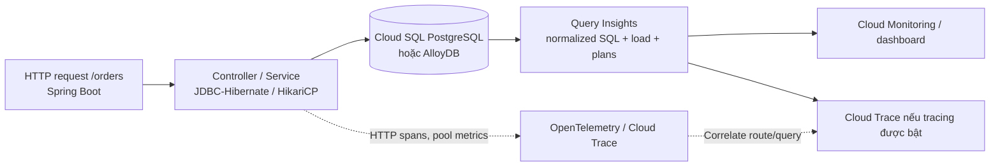
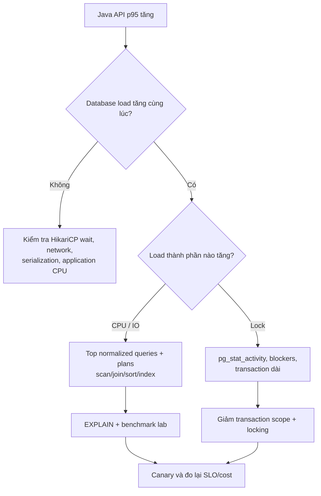
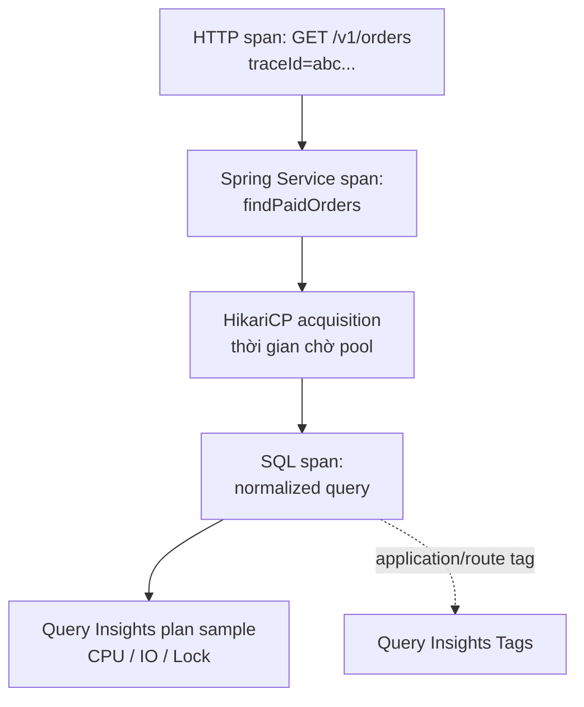

# Query Insights và phân tích hiệu năng truy vấn

## 1. Tình huống: API Java chậm dù cơ sở dữ liệu vẫn hoạt động

Ứng dụng **Spring Boot** chạy trên **Cloud Run/GKE** phục vụ `GET /orders?customerId=17`. Sau một đợt khuyến mãi, **p95 latency** tăng từ 120 ms lên 900 ms; Cloud SQL vẫn ở trạng thái hoạt động, không có lỗi kết nối rõ ràng. Đội vận hành cần biết: truy vấn SQL nào tăng tải, do CPU, I/O hay lock, ứng dụng phát sinh nó ở route nào, và nên thêm index hay sửa code trước?

**Query Insights** là khả năng quan sát truy vấn của **Cloud SQL** và **AlloyDB for PostgreSQL**, giúp xem **database load, top normalized queries, latency, thời gian chờ, query plan** và—với tính năng được hỗ trợ—**traces, application tags, index recommendations, active queries**. Công cụ cung cấp chứng cứ để phân tích, **không tự sửa SQL, không thay transaction và không đảm bảo rằng một index mới sẽ cải thiện mọi truy vấn**.

Bài học thuộc chương **Cloud SQL và AlloyDB** trong mô-đun **CLOUD_PROVIDERS_GCP**, nối kiến thức về database, IAM, networking, Spring Boot/JDBC, độ tin cậy và chi phí. Các ví dụ SQL bên dưới **dành cho PostgreSQL/AlloyDB PostgreSQL**; phần hướng dẫn dashboard chung cũng có ích cho Cloud SQL **MySQL** và **SQL Server**, nhưng câu lệnh `EXPLAIN`/`pg_stat_activity` và chiến lược index của ba engine **không được hoán đổi**.

**Sau bài học, bạn có thể:**

1. Phân biệt Query Insights trên **Cloud SQL Enterprise/Enterprise Plus** và **AlloyDB standard/advanced**.
2. Đọc **query load, CPU/IO/Lock Wait, p95/p99 latency, calls, plans** và truy ra route Java.
3. Dùng **normalized SQL**, `EXPLAIN (ANALYZE, BUFFERS)` và thống kê PostgreSQL để kiểm chứng giả thuyết.
4. Tối ưu **index, query shape, transaction/locks, connection pool** mà không sửa production theo phỏng đoán.
5. Thiết lập một **quy trình read-only trước**, thử trên lab và đánh giá IAM, overhead, retention, chi phí.

> **An toàn:** Bài không tạo hoặc chỉnh instance Cloud SQL/AlloyDB thật. Bật Query Insights/advanced features, đổi cấu hình sampling hoặc tạo index có thể cần **restart**, thêm CPU/RAM/storage và ảnh hưởng giao dịch. Tất cả lệnh thay đổi chỉ áp dụng cho **instance lab được phép**, có change window; không chạy `EXPLAIN ANALYZE` trên câu lệnh ghi dữ liệu production.

## 2. Query Insights đo gì—và không đo gì?



### 2.1. Normalized query và fingerprint

Các câu lệnh có cùng hình dạng nhưng khác tham số được nhóm lại:

```sql
-- Hai request khác nhau:
SELECT id, status FROM orders WHERE customer_id = 17;
SELECT id, status FROM orders WHERE customer_id = 29;

-- Query Insights hiển thị dạng normalized, ví dụ PostgreSQL:
SELECT id, status FROM orders WHERE customer_id = $1;
```

Nhờ vậy có thể thống kê **thời gian/tần suất của một loại truy vấn** thay vì lưu từng giá trị nhạy cảm. Tuy nhiên **SQL comments, application tags và client IP** có thể tiết lộ thông tin: không đưa token, email, số điện thoại, customer ID vào tag.

### 2.2. Database load không phải số requests

**Database load** được biểu diễn gần với **số session truy vấn đang hoạt động trung bình (Average Active Sessions/AAS)**: tổng thời gian mà các truy vấn dùng CPU hoặc chờ tài nguyên trong một cửa sổ, chia cho thời gian thực của cửa sổ ấy.

```text
Giả định 100 queries/giây, trung bình mỗi query active 80 ms:
   Load xấp xỉ = 100 × 0,080 = 8 active sessions.

Nếu máy có 4 vCPU, load 8 không đồng nghĩa CPU usage = 200%.
Cần xem phần CPU & CPU wait, I/O wait và Lock wait riêng.
```

Một query chờ **lock** 5 giây có thể tạo tải DB rõ rệt dù CPU thấp; một query dùng **parallel workers** có thể tiêu thụ nhiều CPU-seconds hơn wall time người dùng đo. **Query load, latency và CPU utilization là ba phép đo khác nhau**. Không so trực tiếp đường load với vCPU mà bỏ qua wait breakdown.

| Chỉ số | Ý nghĩa | Câu hỏi cần trả lời |
| --- | --- | --- |
| **Query load / AAS** | Mức công việc/chờ của database theo thời gian | Khi nào DB bắt đầu quá tải? |
| **CPU and CPU wait** | Dùng CPU và chờ được scheduler cấp CPU | Câu lệnh scan/sort/compute có nặng? |
| **IO Wait** | Chờ đọc/ghi từ storage/buffer | Thiếu index, nhiều random I/O hoặc cache miss? |
| **Lock Wait** | Chờ khóa do transaction khác giữ | Có transaction dài hoặc cập nhật tranh chấp? |
| **Calls / times called** | Số lần câu lệnh được gọi | Có N+1 query hoặc tăng request đột biến? |
| **Avg latency / p95 / p99** | Thời gian truy vấn và tail latency, theo tính năng | Ít truy vấn rất chậm hay mọi truy vấn đều chậm? |
| **Query plan sample** | Các bước scan/join/sort đã lấy mẫu | Có Seq Scan, Sort, sai ước lượng row? |

## 3. Khả năng theo sản phẩm, edition và engine

Không có “một Query Insights” với cùng bảng điều khiển cho mọi dịch vụ. Kiểm tra **edition, database version, machine type, primary/read pool, region và các feature đã bật**.

| Khả năng | **Cloud SQL Enterprise** | **Cloud SQL Enterprise Plus** | **AlloyDB for PostgreSQL** |
| --- | --- | --- | --- |
| Trạng thái ban đầu | **Cần bật Query Insights** | Cần bật; advanced Enterprise Plus features có tùy chọn riêng | **Standard Query Insights bật sẵn** |
| Lưu metrics trên dashboard | **7 ngày** | **30 ngày** với advanced Enterprise Plus | Standard **7 ngày**; advanced Query Insights **30 ngày** khi bật |
| Query plan sampling | Tối đa **20 plans/phút**, mặc định 5 | Tối đa **200 plans/phút**, mặc định 200 cho advanced | Standard tối đa 20, mặc định 5; advanced có cấu hình riêng |
| Wait-event analysis | Không có trong gói standard edition | Có khi bật advanced | Có với standard breakdown; advanced cho phân tích chi tiết hơn |
| Index advisor | Không có theo bộ tính năng Enterprise Plus | Có khi bật tính năng được hỗ trợ | Có trong **advanced Query Insights** |
| Active queries | Có thể bật quan sát | Quan sát và khả năng kết thúc phiên khi đủ quyền | Có **advanced active queries** |
| Truy vết ứng dụng / tags | Có, tùy bật tag/tracing | Có, thêm dữ liệu nâng cao | Có, qua sqlcommenter và Cloud Trace |

**Cloud SQL:** dashboard Query Insights cũng tồn tại cho **MySQL và SQL Server**, nhưng cần xem **trang engine tương ứng** vì phiên bản hỗ trợ, query plan, restart behavior và khả năng edition không hoàn toàn giống PostgreSQL. Với PostgreSQL Enterprise Plus, Query Insights nâng cao có điều kiện **không áp dụng cho shared-core machine type hoặc read replica** theo tài liệu; đừng áp dụng “30 ngày/index advisor” một cách mặc định lên mọi replica.

**AlloyDB:** Query Insights standard luôn bật theo tài liệu, có một bảng cho **primary** và **read pool** (read pool có thể tổng hợp nhiều nodes). **Advanced Query Insights** bổ sung query stats gần thời gian thực, wait-event drilldown, active queries, index advisor và phân tích blocked/blocking transactions; là khả năng riêng, **không phải chỉ đổi tên Cloud SQL Enterprise Plus**. Advanced features có footprint lưu trữ/retention riêng và có thể bị giới hạn trên **secondary clusters**.

Các con số trên là khả năng tại thời điểm biên soạn, không thay cho **release notes** của edition/region đang vận hành. Chọn gói bằng nhu cầu quan sát, workload và tổng chi phí database, không nâng edition chỉ để thêm một biểu đồ nếu có giải pháp nhẹ hơn.

## 4. Trước khi mở dashboard: quyền và thông tin nền

### 4.1. Phân quyền xem khác phân quyền chỉnh

Với **Cloud SQL Query Insights**, người xem dữ liệu lịch sử thường cần **`roles/databaseinsights.viewer`** cùng **`roles/cloudsql.viewer`** trên project chứa instance. Đối với tính năng Enterprise Plus lịch sử, tài liệu yêu cầu đúng hai predefined roles này; custom roles khác có thể không đủ. Để xem **query plans và end-to-end trace**, bật **Cloud Trace API** và cấp quyền đọc traces phù hợp.

Với **AlloyDB**, người dùng cần quyền xem instance/Query Insights; xem trace/plan cần quyền **`cloudtrace.traces.get`** hoặc role chứa permission đó. **Quyền xem dashboard không đồng nghĩa quyền chạy SQL, sửa index hay kill session**.

### 4.2. Kiểm kê an toàn bằng gcloud

Các lệnh **chỉ đọc**, thay tên placeholder trước khi dùng:

```bash
gcloud config set project LAB_PROJECT_ID

# Cloud SQL PostgreSQL:
gcloud sql instances describe CLOUD_SQL_INSTANCE \
  --project=LAB_PROJECT_ID \
  --format="yaml(name,region,databaseVersion,settings.edition,settings.insightsConfig)"

# AlloyDB PostgreSQL:
gcloud alloydb clusters list \
  --project=LAB_PROJECT_ID \
  --region=DB_REGION

gcloud alloydb instances list \
  --project=LAB_PROJECT_ID \
  --region=DB_REGION \
  --cluster=ALLOYDB_CLUSTER
```

**Không nhầm gcloud context với application project:** Java service có thể nằm project A, Cloud SQL nằm project B. Khi điều tra, ghi rõ **database instance/cluster, region, database, user, role, thời gian UTC, endpoint primary/read pool và đợt phát hành Java**.

## 5. Cloud SQL PostgreSQL: bật Query Insights có kiểm soát

Nếu Query Insights đã bật, **không cần patch lại**. Trong Google Cloud Console: **SQL → Instances → chọn instance → Query Insights**; nếu chưa bật, vào **Edit configuration → Query Insights → Enable** rồi xem cấu hình.

Các tùy chọn cơ bản gồm:

- **Query length**: Cloud SQL Enterprise `256–4500 bytes` (mặc định 1024); Enterprise Plus tối đa `100 KB` (mặc định khoảng 10 KB).
- **Query plan samples/minute**: 0–20 trên Enterprise (mặc định 5), lên đến 200 trên Enterprise Plus advanced (mặc định 200).
- **Record application tags/client addresses**: mặc định **tắt** trên Cloud SQL; chỉ bật khi có chính sách dữ liệu phù hợp.
- **Enterprise Plus advanced features**: wait events, index advisor, active queries và AI-assisted troubleshooting (một số ở **Preview**); nhiều tính năng cần bật riêng.

**Khuyến nghị lab chỉ khi đã được duyệt:** với một **Cloud SQL PostgreSQL Enterprise test instance** và quyền `cloudsql.instances.update`, ví dụ:

```bash
# THAY ĐỔI CONFIGURATION — CHỈ LAB, không chạy production:
gcloud sql instances patch CLOUD_SQL_INSTANCE \
  --project=LAB_PROJECT_ID \
  --insights-config-query-insights-enabled \
  --insights-config-query-plans-per-minute=5 \
  --insights-config-query-string-length=1024 \
  --insights-config-record-application-tags
```

**Rủi ro restart:** với một số PostgreSQL maintenance versions cũ, bật Query Insights Enterprise Plus/index advisor **kích hoạt restart**; từ maintenance version `20250302.00_RC31` trở lên, nhiều thao tác bật/đổi query length không còn yêu cầu restart. Nhưng đừng suy rằng **mọi** thay đổi trên mọi version đều zero-downtime. Review **effective flags, maintenance version, backup, HA và khả năng dịch vụ bị gián đoạn** trước khi apply. Nếu bật Enterprise Plus advanced features, kiểm tra cả yêu cầu **automatic storage increases**.

Trong Terraform, cấu hình nằm trong `settings.insights_config` của `google_sql_database_instance`. Ví dụ **fragment chỉ để minh họa, không phải một resource hoàn chỉnh**:

```hcl
settings {
  insights_config {
    query_insights_enabled  = true
    query_string_length     = 1024
    query_plans_per_minute  = 5
    record_application_tags = true
    record_client_address   = false
  }
}
```

**Không import/edit Terraform state của instance thật** để thử ví dụ. Thay đổi infrastructure cần `terraform plan` được review và backup. Tắt Query Insights về sau không đồng nghĩa mọi dữ liệu metrics/traces trong hệ thống monitoring đã bị xóa ngay.

## 6. AlloyDB: đọc chuẩn trước khi dùng advanced features

Trên **Google Cloud Console → AlloyDB for PostgreSQL → Clusters → chọn cluster/instance → Query insights**, chọn **Primary** hoặc **Read pool**, database/user/client address và khoảng thời gian. **Standard Query Insights được bật sẵn**; không dùng `gcloud sql instances patch` trên AlloyDB vì đây là **sản phẩm và API khác**.

Standard AlloyDB cho thấy query load, normalized SQL, CPU/IO/lock breakdown, query plans mẫu và tags/traces khi bật tùy chọn tương ứng. Những dữ liệu này có thể có độ trễ vài phút, không phải stream chính xác từng microsecond. Standard metrics được lưu trong **Cloud Monitoring**, traces trong **Cloud Trace**; retention mặc định dashboard khoảng một tuần.

**Advanced Query Insights** thêm phân tích query theo nhiều chiều, **wait events, blocked queries, active queries và index advisor**. Nó có thể giữ dashboard data **30 ngày**, lấy thông tin gần thời gian thực hơn và dùng thêm storage/CPU/RAM tùy cấu hình. Chỉ bật khi cần và đã kiểm tra quotas/chi phí; **không bật advanced trên secondary cluster** nếu phiên bản đang dùng không hỗ trợ.

Để tùy chỉnh, vào **Query insights → Edit settings** của instance phù hợp và kiểm tra **Query plan sampling, Query length, Store application tags/client IP**. **Đổi query-length giới hạn trên AlloyDB standard có thể restart instance**, và giới hạn dài hơn tăng memory. Query comments khi được thu thập có thể chứa dữ liệu nhạy cảm; nếu bật **Store query comments** trong advanced features, phải kiểm soát quyền xem.

## 7. Đọc Query Insights: từ tổng quan tới câu SQL cụ thể

Quy trình điều tra nên giữ **thời gian và filter nhất quán**:

1. **Chọn đúng instance và UTC window** bao gồm lúc p95 tăng; ghi baseline trước/sau deploy.
2. Nhìn **Database load** và đường **CPU capacity**. So CPU/CPU wait, IO wait và Lock wait.
3. Trong **Top queries/Tags**, sắp theo **total time/load**; đừng chỉ chọn query có một lần chạy chậm nhất.
4. Xem **normalized SQL, calls, avg latency, rows returned** và phân tích biến thiên p95/p99 nếu được hỗ trợ.
5. Mở **Query plans** và **traces** của mẫu bị ảnh hưởng; đối chiếu route/app revision, HikariCP pool và database stats.
6. Đưa ra một giả thuyết đo được, **thử trước trên lab**, triển khai nhỏ và so lại cùng cửa sổ/tải.



### 7.1. Tổng thời gian vs một truy vấn chậm

Một query chạy **10.000 lần × 20 ms ≈ 200 giây tổng thời gian** có thể tiêu thụ nhiều tài nguyên hơn một câu chạy **1 lần × 5 giây**. Ưu tiên theo **tổng DB load và ảnh hưởng SLO**, không chỉ `max latency`. Nếu query gọi lặp lại do **N+1 của Hibernate**, sửa cách fetch/batch có thể hiệu quả hơn thêm một index.

### 7.2. Đừng xem query plan mẫu là kết quả của mọi request

Query Insights **lấy mẫu** plans; optimizer có thể chọn các plan khác nhau theo **tham số, phân bố dữ liệu, stats, cache, thời điểm**. Một plan cũ không chứng minh mọi request hiện tại dùng cùng plan. `EXPLAIN` cho truy vấn tương ứng với dữ liệu và thống kê **tại thời điểm kiểm tra** mới là bước xác minh.

## 8. Bài lab PostgreSQL: tìm Seq Scan và kiểm tra index

Lab SQL này dùng **database/schema riêng**, chỉ trên **Cloud SQL PostgreSQL hoặc AlloyDB PostgreSQL thử nghiệm**. Không chạy trên production, không tải dữ liệu khách hàng và không tạo index trên bảng thật. Cần quyền `CREATE` schema/table, đọc query và đủ dung lượng lưu trữ.

### 8.1. Tạo dữ liệu giả

Kết nối bằng `psql` qua **Cloud SQL Auth Proxy** hoặc AlloyDB connector/private endpoint đã được cấu hình hợp lệ; không cung cấp public DB IP chỉ để chạy lab. Trong `psql`:

```sql
CREATE SCHEMA IF NOT EXISTS qi_lab;

CREATE TABLE IF NOT EXISTS qi_lab.orders (
    id BIGSERIAL PRIMARY KEY,
    customer_id BIGINT NOT NULL,
    status TEXT NOT NULL,
    created_at TIMESTAMPTZ NOT NULL,
    total_minor BIGINT NOT NULL CHECK (total_minor >= 0)
);

-- Chỉ trên bảng lab RỖNG, tạo dữ liệu mô phỏng:
INSERT INTO qi_lab.orders(customer_id, status, created_at, total_minor)
SELECT
    (n % 1000) + 1,
    CASE WHEN n % 4 = 0 THEN 'PAID' ELSE 'CREATED' END,
    now() - (n * interval '1 second'),
    n * 100
FROM generate_series(1, 100000) AS n;

ANALYZE qi_lab.orders;
```

Lệnh `INSERT` tạo **100.000 records**; chạy một lần trên bảng lab trống, không áp dụng trên dữ liệu lớn/production. Nếu rerun, có thể tăng gấp đôi dữ liệu và thay đổi kế hoạch truy vấn.

### 8.2. Query cần phân tích

```sql
EXPLAIN (ANALYZE, BUFFERS)
SELECT id, customer_id, status, created_at, total_minor
FROM qi_lab.orders
WHERE customer_id = 17
  AND status = 'PAID'
ORDER BY created_at DESC
LIMIT 20;
```

**`ANALYZE` thực sự thực thi SQL**, nên ở bài này chỉ dùng với `SELECT` trên dữ liệu giả. Đọc plan: `Seq Scan` (quét nhiều rows), `Sort`, `Rows Removed by Filter`, `Buffers: shared hit/read`, **estimated vs actual rows** và `Execution Time`. Với dataset nhỏ hoặc filter kém chọn lọc, PostgreSQL có thể **vẫn chọn Seq Scan tối ưu**; đó không tự động là bug.

### 8.3. Thử index phù hợp

Vì ứng dụng lọc **`status='PAID'`** rồi tra cứu khách hàng và sắp `created_at DESC`, một **partial composite index** có thể phù hợp:

```sql
-- Chỉ chạy trong lab, ngoài transaction block:
CREATE INDEX CONCURRENTLY IF NOT EXISTS
  idx_qi_orders_paid_customer_created
ON qi_lab.orders (customer_id, created_at DESC)
WHERE status = 'PAID';

ANALYZE qi_lab.orders;

EXPLAIN (ANALYZE, BUFFERS)
SELECT id, customer_id, status, created_at, total_minor
FROM qi_lab.orders
WHERE customer_id = 17
  AND status = 'PAID'
ORDER BY created_at DESC
LIMIT 20;
```

So sánh `Execution Time`, số blocks phải đọc, số rows loại bỏ và kiểu `Index Scan / Bitmap Heap Scan / Seq Scan` trước-sau. Planner **không buộc** dùng index; thống kê và selectivity quyết định. Index cũng tăng **storage, chi phí ghi, maintenance** và có thể ảnh hưởng một số query khác; không tạo hàng loạt theo khuyến nghị mà không benchmark.

**`CREATE INDEX CONCURRENTLY`** không chạy trong transaction block, dùng thêm tài nguyên và có thể cần xử lý index invalid nếu lỗi. Với production cần backup, canary, kiểm tra lock/IO và lịch thay đổi. Sau lab, nếu không cần dữ liệu:

```sql
-- Chỉ xóa SCHEMA lab đã xác minh không dùng chung:
DROP SCHEMA qi_lab CASCADE;
```

### 8.4. Gắn kết quả với Query Insights

Chạy thử truy vấn qua Java lab đủ số lần để xuất hiện trong query stats, sau đó vào dashboard **lọc đúng database/time window**. Vì metrics và plans được sample, chưa thấy query sau một vài requests **không có nghĩa instrumentation bị hỏng**. Ghi baseline SQL shape, calls/latency/load; thử sau index với **cùng dataset và pattern**. Đừng so hai cửa sổ có lượng request khác nhau rồi quy toàn bộ cải thiện cho index.

## 9. Khóa, transaction dài và SQL PostgreSQL đọc-only

Một CPU thấp nhưng **Lock Wait cao** thường cần điều tra **transaction giữ khóa**, không phải tăng vCPU ngay. Các câu sau chỉ đọc system views; quyền xem text query/phiên của người khác phụ thuộc database roles (ví dụ `pg_monitor`), nên tránh tài khoản superuser cho app.

```sql
SELECT pid,
       usename,
       application_name,
       state,
       wait_event_type,
       wait_event,
       now() - xact_start AS transaction_age,
       now() - query_start AS query_age
FROM pg_stat_activity
WHERE pid <> pg_backend_pid()
ORDER BY transaction_age DESC NULLS LAST
LIMIT 30;

-- Chỉ quan sát session bị chặn; không terminate session:
SELECT pid, pg_blocking_pids(pid) AS blocking_pids,
       wait_event_type, wait_event
FROM pg_stat_activity
WHERE cardinality(pg_blocking_pids(pid)) > 0;
```

Nếu thấy `idle in transaction` lâu, xem controller/service Java giữ transaction qua **network call, HTTP request hoặc external API** hay không. Rút gọn transaction, thêm timeout có kiểm soát và tránh lock order ngẫu nhiên. **Không gọi `pg_terminate_backend`, kill query hay reboot instance production** khi chưa biết tác động đến giao dịch, HA và SLA.

`pg_stat_statements` có thể cung cấp thống kê câu truy vấn PostgreSQL (nếu extension đã được bật/cấp quyền), nhưng nó **khác** Query Insights do GCP quản lý. Không tự chỉnh `shared_preload_libraries` hoặc restart database production để bật extension nếu không có quy trình thay đổi.

## 10. Nối Query Insights với Spring Boot, JDBC và HikariCP

Một HTTP request có thể chậm **trước khi SQL được gửi đến database**: đợi lấy connection từ HikariCP, retry ở Cloud SQL connector, network, serialization hoặc thread pool. Vì vậy chỉ tối ưu top query chưa chắc giảm p95 HTTP.

### 10.1. Truy vấn có tham số và mapping dữ liệu

Ví dụ **một service fragment** dùng Spring JDBC (không phải ứng dụng hoàn chỉnh). Giả sử đã có dependency `spring-boot-starter-jdbc`, PostgreSQL JDBC driver và datasource trỏ tới **database lab**:

```java
package dev.example.orders;

import java.time.Instant;
import java.util.List;
import org.springframework.jdbc.core.JdbcTemplate;
import org.springframework.stereotype.Service;

@Service
public class OrderReadService {
    private final JdbcTemplate jdbc;

    public OrderReadService(JdbcTemplate jdbc) {
        this.jdbc = jdbc;
    }

    public record OrderView(
            long id, String status, Instant createdAt, long totalMinor) {}

    public List<OrderView> findPaidOrders(long customerId) {
        String sql = """
            SELECT id, status, created_at, total_minor
            FROM qi_lab.orders
            WHERE customer_id = ? AND status = 'PAID'
            ORDER BY created_at DESC
            LIMIT 20
            """;

        return jdbc.query(sql,
            (rs, rowNum) -> new OrderView(
                rs.getLong("id"),
                rs.getString("status"),
                rs.getTimestamp("created_at").toInstant(),
                rs.getLong("total_minor")),
            customerId);
    }
}
```

`?` là **JDBC bind parameter**, tránh nối customerId trực tiếp vào SQL. Query Insights hiển thị **normalized fingerprint**, nên nhiều customer IDs thường được nhóm về một query. Lưu ý SQL ở đây tham chiếu `qi_lab.orders`, chỉ tồn tại sau bước tạo schema của lab.

### 10.2. Cấu hình pool và ngân sách kết nối

Fragment trong `application.properties` (môi trường lab):

```properties
# Chỉ là ví dụ tuning, không phải giá trị tối ưu cho mọi hệ thống.
spring.datasource.hikari.maximum-pool-size=8
spring.datasource.hikari.connection-timeout=3000
spring.datasource.hikari.minimum-idle=0
```

Nếu Cloud Run có **20 instances** và mỗi instance `maximum-pool-size=8`, số kết nối Hikari **tiềm năng** là **160**, chưa tính monitoring, batch workers, database migrations và các dịch vụ khác. Không lấy số CPU hoặc `max connections` của DB để tự động nhân pool size; đặt giới hạn theo **thực tế queries in flight, throughput, transaction duration và headroom**.

Theo dõi cùng lúc:

- **HTTP server p95/p99** theo route và application revision.
- **Hikari active/idle/pending connections**, connection acquisition time và timeout.
- **Database connection count, load, waits**, query calls/latency trong Query Insights.
- **Cloud Run/GKE scaling, Cloud SQL connector/Proxy latency**, JVM GC và CPU.

Khi Hikari pending tăng nhưng DB load thấp, vấn đề có thể ở **pool nhỏ/connection leak/transaction giữ connection**, không phải thiếu index. Khi DB load và p95 query tăng đồng thời, tập trung kế hoạch truy vấn/khóa/IO.

## 11. SQL Commenter, application tags và end-to-end trace

Ứng dụng dùng **Hibernate/JPA** thường sinh SQL từ entity/repository, gây khó xác định **route/controller** nào tạo top query. **sqlcommenter** là công cụ gắn metadata dạng **SQL comment** cho một số ORM/framework. Query Insights có thể nhóm theo **application tags** nếu chức năng này được bật và comment có đúng định dạng.

```sql
-- Minh họa cú pháp sqlcommenter, KHÔNG lấy customerId làm tag:
SELECT id, status
FROM qi_lab.orders
WHERE customer_id = 17
/*application='orders-api',controller='OrderController',route='%2Fv1%2Forders'*/;
```

Từ góc độ phân tích, query được normalize phần giá trị literal, còn tags giúp lọc **application/route/controller**. **Đừng gắn tags tùy ý**: mỗi tag có thể làm tăng cardinality và một số trường không được Query Insights sử dụng. Các khóa phổ biến được hỗ trợ gồm `application`, `controller`, `action`, `route` và `framework`.

Với **Spring Boot + Hibernate**, muốn tự động tạo comments cần **sqlcommenter integration/instrumentation tương thích với version đang dùng**; Query Insights **không tự chèn SQL comments chỉ vì bạn bật checkbox Store application tags**. Nếu dùng JDBC thuần, có thể gắn comment thủ công theo chuẩn hoặc dùng observability instrumentation thích hợp. Kiểm tra tác động tới prepared statement caching và driver behavior.

**End-to-end tracing:** trace trong **Cloud Trace** có thể nối request HTTP → service Java → database query khi ứng dụng và driver/ORM được instrument đúng và có trace context. Cloud Trace API và permissions phải hợp lệ; query plan sampling không bảo đảm trace có mặt cho từng request. Tránh đẩy nguyên **SQL query params, URL chứa PII hay headers Authorization** vào spans. Đây là công cụ **tương quan nguyên nhân**, không phải nguồn chứng cứ duy nhất.



**Cảnh báo dễ nhầm:** request p95 = 900 ms có thể gồm **700 ms chờ Hikari connection + 50 ms SQL + 150 ms JSON/HTTP**. Query Insights chỉ nhìn thấy phần database; nếu chỉ tối ưu SQL từ 50 ms xuống 20 ms, request vẫn chậm phần lớn.

## 12. Index Advisor, query plans và lựa chọn phương án tối ưu

**Cloud SQL Enterprise Plus** có **Index Advisor** trong Query Insights khi bật tính năng; **AlloyDB advanced Query Insights** cũng cung cấp recommendations. Một khuyến nghị `CREATE INDEX` là **ứng viên để đánh giá**, không phải lệnh bắt buộc.

Trước khi áp dụng index, đối chiếu:

1. **Query fingerprint** và tỷ lệ load/calls của nó trong khung thời gian cần tối ưu.
2. **Plan hiện tại**, estimated/actual rows, filter selectivity và số buffers.
3. **Cardinality** của các cột và phân bố `customerId/status`, đặc biệt tính lệch dữ liệu theo tenant.
4. **Composite/partial/covering index** hay **query rewrite/pagination** phù hợp hơn.
5. **Chi phí storage/ghi/replication**, khả năng ảnh hưởng OLTP writes và thời gian build index.
6. **Canary benchmark**, p95/p99 ứng dụng và các query khác sau thay đổi.

| Dấu hiệu | Hướng xử lý ưu tiên | Vì sao |
| --- | --- | --- |
| Seq Scan lọc ít rows trên bảng lớn | Thử index đúng cột điều kiện/ORDER BY | Giảm số blocks phải quét |
| N+1 Hibernate, calls tăng nhiều lần/request | Fix fetch strategy, batching, DTO | Giảm số round trips, không chỉ thời gian một SQL |
| Sort/hash dùng memory lớn | Index phù hợp, giảm rows, kiểm tra work_mem | Tránh sort tốn RAM/disk spill |
| Lock Wait cao | Thu nhỏ transaction, xử lý thứ tự khóa, audit blockers | Thêm index thường không loại bỏ lock tranh chấp |
| CPU và IO cao do query không cần thiết | Caching, pagination/keyset, tránh `SELECT *` | Giảm khối lượng công việc thực |
| DB connection cao | Sửa pool/leak; cân nhắc pooling phù hợp | Tránh áp lực session và context switching |
| Read pool/replica chịu tải độc lập | Phân tích primary vs read pool riêng | Không suy từ query load ở primary rằng read replicas khỏe |

**Thay đổi query shape thường đi kèm thay đổi tính đúng đắn:** tránh cache dữ liệu phải nhất quán mạnh hoặc pagination không ổn định khi order thay đổi. Chạy regression tests với realistic data skew, không chỉ dữ liệu phân bố đều của lab.

## 13. Tính đặc thù MySQL, SQL Server và AlloyDB

**Cloud SQL for MySQL** có Query Insights nhưng việc giải thích plan nên dùng các công cụ **MySQL** như `EXPLAIN`/`EXPLAIN ANALYZE` (khi phiên bản hỗ trợ), `performance_schema` và cấu hình liên quan. MySQL `max_digest_length` có thể liên quan giới hạn query text trên Enterprise; **không dùng `pg_stat_activity` hoặc `CREATE INDEX CONCURRENTLY`** vì đó là PostgreSQL.

**Cloud SQL for SQL Server** có Query Insights nhưng đi cùng SQL Server execution plans/DMVs và **Query Store** theo quyền/edition. Các khái niệm wait types, parameter sniffing, plan cache và index maintenance có ngữ nghĩa riêng; không dùng PostgreSQL `EXPLAIN` cho T-SQL. Phải xem quyền truy cập Active Queries, index recommendations và các giới hạn Enterprise Plus theo **trang SQL Server**.

**AlloyDB for PostgreSQL** hỗ trợ cú pháp PostgreSQL quen thuộc nhưng có optimizer/storage engine và kiến trúc **primary/read pool/secondary clusters** khác Cloud SQL. Khi phân tích load, chọn đúng instance; standard Query Insights có thể tổng hợp load **nhiều nodes của read pool**. Advanced tính năng như blocking analysis/index advisor vẫn cần cấu hình và quyền đúng; **không giả định các số liệu trên secondary cluster có đầy đủ** như primary.

## 14. Quy trình xử lý sự cố production và alert

### 14.1. Runbook từ SLO tới database root cause

| Triệu chứng | Bước kiểm tra trước | Hướng cải thiện |
| --- | --- | --- |
| HTTP p95 cao, DB load không đổi | Hikari pending, JVM GC, network, Cloud SQL connector | Sửa pool/app/network trước |
| DB load CPU vượt baseline | Top normalized queries, calls, CPU/CPU wait, plans | Rewrite/index/giảm N+1 |
| DB IO Wait cao | Plan, buffer misses, large scans, storage metrics | Index/scan reduction/cache strategy |
| Lock Wait tăng mạnh | `pg_stat_activity`, blocking PIDs, transaction duration | Thu nhỏ transaction/giảm contention |
| Query calls tăng nhưng latency/query ổn định | Traffic spike hoặc app release tạo N+1 | Kiểm soát calls/request, batching |
| Latency/query tăng nhưng calls không đổi | Plan regression, stats, data skew, locks | Compare plans, `ANALYZE`, fixes phù hợp |
| Query Insights trống | Feature chưa bật, thiếu IAM, sai region/instance, filter, sampling | Kiểm tra cấu hình, dashboard/trace permissions |
| Sau đổi config database bị restart | Maintenance version/config apply/restart condition | Rollback theo change record, HA/backup review |
| Index mới làm INSERT/UPDATE chậm | Write amplification, lock/storage pressure | Đánh giá index redundancy, remove có kiểm soát |
| Không thấy client IP/tag | Collection chưa bật, pool proxy, SQL comments sai | Kiểm tra tracking option, client path/sqlcommenter |

### 14.2. Tách quan sát khỏi thao tác rủi ro

1. **Read-only:** chụp Query Insights dashboard, queries/tags, p95, resource metrics, logs và release timeline.
2. **Xác thực giả thuyết:** nếu là SQL plan, tái hiện trên **snapshot/lab**; nếu lock, xác định chính xác blocker và chủ sở hữu.
3. **Canary sửa chữa:** thử index hoặc Java change nhỏ; đo **before/after** với traffic tương đương.
4. **Rollback:** có DDL rollback được duyệt; cân nhắc `DROP INDEX CONCURRENTLY` chỉ khi index do nhóm sở hữu và đã kiểm tra phụ thuộc.
5. **Postmortem:** lưu fingerprint, plan, ứng dụng phát sinh, dữ liệu thời gian, nguyên nhân và biện pháp ngăn tái diễn.

Không terminate query/transaction thông qua Query Insights **nếu chưa đánh giá giao dịch đang ghi, lock dependencies và ảnh hưởng người dùng**. Một biểu đồ CPU đỏ không đủ lý do để tăng cấp edition, resize instance hoặc restart database.

### 14.3. Alert theo SLO chứ không theo một ngưỡng mơ hồ

Ví dụ yêu cầu ứng dụng: **99% GET /orders dưới 500 ms trong 30 ngày**, error rate dưới **0,5%**. Thiết lập alert kết hợp:

- **Spring Boot/Cloud Run p95/p99**, request error rate và độ bão hòa thread/pool.
- **Cloud SQL/AlloyDB CPU/storage/connections**, database load và wait-event breakdown được hỗ trợ.
- **Query latency/calls/load** của top fingerprints, Cloud SQL error logs và read replica lag nếu sử dụng.

Không phải tất cả Query Insights dashboard metrics đều có cùng API/resource type/retention: trong Cloud Monitoring **Metrics Explorer**, kiểm tra metric availability và nhãn trước khi tạo alert. Một số advanced stats lưu trong database/Query Insights riêng, không tương ứng 1:1 với Cloud Monitoring series.

## 15. IAM, bảo mật, retention và chi phí

### 15.1. Bảo vệ telemetry

Query Insights **normalize literals** và traces kế hoạch truy vấn không lưu các giá trị constant theo thiết kế; nhưng **normalized query shape, tên bảng/cột, application tags, client IP, SQL comments, các bản ghi khác trong logs/traces** vẫn có thể nhạy cảm. Chỉ cấp quyền Viewer/Cloud Trace theo nhu cầu, tránh nhúng dữ liệu khách hàng trong `application` hoặc `route` tag. Với Cloud SQL, **Record client IP/tag** mặc định tắt; nếu bật cần đánh giá privacy. AlloyDB có mặc định/phạm vi tracking khác, nên kiểm tra hiệu lực trên instance.

**Tách IAM và PostgreSQL grants:** một Cloud SQL Viewer không tự được SELECT mọi bảng; ngược lại role PostgreSQL `pg_monitor` không tự cấp quyền truy cập Google Cloud Console/Cloud Trace. Java runtime service account chỉ cần quyền kết nối DB và quyền nghiệp vụ của nó; không cấp `cloudsql.admin` hay `alloydb.admin` chỉ để ghi SQL.

### 15.2. Storage và overhead

- **Cloud SQL Query Insights** không thu phí tính năng riêng trên Enterprise/Enterprise Plus theo tài liệu, nhưng **edition/instance**, Monitoring/Trace API, logging và **storage cho advanced metrics** theo trường hợp có thể ảnh hưởng hóa đơn. Enterprise standard metrics được lưu ở Cloud Monitoring; Enterprise Plus advanced cần đảm bảo **automatic storage increases** khi bật.
- **AlloyDB standard Query Insights** không thu phí riêng theo trang sản phẩm, ghi metrics vào Cloud Monitoring và traces vào Cloud Trace. **Advanced Query Insights** giữ dữ liệu dài hơn, có thể tiêu thụ thêm storage tài nguyên AlloyDB; đo và dự toán theo cấu hình/retention.
- **Long query strings, sampling rate cao, tags/IP tracking** có thể tăng memory, CPU, data volume, cardinality và rủi ro lộ thông tin. Bật theo nhu cầu thực tế, xem hiệu năng trước/sau.
- **Index tạo thêm** làm tăng storage, write I/O và chi phí sao chép/backup, có thể xóa lợi ích tiết kiệm CPU nếu workload write-heavy.

Ví dụ minh họa **không phải bảng giá**:

```text
100 queries/giây × 0,080 giây active/query = load 8.
Nếu sửa query còn 0,030 giây với cùng traffic:
  load lý thuyết mới ≈ 100 × 0,030 = 3.

Đây là phép so công suất query, không bảo đảm cloud bill giảm
ngay: Cloud SQL/AlloyDB instance vẫn được provision theo cấu hình.
```

**Chi phí database có thể giữ nguyên** sau khi tối ưu vì tài nguyên instance được cấp sẵn. Lợi ích thực có thể là **trì hoãn nâng cấp instance**, giảm timeout/SLO violations hoặc cho phép phục vụ thêm traffic trước khi scaling. Dùng **Cloud Billing reports, budgets và instance metrics** để kiểm chứng, không suy chi phí từ đồ thị load một cách trực tiếp.

## 16. Bài tập và tiêu chí đánh giá

### Bài A — Đọc database load

Một hệ thống có **100 queries/s, active duration trung bình 80 ms, 4 vCPU**. Tính query load lý thuyết **8**. Giải thích tại sao con số này không chứng minh CPU 200%, và cần nhìn **CPU/IO/Lock Wait** để xác định nguyên nhân.

### Bài B — Chọn đúng edition

Team dùng **Cloud SQL PostgreSQL Enterprise** muốn 30 ngày metrics, wait-event drilldown và index recommendations. Những chức năng nào cần **Enterprise Plus advanced**? So sánh với một **AlloyDB standard** instance và rủi ro khi bật advanced trên primary/secondary.

### Bài C — Tối ưu SQL trên lab

Tạo schema/table `qi_lab.orders` ở mục 8, chạy `EXPLAIN (ANALYZE, BUFFERS)` cho truy vấn lọc `customer_id` và `status`. Tạo **partial composite index** trong lab, chạy lại cùng query. Báo cáo **plan, buffers, execution time và sự khác biệt**, kể cả khi planner vẫn chọn Seq Scan. Nêu vì sao index có chi phí ghi và disk.

### Bài D — Truy vấn N+1 từ Spring Boot

Một API gọi một truy vấn tìm đơn hàng và sau đó **50 truy vấn lấy tên khách hàng** trong một request. Query Insights cho thấy normalized query khách hàng có calls tăng mạnh nhưng từng query chỉ 3 ms. Thiết kế giải pháp **join/batch fetch/projection**, đo calls/request và latency. Giải thích khi nào index vẫn cần thiết và khi nào chỉ sửa N+1 là đủ.

### Bài E — Lock Wait và transaction

`Lock Wait` cao nhưng CPU thấp; `pg_stat_activity` có `idle in transaction` 3 phút. Nêu các bước **chỉ đọc** để tìm blocker, rồi đề xuất giảm scope `@Transactional`, không gọi external APIs khi giữ transaction và cách rollout thay đổi. Vì sao không kill query ngay?

### Bài F — Quyền, tag và dữ liệu nhạy cảm

Một team muốn gắn `customerEmail` vào SQL comment để tìm request chậm. Giải thích rủi ro, thay bằng `application/controller/route` có cardinality thấp, thiết kế `roles/databaseinsights.viewer` + `roles/cloudsql.viewer` và Cloud Trace read access. Kiểm tra tác động của **record client IP** nếu bật.

### Checklist trước khi kết luận đã khắc phục

- [ ] Tôi xác định đúng instance/region/engine/edition và **primary/read pool**.
- [ ] Tôi biết **Cloud SQL Query Insights cần bật**, còn **AlloyDB standard mặc định bật**.
- [ ] Tôi hiểu normalized queries, query load, CPU/IO/Lock Wait và calls/p95.
- [ ] Tôi không suy HTTP p95 bằng query latency; đã đo HikariCP/Java/network.
- [ ] Tôi có bằng chứng query plan/`EXPLAIN`, không tối ưu theo phỏng đoán.
- [ ] Tôi test index/SQL rewrite trên lab, kiểm tra chi phí ghi/disk và canary.
- [ ] Tôi phân biệt IAM của dashboard/Cloud Trace với quyền PostgreSQL.
- [ ] Tôi không log SQL constants, tokens, email hoặc thông tin riêng tư trong tags.
- [ ] Tôi có baseline, tiêu chí SLO, rollback và runbook tránh kill/restart tùy tiện.
- [ ] Tôi ghi nhận chi phí edition, metrics retention, advanced storage và workload changes.

**Kết luận:** Query Insights giúp xác định **loại truy vấn nào, từ ứng dụng nào, tại thời điểm nào và vì tài nguyên nào** đang tạo tải lên Cloud SQL hoặc AlloyDB. Với Java trên Google Cloud, cải thiện đáng tin cậy đòi hỏi nối **SLO HTTP → query load/waits → SQL plan → Java/HikariCP → kiểm thử và canary**; tuyệt đối không đồng nhất “truy vấn chậm” với “chỉ cần thêm index hoặc tăng CPU”.

## 17. Tài liệu Google Cloud và PostgreSQL tham khảo

- [Cloud SQL for PostgreSQL — Using Query Insights](https://cloud.google.com/sql/docs/postgres/using-query-insights)
- [Cloud SQL for PostgreSQL — Index Advisor](https://cloud.google.com/sql/docs/postgres/use-index-advisor)
- [Cloud SQL for PostgreSQL — Monitor active queries](https://cloud.google.com/sql/docs/postgres/monitor-active-queries)
- [Cloud SQL for MySQL — Using Query Insights](https://cloud.google.com/sql/docs/mysql/using-query-insights)
- [Cloud SQL for SQL Server — Using Query Insights](https://cloud.google.com/sql/docs/sqlserver/using-query-insights)
- [AlloyDB — About Query Insights](https://cloud.google.com/alloydb/docs/query-insights-overview)
- [AlloyDB — Improve Query Performance with Query Insights](https://cloud.google.com/alloydb/docs/using-query-insights)
- [AlloyDB — Advanced Query Insights overview](https://cloud.google.com/alloydb/docs/advanced-query-insights-overview)
- [AlloyDB — Advanced Query Insights usage](https://cloud.google.com/alloydb/docs/using-advanced-query-insights)
- [gcloud sql instances patch — Insights flags](https://cloud.google.com/sdk/gcloud/reference/sql/instances/patch)
- [Cloud SQL pricing](https://cloud.google.com/sql/pricing)
- [AlloyDB pricing](https://cloud.google.com/alloydb/pricing)
- [PostgreSQL — EXPLAIN](https://www.postgresql.org/docs/current/sql-explain.html)
- [PostgreSQL — Monitoring database activity](https://www.postgresql.org/docs/current/monitoring-stats.html)
