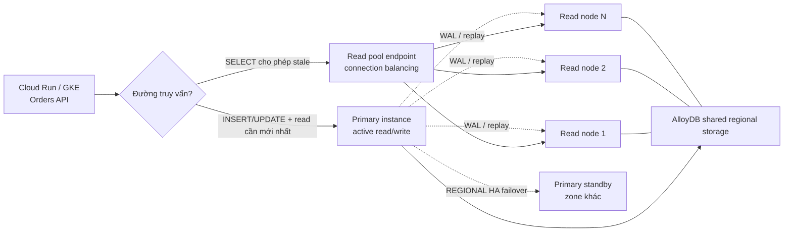
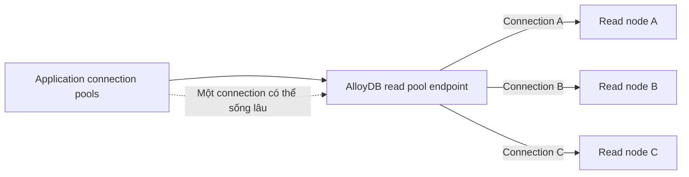
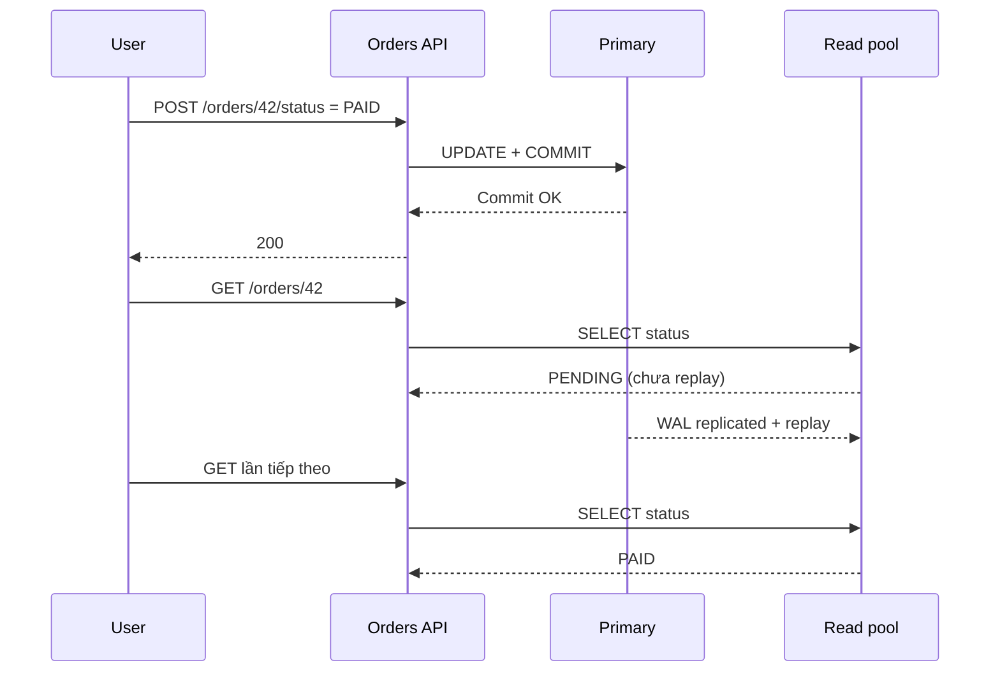

# AlloyDB clusters, primary instances và read pools

Một ứng dụng đặt hàng có thể phát sinh vài chục giao dịch ghi mỗi giây nhưng hàng nghìn truy vấn đọc: tra cứu sản phẩm, lịch sử đơn, báo cáo và dashboard. Nếu mọi truy vấn đều sử dụng một PostgreSQL server, CPU, bộ nhớ và số kết nối của đường ghi có thể bị cạnh tranh. **AlloyDB for PostgreSQL** tách compute khỏi storage, tổ chức tài nguyên theo **cluster**, cung cấp **primary instance** để đọc/ghi và **read pool instances** để mở rộng lượng truy vấn đọc.

Bài thuộc chương **Cloud SQL và AlloyDB** của module `CLOUD_PROVIDERS_GCP`. Mục tiêu là thiết kế hệ thống database phù hợp cho Cloud Run/GKE/Compute Engine, kết nối bảo mật qua IAM và VPC, giữ đúng tính nhất quán của nghiệp vụ, quan sát hiệu năng và kiểm soát chi phí. Một read pool không tự làm database ghi nhanh hơn, không phải backup và cũng không mặc định bảo đảm mọi SELECT thấy giao dịch vừa commit.

> **Cảnh báo:** Các lệnh tạo cluster, primary, read pool, thay số node hoặc xóa tài nguyên sẽ tác động đến Google Cloud và **có thể phát sinh chi phí đáng kể**. Ví dụ dùng project/instance giả định và dành cho sandbox được ủy quyền. Chỉ chạy sau khi kiểm tra project, region, quyền IAM, mạng, ngân sách và owner. Không xóa cluster chứa dữ liệu thật.

## 1. Mục tiêu và kết quả mong đợi

Sau bài này, bạn có thể:

1. Giải thích quan hệ **cluster → primary instance → read pool instance → read nodes**, phân biệt với Cloud SQL read replica và HA standby.
2. Mô tả **storage/compute separation**, read replica WAL replay và các giới hạn **read-after-write**.
3. Chọn primary **REGIONAL** hoặc **ZONAL**, xác định số node và machine type cho read pool theo khả năng sẵn sàng.
4. Hiểu **endpoint của primary**, **endpoint của read pool** và vì sao không kết nối trực tiếp đến một node ngẫu nhiên.
5. Kiểm tra tài nguyên bằng `gcloud`, tạo môi trường lab phù hợp và truy cập database bằng kết nối được bảo vệ.
6. Định tuyến **writes + reads cần dữ liệu mới** tới primary, còn **reads chịu được độ trễ** tới read pool.
7. Mở rộng read pool bằng **node count/autoscaler**, theo dõi CPU, connections, p95 latency và replication lag.
8. Đưa ra quyết định giữa AlloyDB, Cloud SQL và các lựa chọn analytics trên cơ sở SLO/chi phí.

## 2. Kiến trúc AlloyDB: cluster, primary và read pool



Sơ đồ thể hiện vai trò **logic**: AlloyDB sử dụng storage dùng chung và đồng bộ log/replay để các read nodes phục vụ kết quả. Không suy ra mỗi read node có một storage copy độc lập hoặc rằng mọi transaction đã commit được thấy ngay lập tức trên mọi node.

| Thành phần | Vai trò | Điều không nên giả định |
| --- | --- | --- |
| **Cluster** | Ranh giới tài nguyên theo region; gắn database version, storage, mạng, backup/PITR và các instances. | Cluster chỉ là một VM hoặc một IP. |
| **Primary instance** | Compute cho giao dịch đọc/ghi và điều phối writes. Mỗi primary cluster hoạt động có primary. | Tăng read pool nodes làm write throughput của primary tăng. |
| **Primary standby** (REGIONAL) | Node dự phòng ở zone khác, phục vụ failover theo kiến trúc HA. | Standby có thể bị ứng dụng dùng làm endpoint đọc. |
| **Read pool instance** | Nhóm một hoặc nhiều **read nodes** đồng nhất machine type, có endpoint đọc riêng. | Tự cân bằng từng câu SQL theo tải/lag của mọi node. |
| **Read node** | Compute nhận/replay thay đổi, phục vụ read-only queries. | Node có IP/identity ổn định để application pin dài hạn. |
| **Backup/PITR** | Khôi phục dữ liệu khi xóa nhầm, lỗi logic hoặc sự cố khác theo cấu hình. | HA/read pool là thay thế cho backup. |

### 2.1. Tách compute và storage có lợi gì?

Trong mô hình một máy PostgreSQL truyền thống, xử lý SQL và lưu trữ gắn chặt với cùng hạ tầng. AlloyDB cho phép thay đổi **compute primary/read pool** tương đối độc lập với **cluster storage**. Khi cần nhiều năng lực SELECT, ta thêm read nodes mà không cần dựng lại một bản đầy đủ của storage theo cách quen thuộc ở nhiều kiến trúc replication.

Dù dùng storage chung, **WAL flush/replay và caches trên read nodes** vẫn có độ trễ. Một read pool không cung cấp tính nhất quán đồng bộ như primary cho mọi truy vấn.

### 2.2. Cluster, instance, node: cách đếm chi phí

Một ví dụ có **1 cluster**, **1 primary REGIONAL** và **1 read pool có 3 nodes**:

- **Primary REGIONAL** có active và standby để phục hồi khi lỗi zone/node.
- Read pool chứa **3 read nodes** dùng một **read pool endpoint**.
- **Storage** thuộc cluster; compute primary và read nodes được tính theo năng lực được cấp và bảng giá.
- Không nên cộng một node standby thành “read replica cho báo cáo”; đó là năng lực HA.

Read pools có thể dùng machine series khác primary khi được hỗ trợ; nhưng **các nodes bên trong cùng một read pool instance dùng chung machine type**. Nếu workload báo cáo cần cấu hình khác API, tạo read pool thứ hai để cô lập workload thay vì ép tất cả queries cùng tranh tài nguyên.

## 3. Primary instances: ZONAL và REGIONAL

### 3.1. Primary là đường ghi của cluster

Application gửi `INSERT`, `UPDATE`, `DELETE`, DDL và transactions có ghi tới **primary instance endpoint**. Primary cũng có thể phục vụ SELECT; những SELECT phải thấy dữ liệu vừa commit hoặc quyết định nghiệp vụ dựa trên dữ liệu mới nên ưu tiên primary.

| Availability | Kiến trúc | Khi cân nhắc |
| --- | --- | --- |
| **ZONAL** | Một primary node trong một zone; không có automated HA failover sang standby. | Sandbox/thử nghiệm, có thể chấp nhận gián đoạn. |
| **REGIONAL** | Active và standby ở các zones khác nhau, có automated failover theo dịch vụ. | Production cần giảm gián đoạn khi lỗi node/zone. |

Primary REGIONAL thường là mặc định phù hợp production. Tuy nhiên **HA không đồng nghĩa zero downtime**: connection có thể đứt trong failover/maintenance; ứng dụng phải reconnect, retry transaction **theo idempotency** và có connection pool health checks.

### 3.2. Primary không phải phương án DR liên vùng

REGIONAL HA bảo vệ trước một số sự cố **trong region**. Nếu yêu cầu DR khi **cả region** có sự cố, cần thiết kế **secondary cluster/cross-region replication, recovery procedure, backup/PITR, DNS/app failover** theo RTO/RPO của tổ chức. **Read pool nội vùng** không thay thế secondary cluster.

### 3.3. Đọc trạng thái primary

```bash
PROJECT_ID="orders-lab"
REGION="asia-southeast1"
CLUSTER="orders-alloydb-lab"
PRIMARY="orders-primary"

# CHỈ ĐỌC: xác minh project, clusters, instances.
gcloud auth list
gcloud config get-value project
gcloud alloydb clusters list \
  --project="$PROJECT_ID" --region="$REGION"
gcloud alloydb instances list \
  --project="$PROJECT_ID" --region="$REGION" --cluster="$CLUSTER"
gcloud alloydb instances describe "$PRIMARY" \
  --project="$PROJECT_ID" --region="$REGION" --cluster="$CLUSTER" \
  --format=yaml
```

Đọc các trường instance type, machine config, availability, IP addresses, state và labels; đối chiếu owner/maintenance window trước khi thay đổi. `gcloud` giúp quản trị **hạ tầng**, còn PostgreSQL roles/quyền truy cập dữ liệu phải được quản lý riêng.

## 4. Read pools: mở rộng đọc qua instance endpoint

### 4.1. Một pool có nhiều nodes

Read pool instance phục vụ `SELECT` thông qua **endpoint của instance**. AlloyDB phân phối **kết nối database** tới nodes trong pool; đây không phải tính năng định tuyến **mỗi SQL statement** sang node “ít lag nhất”.



Khi tăng node count, **các kết nối đang mở vẫn gắn với node hiện tại**; nếu application connection pool giữ kết nối rất lâu, nodes mới có thể chưa nhận được tải. Điều chỉnh thời gian sống kết nối, tái tạo kết nối có kiểm soát và quan sát phân bố CPU/active connections sau scale-out.

**Không dùng IP của từng read node** trong cấu hình ứng dụng. Nodes là tài nguyên có thể thay đổi khi scaling và maintenance. Endpoint ổn định cần dùng là **read pool instance IP** hoặc tên DNS/connection target tương ứng với phương thức kết nối.

### 4.2. Số nodes và độ sẵn sàng

| Read pool | Availability | Đánh đổi |
| --- | --- | --- |
| **1 node** | Đường đọc một node, phạm vi zonal. | Chi phí thấp hơn nhưng lỗi node có thể làm gián đoạn đọc. |
| **Từ 2 nodes** | Các nodes được bố trí nhiều zones theo khả năng và cấu hình hỗ trợ. | Tăng capacity và resilience, nhưng có thêm compute cost. |
| **Nhiều read pools** | Mỗi pool có endpoint, machine type và node count riêng. | Cô lập báo cáo/API/analytics, cần quản lý nhiều connection targets. |

Theo tài liệu hiện hành, read pool hỗ trợ **1–20 nodes** trong một instance và **không quá 20 read nodes tổng cộng trên các read pool instances của cùng cluster**. Đây là hạn mức sản phẩm, không phải khuyến nghị bắt đầu ở mức cao. Kiểm tra region, quota và machine series cụ thể trước khi lập capacity plan.

### 4.3. Read pool không có quyền ghi

Truy vấn đọc tại read pool được tối ưu cho workloads đọc; các lệnh thay đổi dữ liệu trên connection chỉ đọc sẽ thất bại. Điều này giúp cô lập read workloads khỏi writes nhưng **không thay thế phân quyền SQL**. Vẫn cần database role hạn chế quyền schema/table, IAM và network để bảo vệ dữ liệu.

### 4.4. Read pool khác với Cloud SQL read replicas thế nào?

| Tiêu chí | **Cloud SQL read replica** | **AlloyDB read pool** |
| --- | --- | --- |
| Resource | Replica là instance chỉ đọc có endpoint riêng. | Một read pool instance có nhiều read nodes. |
| Read routing | App/proxy thường chọn giữa các replica endpoints; tính năng Cloud SQL Enterprise Plus read pool là trường hợp khác. | Một endpoint pool phân phối connections tới read nodes. |
| Storage | Cơ chế lưu trữ/replication theo engine và edition Cloud SQL. | Compute/storage tách biệt trong AlloyDB, WAL replay ở read nodes. |
| Scale-out | Tăng số replicas, quản lý endpoint; có tính năng read pool riêng ở cấu hình Enterprise Plus. | Tăng node count hoặc read pool autoscaling. |
| Khi cân nhắc | Dự án đã dùng Cloud SQL, cần một/vài read replica truyền thống. | PostgreSQL workload cần pooled reads, HA và mở rộng compute chuyên sâu. |

Không chọn AlloyDB chỉ vì có nhiều độc giả: nếu Cloud SQL đáp ứng SLO, chi phí và tính năng cần thiết, migration chưa chắc có lợi. AlloyDB là dịch vụ **PostgreSQL-compatible**, cần kiểm tra extensions, flags, SQL behavior và cơ chế quản trị quyền trước khi thay hệ thống đang chạy.

## 5. Độ trễ đồng bộ và read-after-write

Một write đã commit ở primary có thể **chưa được replay** trên read nodes. Vì vậy:



**Replication lag** có thể tăng do write burst, WAL lớn, transaction dài, query nặng, thiếu CPU/memory hoặc replay conflicts. AlloyDB theo dõi cả thời gian chuyển/flush WAL và **replay lag**; read pool có shared storage **không làm mất nhu cầu replay**.

### 5.1. Thiết kế read routing theo nhất quán

| Truy vấn | Route | Vì sao |
| --- | --- | --- |
| `INSERT/UPDATE/DELETE`, transaction cần ghi | **Primary** | Read pool chỉ đọc. |
| Kiểm tra tồn kho, trạng thái thanh toán ngay sau commit | **Primary** | Cần read-your-writes/consistency. |
| Product catalog, dashboard có SLA stale vài giây | **Read pool** | Giảm tải SELECT khỏi primary. |
| Báo cáo dài, analytics | **Read pool riêng**, hoặc BigQuery tùy bài toán | Tránh tranh CPU của các queries OLTP. |
| Read pool bị lag/mất khả dụng | Theo **policy fallback**, rate limit và circuit breaker | Không tự đổ vô hạn traffic về primary gây sập writes. |

Để đảm bảo **read-your-writes**, giải pháp đơn giản là đọc trên primary ngay sau một giao dịch ghi, hoặc theo dõi watermark/LSN và chỉ đọc pool khi xác nhận đã bắt kịp. Không giả định `lag=0` tại một điểm lấy mẫu có nghĩa không thể stale ở mọi lúc.

### 5.2. SQL minh họa phân biệt primary/read node

Kết nối tới hai endpoint bằng phiên `psql` **riêng biệt**, sử dụng cơ chế auth/network được cấp phép:

```sql
-- Chạy trên PRIMARY hoặc READ POOL để xem trạng thái.
SELECT pg_is_in_recovery() AS is_read_node;
SHOW transaction_read_only;
SELECT current_database(), current_user;
```

Trên primary thông thường `pg_is_in_recovery() = false`; trên read node sẽ phản ánh chế độ recovery/read-only phù hợp. Lệnh `SHOW transaction_read_only` giúp kiểm tra phiên có bị buộc chỉ đọc hay không. **Không dùng chỉ một phép kiểm tra SQL làm bằng chứng toàn bộ routing đã đúng**, vì user role và session settings cũng có thể ảnh hưởng quyền.

### 5.3. Bài thử dữ liệu mới và cũ

```sql
-- THAY ĐỔI DỮ LIỆU: chỉ chạy trên PRIMARY sandbox.
CREATE TABLE IF NOT EXISTS demo_orders (
    order_id text PRIMARY KEY,
    state text NOT NULL,
    updated_at timestamptz NOT NULL DEFAULT now()
);
INSERT INTO demo_orders (order_id, state)
VALUES ('ord-42', 'PAID')
ON CONFLICT (order_id)
DO UPDATE SET state = EXCLUDED.state, updated_at = now();

-- TRÊN READ POOL: mở session khác để đọc.
SELECT order_id, state, updated_at
FROM demo_orders WHERE order_id = 'ord-42';
```

Nếu không thấy dữ liệu ngay, ghi lại **thời điểm commit, kết quả query và replication lag**. Truy vấn có thể thấy bản cũ trong thời gian ngắn; nếu lag kéo dài, điều tra trạng thái replay, workload và resource metrics. Không kết luận pool đã hỏng chỉ từ một truy vấn ngay sau commit.

## 6. Lab: chuẩn bị cluster, primary và read pool

Đây là **chuỗi thao tác có thể triển khai** trong sandbox đã có billing, IAM và VPC phù hợp. Nếu tổ chức đã có AlloyDB cluster thử nghiệm, **bỏ qua bước tạo cluster/primary**, chỉ thực hành read-only hoặc tạo read pool khi được người sở hữu cho phép.

### 6.1. Tiền điều kiện

| Điều kiện | Cần xác nhận |
| --- | --- |
| **Project/region** | AlloyDB API đã bật, region hỗ trợ machine type chọn, còn quota và ngân sách. |
| **VPC** | Đã thiết lập **private services access** cho AlloyDB hoặc chọn **Private Service Connect** với quy trình riêng. |
| **Quyền tạo** | Principal được ủy quyền, ví dụ quyền từ `roles/alloydb.admin` và quyền sử dụng mạng tương ứng. |
| **Quyền ứng dụng** | Service account riêng, database role riêng, network path/connector hợp lệ. |
| **Dữ liệu** | Sandbox không chứa dữ liệu người dùng thật; có owner và phương án dọn. |

Ví dụ dùng **private services access (PSA)**, không dùng PSC. Chỉ định VPC đã tạo và kết nối private services access đúng cách **trước** khi chạy lệnh tạo cluster. Không tự tạo mạng, phân bổ CIDR hoặc chỉnh peering khi chưa có quyền quản trị mạng.

```bash
PROJECT_ID="orders-lab"
REGION="asia-southeast1"
NETWORK="orders-vpc"
CLUSTER="orders-alloydb-lab"
PRIMARY="orders-primary"
READ_POOL="orders-read-pool"

# Chỉ đọc: project, VPC, clusters.
gcloud config get-value project
gcloud compute networks describe "$NETWORK" \
  --project="$PROJECT_ID" \
  --format="yaml(name,selfLink)"
gcloud alloydb clusters list \
  --project="$PROJECT_ID" --region="$REGION"
```

**Lưu ý:** nhìn thấy VPC qua `describe` **không chứng minh private services access đã sẵn sàng**; kiểm tra thêm kết nối Service Networking và reserved IP range bằng quy trình network của nhóm platform.

### 6.2. Tạo cluster trong Console (phương án ưu tiên cho lab)

Trong **Google Cloud Console → AlloyDB → Clusters → Create cluster**:

1. Chọn project sandbox, **Production single-zone** cho lab hoặc **multi-zone** nếu muốn thử HA và chấp nhận chi phí.
2. Chọn **region**, database version PostgreSQL được ứng dụng hỗ trợ, cluster ID `orders-alloydb-lab`.
3. Chọn kết nối private services access trên VPC `orders-vpc` đã cấu hình; nếu tổ chức dùng PSC phải chọn mô hình đó ngay từ đầu và chuẩn bị allowed projects/endpoints.
4. Thiết lập mật khẩu admin qua UI an toàn; chọn backup/PITR và encryption theo chính sách, không lưu password trong tài liệu hoặc Git.
5. Chọn primary machine type phù hợp, ghi lại **primary instance ID, availability, region và IP/connection target**.
6. Review chi phí rồi tạo; chờ operation hoàn tất trước khi tạo read pool.

Việc tạo cluster qua CLI cũng khả thi, nhưng flag `--password` có thể làm lộ giá trị qua **command history, process arguments, logs** nếu thao tác cẩu thả; vì vậy bài lab ưu tiên UI cho bước khởi tạo credential. Nếu phải tự động hóa, dùng Terraform/IaC + secret-handling chuẩn của tổ chức, tránh hardcode mật khẩu vào file/lệnh.

### 6.3. CLI tạo primary trên cluster đã có (tùy chọn)

**Chỉ chạy nếu cluster đã tồn tại nhưng chưa có primary**, được phép tạo, và bạn không vừa tạo primary qua UI ở bước trước:

```bash
# THAY ĐỔI HẠ TẦNG + PHÁT SINH PHÍ.
# REGIONAL = primary có active/standby ở nhiều zones.
gcloud alloydb instances create "$PRIMARY" \
  --project="$PROJECT_ID" \
  --region="$REGION" \
  --cluster="$CLUSTER" \
  --instance-type=PRIMARY \
  --availability-type=REGIONAL \
  --machine-type=n2-highmem-4

# CHỈ ĐỌC: xác minh instance và trạng thái.
gcloud alloydb instances describe "$PRIMARY" \
  --project="$PROJECT_ID" --region="$REGION" --cluster="$CLUSTER" \
  --format=yaml
```

Nếu cluster đã có primary, **không tạo primary thứ hai**. Với sandbox không cần HA có thể chọn `--availability-type=ZONAL`; production cần xem RTO/RPO, region và SLO trước khi chọn. Machine type trong ví dụ chỉ minh họa và phải được region/organization hỗ trợ.

### 6.4. Tạo read pool 2 nodes

```bash
# THAY ĐỔI HẠ TẦNG + PHÁT SINH PHÍ.
gcloud alloydb instances create "$READ_POOL" \
  --project="$PROJECT_ID" \
  --region="$REGION" \
  --cluster="$CLUSTER" \
  --instance-type=READ_POOL \
  --read-pool-node-count=2 \
  --machine-type=n2-highmem-4

# CHỈ ĐỌC: xác minh node count, endpoint và trạng thái.
gcloud alloydb instances list \
  --project="$PROJECT_ID" --region="$REGION" --cluster="$CLUSTER"
gcloud alloydb instances describe "$READ_POOL" \
  --project="$PROJECT_ID" --region="$REGION" --cluster="$CLUSTER" \
  --format=yaml
```

**Không copy nguyên lệnh cho PSC:** khi cluster sử dụng Private Service Connect, cần **`--allowed-psc-projects`** và cấu hình PSC endpoint/DNS để clients truy cập, không chỉ đặt tên VPC. Không bật public IP và mở `0.0.0.0/0` chỉ để chạy thử.

Sau khi tạo, ứng dụng dùng **read pool instance endpoint**, không kết nối trực tiếp tới các node riêng lẻ. Một pool có hai nodes tạo khả năng đọc và phân tán tốt hơn một node; nhưng **read pool vẫn có replication lag** và không làm primary tự tăng write throughput.

## 7. Kết nối ứng dụng an toàn

### 7.1. Chọn phương thức network

| Cách kết nối | Phù hợp | Điều kiện |
| --- | --- | --- |
| **Private services access (PSA)** | GKE/VM/Cloud Run có đường vào VPC private đã chuẩn bị. | VPC networking, peering/private services access, firewall và DNS đúng. |
| **Private Service Connect (PSC)** | Nhiều VPC/projects hoặc topology không phù hợp peering trực tiếp. | Cluster cấu hình PSC, allowed projects, endpoints và DNS. |
| **AlloyDB Auth Proxy / Language Connectors** | Cần mTLS, IAM authorization và quản lý certificates tự động. | IAM principal có quyền, **vẫn cần đường mạng** phù hợp với instance. |
| **Public IP** | Use case đặc biệt ngoài VPC được security phê duyệt. | Sử dụng Auth Proxy/connector, IAM và giới hạn nguồn; tránh công bố không kiểm soát. |

**Proxy không phải VPN:** AlloyDB Auth Proxy/Language Connectors cung cấp xác thực/mTLS nhưng không tự tạo mạng riêng tới instance private IP. Với Cloud Run private IP, dùng **Direct VPC egress** hoặc Serverless VPC Access connector theo network topology; với GKE/Compute Engine, kiểm tra VPC, routing và IAM.

### 7.2. IAM khác với quyền PostgreSQL

Để dùng Auth Proxy, principal thường cần `roles/alloydb.client` và `roles/serviceusage.serviceUsageConsumer` theo tài liệu, ngoài kết nối network. Nhưng kết nối đến PostgreSQL vẫn yêu cầu **database authentication/roles**; `roles/alloydb.admin` không tự cho ứng dụng toàn quyền SELECT/UPDATE mọi bảng.

Khuyến nghị:

- Mỗi workload có **service account** riêng, tránh tải key JSON lâu dài vào image.
- Tạo **DB role** đọc/ghi và **DB role** chỉ đọc tách biệt; không dùng `postgres` cho ứng dụng.
- Với workload chỉ đọc, cấp `SELECT` cho bảng/schema cần thiết và dùng read pool endpoint.
- Với Cloud Run/GKE, dùng Workload Identity/attached SA và Secrets Manager theo chính sách; không ghi mật khẩu vào Git hoặc stdout.
- Hạn chế concurrent DB connections và thử tự reconnect sau maintenance/failover.

### 7.3. Kết nối tương tác bằng gcloud beta

Từ máy **được phép truy cập mạng của instance**, có `psql` và quyền phù hợp:

```bash
# Có thể yêu cầu gcloud beta và psql được cài.
# Lệnh mở phiên database, không sửa schema nếu bạn chỉ chạy SELECT.
gcloud beta alloydb connect "$PRIMARY" \
  --project="$PROJECT_ID" \
  --region="$REGION" \
  --cluster="$CLUSTER" \
  --user=postgres

# Terminal thứ hai/phiên khác tới read pool:
gcloud beta alloydb connect "$READ_POOL" \
  --project="$PROJECT_ID" \
  --region="$REGION" \
  --cluster="$CLUSTER" \
  --user=postgres
```

CLI beta dùng AlloyDB Auth Proxy và phiên `psql` để kết nối. **Cloud Shell không tự kết nối trực tiếp được với instance PSA private IP**, vì nó không nằm trong VPC của bạn. Hãy chạy từ VM/bastion được phê duyệt trong VPC hoặc dùng đường kết nối được hỗ trợ; nếu cần PSC/public IP, phải dùng flags/đường mạng đúng thiết kế, không tự mở firewall.

### 7.4. Auth Proxy cho ứng dụng có hai endpoints

Nếu đã cài phiên bản **AlloyDB Auth Proxy** được tổ chức kiểm duyệt và máy có network path/IAM:

```bash
PRIMARY_URI="projects/$PROJECT_ID/locations/$REGION/clusters/$CLUSTER/instances/$PRIMARY"
READ_URI="projects/$PROJECT_ID/locations/$REGION/clusters/$CLUSTER/instances/$READ_POOL"

# Terminal A: proxy chỉ lắng nghe loopback, tránh mở cho Internet.
# Primary -> localhost:5432, read pool -> localhost:5433.
alloydb-auth-proxy "$PRIMARY_URI" "$READ_URI"
```

Hai phiên `psql` ở terminal B và C:

```bash
# Nhập mật khẩu đúng DB user khi được yêu cầu.
psql -h 127.0.0.1 -p 5432 -U postgres
psql -h 127.0.0.1 -p 5433 -U postgres
```

**5432/5433 ở đây là cổng local của proxy**, không nên nhầm với cổng TCP phía server AlloyDB hoặc port cho Direct VPC networking. Cấu hình application/secret cần phân biệt endpoint primary và pool. Nếu dùng PSC, Auth Proxy yêu cầu cờ `--psc` và PSC DNS/endpoint phù hợp.

### 7.5. Read/write routing ở ứng dụng

Ví dụ logic ở service layer (pseudocode, không phải Java code tự chạy):

```text
placeOrder(order):
    transaction(primaryConnection):
        INSERT order
        UPDATE inventory
        COMMIT
    return orderId

getOrder(orderId, requireFresh):
    if requireFresh:
        return SELECT ... using primaryConnection
    else:
        return SELECT ... using readPoolConnection
```

**Không route một transaction write giữa hai connections**: một transaction PostgreSQL gắn với một connection. Đọc trong luồng nghiệp vụ có yêu cầu nhất quán nên sử dụng primary cùng transaction khi cần. Application connection pool (ví dụ HikariCP) phải giới hạn số kết nối ở từng endpoint; **managed connection pooling**, nếu bật và phù hợp, cũng cần được cấu hình/benchmark chứ không thay thế giới hạn kết nối của ứng dụng.

## 8. Mở rộng read pool: thủ công và autoscaling

### 8.1. Thay đổi số nodes bằng gcloud

Giả sử read pool có 2 nodes, muốn tăng lên 3:

```bash
# THAY ĐỔI HẠ TẦNG VÀ CHI PHÍ: chỉ chạy trên pool lab được phép.
gcloud alloydb instances update "$READ_POOL" \
  --project="$PROJECT_ID" \
  --region="$REGION" \
  --cluster="$CLUSTER" \
  --read-pool-node-count=3

# CHỈ ĐỌC kết quả.
gcloud alloydb instances describe "$READ_POOL" \
  --project="$PROJECT_ID" \
  --region="$REGION" \
  --cluster="$CLUSTER" \
  --view=FULL \
  --format="yaml(nodes)"
```

Scale-out **không tự chuyển tất cả kết nối cũ** sang nodes mới. Scale-in có thể làm rớt kết nối tới node bị thu hồi; app phải có reconnect/retry an toàn. Cần theo dõi CPU per node, connections distribution và cache warm-up sau scale.

### 8.2. Autoscaler theo CPU hoặc connections

AlloyDB hỗ trợ **read pool autoscaling** dựa trên CPU utilization, connection count và chính sách schedule trong cấu hình được hỗ trợ. Ví dụ bật CPU autoscaler cho pool mới có **min 2 / max 4 nodes**:

```bash
# CHỈ CHỌN MỘT: ví dụ này thay thế bước tạo READ_POOL thủ công ở mục 6.4.
# THAY ĐỔI HẠ TẦNG + CHI PHÍ.
gcloud alloydb instances create "$READ_POOL" \
  --project="$PROJECT_ID" \
  --region="$REGION" \
  --cluster="$CLUSTER" \
  --instance-type=READ_POOL \
  --read-pool-node-count=2 \
  --machine-type=n2-highmem-4 \
  --enable-autoscaler \
  --autoscaler-max-node-count=4 \
  --autoscaler-target-cpu-usage=0.7
```

**Không chạy create lần nữa** nếu read pool đã có. Đối với pool đã tạo, dùng `gcloud alloydb instances update` với `--enable-autoscaler` và các target/max phù hợp thay vì tạo trùng. Với autoscaler kết hợp CPU/connection/schedule, dịch vụ chọn mức node count cao nhất được các policies đề xuất trong giới hạn cấu hình.

| Scaling | Ý nghĩa | Giới hạn |
| --- | --- | --- |
| **Vertical primary** | Tăng/đổi machine type cho primary. | Không phải horizontal write scaling; có tác động vận hành. |
| **Vertical read pool** | Đổi machine type của pool. | Nodes cùng pool phải đồng nhất type. |
| **Horizontal read pool** | Tăng/giảm số read nodes. | Chỉ scale đọc; quota, capacity, cache và connection stickiness. |
| **Autoscaling CPU** | Thêm nodes khi CPU vượt mục tiêu. | CPU thấp không bảo đảm queries nhanh nếu nghẽn I/O/lock. |
| **Autoscaling connections** | Thêm nodes khi nhiều connections. | Connection count không phải số query/s; pooler có thể làm tín hiệu khác. |
| **Schedule-based scaling** | Chủ động tăng min nodes vào giờ cao điểm dự báo. | Tăng chi phí ngay cả khi tải thực chưa tới. |

**Autoscaling không phải tức thời**: provision có độ trễ, nodes mới cần warm cache; khi autoscaling scale-in, connections tới node bị thu hồi phải reconnect. Có thể chọn thêm nhiều read pools hoặc đổi machine series khi một region thiếu capacity loại VM đã chọn, nhưng phải benchmark lại.

## 9. HA, backups và sự cố

**Ba cơ chế giải quyết ba rủi ro khác nhau:**

| Nhu cầu | Cơ chế | Không giải quyết |
| --- | --- | --- |
| **Lỗi primary node/zone** | Primary `REGIONAL` active/standby và automated failover. | Xóa nhầm dữ liệu hoặc lỗi logic được replicate. |
| **Tải SELECT tăng / read node lỗi** | Read pool nhiều nodes, phân phối connections; autoscaler khi cần. | Primary write availability hoặc strong consistency tuyệt đối. |
| **Xóa sai dữ liệu / corruption** | Backups, point-in-time recovery theo retention và cấu hình. | Tự chuyển mọi application traffic khi cả region sập. |
| **Sự cố toàn region** | Secondary cluster/cross-region replication + DR runbook. | RPO/RTO bằng 0 một cách mặc định. |

Trong production:

1. Bật backup/PITR theo RPO, kiểm tra retention/restore permission và **thử khôi phục định kỳ** vào cluster khác.
2. Dùng primary REGIONAL khi SLO yêu cầu HA trong region; thử failover và kiểm tra application reconnect.
3. Tạo read pools ít nhất hai nodes nếu đường đọc cũng cần chịu lỗi một node/zone.
4. Giữ application connection pools, timeouts, health probes và circuit breakers phù hợp để tránh đồng loạt mở lại quá nhiều connections.
5. Nếu có yêu cầu DR liên vùng, thiết kế secondary cluster và failover, dữ liệu/app routing và công thức RTO/RPO độc lập.

Không coi status `READY` của read pool là bằng chứng truy vấn bất kỳ cũng có latency/consistency đạt SLO; phải **đo từ ứng dụng**.

## 10. Quan sát và xử lý sự cố

### 10.1. Metrics cần theo dõi

| Signal | Tầng | Ý nghĩa |
| --- | --- | --- |
| **CPU utilization / memory available** | Primary, read pool / nodes | Query load, cache pressure và mức dùng compute. |
| **Active connections / peak connections** | Per instance/node | Load distribution, giới hạn connection và pool behavior. |
| **Read pool maximum replication lag** | Read pool | Node có thể đang replay chậm; tác động dữ liệu stale. |
| **Read latency p95/p99, throughput** | App & database | Người dùng được phục vụ nhanh không, query nào nặng? |
| **Active read nodes, autoscaler decisions** | Read pool | Scale có tạo đủ capacity, cache warm-up hoàn tất chưa? |
| **Long queries / locks / wait events** | PostgreSQL Query Insights | Truy vấn report/transaction có làm nghẽn replay không? |
| **Failover/maintenance, connection errors** | Platform + app | Độ sẵn sàng và retry/reconnect. |
| **Storage growth, backups, costs** | Cluster & Billing | Capacity, retention và ngân sách. |

Cloud Monitoring có metric **`alloydb.googleapis.com/instance/postgres/replication/maximum_lag`** (đơn vị milliseconds theo metric reference), và node metrics như `node/postgres/replay_lag` khi được cung cấp. Quan sát metrics theo **instance và node**, không chỉ giá trị trung bình toàn cluster. **System insights** và **Query insights** giúp so CPU/connection/queries với thời điểm lag tăng; sampling có độ trễ nên không dùng một điểm đo để quyết định read-your-writes.

### 10.2. Bảng troubleshooting

| Triệu chứng | Nguyên nhân khả dĩ | Cách điều tra |
| --- | --- | --- |
| Client bị `connection refused/timeout` | VPC/PSA/PSC/DNS, firewall, sai endpoint hoặc Auth Proxy không có network path. | Xác minh connectivity method, proxy logs, IP và port; không mở public `0.0.0.0/0`. |
| Auth Proxy báo `PERMISSION_DENIED` | Thiếu `alloydb.client`/Service Usage Consumer hoặc credential khác với mong đợi. | Kiểm tra workload principal, IAM, Google API access. |
| PostgreSQL `password authentication failed` | User/password hoặc IAM DB auth sai. | Xem database role và phương thức authentication, không cấp AlloyDB Admin để “chữa”. |
| SELECT trên read pool trả dữ liệu cũ | WAL receive/replay lag. | `maximum_lag`, Query insights, write bursts và read-after-write routing. |
| Pool có thêm nodes nhưng CPU node cũ vẫn cao | Connection pools giữ long-lived connections. | Rotate connections có kiểm soát, đo active connections per node. |
| Dùng read pool để `INSERT` bị lỗi | Endpoint chỉ đọc. | Định tuyến transaction ghi tới primary. |
| Scale operation thất bại | Regional capacity/quota/machine type hoặc maintenance. | Kiểm tra operation state, quota, type; retry có backoff khi phù hợp. |
| p95 SELECT chậm dù CPU thấp | SQL/index chưa tối ưu, locks, network hoặc storage waits. | Query plans, `EXPLAIN`, Query insights và downstream app latency. |
| Ứng dụng lỗi khi primary failover | Connection cũ invalid, transactions bị ngắt. | Reconnect/retry idempotent, pool health checks, DR runbook. |

### 10.3. Quy trình triage khi read pool lag cao

1. **Xác minh ảnh hưởng:** p95 latency/read freshness, phạm vi users và các truy vấn nhạy consistency.
2. **Đọc metrics:** maximum replication lag, CPU/memory, connections của pool và write throughput primary.
3. **Phân loại nguyên nhân:** long-running queries, transaction lớn, WAL burst, replay conflicts, thiếu node compute.
4. **Giảm tác động:** route reads quan trọng về primary **có rate limit và capacity guardrail**, tách report nặng hoặc giảm concurrency.
5. **Khắc phục nguyên nhân:** tối ưu query/index, batch writes hợp lý, thay size/node count, tune connection pooling có đo lường.
6. **Xác minh hồi phục:** lag, p95/5xx, connection churn, business correctness và chi phí sau thay đổi.

Đừng scale read pool chỉ vì một biểu đồ CPU cao: nếu lag do query locks hoặc write burst, thêm node không chắc giải quyết vấn đề; phải đo trước/sau.

## 11. Sizing, lựa chọn dịch vụ và chi phí

### 11.1. Tính capacity theo workload

Để chọn read pool ban đầu:

- **Đo:** RPS của SELECT, p95/p99, concurrency, CPU/connection per query, cache hit rate và replication lag.
- **Chia workloads:** API cần latency thấp, reporting nặng và batch analytics có SLO khác nhau.
- **Ước lượng:** nếu mỗi read node sau benchmark đáp ứng an toàn khoảng 300 reads/s, 900 reads/s cần ít nhất 3 nodes về throughput, **chưa tính HA/headroom/độ lệch tải**.
- **Kiểm thử:** một read pool nhiều nodes có connection balancing; với long-lived pools phải kiểm tra phân phối thực tế, không lấy `3 × 300` làm cam kết tự động.
- **Giữ đường ghi:** một primary có thể vẫn là bottleneck cho lock contention, WAL write hoặc transaction throughput.

```text
Ví dụ capacity estimate (chỉ để lập kế hoạch):
Traffic read peak:            900 queries/second
Load-tested safe node rate:  300 queries/second
Lower bound:                900 / 300 = 3 read nodes
Production target:          3+ nodes, thêm headroom/HA theo SLO
```

### 11.2. Chi phí cần đưa vào dự toán

| Nhóm | Có thể phát sinh | Hướng tối ưu |
| --- | --- | --- |
| Primary compute | Machine type và HA active/standby. | Right-size theo write throughput/SLO. |
| Read pool compute | **Số read nodes × machine type × thời gian cấp phát**. | Dùng autoscaler có giới hạn, tách SLO khi cần. |
| Cluster storage | Dữ liệu, tăng trưởng, storage/bandwidth theo bảng giá. | Retention, dọn dữ liệu và capacity plan. |
| Backup/PITR | Dữ liệu backup và retention. | Theo chính sách RPO/RTO, không tắt backup chỉ vì tiết kiệm. |
| Network | Intra/cross-region traffic, VPC/NAT/PSC theo trường hợp. | Đặt compute gần database, tránh đường vòng không cần thiết. |
| Observability | Cloud Monitoring/Logging, export traces. | Sampling/retention có chủ đích. |
| App compute | Cloud Run/GKE/VM connection pools và retries. | Hạn chế fan-out, kiểm soát connections. |

**Read pool không miễn phí lúc idle chỉ vì không có queries**. Thêm 4 nodes cần đánh giá mức sử dụng trong ngày, không chỉ lúc cao điểm. Bảng giá và promotions có thể đổi theo region; dùng [AlloyDB pricing](https://cloud.google.com/alloydb/pricing) và Cloud Billing thực tế để quyết định.

### 11.3. Khi chọn AlloyDB thay Cloud SQL?

Đánh giá AlloyDB khi PostgreSQL workload cần **tách compute/storage, performance/HA, read pools scale ngang**, có yêu cầu cao về transaction throughput hoặc phục vụ nhiều nhóm read khác nhau. Chọn Cloud SQL khi workload nhỏ/trung bình, tính năng/giá hiện tại đã đủ và ưu tiên đơn giản vận hành. Với analytics lớn, cân nhắc **BigQuery hoặc pipelines CDC** thay vì để báo cáo nặng gây lag cho pool phục vụ request.

Trước migration, kiểm tra **PostgreSQL compatibility, extensions, roles, flags, backup/restore, networking, HA/DR và licensing/cost**, rồi thử với dataset và query plan thực. Không coi chuyển database engine managed là một lệnh import không có rủi ro.

## 12. Dọn tài nguyên sandbox

Chỉ dọn tài nguyên **do bài lab tạo mới**, không dùng chung với team khác:

```bash
# CHỈ ĐỌC: xác nhận dự án, chủ sở hữu, trạng thái và dữ liệu.
gcloud alloydb instances list \
  --project="$PROJECT_ID" --region="$REGION" --cluster="$CLUSTER"
gcloud alloydb clusters describe "$CLUSTER" \
  --project="$PROJECT_ID" --region="$REGION" \
  --format=yaml

# XÓA THẬT: chỉ khi READ_POOL thuộc riêng lab và không còn client sử dụng.
# gcloud alloydb instances delete "$READ_POOL" \
#   --project="$PROJECT_ID" --region="$REGION" --cluster="$CLUSTER"
```

**Không xóa primary/cluster chứa dữ liệu cần giữ**. Nếu cluster được tạo riêng cho lab, xác nhận backup/retention, chủ sở hữu, phụ thuộc và áp dụng quy trình xóa theo tài liệu của dịch vụ. Xóa read pool không xóa dữ liệu cluster; xóa cluster có thể làm **mất quyền truy cập dữ liệu** theo chính sách. Kiểm tra Billing sau khi dọn, và không tự xóa VPC/PSA/PSC connection dùng chung.

## 13. Bài tập vận dụng (có đáp án)

**Bài 1 — Vai trò cluster.** Một nhóm nói “cluster chính là VM chạy PostgreSQL, tăng cluster nghĩa là tăng CPU”. Đúng không?

*Đáp án:* **Sai.** Cluster quản lý storage/cấu hình/network/backup; **primary** và **read pool nodes** là các thành phần compute. Tăng CPU là thay machine type của instance, còn scale read capacity là tăng nodes/read pools.

**Bài 2 — Đường ghi.** Gửi `UPDATE orders SET status='PAID'` đến read pool endpoint, điều gì xảy ra?

*Đáp án:* Read pool chỉ đọc, thao tác ghi không được chấp nhận. Transaction ghi phải đi **primary**.

**Bài 3 — Read-after-write.** API trả 200 sau khi thanh toán; request GET ngay tiếp theo đi read pool nhưng vẫn thấy PENDING. Có thể vì sao?

*Đáp án:* **WAL replay lag**. Khi nghiệp vụ yêu cầu đọc trạng thái mới nhất, route GET liên quan về **primary** hoặc chờ watermark/LSN theo một cơ chế được kiểm chứng.

**Bài 4 — Scale-out chưa giảm CPU.** Pool từ 2 lên 4 nodes, CPU hai nodes cũ vẫn cao và nodes mới nhàn. Nguyên nhân?

*Đáp án:* Endpoint cân bằng **kết nối**, không tự chuyển các long-lived connections cũ. Cần rotate/thiết lập lifetime của app connection pool có kiểm soát, theo dõi distribution per node.

**Bài 5 — Primary standby.** Nhóm muốn dùng standby REGIONAL để chạy báo cáo nhằm tiết kiệm read pool. Có nên không?

*Đáp án:* Không. Standby của primary phục vụ **HA/failover**, không phải endpoint SELECT ứng dụng. Dùng primary hoặc read pool đúng SLO.

**Bài 6 — Số read nodes.** Benchmark một node xử lý an toàn 300 reads/s, peak 900 reads/s. Lower bound cần bao nhiêu nodes?

*Đáp án:* **3 nodes** theo phép tính sơ bộ, nhưng phải cộng headroom/HA, đo query mix, load distribution, replication lag và khả năng cao điểm.

**Bài 7 — IAM.** Cloud Run runtime SA có `roles/alloydb.client` nhưng `psql` báo `password authentication failed`. Có cần cấp Owner cho SA?

*Đáp án:* Không. `alloydb.client` giúp authorize kết nối qua Auth Proxy/connector; **DB username/password hoặc IAM DB auth + database role** vẫn phải đúng. Kiểm tra phương thức xác thực, VPC route và IAM cần thiết, không cấp quyền rộng.

**Bài 8 — HA vs backup.** Primary REGIONAL tự failover. Có thể tắt PITR và backups không?

*Đáp án:* Không nên nếu có RPO/dữ liệu quan trọng. HA xử lý lỗi hạ tầng; backup/PITR phục hồi sau lỗi logic/xóa nhầm. Khả năng DR liên vùng cần thiết kế riêng.

**Bài 9 — Read pool autoscaling.** Autoscaler thêm node nhưng báo cáo lâu vẫn gây lag, write load tăng mạnh. Có thể xử lý thế nào?

*Đáp án:* Đo maximum_lag, WAL volume, CPU/locks, query plans và per-node connections. Tách báo cáo nặng, tối ưu query, giới hạn long-running reads, xem cơ chế throttle/replay; chỉ thêm nodes khi nguyên nhân là capacity và còn quota.

**Bài 10 — Chi phí.** Mỗi ngày có 2 giờ cao điểm, đội giữ 8 read nodes cả 24 giờ. Nên đánh giá gì?

*Đáp án:* Thử autoscaling với min/max/schedule có SLO, cân nhắc node sizes, cache warm-up và thời gian provisioning; tính compute read nodes cả ngày và kiểm tra năng lực khi scale-in/out. Không giảm min quá mức nếu đường đọc cần HA.

## 14. Checklist trước production

- [ ] Cluster region/database version/VPC topology và quyền sở hữu đã được phê duyệt.
- [ ] Chọn primary REGIONAL/ZONAL theo SLO; có phương án reconnect/failover.
- [ ] Có backups, PITR/restore test và DR nếu yêu cầu khác region.
- [ ] Read pool machine type/node count và tổng quota/giới hạn được kiểm chứng.
- [ ] Ứng dụng dùng **primary cho writes và reads cần consistency**, read pool cho reads chịu được lag.
- [ ] Chỉ kết nối **read pool instance endpoint**, không pin IP một read node.
- [ ] IAM workload, PostgreSQL roles, network path, proxy/connector và secrets tách biệt.
- [ ] Connection pool giới hạn, max connection lifetime và graceful reconnect được kiểm thử.
- [ ] Replication lag, p95 latency, CPU, connections, Query insights có dashboard/alerts.
- [ ] Autoscaler CPU/connections/schedule có min/max và theo dõi cache warm-up.
- [ ] Đã thử stale reads, read pool node loss, primary failover, quota/capacity và recovery.
- [ ] Đã benchmark PostgreSQL compatibility, query/index và tổng chi phí primary/read/storage/backups.
- [ ] Có runbook, rollback/change management và ownership rõ trước khi chỉnh cluster.

## 15. Tổng kết

**AlloyDB cluster** là ranh giới dữ liệu, mạng và cấu hình; **primary instance** là nơi xử lý transactions đọc/ghi; **read pool instance** cung cấp endpoint cho nhiều read nodes để mở rộng truy vấn đọc. Cách mở rộng này giúp cô lập read workloads, nhưng vẫn phải kiểm soát **WAL replay lag, connection stickiness, routing nhất quán, HA/backup và chi phí compute**.

Để vận hành đúng: bắt đầu bằng **đo workload**, chọn primary HA theo SLO, thêm read pool với node count có cơ sở, route writes/reads nhất quán vào đúng endpoint, bảo vệ IAM/VPC/database roles và theo dõi **replication lag + p95 latency + active connections**. **Một read pool khỏe không đồng nghĩa dữ liệu luôn mới và cũng không thay thế backup hoặc DR**.

### Tài liệu Google Cloud tham khảo

- [AlloyDB overview](https://cloud.google.com/alloydb/docs/overview)
- [Create a cluster and its primary instance](https://cloud.google.com/alloydb/docs/cluster-create)
- [Create a read pool instance](https://cloud.google.com/alloydb/docs/instance-read-pool-create)
- [Scale an instance and configure read pool autoscaling](https://cloud.google.com/alloydb/docs/instance-read-pool-scale)
- [Choose an AlloyDB connectivity option](https://cloud.google.com/alloydb/docs/choose-alloydb-connectivity)
- [Connect with AlloyDB Auth Proxy](https://cloud.google.com/alloydb/docs/auth-proxy/connect)
- [Connect using gcloud](https://cloud.google.com/alloydb/docs/connect-gcloud)
- [Monitor instances and System insights](https://cloud.google.com/alloydb/docs/monitor-instance)
- [Troubleshoot replication issues](https://cloud.google.com/alloydb/docs/troubleshoot/replication-issues)
- [System insights metrics reference](https://cloud.google.com/alloydb/docs/reference/system-insights-metrics)
- [AlloyDB pricing](https://cloud.google.com/alloydb/pricing)
