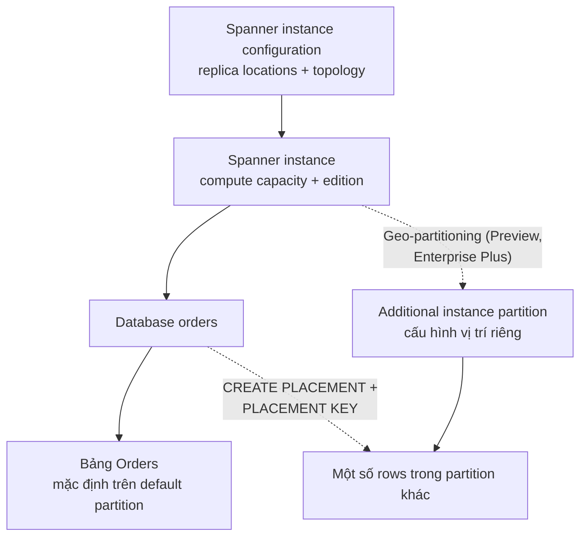
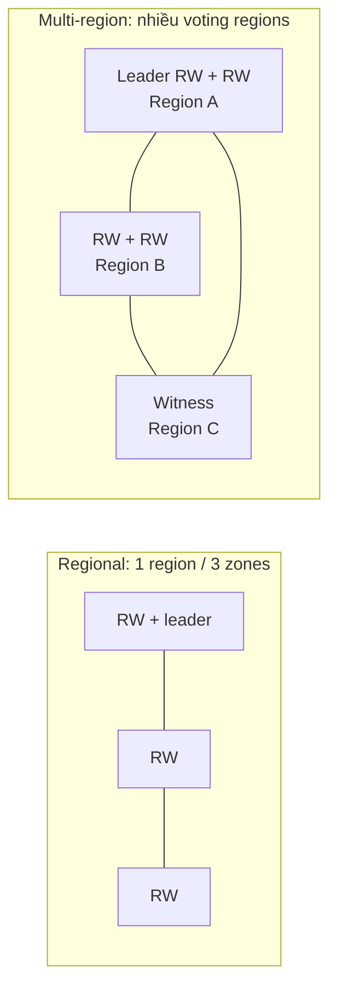
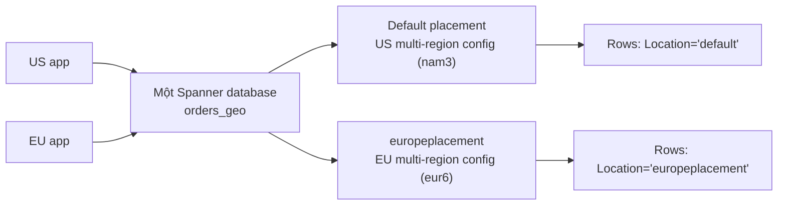

# Instance configurations và bố trí dữ liệu theo vị trí

Một ứng dụng đặt hàng Java chạy ở Singapore, phần lớn giao dịch phát sinh tại Đông Nam Á; sau đó doanh nghiệp mở rộng sang Nhật Bản và châu Âu. Khi dùng **Spanner**, câu hỏi không chỉ là “đặt database ở region nào” mà còn là: **replicas nằm ở đâu, nơi nào xử lý ghi, đọc có cần độ mới tuyệt đối không, dữ liệu có được phép ra khỏi quốc gia/khu vực hay không**. Chọn cấu hình không phù hợp có thể làm tăng write latency, chi phí nhân bản hoặc vi phạm yêu cầu lưu trú dữ liệu dù SQL và schema đều đúng.

Bài thuộc chương **Spanner** trong module **CLOUD_PROVIDERS_GCP**, nối kiến thức project, IAM, VPC, Compute Engine, GKE, Cloud Run, lưu trữ và cơ sở dữ liệu với thiết kế độ tin cậy, tự động hóa và tối ưu chi phí. Trọng tâm là **regional, dual-region, multi-region instance configurations**, vị trí replicas/leader, **custom configurations**, và **geo-partitioning** để chọn vị trí cho từng hàng dữ liệu trong những điều kiện được hỗ trợ.

> Tất cả project, instance, database, tenant và số liệu là ví dụ. Tạo Spanner instance và thêm partitions/replicas có thể phát sinh phí đáng kể dù không có traffic. Không chạy lệnh tạo, chuyển hoặc xóa tài nguyên trong production khi chưa có phê duyệt, phương án bảo vệ backup, kiểm tra residency và chi phí. Các tính năng **geo-partitioning Preview** có thể thay đổi điều kiện hỗ trợ.

## Mục tiêu

Sau bài này, bạn có thể:

1. Giải thích phân cấp **instance configuration → instance → database**, và phân biệt **replica placement** với **row placement**.
2. So sánh regional, dual-region, multi-region theo **tính sẵn sàng, độ trễ, ràng buộc địa lý và chi phí**.
3. Phân biệt **read-write**, **read-only**, **witness** replica, quorum, leader và loại read ảnh hưởng latency.
4. Xem cấu hình Spanner qua Console/`gcloud`, tạo instance regional trong lab và quan sát vị trí leader của database.
5. Hiểu cách **đổi default leader region**, thêm read-only replica qua custom configuration và **move instance** an toàn.
6. Mô tả geo-partitioning (**instance partition, placement, PLACEMENT KEY**), điều kiện Preview/Enterprise Plus và rủi ro di chuyển dữ liệu.
7. Chọn bố trí phù hợp cho các tình huống thực, thiết lập metrics, capacity, IAM, bảo vệ dữ liệu và kiểm soát ngân sách.

## 1. Ba tầng vị trí dữ liệu dễ bị nhầm



| Khái niệm | Xác định | Không đồng nghĩa |
| --- | --- | --- |
| **Instance configuration** | Những region/zone có replicas, loại replica và topology sao chép | Region của VM/Cloud Run |
| **Instance** | Tài nguyên Spanner chứa databases, edition và compute capacity (nodes/processing units) | Một máy chủ đơn lẻ |
| **Database** | DDL, bảng, indexes, dữ liệu và giao dịch | Một địa điểm độc lập mặc định |
| **Default leader region** | Region ưu tiên đặt leader cho database/placement đủ điều kiện | Di chuyển toàn bộ dữ liệu sang region đó |
| **Instance partition** | Compute/storage theo một cấu hình vị trí trong cùng instance, dùng cho geo-partitioning | Kubernetes partition hoặc sharding tự đặt theo key hash |
| **Placement / placement key** | Ánh xạ rows vào default hoặc partition chỉ định | Nhãn nghiệp vụ như `country=VN` tự động tạo quy tắc lưu trú |

Khi **không dùng geo-partitioning**, các databases trong instance dùng topology replicas của instance configuration. Một cột `CountryCode='JP'` trong bảng không tự khiến row chuyển tới Nhật Bản. Ngay cả khi triển khai geo-partitioning, ứng dụng cần **gán placement key rõ ràng** và kiểm chứng constraints.

## 2. Regional, dual-region và multi-region

Spanner replication cung cấp **strong consistency/external consistency** dù có nhiều bản sao. Đổi lại, mỗi write phải được chấp nhận bởi **write quorum**, nên khoảng cách giữa các voting replicas ảnh hưởng write latency.

| Loại configuration | Bố trí cơ bản | Phù hợp | Hạn chế/đánh đổi |
| --- | --- | --- | --- |
| **Regional** | Ba read-write replicas ở các zones trong **một region** | Ứng dụng/tải ghi tập trung cùng region, ưu tiên write latency và chi phí | Không có data replicas ở region thứ hai để chịu sự cố toàn region |
| **Dual-region** | Hai regions **cùng một quốc gia**; mỗi region có 2 read-write + 1 witness | Residency theo quốc gia + khả năng phục hồi liên vùng | Enterprise Plus, giá cao hơn, write quorum qua hai regions |
| **Multi-region** | Thường 2 read-write regions (mỗi nơi 2 replicas) + 1 witness region; có thể kèm read-only regions | Nhiều vùng người dùng, RTO/availability cao, reads nhiều khu vực | Enterprise Plus, chi phí và write latency tăng; cần chọn leader |

Theo tài liệu sản phẩm, **regional có SLA 99,99%**, **dual/multi-region 99,999%** *khi đáp ứng điều kiện SLA tương ứng*; đây là cam kết dịch vụ theo hợp đồng, **không** bảo đảm ứng dụng luôn đạt mức đó nếu frontend, network, dependencies hoặc vận hành thiếu dự phòng.

### Ví dụ chọn cấu hình

- **`regional-asia-southeast1` (Singapore):** phù hợp nếu Java/Cloud Run/GKE và phần lớn writes ở Singapore; đủ chịu lỗi zone theo thiết kế regional.
- **`dual-region-japan1`:** dữ liệu được replicate tại Tokyo và Osaka trong Nhật Bản; hợp với điều kiện residency nội địa Nhật và yêu cầu HA liên vùng, **không** áp dụng như một “dual region Singapore–Nhật”.
- **Một multi-region configuration có read-write/read-only replicas trải nhiều vùng:** phù hợp workload toàn cầu, nhưng phải xem danh sách **replica locations thực tế** thay vì suy đoán tên như `nam3`/`eur6` là quốc gia hoặc city.

**Edition:** Standard/Enterprise có lựa chọn regional theo capabilities của edition; **dual-region và multi-region yêu cầu Enterprise Plus**. Thêm read-only replica vào custom **regional/multi-region** configuration cần edition hỗ trợ (Enterprise hoặc Enterprise Plus) và region nằm trong **optional regions được Google công bố**. Không thể tạo custom dual-region configuration.

### Sơ đồ replica điển hình



Sơ đồ mô tả **regional** và một topology **multi-region phổ biến**, không áp dụng nguyên xi cho mọi cấu hình: ví dụ `asia2` có ba read-write regions thay vì witness region. **Dual-region** có cấu trúc khác: mỗi trong hai regions có **2 RW + 1 witness**, và quorum khi cả hai khỏe yêu cầu đủ voting replicas từ **cả hai region**.

## 3. Đọc, ghi và vai trò của replicas

| Replica | Tham gia voting quorum | Có thể làm leader | Có thể phục vụ reads | Vai trò |
| --- | --- | --- | --- | --- |
| **Read-write** | Có | Có | Có | Lưu dữ liệu, tham gia ghi/đọc |
| **Read-only** | Không | Không | Có | Phục vụ đọc (đặc biệt stale reads gần client) |
| **Witness** | Có | Không | Không | Bổ sung phiếu quorum mà không phục vụ dữ liệu đọc |

Một write transaction được commit khi đạt **quorum** theo cấu hình. Ví dụ regional 3 RW cần **2/3** voting replicas để commit. Multi-region có voting replicas phân bố liên vùng, nên writes có thể phải chờ liên lạc mạng cross-region; read-only replicas không tính vào quorum, không tăng khả năng survive vùng ghi bị mất.

### Strong read, stale read và latency

- **Strong read** cần dữ liệu mới nhất theo consistency được bảo đảm; routing và leader/quorum state có thể làm tăng độ trễ tùy vị trí client.
- **Stale read** cho phép đọc snapshot cũ hơn một khoảng thời gian đã chọn để tận dụng replica gần client; thích hợp báo cáo, catalog hoặc dữ liệu không cần real-time.
- Với multi-region, tài liệu khuyên dùng **staleness ít nhất 15 giây** khi muốn tối ưu đọc từ region **không phải default leader** trong nhiều tình huống.
- Không dùng stale read cho bước thanh toán/kiểm tra tồn kho mà điều kiện nghiệp vụ đòi dữ liệu mới và transaction nhất quán.

**Không hiểu “read-only replica = DR độc lập”.** Nếu write quorum của instance không còn hoạt động, optional read-only replica cũng không trở thành database độc lập phục vụ đọc vô hạn. Backup/PITR/DR plan vẫn phải thiết kế riêng.

### Vị trí ứng dụng so với vị trí database

```text
Cloud Run (asia-southeast1) -> Spanner regional-asia-southeast1
    thường tối ưu round-trip cho reads/writes phát sinh ở Singapore

Cloud Run (Europe) -> Spanner multi-region với leader ở North America
    cross-region write RTT vẫn tồn tại dù có local read-only replica
```

Ưu tiên deploy **write-heavy workers** ở/ gần leader region; deploy **read-heavy workers** gần read replicas và đo strong/stale reads theo mục tiêu. Leader-aware routing của Spanner hỗ trợ route write transactions tự động, **không triệt tiêu độ trễ vật lý** giữa application và leader.

## 4. Chọn instance configuration bằng số đo

Trước khi chọn một địa điểm, ghi lại:

1. **Residency:** dữ liệu, backups, logs, khóa CMEK và các replicas được phép hiện diện ở những nơi nào?
2. **Availability/RTO/RPO:** có cần tồn tại qua sự cố một region không, và ứng dụng đã chạy dự phòng ở hai regions chưa?
3. **Traffic:** tỷ lệ read/write, RPS theo region, latency p95/p99, tỷ lệ transactions cross-region.
4. **Consistency:** phần nào phải strong read/write, phần nào có thể stale reads?
5. **Giá:** edition, nodes/processing units mỗi nơi, storage, backups, network, cross-region egress và ứng dụng.
6. **Ràng buộc hệ sinh thái:** Cloud Run/GKE/Cloud SQL region, VPC, IAM, private connectivity, compliance, quotas.

### Minh họa tác động độ trễ (giả định, không phải benchmark)

| Kịch bản | RTT app → leader | Nhận xét |
| --- | ---: | --- |
| App và regional Spanner cùng Singapore | 2 ms (giả định) | Ít chặng mạng hơn |
| App ở Tokyo, leader ở Singapore | 70 ms (giả định) | Có thể tăng transaction p95 nếu write nhiều |
| App ở EU, leader ở Bắc Mỹ | 120 ms (giả định) | Cross-region latency ảnh hưởng round trips |

RTT chỉ để **so sánh thiết kế**, không phải cam kết Spanner. Transaction thực có thể gồm nhiều round trips, lock waits, quorum propagation, contention và application processing. **Đo bằng request thật với client đặt đúng region**, không lấy Ping endpoint chung làm metric duy nhất.

## 5. Lab: kiểm tra instance configurations và tạo instance regional

Lab này **không yêu cầu Enterprise Plus**: dùng base regional configuration để xem vị trí replicas, tạo instance và database, rồi thử SQL. Cloud Shell/Bash được dùng trong ví dụ.

### 5.1 Kiểm tra tài khoản và tài nguyên có sẵn

```bash
PROJECT_ID="retail-dev-01"
INSTANCE_ID="spanner-orders-lab"
DATABASE_ID="orders_lab"
CONFIG="regional-asia-southeast1"

gcloud auth list
gcloud config get-value project

# Chỉ đọc: kiểm tra Spanner đã bật API và project đủ quyền.
gcloud services list --enabled --project="$PROJECT_ID" \
  --filter="config.name:spanner.googleapis.com"
gcloud spanner instance-configs list --project="$PROJECT_ID"
gcloud spanner instance-configs describe "$CONFIG" --project="$PROJECT_ID"
gcloud spanner instances list --project="$PROJECT_ID"
```

Trong output `instance-configs describe`, chú ý `replicas[].location`, `replicas[].type` và `defaultLeaderLocation` (nếu có). **Không giả định** cấu hình regional có leader cố định được chọn bằng cùng thao tác như multi-region.

### 5.2 Tạo instance có tính phí

```bash
# THAY ĐỔI hạ tầng: chi phí theo Spanner edition/capacity/region.
# 1 node được chọn để đơn giản hóa lab; dọn sau khi xong.
gcloud services enable spanner.googleapis.com --project="$PROJECT_ID"

gcloud spanner instances create "$INSTANCE_ID" \
  --project="$PROJECT_ID" \
  --config="$CONFIG" \
  --edition=STANDARD \
  --description="Orders regional lab" \
  --nodes=1

gcloud spanner instances describe "$INSTANCE_ID" --project="$PROJECT_ID"
```

**Một node = 1.000 processing units.** Đây là **compute capacity**, không phải một bản sao dữ liệu hoặc VM do bạn quản lý. Spanner duy trì replicas theo instance configuration, không phải chỉ một replica khi `--nodes=1`. Nếu có quota/cost constraints, chọn processing units thấp hơn theo hạn mức/edition phù hợp sau khi kiểm tra tài liệu tính phí.

### 5.3 Tạo database và một bảng

```bash
# THAY ĐỔI dữ liệu/DDL: chỉ làm trên instance lab đã tạo.
gcloud spanner databases create "$DATABASE_ID" \
  --instance="$INSTANCE_ID" \
  --project="$PROJECT_ID"

gcloud spanner databases ddl update "$DATABASE_ID" \
  --instance="$INSTANCE_ID" \
  --project="$PROJECT_ID" \
  --ddl='CREATE TABLE Orders (
    TenantId STRING(40) NOT NULL,
    OrderId STRING(60) NOT NULL,
    AmountMinor INT64 NOT NULL,
    CreatedAt TIMESTAMP OPTIONS (allow_commit_timestamp=true)
  ) PRIMARY KEY (TenantId, OrderId)'

gcloud spanner databases describe "$DATABASE_ID" \
  --instance="$INSTANCE_ID" --project="$PROJECT_ID"
```

Bảng không có `PLACEMENT KEY`, nên tất cả rows dùng **default instance partition**. Có thể dùng **Spanner Studio** (GoogleSQL) để chạy DML mẫu:

```sql
INSERT INTO Orders (TenantId, OrderId, AmountMinor, CreatedAt)
VALUES ('shop-a', 'order-1001', 145000, PENDING_COMMIT_TIMESTAMP());

SELECT TenantId, OrderId, AmountMinor
FROM Orders
WHERE TenantId = 'shop-a' AND OrderId = 'order-1001';
```

Thực hiện INSERT và SELECT **ở hai lần chạy riêng nếu công cụ yêu cầu kiểu transaction khác nhau**. Kết quả mong đợi có một dòng `order-1001` với `AmountMinor=145000`. Thông số `TenantId` chỉ là khóa logic, **không** làm Spanner tự lưu tenant tại một quốc gia khác.

### 5.4 Dọn lab an toàn

```bash
# DESTRUCTIVE! Chỉ chạy khi xác nhận chính xác tên instance lab và
# mọi database/backup trong đó đều có thể xóa.
gcloud spanner instances describe "$INSTANCE_ID" --project="$PROJECT_ID"
gcloud spanner instances delete "$INSTANCE_ID" \
  --project="$PROJECT_ID"
```

Không chạy lệnh xóa trên instance dùng chung hoặc chứa dữ liệu production. Khi xóa instance, dữ liệu có thể mất vĩnh viễn theo chính sách lưu giữ/backup tương ứng; không coi `delete` là cách giảm phí “tạm thời” có thể tự phục hồi.

## 6. Default leader region: tối ưu đường ghi

Trong **dual-region hoặc multi-region**, một trong các **read-write regions** được chọn làm **default leader region** cho database. Leader xử lý các writes; Spanner có **leader-aware routing** giúp định tuyến read-write transactions từ client ở non-leader region đến leader. Cơ chế này có lợi, nhưng vẫn phải trả **độ trễ mạng vật lý** giữa các regions và round trips liên quan.

Ví dụ cấu hình `dual-region-japan1` có hai read-write regions **`asia-northeast1` (Tokyo)** và **`asia-northeast2` (Osaka)**. Nếu phần lớn write-heavy Java services đặt tại Osaka, có thể cân nhắc đổi default leader của **database** sang Osaka (sau khi đo latency/quorum):

```bash
# Ví dụ trên instance ENTERPRISE_PLUS có config dual-region-japan1.
# THAY ĐỔI metadata database; chỉ chạy sau approval/benchmark.
PROJECT_ID="retail-prod-01"
INSTANCE_ID="spanner-japan-ha"
DATABASE_ID="orders_ha"

# Trước khi đổi: kiểm tra danh sách leaderOptions của config.
gcloud spanner instance-configs describe dual-region-japan1 \
  --project="$PROJECT_ID"

gcloud spanner databases describe "$DATABASE_ID" \
  --instance="$INSTANCE_ID" --project="$PROJECT_ID"

# Đặt leader ở Osaka theo GoogleSQL DDL.
gcloud spanner databases ddl update "$DATABASE_ID" \
  --instance="$INSTANCE_ID" --project="$PROJECT_ID" \
  --ddl='ALTER DATABASE orders_ha
         SET OPTIONS (default_leader = "asia-northeast2")'

# Xác minh thay đổi sau khi operation hoàn tất.
gcloud spanner databases describe "$DATABASE_ID" \
  --instance="$INSTANCE_ID" --project="$PROJECT_ID"
```

**Bốn lưu ý:**

1. Chỉ được chọn một **read-write region** thuộc `leaderOptions`, không chọn witness hoặc optional read-only region.
2. **Đổi leader là metadata operation**; nó **không chuyển toàn bộ row data sang Osaka** và không giúp tự thỏa một residency policy mới.
3. Quá trình đổi có thể mất vài phút; đo **commit p95/p99**, transaction aborts và tải ở client regions trước/sau.
4. Với multi-region, Spanner hỗ trợ **leader failover tự động** khi default leader region gặp sự cố theo topology/quorum. **Dual-region có mô hình quorum/failover riêng**, có thể cần thao tác failover thủ công theo runbook để duy trì hoạt động trong sự cố vùng; không mặc định hai loại có cùng RTO.

Muốn trở về leader mặc định của cấu hình, dùng tùy chọn `default_leader = NULL` theo tài liệu, **không cần** di chuyển Spanner instance.

## 7. Custom instance configurations và optional read-only replicas

Base configurations có các region/replica types do Google xác định. Bạn **không thể tự biến witness thành read-write** hoặc sửa topology của base config. Trong **Enterprise/Enterprise Plus**, có thể tạo **custom instance configuration** bằng cách clone một **base regional hoặc multi-region** rồi thêm **optional read-only replica** ở region **được hỗ trợ** (phải khác các region đã nằm trong cấu hình gốc).

Ví dụ minh họa cách xem trước danh sách optional regions và tạo custom config dựa trên `nam3`:

```bash
PROJECT_ID="retail-lab-01"
BASE_CONFIG="nam3"
CUSTOM_CONFIG="custom-nam3-us-west2"

gcloud spanner instance-configs describe "$BASE_CONFIG" \
  --project="$PROJECT_ID"

# THAY ĐỔI instance configuration; chỉ thực hiện nếu
# optionalReplicas thực tế cho phép us-west2 và edition phù hợp.
gcloud spanner instance-configs create "$CUSTOM_CONFIG" \
  --clone-config="$BASE_CONFIG" \
  --add-replicas=location=us-west2,type=READ_ONLY \
  --project="$PROJECT_ID"

gcloud spanner instance-configs describe "$CUSTOM_CONFIG" \
  --project="$PROJECT_ID"
```

**Không khởi tạo custom dual-region config**: tính năng này không hỗ trợ dual-region. Một optional read-only replica giúp **đọc dữ liệu gần người dùng hơn**, nhất là stale reads, nhưng **không tham gia voting quorum** và **không tự tăng SLA/khả năng DR của voting regions**. Thêm replicas làm tăng footprint/giá, có thể ảnh hưởng residency và cần đánh giá throughput.

### Khi nào nên thêm read-only replica?

Ứng dụng chủ yếu **ghi tại Mỹ**, nhưng nhiều truy vấn báo cáo đọc từ miền Tây Mỹ. Một read-only replica tại vùng optional gần client có thể giúp giảm độ trễ cho **stale reads**. Nếu toàn bộ workload cần read-write transaction mạnh tại cùng khu vực mới, chỉ thêm read-only replica thường **không giải quyết** độ trễ ghi do leader/quorum ở vùng cũ.

## 8. Move instance sang cấu hình khác: thay đổi lớn, không phải đổi leader

Spanner hỗ trợ **move instance** giữa các regional, dual-region, multi-region và custom configurations phù hợp điều kiện. Tài liệu mô tả quá trình **không gây downtime**, vẫn giữ các bảo đảm nhất quán, nhưng trong lúc chuyển có thể tăng **write latency, transaction abort rate, CPU** và tạo tác động mạng/giá.

```bash
# Chỉ là ví dụ quy trình, KHÔNG chạy trên production khi chưa
# hoàn thành preflight/backup/CMEK/edition/quota review.
PROJECT_ID="retail-prod-01"
INSTANCE_ID="spanner-orders-prod"
TARGET_CONFIG="nam3"

gcloud spanner instances describe "$INSTANCE_ID" --project="$PROJECT_ID"
gcloud spanner instance-configs describe "$TARGET_CONFIG" \
  --project="$PROJECT_ID"

# DỪNG ở đây để đánh giá rủi ro!
# Giao diện chuyển sau khi được phê duyệt:
# gcloud spanner instances move "$INSTANCE_ID" \
#   --target-config="$TARGET_CONFIG" --project="$PROJECT_ID"
```

### Checklist bắt buộc trước move

- **Edition/compute:** để move cần tối thiểu **1 node / 1.000 processing units**. Từ regional Standard sang dual/multi-region phải **nâng Enterprise Plus trước**.
- **Location/residency:** xem đầy đủ voting/read-only/witness regions, mô hình encryption, chính sách tuân thủ và giá mới.
- **Quota/capacity:** region đích có đủ quota; chuẩn bị headroom CPU, kiểm soát app retry/transaction abort, độ trễ.
- **Backup/backup schedules:** theo quy trình move chính thức, backups và backup schedules **không được move**; cần xử lý/xóa chúng trước khi move và có **kế hoạch giữ bản sao bảo vệ dữ liệu khác**. Không tự xóa backup production chỉ để chạy lệnh.
- **CMEK:** database dùng customer-managed encryption keys cần các **keys ở địa điểm đích** và cấu hình `--target-database-move-configs` thích hợp; tránh mất khả năng giải mã.
- **Regional endpoint:** những requests dùng **regional endpoint** có thể bị ảnh hưởng do regional enforcement; kiểm tra client endpoints.
- **Geo-partitioning:** move instance chỉ chuyển **default instance partition**, **không** di chuyển các partitions phụ.
- **Kết thúc:** theo dõi long-running operation, tạo backup/schedule mới theo target config, kiểm thử restore, đo latency/billing và cập nhật runbook.

**Phân biệt ba thao tác:**

| Thao tác | Thứ gì thay đổi? | Thứ gì không tự thay đổi? |
| --- | --- | --- |
| `ALTER DATABASE … default_leader` | Region ưu tiên xử lý writes | Replica topology và vị trí vật lý của dữ liệu |
| Custom config + optional RO replica | Topology có thêm RO region sau khi instance dùng config mới | Voting quorum/SLA không tự tăng |
| `instances move --target-config` | Geographic footprint/topology của **default partition** | Project ID; các geo partitions phụ |

## 9. Geo-partitioning: bố trí từng hàng theo placement

Khi một database phục vụ nhiều quốc gia, việc **replicate toàn bộ database** ở nhiều nơi có thể không phù hợp với yêu cầu “dữ liệu khách EU được lưu trong các vị trí EU được phê duyệt, dữ liệu khách Mỹ tại các vị trí US được phê duyệt”. **Geo-partitioning** cho phép gắn từng row trong **placement table** với một **instance partition** có configuration địa lý riêng.

**Trạng thái tính năng tại thời điểm biên soạn: Preview, Enterprise Plus.** Các điều kiện quan trọng hiện tại:

- **Default instance partition và partitions bổ sung đều phải dùng multi-region configuration**; không dùng regional/dual-region partition trong mô hình Preview này.
- Mỗi additional instance partition tối thiểu **1 node (1.000 processing units)**; có quota về số lượng partitions, placements và rows/node.
- Không tạo nhiều instance partitions trong một instance với **cùng base instance configuration**.
- Không hỗ trợ free trial instance / instance dưới mức node yêu cầu; instance partition không thể tự đổi sang configuration khác sau khi tạo.
- Trong placement table, **không thể thêm/bỏ `PLACEMENT KEY` sau khi tạo bảng**. Mỗi row phải có giá trị placement hợp lệ.
- Hạn chế transactions: `INSERT`/`DELETE` trên placement table phải là **statement duy nhất trong transaction** theo giới hạn Preview; update/read-write DML có quy định chặt với primary key.

Do nhiều giới hạn và chi phí, **không biến geo-partitioning thành bước mặc định** của lab regional mục 5. Phần dưới là **lab nâng cao có phí**, chỉ chạy trong project được bật/cho phép tính năng Preview.

### Kiến trúc ví dụ Mỹ–EU



Sơ đồ minh họa ý tưởng **per-row**; không tự cam kết một số dữ liệu điều khiển/metadata, logs, backups và luồng truy vấn hoàn toàn ở EU/US. Thẩm định residency cần xem thêm `per_placement_routing_metadata`, các locations thực tế của configs và data lifecycle.

### 9.1 Tạo instance Enterprise Plus có default multi-region

```bash
# Chạy riêng trong project lab được phép; chi phí cao hơn regional.
PROJECT_ID="retail-geo-lab-01"
GEO_INSTANCE="orders-geo-lab"
GEO_DB="orders_geo"

gcloud spanner instance-configs describe nam3 --project="$PROJECT_ID"
gcloud spanner instance-configs describe eur6 --project="$PROJECT_ID"

# THAY ĐỔI HẠ TẦNG / CÓ PHÍ:
gcloud spanner instances create "$GEO_INSTANCE" \
  --project="$PROJECT_ID" \
  --edition=ENTERPRISE_PLUS \
  --config=nam3 \
  --description="Geo-partitioning preview lab" \
  --nodes=1

gcloud spanner databases create "$GEO_DB" \
  --instance="$GEO_INSTANCE" --project="$PROJECT_ID"
```

**Cả `nam3` và `eur6` phải có sẵn và được phép dùng trong project/edition của bạn**. Chỉ tạo sau khi kiểm tra `instance-configs describe`/quotas; tên multi-region không phải một tuyên bố đầy đủ về residency.

### 9.2 Tạo additional instance partition

```bash
# THAY ĐỔI / PHÁT SINH CHI PHÍ riêng cho partition EU.
gcloud spanner instance-partitions create eu-partition \
  --instance="$GEO_INSTANCE" \
  --config=eur6 \
  --description="EU placement partition" \
  --nodes=1 \
  --project="$PROJECT_ID"

gcloud spanner instance-partitions list \
  --instance="$GEO_INSTANCE" --project="$PROJECT_ID"
```

**Không lấy một instance regional đã tạo ở mục 5 rồi chạy trực tiếp `instance-partitions create`**: Preview yêu cầu default partition thuộc multi-region. Nếu edition/feature chưa được hỗ trợ trong project, dừng lại thay vì gỡ kiểm tra bằng việc thay IAM bừa bãi.

### 9.3 Chọn nơi lưu routing metadata trước khi tạo placement

Với database geo-partitioned, Spanner có option:

- `per_placement_routing_metadata=TRUE`: metadata định tuyến nằm theo partition của dữ liệu, thường giúp truy cập từ cùng vùng.
- `FALSE`: routing metadata tập trung ở default partition, có thể phù hợp khi truy vấn qua nhiều vùng thường xuyên.

**Kể từ tháng 7/2026, mặc định của option đã đổi sang TRUE** (trước đó FALSE), vì vậy nên **đặt rõ theo mô hình traffic**. Option **không thể thay đổi sau khi đã có placements**.

Trong Spanner Studio hoặc bằng `gcloud`:

```bash
# THAY ĐỔI database DDL; làm TRƯỚC khi tạo placement.
gcloud spanner databases ddl update "$GEO_DB" \
  --instance="$GEO_INSTANCE" --project="$PROJECT_ID" \
  --ddl='ALTER DATABASE orders_geo
         SET OPTIONS (per_placement_routing_metadata = TRUE)'
```

### 9.4 Tạo placement và placement table

```bash
# THAY ĐỔI database DDL: mapping tên placement -> instance partition.
gcloud spanner databases ddl update "$GEO_DB" \
  --instance="$GEO_INSTANCE" --project="$PROJECT_ID" \
  --ddl="CREATE PLACEMENT europeplacement
         OPTIONS (instance_partition='eu-partition')"

# Tạo bảng có cột vị trí. Không thể bổ sung PLACEMENT KEY sau.
gcloud spanner databases ddl update "$GEO_DB" \
  --instance="$GEO_INSTANCE" --project="$PROJECT_ID" \
  --ddl='CREATE TABLE OrdersByRegion (
    OrderId STRING(64) NOT NULL,
    AmountMinor INT64 NOT NULL,
    Location STRING(MAX) NOT NULL PLACEMENT KEY
  ) PRIMARY KEY (OrderId)'
```

Để chèn dữ liệu trong **Spanner Studio (GoogleSQL)**, chạy mỗi lệnh ở **một transaction riêng** theo giới hạn Preview:

```sql
-- Row ở default placement (nam3 theo ví dụ).
INSERT INTO OrdersByRegion (OrderId, AmountMinor, Location)
VALUES ('us-1001', 145000, 'default');

-- Chạy riêng: row được gán vào EU placement (eur6).
INSERT INTO OrdersByRegion (OrderId, AmountMinor, Location)
VALUES ('eu-2001', 10000, 'europeplacement');
```

Giá trị `Location` phải **chính xác** bằng tên placement đã tạo hoặc `default`. `'eu'`, `'Europe'` hoặc một chuỗi country code bất kỳ **không tự có mapping** và có thể bị từ chối. Nếu yêu cầu query/update khi dùng placement table, kiểm tra ràng buộc **primary-key lookups**, routing metadata, index/transaction mode và hành vi cross-partition.

### 9.5 Di chuyển một row giữa placements

Đổi `Location` sang placement khác là **thao tác di chuyển dữ liệu thực**, không chỉ thay nhãn hiển thị. Trong Preview, cách thay đổi placement đòi hỏi quy trình và có thể dùng **partitioned DML**, chịu giới hạn tốc độ di chuyển theo nodes partition đích. Vì vậy:

1. Xác minh compliance cho target placement và compute quota.
2. Đọc giới hạn SQL/DML chính thức; không gửi bulk `UPDATE Location` qua một transaction nhỏ mà chưa thử.
3. Đo thời gian move, write latency, chi phí và số rows trong partition đích.
4. Giữ nguồn dữ liệu/backup/restore strategy theo chính sách trước khi cắt traffic.

**Geo-partitioning không thay một kiến trúc tuân thủ pháp lý hoàn chỉnh.** Kiểm tra bản sao, metadata, log exports, backup locations, mạng và đường truy cập quản trị; không chỉ kiểm tra cột `Location`.

## 10. Case study: đặt dữ liệu cho nền tảng thương mại điện tử

Doanh nghiệp có ba nhóm:

| Nhu cầu | Phương án | Lý do |
| --- | --- | --- |
| 85% writes từ Cloud Run Singapore, chủ yếu khách Đông Nam Á | **Regional Singapore** | Ưu tiên latency ghi/chi phí, chịu lỗi zone |
| Dịch vụ Nhật có yêu cầu dữ liệu nội địa và hoạt động liên vùng | **Dual-region Japan** (Enterprise Plus) | Hai regions trong cùng quốc gia, HA cao hơn; kiểm tra failover runbook |
| Toàn cầu, dữ liệu chung và reads nhiều vùng | **Multi-region** với leader gần writes | Voting quorum liên vùng, stale reads từ vùng khác; chi phí cao hơn |
| Một logical database nhưng từng row EU/US cần đặt trong vùng đã duyệt | **Geo-partitioning Preview** nếu đủ điều kiện | Placement key per row; cần review metadata/residency, limits và billing |

### Tình huống thay đổi yêu cầu

Ban đầu đơn hàng chỉ ở Singapore. Sau một năm, 40% traffic đọc từ Nhật. Ba lựa chọn:

- **A. Giữ regional Singapore:** đơn giản, write vẫn nhanh; Nhật đọc qua WAN và p95 có thể cao.
- **B. Thêm optional read-only replica** ở region được hỗ trợ qua custom regional config: giúp một số reads, đặc biệt stale reads, nhưng writes vẫn xử lý ở quorum/leader cũ và SLA regional không tự thành 99,999%.
- **C. Move sang dual/multi-region** nếu edition, residency, HA và ngân sách phù hợp. Bố trí thêm read-write regions và failover nhưng write latency/chi phí thay đổi; cần chuẩn bị trước move.

Chọn lựa không dựa vào “multi-region luôn tốt nhất”. Kết quả phải được kiểm chứng bằng **bản đồ traffic theo region, consistency SLO, ngân sách, yêu cầu dữ liệu và thử tải**.

## 11. Monitoring, IAM và vận hành theo vùng

### Dashboard cần có

| Tín hiệu | Câu hỏi |
| --- | --- |
| p50/p95/p99 read/write latency theo client region | Vùng nào chịu RTT/quorum overhead? |
| CPU high-priority/total utilization theo instance/region | Capacity đã đủ cho region bận nhất? |
| Storage utilization và per-partition rows | Có vượt giới hạn placement rows/node hay storage? |
| Transaction abort rate, lock wait/commit latency | Có hot-key, contention hoặc move gây ảnh hưởng? |
| Active session counts và client-side latency | Pool/session đủ, có overload/routing sai? |
| Default leader và leader changes/failover | Ghi đang về đúng leader region? |
| Backup/PITR status, backup locations | Data recovery đúng kỳ vọng và constraints? |
| Billing theo edition, capacity, storage, network | Mỗi optional replica/partition tác động ngân sách ra sao? |

Ở **regional**, tài liệu hiệu năng khuyên giữ **high-priority CPU dưới ~65%**; với **multi-region** khoảng **45%** để có headroom. Đây là khuyến nghị vận hành, **không phải quota cứng**, và không thay thế đo tải thực. Dùng **Key Visualizer** và Query Insights để phát hiện hot keys/transaction contention trước khi kết luận “region quá xa”.

### IAM tối thiểu

- Người vận hành `gcloud spanner instance-configs list/describe` cần quyền **xem cấu hình**; người tạo instance hoặc custom config cần quyền `spanner.instances.create` hoặc `spanner.instanceConfigs.create` tương ứng.
- Java service cần quyền đọc/ghi **database** theo workload (IAM database roles hoặc fine-grained access control nếu thiết kế phù hợp), không cần Spanner Admin để phục vụ request.
- Việc `instances move`, đổi leader, thêm partition hoặc xóa backups phải qua **change approval**, log/audit và quyền hạn chế; CI dùng service account ngắn hạn/Workload Identity Federation, tránh service account JSON key trong repo.
- Residency là cả **quyền ai đọc được dữ liệu** lẫn **vị trí dữ liệu được lưu/đọc**: IAM, CMEK, private connectivity, org policies và audit đều phải được kiểm tra.

### Runbook xử lý độ trễ

1. Ghi **project/instance/database/config**, client region, leader region, transaction mode, thời gian và p95/p99.
2. Xác định type: slow **strong read**, **stale read** hay **read-write transaction**; đo region-to-region RTT.
3. Kiểm tra **quorum/replica health, CPU, sessions, aborts, hot-key**, không đổi config khi thực ra có lock contention.
4. Nếu writes xa leader, cân nhắc **deploy writes gần leader** hoặc **đổi default leader** (chỉ đủ điều kiện).
5. Nếu stale reads xa client, xem **read-only region**/staleness hoặc custom config; đo kết quả trước khi thêm phí replica.
6. Nếu cần thay physical placement, lập kế hoạch **instance move/geo-partitioning** với edition, backup/CMEK, quotas, approvals và hậu kiểm.

## 12. Bài tập và đáp án

### Bài 1 — Instance configuration quyết định gì?

Một bảng `Orders` trong Spanner regional Singapore có cột `CountryCode='JP'`. Dòng đó tự được lưu tại Nhật không?

<details>
<summary>Đáp án</summary>

Không. Regional instance configuration quyết định các replicas trong Singapore. Cột `CountryCode` chỉ là dữ liệu nghiệp vụ; placement từng row cần tính năng geo-partitioning riêng và placement key.
</details>

### Bài 2 — Quorum của regional

Regional configuration có ba read-write replicas ở ba zones. Cần bao nhiêu voting replicas để commit write theo cấu hình điển hình?

<details>
<summary>Đáp án</summary>

**Hai trên ba** replicas đủ quorum. Nó giúp chịu lỗi một zone, không bảo đảm database vẫn hoạt động nếu **toàn bộ region** mất.
</details>

### Bài 3 — Witness replica

Witness có tham gia quorum không? Nó có thể tự làm leader hoặc phục vụ query SQL không?

<details>
<summary>Đáp án</summary>

Witness **có quyền vote**, nhưng **không làm leader** và **không phục vụ reads**. Vai trò là hỗ trợ voting quorum, không phải bản sao cho BI queries.
</details>

### Bài 4 — Dual-region và residency

Doanh nghiệp phải giữ toàn bộ dữ liệu giao dịch tại Nhật nhưng cần HA trước sự cố một region. Nêu một cấu hình phù hợp và một điều cần kiểm tra.

<details>
<summary>Gợi ý đáp án</summary>

`dual-region-japan1` (Enterprise Plus) với Tokyo/Osaka là lựa chọn đáng đánh giá. Phải kiểm tra cả yêu cầu residency, quorum/failover procedures, phí, vị trí logs/backups/KMS và frontend dự phòng ở hai region.
</details>

### Bài 5 — Đổi leader

Một database ở multi-region có leader mặc định tại region A. Đổi `default_leader` sang region B có tự chuyển mọi row đến B không?

<details>
<summary>Đáp án</summary>

Không. Đổi leader là **metadata operation** chọn region xử lý ghi trong tập read-write regions cho phép; replica locations do instance configuration quyết định.
</details>

### Bài 6 — Read-only replica và DR

Thêm read-only replica tới region thứ ba có tự tăng write quorum hoặc biến nó thành vùng khôi phục độc lập khi hai voting regions đều mất không?

<details>
<summary>Đáp án</summary>

Không. Read-only replica **không vote** và **không trở thành DR độc lập** khi quorum chính mất. Nó chủ yếu cải thiện khả năng phục vụ reads gần client.
</details>

### Bài 7 — SQL placement

Ở một placement table, row có `Location='eu'` nhưng placement duy nhất là `europeplacement`. Row có tự vào EU không?

<details>
<summary>Đáp án</summary>

Không. Placement key phải là **tên placement đã khai báo** hoặc `default`. Với giá trị không hợp lệ, thao tác có thể bị từ chối; phải dùng `Location='europeplacement'`.
</details>

### Bài 8 — Geo-partitioning Preview

Một nhóm muốn thêm EU partition vào instance `regional-asia-southeast1` ở Standard edition và cấp 100 processing units. Nêu ba điều kiện đang không phù hợp.

<details>
<summary>Đáp án</summary>

Geo-partitioning hiện cần **Enterprise Plus**, **default instance partition multi-region**, và **mỗi additional partition ít nhất 1.000 processing units (1 node)**; trong Preview partition bổ sung cũng phải là multi-region. Không thể sửa bằng cách chỉ cấp IAM.
</details>

### Bài 9 — Move instance có cần backup review?

Một DBA cho rằng `instances move` “không downtime” nên có thể chạy ngay mà không kiểm tra backups/CMEK/quota. Nhận định này đúng không?

<details>
<summary>Đáp án</summary>

Sai. Move vẫn có thể tăng latency/aborts/CPU; backup schedules và backups không di chuyển theo, CMEK cần keys hợp lệ ở vùng đích, phải có quota/capacity và phương án bảo vệ/khôi phục dữ liệu riêng trước thao tác.
</details>

## 13. Checklist quyết định bố trí dữ liệu

- [ ] Đã xác minh instance configuration và **replica locations thực tế**, không suy theo tên.
- [ ] Hiểu sự khác nhau giữa **replica topology, leader region và row placement**.
- [ ] Regional/dual/multi-region được chọn theo SLA, RTO/RPO, write latency, residency và budget.
- [ ] Đã đọc edition requirements: dual/multi-region Enterprise Plus, custom read-only có điều kiện.
- [ ] Frontend/Cloud Run/GKE đặt gần write leader; stale reads được cân nhắc riêng.
- [ ] Có đánh giá backup, logs, export, KMS, cross-border network và quyền truy cập.
- [ ] Có load test p95/p99, CPU, abort rate, sessions và monitoring trước/ sau thay đổi.
- [ ] Optional RO replica được chọn từ danh sách hỗ trợ; không coi là write quorum/DR độc lập.
- [ ] Move instance có checklist quota, backup, CMEK, regional endpoints, CPU headroom và hậu kiểm.
- [ ] Geo-partitioning chỉ dùng khi preview/edition/quotas hỗ trợ, placement key rõ ràng và xác minh residency.
- [ ] Dự toán instance/partition nodes, storage/replicas, backup, egress và alerts; dọn lab đúng quy trình.
- [ ] Áp IAM tối thiểu, thay đổi hạ tầng có approval, audit và kế hoạch rollback/recovery.

## Tài liệu tham khảo chính thức

- [Regional, dual-region, and multi-region configurations](https://cloud.google.com/spanner/docs/instance-configurations): topology, SLA, residency, trade-offs và leader.
- [Replication](https://cloud.google.com/spanner/docs/replication): read-write/read-only/witness replicas và quorum.
- [Create and manage instances](https://cloud.google.com/spanner/docs/create-manage-instances): `gcloud spanner instances create`, editions, compute capacity.
- [Instances overview](https://cloud.google.com/spanner/docs/instances): phân biệt instance và database.
- [Leader-aware routing](https://cloud.google.com/spanner/docs/leader-aware-routing): read-write transaction routing.
- [Modify the leader region](https://cloud.google.com/spanner/docs/modifying-leader-region): `ALTER DATABASE … default_leader`.
- [Create and manage instance configurations](https://cloud.google.com/spanner/docs/create-manage-configurations): clone/add optional read-only replica.
- [Move an instance](https://cloud.google.com/spanner/docs/move-instance): quota, backup/CMEK, ảnh hưởng và các bước.
- [Geo-partitioning overview](https://cloud.google.com/spanner/docs/geo-partitioning): Preview, Enterprise Plus, placement keys và giới hạn.
- [Create and manage instance partitions](https://cloud.google.com/spanner/docs/create-manage-partitions): create/list/scale partitions.
- [Create and manage data placements](https://cloud.google.com/spanner/docs/create-manage-data-placements): routing metadata, `CREATE PLACEMENT`, placement table DDL/DML.
- [Spanner pricing](https://cloud.google.com/spanner/pricing) và [Google Cloud Pricing Calculator](https://cloud.google.com/products/calculator): edition, compute/storage, backups và network.
- [Spanner quotas and limits](https://cloud.google.com/spanner/quotas): instance sizes, partitions và residency-related quotas.


