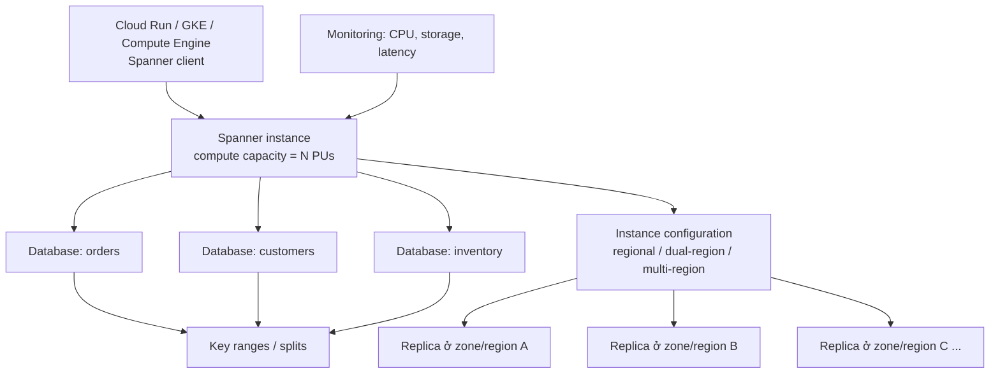

# Nodes, processing units và quản lý năng lực Spanner

Một API đơn hàng dùng **Google Cloud Spanner** đang có p99 tăng ở giờ cao điểm. Nhóm phát triển thấy instance chỉ dùng 400 **processing units (PUs)** và muốn tăng ngay lên 2.000 PUs. Liệu tăng năng lực có cải thiện độ trễ, hay vấn đề thật sự đến từ **hotspot trên khóa chính, truy vấn quét quá nhiều dữ liệu, giao dịch tranh chấp** hoặc request tập trung vào một partition?

Bài thuộc chương **Spanner** của mô-đun `CLOUD_PROVIDERS_GCP`, trong lộ trình Google Cloud từ project/IAM/VPC đến Compute Engine, GKE, Cloud Run, lưu trữ, cơ sở dữ liệu, vận hành độ tin cậy và chi phí. Trọng tâm là **đo và quản lý compute capacity** của Spanner bằng **nodes/processing units**, hiểu giới hạn lưu trữ tương ứng, đặt guardrails cho **manual scaling/managed autoscaling**, và kiểm chứng thay đổi bằng dữ liệu quan sát.

## 1. Mục tiêu học tập

Sau bài này, bạn có thể:

1. Giải thích `node`, `processing unit`, `instance`, `database`, `replica` và `split` trong kiến trúc Spanner.
2. Chuyển đổi **1 node = 1.000 PUs**, nhận biết bước tăng hợp lệ và giới hạn của instance nhỏ hơn 1 node.
3. Tính toán mức storage tối đa tương ứng với PUs/nodes và phân biệt **quota storage** với **dữ liệu thực được tính phí**.
4. Đọc **high-priority CPU**, total CPU, 24-hour smoothed CPU, storage utilization, latency, throughput và hot splits để phát hiện bottleneck.
5. Ước lượng capacity từ baseline và SLO, cân nhắc regional so với dual-/multi-region.
6. Phân biệt **manual allocation** với **managed autoscaler** (Enterprise/Enterprise Plus), chọn minimum/maximum và CPU/storage targets.
7. Dùng `gcloud` đọc cấu hình; nếu được duyệt, điều chỉnh PUs/nodes hoặc autoscaling trên **instance lab hiện có**.
8. Chuẩn bị phương án scale-up/down an toàn, dự toán chi phí, bảo mật IAM và runbook khi p99/CPU tăng.
9. Giải các bài tập tính PU, storage headroom, target CPU và chi phí tương đối.

**Phạm vi lab:** dùng **project/Spanner instance đã được ủy quyền**, ưu tiên thao tác chỉ đọc. Các ví dụ `gcloud spanner instances update` **ghi cấu hình và phát sinh/điều chỉnh chi phí**, chỉ chạy khi có change approval. Bài không tự tạo database production, không tải dữ liệu thật và không xóa instance dùng chung.

## 2. Compute capacity Spanner nằm ở cấp instance



**Compute capacity được cấp ở cấp instance** và được chia sẻ bởi các databases trong instance, **không phải** một số nodes dành riêng cho mỗi database. Nếu database `orders` tăng truy vấn nặng, database `customers` cùng instance cũng có thể bị ảnh hưởng khi instance quá tải.

Các khái niệm:

| Khái niệm | Ý nghĩa | Không nên hiểu là |
| --- | --- | --- |
| **Instance** | Container logic của databases, cấu hình địa lý và compute capacity | Một VM chạy PostgreSQL |
| **Node** | **Đơn vị logic** tương đương 1.000 PUs | Một máy chủ vật lý hoặc một replica |
| **Processing unit (PU)** | Đơn vị đo compute nhỏ hơn node | CPU core vĩnh viễn hay vCPU của Compute Engine |
| **Instance configuration** | Chọn vùng/replica topology và data residency | Chỉ một nhãn region |
| **Replica** | Bản sao dữ liệu trong zone/region; vai trò đọc/ghi tùy cấu hình | Một database copy do người dùng phải tự đồng bộ |
| **Split** | Một dải khóa dữ liệu Spanner phân phối phục vụ | Partition do ứng dụng quản lý thủ công như Kafka |
| **Database** | Schema, bảng, dữ liệu và transaction workloads | Có CPU quota riêng mặc định |

Google Cloud quản lý replication, splits, server placement và nền tảng database. Nhóm ứng dụng vẫn phải thiết kế **keys, indexes, queries, transaction boundaries, IAM, latency SLO và cost budget**.

## 3. Nodes và PUs: chuyển đổi và kích thước hợp lệ

**Công thức cơ bản:**

\[1\ \text{node}=1000\ \text{processing units}\]

- Với capacity **dưới 1 node**, khai báo theo **bội số 100 PUs**: `100`, `200`, …, `900`.
- Tại hoặc trên **1 node**, chọn `1, 2, 3, … nodes` (tương đương `1.000, 2.000, 3.000, … PUs`).
- **Không** coi `1.300 PUs` hoặc `1,5 nodes` là cấu hình manual hợp lệ; mức trên 1.000 PUs được chọn theo bội số 1.000 PUs.
- Với các instance nhỏ, PU là cách chọn dung lượng theo bước chi tiết, không buộc mua nguyên 1 node.

| Capacity | Tương đương node | Khi cân nhắc |
| --- | ---: | --- |
| 100 PUs | 0,1 node | Sandbox, lưu lượng nhỏ |
| 300 PUs | 0,3 node | Bắt đầu workload nhỏ, cần benchmark |
| 600 PUs | 0,6 node | Tải tăng nhưng chưa cần 1 node |
| 1.000 PUs | 1 node | Workload ổn định, cần throughput và nhiều splits hơn |
| 2.000 PUs | 2 nodes | Lưu lượng/storage lớn hơn, sau khi đo |
| 4.000 PUs | 4 nodes | Tăng scale theo tải đã xác minh |

**Node không phải một VM vật lý:** Spanner phân bổ CPU/RAM tương ứng qua nhiều servers và replicas để duy trì HA. Việc tăng từ 1 lên 2 nodes **không tạo thêm vùng replica mới**; nó tăng compute/memory/disk resources **trong topology đã chọn**.

### 3.1. Vì sao instance dưới 1 node có thể chậm hơn dự kiến?

Với ít hơn 1 node, tài nguyên và mức song song hóa **bị giới hạn**; một số workload có latency tăng không tuyến tính. Bài toán “100 PUs đạt 100 QPS, vậy 200 PUs chắc chắn đạt 200 QPS” **không đúng cho mọi schema/query**. Với ứng dụng latency-sensitive, phải test p95/p99, throughput và hotspot chứ không chỉ lấy phép nhân tuyến tính.

### 3.2. Nodes/PUs khác số replicas

Trong cấu hình regional điển hình có **ba read-write replicas ở ba zone**. Một instance **1 node** có năng lực **tương đương 1.000 PUs cho mỗi replica/zone tương ứng**, **không phải** 1.000/3 ≈ 333 PUs mỗi zone. Topology khác có số và loại replicas khác; billing dựa trên **edition, instance configuration và replica resources** theo biểu giá, không tính đơn giản là “1 node = 1 VM”.

## 4. Instance configuration ảnh hưởng hiệu năng và chi phí

| Cấu hình | Điểm chính | Hướng lựa chọn |
| --- | --- | --- |
| **Regional** | Replicas ở nhiều zone của **một region**; thông thường write quorum nội vùng | Ứng dụng tập trung một vùng, muốn latency/chi phí cân đối |
| **Dual-region** | Replicas trải hai region trong cùng quốc gia ở cấu hình hỗ trợ | Yêu cầu residency/HA theo thiết kế, **Enterprise Plus** |
| **Multi-region** | Có các read-write/read-only/witness replica theo cấu hình; phục vụ khu vực rộng hơn | Cần HA liên vùng và read latency đa vùng, **Enterprise Plus** |

Một **node** cấp năng lực cho **mỗi replica** trong instance topology; tăng nodes làm tăng compute tại các vùng/zone liên quan, chứ không làm tăng **số lượng** replica. Với dual-/multi-region, leader placement, write quorum qua vùng và network RTT có thể làm **write latency** cao hơn regional. Read latency có thể tối ưu bằng read-only replicas/stale reads nếu phù hợp consistency và edition.

**Đừng đổi từ regional lên multi-region chỉ để tăng QPS**; đó là thay đổi data placement, RPO/RTO, latency và chi phí. Nếu ứng dụng không cần region failover hoặc global reads, regional có thể hợp lý hơn.

## 5. Storage capacity phụ thuộc PUs/nodes

Spanner có **giới hạn dữ liệu database dựa vào compute capacity**:

| Compute capacity | Storage allowance xấp xỉ |
| --- | --- |
| 100 PUs | **1 TiB** (1.024 GiB) |
| 200 PUs | **2 TiB** |
| 500 PUs | **5 TiB** |
| 1.000 PUs / 1 node | **10 TiB** |
| 2 nodes | **20 TiB** |

Công thức định mức:

\[
L_\text{storage}=
\begin{cases}
1024\ \text{GiB}\times \frac{\text{PUs}}{100},&\text{PUs}<1000\\
10\ \text{TiB}\times \text{nodes},&\text{nodes}\ge1
\end{cases}
\]

Các ngưỡng là **storage limit**, không phải dữ liệu đã tiêu thụ. **Spanner tính phí database storage thực tế sử dụng**, không tự tính tiền 10 TiB chỉ vì instance có 1 node. **Backup storage** được tính và giới hạn riêng, không cộng vào database storage limit. Ở các cấu hình/tính năng storage tiering, phải kiểm tra quota áp dụng cho SSD/HDD và dữ liệu kết hợp.

### 5.1. Ví dụ dự báo đủ chỗ cho 30 ngày

Instance có 100 PUs và **850 GiB dữ liệu**; dự kiến tăng **15 GiB/ngày**:

```text
Dung lượng sau 30 ngày = 850 + 15 × 30 = 1.300 GiB
Storage allowance 100 PUs = 1.024 GiB  -> không đủ

Nếu target utilization <=70%:
  allowance cần >= 1.300 / 0,70 = 1.857,2 GiB

200 PUs cho allowance = 2.048 GiB
  sử dụng dự kiến = 1.300 / 2.048 ≈ 63,5% -> hợp lý
```

Lúc đó chọn **200 PUs** thỏa nhu cầu storage *theo phép tính*. Nhưng vẫn cần xem **CPU/p99/splits**, tránh chọn capacity chỉ theo GiB. Khi vượt storage limit, Spanner có thể từ chối các thao tác ghi hoặc thay schema/index; phải cảnh báo trước khi hết headroom.

### 5.2. Đã xóa dữ liệu nhưng metric chưa giảm?

Spanner có compaction. Xóa nhiều rows có thể **không giảm storage utilization ngay lập tức** vì hệ thống chưa thu hồi vật lý. Đừng lập tức scale-down khi vừa chạy cleanup rồi thấy metric vẫn cao; chờ compaction và xác minh before/after.

## 6. CPU metrics và mức an toàn khi có failover

Spanner có nhiều loại CPU, tránh đọc một biểu đồ rồi kết luận:

| Metric | Ý nghĩa | Cách dùng |
| --- | --- | --- |
| **High-priority CPU utilization** | Compute dùng bởi công việc ưu tiên cao, gồm yêu cầu người dùng mặc định | Theo dõi tải ứng dụng và **headroom cho failover** |
| **Total CPU utilization** | Toàn bộ công việc ưu tiên cao/trung bình/thấp, gồm một số tác vụ nền | Xem áp lực tổng và background work |
| **24-hour smoothed CPU** | Trung bình trượt 24 giờ, giúp phát hiện quá tải kéo dài | Alert và capacity planning dài hơn một spike |
| **CPU by operation type** | CPU theo read/write/commit và các loại operation | Chẩn đoán thành phần tạo tải |

Ngưỡng khuyến nghị của Google Cloud để giữ khả năng phục vụ trong tình huống mất zone/region:

| Metric | Regional | Dual-/multi-region (theo từng region) |
| --- | ---: | ---: |
| **High-priority CPU** | **≤65%** | **≤45%** |
| **24h smoothed aggregate CPU** | **≤90%** | **≤90%** |

**Ngưỡng khuyến nghị, không phải giới hạn cứng:** instance có thể có CPU cao hơn trong thời gian ngắn, nhưng sustained overload làm latency tăng và giảm headroom khi failover. Ngược lại, background CPU cao trong lúc không có user traffic có thể là công việc hệ thống tận dụng công suất rảnh; không tự coi là sự cố nếu p99/SLO vẫn khỏe.

### 6.1. Khi nào nên scale CPU?

Cân nhắc scale-up nếu:

- CPU high-priority **cao kéo dài**, p95/p99 tăng ở workload đại diện.
- Tải đã được tối ưu query/schema nhưng không còn headroom cho peak/failover.
- Database/storage operations cần thêm compute và không bị kẹt bởi hotspot hoặc contention.

**Không vội scale** nếu CPU toàn instance 30% nhưng một split hot, query sai plan hoặc transaction lock chờ. Capacity mới có thể không giúp một dải khóa nóng duy nhất xử lý song song hơn.

## 7. Định cỡ compute từ CPU đo được

Không có công thức “số user → PUs” đúng cho mọi ứng dụng. Hãy dùng **load test cùng query mix và dữ liệu đại diện**.

Một phép ước lượng sơ bộ khi workload đủ phân tán:

\[
\text{PUs mới cần}\ \approx\ \text{PUs hiện tại}
\times \frac{\text{CPU quan sát}}{\text{CPU mục tiêu}}
\]

Ví dụ regional instance **400 PUs**, high-priority CPU **78%** tại peak, mục tiêu thiết kế **60%** để dư headroom:

```text
400 × (78 / 60) = 520 PUs (lý thuyết)
Bước hợp lệ dưới 1000 PUs: 600 PUs
Cần benchmark khi tăng lên 600 PUs.
```

Nếu instance **1.000 PUs** với cùng 78%/60%, phép tính cho **1.300 PUs**. Vì capacity từ 1 node trở lên theo số nguyên nodes, mức manual hợp lệ kế tiếp là **2.000 PUs (2 nodes)**. Điều đó có thể làm chi phí tăng rõ; hãy kiểm tra **Query Insights, Key Visualizer, index/scan** để tránh mua thêm capacity không cần thiết.

**Lưu ý:** CPU không nhất thiết tỷ lệ nghịch tuyến tính với PUs do workload skew, split distribution, retries, index backfills và instance topology. Công thức chỉ là **điểm xuất phát**, không thay thế benchmark/monitoring.

### 7.1. Throughput lý thuyết không phải SLA

Google Cloud công bố **các mốc peak reads/writes per node** theo instance configuration, storage và workload mẫu. Chúng mang tính tham khảo và thường giả định **100% CPU**, đọc thuần hoặc ghi thuần; throughput thực tế thay đổi theo kích thước row, index, transaction conflict, consistency, locality và schema.

**Quy trình benchmark đúng:** tạo workload tương đương production trên môi trường thử nghiệm, tăng request rate theo nấc, ghi p95/p99, CPU theo priority, read/write/commit latency, abort/retry rate và cost/QPS. Chỉ lựa chọn capacity khi đạt SLO ở peak **và** còn headroom cho failover.

## 8. Hotspot: có trường hợp tăng node không sửa được

Spanner phân vùng dữ liệu theo **key ranges**. Nếu bảng dùng khóa chính có giá trị **tăng dần** như timestamp hoặc sequence mà traffic luôn ghi vào đầu/cuối cùng một key range, có thể tạo **hotspot**, nhất là khi QPS tăng.

Ví dụ mô hình bảng có nguy cơ:

```sql
-- GoogleSQL, dùng cho thảo luận thiết kế; không chạy DDL trên production.
CREATE TABLE Events (
  CreatedAt TIMESTAMP NOT NULL,
  EventId STRING(36) NOT NULL,
  Payload STRING(MAX)
) PRIMARY KEY (CreatedAt, EventId);
```

Khi `CreatedAt` tăng liên tục và mọi writes cùng tập trung vào mép key range, một split có thể quá tải dù **CPU instance trung bình thấp**. Một số phương án:

1. Chọn **key có phân bố tốt**, ví dụ hash/shard prefix kết hợp entity ID, nếu truy vấn cho phép.
2. Dùng **UUID dạng phân bố ngẫu nhiên** thay cho monotonically increasing ID khi phù hợp.
3. Thiết kế index không tạo **hot index** trên timestamp tăng dần; có thể cân nhắc cơ chế đánh dấu không index trường chỉ dùng cho data retention/query khác, hoặc thêm shard key.
4. Đo hot keys/splits và latency qua **Key Visualizer**, Query Insights và transaction metrics.
5. Đánh giá transaction contention, không giữ read-write transaction quá lâu; dùng retry cho `ABORTED` với backoff.

Không tự động hash toàn bộ primary key: nó làm **range queries**, locality và locality joins phức tạp hơn. Phải chọn khóa dựa trên **access patterns** và data model; tối ưu Spanner cần cân bằng phân bố tải và truy vấn.

## 9. Tại sao các database trong một instance ảnh hưởng lẫn nhau?

Giả sử instance có 600 PUs và 3 databases:

| Database | Công việc | Rủi ro |
| --- | --- | --- |
| `orders` | Ghi giao dịch theo người dùng | Cần p99 ổn định |
| `analytics_temp` | Full scan hàng giờ | Ăn CPU/IO, gây ảnh hưởng tải khác |
| `catalog` | Đọc rất nhiều trong khuyến mại | Cạnh tranh capacity của cùng instance |

Tất cả cùng tiêu thụ **instance compute capacity**. Spanner có **request priority** cao/trung bình/thấp giúp điều phối công việc: user-facing queries có thể ở high, batch/backfill có thể đặt low khi thích hợp. Nhưng priority **không tạo CPU dành riêng** cho mỗi database, và background jobs vẫn cần được hoàn tất.

Nếu workload có SLO và owner khác biệt lớn, có thể tách sang **Spanner instance riêng** để có quota/cost/monitoring và isolation tốt hơn. Cần đánh đổi extra baseline cost, data distribution và transaction boundaries; không tách tùy tiện nếu nghiệp vụ phụ thuộc giao dịch giữa các bảng.

## 10. Manual allocation và managed autoscaling

| Thuộc tính | **Manual allocation** | **Spanner managed autoscaler** |
| --- | --- | --- |
| Edition | Theo edition/cấu hình được hỗ trợ | **Enterprise và Enterprise Plus** |
| Tài nguyên | Đặt cố định PUs/nodes cho tới khi sửa | Tự scale theo CPU, storage và min/max |
| Kích thước tối thiểu | Có thể từ **100 PUs** ở instance phù hợp | **Tối thiểu 1 node (1.000 PUs)** |
| Điều khiển | `gcloud instances update --processing-units/--nodes` | CPU/storage targets, min/max và chính sách downscale |
| Chi phí | Dự báo baseline dễ nhưng có thể overprovision | Thay đổi theo capacity sử dụng, phải có budget/alerts |
| Vận hành | Người quản trị/scheduler quyết định lúc scale | GKE/Cloud Run apps không phải tự vận hành scaler |
| Bất lợi | Dễ thiếu capacity khi traffic spike | Scale không tức thì; bị giới hạn quota/max và split rebalancing |

**Managed autoscaler** khác **Autoscaler tool** mã nguồn mở triển khai bằng Cloud Run functions/GKE. Khi chọn sản phẩm, phải biết mình dùng loại nào. Bài hướng dẫn **managed autoscaler tích hợp**; không cấu hình một custom function để cập nhật instance mỗi phút.

### 10.1. Ví dụ chọn mode

- **Sandbox 100–500 PUs, tải nhỏ:** manual hợp lý vì managed autoscaler có **minimum 1 node**, có thể khiến chi phí nền tăng.
- **Production tải theo giờ cao điểm, Enterprise/Plus, >=1 node:** cân nhắc managed autoscaler có min/max theo benchmark.
- **Workload rất đột biến trong vài giây:** giữ **min capacity đủ buffer**, vì scale-up và split rebalancing cần thời gian.
- **Workload bị hot key:** sửa data model/queries trước; autoscaler không hứa giải quyết một split nóng.

## 11. Managed autoscaler quyết định size như thế nào?

Managed autoscaler xem **nhiều chiều**:

1. **High-priority CPU utilization target**.
2. **Total CPU utilization target** (nếu chọn).
3. **Storage utilization target**.
4. **Minimum/maximum compute capacity**.

Mỗi chiều tạo khuyến nghị, hệ thống chọn **mức cần cao nhất**, nhưng không vượt `max`/quota hợp lệ. Nếu storage cần 3 nodes còn CPU cần 5 nodes, autoscaler hướng tới **5 nodes**, không lấy trung bình 4.

### 11.1. Cấu hình baseline regional

Một cấu hình tham khảo cho **Enterprise instance regional**:

| Trường | Giá trị ví dụ | Lý do |
| --- | ---: | --- |
| Min nodes | 1 | Không xuống dưới capacity test chấp nhận được |
| Max nodes | 3 | Cho scale peak, có trần chi phí capacity |
| High-priority CPU target | 65% | Headroom theo hướng dẫn regional |
| Total CPU target | 70% | Giữ sức cho background/index tasks |
| Storage target | 70% | Không đợi disk sát 100% |

**Ràng buộc:** nếu đặt cả high-priority và total targets, **high-priority target phải thấp hơn total target**. Target CPU phải trong phạm vi được hỗ trợ (hiện hành khoảng 10–90%); storage target cũng có phạm vi riêng. Minimum không thể nhỏ hơn **10% của maximum**, và maximum không được quá **10 lần minimum**.

Không chọn `min=1, max=30` vì vượt tỷ lệ 10×. Autoscaler **không thể cấp nodes vượt quota**, kể cả max setting cao; nếu đạt max nhưng high-priority CPU vẫn vượt target hoặc storage đầy, request latency/errors vẫn có thể tăng.

### 11.2. Regional và multi-region không nên dùng cùng CPU target

Khuyến nghị baseline chống failover:

- **Regional:** high-priority CPU 65%, total CPU 70%.
- **Multi-region:** high-priority CPU 45% **theo từng region**, total CPU 50%.

Với cấu hình dual-/multi-region cần xem replica roles, leader region và failover footprint. Đặt target cao hơn có thể giảm compute cost trong bình thường nhưng **giảm headroom khi mất region**. Nếu có **asymmetric read-only autoscaling** trên replica chỉ đọc (tính năng đủ điều kiện), cần thiết kế target theo từng region và bảo đảm read traffic/DR không bị bottleneck; không áp nó như cách điều khiển read-write/witness replicas.

## 12. Sizing theo storage và CPU phải xét đồng thời

Giả sử một instance regional đang có:

| Chỉ số | Giá trị |
| --- | ---: |
| Capacity | 300 PUs |
| High-priority CPU peak | 42% |
| Stored data | 2,4 TiB |
| Storage allowance | 3 TiB |
| Data growth | 0,2 TiB/tháng |
| SLO | p99 dưới 100 ms |

CPU còn headroom nhưng storage utilization đã **80%**. Trong 2 tháng data có thể thành **2,8 TiB**, khiến storage allowance gần đầy, dù CPU vẫn 42%. Vì vậy **có thể cần tăng capacity vì storage chứ không phải CPU**.

Ở **400 PUs**, storage allowance là **4 TiB**; data dự kiến 2,8 TiB sẽ dùng 70%. Nhưng capacity chỉ hợp lý sau khi xem tính chính xác của growth forecast, quota, edition, CPU và giá. Không thể kết luận “CPU thấp thì instance đã quá lớn”.

**Phân biệt tính phí:** tăng PUs tăng **compute charges**; phần storage billed theo dung lượng dữ liệu **thực**. Tăng PU **không tăng dữ liệu ngay**, nhưng mở rộng giới hạn có thể giúp index creation, data growth hoặc backup restore hoạt động.

## 13. Đọc tài nguyên lab trước khi thay đổi

Các lệnh sau chạy trong Bash/Cloud Shell với `gcloud`. Người học phải có IAM xem Spanner instance; **không dùng tài khoản production admin nếu chỉ cần quan sát**.

```bash
PROJECT_ID="YOUR_AUTHORIZED_LAB_PROJECT"
INSTANCE="YOUR_EXISTING_SPANNER_LAB_INSTANCE"
DATABASE="YOUR_EXISTING_LAB_DATABASE"

gcloud --version
gcloud auth list

gcloud projects describe "$PROJECT_ID" \
  --format="yaml(projectId,lifecycleState)"

# Chỉ đọc: danh sách instance.
gcloud spanner instances list \
  --project="$PROJECT_ID"

# Chỉ đọc: trạng thái, edition, config và capacity.
gcloud spanner instances describe "$INSTANCE" \
  --project="$PROJECT_ID"

# Chỉ đọc: cấu hình region/instance topology được hỗ trợ.
gcloud spanner instance-configs list \
  --project="$PROJECT_ID"

# Chỉ đọc: databases trong instance.
gcloud spanner databases list \
  --instance="$INSTANCE" \
  --project="$PROJECT_ID"
```

Trước mỗi lệnh **ghi**, cần xác minh `INSTANCE` là instance lab của mình, biết edition, regional/multi-region config, node count/PUs, autoscaler mode, storage used/limit, quota, billing và operation đang chạy.

### 13.1. Điều kiện thành công của preflight

- `gcloud spanner instances describe` trả đúng **project/instance/config/edition** và capacity.
- Có thể đối chiếu `processingUnits` hoặc `nodeCount` trong output, **không cộng cả hai** như hai nguồn compute.
- Instance không có operation thay đổi cấu hình đang chờ và workload owner cho phép thao tác.
- `DATABASE` là database **lab** có quyền đọc, không phải hệ thống nghiệp vụ.
- Có baseline CPU/p99/storage/throughput từ Cloud Monitoring.
- Có budget/alerts và kế hoạch restore/safe-change nếu cần thực hiện patch.

Nếu thiếu IAM viewer, yêu cầu quyền tối thiểu. Không cấp `roles/spanner.admin` cho mọi người học chỉ để đọc metadata.

## 14. SQL read-only với Spanner

Cloud Spanner hỗ trợ dialect **GoogleSQL** và **PostgreSQL interface**; có những khác biệt về chức năng so với PostgreSQL tự host. Bài dùng truy vấn tối giản chạy được trong hai dialect, **không tạo bảng hay ghi dữ liệu**:

```bash
# Chỉ đọc: test kết nối đến database lab đã tồn tại.
gcloud spanner databases execute-sql "$DATABASE" \
  --instance="$INSTANCE" \
  --project="$PROJECT_ID" \
  --sql="SELECT 1 AS ready"
```

Để xem query plan, có thể dùng `--query-mode=PLAN` trên một câu `SELECT` đã được phép và đã kiểm soát quyền:

```bash
gcloud spanner databases execute-sql "$DATABASE" \
  --instance="$INSTANCE" \
  --project="$PROJECT_ID" \
  --sql="SELECT 1 AS ready" \
  --query-mode=PLAN
```

`SELECT 1` **không** cho biết QPS hay phân bố splits của production; đó chỉ là smoke test quyền kết nối. Với SQL thực, kiểm tra **Query Insights, Execution Plans, Key Visualizer, Query Statistics** rồi đánh giá hotspot/index và latency. Không lấy metadata từ internal system tables của database thật khi bạn không có quyền phù hợp.

**Phân quyền:** quyền xem instance và quyền truy vấn database là hai lớp khác nhau. Ứng dụng cần principal có quyền database data access theo IAM/FGAC; `spanner.instances.get` không tự cấp quyền đọc mọi hàng. Luôn dùng ADC/workload identity; tránh key JSON không cần thiết.

## 15. Lab thay manual processing units trên instance đã tồn tại

**Đây là thao tác ghi có thể làm tăng chi phí và thay đổi latency.** Chỉ thử khi được phê duyệt trên instance lab `manual allocation` hiện ở **300 PUs** và chưa có operation khác.

### 15.1. Lập kế hoạch thay đổi

| Bước | Điều kiện |
| --- | --- |
| Before | Xác minh capacity 300 PUs, storage/headroom, p95/p99, CPU, ticket và owner |
| Target | Tăng thử lên **500 PUs**, bội số hợp lệ dưới 1 node |
| Kết quả kỳ vọng | CPU giảm nếu workload CPU-bound đủ phân tán, p99 cải thiện |
| Monitor | Instance status, CPU priority, request latency, storage, billing |
| Rollback | Trả về 300 PUs **nếu storage/splits/headroom cho phép**, không mặc định an toàn |
| Giới hạn | Không chạy khi instance đang autoscale hoặc production/shared |

### 15.2. Lệnh điều chỉnh

```bash
# GHI, THAY ĐỔI COMPUTE VÀ BILLING: CHỈ TRÊN INSTANCE LAB được duyệt.
gcloud spanner instances update "$INSTANCE" \
  --project="$PROJECT_ID" \
  --processing-units=500
```

Readback:

```bash
gcloud spanner instances describe "$INSTANCE" \
  --project="$PROJECT_ID"
```

Nâng compute thường xong trong vài phút, nhưng có trường hợp kéo dài tới khoảng một giờ. Sau update, dữ liệu/splits có thể cần thời gian rebalance để dùng tài nguyên mới. **Không đánh giá p99 chỉ trong 30 giây đầu.**

Để thử giảm về baseline **chỉ khi owner duyệt** và storage/headroom/splits cho phép:

```bash
# GHI: có thể làm tăng latency/tạo quá tải; không chạy nếu chưa đủ headroom.
gcloud spanner instances update "$INSTANCE" \
  --project="$PROJECT_ID" \
  --processing-units=300
```

**Giảm compute có giới hạn:** không được khiến storage vượt allowance (ví dụ giảm 200 → 100 PUs trong khi dữ liệu >1 TiB), và instance có quá nhiều splits có thể chưa cho scale-down. Chờ Spanner cân bằng/gộp splits hoặc chọn mức giảm nhỏ hơn, không ép giảm bằng cách xóa dữ liệu production.

### 15.3. Khi instance đã ở 1 node

Với 1.000 PUs trở lên, thao tác manual dùng **integer nodes**:

```bash
# Ví dụ GHI: 1 node -> 2 nodes, CHỈ sau khi phê duyệt chi phí.
gcloud spanner instances update "$INSTANCE" \
  --project="$PROJECT_ID" \
  --nodes=2
```

Không chạy lệnh này sau ví dụ 500 PUs trừ khi bạn đã **xác minh trạng thái thực** và được phép chuyển instance sang 2 nodes. Dùng một đường thay đổi riêng, không trộn lẫn hai kịch bản làm người học vô tình vượt capacity mục tiêu.

## 16. Lab tùy chọn: bật managed autoscaler

**Chỉ dùng khi instance là Enterprise/Enterprise Plus**, không ở trạng thái đang di chuyển instance và team đã phê duyệt việc chuyển từ manual sang autoscaler. Managed autoscaler yêu cầu min **ít nhất 1.000 PUs**, vì vậy **không thể giữ baseline 300 PUs** sau khi bật.

Ví dụ trên một **Enterprise regional instance lab** đã có từ **1 node**, owner cho phép 1–3 nodes:

```bash
# GHI: ENABLE MANAGED AUTOSCALER VÀ CAPACITY RANGE, CÓ CHI PHÍ.
gcloud spanner instances update "$INSTANCE" \
  --project="$PROJECT_ID" \
  --autoscaling-min-nodes=1 \
  --autoscaling-max-nodes=3 \
  --autoscaling-high-priority-cpu-target=65 \
  --autoscaling-total-cpu-target=70 \
  --autoscaling-storage-target=70
```

Giá trị `65`, `70`, `70` là **percent**, không phải số thập phân 0,65. Ví dụ này dành cho **regional instance**; multi-region cần lower CPU targets theo topology và failover requirements.

Sau khi cập nhật:

```bash
gcloud spanner instances describe "$INSTANCE" \
  --project="$PROJECT_ID"
```

Quan sát Console **Spanner → Instance → System insights**:

- Capacity thực theo thời gian, min/max.
- High-priority CPU và total CPU.
- Storage utilization.
- Autoscaling events và nguyên nhân capacity thay đổi.
- p99, abort/retry rate và QPS ở traffic thực.

**Nếu load spike nhanh:** autoscaler cần thời gian cấp tài nguyên và rebalance. Giữ `min` cao hơn mức bình thường nếu cần chịu peak đột ngột. Nếu max=3 nodes mà CPU/storage vẫn vượt target, **autoscaler không thể vượt max/quota**; phải nâng max và quota có kế hoạch hoặc tối ưu workload.

### 16.1. Lưu ý flags và edition

- Không truyền `--nodes`/`--processing-units` cùng `--autoscaling-min/max-*` trong một lệnh.
- Không trộn `--autoscaling-min-nodes` với `--autoscaling-max-processing-units`.
- Nếu dùng 1–3 nodes, ratio min/max=1:3 hợp lệ; 1–20 nodes **không** hợp lệ vì >10×.
- Autoscaler **Enterprise/Enterprise Plus**; Standard dùng manual hoặc xem lựa chọn nâng edition theo change plan.
- Có `--disable-downscaling` nếu cần ngừng scale-down tạm thời, nhưng giữ capacity cao kéo dài **làm tăng phí**; không dùng thường trực mà không đo.

## 17. Vì sao scale-down khó hơn scale-up?

Spanner có thể tăng compute nhanh, nhưng giảm capacity phải **giữ dữ liệu, splits và hiệu năng** trong giới hạn:

- Storage không vượt **10 TiB/node** (hoặc 1 TiB/100 PU nếu dưới node).
- Có thể có **quá nhiều splits** cho mức capacity nhỏ; hệ thống cần thời gian gộp splits, đôi khi từ nhiều ngày tới 1–2 tuần tùy workload.
- CPU sau giảm không được vượt target dài hạn, đặc biệt khi failover.
- Latency có thể tăng tạm thời trong lúc giảm/rebalance.
- Quota và autoscaler bounds phải đúng; không giảm vì muốn hóa đơn thấp nhưng làm mất write availability.

**Rollback năng lực** không giống rollback schema/data. Nếu đã thay query/schema/partitioning làm CPU tăng, quay về số nodes cũ có thể khiến SLO xấu hơn. Cần bảo đảm load test và alert sau mỗi đợt scale-down.

## 18. Monitoring: dấu hiệu nào dẫn đến hành động nào?

| Quan sát | Giả thuyết ưu tiên | Hành động đầu tiên |
| --- | --- | --- |
| High-priority CPU >65% regional kéo dài | Thiếu compute hoặc query load tăng | Query Insights, kiểm tra load rồi scale theo benchmark |
| High-priority CPU >45% mỗi region multi-region | Headroom failover thấp | Kiểm tra từng region, leader/read traffic và capacity |
| 24h smoothed CPU >90% | Tải liên tục, ít headroom cho system tasks | Scale/giảm tải/tối ưu queries |
| CPU instance thấp nhưng p99 cao | Hot split, lock/transaction conflict, network | Key Visualizer, Query Insights, latency breakdown |
| Storage >80% và tăng | Growth vượt allowance sớm | Dự báo ngày hết chỗ, tăng PUs/nodes hoặc archive |
| Autoscaler ở max lâu | Max/quota thiếu hoặc workload quá lớn | Capacity plan, quota, target và hotspot |
| Scale-up xong CPU chưa giảm | Rebalance chưa xong hoặc hot key/queries | Đợi đủ thời gian, theo dõi splits/plan |
| ABORTED retries tăng | Transaction contention | Giảm transaction duration, key hotspots, retry |
| Read latency từ xa cao | Độ trễ network/consistency/leader placement | Client locality, bounded-staleness nếu phù hợp |
| Chi phí tăng khi idle | Manual/managed min cao, edition/region đắt | Đo baseline, min phù hợp, tách workload |

Cần **Cloud Monitoring alerts** cho CPU theo priority, 24-hour smoothed CPU, storage used/limit, request p95/p99, operation errors và autoscaler events. Nếu tổ chức quản lý incident theo SLO, thông báo kèm **user impact**, không chỉ “CPU 81%”.

### 18.1. Đo trước và sau một thay đổi

Ghi những dữ liệu sau trong cùng time window và cùng traffic mix:

```text
timestamp, instance, edition, configuration, capacity_PUs
QPS read/write, p50/p95/p99, high-priority CPU, total CPU
24h CPU, storage bytes & allowance, aborted/retries, hot splits
cost estimate, người phê duyệt, điều kiện rollback
```

Nếu sau scale-up p99 không cải thiện, **không tiếp tục tăng nodes theo phản xạ**; tìm nguyên nhân ở query plan/index/transaction contention hoặc client location.

## 19. Tối ưu chi phí và lựa chọn edition

Spanner tính phí theo các nhóm chính: **compute capacity (nodes/PUs theo thời gian, edition và instance configuration/replicas), database storage sử dụng, backup storage, network và tính năng bổ sung** như Data Boost. Không tính tiền storage allowance trống, nhưng **compute capacity luôn được cấp** khi instance tồn tại — Spanner không có “suspend để ngừng tính compute”.

### 19.1. Ví dụ chi phí tương đối

Giả sử cùng regional config/edition, chạy **730 giờ/tháng** ở manual allocation:

```text
300 PUs × 730 h = 219.000 PU-hours
Tương đương          219 node-hours (vì 1 node=1.000 PUs)

1 node × 730 h      = 730 node-hours
Tỷ lệ compute        = 730 / 219 ≈ 3,33 lần
```

Đây là **tỷ lệ compute capacity theo thời gian**, không phải hóa đơn USD: đơn giá còn phụ thuộc **edition, configuration/replicas và điều khoản giá/discount**. Storage/backup/network tính riêng. Nếu đang chạy 300 PUs nhưng muốn bật managed autoscaler, **min 1 node** làm baseline compute tương đương cao hơn khoảng 3,33 lần trước autoscaling — cần tính ROI rất cẩn thận.

### 19.2. Ba cách tiết kiệm mà không hy sinh SLO

1. **Tối ưu query/schema trước:** tránh full scan, hot index, transaction retry.
2. **Capacity đúng thời điểm:** manual scale theo lịch có change management hoặc managed autoscaler khi workload đủ lớn/edition hỗ trợ.
3. **Đặt giới hạn và quyền:** min/max, quota, budget alerts, IAM role tối thiểu, labeling/project-level billing dashboard.

**Budget alert chỉ cảnh báo**, không chặn chi tiêu. Đặt autoscaler maximum quá thấp để “chặn hóa đơn” có thể khiến CPU/storage quá tải và ảnh hưởng khách hàng; cần đánh giá giới hạn cùng team reliability.

## 20. Regional vs multi-region: một bài toán failover

Giả sử nhóm cần Spanner cho ứng dụng thanh toán. Với regional configuration, high-priority CPU peak **58%**, storage còn dư. Mức này dưới ngưỡng regional **65%**, nhưng buffer cho flash sale chỉ khoảng 7 điểm phần trăm.

Khi đánh giá:

1. **Có cần tăng compute không?** Đo p99 peak, workload growth và mức spike dự kiến; ngưỡng 65% là hướng dẫn cho failover, không phải nút bật/tắt tự động.
2. **Có cần multi-region không?** Chỉ khi RTO/RPO, data residency và availability requirements yêu cầu; multi-region tăng topology/cost/latency trade-offs.
3. **Nếu multi-region:** cần nhìn high-priority CPU **từng region**, target điển hình **≤45%**, không copy mục tiêu regional 65%.
4. **Read-only replicas:** giảm latency đọc ở nơi có nhu cầu nhưng không tự thay write quorum; thiết kế routing/stale reads và chi phí phù hợp.

**Điều quan trọng:** failover có thể làm thay đổi region nhận traffic hoặc tăng tải tại replica còn hoạt động. Vì vậy capacity plan phải đo **khả năng chịu lỗi**, không chỉ QPS trong điều kiện mọi vùng đều khỏe.

## 21. Runbook xử lý p99 tăng đột ngột

**Triệu chứng:** lúc 11:00, p99 từ 90 lên 650 ms, high-priority CPU từ 48% lên 82%; instance regional 600 PUs, storage utilization 35%.

### Bước 1 — xác định phạm vi

- Tìm service/revision nào vừa tăng request rate, top SQL và aborted transactions.
- Xem CPU có cao đồng đều hay chỉ một số splits tạo hotspot.
- Kiểm tra request retries/client deadline, network và Key Visualizer.
- Xác nhận instance có autoscaler không; nếu có, đã gần max chưa.

### Bước 2 — chọn giải pháp

| Phát hiện | Hành động |
| --- | --- |
| CPU đều cao, workload hợp lệ tăng và query đã tốt | Scale từ 600 lên 800/900 PUs theo benchmark, theo dõi |
| Một bảng/index có hot key | Sửa key/index và giảm tranh chấp; scale không phải cách chữa dứt điểm |
| Transaction retry tăng | Giảm transaction scope, cân nhắc backoff/idempotency |
| Autoscaler đã max | Tăng max/quota có approval nếu cần, đồng thời điều tra workload |
| Storage chưa gần limit | Không cần tăng PU *chỉ vì storage* |

### Bước 3 — kiểm chứng và thông báo

Theo dõi **p95/p99, CPU, error/ABORTED rate, throughput, instance events và billing**. Nếu không đạt SLO sau scale, chuyển sang tối ưu query/schema hoặc giảm traffic theo runbook ứng dụng. Lưu incident timeline, lựa chọn có/không tăng capacity và bài học điều chỉnh min/max.

## 22. Troubleshooting thường gặp

| Hiện tượng | Nguyên nhân có thể | Cách xử lý |
| --- | --- | --- |
| `--processing-units=1300` bị từ chối | Trên 1 node yêu cầu bội số 1.000 PUs | Dùng `--nodes=2` hoặc cấu hình hợp lệ |
| Scale-down bị từ chối | Storage limit hoặc quá nhiều splits | Đọc storage/Key Visualizer, giảm ít hơn hoặc đợi merges |
| Autoscaler không cho min 300 PUs | Managed autoscaler min **1 node** | Giữ manual cho instance nhỏ hoặc nâng baseline có budget |
| Standard không bật managed autoscaler | Edition không được hỗ trợ | Dùng manual hoặc đánh giá Enterprise |
| Autoscaler không lên thêm | Chạm max/quota, target/config sai | Events, quota, bounds, CPU/storage metrics |
| CPU thấp nhưng p99 cao | Hot key, contention, network hoặc query plan | Key Visualizer, Query Insights, client traces |
| CPU total cao mà high-priority thấp | Tác vụ system/backfill/compaction | Phân tích priority và SLO trước resize |
| Storage allowance đầy | Data growth vượt PUs/nodes, index tăng | Tăng compute capacity hoặc quản lý dữ liệu |
| Đổi node count không tăng replicas | Topology không đổi khi scale compute | Xem instance config, không coi node là replica |
| DB khác cùng instance chậm theo | Chia sẻ capacity, neighbor workload | Điều tra cross-db load, request priority, tách instance nếu cần |
| Multi-region p99 writes cao | Write quorum liên vùng và client/leader location | Chọn locality/consistency/instance config phù hợp |
| Compute cost cao khi không có request | Spanner capacity luôn provisioned | Scale manual xuống mức an toàn hoặc xem autoscaling |
| CLI describe 403 | Thiếu IAM xem instance/project | Xin viewer tối thiểu, không dùng admin vô điều kiện |
| SQL SELECT bị từ chối | Có quyền metadata nhưng thiếu data access/FGAC | Kiểm tra IAM DB role, dialect và principal |

## 23. Bài tập tự luyện

### Bài 1 — quy đổi PU

Instance có 700 PUs. Tương đương bao nhiêu nodes? Có hợp lệ khi đặt 1.300 PUs?

**Đáp án:** 0,7 node. 1.300 PUs **không** là bước manual hợp lệ cho instance từ 1 node trở lên; dùng 1.000 hoặc 2.000 PUs theo tình huống.

### Bài 2 — replica không chia nhỏ PUs

Regional instance có 1.000 PUs và ba zones. Mỗi zone chỉ có khoảng 333 PUs?

**Đáp án:** Không. Compute 1.000 PUs được phân bổ đầy đủ cho mỗi replica/zone trong topology, không chia 1.000/3. Node là đơn vị logic, không phải server vật lý.

### Bài 3 — storage allowance

Một instance 400 PUs có allowance bao nhiêu? Dữ liệu 3,5 TiB có vượt không?

**Đáp án:** 4 TiB. Chưa vượt hard limit, nhưng đang dùng **87,5%**, gần giới hạn; cần growth forecast và headroom trước khi thêm indexes/data.

### Bài 4 — tăng capacity vì storage

100 PUs đang lưu 900 GiB; dự báo thêm 300 GiB, muốn storage utilization ≤75%. Chọn mức PUs nhỏ nhất nào?

**Đáp án:** Data 1.200 GiB; allowance cần 1.200/0,75 = 1.600 GiB. **200 PUs** (2.048 GiB) là mức hợp lệ nhỏ nhất đạt target.

### Bài 5 — CPU target regional

Regional instance 400 PUs có high-priority CPU 75% tại peak. Nhắm 60%, ước lượng PUs mới?

**Đáp án:** 400 × 75/60 = 500 PUs; **500 PUs** hợp lệ. Cần benchmark lại, vì không bảo đảm scaling tuyến tính.

### Bài 6 — CPU mục tiêu multi-region

Team copy high-priority CPU target 65% từ regional sang multi-region, trong khi cần đủ năng lực khi một region lỗi.

**Đáp án:** Không phù hợp hướng dẫn; xem **≤45% theo từng region** cho multi-region và thử failover/cost/latency.

### Bài 7 — autoscaler trên instance nhỏ

Team Standard instance 300 PUs muốn managed autoscaler tự hạ về 300 PUs và lên tối đa 2 nodes.

**Đáp án:** Không làm được. Managed autoscaler chỉ **Enterprise/Enterprise Plus**, minimum **1 node**; có thể giữ manual hoặc thiết kế scaling khác.

### Bài 8 — max/min autoscaler

Enterprise instance đặt min 1 node, max 15 nodes, CPU high 65%, total 70%, storage 70%.

**Đáp án:** Min/max **không hợp lệ** vì max không được quá 10× min. Cần chọn max ≤10 hoặc nâng min theo nhu cầu và budget.

### Bài 9 — CPU thấp, latency xấu

CPU instance 25% nhưng một dải khóa ghi trên timestamp liên tục làm p99 2 giây.

**Đáp án:** Khả năng **hotspot**; kiểm tra Key Visualizer, key design và secondary indexes. Tăng nodes không chắc cải thiện split đang nóng.

### Bài 10 — ước lượng chi phí

Một instance manual 300 PUs và một instance 1 node cùng edition/config chạy 720 giờ. Compute capacity time của bản 1 node cao hơn bao nhiêu lần?

**Đáp án:** 1.000/300 ≈ **3,33 lần**. Đây là tỷ lệ node-hours, **không phải** hóa đơn tổng khi storage, backups, network hoặc cấu hình khác nhau.

## 24. Checklist quyết định và hoàn tất lab

- [ ] Hiểu `1 node=1.000 PUs`, quy tắc bội số và không nhầm node với VM/replica.
- [ ] Ghi rõ instance config, edition, regional/dual-/multi-region và số databases chia sẻ.
- [ ] Có baseline p95/p99, QPS, CPU high/total/24h, storage, abort/retry, cost.
- [ ] Đánh giá cả **CPU** và **storage limit/headroom** trước khi đặt capacity.
- [ ] Dự báo data growth, index/backup usage; không chỉ dựa vào kích thước file xuất.
- [ ] Dùng Key Visualizer/Query Insights để loại trừ hot key/index và scan lớn.
- [ ] Regional high-priority CPU ≤65%, multi-region ≤45%/region là hướng dẫn để có failover headroom.
- [ ] Nếu manual: target là capacity hợp lệ, có change approval, đo sau thay đổi.
- [ ] Nếu managed: edition Enterprise/Plus, min ≥1 node, max ≤10× min và quota đủ.
- [ ] Có CPU/storage targets thực tế, không đặt max quá thấp khiến hệ thống hết khả năng tăng.
- [ ] Đã kiểm thử QPS/p99 cùng workload, cân nhắc rebalance và scaling latency.
- [ ] Có IAM viewer/data-access riêng, sử dụng ADC; không cấp Admin chỉ để đọc.
- [ ] Biết scale-down bị chặn bởi storage hoặc splits, không mặc định rollback dễ.
- [ ] Đã ghi Billing budgets/alerts và chi phí compute/storage/backup/network.
- [ ] Có runbook failover, incident và người sở hữu scaling/SLO.

### 24.1. Dọn lab

Nếu chỉ dùng các lệnh **read-only**, không có resource mới phải xóa. Nếu đã thay manual capacity trên instance lab riêng, có thể **khôi phục mức đã ghi trước lab** bằng lệnh update tương ứng **sau khi** xác minh storage/splits/headroom và có approval. Không xóa instance, database, backups hoặc IAM bindings thuộc nhóm khác.

**Nếu bạn đã bật managed autoscaler trên lab**, không tự “dọn” bằng cách hạ về 300 PUs khi autoscaler còn bật: phải xử lý chuyển scaling mode có kế hoạch, constraints và edition; mặc định giữ đúng trạng thái mà owner phê duyệt. Không chạy `gcloud spanner instances delete` trong bài vì xóa instance sẽ xóa các databases của instance và có thể mất dữ liệu vĩnh viễn.

## 25. Tài liệu Google Cloud chính thức

- [Spanner: Compute capacity, nodes and processing units](https://cloud.google.com/spanner/docs/compute-capacity): đơn vị PU/node, phân bổ compute giữa replicas và storage limits.
- [Create and manage Spanner instances](https://cloud.google.com/spanner/docs/create-manage-instances): tạo/thay capacity và managed autoscaler.
- [Instances overview](https://cloud.google.com/spanner/docs/instances): instance, database, compute capacity.
- [Spanner editions overview](https://cloud.google.com/spanner/docs/editions-overview): Standard/Enterprise/Enterprise Plus và tính năng.
- [Regional, dual-region and multi-region configurations](https://cloud.google.com/spanner/docs/instance-configurations): topology, failover và locality.
- [CPU utilization metrics](https://cloud.google.com/spanner/docs/cpu-utilization): high-priority/total/24h, ngưỡng 65%/45%.
- [Storage utilization](https://cloud.google.com/spanner/docs/storage-utilization): usage/limit, compaction và alert.
- [Performance overview](https://cloud.google.com/spanner/docs/performance): QPS/node tham khảo theo instance configuration.
- [Managed autoscaler](https://cloud.google.com/spanner/docs/managed-autoscaler): CPU/storage targets, min/max, giới hạn và cost.
- [Autoscaling overview](https://cloud.google.com/spanner/docs/autoscaling-overview): managed vs open-source autoscaler.
- [Spanner Key Visualizer](https://cloud.google.com/spanner/docs/key-visualizer): nhận diện hot splits và key patterns.
- [Spanner Query Insights](https://cloud.google.com/spanner/docs/query-insights-overview): slow SQL, execution plans và resource usage.
- [Cloud Spanner quotas and limits](https://cloud.google.com/spanner/quotas): storage và database limits.
- [gcloud spanner instances update](https://cloud.google.com/sdk/gcloud/reference/spanner/instances/update): thay capacity và autoscaler flags.
- [gcloud spanner databases execute-sql](https://cloud.google.com/sdk/gcloud/reference/spanner/databases/execute-sql): SQL read-only, query plan và diagnostics.
- [Spanner pricing](https://cloud.google.com/spanner/pricing): compute/storage/backup/network/edition/replica billing.

**Kết luận:** quản lý năng lực Spanner không phải chỉ chọn một con số nodes lớn hơn. Cần **quy đổi đúng PUs/nodes và giới hạn storage**, xem **CPU theo priority cùng p99**, phân biệt **hotspot với thiếu compute**, chọn manual hay autoscaler đúng **edition/min/max**, và đo lại SLO/chi phí sau mỗi thay đổi. Một capacity plan tốt có đủ headroom cho dữ liệu và failover, nhưng không trả phí vô ích cho tài nguyên chưa cần dùng.
