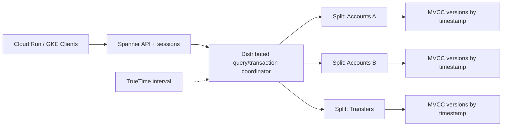
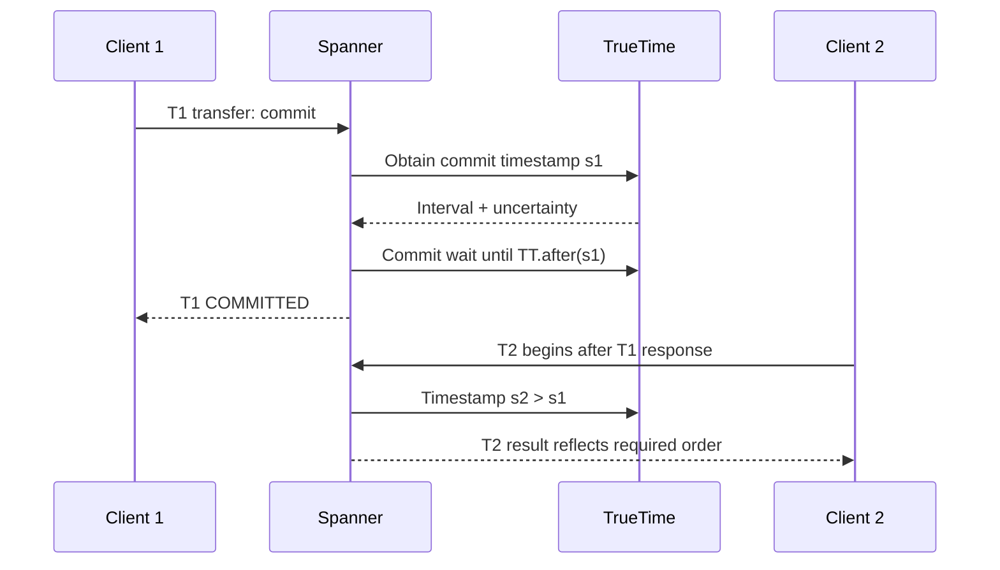
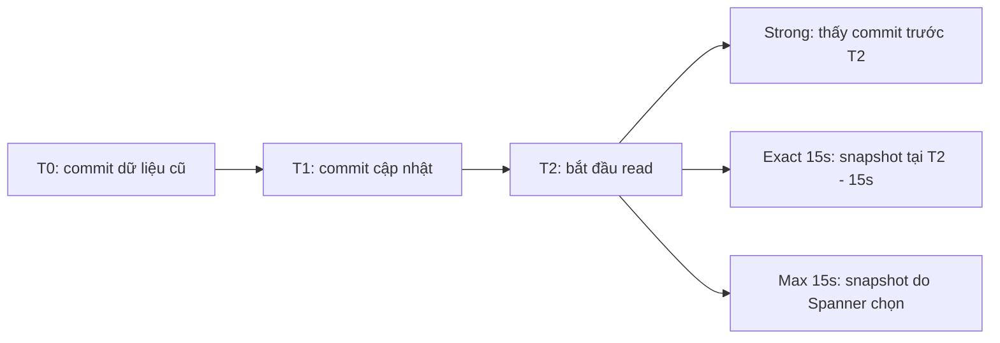
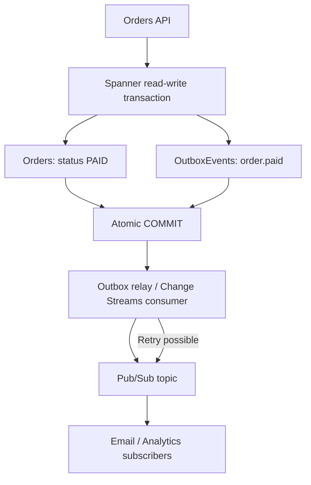

# Transactions, consistency và mô hình thời gian Spanner

Một khách hàng chuyển 300.000 đồng từ ví A sang ví B. Dịch vụ phải bảo đảm **hoặc cả hai số dư cùng thay đổi, hoặc không số dư nào thay đổi**, ngay cả khi các hàng được phân bố trên nhiều máy/region. Đồng thời, hệ thống báo cáo muốn đọc dữ liệu nhất quán nhưng chấp nhận trễ 15 giây để giảm độ trễ truy vấn. **Google Cloud Spanner** giải quyết hai yêu cầu này bằng giao dịch phân tán, phiên bản dữ liệu theo timestamp (MVCC) và đồng hồ phân tán **TrueTime**.

Bài thuộc chương **Spanner** của module `CLOUD_PROVIDERS_GCP`: người học kết nối kiến thức project/IAM/VPC với ứng dụng chạy trên Compute Engine, GKE, Cloud Run, lựa chọn lưu trữ và cơ sở dữ liệu, tự động hóa phát hành, giám sát SLO và chi phí. Trọng tâm là **chọn kiểu transaction và độ mới dữ liệu đúng nghiệp vụ**, không mặc định mọi truy vấn dùng cùng tính nhất quán hoặc phải trả giá như nhau.

> Các project, số dư và câu lệnh trong bài là ví dụ. Lệnh tạo database, DDL, DML hoặc chạy transaction có thể thay đổi dữ liệu và phát sinh chi phí; chỉ chạy trong sandbox được cho phép. Ví dụ SQL dùng **Spanner GoogleSQL dialect**, không dùng trực tiếp cho Spanner PostgreSQL dialect.

## 1. Kết quả học tập

Sau bài học, bạn có thể:

1. Giải thích **ACID**, **serializable isolation**, **external consistency**, **TrueTime** và **MVCC** trong Spanner.
2. Phân biệt read-write transaction, read-only snapshot transaction, single-use read và partitioned DML.
3. Chọn **strong**, **exact staleness/read timestamp** hoặc **bounded staleness** theo yêu cầu dữ liệu mới.
4. Đọc/ghi nhiều hàng nguyên tử bằng Java Spanner client library và xử lý lỗi `ABORTED` đúng cách.
5. Sử dụng commit timestamp, hiểu giới hạn version retention và tránh timestamp-based hotspots.
6. Xác định rủi ro concurrency, transaction retry, side effects, latency đa region và chi phí.
7. Vận dụng vào hệ thống Orders/Payments và xây dựng bài kiểm thử tính nhất quán.

## 2. Mô hình dữ liệu: một trạng thái nhất quán tại một thời điểm

Spanner lưu nhiều **phiên bản** của một giá trị, mỗi phiên bản liên quan đến commit timestamp. Đọc tại timestamp `t` trả về **ảnh chụp nhất quán** của dữ liệu đã commit tính đến `t`; không thấy nửa giao dịch.



Nếu chuyển 30 đơn vị từ A (100) sang B (50):

| Thời điểm đọc logic | Balance A | Balance B | Tổng |
| --- | ---: | ---: | ---: |
| Trước giao dịch | 100 | 50 | 150 |
| **Sau khi commit** | 70 | 80 | 150 |

Một snapshot read nhất quán **không** được thấy tổ hợp A=70, B=50 do cùng một giao dịch đã ghi hai hàng. Đó là nguyên tắc **atomicity**. Tuy nhiên, nếu ứng dụng thực hiện **hai strong reads độc lập** ở hai thời điểm khác nhau, một lần có thể đọc A trước commit và lần kia đọc B sau commit. Muốn tổng hợp nhất quán, hãy đọc cả hai trong **cùng một read-only transaction/snapshot**.

### 2.1. ACID và phạm vi giao dịch

| Thuộc tính | Ý nghĩa trong Spanner | Điều ứng dụng vẫn phải chịu trách nhiệm |
| --- | --- | --- |
| **Atomicity** | Các thay đổi trong một read-write transaction commit cùng nhau hoặc rollback | Không lén gọi payment/email API ngoài DB trong callback có thể retry |
| **Consistency** | Transaction/constraints và isolation bảo vệ trạng thái DB | Quy tắc nghiệp vụ như không âm số dư phải được viết và kiểm thử |
| **Isolation** | Mặc định `SERIALIZABLE`, bảo đảm mạnh cho các transactions đồng thời | Chọn isolation level phù hợp; chế độ khác có thể cho anomaly |
| **Durability** | Commit đã thành công được bảo vệ theo mô hình replication/consensus của Spanner | Không thay thế backup, audit hoặc cơ chế đối soát downstream |

Giao dịch Spanner có thể trải qua nhiều tables và splits **trong một database**. Nó **không phải distributed ACID transaction xuyên mọi dịch vụ**: Cloud SQL, Pub/Sub, Stripe hoặc service thanh toán khác cần idempotency/outbox/Saga riêng.

## 3. TrueTime và external consistency

### 3.1. TrueTime không phải một đồng hồ có thời điểm chính xác tuyệt đối

TrueTime cung cấp khoảng bất định về thời gian thực: `TT.now() = [earliest, latest]`. Spanner dùng khoảng đó để gán **commit timestamp** và thực hiện **commit wait**, bảo đảm timestamp phù hợp thứ tự có thể quan sát của những transaction đã hoàn tất. Đây là lý do Spanner có thể giữ thứ tự theo thời gian thực ngay cả khi dữ liệu nằm trên các region khác nhau.



**External consistency** (external serializability) là: các transaction hành xử như một thứ tự tuần tự **và** thứ tự đó tôn trọng thứ tự thời gian thực khi một transaction đã hoàn tất trước khi transaction tiếp theo bắt đầu commit. Nó mạnh hơn việc chỉ “mọi replica sẽ đồng bộ sau một lúc”.

**Không đánh đồng commit timestamp với đồng hồ máy ứng dụng.** App server timestamp từ `System.currentTimeMillis()` có thể lệch; Spanner commit timestamp được chọn tại commit. Hai transactions ghi **các vùng dữ liệu không giao nhau** có thể có cùng commit timestamp; đừng dùng timestamp như một khóa ID duy nhất.

### 3.2. Vì sao strong reads có thể nhất quán ở nhiều region?

Spanner dùng **MVCC + timestamp ordering** để trả một snapshot nhất quán. Strong read phải thấy toàn bộ transactions đã commit trước khi phép đọc bắt đầu, bất kể replica hợp lệ nào phục vụ. Việc đồng bộ/consensus, phân phối dữ liệu và vị trí leader ảnh hưởng latency; **consistency mạnh không đồng nghĩa mọi phép đọc đều có latency như RAM cục bộ**.

Một **stale read** chọn timestamp quá khứ nhưng **vẫn nhất quán tại timestamp đó**, khác với mô hình eventual consistency mà một phép đọc có thể thấy các mảnh dữ liệu ở những thời điểm không nhất quán. Với multi-region, stale reads phù hợp có thể được phục vụ gần client, giảm độ trễ và tải đọc.

## 4. Isolation level: mặc định SERIALIZABLE, tùy chọn REPEATABLE_READ

Spanner hiện hỗ trợ hai isolation levels cho các tình huống phù hợp:

| Isolation | Mô hình | Đặc trưng | Khi chọn |
| --- | --- | --- | --- |
| **SERIALIZABLE** (mặc định) | External consistency; mặc định pessimistic concurrency control | Có thể lấy locks, đợi và abort khi tranh chấp | Chuyển tiền, tồn kho, kiểm tra ràng buộc xuyên nhiều hàng |
| **REPEATABLE_READ** | Snapshot isolation; mặc định optimistic concurrency control | Đọc ở snapshot nhất quán, phát hiện xung đột ghi khi commit | Workloads chấp nhận rủi ro anomaly của snapshot isolation và đã kiểm tra nghiệp vụ |

**Không nói rằng mọi giao dịch Spanner luôn external consistent bất kể isolation level.** Bảo đảm external consistency được áp dụng với **serializable isolation**; repeatable read cho phép các anomaly mà serializable ngăn chặn, điển hình **write skew**.

### 4.1. Write skew: hai transactions đọc cùng một snapshot

Giả sử bảng phân ca có bác sĩ A và B, quy định “luôn phải còn ít nhất một bác sĩ trực”. T1 thấy B đang trực rồi tắt trạng thái A; T2 đồng thời thấy A đang trực rồi tắt B. Nếu cả hai chỉ ghi **hai hàng khác nhau**, snapshot isolation có thể cho cả hai commit, làm **không còn ai trực**.

Với nghiệp vụ cần bất biến xuyên hai hàng, dùng **SERIALIZABLE** và đặt phép kiểm tra + update trong **cùng transaction**; dự kiến `ABORTED` và retry toàn bộ transaction khi xung đột. Tránh đơn giản chỉ kiểm tra ngoài transaction rồi thực hiện UPDATE độc lập.

### 4.2. Pessimistic và optimistic concurrency

- **Pessimistic:** giữ locks có liên quan đến vùng đọc/ghi để ngăn các transactions xung đột đồng thời; tốt khi xung đột cao nhưng transactions dài có thể giữ locks lâu.
- **Optimistic:** đọc snapshot không cần chủ động giữ read locks, kiểm tra xung đột tại commit; phù hợp một số workloads đọc nhiều, nhưng commit có thể bị abort và chạy lại.
- Isolation và lock mode có cấu hình riêng; không suy từ tên isolation sang một kiểu locks cố định trong mọi phiên bản hoặc transaction.

**Thực hành:** bắt đầu với mặc định SERIALIZABLE khi chưa chứng minh nghiệp vụ an toàn ở REPEATABLE_READ. Nếu điều chỉnh isolation vì latency, kiểm thử concurrent transactions/transaction anomalies, không chỉ benchmark query đơn lẻ.

## 5. Các kiểu transaction của Spanner

| Kiểu | Được ghi? | Bảo đảm | Kỹ thuật phù hợp |
| --- | --- | --- | --- |
| **Read-write transaction** | Có | Atomically commit reads+writes, mặc định serializable | Cập nhật nhiều tài khoản, kho hàng |
| **Read-only transaction** | Không | Nhiều reads tại **cùng snapshot timestamp**, không cần commit | Báo cáo hai bảng cần nhất quán |
| **Single-use read** | Không | Một read/query với timestamp bound, tránh quản lý transaction dài | GET dữ liệu một bảng |
| **Partitioned DML** | Có | Một statement chia nhiều partition transactions, **không atomic toàn bảng** | Backfill idempotent, cleanup quy mô lớn |

### 5.1. Read-write transaction

Transaction có thể đọc trước rồi quyết định ghi; Spanner bảo vệ consistency thông qua concurrency control và transaction protocol (có thể dùng two-phase commit nếu đụng nhiều splits). Khi gặp xung đột, trả `ABORTED`: **thực thi lại toàn bộ transaction logic**, không chỉ gửi lại commit request trên các giá trị đọc cũ.

Tránh giữ transaction trong lúc chờ người dùng, gọi API bên ngoài hoặc ngủ dài; tăng lock contention, timeout, abort và chi phí. Với Java Spanner client library, `TransactionRunner` giúp retry tự động cho `ABORTED` trong callback phù hợp.

### 5.2. Read-only snapshot transaction

Spanner chọn một read timestamp và giữ cố định cho nhiều SELECTs trong cùng read-only transaction. Nó không thực hiện mutations, không cần commit, thường không lấy read locks; nhưng có thể đợi transactions đang ghi để tạo snapshot nhất quán. **Hai read-only transactions riêng** có thể lấy hai timestamp khác nhau dù đều là strong.

Thích hợp tính tổng hai tài khoản, kết hợp Orders và OrderLines, hoặc render báo cáo nhiều phần mà cần cùng một ảnh chụp. Không giữ read-only transaction sống quá lâu vì session/resources, timestamp retention và freshness của báo cáo.

### 5.3. Partitioned DML không phải transaction đa hàng nguyên tử

Partitioned DML chia một câu `UPDATE`/`DELETE` đủ đơn giản thành nhiều transactions theo partitions. **Các partitions đã commit không được rollback tất cả** nếu một partition sau đó lỗi; statement phải **idempotent** do hệ thống có thể chạy lại một partition.

| Hợp lệ về nguyên tắc | Không phù hợp |
| --- | --- |
| `UPDATE Orders SET Archived = TRUE WHERE CreatedAt < TIMESTAMP("2025-01-01T00:00:00Z")` | `UPDATE Accounts SET Balance = Balance - 100` (không idempotent) |
| Gán một giá trị cố định cho mỗi row độc lập | Transaction chuyển tiền hai hàng cần atomicity |

Partitioned DML chỉ chạy **một câu DML** trên mỗi lời gọi tương ứng và có hạn chế về phân vùng; không hỗ trợ cùng phạm vi giao dịch nguyên tử hay rollback toàn bộ. Với nhiều blind writes cần hiệu năng, xem **Batch Write API** và chấp nhận semantics khác.

## 6. Chọn thời điểm đọc: strong, exact và bounded staleness

Spanner có **timestamp bounds** cho read-only transactions hoặc single read. Bound xác định mức dữ liệu mới tại một **snapshot timestamp**, không phải số lần retry hay timeout.

| Timestamp bound | Chọn read timestamp | Bảo đảm | Trường hợp |
| --- | --- | --- | --- |
| **Strong** (mặc định) | Timestamp hiện tại do Spanner chọn | Thấy mọi commit hoàn tất trước khi read bắt đầu | Trạng thái thanh toán, số dư |
| **Exact staleness** | Chính xác `now - Δ` (xấp xỉ lúc bắt đầu read) | Snapshot nhất quán tại thời điểm xác định | Báo cáo chấp nhận dữ liệu trễ 15 s |
| **Exact read timestamp** | Timestamp cụ thể theo UTC/commit timestamp | Nhiều truy vấn khác nhau có thể đọc lại **cùng ảnh chụp**, nếu version còn giữ | Reconcile hoặc so sánh báo cáo |
| **Bounded staleness** | Spanner chọn một timestamp không cũ hơn giới hạn | Ảnh chụp nhất quán; thường ưu tiên replica gần | Trang sản phẩm đọc nhanh, chấp nhận trễ tối đa |

### 6.1. Strong là mới nhất *tại lúc bắt đầu đọc*, không phải khóa thời gian

Nếu T1 đã commit trước khi một **strong read** bắt đầu, phép đọc phải thấy T1. Nếu T2 commit trong lúc read đang diễn ra, snapshot có thể **không** chứa T2. Hai strong reads tách rời có thể quan sát hai thời điểm khác nhau; để giữ cùng snapshot qua nhiều phép đọc, dùng **read-only transaction**.

### 6.2. Exact staleness và exact read timestamp

Với exact staleness = 15 giây, Spanner đọc tại timestamp cách thời điểm bắt đầu khoảng 15 giây. Một order vừa commit 3 giây trước có thể chưa được thấy, **nhưng tất cả hàng trong phép đọc phản ánh cùng một snapshot hợp lệ**.

Khi truyền **read timestamp cụ thể** (ví dụ timestamp một báo cáo đã lưu), các lần chạy sau có thể tái tạo cùng ảnh chụp nếu timestamp vẫn nằm trong **version retention window**. Nếu timestamp thuộc tương lai, Spanner có thể đợi đến thời điểm đó thay vì trả ngay. Luôn có request deadline và không lấy timestamp do client tự đặt để giả vờ đã commit.

### 6.3. Bounded staleness khác exact staleness

Với max staleness = 15 giây, Spanner chọn timestamp mới nhất thích hợp trong giới hạn cho phép, thường để phục vụ bằng replica gần mà tránh đợi giao dịch đang ghi. Nó **có thể trả dữ liệu mới hơn** exact staleness 15 giây, nhưng có bước chọn timestamp. Hai lần đọc riêng cùng bound **không nhất thiết** dùng cùng timestamp.

**Giới hạn quan trọng:** bounded staleness chỉ hỗ trợ **single-use read/read-only transaction**, không dùng cho multi-use read-only transaction gồm nhiều reads như một snapshot cố định. Nếu cần nhiều phép đọc cùng snapshot, dùng strong hoặc exact timestamp/exact staleness trong một read-only transaction. Stale reads có lợi rõ hơn khi cho phép độ trễ đủ lớn (Google khuyến nghị khoảng 10–15 giây cho các tình huống phù hợp), không phải lúc nào 1 ms stale cũng cải thiện latency.



### 6.4. Chọn theo API/SLO

| API | Yêu cầu dữ liệu | Bound đề xuất |
| --- | --- | --- |
| `POST /transfer`, kiểm tra số dư sau chuyển | Cần quan hệ giao dịch đúng | Read-write transaction + strong read khi cần |
| `GET /wallet/{id}` ngay sau chuyển tiền | Read-your-writes | Strong read hoặc dữ liệu từ commit result |
| `GET /catalog` | Chấp nhận trễ 15 giây | Exact/bounded staleness, benchmark |
| `GET /daily-reports` nhiều bảng | Cùng thời điểm và reproducible | Read-only transaction với exact read timestamp |
| `GET /inventory-to-reserve` | Không dùng giá trị cũ để quyết định ghi | **Read-write transaction** thay vì stale SELECT rồi UPDATE |

## 7. Commit timestamp, MVCC và version retention

**Commit timestamp** được chọn khi Spanner quyết định commit một transaction. Trong GoogleSQL, đặt `OPTIONS (allow_commit_timestamp=true)` trên cột `TIMESTAMP` rồi dùng `PENDING_COMMIT_TIMESTAMP()` ở DML hoặc `Value.COMMIT_TIMESTAMP` trong Java Mutation API.

```sql
-- DDL cho Spanner GOOGLESQL dialect; sandbox, không phải PostgreSQL.
CREATE TABLE Accounts (
  AccountId STRING(36) NOT NULL,
  Balance INT64 NOT NULL,
  UpdatedAt TIMESTAMP OPTIONS (allow_commit_timestamp=true)
) PRIMARY KEY (AccountId);
```

Sau khi thiết lập bảng, một câu lệnh DML riêng lẻ có thể lưu commit timestamp:

```sql
-- Thay đổi dữ liệu: chỉ dùng một account đã tồn tại ở sandbox.
UPDATE Accounts
SET Balance = 70000, UpdatedAt = PENDING_COMMIT_TIMESTAMP()
WHERE AccountId = "A";
```

Vì timestamp chỉ được biết khi transaction commit, **sau khi dùng `PENDING_COMMIT_TIMESTAMP()`, những SQL read tiếp theo trên cùng bảng/index trong transaction có thể bị từ chối**. Hãy đọc/kiểm tra trước, rồi ghi commit timestamp ở phần cuối transaction.

**Không dùng commit timestamp làm ID duy nhất:** hai commits không ghi đè cùng một field có thể chia sẻ timestamp. Nếu đưa timestamp tăng đơn điệu vào **đầu primary key hoặc secondary index**, có thể gây **hotspot**; dùng khóa có phân tán phù hợp, không dùng `(CommitTs)` đơn độc làm primary key cho lượng ghi lớn.

### 7.1. Retention giới hạn khả năng time travel

Spanner **garbage collects** các phiên bản cũ. Database option `version_retention_period` cho phép giữ từ **1 giờ đến 7 ngày**, mặc định **1 giờ** theo tài liệu DDL hiện hành; đọc quá `earliest_version_time` sẽ lỗi, không tự tìm được dữ liệu đã bị GC.

```sql
-- CHỈ ĐỌC: xem cấu hình retention hiện tại trong Console/API.
-- Ví dụ DDL khi cần thay đổi retention (thay đổi chi phí/storage):
ALTER DATABASE `orders-db` SET OPTIONS (version_retention_period = '1d');
```

DDL trên là ví dụ **thay đổi dữ liệu cấu hình** và chỉ áp dụng nếu database name/dialect phù hợp. Tăng retention giúp audit/point-in-time reads nhưng phát sinh storage và có giới hạn. **Retention không thay thế backup/PITR, change streams hay lưu trữ nghiệp vụ dài hạn.**

## 8. Lab gcloud: đọc mạnh và đọc tại timestamp xác định

Giả định instance `orders-spanner` và database `orders-db` đã tồn tại trong project `orders-lab`, database dùng **GoogleSQL**, có bảng `Accounts` và sample rows. Nếu chưa có resource, quản trị viên phải tạo instance/database theo region configuration, billing và IAM được duyệt trước; không tự chạy lệnh tạo instance trên production.

### 8.1. Kiểm tra instance/database và schema (chỉ đọc)

```bash
PROJECT_ID="orders-lab"
INSTANCE="orders-spanner"
DATABASE="orders-db"

gcloud spanner instances describe "$INSTANCE" --project="$PROJECT_ID"
gcloud spanner databases describe "$DATABASE" \
  --instance="$INSTANCE" --project="$PROJECT_ID"
gcloud spanner databases ddl describe "$DATABASE" \
  --instance="$INSTANCE" --project="$PROJECT_ID"
```

### 8.2. Tạo bảng trong sandbox (nếu chưa có)

```bash
# THAY ĐỔI SCHEMA / CÓ PHÍ. Không chạy nếu bảng đã tồn tại.
gcloud spanner databases ddl update "$DATABASE" \
  --instance="$INSTANCE" --project="$PROJECT_ID" \
  --ddl='CREATE TABLE Accounts (AccountId STRING(36) NOT NULL, Balance INT64 NOT NULL, UpdatedAt TIMESTAMP OPTIONS (allow_commit_timestamp=true)) PRIMARY KEY (AccountId)'

# THAY ĐỔI DỮ LIỆU: hai lệnh riêng, dùng số dư demo (đơn vị tùy ứng dụng).
gcloud spanner databases execute-sql "$DATABASE" \
  --instance="$INSTANCE" --project="$PROJECT_ID" \
  --sql='INSERT INTO Accounts (AccountId, Balance) VALUES ("A", 100), ("B", 50)'
```

Nếu script được chạy lại, `INSERT` có thể lỗi vì trùng primary key: **đừng xóa dữ liệu thật để chạy lại demo**. Hai lệnh `execute-sql` liên tiếp **không cùng transaction**; phần chuyển tiền nguyên tử sẽ sử dụng Java client ở mục 9.

### 8.3. Strong read qua CLI

```bash
# CHỈ ĐỌC: dữ liệu mới nhất đã commit trước lúc read bắt đầu.
gcloud spanner databases execute-sql "$DATABASE" \
  --instance="$INSTANCE" --project="$PROJECT_ID" \
  --strong \
  --sql='SELECT AccountId, Balance FROM Accounts ORDER BY AccountId'
```

### 8.4. Đọc tại UTC timestamp cụ thể

```bash
# CHỈ ĐỌC: thay TIMESTAMP thực còn nằm trong version retention.
READ_TS="2026-11-19T01:00:00Z"
gcloud spanner databases execute-sql "$DATABASE" \
  --instance="$INSTANCE" --project="$PROJECT_ID" \
  --read-timestamp="$READ_TS" \
  --sql='SELECT AccountId, Balance FROM Accounts ORDER BY AccountId'
```

**Timestamp là minh họa:** nếu timestamp cũ hơn retention hoặc trước khi bảng được tạo, lệnh có thể lỗi. Không dùng cùng một giá trị minh họa cho môi trường thật; phải ghi lại timestamp hợp lệ từ execution/read transaction hoặc commit timestamp đã lưu.

## 9. Java: chuyển số dư nguyên tử với TransactionRunner

Ứng dụng Java trên Cloud Run hoặc GKE nên dùng **Google Cloud Spanner Java client library** thay vì tự xây transaction protocol. Khai báo dependency `com.google.cloud:google-cloud-spanner` với phiên bản do **Google Cloud Libraries BOM** hoặc dependency management của dự án kiểm soát; dùng **Application Default Credentials / Workload Identity**.

### 9.1. Nhận DatabaseClient

```java
import com.google.cloud.spanner.*;
import com.google.cloud.Timestamp;

// Khởi tạo một Spanner client dùng lại giữa nhiều requests.
String projectId = "orders-lab";
String instanceId = "orders-spanner";
String databaseId = "orders-db";

try (Spanner spanner = SpannerOptions.newBuilder()
         .setProjectId(projectId).build().getService()) {
  DatabaseClient db = spanner.getDatabaseClient(
      DatabaseId.of(projectId, instanceId, databaseId));
  // Gọi các phương thức ở mục 9.2/9.3 với db.
}
```

Đây là **trích đoạn bên trong phương thức Java**, không phải file Java độc lập. Trong service thật, tạo Spanner client một lần theo vòng đời ứng dụng rồi tái sử dụng **session pool** thay vì tạo/đóng client cho mỗi HTTP request. Cần permission trên database và API `spanner.googleapis.com` đã được bật; đừng đưa service account key JSON vào container.

### 9.2. Một giao dịch chuyển tiền hai hàng

Giả sử bảng `Accounts` từ mục 7 đã có A=100, B=50, số dư là đơn vị số nguyên, và người dùng yêu cầu chuyển 30:

```java
import com.google.cloud.Timestamp;
import com.google.cloud.spanner.*;
import java.util.List;
import java.util.Objects;

static Timestamp transfer(DatabaseClient db, String fromId,
                          String toId, long amount) {
  if (amount <= 0 || fromId.equals(toId)) {
    throw new IllegalArgumentException("Invalid transfer");
  }

  TransactionRunner runner = db.readWriteTransaction();
  runner.run(tx -> {
    Struct from = Objects.requireNonNull(
        tx.readRow("Accounts", Key.of(fromId), List.of("Balance")));
    Struct to = Objects.requireNonNull(
        tx.readRow("Accounts", Key.of(toId), List.of("Balance")));

    long beforeFrom = from.getLong("Balance");
    long beforeTo = to.getLong("Balance");
    if (beforeFrom < amount || beforeTo > Long.MAX_VALUE - amount) {
      throw new IllegalStateException("Insufficient funds or overflow");
    }

    tx.buffer(Mutation.newUpdateBuilder("Accounts")
        .set("AccountId").to(fromId)
        .set("Balance").to(beforeFrom - amount)
        .set("UpdatedAt").to(Value.COMMIT_TIMESTAMP)
        .build());
    tx.buffer(Mutation.newUpdateBuilder("Accounts")
        .set("AccountId").to(toId)
        .set("Balance").to(beforeTo + amount)
        .set("UpdatedAt").to(Value.COMMIT_TIMESTAMP)
        .build());
    return null;
  });
  // Chỉ đọc commit timestamp SAU khi runner.run() thành công.
  return runner.getCommitTimestamp();
}
```

Hai mutations được commit **nguyên tử**; nếu không đủ tiền, callback ném exception và không commit. Nếu xung đột, `TransactionRunner` có thể chạy lại toàn bộ callback với snapshot/locks mới. Đừng gắn `sendEmail()`, `chargeCard()` hoặc `publishPubSub()` **bên trong** callback: chúng có thể bị gọi nhiều lần dù transaction cuối cùng chỉ commit một lần.

Đây là **mẫu kỹ thuật**, chưa đủ điều kiện production: phải có xác thực người gọi, kiểm tra quyền sở hữu ví, chống chuyển tiền hai lần khi HTTP request bị gửi lại, hạn mức số tiền, ghi ledger bất biến và kiểm toán. Nếu API retry sau khi commit thành công nhưng response thất lạc, một lệnh gọi `transfer` mới có thể chuyển thêm lần nữa. Sử dụng **operationId duy nhất**, lưu kết quả trong cùng transaction và trả kết quả cũ cho các request trùng.

### 9.3. Read-only snapshot và stale read

```java
import com.google.cloud.spanner.*;
import java.util.concurrent.TimeUnit;

static void readConsistentBalances(DatabaseClient db) {
  // Cả hai lần đọc dùng một snapshot timestamp.
  try (ReadOnlyTransaction snap = db.readOnlyTransaction()) {
    Struct a = snap.readRow("Accounts", Key.of("A"),
                            java.util.List.of("Balance"));
    Struct b = snap.readRow("Accounts", Key.of("B"),
                            java.util.List.of("Balance"));
    System.out.printf("A=%d, B=%d, readTs=%s%n",
        a.getLong("Balance"), b.getLong("Balance"),
        snap.getReadTimestamp());
  }
}

static void read15SecondsOld(DatabaseClient db) {
  // Single-use query, chính xác khoảng 15 giây trong quá khứ.
  try (ResultSet rows = db
      .singleUse(TimestampBound.ofExactStaleness(
          15, TimeUnit.SECONDS))
      .executeQuery(Statement.of(
          "SELECT AccountId, Balance FROM Accounts ORDER BY AccountId"))) {
    while (rows.next()) {
      System.out.printf("%s=%d%n",
          rows.getString("AccountId"), rows.getLong("Balance"));
    }
  }
}
```

Nếu cần **bounded** stale read đơn lẻ, đổi thành `TimestampBound.ofMaxStaleness(15, TimeUnit.SECONDS)`. Nếu cần hai queries **cùng snapshot**, giữ `ReadOnlyTransaction` hoặc truyền một exact `readTimestamp` hợp lệ, không gọi hai `singleUse(...)` riêng rồi giả định timestamps trùng nhau. Các phương thức SDK có thể trả lỗi khi dữ liệu không tồn tại hoặc read timestamp quá cũ; mã mẫu cố ý ngắn nên ứng dụng thật phải xử lý lỗi.

## 10. Concurrency, ABORTED và retry đúng

Tại cùng thời điểm, T1 và T2 cùng muốn trừ tiền trên A. Cả hai có thể đọc số dư ban đầu trong giai đoạn xử lý; Spanner phải ngăn cả hai commit trên trạng thái cũ và làm sai invariant. Với serializable isolation, transactions xung đột sẽ đợi hoặc một transaction bị **ABORTED**, tùy khóa, tranh chấp và cách thực thi.

### 10.1. Các lỗi thường gặp

| Mã/trạng thái | Ý nghĩa thường gặp | Cách xử lý |
| --- | --- | --- |
| `ABORTED` | Transaction bị hủy do xung đột/concurrency hoặc lý do khác | **Retry toàn bộ read–check–write** với backoff; dùng TransactionRunner |
| `DEADLINE_EXCEEDED` | Response chưa về trước deadline | Phân biệt timeout đọc/commit; **không giả định ghi chắc chắn thất bại** |
| `UNAVAILABLE` | Lỗi tạm thời kết nối/service | Retry có giới hạn theo SDK; giữ idempotency key |
| `FAILED_PRECONDITION` | Timestamp quá cũ hoặc điều kiện sử dụng không đạt | Xem retention, schema, transaction mode; không retry mãi |
| `PERMISSION_DENIED` | IAM/database role thiếu | Sửa quyền chính xác, không cấp Owner toàn project |
| `RESOURCE_EXHAUSTED` | Quota/capacity/session pressure | Rate limit, tối ưu query, điều chỉnh resource hợp lý |

**Lỗi timeout/unknown outcome của commit là đặc biệt nguy hiểm:** client có thể không nhận được response mặc dù DB đã commit. Đọc lại theo **operationId hoặc ledger** để xác định trạng thái trước khi thực hiện một write có side effect mới. Với transaction retry tự động, callback phải **deterministic theo dữ liệu vừa đọc** và không có side effect bên ngoài.

### 10.2. Giảm contention thay vì tăng retries

- Giữ transaction **ngắn**, không gọi HTTP hay chờ user bên trong.
- Truy cập theo **primary keys** hoặc phạm vi nhỏ khi có thể; tránh scan toàn bảng trong read-write transaction.
- Tránh một hàng counter toàn cục nhận mọi writes; cân nhắc **sharded counters** hoặc mô hình phân vùng nghiệp vụ.
- Sử dụng read-only transaction cho báo cáo, không giữ read locks của read-write transaction không cần thiết.
- Dùng schema/index phù hợp, phân phối keys tốt; chú ý các khóa tăng đều, timestamp-leading keys và index hotspots.
- Đo **abort rate, lock wait, transaction attempts, commit latency** trước và sau tối ưu.

Nếu lỗi chỉ xuất hiện khi tăng concurrency, **mở thêm compute nodes không phải lúc nào chữa được hotspot một key**. Cần đổi thiết kế dữ liệu/khả năng chia khóa và giới hạn tải đầu vào.

## 11. Tính nhất quán xuyên dịch vụ và mô hình outbox

Spanner bảo đảm atomicity **trong một database**, không tự gộp message Pub/Sub và HTTP Payment vào cùng transaction. Ví dụ Orders commit thành công nhưng worker chết trước khi publish `order.paid`; nếu không có phương án khôi phục, downstream sẽ không biết đơn đã trả tiền.

**Transactional outbox**: ghi `Orders` và `OutboxEvents` trong cùng Spanner read-write transaction. Sau commit, relay đọc outbox, publish tới Pub/Sub và đánh dấu đã phát. Relay có thể publish lặp nếu response thất lạc, nên consumers vẫn cần xử lý **eventId idempotent**. Không xuất message từ callback transaction trước khi commit hoàn tất.



Với Spanner **change streams**, có thể theo dõi changes đã commit và xây data pipeline; vẫn phải hiểu semantics, thứ tự và khả năng lặp trong downstream. External API như thanh toán cần **idempotency key và reconciliation**, dù transaction Spanner đã serializable.

## 12. Độ trễ phân tán, leader region và lựa chọn đọc

**Tính nhất quán và độ trễ** phụ thuộc cách Spanner điều phối consensus, các splits và vị trí của client:

| Quyết định | Tác động latency | Lưu ý |
| --- | --- | --- |
| Regional instance configuration | Thường ít khoảng cách mạng hơn cho workload một vùng | Cần đánh giá availability và DR riêng |
| Multi-region configuration | Đọc/ghi trải rộng địa lý, có leader và replication quorum | Strong reads/writes từ xa có thể tốn thêm round trips |
| Strong read | Phải bảo đảm mọi commit trước lúc đọc được thấy | Có thể cần trao đổi với leader/replicas phù hợp |
| Exact/bounded stale read | Có thể tận dụng replica gần để giảm latency | Không dùng cho quyết định cần thấy write mới |
| Read lease region (khi hỗ trợ) | Có thể giảm strong read latency ở region xa | Có thể tăng write latency, kiểm tra capability và SLO |
| Transaction nhiều splits | Có thể thêm distributed commit coordination (2PC) | Tránh tăng số partitions/rows tham gia không cần thiết |

Không có hằng số `write latency = N ms` áp dụng cho mọi instance: vị trí leader, partitioning, number of participants, tải, lock contention và TrueTime uncertainty đều ảnh hưởng. Đo **end-to-end latency từ Cloud Run/GKE theo region** và phân tách server-side commit latency để tìm nguyên nhân.

**Transaction thời gian dài** làm tăng xung đột và chờ; thời gian của read-only transaction cũng có thể tăng khi chờ snapshot. Không triển khai HTTP request người dùng mở transaction rồi đợi callback ngoài hệ thống.

## 13. IAM, kết nối và bảo mật dữ liệu

Spanner là managed database truy cập qua Google Cloud APIs; sử dụng **Application Default Credentials (ADC)** và IAM, không nhúng service account JSON keys vào image. Cloud Run/GKE có thể dùng service accounts và Workload Identity Federation for GKE; khi tổ chức yêu cầu private connectivity/perimeter, xem Private Google Access, Private Service Connect cho Google APIs và VPC Service Controls phù hợp.

| Danh tính | Quyền Spanner gợi ý | Ghi chú |
| --- | --- | --- |
| Orders service thực hiện transaction | `roles/spanner.databaseUser` trên đúng database, hoặc **fine-grained database role** được thiết kế hẹp hơn | DatabaseUser có cả quyền sửa DDL; không xem là read/write role tối thiểu tuyệt đối |
| Reporting service chỉ đọc | `roles/spanner.databaseReader` hoặc fine-grained role | Không cấp write/DDL khi không cần |
| Schema migration pipeline | Role có `spanner.databases.updateDdl` ở phạm vi được duyệt | Tách khỏi runtime identity |
| Database/platform admin | `roles/spanner.databaseAdmin`/Admin theo phạm vi | Chỉ dùng cho quản trị, không gắn cho Pod nghiệp vụ |
| Monitoring operator | Viewer/Monitoring roles đủ để đọc metrics/insights | Không cấp quyền ghi dữ liệu chỉ để xem graphs |

**Fine-grained access control** có thể dùng database roles và `roles/spanner.fineGrainedAccessUser`, `roles/spanner.databaseRoleUser` cùng IAM conditions theo hướng dẫn. Nếu hệ thống multi-tenant, Spanner transaction consistency **không thay kiểm tra tenant ownership**: SQL queries phải áp giới hạn tenant và auth của ứng dụng.

### 13.1. Session pooling

Spanner Java client quản lý **sessions**; tạo một client mới cho mỗi HTTP request gây tăng overhead và sessions pressure. Với Cloud Run autoscaling, tổng sessions tăng theo số instances, pool size và concurrency. Thiết kế timeout, warm-up, graceful shutdown và max instances dựa trên **đo đạc session metrics**.

Tránh ghi các tham số nhạy cảm vào Cloud Logging: có thể log correlation ID, operationId đã pseudonymize, transaction type, error code, latency và retry attempts; không log số tài khoản, PII hoặc access tokens khi chưa có lý do và chính sách.

## 14. Observability, SLO và chi phí

Spanner cung cấp Cloud Monitoring, **Query insights**, **Lock insights** và **Transaction insights**. Với read/write transaction, quan sát **latency, commit latency, attempts/aborts, lock wait, số participants, CPU và storage**. Theo dõi client-side p95/p99 vì server-side metrics không phản ánh hết network và serialization.

| Tín hiệu | Câu hỏi vận hành | Hành động ưu tiên |
| --- | --- | --- |
| Transaction aborts / attempts | Có quá nhiều xung đột không? | Giảm hotspots, scope/length transaction |
| Lock wait và top lock conflicts | Hàng/index nào gây chờ? | Xem Transaction/Lock insights, query plans |
| Commit latency | Consensus/participants/region ảnh hưởng bao nhiêu? | So sánh region, giảm splits tham gia |
| Strong vs stale read p95 | Trade-off freshness/latency có đạt SLO không? | Chọn bounds theo loại API |
| High CPU / storage / sessions | Capacity hoặc query plan có vấn đề? | Index tuning, capacity autoscaling theo edition |
| Error codes `ABORTED`, `DEADLINE_EXCEEDED` | Retry có đang khuếch đại tải? | Backoff có giới hạn, kiểm tra deadlines |
| Business invariants | Số dư âm, lệch tổng, đơn trùng không? | Integration tests, audit/reconciliation |

Ví dụ SLO:

- **Thanh toán:** 99,95% giao dịch được commit thành công và hiển thị strong read trong giới hạn latency đã chọn; không có double debit.
- **Báo cáo:** 99% truy vấn snapshot 15 giây cũ đáp ứng p95 mục tiêu, và luôn dùng timestamp hợp lệ.
- **Tính đúng:** không có vi phạm invariant của ledger sau giao dịch đồng thời; alert theo reconciliation, không chỉ theo HTTP 5xx.

### 14.1. Chi phí ảnh hưởng thiết kế nhất quán

| Thành phần | Tác động |
| --- | --- |
| Processing capacity (nodes/processing units) | CPU/compute và năng lực xử lý theo edition/region |
| Multi-region replication | Availability, latency và giá cấu hình instance |
| Storage/MVCC version retention | Phiên bản giữ lâu hơn tăng sử dụng storage |
| Backup/PITR, change streams, Data Boost | Các tính năng phục vụ recovery/analytics có chi phí/giới hạn riêng |
| Read/write operations và network | Tải nhiều vùng, remote reads, response size ảnh hưởng latency/chi phí |
| Cloud Logging/Monitoring và client runtime | Traces/logging ingestion, Cloud Run/GKE resource usage |

**Stale read không phải công tắc giảm mọi chi phí.** Nó có thể giảm latency/CPU do phục vụ từ replica gần trong trường hợp phù hợp, nhưng số query, scan bytes, instance capacity và lưu trữ phiên bản vẫn cần tối ưu. Một index tốt, tránh N+1 queries hoặc cân nhắc Data Boost cho analytics có thể quan trọng hơn việc đổi timestamp bound.

## 15. Tình huống Orders: báo cáo chậm nhưng giao dịch phải đúng

Ứng dụng Orders gồm:

- `POST /transfer`: cập nhật hai ví và tạo ledger record, cần transaction **SERIALIZABLE**.
- `GET /wallet/{id}`: người dùng vừa chuyển tiền cần thấy trạng thái mới, dùng **strong read**.
- `GET /daily-summary`: tổng hợp nhiều bảng ở **cùng một snapshot**, cho phép 15 giây cũ.
- `POST /notify`: phát event sau commit qua outbox, không gọi email trực tiếp trong transaction.

### 15.1. Kịch bản và quyết định

| Tình huống | Chọn | Vì sao |
| --- | --- | --- |
| Hai giao dịch đồng thời rút từ A=100, mỗi giao dịch rút 80 | Read-write SERIALIZABLE, validate số dư trong transaction | Tránh cả hai cùng rút thành công trên số dư cũ |
| GET số dư ngay sau response 200 | Strong read hoặc trả số dư từ commit result | Đảm bảo read-your-writes |
| Dashboard xem tổng giao dịch | Read-only snapshot, exact staleness 15 s | Dữ liệu nhiều bảng nhất quán và giảm độ trễ |
| Re-run báo cáo đã chốt vào timestamp cũ | Exact read timestamp trong retention | Lặp lại cùng trạng thái trước khi versions bị GC |
| Transaction callback bị chạy lại sau ABORTED | Không gửi email/charge card trong callback | Tránh lặp side effect |
| Client timeout sau commit request | Query ledger theo operationId | Không tự chuyển tiền lần hai |

### 15.2. Sự cố giả định: tổng số dư lệch vì hai strong reads riêng

Nhóm viết báo cáo bằng hai yêu cầu độc lập: đọc số dư ví A lúc 10:00:00.000, sau đó đọc ví B lúc 10:00:00.120. Một transfer commit giữa hai lần đọc; báo cáo tính tổng từ **hai ảnh chụp khác nhau** và báo sai.

**Khắc phục:** dùng **một read-only transaction** cho cả hai SELECTs (hoặc ghi/lưu exact read timestamp). Không cần tắt strong consistency; điều cần sửa là **phạm vi snapshot của nhiều lần đọc**. Thử nghiệm concurrency phải kiểm tra tổng bất biến trong read-only transaction và đối chiếu với hai strong reads độc lập.

### 15.3. Sự cố giả định: callback chuyển tiền chạy lại

Cloud Run nhận yêu cầu với `operationId=transfer-1001`. Transaction T1 bị `ABORTED` sau tranh chấp, SDK tự chạy lại callback thành T2 và commit. Nếu callback gửi thông báo trước commit, người nhận có thể nhận **hai email**. Nếu HTTP client retry cả API sau mất response, tiền có thể bị chuyển lần nữa dù Spanner chỉ commit mỗi lần gọi một transaction hợp lệ.

**Khắc phục:** callback chỉ đọc/ghi Spanner; lưu `operationId` unique và ledger cùng transfer, xuất event qua outbox sau commit, rồi khi nhận API retry kiểm tra operationId trước khi tạo giao dịch mới. Thử trường hợp mất response, concurrent requests trùng operationId và xử lý lỗi sau commit.

## 16. Troubleshooting theo triệu chứng

| Triệu chứng | Nguyên nhân có thể | Hành động |
| --- | --- | --- |
| `ABORTED` tăng khi peak traffic | Hot key/index, transaction dài, lock contention | Transaction insights, giảm scope, key distribution |
| `DEADLINE_EXCEEDED` nhiều | Query slow, cold sessions, network/region hoặc locks | p95, query plan, session pool và đúng deadline |
| Strong read vẫn thấy dữ liệu “cũ” | Đọc trước commit hoàn tất, nhầm DB/tenant, client cache | Đối chiếu commit/result, timestamp, routing và cache |
| Hai strong SELECTs tạo báo cáo lệch | Hai snapshots khác nhau | Dùng cùng read-only transaction |
| Stale read không thấy write vừa commit | Chọn timestamp quá khứ theo thiết kế | Dùng strong cho read-after-write |
| Bounded staleness không chạy trong multi-use txn | API chỉ cho bounded trong single-use | Đổi sang strong/exact timestamp multi-use |
| Exact timestamp query lỗi | Quá retention, timestamp tương lai, schema đã đổi | Xem earliest_version_time, retention và deadline |
| Commit timestamp trùng | Transactions không giao nhau có thể cùng timestamp | Dùng operationId/primary key riêng |
| Scan/update hàng triệu rows làm quá giới hạn | Dùng read-write transaction lớn thay vì partitioned DML | Chuyển sang partitioned DML idempotent/batch write theo yêu cầu |
| Partitioned DML dở dang sau lỗi | Không atomic toàn bảng | Đối soát partitions, chạy lại câu idempotent |
| Java client mở nhiều sessions | Tạo client trong mỗi request, autoscale nhanh | Reuse Spanner client, kiểm soát pool/max instances |
| `PERMISSION_DENIED` | Thiếu IAM hoặc database role | Grant theo database/role, không cấp Owner |
| Multi-region write latency tăng | Leader/quorum location, nhiều splits, lock wait | Đo commit latency, locality và transaction scope |

## 17. Bài tập thực hành

### Bài A — ACID và snapshot

Hai accounts A=100, B=50; một transfer 30 từ A sang B. Vẽ các trạng thái hợp lệ trước/sau commit. Vì sao hai SELECTs strong riêng biệt có thể cho một tổng không đúng, còn một read-only transaction thì không?

### Bài B — TrueTime và external consistency

Giải thích khoảng thời gian `[earliest, latest]`, commit wait và thứ tự hai transactions T1/T2 khi T1 đã hoàn tất trước lúc T2 bắt đầu commit. Phân biệt external consistency với eventual consistency và với strong read.

### Bài C — Serializable và repeatable read

Dùng tình huống hai bác sĩ trực và mỗi người cùng nghỉ, thiết kế hai transactions đồng thời để minh họa **write skew** có thể xảy ra dưới snapshot isolation. Vì sao serializable phù hợp để bảo vệ invariant “còn ít nhất một bác sĩ”?

### Bài D — Java transaction và ABORTED

Tại sandbox, dùng bảng Accounts/Java `TransactionRunner` để chuyển 30 đơn vị. Tạo hai threads cùng chuyển từ một account nhỏ; log retry attempts và commit results. Vì sao không được gửi email/charge card trong callback, và vì sao operationId vẫn cần thiết ngoài retry nội bộ?

### Bài E — Timestamp bounds

Một dashboard chấp nhận dữ liệu trễ tối đa 15 giây; một màn hình chuyển tiền phải thấy kết quả mới nhất. Chọn strong, exact hoặc bounded staleness. Giải thích vì sao hai bounded reads có thể chọn timestamps khác nhau và cách tái tạo báo cáo đúng một snapshot.

### Bài F — Commit timestamps và retention

Tạo một cột `UpdatedAt` hỗ trợ `allow_commit_timestamp=true`, ghi dữ liệu bằng `PENDING_COMMIT_TIMESTAMP()` rồi đọc lại. Nêu hai lý do timestamp không nên làm ID duy nhất/leading index key. Kiểm tra tình huống read timestamp quá cũ khi retention chỉ một giờ.

### Bài G — DML hay partitioned DML?

Phân loại các tác vụ: chuyển 100 giữa hai accounts, đặt `Archived=TRUE` cho hàng triệu order cũ, tăng mọi balance thêm 10%. Tác vụ nào phù hợp partitioned DML và vì sao idempotency, partial completion quan trọng?

### Bài H — SLO và khả năng chịu lỗi

Thiết kế dashboard tối đa tám biểu đồ gồm abort rate, lock wait, transaction latency, commit latency, CPU, sessions, query latency và business anomalies. Mô tả runbook khi Cloud Run trả timeout sau yêu cầu commit: làm sao xác minh giao dịch đã xảy ra hay chưa mà không double-charge?

### Câu hỏi tự kiểm tra

1. External consistency được Spanner đảm bảo mặc định dưới isolation nào?
2. Repeatable read có tương đương serializable/external consistency không?
3. Strong read có thấy transaction commit trong lúc read đang chạy hay không?
4. Vì sao hai strong reads tách biệt có thể cho kết quả không cùng snapshot?
5. Exact staleness và bounded staleness khác nhau thế nào?
6. Bounded staleness có dùng trong multi-use read-only transaction không?
7. `TransactionRunner` xử lý `ABORTED` bằng cách nào?
8. `PENDING_COMMIT_TIMESTAMP()` có thể được dùng làm timestamp ID duy nhất không?
9. Partitioned DML có rollback toàn bảng nếu một partition lỗi không?
10. Vì sao Spanner ACID transaction không bao gồm luôn message Pub/Sub hoặc HTTP payment?

## 18. Checklist triển khai và tài liệu chính thức

- [ ] Chọn rõ isolation level cho transaction; mặc định serializable trừ khi có lý do kiểm chứng khác.
- [ ] Tất cả read-dependent writes nằm trong **cùng read-write transaction**.
- [ ] Một báo cáo nhiều SELECTs dùng **một snapshot** hoặc exact read timestamp.
- [ ] Strong reads dùng cho read-after-write; stale bounds chỉ cho dữ liệu chấp nhận cũ.
- [ ] Retry toàn bộ transaction khi ABORTED, callback không gọi external side effects.
- [ ] API có operationId/idempotency và reconciliation cho commit outcome không chắc chắn.
- [ ] Commit timestamp và version retention được thiết kế đúng, tránh hotspot và phụ thuộc lịch sử quá hạn.
- [ ] IAM/database roles, session pooling, region/quorum locality, SLO, quotas và billing được review.

Tài liệu Google Cloud chính thức:

- [Transactions overview](https://cloud.google.com/spanner/docs/transactions)
- [TrueTime and external consistency](https://cloud.google.com/spanner/docs/true-time-external-consistency)
- [Isolation levels overview](https://cloud.google.com/spanner/docs/isolation-levels)
- [Concurrency control](https://cloud.google.com/spanner/docs/concurrency-control)
- [Timestamp bounds](https://cloud.google.com/spanner/docs/timestamp-bounds)
- [Reads outside transactions](https://cloud.google.com/spanner/docs/reads)
- [Java read-write transaction sample](https://cloud.google.com/spanner/docs/samples/spanner-read-write-transaction)
- [Java read stale data sample](https://cloud.google.com/spanner/docs/samples/spanner-read-stale-data)
- [Commit timestamps in GoogleSQL](https://cloud.google.com/spanner/docs/commit-timestamp)
- [Data Manipulation Language best practices](https://cloud.google.com/spanner/docs/dml-best-practices)
- [Partitioned DML](https://cloud.google.com/spanner/docs/dml-partitioned)
- [Point-in-time recovery/version retention](https://cloud.google.com/spanner/docs/pitr)
- [Lock and Transaction insights](https://cloud.google.com/spanner/docs/use-lock-and-transaction-insights)
- [Spanner IAM roles](https://cloud.google.com/spanner/docs/iam)
- [Spanner pricing](https://cloud.google.com/spanner/pricing)

**Ghi nhớ:** Spanner hỗ trợ giao dịch phân tán ACID và **external consistency ở isolation mặc định serializable**, dùng TrueTime/commit timestamps và MVCC. Strong read thấy những commit đã hoàn tất trước khi đọc; stale read vẫn nhất quán tại timestamp quá khứ; **nhiều phép đọc cần một snapshot chung**. Viết transaction ngắn, retry an toàn, bảo vệ business invariants và quan sát abort/lock/latency thay vì chỉ dựa vào tính đúng của database.
