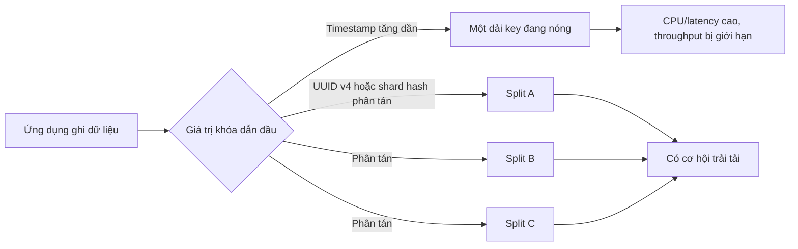

# Indexes, query plans và tránh hotspot

> **Chương:** Spanner  
> **Module:** CLOUD_PROVIDERS_GCP  
> **Phạm vi module:** Khám phá Google Cloud từ tổ chức project, IAM và VPC đến Compute Engine, GKE, Cloud Run, dịch vụ lưu trữ và cơ sở dữ liệu. Qua các tình huống triển khai, người học biết lựa chọn dịch vụ, bảo vệ tài nguyên, tự động hóa phát hành và theo dõi độ tin cậy cùng chi phí.

Spanner phân phối dữ liệu theo **các khoảng khóa (key ranges)** trên nhiều tài nguyên phục vụ. Điều này tạo khả năng mở rộng, nhưng cũng khiến thiết kế **primary key**, **secondary index** và **query** có ảnh hưởng trực tiếp đến hiệu năng: một truy vấn thiếu index có thể quét nhiều rows, còn một index bắt đầu bằng timestamp tăng liên tục có thể dồn mọi lượt ghi vào cùng một vùng nóng (**hotspot**).

Bài học dùng **GoogleSQL dialect** nhất quán để thiết kế index, đọc execution plan, điều tra bằng Query insights/Key Visualizer và chọn chiến lược tránh hotspot. Các ví dụ SQL là tài liệu học tập; phần thực hành chỉ đọc trên **Spanner database sandbox đã có sẵn**. Tạo bảng/index hoặc tạo tải thử chỉ là bước tùy chọn có phê duyệt, không chạy trên database production.

## Mục tiêu học tập

Sau bài này, bạn có thể:

1. Giải thích primary-key index, secondary index, **key prefix**, `STORING` và index back join.
2. Tạo index phục vụ `WHERE`, `ORDER BY`, `LIMIT` và cân bằng read latency với write amplification.
3. Đọc query plans với `PLAN`, `PROFILE`, nhận biết scan, filter, distributed execution và lookup về base table.
4. Nhận diện hotspot do **monotonic primary key/index**, giá trị có cardinality thấp hoặc một khóa bị truy cập quá mức.
5. Chọn UUID phân bố tốt, bit-reversed sequences, composite key hoặc **hash/shard prefix**, hiểu đổi chác của truy vấn fan-out.
6. Dùng Query insights, index advisor, Key Visualizer và metrics để có bằng chứng trước/sau khi tối ưu.

## 1. Vì sao phân phối theo key range quan trọng?

Spanner lưu bảng và index có thứ tự theo **khóa**; nền tảng phân chia những khoảng khóa thành **splits** và phân bổ chúng để phục vụ lưu lượng. Thêm compute capacity không tự sửa được một thiết kế cứ ghi vào **cuối một khoảng khóa duy nhất**.



**Hotspot** là khi nhiều request tập trung vào một split/server hoặc một nhóm rows/keys đến mức quá tải. Có ít nhất ba nguyên nhân khác nhau:

| Kiểu hotspot | Ví dụ | Hướng xử lý |
|---|---|---|
| **Sequential write** | Primary key mở đầu bằng `CreatedAt` tăng dần | Dùng UUID v4, bit-reversed sequence hoặc hash/shard key |
| **Secondary-index write** | PK là UUID, nhưng index mở đầu bằng `CreatedAt DESC` hoặc `Status='NEW'` + timestamp | Sửa **index key**, không chỉ primary key |
| **Hot row / hot logical key** | Mọi giao dịch cộng vào một row tổng tiền | Tách counters/transactions, phân vùng nghiệp vụ, giảm contention |

**Quy tắc:** cả **bảng chính lẫn từng secondary index** đều là cấu trúc có thứ tự. Một index mới có thể cải thiện đọc nhưng làm **ghi chậm hơn** nếu key index hội tụ vào một dải.

## 2. Primary key và secondary index

Primary key xác định duy nhất row và hỗ trợ truy xuất theo khóa. Spanner tự tổ chức dữ liệu theo primary key; không cần tạo secondary index trùng hệt với primary key.

**Ví dụ GoogleSQL:** bảng đơn hàng của hệ thống nhiều tenant; `OrderId` do ứng dụng phát sinh dạng UUID v4, không phải chuỗi số tăng tuần tự.

```sql
-- DDL MINH HỌA; chỉ áp dụng nếu có database lab được phép thay đổi.
CREATE TABLE Orders (
  TenantId STRING(36) NOT NULL,
  OrderId STRING(36) NOT NULL,
  CustomerId STRING(36) NOT NULL,
  CreatedAt TIMESTAMP NOT NULL,
  Status STRING(16) NOT NULL,
  TotalAmount NUMERIC,
  ExternalRef STRING(64)
) PRIMARY KEY (TenantId, OrderId);

CREATE INDEX OrdersByCustomerCreatedAt
ON Orders(TenantId, CustomerId, CreatedAt DESC)
STORING (Status, TotalAmount);
```

Phân tích:

- Primary key `(TenantId, OrderId)` gom rows theo tenant và trải OrderId theo không gian khóa **trong mỗi tenant** nếu ID phân bố đủ tốt. Một tenant quá nóng vẫn cần theo dõi.
- Index `(TenantId, CustomerId, CreatedAt DESC)` phục vụ tìm đơn theo **tenant + customer** và trả đơn mới trước mà không phải sort toàn bộ dữ liệu.
- `STORING (Status, TotalAmount)` sao chép hai cột vào index, làm **covering index** cho một số SELECT phổ biến.
- Cột OrderId thuộc primary key nên có thể được lấy từ secondary-index entry theo mô hình lưu trữ Spanner.

### 2.1. Index key prefix và thứ tự cột

Giả sử truy vấn phổ biến:

```sql
SELECT OrderId, CreatedAt, Status, TotalAmount
FROM Orders
WHERE TenantId = 'tenant-blue'
  AND CustomerId = 'customer-007'
ORDER BY CreatedAt DESC
LIMIT 20;
```

Index phù hợp vì hai điều kiện **equality** nằm ở đầu, sau đó là `CreatedAt DESC` để lấy 20 rows mới. Nhưng nếu chỉ lọc `WHERE CustomerId = ...`, không có `TenantId`, Spanner có thể không dùng index hiệu quả như truy vấn đầy đủ prefix. Tương tự, khi bắt đầu dùng **range predicate**, các cột phía sau có thể ít hữu ích hơn cho định vị chính xác.

Một **index duy nhất không tối ưu mọi query**. Chọn thứ tự cột dựa trên query patterns thực tế và phân phối dữ liệu, không đơn thuần đặt cột “hay được hỏi” lên trước.

### 2.2. Covering index vs back join

Khi query cần một cột **không có trong index**, Spanner có thể đọc index để tìm khóa rồi **back join** về base table lấy cột thiếu:

```text
Index scan → tìm PK ứng với rows thỏa điều kiện
           → table lookup / distributed cross apply
           → đọc cột còn thiếu trong bảng chính
           → trả kết quả
```

`STORING` giúp bỏ các lượt lookup này nhưng tăng:

- Dung lượng lưu trữ và chi phí.
- Công việc ghi/duy trì index khi cột stored thay đổi.
- Backfill khi index thêm vào bảng có dữ liệu.

Đừng thêm `STORING` cho mọi cột hoặc `SELECT *` theo phản xạ. Đo **rows scanned, latency, CPU, số lượt lookup** và write load trước khi quyết định.

### 2.3. NULL_FILTERED và UNIQUE

Nếu `ExternalRef` chỉ có ở một phần nhỏ đơn hàng, index bình thường vẫn lưu rows có `NULL`. GoogleSQL cho phép index loại những rows có cột index-key NULL:

```sql
CREATE NULL_FILTERED INDEX OrdersByExternalRef
ON Orders(TenantId, ExternalRef);
```

Truy vấn muốn sử dụng index này phải loại trừ các rows NULL tương ứng:

```sql
SELECT OrderId
FROM Orders@{FORCE_INDEX=OrdersByExternalRef}
WHERE TenantId = 'tenant-blue'
  AND ExternalRef = 'merchant-ref-123'
  AND ExternalRef IS NOT NULL;
```

**Không dùng NULL_FILTERED** nếu nghiệp vụ phải truy vấn các rows `ExternalRef IS NULL` qua index đó. `UNIQUE` index có thể giúp thực thi ràng buộc duy nhất, nhưng **UNIQUE NULL_FILTERED** không áp uniqueness cho rows bị loại khỏi index vì chứa NULL. Nếu cần unique cả khi nullable, phải thiết kế ràng buộc/dữ liệu cho đúng.

**Khác biệt dialect:** trong **Spanner PostgreSQL dialect**, dùng `INCLUDE` thay `STORING`, dùng partial index `WHERE col IS NOT NULL` thay `NULL_FILTERED`, và cú pháp hint khác. **Không dán nguyên GoogleSQL DDL vào database PostgreSQL dialect.**

## 3. Index usage: ưu tiên optimizer, chỉ ép index khi có chứng cứ

Spanner optimizer thường tự chọn giữa base-table scan và các secondary indexes. Nếu đã đo và cần kiểm tra một index cụ thể, GoogleSQL hỗ trợ `FORCE_INDEX`:

```sql
-- Thử ép index, phục vụ so sánh PLAN/PROFILE.
SELECT OrderId, CreatedAt, Status, TotalAmount
FROM Orders@{FORCE_INDEX=OrdersByCustomerCreatedAt}
WHERE TenantId = 'tenant-blue'
  AND CustomerId = 'customer-007'
ORDER BY CreatedAt DESC
LIMIT 20;

-- So sánh với truy vấn đọc bảng gốc, cũng chỉ dùng để chẩn đoán.
SELECT OrderId, CreatedAt, Status, TotalAmount
FROM Orders@{FORCE_INDEX=_BASE_TABLE}
WHERE TenantId = 'tenant-blue'
  AND CustomerId = 'customer-007'
ORDER BY CreatedAt DESC
LIMIT 20;
```

**FORCE_INDEX là directive:** Spanner báo lỗi nếu index không tồn tại hoặc không thuộc đúng table, và có thể báo lỗi khi ép `NULL_FILTERED` index mà predicate chưa loại NULL tương ứng. Trên truy vấn đang tốt, ép index có thể **kém hơn** optimizer sau khi dữ liệu, statistics package hoặc schema đổi.

### 3.1. Anti-pattern: index tốt cho ORDER BY nhưng phá write throughput

```sql
-- Không khuyến nghị cho bảng có tốc độ ghi lớn, CreatedAt tăng liên tục.
CREATE INDEX OrdersByCreatedAt
ON Orders(CreatedAt DESC);

-- Dễ tạo các dải nóng tương tự nếu đa số write có Status='NEW'.
CREATE INDEX OrdersByStatusTime
ON Orders(Status, CreatedAt DESC);
```

Dù `OrderId` là UUID ngẫu nhiên, **mọi insert cũng cập nhật secondary indexes**. Với index bắt đầu bằng timestamp, phần lớn writes hội tụ ở đầu/cuối cùng một key range; với `Status='NEW'`, còn dễ dồn một nhóm lớn sự kiện vào một dải. `DESC` chỉ đổi vị trí nóng, **không làm write phân tán**.

## 4. Vòng đời index: backfill, quota và chi phí

Thêm index vào bảng đã có dữ liệu sẽ kích hoạt **backfill** để tạo index entries. Spanner có thể tiếp tục phục vụ traffic khi thao tác DDL chạy, nhưng backfill tiêu thụ tài nguyên và có thể tăng latency/write pressure.

**Quy trình đề xuất cho hệ thống thật:**

1. Dùng **Query insights/Index advisor** tìm workload cần tối ưu, ghi baseline.
2. Thiết kế thứ tự key, `STORING`, nullable/uniqueness và nguy cơ **write hotspot**.
3. Tạo thử trên database/staging có dữ liệu phân phối tương tự.
4. Chạy DDL theo change window, giám sát **long-running operation/backfill** và mức CPU/storage.
5. Sau hoàn tất, so sánh `PLAN`/`PROFILE`, latency, rows scanned **và write latency**.
6. Nếu không có lợi ích, rollback bằng DDL **chỉ sau đánh giá phụ thuộc**; đừng xóa index được ứng dụng khác sử dụng.

**Lưu ý:** `ALTER INDEX ... ADD STORED COLUMN` cũng có thể backfill và làm index lớn thêm. Index advisor đưa ra **đề xuất** chứ không phải lệnh tự động đúng trong mọi môi trường. Đổi schema hoặc data distribution lớn có thể khiến optimizer cần **statistics package mới**.

## 5. Đọc query plans: PLAN khác PROFILE

Query plan mô tả cách Spanner thực thi SQL qua các máy/splits. Các mode của `ExecuteSql`:

| Query mode | Thực thi SQL? | Trả về |
|---|---|---|
| `NORMAL` | Có | Rows, không có plan/stats |
| `PLAN` | **Không thực thi truy vấn** | Kế hoạch **ước tính**; không có runtime stats |
| `PROFILE` | **Có** | Rows + plan + statistics tổng và theo operators |
| `WITH_STATS` | Có | Rows + thống kê tổng |
| `WITH_PLAN_AND_STATS` | Có | Rows + plan + thống kê tổng |

**Không chạy `PROFILE` một truy vấn scan lớn trên production chỉ để xem biểu đồ**: nó thực sự đọc dữ liệu, tiêu thụ CPU/I/O và có overhead phân tích. Dùng `PLAN` trước; `PROFILE` chỉ trên SELECT có phạm vi an toàn, dữ liệu/giờ được phê duyệt.

### 5.1. Những operators thường gặp

```text
Distributed Union
  └─ Serialize Result
      └─ Limit / Sort
          └─ Filter
              └─ Index Scan  (hoặc Table Scan)
                  └─ [Back Join / Distributed Cross Apply nếu thiếu cột]
```

Đây là **sơ đồ minh họa**, không phải plan đầu ra cố định. Spanner quyết định operators theo schema, statistics, query shape và optimizer version.

| Dấu hiệu trong plan | Điều nên hỏi |
|---|---|
| **Table Scan** nhiều rows | Có predicate/index đủ chọn lọc chưa? Có cần scan toàn bảng thật không? |
| **Index Scan** + back join | Thêm một số `STORING` columns có đáng chi phí ghi/lưu trữ? |
| **Filter** sau khi scan nhiều rows | Predicate có được đẩy xuống scan không? Index key prefix có phù hợp? |
| **Sort/TopK** lớn | Index có cung cấp order yêu cầu không? `LIMIT` đã đẩy xuống được chưa? |
| **Distributed Union/Apply** và remote calls nhiều | Query chạm bao nhiêu key ranges/servers? Fan-out có cần thiết? |
| **Rows scanned ≫ rows returned** | Đang đọc quá nhiều rồi loại bỏ kết quả? |

Không kết luận “thấy Table Scan = lỗi” cho mọi câu `COUNT(*)`, truy vấn phân tích toàn bảng hoặc bảng rất nhỏ. **Quan trọng là chi phí so với mục tiêu nghiệp vụ**.

### 5.2. Giải thích metrics bằng ví dụ

Giả sử một query trả **20 orders** nhưng `PROFILE` cho thấy:

| Chỉ số giả định | Trước index | Sau index phủ đủ cột |
|---|---:|---:|
| Rows returned | 20 | 20 |
| Rows scanned | 500.000 | 22 |
| Remote calls | 180 | 4 |
| p95 latency | 900 ms | 45 ms |

Các số trên **là minh họa học tập, không phải benchmark Google Cloud**. Để chứng minh index có lợi thật, cần đo trên workloads tương đương, nhiều lần, lưu CPU/write latency, optimizer version và statistics package; không so một query lạnh với query đã cache rồi rút kết luận.

## 6. Hotspots ở bảng và index: nhận diện đúng nguyên nhân

### 6.1. Monotonic primary key

```sql
-- Anti-pattern khi ghi tốc độ cao vào bảng events:
CREATE TABLE EventLogBad (
  EventTime TIMESTAMP NOT NULL,
  EventId STRING(36) NOT NULL,
  Payload STRING(MAX)
) PRIMARY KEY (EventTime, EventId);
```

Khi `EventTime` gần như luôn tăng, inserts dồn về **cuối key range**; đổi `ASC` thành `DESC` chỉ chuyển từ cuối sang đầu.

### 6.2. Index độc lập vẫn có thể nóng

Giả sử đã sửa primary key của event thành `EventId` UUID v4:

```sql
CREATE TABLE EventLogById (
  EventId STRING(36) NOT NULL,
  EventTime TIMESTAMP NOT NULL,
  Payload STRING(MAX)
) PRIMARY KEY (EventId);

-- VẪN có nguy cơ hotspot ở secondary index:
CREATE INDEX EventsByTime
ON EventLogById(EventTime DESC);
```

Một insert vừa ghi row ở vị trí `EventId` phân tán, **vừa ghi index entry** tại timestamp mới nhất. Vì vậy sửa primary key mà không xem secondary index có thể không hết hotspot.

### 6.3. Hot row khác hot range

Một row `GlobalStats(Id='all', TotalOrders)` bị hàng nghìn transactions cập nhật đồng thời sẽ sinh contention/abort dù schema có nhiều splits. Không dùng thêm secondary index để “sửa” một **hot row**. Giải pháp thường là:

- Chuyển sang ghi **append-only events**, tổng hợp bất đồng bộ.
- Dùng **sharded counters** với một số rows phân tán rồi tổng hợp khi đọc.
- Điều chỉnh transaction boundaries, giảm lock contention và giới hạn retries.

## 7. Chiến lược tránh hotspot và đánh đổi

| Chiến lược | Ưu điểm | Giá phải trả / giới hạn |
|---|---|---|
| **UUID v4/ID ngẫu nhiên** làm key đầu | Trải writes trên không gian khóa, lookup theo ID thuận tiện | Không có thứ tự thời gian; nhiều random access |
| **Bit-reversed sequence** | ID số sinh có tính phân tán, giảm hotspot so với counter tăng tuần tự | Cần dùng cơ chế sequence hỗ trợ của Spanner, không tự đảo bit thủ công sai |
| **Hash/shard prefix** trước timestamp | Trải writes theo nhiều dải key | Query theo thời gian toàn cục phải đọc **nhiều shards** và merge |
| **Đổi thứ tự composite key** | Đưa cột phân bố tốt trước cột tăng dần | Thay cách thực hiện queries theo prefix |
| **Loại index không dùng** | Giảm write amplification và hotspot ở index | Một số read có thể chậm hơn; cần xác minh phụ thuộc |
| **Tách hot counter** | Giảm contention tại một row | Đọc tổng có thêm bước aggregate |

**UUID phải có phân bố ngẫu nhiên ở phần đầu** (ví dụ **UUID v4**). UUID có timestamp ở các bit quan trọng có thể vẫn tạo write hotspot; không coi mọi chuỗi có dấu gạch là tương đương.

### 7.1. Shard key trước thời gian

Thiết kế dành cho luồng event ghi cao theo tenant, dùng số shard nhỏ có kiểm chứng:

```sql
-- GoogleSQL. Chỉ dùng trong database lab riêng được phép cập nhật DDL.
CREATE TABLE EventLogSharded (
  TenantId STRING(36) NOT NULL,
  ShardId INT64 NOT NULL,
  EventId STRING(36) NOT NULL,
  EventTime TIMESTAMP NOT NULL,
  Payload STRING(MAX)
) PRIMARY KEY (TenantId, ShardId, EventId);

CREATE INDEX EventsByTenantShardTime
ON EventLogSharded(TenantId, ShardId, EventTime DESC);
```

Ở application, tính `ShardId` **ổn định từ EventId** (ví dụ `SHA256(EventId) mod N`), không chọn `ShardId=TenantId` hoặc `ShardId=hour`, vì sẽ lại dồn writes. Dùng **N** phù hợp số nodes, mức tải và yêu cầu đọc; bắt đầu nhỏ, đo rồi điều chỉnh. Thay N sau này có thể cần backfill/migration.

Để xem 20 events mới nhất của một tenant khi có 4 shards:

```sql
-- Có thể phải đọc/merge từ cả 4 dải khóa; hãy xem PLAN/PROFILE.
SELECT EventId, EventTime
FROM EventLogSharded@{FORCE_INDEX=EventsByTenantShardTime}
WHERE TenantId = 'tenant-blue'
  AND ShardId IN UNNEST([0, 1, 2, 3])
ORDER BY EventTime DESC
LIMIT 20;
```

**Đánh đổi:** truy vấn tìm event theo `EventId` muốn biết shard để lookup hiệu quả; truy vấn “20 mới nhất toàn bộ tenant” fan-out trên N shards rồi merge/sort. Đây là đổi **write throughput** lấy một phần **read complexity**; thiết kế theo tỷ lệ đọc/ghi thực tế.

### 7.2. Nhiều tenant không bảo đảm hết nóng

`PRIMARY KEY (TenantId, OrderId)` có thể phù hợp cho multi-tenancy, nhưng nếu một tenant chiếm phần lớn ghi, prefix `TenantId` sẽ tập trung dữ liệu vào dải của tenant đó; UUID `OrderId` giúp phân bố **trong dải** nhưng cần quan sát thực. Nếu workload có **một tenant cực nóng**, có thể cần shard thứ hai theo key ổn định và sửa các index/query liên quan.

## 8. Bộ công cụ quan sát: đừng sửa schema theo cảm giác

### 8.1. Query insights và index advisor

Trong **Google Cloud Console → Spanner → instance → database → Query insights**:

1. Chọn khung thời gian khi latency/CPU tăng.
2. Xác định **TopN queries/tags** theo CPU, latency, execution count.
3. Kiểm tra **Avg rows scanned vs Avg rows returned** và patterns theo parameter.
4. Xem **index recommendation** nếu Spanner đề xuất; đọc DDL và ước tính tác động ghi/backfill trước khi áp.
5. Mở truy vấn trong **Spanner Studio → Explanation** để xem plan và operators.

Index advisor là công cụ gợi ý **không thay DBA review**. Một index có thể giúp read query nhưng làm giao dịch ghi khác chậm hơn.

### 8.2. Key Visualizer

**Key Visualizer** hiển thị heatmap theo **thời gian (trục ngang)** và **key ranges (trục dọc)**. Có thể khoanh vùng một **table hoặc index** để nhận biết nơi reads/writes tập trung:

| Mẫu heatmap thường gặp | Diễn giải khả dĩ | Bước tiếp theo |
|---|---|---|
| Một **đường sáng chéo** di chuyển theo thời gian | Writes trên monotonic key/timestamp | Kiểm tra PK và index-leading key |
| Một **dải ngang sáng cố định** | Một nhóm keys/tenant/row luôn nóng | Kiểm tra hot tenant, counter hoặc index prefix |
| Nhiều dải sáng rải đều | Phân tán tải tốt hơn, nhưng chưa chứng minh SLO | Đối chiếu CPU/latency/abort rate |
| Mảng sáng xuất hiện lúc backfill | Index rebuild/DDL/batch ingestion | Tìm operations và lịch deploy |

**Giới hạn:** Key Visualizer lấy mẫu/nhóm tối đa một số key ranges nhất định (ví dụ tối đa 1.000 ranges), có độ trễ và có thể bỏ chi tiết ở bảng nhỏ hoặc khi có rất nhiều indexes. Nó không phải tracing từng request. Luôn so với Query insights, CPU, latency, lock/transaction stats và các chỉ số workload.

### 8.3. Metrics và lỗi ứng dụng

Theo dõi đồng thời:

- **Read:** p50/p95/p99 query latency, rows scanned/returned, CPU theo query, remote calls, seek count.
- **Write:** commit latency, transaction abort/retries, write throughput, CPU split/server, index backfill load.
- **Capacity:** Spanner CPU utilization, storage, node/processing units, autoscaling, quota.
- **Cost:** compute, storage **bao gồm indexes**, backup/replication và network egress theo cấu hình.

CPU cao có thể đến từ query scan, write hotspot hoặc thiếu capacity. **Thêm nodes** hữu ích nếu tải phân tán nhưng thường **không giải quyết** mọi traffic tập trung vào một key range.

## 9. Lab A — Đọc plan trên database hiện có (không tạo tài nguyên)

> **Điều kiện:** có sẵn **Spanner instance/database sandbox**, được chủ sở hữu cho phép đọc. Nếu chưa có database, **bỏ qua lệnh Cloud và làm bài tập thiết kế**; không tự tạo instance vì phí tính theo compute capacity/storage. Không chạy PROFILE query rộng ở production.

### 9.1. Kiểm kê chỉ đọc

Trong Cloud Shell/Bash:

```bash
PROJECT_ID="my-spanner-sandbox"
INSTANCE_ID="spanner-learning"
DATABASE_ID="app-lab"

gcloud auth list --filter="status:ACTIVE"
gcloud projects describe "$PROJECT_ID" \
  --format="table(projectId,name,lifecycleState)"
gcloud spanner instances list --project="$PROJECT_ID"
gcloud spanner databases list \
  --project="$PROJECT_ID" --instance="$INSTANCE_ID"

# Kiểm tra database dialect; bài này dùng GOOGLE_STANDARD_SQL.
gcloud spanner databases describe "$DATABASE_ID" \
  --project="$PROJECT_ID" --instance="$INSTANCE_ID" \
  --format="yaml(name,databaseDialect,state)"

# Đọc schema, không thay đổi database.
gcloud spanner databases ddl describe "$DATABASE_ID" \
  --project="$PROJECT_ID" --instance="$INSTANCE_ID"
```

**Không chạy tiếp** ví dụ `Orders` nếu database không chứa bảng tương ứng hoặc là **POSTGRESQL dialect**. Trong trường hợp đó, đọc plans từ các **SELECT phù hợp schema hiện có** với quyền tối thiểu; không tự tạo/đổi schema để chạy cho bằng được.

### 9.2. Phân biệt PLAN và PROFILE với CLI

Giả sử database sandbox có `Orders` và index ở mục 2:

```bash
SQL="SELECT OrderId, CreatedAt, Status, TotalAmount \
FROM Orders \
WHERE TenantId='tenant-blue' AND CustomerId='customer-007' \
ORDER BY CreatedAt DESC LIMIT 20"

# PLAN chỉ biên dịch kế hoạch, không thực thi SELECT.
gcloud spanner databases execute-sql "$DATABASE_ID" \
  --project="$PROJECT_ID" --instance="$INSTANCE_ID" \
  --query-mode=PLAN --sql="$SQL"

# PROFILE thực thi SELECT và thu runtime stats:
# CHỈ khi database sandbox có dữ liệu phù hợp, phạm vi query an toàn.
gcloud spanner databases execute-sql "$DATABASE_ID" \
  --project="$PROJECT_ID" --instance="$INSTANCE_ID" \
  --query-mode=PROFILE --sql="$SQL"
```

So sánh ở **Spanner Studio → Explanation** dễ đọc operators hơn output CLI. Nếu bảng rỗng hoặc chỉ vài rows, optimizer có thể chọn plan khác với sản xuất; **không dùng số liệu này làm benchmark**.

### 9.3. So optimizer, index và base table

Chạy **PLAN trước** cho ba biến thể:

```sql
-- A. Để optimizer tự quyết.
SELECT OrderId, CreatedAt, Status, TotalAmount
FROM Orders
WHERE TenantId='tenant-blue' AND CustomerId='customer-007'
ORDER BY CreatedAt DESC LIMIT 20;

-- B. Ép index.
SELECT OrderId, CreatedAt, Status, TotalAmount
FROM Orders@{FORCE_INDEX=OrdersByCustomerCreatedAt}
WHERE TenantId='tenant-blue' AND CustomerId='customer-007'
ORDER BY CreatedAt DESC LIMIT 20;

-- C. Ép đọc bảng.
SELECT OrderId, CreatedAt, Status, TotalAmount
FROM Orders@{FORCE_INDEX=_BASE_TABLE}
WHERE TenantId='tenant-blue' AND CustomerId='customer-007'
ORDER BY CreatedAt DESC LIMIT 20;
```

**Báo cáo lab:** ghi index/table scan, có back join hay không, estimated vs actual stats, remote calls, rows scanned và số rows trả về. Nếu dataset không đủ, mô tả **giả thuyết** thay vì tự bịa số đo.

## 10. Lab B — Thiết kế DDL trên giấy hoặc database lab riêng

Nếu không có quyền tạo schema, thực hiện lab này **trên giấy**. Nếu có một **database GoogleSQL sandbox dành riêng** và được phê duyệt DDL, người học có thể dùng ví dụ đã nêu:

```bash
# CHỈ trong database sandbox trống hoặc riêng, đã xác minh dialect/owner.
# Ví dụ cách tạo index SAU khi đã có bảng Orders:
gcloud spanner databases ddl update "$DATABASE_ID" \
  --project="$PROJECT_ID" --instance="$INSTANCE_ID" \
  --ddl="CREATE INDEX OrdersByCustomerCreatedAt ON Orders(TenantId, CustomerId, CreatedAt DESC) STORING (Status, TotalAmount)"
```

Trước lệnh này, phải bảo đảm bảng `Orders` đã có **đúng schema ở mục 2**, index chưa tồn tại, và owner chấp thuận backfill. **Không chạy** nếu index đã tồn tại hoặc bảng đang phục vụ ứng dụng khác. Việc tạo index có thể tiêu thụ compute/storage, dù không dừng mọi truy vấn.

**Bài quan sát định tính:** so sánh hai designs:

| Design | Nhận xét |
|---|---|
| `PRIMARY KEY (EventTime, EventId)` và `INDEX(EventTime DESC)` | **Hai cấu trúc** đều dễ bị write hotspot khi timestamp tăng |
| `PRIMARY KEY (TenantId, ShardId, EventId)` với `INDEX(TenantId, ShardId, EventTime DESC)` | Writes có cơ hội trải theo shard; read top-N phải fan-out/merge |

Không tạo **đại tải** hay ghi hàng trăm nghìn rows chỉ để Key Visualizer hiển thị đường nóng. Với dữ liệu ít, lập luận dựa trên key ordering + plans là đủ mục tiêu học tập; performance benchmark cần kế hoạch và giới hạn riêng.

## 11. Quy trình xử lý sự cố thực tế

| Triệu chứng | Bằng chứng cần tìm | Hành động hợp lý |
|---|---|---|
| Query trả 20 rows nhưng đọc hàng triệu | `PROFILE` rows scanned ≫ rows returned, full scan | Thiết kế index/filter đúng prefix, giới hạn projection |
| Query có index nhưng vẫn chậm | Back join lớn, remote calls cao, sort lớn | Cân nhắc `STORING` vừa đủ hoặc sửa query |
| Writes chậm ngay sau thêm index | Backfill/storage/CPU tăng, writes vào key index mới | Xem operation và hotspot ở **index**; không chỉ tăng nodes |
| Timestamp PK tăng làm latency spike | Key Visualizer đường chéo nóng | UUID v4, bit-reversed sequence, shard prefix |
| PK random nhưng writes vẫn nóng | Index bắt đầu bằng `CreatedAt` hoặc `Status` thấp cardinality | Thiết kế lại **secondary index** |
| Giao dịch cùng một row hay abort | Lock/transaction stats, cùng business key | Sharded counters, giảm contention, transaction ngắn |
| Query plan tự đổi, latency tăng | Optimizer/stats package/schema thay đổi | So PLAN trước/sau, regression analysis, cân nhắc hint tạm thời |
| Index advisor đề xuất rất nhiều indexes | Read CPU cao nhưng write costs không rõ | Review workload tổng thể, storage/backfill/unused indexes |
| Nhiều shards nhưng query top-N chậm | Fan-out/Sort/remote calls | Giảm N hợp lý, materialized aggregation theo workload, cache có kiểm soát |
| CPU cao nhưng key heatmap khá đều | Có thể thiếu capacity hoặc truy vấn toàn bảng | Kiểm tra CPU/node, Query insights, tổng lượng work |

### 11.1. Không sửa schema khi chưa đo

```text
SLO xấu → Query insights / transaction metrics
         → PLAN trước, PROFILE SELECT an toàn
         → Key Visualizer phân biệt table vs index hotspot
         → Giả thuyết: index / key order / hot row / capacity
         → Staging + đo read/write + cost
         → DDL rollout có giám sát / rollback có owner
```

## 12. Bài tập và đáp án gợi ý

### Bài 1 — Index đúng cho query

Đơn hàng được tìm theo `TenantId` và `CustomerId`, mới nhất trước, trả `OrderId, CreatedAt, Status`. So sánh index `(TenantId, CustomerId, CreatedAt DESC) STORING(Status)` với index chỉ `(CreatedAt DESC)`.

**Đáp án:** index thứ nhất phù hợp equality prefix + order + covering; index timestamp đơn lẻ lọc tenant/customer kém và có nguy cơ write hotspot.

### Bài 2 — Có cần FORCE_INDEX?

Một query đã tự chọn index đúng và p95 đạt SLO. Có nên thêm `FORCE_INDEX` vào mọi query để “ổn định” không?

**Đáp án:** không. Chỉ dùng khi plan regression được đo/kiểm chứng; ép index có thể kém hiệu quả sau khi dữ liệu/statistics thay đổi.

### Bài 3 — Dừng đúng lúc dùng PROFILE

Bạn có quyền xem một database production chứa hàng tỷ rows. Muốn biết query `SELECT * FROM Events` có scan gì, nên chạy `PLAN` hay `PROFILE` trước?

**Đáp án:** `PLAN`; nó trả plan không thực thi query. `PROFILE` thực sự chạy SELECT và có thể tốn tài nguyên đáng kể; chỉ dùng trên truy vấn read an toàn đã được phê duyệt.

### Bài 4 — Secondary index cũng nóng

Primary key `OrderId` là UUID v4 nhưng write latency tăng sau khi tạo index `(CreatedAt DESC)`. Tại sao?

**Đáp án:** index là key range riêng; mọi insert có CreatedAt gần hiện tại sẽ ghi vào cùng đầu dải index. Cần sửa index/query workload; random PK không tự giải quyết index hotspot.

### Bài 5 — Shard key và top-N

Log theo tenant có `ShardId = stableHash(EventId) mod 8` và index `(TenantId, ShardId, EventTime DESC)`. Muốn 20 sự kiện mới nhất toàn tenant, phải lưu ý gì?

**Đáp án:** đọc/fan-out trên tối đa 8 shard ranges rồi merge/sort theo EventTime; shards trải writes nhưng tăng số ranges phải xét khi reads. Chọn N theo tải và quy mô nodes, không chọn cực lớn vô cớ.

### Bài 6 — Back join

Query dùng index `(TenantId, CustomerId)` nhưng trả thêm 15 cột lớn không trong index. Plan có `Index Scan → Distributed Cross Apply → Table Scan`. Có nên `STORING` cả 15 cột?

**Đáp án:** chưa chắc. Chỉ lưu cột thực sự cần và có lợi đo được, cân nhắc dung lượng/update cost; trước hết giảm projection, xem cardinality và query frequency.

### Bài 7 — Đọc heatmap

Key Visualizer cho một **vệt sáng chéo** ở index `EventsByTime`, CPU/write latency cao giờ ingest. Hãy nêu giả thuyết và kế hoạch xác minh.

**Gợi ý:** monotonic EventTime dẫn writes vào dải index; đối chiếu index DDL, write rate, Query insights/operations; thử shard index trong staging, đo read/write và chi phí trước rollout.

### Bài 8 — NULL_FILTERED

`ExternalRef` nullable. Team tạo `UNIQUE NULL_FILTERED INDEX` rồi cho rằng tất cả rows, kể cả NULL, phải duy nhất. Đúng không?

**Đáp án:** không. Rows không được đưa vào index vì NULL không được UNIQUE index đó kiểm tra. Nếu nghiệp vụ cần ràng buộc khác, chỉnh schema/logic và test.

## 13. Cleanup và checklist production

### 13.1. Kết thúc lab an toàn

Lab A chỉ dùng lệnh **describe/PLAN/SELECT** trên database đã có. Không có Spanner instance/database nào được tạo trong khi biên soạn bài; **không xóa instance, database, bảng, index hoặc API** để dọn lab read-only.

Nếu Lab B được thực hiện trên **database riêng do người học kiểm soát**, chỉ sau khi owner xác minh index này không có consumer:

```bash
# CHỈ nếu index được tạo riêng trong Lab B trên database riêng,
# không có query/hint khác phụ thuộc và owner phê duyệt:
# gcloud spanner databases ddl update "$DATABASE_ID" \
#   --project="$PROJECT_ID" --instance="$INSTANCE_ID" \
#   --ddl="DROP INDEX OrdersByCustomerCreatedAt"
```

**Không xóa bảng hoặc Spanner instance** chỉ vì đã xong bài, nhất là khi index được thêm vào bảng có sẵn. DDL thay đổi hệ thống là thao tác có thể tốn tài nguyên và ảnh hưởng ứng dụng. Nếu cần giữ bảng để học tiếp, không có yêu cầu buộc phải rollback index.

### 13.2. Checklist trước production

| Nhóm kiểm tra | Tiêu chí đạt |
|---|---|
| **Schema** | PK và mọi index-leading key không tạo monotonic/highly skewed writes |
| **Query patterns** | Equality/range/order theo key prefix, chỉ SELECT cột cần thiết |
| **Covering** | `STORING` có lợi ích đo được, không nhân bản cột tùy tiện |
| **NULL/unique** | NULL_FILTERED và UNIQUE có semantics phù hợp nghiệp vụ |
| **Plan** | PLAN/PROFILE, rows scanned/returned, remote calls/back join được đối chiếu |
| **Hotspot** | Key Visualizer phân tích cả table và index, xem hot tenant/row |
| **Index lifecycle** | DDL/backfill/operations, statistics package và rollback được phê duyệt |
| **Consistency** | Migrations và write transactions vẫn giữ ràng buộc dữ liệu |
| **SLO** | So sánh read/write p95, CPU, abort rate, throughput trước/sau |
| **Security** | IAM/Fine-grained access control chỉ cấp quyền cần thiết |
| **Cost** | Compute, index storage, write amplification, backup/egress có budget |
| **Cleanup** | Chỉ chỉnh/xóa resource sandbox thuộc quyền sở hữu |

## Ghi nhớ

**Chỉ số read tốt không đủ:** một index có thể làm SELECT nhanh nhưng tạo **write hotspot hoặc backfill cost**. Trong Spanner, hãy xem **primary key lẫn secondary indexes**, dùng `PLAN` để kiểm tra trước khi chạy `PROFILE`, dựa vào **Query insights và Key Visualizer** để xác định nguyên nhân. Khi writes tăng dần theo timestamp/sequence, cân nhắc **UUID v4, bit-reversed sequence hoặc sharding**, đồng thời tính chi phí fan-out khi cần truy vấn theo thời gian toàn cục.

## Tài liệu tham khảo chính thức

- [Spanner — Secondary indexes](https://cloud.google.com/spanner/docs/secondary-indexes)
- [Spanner — GoogleSQL DDL / CREATE INDEX](https://cloud.google.com/spanner/docs/reference/standard-sql/data-definition-language)
- [Spanner — Schema design best practices](https://cloud.google.com/spanner/docs/schema-design)
- [Spanner — Schemas and data model](https://cloud.google.com/spanner/docs/schema-and-data-model)
- [Spanner — Query execution plans](https://cloud.google.com/spanner/docs/query-execution-plans)
- [Spanner — Query plan visualizer](https://cloud.google.com/spanner/docs/query-plan-visualizer-overview)
- [Spanner — Query tuning](https://cloud.google.com/spanner/docs/query-tuning)
- [Spanner — Query insights](https://cloud.google.com/spanner/docs/using-query-insights)
- [Spanner — Index advisor](https://cloud.google.com/spanner/docs/index-advisor)
- [Spanner — Key Visualizer](https://cloud.google.com/spanner/docs/key-visualizer)
- [Spanner — Key Visualizer heatmap patterns](https://cloud.google.com/spanner/docs/key-visualizer/patterns)
- [gcloud — Execute SQL with PLAN/PROFILE](https://cloud.google.com/sdk/gcloud/reference/spanner/databases/execute-sql)
- [gcloud — Update database DDL](https://cloud.google.com/sdk/gcloud/reference/spanner/databases/ddl/update)
