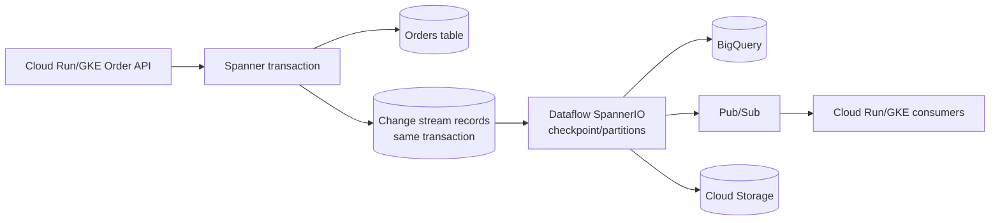
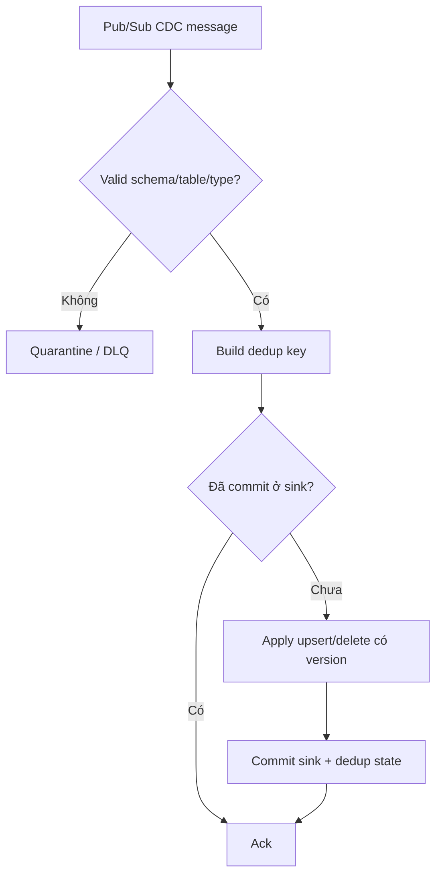

# Change streams và tích hợp luồng dữ liệu

## 1. Bài toán và mục tiêu

Một hệ thống đơn hàng ghi dữ liệu giao dịch vào **Spanner**. Bộ phận phân tích muốn xem các thay đổi trên **BigQuery** gần thời gian thực; hệ thống thông báo muốn nhận event qua **Pub/Sub**; đội kiểm toán muốn lưu lịch sử biến động vào **Cloud Storage**. Nếu ứng dụng ghi Spanner thành công nhưng tự publish event thất bại, hai hệ thống sẽ không nhất quán.

**Spanner change streams** là tính năng **change data capture (CDC)** theo dõi các thay đổi `INSERT`, `UPDATE` và `DELETE` trên bảng/cột được cấu hình. Spanner ghi **data change record trong cùng transaction** với thay đổi dữ liệu. Sau khi commit, bộ đọc có thể lấy những bản ghi ấy để xây pipeline đến Dataflow, BigQuery, Pub/Sub, Cloud Storage hoặc hệ thống ngoài GCP. Đây là cách tích hợp CDC mà không yêu cầu ứng dụng tự thực hiện hai lệnh ghi DB và publish riêng biệt.

Bài học nằm trong chương **Spanner** của **CLOUD_PROVIDERS_GCP**, liên hệ các kiến thức về Project/IAM, VPC, Compute Engine, GKE, Cloud Run, dịch vụ lưu trữ/database, tự động hóa phát hành và theo dõi độ tin cậy cùng chi phí.

**Mục tiêu:** sau bài học bạn có thể:

1. Giải thích phạm vi ghi nhận, retention, value capture và giới hạn change streams.
2. Đọc cấu trúc **data records, heartbeat records, child partition records**.
3. Tạo và kiểm tra change stream trên **GoogleSQL-dialect Spanner database**.
4. Dùng **Dataflow Flex Template** xuất thay đổi sang Pub/Sub; so sánh BigQuery, Cloud Storage, Kafka và Datastream.
5. Thiết kế consumer **idempotent**, checkpoint, xử lý schema evolution và replay khi pipeline ngừng chạy.
6. Thiết lập IAM, monitoring, cảnh báo độ trễ và dự toán chi phí.

> **An toàn:** Các tên project, instance, database và Pub/Sub topic trong bài là giả định. Những lệnh `CREATE`, `INSERT`, `UPDATE` và triển khai Dataflow có thể thay đổi dữ liệu/phát sinh phí; chỉ chạy trong project lab được cấp quyền. Không dùng dòng dữ liệu chứa PII hoặc payment thật trong bài tập.

## 2. CDC trong Spanner hoạt động như thế nào?



**Hai ranh giới nhất quán khác nhau:**

- **Spanner commit → change stream record:** được ghi atomically cùng transaction dữ liệu; một transaction đã commit thay đổi được theo dõi thì record tương ứng được lưu.
- **Change stream → downstream:** là xử lý **bất đồng bộ**. Dataflow/consumer có thể chậm, retry, nhận lại record hoặc mất khả năng bắt kịp retention. Không được hiểu Spanner commit nghĩa là BigQuery/Pub/Sub đã cập nhật ngay.

### Change stream theo dõi những gì?

| Ghi nhận | Không ghi nhận như một data change thông thường |
| --- | --- |
| Insert, update, delete từ **DML/mutations** | `CREATE TABLE`, `ALTER TABLE`, `DROP TABLE` là thay đổi schema |
| Cascading delete của các bảng phù hợp | Changes trong index/view/system tables |
| TTL deletes **mặc định được ghi nhận** | Generated columns, trừ trường hợp chúng là thành phần primary key |
| Các cột được theo dõi, và primary keys | Những bảng/cột nằm ngoài scope hoặc bị bộ lọc loại |

**Bẫy quan trọng:** một `DROP TABLE` có thể xóa dữ liệu về mặt kết quả nhưng change stream **không phát mỗi hàng bị xóa như một loạt `DELETE` events**. CDC không phải hệ thống audit schema đầy đủ hay backup/PITR. Muốn theo dõi schema DDL dùng quản trị thay đổi/audit riêng; muốn khôi phục dữ liệu dùng backup/PITR.

## 3. Phạm vi và cách chọn stream

Change stream là một **schema object** trong Spanner database, tương tự bảng/index, có thể:

- Theo dõi **toàn bộ database**: `FOR ALL`.
- Theo dõi **một hoặc nhiều bảng**: ví dụ `FOR Orders, Payments`.
- Theo dõi **một số cột của bảng**: ví dụ `FOR Orders (Status, AmountCents)`; primary key được giữ để định danh hàng.

| Phạm vi | Phù hợp | Rủi ro/đánh đổi |
| --- | --- | --- |
| `FOR ALL` | CDC toàn database cho migration/warehouse | Lưu nhiều dữ liệu, bao gồm bảng nhạy cảm hoặc ghi metadata ứng dụng |
| `FOR Orders` | Toàn bộ thay đổi đơn hàng | Theo dõi cột mới thêm theo quy tắc của scope, có thể làm downstream schema thay đổi |
| `FOR Orders (Status, AmountCents)` | Chỉ đồng bộ trạng thái/giá trị cần thiết | Consumer không có toàn bộ row nếu các cột khác không được capture |

Không tạo một stream rộng cho mọi mục đích khi business chỉ cần hai cột. Thông tin như email, số điện thoại, địa chỉ hoặc payment metadata cần được xem xét theo **least privilege và data residency** trước khi đưa sang Pub/Sub/BigQuery.

Theo quotas hiện hành, Spanner có giới hạn như **10 change streams/database**, tối đa **3 streams theo dõi một non-key column**, và **20 concurrent readers/partition**; kiểm tra lại [Spanner quotas](https://cloud.google.com/spanner/quotas) vì giới hạn có thể thay đổi. Tránh tách một stream cho mỗi developer nếu có thể dùng một pipeline chia destinations.

## 4. Value capture: dữ liệu cũ/mới gồm những cột nào?

`value_capture_type` quyết định các giá trị được lưu cho thay đổi hàng:

| Kiểu | Với `UPDATE`, record có gì? | Khi dùng |
| --- | --- | --- |
| `OLD_AND_NEW_VALUES` (**mặc định**) | Giá trị cũ/mới của **cột thay đổi** được theo dõi | Audit delta và so sánh trước/sau |
| `NEW_VALUES` | Giá trị mới của những **non-key columns thay đổi** | Consumer chỉ cần delta mới |
| `NEW_ROW` | Giá trị mới của **toàn bộ cột được theo dõi** trong hàng | Đồng bộ snapshot trạng thái hàng xuống BigQuery |
| `NEW_ROW_AND_OLD_VALUES` | Cột được theo dõi đầy đủ ở trạng thái mới, thêm giá trị cũ của cột thay đổi | Cần trạng thái mới đầy đủ và delta cũ |

Ví dụ hàng:

```text
OrderId = "O-1", Status = "NEW", AmountCents = 12000
UPDATE Orders SET Status = "PAID" WHERE OrderId = "O-1"
```

- `OLD_AND_NEW_VALUES`: thường thấy `Status: NEW → PAID`; **không tự có giá trị `AmountCents` không đổi**.
- `NEW_VALUES`: thấy `Status: PAID`.
- `NEW_ROW`: thấy trạng thái mới của cả `Status` và `AmountCents` **nếu cả hai cột được theo dõi**.
- `NEW_ROW_AND_OLD_VALUES`: có trạng thái mới đầy đủ và `Status` cũ.

**Khi cần một full-row image**, `NEW_ROW` thường hiệu quả hơn việc nhận delta rồi đọc lại Spanner tại commit timestamp. Đọc lịch sử bằng *stale read* còn chịu giới hạn `version_retention_period` (mặc định thường **1 giờ**, cấu hình tối đa **7 ngày**), **khác** change stream retention tối đa 30 ngày.

## 5. Data change, heartbeat và child partition records

Spanner change streams không chỉ xuất ra một mảng JSON của row changes:

| Record type | Trường quan trọng | Consumer phải làm gì? |
| --- | --- | --- |
| **Data change** | `commit_timestamp`, `server_transaction_id`, `record_sequence`, `table_name`, `mod_type`, primary keys, old/new values | Biến đổi thành event/upsert/delete, deduplicate và ghi sink |
| **Heartbeat** | Timestamp tiến độ khi partition không có thay đổi | Cập nhật tiến độ/watermark, không tạo business event |
| **Child partitions** | `start_timestamp`, `token`, `parent_partition_tokens` | Lên lịch các partitions con khi split/merge, checkpoint chính xác |

**Ví dụ mô tả đã rút gọn**, không phải JSON raw của toàn bộ Spanner API:

```json
{
  "record_type": "data_change",
  "commit_timestamp": "2026-11-19T03:15:02.123456Z",
  "server_transaction_id": "transaction-illustrative",
  "record_sequence": "00000001",
  "table_name": "Orders",
  "mod_type": "UPDATE",
  "keys": {"OrderId": "O-1"},
  "new_values": {"Status": "PAID", "AmountCents": 12000}
}
```

**Mỗi record có metadata của transaction nhưng không mặc định mỗi record là một event nghiệp vụ độc lập.** Một transaction có thể tạo nhiều modifications trên nhiều bảng/partitions. Nếu cần xử lý tổng thể như chuyển tiền giữa hai tài khoản, phải xem `server_transaction_id`, `record_sequence` và thông tin số records/partitions trong transaction để tập hợp đúng.

Partition có thể split/merge. Không dùng thứ tự đến Pub/Sub/BigQuery làm **total ordering toàn database**. Thứ tự cần được định nghĩa theo **transaction, key và commit timestamp**, kết hợp dependency giữa parent/child partitions.

## 6. Retention, thay đổi cấu hình và replay

**Spanner change streams lưu các data change records từ 1 đến 30 ngày; mặc định 7 ngày.** Đây là giới hạn có thể cấu hình khác nhau theo stream. **Giảm retention làm dữ liệu cũ hơn giới hạn mới không thể đọc lại ngay lập tức và vĩnh viễn**.

| Quyết định | Tác động |
| --- | --- |
| Tăng `retention_period` từ 7d lên 14d | Có thêm khoảng đệm để xử lý outage, tăng storage |
| Giảm xuống 1d | Chặn khả năng backfill những records quá 1 ngày |
| `exclude_ttl_deletes = true` | Không emit TTL-based deletes; downstream cần tự xử lý vòng đời |
| `exclude_insert/update/delete = true` | Loại bớt modification type tương ứng |
| `allow_txn_exclusion = true` | Cho phép transaction có option loại record khỏi change streams |
| `ALTER CHANGE STREAM ... DROP FOR ALL` | Tạm dừng theo dõi, giữ records hiện có theo retention |
| `DROP CHANGE STREAM` | Xóa stream và các bản ghi change stream còn lưu |

**Các filters này là cấu hình capture**, không phải một lời đảm bảo rằng business stream có thể truy vấn lại lịch sử đầy đủ sau khi thay đổi. Khi đổi `value_capture_type`, Spanner không backfill các old values từ trước thời điểm thay đổi.

**Replay** chỉ khả dụng trong khoảng:

```text
max(thời điểm tạo stream, thời điểm hiện tại - retention)
              ≤ startTimestamp ≤ hiện tại
```

Đây là **ước lượng logic**; kiểm tra thực tế theo watermark, thời gian record, quyền đọc và partition history. Một pipeline ngừng **8 ngày** trên stream retention **7 ngày** có thể mất vĩnh viễn khoảng dữ liệu CDC đầu outage. Đừng thử chỉnh startTimestamp cũ hơn rồi hy vọng nhận records đã hết hạn: hãy chạy **full snapshot + catch-up** theo quy trình được kiểm chứng.

## 7. Đọc trực tiếp với change stream TVF

Khi tạo stream tên `OrdersChangeStream`, Spanner tạo một **table-valued function (TVF)** để đọc records. Với **GoogleSQL dialect**:

```sql
-- MINH HỌA: gọi qua Spanner ExecuteStreamingSql API,
-- không phải SELECT bảng OLTP thông thường
SELECT ChangeRecord
FROM READ_OrdersChangeStream(
  start_timestamp => "2026-11-19T03:00:00Z",
  end_timestamp => NULL,
  partition_token => NULL,
  heartbeat_milliseconds => 10000
);
```

**Điều kiện kỹ thuật:** truy vấn change stream TVF phải chạy bằng `ExecuteStreamingSql` với **single-use strong read-only transaction**, không dùng read-write transaction. `start_timestamp` phải nằm trong retention và không trước lúc stream được tạo. `end_timestamp=NULL` biểu thị đọc liên tục; với một cửa sổ giới hạn, dùng end timestamp phù hợp.

**Luồng đọc low-level đúng:**

1. Gọi TVF với `partition_token=NULL` để khám phá initial partitions.
2. Đọc từng partition; xử lý **data records** và **heartbeats**.
3. Khi nhận `child_partitions_record`, ghi checkpoint và tokens mới.
4. Dùng đúng `start_timestamp` do child record cấp và xử lý **dependencies giữa parent/child**.
5. Ghi sink/checkpoint bền vững; khi lỗi, đọc lại và **deduplicate**.

Với **PostgreSQL-dialect Spanner**, cú pháp TVF khác:

```sql
-- MINH HỌA PostgreSQL dialect; chỉ chạy qua streaming Spanner API
SELECT *
FROM "spanner"."read_json_OrdersChangeStream"(
  '2026-11-19T03:00:00Z', NULL, NULL, 10000, NULL
);
```

Đừng nhầm **Spanner PostgreSQL interface** với PostgreSQL server gốc hoặc native logical replication slots; cú pháp và hành vi của change stream là API Spanner. Tự cài partition coordinator/checkpoint khá phức tạp, nên ưu tiên **Dataflow SpannerIO**, Datastream hoặc Kafka connector khi phù hợp.

## 8. Chọn hướng tích hợp: Dataflow, Datastream, Kafka hay API?

| Đích / nhu cầu | Công cụ nên đánh giá | Điểm cần kiểm chứng |
| --- | --- | --- |
| **BigQuery** cập nhật analytics liên tục | Dataflow template *Spanner change streams to BigQuery* | Target schema, row order, upsert semantics, watermark/DLQ |
| **Pub/Sub** fan-out event-driven | Dataflow template *Spanner change streams to Pub/Sub* | Topic, event schema, duplicate delivery, consumers |
| **Cloud Storage** lưu archive | Dataflow template *Spanner change streams to Cloud Storage* | Định dạng AVRO/TEXT, windows, lifecycle và retention |
| **BigQuery/BigLake/Cloud Storage** bằng managed CDC | **Datastream** với Spanner source | Compatibility, source setup, topology/latency |
| **Kafka ecosystem** | Debezium-based Spanner Kafka connector | Kafka offsets, mapping, sink semantics, vận hành |
| Ứng dụng cần raw Spanner records/custom schedule | **Spanner API** trực tiếp | Partition orchestration, retries, checkpoint |

Không nhầm Dataflow streaming template với batch export toàn database. CDC **chỉ bắt đầu tại mốc stream có dữ liệu**; muốn đưa toàn bộ lịch sử vào warehouse, cần **bootstrap snapshot** hoặc import ban đầu rồi catch-up từ mốc CDC được chọn. Kết hợp sai snapshot và stream có thể tạo **gaps hoặc duplicates**.

## 9. Lab A — tạo GoogleSQL change stream theo dõi Orders

Lab dùng instance/database **đã tồn tại** và chỉ thao tác trong không gian thử nghiệm:

```text
Project:             acme-spanner-lab
Spanner instance:    spanner-lab
Database (GoogleSQL): orders-lab-db
Source table:        Orders
Change stream:       OrdersChangeStream
Region cho pipeline: asia-southeast1
```

**Preflight:** Spanner API đã bật, database dùng **GoogleSQL dialect**, tài khoản có quyền `spanner.databases.updateDdl` và quyền thao tác DML trên **database lab**. DDL stream có thể tăng storage/CPU và ảnh hưởng writes. Không chạy `FOR ALL` ở production chỉ để thử chức năng.

### 9.1. Kiểm tra instance và schema

```bash
# CHỈ ĐỌC
gcloud spanner instances describe spanner-lab \
  --project=acme-spanner-lab

gcloud spanner databases describe orders-lab-db \
  --instance=spanner-lab \
  --project=acme-spanner-lab

gcloud spanner databases ddl describe orders-lab-db \
  --instance=spanner-lab \
  --project=acme-spanner-lab
```

Nếu `Orders` đã tồn tại, **không tạo hoặc ghi đè**; dùng bảng lab có tên khác và chỉnh stream DDL tương ứng.

### 9.2. Tạo bảng mẫu

```sql
CREATE TABLE Orders (
  OrderId STRING(36) NOT NULL,
  Status STRING(20) NOT NULL,
  AmountCents INT64 NOT NULL
) PRIMARY KEY (OrderId);
```

Sử dụng `gcloud spanner databases ddl update`:

```bash
# THAY ĐỔI SCHEMA trên database LAB
gcloud spanner databases ddl update orders-lab-db \
  --instance=spanner-lab \
  --project=acme-spanner-lab \
  --ddl='CREATE TABLE Orders (OrderId STRING(36) NOT NULL, Status STRING(20) NOT NULL, AmountCents INT64 NOT NULL) PRIMARY KEY (OrderId)'
```

### 9.3. Tạo stream chỉ theo dõi hai cột nghiệp vụ

```sql
-- GoogleSQL-dialect DDL
CREATE CHANGE STREAM OrdersChangeStream
FOR Orders (Status, AmountCents)
OPTIONS (
  retention_period = '7d',
  value_capture_type = 'NEW_ROW',
  exclude_ttl_deletes = true
);
```

```bash
# THAY ĐỔI: schema object mới, có chi phí ghi/retention
gcloud spanner databases ddl update orders-lab-db \
  --instance=spanner-lab \
  --project=acme-spanner-lab \
  --ddl="CREATE CHANGE STREAM OrdersChangeStream FOR Orders (Status, AmountCents) OPTIONS (retention_period = '7d', value_capture_type = 'NEW_ROW', exclude_ttl_deletes = true)"

# CHỈ ĐỌC: xem DDL và stream scope/retention
gcloud spanner databases ddl describe orders-lab-db \
  --instance=spanner-lab \
  --project=acme-spanner-lab
```

**Kỳ vọng:** stream xuất hiện trong schema sau khi DDL operation hoàn tất, nhưng **không phát lại tự động** những updates đã xảy ra trước lúc stream được tạo.

### 9.4. Ghi dữ liệu rồi quan sát thay đổi

```bash
# THAY ĐỔI: DML chỉ trên Orders trong lab
gcloud spanner databases execute-sql orders-lab-db \
  --instance=spanner-lab --project=acme-spanner-lab \
  --sql="INSERT INTO Orders (OrderId, Status, AmountCents) VALUES ('O-LAB-1', 'NEW', 12000)"

gcloud spanner databases execute-sql orders-lab-db \
  --instance=spanner-lab --project=acme-spanner-lab \
  --sql="UPDATE Orders SET Status = 'PAID' WHERE OrderId = 'O-LAB-1'"

# CHỈ ĐỌC: xác nhận dữ liệu nguồn
gcloud spanner databases execute-sql orders-lab-db \
  --instance=spanner-lab --project=acme-spanner-lab \
  --sql="SELECT * FROM Orders WHERE OrderId = 'O-LAB-1'"
```

Bạn sẽ có ít nhất hai thay đổi từ các transactions `INSERT` và `UPDATE`. Vì stream đặt `NEW_ROW`, change record của UPDATE có các cột đã theo dõi ở trạng thái mới; **không xem lệnh SELECT dữ liệu nguồn là lệnh đọc change stream**. Để quan sát CDC thực tế, dùng pipeline ở Lab B hoặc TVF qua streaming API.

## 10. Lab B — Dataflow change streams → Pub/Sub

Google cung cấp Flex Template **Spanner change streams to Pub/Sub**. Template dùng **Apache Beam SpannerIO**, tự quản lý partitions/checkpoints bằng bảng metadata Spanner và publish những data change records sang topic. Đây là luồng **streaming liên tục**; nếu để job chạy sau buổi học, nó có thể tiếp tục tạo phí.

### 10.1. Tạo topic, subscription và metadata database

Giả định `spanner-lab`, `orders-lab-db` và `OrdersChangeStream` đã được tạo ở Lab A; chọn Pub/Sub topic và subscription riêng:

```bash
# THAY ĐỔI: tạo resources chỉ trong project LAB
gcloud pubsub topics create orders-cdc-lab \
  --project=acme-spanner-lab

gcloud pubsub subscriptions create orders-cdc-lab-sub \
  --project=acme-spanner-lab \
  --topic=orders-cdc-lab

# Metadata database: connector tự tạo bảng quản lý partition/checkpoint
gcloud spanner databases create cdc-meta-lab-db \
  --project=acme-spanner-lab \
  --instance=spanner-lab
```

**Tách metadata database khỏi database nghiệp vụ** được Spanner khuyến nghị: Dataflow cần quyền **đọc stream** trên `orders-lab-db` và quyền **đọc/ghi/tạo DDL metadata table** trên `cdc-meta-lab-db`. Nếu metadata đặt trong database nghiệp vụ có stream `FOR ALL`, các writes của connector có thể bị chính stream đó bắt lại, làm tăng tải và chi phí.

**IAM tối thiểu cần kiểm tra trước khi run:** Dataflow worker service account có quyền đọc change stream (`spanner.databases.select`; thêm DB role privileges khi dùng fine-grained access control), quyền Spanner sessions, quyền metadata DB DDL/read/write, quyền `pubsub.topics.publish` trên topic đích, quyền Dataflow worker và quyền dùng staging/temp storage theo cấu hình job. Deployer cần quyền tạo Dataflow job và `iam.serviceAccounts.actAs` nếu dùng worker SA tùy chỉnh.

### 10.2. Khởi chạy Flex Template

```bash
# THAY ĐỔI: khởi chạy streaming job tính phí liên tục.
# Chỉ chạy khi IAM, quotas, worker network và Pub/Sub topic đều sẵn sàng.
gcloud dataflow flex-template run spanner-cdc-lab-20261119 \
  --project=acme-spanner-lab \
  --region=asia-southeast1 \
  --template-file-gcs-location=gs://dataflow-templates/latest/flex/Spanner_Change_Streams_to_PubSub \
  --parameters="spannerInstanceId=spanner-lab,spannerDatabase=orders-lab-db,spannerMetadataInstanceId=spanner-lab,spannerMetadataDatabase=cdc-meta-lab-db,spannerChangeStreamName=OrdersChangeStream,pubsubTopic=projects/acme-spanner-lab/topics/orders-cdc-lab"
```

**Lưu ý phiên bản:** `latest` phù hợp minh họa nhanh; production nên **pin dated template version** đã được kiểm thử, tránh template mới thay đổi không tương thích. Worker service account tùy chỉnh, worker subnet, private networking và temp/staging location có thể cần cờ bổ sung theo tổ chức.

**Điểm bắt đầu mặc định của Dataflow template là lúc pipeline bắt đầu chạy.** Do đó hai transactions ở Lab A **không chắc xuất hiện** nếu đã xảy ra trước lúc pipeline start. Muốn bắt đầu sớm hơn, cung cấp `startTimestamp` trong retention và **sau thời điểm stream được tạo**; không chọn một timestamp lịch sử ngoài phạm vi stream. Lab dưới đây tạo **thay đổi mới sau khi job đã RUNNING** để tránh hiểu nhầm.

### 10.3. Ghi một UPDATE mới, rồi pull CDC

```bash
# CHỈ ĐỌC: chờ Dataflow job chạy trước khi ghi tiếp
gcloud dataflow jobs list \
  --project=acme-spanner-lab \
  --region=asia-southeast1

# THAY ĐỔI trong database LAB, sau khi Dataflow sẵn sàng
gcloud spanner databases execute-sql orders-lab-db \
  --instance=spanner-lab --project=acme-spanner-lab \
  --sql="UPDATE Orders SET AmountCents = 12500 WHERE OrderId = 'O-LAB-1'"

# THAY ĐỔI ACK state: --auto-ack CHỈ dành cho subscription LAB
gcloud pubsub subscriptions pull orders-cdc-lab-sub \
  --project=acme-spanner-lab \
  --limit=10 \
  --auto-ack
```

**Kỳ vọng:** sau độ trễ của Dataflow và Pub/Sub, subscription nhận message chứa data change record liên quan `Orders`, `O-LAB-1` và cập nhật `AmountCents`. **Payload chính xác tuân theo output format của Flex Template** (JSON mặc định hoặc AVRO nếu cấu hình), **không** mặc định bằng JSON rút gọn ở mục 5.

Nếu lần pull đầu rỗng, không vội tạo thêm topic/job: xem Dataflow logs, job state, watermark, IAM Spanner/Pub/Sub và thời điểm start của stream. `--auto-ack` không dùng để thử nghiệm trên production subscription vì có thể xác nhận message trước khi consumer xử lý.

### 10.4. Kiểm tra rồi dừng job đúng cách

```bash
# CHỈ ĐỌC: lấy JOB_ID đúng từ danh sách
gcloud dataflow jobs list \
  --project=acme-spanner-lab \
  --region=asia-southeast1

# THAY ĐỔI: chỉ hủy đúng Dataflow streaming JOB_ID của LAB
gcloud dataflow jobs cancel JOB_ID \
  --project=acme-spanner-lab \
  --region=asia-southeast1
```

**Quan trọng:** Spanner change streams connector **không hỗ trợ Dataflow drain**; muốn dừng pipeline phải **cancel**, không chọn drain vì job có thể mắc trạng thái draining. Cancel không phải cam kết mọi event đã đến downstream; cần checkpoint/business reconciliation trước khi thực hiện trên production. **Không xóa metadata DB** khi còn job đang dùng hoặc dự định update pipeline bằng metadata table ấy.

## 11. Dataflow SpannerIO và vai trò metadata database

Khi tự xây Apache Beam pipeline, SpannerIO là lựa chọn nên cân nhắc:

```java
// Mã Java minh họa lõi Beam transform, không phải ứng dụng chạy độc lập.
SpannerConfig config = SpannerConfig.create()
    .withProjectId("acme-spanner-lab")
    .withInstanceId("spanner-lab")
    .withDatabaseId("orders-lab-db");

pipeline.apply(
    SpannerIO.readChangeStream()
        .withSpannerConfig(config)
        .withChangeStreamName("OrdersChangeStream")
        .withMetadataInstance("spanner-lab")
        .withMetadataDatabase("cdc-meta-lab-db")
        .withInclusiveStartAt(Timestamp.now()));
```

Dataflow connector quản lý:

1. Khám phá partitions và xử lý child partition tokens.
2. Chia công việc đọc trên nhiều workers.
3. Lưu tiến độ/partition metadata vào **Spanner metadata database**.
4. Tích hợp watermark, retry và Beam transforms để xây sink.

Khi **update** pipeline, tài liệu yêu cầu **tái sử dụng metadata table** bằng cấu hình `spannerMetadataTableName` của template hoặc `withMetadataTable(...)` trong Beam; không tạo một metadata table mới rồi kỳ vọng tiếp tục đúng checkpoint cũ. Nếu thay state/runner/template phiên bản mới, xem hướng dẫn Dataflow job update và thử trong staging.

**Connector checkpoint khác transaction commit của sink.** Dataflow có thể chạy lại một bước khi worker thất bại, trong khi sink đã ghi. Thiết kế sink/consumer **idempotent** vẫn cần cho các side effects.

## 12. Đồng bộ BigQuery và Cloud Storage: chọn semantics đúng

### 12.1. Spanner → BigQuery

Template **Spanner change streams to BigQuery** phát các records vào BigQuery với metadata như:

- `_metadata_spanner_mod_type`: `INSERT`, `UPDATE` hoặc `DELETE`.
- `_metadata_spanner_table_name`: tên bảng nguồn.
- `_metadata_spanner_commit_timestamp`: thời điểm commit.

**Đừng hiểu bảng BigQuery được cập nhật như một bảng OLTP với thứ tự row luôn đúng theo commit timestamp.** Tài liệu template nêu các rows có thể được insert **khác thứ tự commit gốc**; cần thiết kế **version-aware dedup/upsert logic hoặc views** cho use case current-state. Với `NEW_ROW`, template có thể tránh stale read để lấy phần còn lại của hàng, giảm chi phí/độ trễ.

Sơ đồ dữ liệu:

```text
Spanner Orders (transactional source of truth)
  → OrdersChangeStream (NEW_ROW)
  → Dataflow template
  → BigQuery order_history (append + commit metadata)
  → View/model chọn bản ghi mới nhất theo OrderId + commit information
```

**Schema evolution:** nếu thêm cột nguồn đang được stream theo dõi, xác minh template hỗ trợ type, BigQuery schema/dataset, cột metadata và downstream SQL. Với nguồn có nhiều schemas, một số template có giới hạn về **default schema**; không cho rằng mọi custom schema sẽ tự hoạt động.

### 12.2. Spanner → Cloud Storage archive

Template **Spanner change streams to Cloud Storage** có thể ghi **AVRO hoặc TEXT** theo các windows. Phù hợp lưu trữ dữ liệu CDC phục vụ audit/backfill ngoài thời gian retention của Spanner.

Thiết kế archive gồm:

| Thành phần | Quyết định |
| --- | --- |
| Object key | Region/source/table + date/window + unique file ID |
| Định dạng | AVRO cho schema typed hoặc TEXT khi pipeline/consumer cần |
| Retention | Cloud Storage lifecycle/retention policy theo compliance |
| Replay | Job đọc archive và ghi trở lại sink với dedup |
| Security | Bucket IAM, CMEK nếu cần, PII masking, access logging |

Đừng giả định archive là **backup đầy đủ Spanner database** hoặc có thể dùng làm PITR. Change stream chỉ có dữ liệu trong scope, từ lúc stream được tạo, và semantics capture được cấu hình.

## 13. Tích hợp Pub/Sub consumer: idempotency và contract



**Không dùng riêng Pub/Sub `messageId` làm CDC business key.** Một event được publish lại trong quá trình retry có thể có **message ID mới**, nhưng vẫn đại diện cùng Spanner data change.

Một khóa xử lý thường cần:

```text
sourceDatabase + changeStream + serverTransactionId
    + recordSequence + primaryKey / mod index
```

Đây là **đề xuất thiết kế**, không phải một trường ID duy nhất do Spanner trả sẵn. Khi record chứa nhiều `mods` hoặc được biến đổi thành nhiều output messages, cần thêm **table/key/modification index** hoặc business version để mỗi side effect có khóa duy nhất. `commit_timestamp` **một mình không đủ**: nhiều rows/transactions có thể cùng timestamp theo ngữ cảnh, và một transaction có nhiều changes.

### Upsert phiên bản để tránh out-of-order

Giả sử downstream giữ projection:

```sql
-- SQL minh họa logic ở sink có transaction/constraint phù hợp
UPDATE order_projection
SET status = :incoming_status,
    last_commit_ts = :incoming_commit_ts
WHERE order_id = :order_id
  AND last_commit_ts < :incoming_commit_ts;
```

Với tie tại timestamp, cần thêm order/sequence metadata và quan hệ transaction để quyết định phiên bản mới nhất; khi delete, cần **tombstone** hoặc version bền vững để event cũ không “hồi sinh” hàng. Hãy xử lý `INSERT/UPDATE/DELETE` theo primary key, không ép mọi thay đổi thành `INSERT`.

**Không bảo đảm exactly-once end-to-end** chỉ vì Spanner ghi change record atomically: đoạn **Dataflow → Pub/Sub → consumer → database bên ngoài** vẫn có retries và delivery duplicates. Đặt idempotency **trong cùng transaction với sink update**, hoặc sử dụng conditional writes/unique constraints thích hợp.

### Business event hay CDC event?

CDC có `mod_type` và row values; business event như `OrderPaid` còn có **ý nghĩa nghiệp vụ** và version contract. Nếu các consumer cần quy tắc như “chỉ gửi email sau khi payment captured và fulfillment accepted”, một row update `Status=PAID` **không nhất thiết đủ**.

Hãy cân nhắc **outbox table trong cùng Spanner transaction** để lưu business event rõ ràng, rồi dùng change stream theo dõi **outbox**. Outbox kết hợp CDC tránh dual-write gap, nhưng vẫn cần dedup và checkpoint ở consumers.

## 14. IAM, bảo vệ dữ liệu và kết nối mạng

| Identity | Quyền cần thiết | Nguyên tắc |
| --- | --- | --- |
| Database schema deployer | `spanner.databases.updateDdl` | Không dùng role quản trị project cho mọi app |
| Change stream reader | `spanner.databases.select`, sessions; DB role `SELECT`/`EXECUTE` nếu dùng fine-grained access | Chỉ đọc streams và bảng được phép |
| Dataflow worker SA | Dataflow worker, source Spanner read, metadata Spanner DDL/read/write, sink Pub/Sub publish/BigQuery write/GCS write | Không dùng default Editor rộng |
| Pub/Sub consumer | Subscriber trên subscription riêng, quyền sink chính xác | Không cấp Pub/Sub admin không cần thiết |
| Ops/CI | Quyền deploy Dataflow, đọc logs/metrics, `iam.serviceAccounts.actAs` khi cần | Tách production approval và operator |

**Fine-grained access control (FGAC):** nếu Dataflow job dùng database role, role cần `SELECT` trên **change stream** và `EXECUTE` trên **read TVF**; khai báo `spannerDatabaseRole` cho template hoặc `withDatabaseRole(...)` trong Beam. Metadata DB vẫn cần quyền ghi riêng.

**Thông tin nhạy cảm:**

- Chỉ stream bảng/cột cần thiết. `FOR ALL` có thể vô tình xuất dữ liệu PII mới được thêm vào sau này.
- Kiểm soát Pub/Sub topic/subscription IAM, BigQuery dataset, GCS buckets, retention và CMEK.
- Không log toàn bộ CDC payload, API tokens, thông tin thanh toán hoặc fields cá nhân vào Dataflow worker logs.
- Với VPC Service Controls/Private Google Access, Dataflow worker egress tới Spanner, Pub/Sub, BigQuery/GCS phải được phép; phân biệt **PERMISSION_DENIED** với network timeout.
- Khi sink ở region khác, xem data residency và phí egress; ưu tiên region hợp lý theo cấu hình Spanner/Dataflow/đích.

**Spanner change streams không che/mask dữ liệu cho bạn**: data governance ở Spanner schema scope, IAM, template transformation và sink vẫn là trách nhiệm của đội nền tảng.

## 15. Partitioning, ordering và phục hồi sau downtime

### 15.1. Nguyên tắc ordering

- Spanner gắn `commit_timestamp`, `server_transaction_id` và `record_sequence` cho data change records.
- `record_sequence` tăng trong phạm vi transaction, giúp tái dựng thứ tự các records của transaction đó theo điều kiện tài liệu.
- Các partitions có thể split/merge, tạo **child partition tokens**.
- Dataflow/BigQuery/Pub/Sub sinks **không tự hứa hẹn total ordering toàn bộ database**.

Nếu một transfer thay đổi tài khoản A và B trong cùng transaction, downstream dùng cả hai updates phải xử lý theo **transaction boundary** hoặc xây derived state có khả năng reconcile, thay vì diễn giải hai Pub/Sub messages độc lập là hai giao dịch tài chính khác nhau.

### 15.2. Consumer bị dừng lâu

Ví dụ `retention_period=7d`, Dataflow không hoạt động 3 ngày:

1. Kiểm tra **metadata checkpoint** và earliest available change records.
2. Xác nhận pipeline có thể resume đúng start/watermark và không tạo job mới với **startTimestamp=now** làm bỏ qua ba ngày.
3. Nếu dùng update pipeline, giữ **metadata table** theo hướng dẫn.
4. Theo dõi replay lag/throughput cho tới khi catch up; không tăng concurrency mà bỏ qua Spanner CPU/quota.
5. So sánh source và sink bằng counts/checksums/business key reconciliation.

Nếu Dataflow ngừng hơn retention, records quá cũ không còn: **không có phép đổi timestamp để khôi phục chúng**. Cần **bootstrap snapshot** từ Spanner hiện tại hoặc archive (nếu có) và phát lại phần log còn giữ theo chiến lược có ranh giới rõ. Trước khi resync, quyết định xử lý deletion/tombstone để tránh data drift.

### 15.3. Thay đổi DDL

Change stream **không phát schema DDL event đầy đủ**. Khi thêm/xóa cột được theo dõi:

1. Đánh giá ảnh hưởng đến producer/consumer schema, BigQuery target, Pub/Sub parser.
2. Chỉnh `ALTER CHANGE STREAM` và các migrations theo **đúng thứ tự**, có kế hoạch tương thích trước/sau.
3. Nếu stream **explicitly watches** một cột/bảng, phải gỡ tham chiếu khỏi stream trước khi drop nguồn theo quy tắc schema dependency.
4. Canh thời điểm thay đổi, giữ compatibility window và thử rollback.

Không giảm retention hoặc `DROP CHANGE STREAM` chỉ để tránh sửa consumer: có thể làm mất dữ liệu CDC phục vụ phục hồi.

## 16. Monitoring: đo độ tươi dữ liệu, không chỉ job RUNNING

Một Dataflow job đang `RUNNING` vẫn có thể đang xử lý backlog quá chậm hoặc liên tục retry cùng record. Hãy quan sát **độ trễ từ Spanner commit tới business sink**, không chỉ CPU workers.

| Nhóm chỉ số | Nguồn | Điều gì đáng ngại? |
| --- | --- | --- |
| **Data freshness / output watermark lag** | Dataflow metrics | Watermark tụt xa, dữ liệu analytics cũ hơn SLO |
| **System latency** | Dataflow metrics | Record chờ xử lý lâu, downstream nghẽn |
| **Commit-to-PCollection latency** | SpannerIO custom metrics | Đọc từ change stream chậm |
| **Data change records read** | SpannerIO custom metrics | Bất thường giảm về 0 khi Spanner vẫn có writes |
| **Partitions being read** | SpannerIO custom metrics | Bằng 0 bất thường khi pipeline cần theo dõi stream |
| **Spanner CPU/storage** | Spanner Monitoring | CDC làm nguồn quá tải hoặc retention tăng storage |
| **Pub/Sub unacked/oldest age** | Pub/Sub Monitoring | Consumer downstream không theo kịp |
| **BigQuery error/DLQ** | Dataflow logs, target tables, dead-letter | Record bị reject/schema mismatch |
| **Business reconciliation** | Query source/sink theo key/version | Mất/nhân đôi event hoặc projection sai |

### Ví dụ SLO do đội dự án đặt

```text
CDC pipeline end-to-end p95 lag < 60 giây
99,9% thay đổi Orders xuất hiện ở analytics trong 5 phút
Không có child partition bị mất theo dõi
Mọi record bị DLQ được điều tra trước khi hết change stream retention
```

Đây là **SLO ứng dụng minh họa**, không phải Spanner SLA. Hãy đặt alert trước khi **data freshness + thời gian cần sửa sự cố** tiến gần retention. Ví dụ stream lưu 7 ngày nhưng chỉ cảnh báo sau 6 ngày 23 giờ là quá muộn để thực hiện resync an toàn.

**Dataflow watermark** nói về tiến độ xử lý trong pipeline, không tự chứng minh BigQuery view đã tính toán đúng hoặc Pub/Sub consumer đã commit business update. Thêm **end-to-end audit marker** và đối soát dữ liệu.

## 17. Hiệu năng, giới hạn và chi phí

Change streams tăng lượng ghi trong transaction, storage cho records và CPU/read traffic từ connector. Việc xuất sang hệ thống ngoài làm phát sinh thêm tài nguyên:

- **Spanner:** processing units/nodes, change stream storage, write/replication và read workload.
- **Dataflow:** streaming workers, Streaming Engine và job time; job chạy liên tục tạo phí ngay cả lúc ít record.
- **Pub/Sub:** publish, delivery, message storage/retention và egress.
- **BigQuery:** streaming/storage/queries theo mô hình tính phí hiện hành.
- **Cloud Storage:** archived bytes, lifecycle, network và KMS nếu có.
- **Cloud Logging/Monitoring:** log ingestion/retention, metrics và alerts.

### Bài toán sizing minh họa

```text
Tần suất cập nhật:      500 thay đổi hàng/giây
Payload CDC trung bình: 600 bytes/change (giả định)
CDC data thô:           500 × 600 = 300.000 bytes/giây
Mỗi ngày:               khoảng 25,92 GB dữ liệu thô
Retention 7 ngày:       khoảng 181,44 GB dữ liệu thô
```

Đây **không phải số byte Spanner thực tế lưu hoặc hóa đơn**: record overhead, capture type, nén, primary keys, replication, nhiều record/transaction, metadata, Dataflow và sink làm thay đổi chi phí. Sử dụng [Spanner pricing](https://cloud.google.com/spanner/pricing), Dataflow/BigQuery/Pub/Sub pricing và Cloud Billing export để dự toán.

**Cách tối ưu:**

1. Chọn đúng **tables/columns**, không dùng `FOR ALL` nếu không cần.
2. Chọn capture type phù hợp; `NEW_ROW` tăng record size nhưng có thể giảm truy vấn stale read.
3. Cấu hình retention theo thời gian phát hiện/phục hồi sự cố, không tối đa hóa tùy tiện.
4. Tách connector metadata DB; benchmark Spanner CPU và Dataflow worker size trong staging.
5. Chỉ tăng worker parallelism khi **Spanner read capacity và sink throughput** cho phép.
6. Pin template version và giữ một cấu hình pipeline dễ rollback.

Đối với multi-region Spanner, có thể đánh giá **directed reads** và đặt Dataflow pipeline ở region phù hợp để phân tán tải khỏi leader region; đánh đổi là latency, network cost và khả năng của bản sao/region. Không giả định đọc từ một replica xa luôn nhanh hơn.

## 18. Troubleshooting: từ triệu chứng tới nguyên nhân

| Triệu chứng | Nguyên nhân khả dĩ | Bước xác minh |
| --- | --- | --- |
| Không tạo được stream | `spanner.databases.updateDdl` thiếu, DDL/scope không hợp lệ, chạm quota | DDL operation, IAM, stream limits |
| Stream tồn tại nhưng không có event từ một bảng | Bảng/cột ngoài `FOR`, stream được tạo sau thay đổi | `ddl describe`, DML commit timestamp |
| UPDATE chỉ có cột Status, thiếu Amount | `OLD_AND_NEW_VALUES`/`NEW_VALUES` chỉ ghi cột thay đổi | `value_capture_type`, scope cột |
| Không thấy bản ghi DELETE từ TTL | `exclude_ttl_deletes=true` | Stream options, TTL policy |
| Không thấy DDL/DROP TABLE trong CDC | Change stream không ghi schema events như row changes | DDL audit/migrations logs riêng |
| TVF trả INVALID_ARGUMENT | Sai start timestamp/retention/partition token hoặc không dùng streaming API đúng | `ExecuteStreamingSql`, strong read-only transaction |
| Dataflow không chạy | Thiếu Spanner metadata DB, IAM, template/worker network | Dataflow launcher/worker logs và permissions |
| Dataflow RUNNING nhưng Pub/Sub không có data | startTimestamp mặc định bắt đầu lúc job start, sai topic, không có writes mới | Source commit time, connector metrics, topic IAM |
| BigQuery có bản ghi khác thứ tự | Sink không giữ tổng thứ tự Spanner commit | Metadata commit timestamp + per-key dedup/upsert |
| Record bị xử lý hai lần | Job retry, Pub/Sub redelivery, source replay | transaction/sequence key, consumer inbox |
| Pipeline dừng > retention | CDC records cũ đã bị xóa | Full snapshot/archive + catch-up, không chỉ restart |
| Update Dataflow làm đọc lại từ đầu | Không giữ `spannerMetadataTableName` | Metadata DB/table, job update procedure |
| Dataflow job mắc draining | Connector không hỗ trợ drain | Cancel theo runbook, không tự drain |
| Spanner CPU/storage tăng | Scope quá rộng, nhiều streams, retention/reads cao | Benchmark, Spanner metrics và billing |
| Schema mới làm sink lỗi | Cột/type/target schema chưa tương thích | Pipeline logs/DLQ, migration review |

### Runbook sự cố CDC

1. Xác nhận **source project/instance/database**, stream name, scope, retention và thời điểm bắt đầu lỗi.
2. Ghi **Dataflow job ID, region, metadata database/table và sink resource**.
3. Đọc Dataflow **data freshness, watermark, partition count, error logs** và sink DLQ.
4. So sánh **earliest available change** với checkpoint; xem có gap ngoài retention không.
5. Phân loại lỗi **source permission/DDL**, **connector state**, **sink IAM/schema**, **capacity**, hoặc **consumer idempotency**.
6. Sửa tối thiểu: IAM đúng principal, tăng capacity, chỉnh schema tương thích, retry với checkpoint cũ; không tự tạo pipeline mới bắt đầu `now` nếu đang có backlog.
7. Đối soát **primary keys/commit timestamps/business records** sau khi phục hồi; ghi kết quả và cập nhật alert thresholds.

**Không xóa metadata DB hoặc drop stream trước khi thu thập checkpoint và xác minh replay plan.** Hai hành động đó có thể làm mất khả năng phục hồi tự động và history CDC.

## 19. Ba tình huống kiến trúc

### Tình huống A — Spanner → BigQuery cho dashboard

Order service ghi `Orders` bằng transaction Spanner. Stream `NEW_ROW` theo dõi các trường phục vụ phân tích, Dataflow đẩy vào BigQuery. Dashboard cần xem **trạng thái cuối mỗi order**, nên dùng view/model chọn phiên bản mới nhất theo primary key và commit metadata; quản lý deletes/tombstones để tránh hiển thị order đã xóa.

**Kiểm thử:** UPDATE hai lần liên tiếp cùng order, Dataflow worker restart giữa hai lần, BigQuery nhận events đảo thứ tự. Kết quả business view vẫn phải là **trạng thái mới nhất**, không phụ thuộc event arrival order.

### Tình huống B — Spanner → Pub/Sub cho thông báo

Đội thông báo muốn gửi email khi đơn `PAID`. Nếu trực tiếp đọc mỗi `UPDATE Status` từ CDC, retries có thể gửi **hai email**; hơn nữa `PAID` có thể chỉ là thay đổi nội bộ chưa đủ điều kiện gửi. Thiết kế một **OutboxEvents** table trong cùng Spanner transaction xác nhận nghiệp vụ rồi stream bảng outbox, dùng `eventId` cố định và inbox dedup ở consumer.

**Kiểm thử:** Pub/Sub message được redeliver, consumer crash sau khi gửi email nhưng trước khi ack. Cần cơ chế idempotency của email gateway hoặc outbox gửi email để tránh gửi trùng, không chỉ dedup trong RAM.

### Tình huống C — Kết nối Cloud Storage archive để phục hồi dài hạn

Pipeline ghi CDC records vào Cloud Storage với object keys theo date/window, lifecycle policy và IAM riêng. Khi Dataflow dừng quá **30 ngày** (vượt giới hạn stream retention), đội vận hành không thể đọc toàn bộ khoảng gap từ Spanner change stream. Archive chỉ giúp **nếu các records đã được xuất từ trước outage**; khoảng Dataflow không đọc không tự xuất hiện trong archive.

**Kế hoạch khôi phục:** so sánh source snapshot hiện tại với sink và dùng archive hợp lệ; thiết kế full resync + backfill cho khoảng không có CDC. Đây là lý do CDC **không thay thế** Spanner backup, export và PITR.

## 20. Bài tập và câu hỏi kiểm chứng

1. **Atomicity:** Spanner transaction cập nhật Orders thành công nhưng Dataflow đang dừng. Change record có được tạo không? **Đáp án:** Có nếu scope theo dõi và transaction được commit; sink downstream vẫn chưa cập nhật.
2. **Giới hạn retention:** Stream lưu 7 ngày, job ngừng 9 ngày. Có thể chỉ đặt `startTimestamp` về 9 ngày trước để replay đủ không? **Không**, dữ liệu quá retention không còn; cần snapshot/archive/resync.
3. **Tính tuổi lưu:** Một stream cấu hình 14 ngày, lúc 12:00 ngày 19/11 nhận yêu cầu đọc thay đổi ngày 03/11. Có hợp lệ không? **Gợi ý:** thường ngoài 14 ngày, dù stream tồn tại từ lâu.
4. **Value capture:** UPDATE `Status` trong khi `AmountCents` không đổi. Capture type nào trả toàn bộ giá trị mới của hai cột đang được theo dõi? **Đáp án:** `NEW_ROW` hoặc `NEW_ROW_AND_OLD_VALUES`.
5. **Scope:** Stream `FOR Orders (Status)` có tự lưu Email của khách không? **Không**; primary keys vẫn được ghi để nhận diện hàng, và Email ngoài scope.
6. **DDL:** `DROP TABLE Orders` có tạo `DELETE` event cho từng hàng không? **Không**; change streams không xem việc drop table là chuỗi row deletes.
7. **TVF:** Vì sao `READ_OrdersChangeStream(...)` không nên coi như bảng để query trong read-write transaction thường? **Gợi ý:** cần `ExecuteStreamingSql`, single-use strong read-only, partition tokens.
8. **Metadata DB:** Vì sao Dataflow SpannerIO nên có database metadata riêng? **Đáp án:** lưu checkpoint/tokens, tách quyền ghi và tránh capture self-generated metadata khi stream `FOR ALL`.
9. **Start timestamp:** Lab A đã INSERT lúc 09:00, Dataflow bắt đầu 09:10 mà không cấu hình `startTimestamp`. Có chắc nhận INSERT 09:00 không? **Không**, mặc định bắt đầu lúc pipeline start.
10. **Sink ordering:** Hai updates của một order được BigQuery nhận đảo thứ tự. Làm sao xây current-state view đúng? **Gợi ý:** dùng primary key, commit metadata/version, delete/tombstone semantics và dedup.
11. **Idempotency:** Một CDC record được publish hai lần với hai Pub/Sub message IDs. Vì sao dedup theo `messageId` không đủ? Đề xuất khóa từ source transaction/record/primary key.
12. **Chi phí:** 100 thay đổi/giây, trung bình 1.000 bytes/change; trong một ngày có bao nhiêu bytes thô? **Đáp án:** 100 × 1.000 × 86.400 = 8,64 GB decimal, trước overhead và nén.
13. **DLQ:** Một dòng mới chứa kiểu dữ liệu mà BigQuery schema chưa hỗ trợ. Nên drop event để pipeline không lag hay lưu DLQ? **Gợi ý:** quarantine/DLQ, sửa schema, replay có kiểm soát trong retention.
14. **Tình huống tổng hợp:** Thiết kế Spanner → Pub/Sub → Cloud Run consumer với SLO 2 phút; nêu scope, capture type, Dataflow metadata DB, idempotency key, watermark alert, handling của `DELETE` và cách phục hồi khi pipeline dừng 4 ngày.

## 21. Checklist triển khai production

- [ ] Chỉ định **source of truth**, downstream contract, bảng/cột được stream và PII policy.
- [ ] Chọn `FOR ALL`, table hoặc column scope theo nguyên tắc dữ liệu tối thiểu.
- [ ] Chọn capture type theo nhu cầu full-row vs delta và tác động storage/read.
- [ ] Chọn retention 1–30 ngày dựa trên outage/replay objective; không nhầm với Spanner version retention.
- [ ] Xác nhận stream bắt đầu theo dõi **sau DDL creation**, không tự backfill lịch sử.
- [ ] Đã hiểu 3 loại records: data, heartbeat, child partitions.
- [ ] Dùng SpannerIO/Datastream/Kafka connector phù hợp, không tự xây partition orchestrator nếu không cần.
- [ ] Dataflow có metadata DB riêng, checkpoint được lưu/giữ khi update.
- [ ] Nếu dùng Pub/Sub, topic/subscription tồn tại trước job; IAM publisher/subscriber đúng.
- [ ] Nếu dùng BigQuery, xử lý schema changes, row ordering, duplicates và deletes.
- [ ] Có business idempotency, transaction/unique constraint hoặc conditional writes ở sink.
- [ ] Dataflow template version được pin; không drain pipeline SpannerIO change streams.
- [ ] FGAC/Spanner IAM, Dataflow worker SA, Pub/Sub/BigQuery/GCS permissions được phân tách.
- [ ] Region placement, network egress, VPC Service Controls và encryption được kiểm tra.
- [ ] Dashboard có freshness/lag, connector partitions, Spanner CPU/storage và sink errors/DLQ.
- [ ] Có plan bootstrap snapshot + catch-up, schema evolution, restart/replay và full resync.
- [ ] Đã benchmark workload thật, kiểm soát cost của retention, Dataflow, sink và logs.
- [ ] Có owner, runbook incident, reconciliation và kiểm thử retry/split/merge/schema change.

## 22. Tài liệu Google Cloud chính thức

1. [Spanner change streams overview](https://cloud.google.com/spanner/docs/change-streams).
2. [Create and manage change streams](https://cloud.google.com/spanner/docs/change-streams/manage).
3. [Partitions, records, and query workflow](https://cloud.google.com/spanner/docs/change-streams/details).
4. [Build change streams connections using Dataflow](https://cloud.google.com/spanner/docs/change-streams/use-dataflow).
5. [Spanner change streams and Dataflow templates](https://cloud.google.com/spanner/docs/dataflow-templates).
6. [Spanner change streams to Pub/Sub template](https://cloud.google.com/dataflow/docs/guides/templates/provided/cloud-spanner-change-streams-to-pubsub).
7. [Spanner change streams to BigQuery template](https://cloud.google.com/dataflow/docs/guides/templates/provided/cloud-spanner-change-streams-to-bigquery).
8. [Spanner change streams to Cloud Storage template](https://cloud.google.com/dataflow/docs/guides/templates/provided/cloud-spanner-change-streams-to-cloud-storage).
9. [Spanner as a Datastream source](https://cloud.google.com/datastream/docs/sources-spanner).
10. [Spanner quotas and limits](https://cloud.google.com/spanner/quotas).
11. [Spanner DDL reference for GoogleSQL](https://cloud.google.com/spanner/docs/reference/standard-sql/data-definition-language).
12. [Spanner PostgreSQL DDL reference](https://cloud.google.com/spanner/docs/reference/postgresql/data-definition-language).
13. [Change streams fine-grained access control](https://cloud.google.com/spanner/docs/fgac-change-streams).
14. [gcloud Spanner DDL update](https://cloud.google.com/sdk/gcloud/reference/spanner/databases/ddl/update).
15. [gcloud Spanner execute SQL](https://cloud.google.com/sdk/gcloud/reference/spanner/databases/execute-sql).
16. [Dataflow Flex Templates](https://cloud.google.com/dataflow/docs/guides/templates/using-flex-templates).
17. [Spanner pricing](https://cloud.google.com/spanner/pricing).
18. [Dataflow pricing](https://cloud.google.com/dataflow/pricing).
19. [Pub/Sub pricing](https://cloud.google.com/pubsub/pricing).

**Ghi nhớ:** Spanner change streams ghi biến động dữ liệu **atomically trong transaction nguồn**, nhưng chuyển tiếp sang các hệ thống khác vẫn **bất đồng bộ và cần xử lý trùng/lệch thứ tự**. Chọn scope, capture type và retention đúng; dùng **Dataflow SpannerIO/metadata checkpoint**, thiết kế **sink idempotent**, đo **data freshness** và có kế hoạch **reconciliation/resync** trước khi pipeline gặp sự cố.
