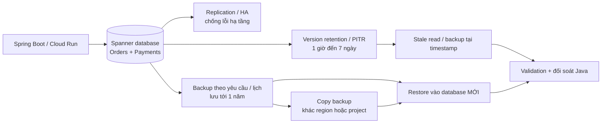
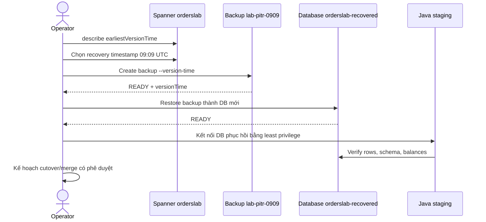
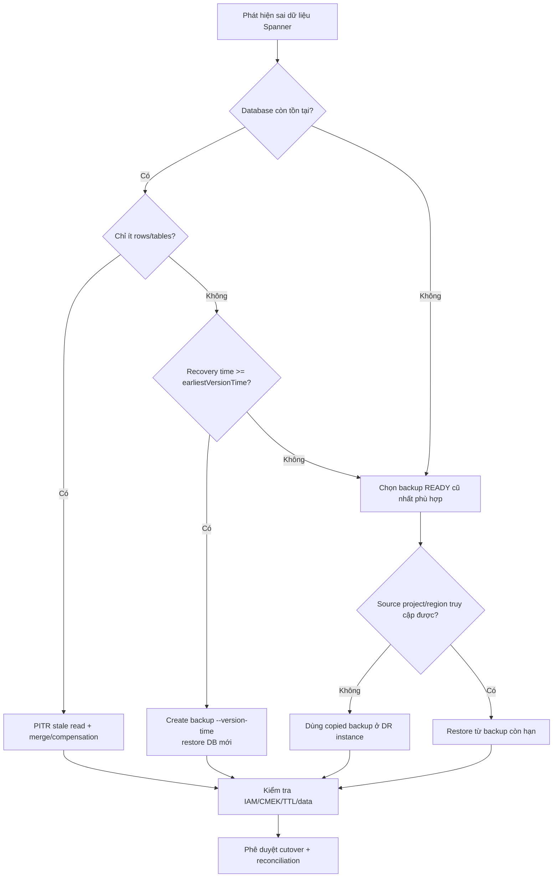

# Backups, point-in-time recovery và bảo vệ dữ liệu Spanner

## 1. Khi Spanner vẫn sẵn sàng nhưng dữ liệu đã bị ghi sai

Một hệ thống **Java/Spring Boot** trên **Cloud Run hoặc GKE** dùng **Spanner** lưu đơn hàng. Lúc 09:10 UTC, một phiên bản ứng dụng có lỗi chạy cập nhật và chuyển nhầm hàng nghìn đơn `PAID` thành `CANCELLED`. Database vẫn hoạt động, replication vẫn khỏe và mọi câu lệnh đều được commit hợp lệ. **High availability không bảo vệ được khỏi lỗi ghi/xóa logic đã được nhân bản**.

Khi đó, đội vận hành cần biết: có thể đọc lại dữ liệu lúc **09:09 UTC** không? Nếu phải khôi phục cả database thì dùng **PITR** hay **backup** nào? Làm sao tránh ghi đè dữ liệu hợp lệ phát sinh sau sự cố, kiểm tra quyền và kết nối Java, và đảm bảo thời gian phục hồi theo mục tiêu kinh doanh?

**Spanner** là cơ sở dữ liệu quan hệ phân tán, hỗ trợ tính nhất quán giao dịch mạnh và replication theo cấu hình instance. Bảo vệ dữ liệu cần kết hợp **version retention/PITR**, **full/incremental backups**, **backup schedules**, **copy backup khác region/project**, **IAM/CMEK** và **diễn tập restore**. Không có một cơ chế duy nhất giải quyết được mọi loại sự cố.

Trong chương **Spanner** của mô-đun **CLOUD_PROVIDERS_GCP**, bài này giúp lập chiến lược khôi phục cho ứng dụng Java, cân bằng **RPO, RTO, quyền truy cập, dữ liệu bền vững và chi phí**.

**Sau bài học bạn có thể:**

1. Phân biệt **PITR 1 giờ–7 ngày**, backup giữ tới **1 năm**, replication và export/import.
2. Giải thích `version_time`, `create_time`, `earliest_version_time` và giới hạn vùng phục hồi.
3. Kiểm kê, tạo full backup theo yêu cầu, lên lịch full/incremental backup và kiểm tra `READY` bằng `gcloud`.
4. Phục hồi bằng **stale read**, **backup tại timestamp cũ → restore thành database mới**, hoặc chọn lọc dữ liệu theo nghiệp vụ.
5. Sao chép backup khác region/project, rà soát **IAM, TTL, change streams, CMEK** sau restore.
6. Thiết kế runbook, bài thực hành và ngân sách backup/restore có kiểm chứng.

> **An toàn:** không chạy lệnh tạo/xóa/sửa database, backup hoặc retention trên production để thử bài. Các bước thay đổi chỉ dành cho **instance/database lab được phê duyệt**; Spanner, backup storage, copy và restore có thể phát sinh phí. **Không xóa database gốc hoặc chuyển Spring Boot production sang database phục hồi khi chưa qua quy trình phê duyệt.**

## 2. Bốn lớp bảo vệ khác nhau



| Cơ chế | Bảo vệ chính | Giới hạn cần nhớ |
| --- | --- | --- |
| **Spanner replication/HA** | Mất node/zone hoặc một số failure domain theo cấu hình instance | Lỗi ghi logic được replication; không phải lịch sử khôi phục |
| **PITR/version retention** | Đọc dữ liệu và schema ở thời điểm gần đây, trước ghi/xóa nhầm | Mặc định **1 giờ**, cấu hình tối đa **7 ngày**; cần database/version còn tồn tại |
| **Backup/restore** | Snapshot nhất quán để phục hồi lâu dài | Backup có thời điểm `version_time`; restore tạo **database mới**, không ghi đè |
| **Backup copy** | Bảo vệ khi cần bản sao ở project/region khác | Phải copy tới instance đích; phát sinh thêm thời gian và phí |
| **Export/Import** | Di chuyển dữ liệu/định dạng phục vụ yêu cầu riêng | Không tương đương native backup và không bảo đảm rollback ứng dụng tự động |

**RPO (Recovery Point Objective)** là lượng dữ liệu có thể chấp nhận mất, tính theo khoảng cách từ thời điểm xảy ra lỗi đến **điểm dữ liệu cuối cùng phục hồi được**. **RTO (Recovery Time Objective)** là thời gian tối đa đến khi **dịch vụ hoạt động trở lại đáp ứng tiêu chí**. RPO/RTO của **một database snapshot** khác RPO/RTO của **đơn hàng/ERP/notification trên toàn hệ thống**.

Ví dụ: backup mỗi 24 giờ tạo khoảng cách **24 giờ giữa các `versionTime` theo lịch**, nhưng RPO khả dụng thực tế có thể **lớn hơn** vì scheduled backup được khởi tạo trong cửa sổ tối đa 4 giờ và phải chờ `READY`. PITR cung cấp nhiều điểm thời gian trong cửa sổ retention, nhưng RTO có thể gồm **tạo backup, restore, cấp IAM, xác minh, chuyển ứng dụng và đối soát**.

## 3. PITR: version retention và earliest version time

Spanner giữ các phiên bản **dữ liệu và schema** ở mức thời gian rất mịn. `version_retention_period` mặc định **1h** và có thể đặt từ **1h đến 7d** trên cả **GoogleSQL** và **PostgreSQL dialect**. `earliest_version_time` cho biết thời điểm **sớm nhất hiện có thể đọc lại**; nó liên tục dịch chuyển và có thể đã thay đổi giữa lúc bạn kiểm tra và lúc tạo bản backup.

```text
Giả định tại 12:00 UTC:
  retention = 3d
  earliest_version_time ≈ 12:00 UTC của ba ngày trước

  ├───────── lịch sử còn giữ ─────────┤
  t_min                              now
          ↑             ↑
     09:09 sự cố     09:10 ghi sai

Chọn 09:09 khi T nằm giữa earliest_version_time và NOW
và xác nhận trạng thái nghiệp vụ tại timestamp đó.
```

### 3.1. Những điều PITR không bảo đảm

- **Không backfill** khi tăng retention: đổi từ 1h sang 7d **không lập tức** cho phép xem dữ liệu của 7 ngày trước; phải chờ lịch sử tích lũy.
- PITR **không phải nút “undo”** của ứng dụng. Có thể đọc lại và tạo backup tại `version_time` cũ, nhưng phục hồi cả database phải tạo **database mới**. Nếu chỉ vài rows bị hỏng, nên lấy dữ liệu cần thiết rồi **sửa có kiểm soát**.
- `earliest_version_time` **thay đổi liên tục**. Khi sự cố xảy ra, nhanh chóng ghi nhận timestamp và chọn điểm có biên độ an toàn, tránh chờ sát ranh giới retention.
- Nếu database đã bị xóa, **không dựa vào PITR của database đã mất**; dùng backup vẫn tồn tại. Backup cũ có thể tồn tại độc lập sau khi xóa database nguồn.
- Timestamp phải phản ánh **thời điểm commit** chứ không phải timestamp ghi log trên laptop có thể lệch giờ. Dùng UTC/RFC 3339 và đối chiếu audit/application traces.

### 3.2. Kiểm tra PITR trước khi thay đổi

```bash
# Read-only: dùng project và database lab hợp lệ.
gcloud config set project LAB_PROJECT_ID

gcloud spanner databases describe orderslab \
  --instance=LAB_INSTANCE \
  --format="yaml(name,state,versionRetentionPeriod,earliestVersionTime)"

gcloud spanner databases ddl describe orderslab \
  --instance=LAB_INSTANCE
```

Trên Google Cloud Console: **Spanner → Instance → Database → Backup/Restore** để xem retention và thời điểm sớm nhất. Ghi `earliestVersionTime` và xác minh lại **ngay trước khi tạo backup từ thời điểm quá khứ**.

### 3.3. Tăng retention chỉ trong database lab

**GoogleSQL dialect** dùng DDL:

```sql
-- CHỈ database thử nghiệm, cần quyền chỉnh DDL.
ALTER DATABASE orderslab
SET OPTIONS (version_retention_period = '3d');
```

Có thể áp dụng qua **Spanner Studio/DDL** hoặc lệnh gcloud sau cho **database ID không có dấu gạch nối**:

```bash
gcloud spanner databases ddl update orderslab \
  --instance=LAB_INSTANCE \
  --ddl="ALTER DATABASE orderslab SET OPTIONS (version_retention_period = '3d')"
```

Với **Spanner PostgreSQL dialect**, cú pháp đặt option khác GoogleSQL, ví dụ:

```sql
ALTER DATABASE "orderslab"
SET "spanner.version_retention_period" = '3d';
```

Không chạy cả hai cú pháp trên cùng database; chúng thuộc **hai dialect khác nhau**. Sau khi cập nhật, kiểm tra `versionRetentionPeriod` và `earliestVersionTime`, không suy ra rằng history 3 ngày đã sẵn có ngay lập tức. Tăng retention làm tăng chi phí **versioned storage** theo mức độ thay đổi dữ liệu.

## 4. Backup: full, incremental, schedule và các timestamp

Một **native Spanner backup** lưu **ảnh chụp giao dịch nhất quán** của database ở `version_time`, gồm dữ liệu và schema phù hợp. Backup được tạo **trong cùng instance, region và project** với database gốc; khi cần khác vị trí, dùng **copy backup** sau khi backup hoàn tất.

| Thành phần | Ý nghĩa |
| --- | --- |
| `versionTime` | Thời điểm dữ liệu/schema được chụp nhất quán |
| `createTime` | Thời điểm Spanner bắt đầu tiến trình tạo backup |
| `state` | `CREATING` hoặc `READY`; chỉ phục hồi bản backup đã sẵn sàng |
| `expireTime` | Hết hạn lưu backup (có thể kéo dài phù hợp giới hạn) |
| `sizeBytes` / `exclusiveSizeBytes` | Kích thước và storage thuộc riêng backup, hữu ích cho incremental chain/chi phí |

**Phân biệt thời điểm:** với **on-demand full backup**, mặc định `createTime≈versionTime`. Có thể đặt `--version-time` cũ nếu timestamp **nằm trong PITR window**. Với **scheduled backup**, `versionTime` là thời điểm lịch được đặt, còn `createTime` có thể đến **trong 4 giờ kế tiếp**; không được xem backup 02:00 là sẵn sàng đúng 02:00.

### 4.1. Loại backup theo nhu cầu

| Loại | Tạo bằng gì? | Lưu ý |
| --- | --- | --- |
| **On-demand full** | Console, `gcloud spanner backups create`, API/client | Chụp dữ liệu toàn database; có thể chọn `versionTime` cũ |
| **Scheduled full** | Backup schedule với `--backup-type=full-backup` | Tần suất tối thiểu **12 giờ** |
| **Scheduled incremental** | Backup schedule với `--backup-type=incremental-backup` | Chỉ **Enterprise/Enterprise Plus**, tần suất tối thiểu **4 giờ**; **không** tạo incremental on-demand |

Incremental backup đầu tiên của chuỗi là **full**, các bản tiếp theo giữ phần thay đổi; chuỗi tối đa **13 incremental backups** sau full. Bản incremental có thể **phụ thuộc các backup trước** để restore, nên xóa một bản cũ **không chắc giải phóng ngay storage**; Spanner có thể tiếp tục giữ dữ liệu cần cho những bản mới hơn. Restore incremental **có thể lâu hơn** full tương đương.

### 4.2. Backup mặc định không thay kiểm kê

Theo tài liệu hiện hành, **instance mới** mặc định bật chính sách tạo **full backup 24 giờ/lần, retention 7 ngày** cho **database mới được tạo trong instance đó**. Có thể tùy chỉnh/tắt khi tạo hoặc chỉnh instance. **Bật default schedule trên instance đã tồn tại không tự áp dụng cho databases cũ**; schedule mới có thể cần **tới 24 giờ** mới chạy lần đầu.

**Vẫn phải kiểm tra thực tế** `backup-schedules list` và `backups list`. Không giả định chỉ vì thấy tùy chọn default enabled mà production database đã có backup `READY`, và không tạo schedule thứ hai trước khi kiểm tra duplication.

## 5. Lab gcloud: tạo backup và lịch backup

Điều kiện: đã có **Spanner instance và database `orderslab` thuộc lab**; bật Billing, Spanner API, quyền backup phù hợp; không dùng project nguồn của sản phẩm thật. Tất cả lệnh là ví dụ cho người học, **không thực thi khi biên soạn**.

### 5.1. Kiểm kê read-only trước

```bash
gcloud spanner instances describe LAB_INSTANCE \
  --project=LAB_PROJECT_ID

gcloud spanner databases describe orderslab \
  --instance=LAB_INSTANCE \
  --project=LAB_PROJECT_ID

gcloud spanner backup-schedules list \
  --project=LAB_PROJECT_ID \
  --instance=LAB_INSTANCE \
  --database=orderslab

gcloud spanner backups list \
  --instance=LAB_INSTANCE \
  --project=LAB_PROJECT_ID
```

Nếu đã có một backup schedule hợp lệ, **không tạo thêm chỉ để thấy lệnh chạy**. Mục tiêu là xác minh **frequency, retention, backup type, encryption và lần backup `READY` mới nhất**.

### 5.2. Tạo on-demand full backup 7 ngày

```bash
# Chỉ trên database lab sau khi xác nhận mức phí:
gcloud spanner backups create orderslab-snapshot-001 \
  --project=LAB_PROJECT_ID \
  --instance=LAB_INSTANCE \
  --database=orderslab \
  --retention-period=7d \
  --async

# Kiểm tra lại, CHỈ coi backup dùng được khi state=READY:
gcloud spanner backups describe orderslab-snapshot-001 \
  --project=LAB_PROJECT_ID \
  --instance=LAB_INSTANCE
```

`--async` trả về trước khi tạo xong. Bỏ `--async` để CLI đợi operation; không suy ra `READY` từ kết quả “Create request issued”. Backup ID phải duy nhất trong instance. Backup expiration tối đa khoảng **một năm từ creation time**, không phải lưu vĩnh viễn.

### 5.3. Tạo full backup schedule minh họa

Nếu database lab **chưa có** lịch thích hợp:

```bash
# Hằng ngày lúc 02:00 UTC; chỉ với database LAB.
gcloud spanner backup-schedules create orderslab-daily \
  --project=LAB_PROJECT_ID \
  --instance=LAB_INSTANCE \
  --database=orderslab \
  --cron="0 2 * * *" \
  --backup-type=full-backup \
  --retention-duration=604800s \
  --encryption-type=use-database-encryption

gcloud spanner backup-schedules describe orderslab-daily \
  --project=LAB_PROJECT_ID \
  --instance=LAB_INSTANCE \
  --database=orderslab
```

Lệnh trên dùng mẫu encryption theo cấu hình database. Kiểm tra **Spanner edition, CMEK, quota tối đa 4 schedules/database** trước khi tạo. Vì lịch có thể bắt đầu chạy trễ, vẫn cần **on-demand backup** cho yêu cầu có bản bảo vệ ngay.

### 5.4. Incremental schedule khi edition hỗ trợ

**Không chạy cùng schedule full** nếu chưa tính retention, phụ thuộc chain và ngân sách:

```bash
# Chỉ Enterprise/Enterprise Plus và database lab đã được duyệt:
gcloud spanner backup-schedules create orderslab-4h \
  --project=LAB_PROJECT_ID \
  --instance=LAB_INSTANCE \
  --database=orderslab \
  --cron="0 */4 * * *" \
  --backup-type=incremental-backup \
  --retention-duration=604800s \
  --encryption-type=use-database-encryption
```

Incremental giúp giảm backup storage cho workload có tỷ lệ thay đổi nhỏ; nhưng cần kiểm tra `exclusiveSizeBytes`, chuỗi phụ thuộc và thời gian restore. Đừng hứa “incremental lúc nào cũng rẻ/nhanh hơn full” hoặc xóa một backup giữa chain để tiết kiệm ngay.

## 6. PITR thực hành: xem dữ liệu quá khứ mà chưa phục hồi database

Khi sai dữ liệu ở **một vài đơn**, bước đầu an toàn là **stale read ở timestamp trước sự cố**. Lệnh sau chỉ đọc snapshot, không sửa trạng thái:

```bash
# Chọn RECOVERY_TIME_UTC sau earliestVersionTime và trước commit sai.
# Ví dụ format: 2026-11-19T09:09:00Z (nếu còn trong PITR window).
gcloud spanner databases execute-sql orderslab \
  --project=LAB_PROJECT_ID \
  --instance=LAB_INSTANCE \
  --read-timestamp=RECOVERY_TIME_UTC \
  --sql="SELECT OrderId, Status FROM Orders LIMIT 20"
```

Ví dụ này dùng **GoogleSQL dialect** và giả định bảng `Orders` có cột `OrderId, Status`. Với PostgreSQL dialect, chỉnh **SQL phù hợp schema**, không copy nguyên ví dụ nếu table/cột khác. Kết quả snapshot phải được **đối chiếu với audit logs và nghiệp vụ**; chọn timestamp quá sớm có thể làm mất các đơn hợp lệ đã tạo trước lỗi.

**Không được chạy UPDATE theo bản stale read nếu chưa thiết kế:** một row có thể thay đổi hợp lệ *sau* `RECOVERY_TIME_UTC`. Kịch bản khôi phục chọn lọc cần khóa business key, xác định changelog, áp dụng **conditional mutation/transaction**, replay hoặc compensation và xác minh idempotency.

## 7. PITR toàn database: backup tại version time cũ rồi restore

Khi lỗi ảnh hưởng **phần lớn database hoặc schema** và cần một snapshot đầy đủ, Spanner cho phép tạo **on-demand full backup** với `--version-time` nằm trong PITR window, rồi **restore thành một database mới**.



### 7.1. Chọn recovery timestamp

Phải xác minh:

- `RECOVERY_TIME_UTC` **sau** `earliestVersionTime` và **trước** commit lỗi, ở định dạng RFC 3339 UTC.
- Không chỉ dựa vào thời điểm người dùng phát hiện: một transaction sai có thể chạy trước khi monitor báo lỗi.
- Các thay đổi hợp lệ phát sinh sau thời điểm chọn **không nằm trong snapshot**. Cần kế hoạch reconcile để không mất thanh toán/đơn hàng hợp lệ.
- Nếu dữ liệu ở ngoài PITR window, chọn **backup gần nhất còn READY**, chấp nhận RPO lớn hơn và tính đến replay sự kiện theo nghiệp vụ.

### 7.2. Tạo backup tại thời điểm lịch sử

```bash
# CHỈ DB LAB. Thay RECOVERY_TIME_UTC bằng timestamp còn trong PITR.
gcloud spanner databases describe orderslab \
  --instance=LAB_INSTANCE \
  --project=LAB_PROJECT_ID \
  --format="yaml(versionRetentionPeriod,earliestVersionTime)"

gcloud spanner backups create orderslab-pitr-recovery \
  --project=LAB_PROJECT_ID \
  --instance=LAB_INSTANCE \
  --database=orderslab \
  --version-time=RECOVERY_TIME_UTC \
  --retention-period=7d \
  --async

gcloud spanner backups describe orderslab-pitr-recovery \
  --project=LAB_PROJECT_ID \
  --instance=LAB_INSTANCE
```

Xem `state: READY` và `versionTime` **thực tế**, không dùng backup còn `CREATING`. Lệnh có thể thất bại nếu timestamp bị trôi ra ngoài khoảng version retention trong khi chờ. Khi đã có backup `READY`, lịch sử ở thời điểm đó **không còn phụ thuộc database tiếp tục giữ PITR** trong thời gian backup chưa hết hạn.

### 7.3. Restore tạo database **mới**, không overwrite

```bash
# CHỈ LAB, sau khi backup state=READY:
gcloud spanner databases restore \
  --project=LAB_PROJECT_ID \
  --source-instance=LAB_INSTANCE \
  --source-backup=orderslab-pitr-recovery \
  --destination-instance=LAB_INSTANCE \
  --destination-database=orderslab-recovered \
  --async

gcloud spanner databases describe orderslab-recovered \
  --project=LAB_PROJECT_ID \
  --instance=LAB_INSTANCE
```

`orderslab-recovered` **chưa được tồn tại**; nếu trùng tên, restore thất bại. Khi source/destination instances khác nhau, cần tương thích **instance configuration** theo quy tắc restore và edition support. `--async` chỉ tạo operation; chờ database `READY` trước khi cấp quyền hoặc chuyển kết nối app.

**Restore không tự đổi database name trong Spring Boot/Cloud Run service**: ứng dụng vẫn trỏ tới `orderslab` cho tới khi operator cập nhật và triển khai connection config. Không “restore trực tiếp lên database hiện tại”. Trước cutover phải **đóng/mở quyền ghi đúng trình tự**, xác nhận số dư, event outbox và các dịch vụ liên quan.

## 8. Copy backup khác instance, region hoặc project

Backup mới tạo **ở cùng instance/region/project** với database nguồn. Nếu yêu cầu DR hoặc giảm rủi ro khi mất quyền quản trị một project, tạo **bản sao backup** trong một **destination instance đã tồn tại** ở region/project khác. Sao chép backup **không phải streaming replication**, không cung cấp RPO bằng 0.

### 8.1. Copy trong cùng project

```bash
# Chỉ sau khi source backup READY và destination instance có thật.
gcloud spanner backups copy \
  --project=LAB_PROJECT_ID \
  --source-instance=LAB_INSTANCE \
  --source-backup=orderslab-snapshot-001 \
  --destination-instance=LAB_DR_INSTANCE \
  --destination-backup=orderslab-dr-copy-001 \
  --retention-period=7d \
  --async

gcloud spanner backups describe orderslab-dr-copy-001 \
  --project=LAB_PROJECT_ID \
  --instance=LAB_DR_INSTANCE
```

### 8.2. Copy giữa các projects

```bash
# Khi cả source/destination instances đều đã tạo và IAM phù hợp:
gcloud spanner backups copy \
  --source-backup=projects/SOURCE_PROJECT/instances/SOURCE_INSTANCE/backups/SOURCE_BACKUP \
  --destination-backup=projects/DR_PROJECT/instances/DR_INSTANCE/backups/DR_BACKUP \
  --retention-period=7d \
  --async
```

Bản copy có trạng thái tạo riêng; cần chờ **READY**. Với incremental backup, Spanner có thể **copy toàn bộ các backups trước cần thiết trong chain**; destination cần storage và thời gian copy tương ứng. Với các cặp project/region khác, kiểm tra **IAM source/destination, CMEK key location, data residency và quota**.

Theo tài liệu, đa số backup copies có thể hoàn thành trong **vài giờ** tùy size/region; **không có RTO cố định 5 phút** chỉ vì đã bật copy. Muốn ứng dụng khôi phục nhanh, lập chiến lược **bản copy định kỳ, instance dự phòng và diễn tập cutover**.

## 9. Phục hồi chọn lọc: không ghi đè thay đổi hợp lệ

Giả sử lúc 09:10 có 3.000 đơn bị sai, nhưng tới 09:25 hệ thống đã tạo thêm 200 đơn hợp lệ. Restore database toàn phần về 09:09 rồi chuyển traffic có thể làm **mất 200 đơn** nếu không replay/chuyển đổi đúng. Với sự cố có phạm vi nhỏ, cân nhắc:

1. Tạo snapshot backup tại `versionTime` trước lỗi hoặc stale-read những hàng cần thiết.
2. Xuất/đối chiếu **keys, version/commit timestamps, giá trị trước-sau** ở hệ thống ghi có thẩm quyền.
3. Xác định row có thay đổi hợp lệ sau lỗi; **không** blind overwrite toàn bộ.
4. Viết **migrations hoặc compensating mutations** theo transaction/idempotency; triển khai canary theo nhóm keys.
5. Đối soát Cloud SQL, Pub/Sub outbox, thanh toán, ERP và số dư; chạy validation trước và sau.

Nếu cần khôi phục nguyên **một table**, có thể **restore backup thành database khác**, export một table bằng Dataflow/Avro rồi import có kiểm soát, hoặc đọc dữ liệu ở một timestamp cũ và viết lại theo transaction phù hợp. **Import không tự xóa các rows được thêm sau snapshot**; muốn bảng đúng nguyên trạng cũ phải xử lý chúng riêng—điều này có thể làm mất dữ liệu hợp lệ.

**PITR chỉ đưa ra một lịch sử đáng tin cậy của Spanner tại timestamp**, không thay business workflow để đảo email đã gửi hoặc hoàn tiền bên ngoài Spanner. Khi hồi phục từ snapshot, **outbox/replay consumer** cần idempotency để tránh gửi cùng sự kiện lần hai.

## 10. Java 21: đọc Spanner tại timestamp quá khứ

Với **Java client library `com.google.cloud:google-cloud-spanner`**, có thể dùng `TimestampBound.ofReadTimestamp` để thực hiện **read-only query tại thời điểm cố định**, không cần restore toàn database khi chỉ muốn kiểm tra dữ liệu. Ví dụ sau dùng **GoogleSQL dialect** và bảng `Orders(OrderId STRING, Status STRING)` trong database lab.

### 10.1. Maven `pom.xml` tối thiểu

```xml
<?xml version="1.0" encoding="UTF-8"?>
<project xmlns="http://maven.apache.org/POM/4.0.0"
         xmlns:xsi="http://www.w3.org/2001/XMLSchema-instance"
         xsi:schemaLocation="http://maven.apache.org/POM/4.0.0 https://maven.apache.org/xsd/maven-4.0.0.xsd">
  <modelVersion>4.0.0</modelVersion>
  <groupId>dev.example</groupId>
  <artifactId>spanner-pitr-read-lab</artifactId>
  <version>1.0.0</version>
  <properties>
    <maven.compiler.release>21</maven.compiler.release>
    <project.build.sourceEncoding>UTF-8</project.build.sourceEncoding>
  </properties>
  <dependencies>
    <dependency>
      <groupId>com.google.cloud</groupId>
      <artifactId>google-cloud-spanner</artifactId>
      <version>6.124.0</version>
    </dependency>
  </dependencies>
  <build>
    <plugins>
      <plugin>
        <groupId>org.apache.maven.plugins</groupId>
        <artifactId>maven-compiler-plugin</artifactId>
        <version>3.13.0</version>
      </plugin>
    </plugins>
  </build>
</project>
```

Phiên bản client chỉ để minh họa cách khai báo; production nên quản lý bằng **Google Cloud Java Libraries BOM**, pin version được hỗ trợ và scan CVEs. Chạy qua **Application Default Credentials (ADC)** với quyền đọc Spanner database lab, không lưu JSON service account key trong repo.

### 10.2. Lớp `SnapshotRead.java`

```java
package dev.example.spanner;

import com.google.cloud.Timestamp;
import com.google.cloud.spanner.DatabaseClient;
import com.google.cloud.spanner.DatabaseId;
import com.google.cloud.spanner.ResultSet;
import com.google.cloud.spanner.Spanner;
import com.google.cloud.spanner.SpannerOptions;
import com.google.cloud.spanner.Statement;
import com.google.cloud.spanner.TimestampBound;

public final class SnapshotRead {
    public static void main(String[] args) {
        if (args.length != 4) {
            throw new IllegalArgumentException(
                "Usage: PROJECT_ID INSTANCE_ID DATABASE_ID UTC_TIMESTAMP");
        }

        String project = args[0];
        String instance = args[1];
        String database = args[2];
        Timestamp timestamp = Timestamp.parseTimestampDuration(args[3]);

        try (Spanner spanner = SpannerOptions.newBuilder()
                .setProjectId(project).build().getService()) {
            DatabaseClient client = spanner.getDatabaseClient(
                DatabaseId.of(project, instance, database));

            // Chỉ đọc tại timestamp đã kiểm tra PITR earliestVersionTime.
            try (ResultSet rs = client
                    .singleUse(TimestampBound.ofReadTimestamp(timestamp))
                    .executeQuery(Statement.of(
                        "SELECT OrderId, Status FROM Orders LIMIT 20"))) {
                while (rs.next()) {
                    System.out.printf("%s -> %s%n",
                        rs.getString("OrderId"),
                        rs.getString("Status"));
                }
            }
        }
    }
}
```

**Ranh giới quan trọng:** `TimestampBound.ofReadTimestamp` tạo **read-only snapshot** có thể lặp lại ở cùng timestamp; không phải read-write transaction và **không thể xem lịch sử ngoài `earliestVersionTime`**. Với timestamp quá cũ, Spanner trả lỗi do version đã bị garbage collected. Không dùng stale read để ra quyết định thanh toán trực tiếp ở thời điểm hiện tại.

### 10.3. Liên hệ Spring Boot/Cloud Run

Trong Spring Boot production, **không đổi `spring.cloud.gcp.spanner.database` hoặc endpoint runtime** chỉ để debug lịch sử. Đặt read-only recovery job riêng, có **Spanner Database Reader** hoặc role tương đương đúng phạm vi, log **request ID/timestamp/keys**, và để giao dịch khôi phục thực hiện qua **runbook được kiểm duyệt**. Nếu quyết định cutover sang database phục hồi, triển khai qua secret/config có version và rollback path rõ ràng.

## 11. Tính đầy đủ của backup và những thứ phải cấu hình lại

Native full backup giữ **dữ liệu, database schema, indexes, change stream definitions và database options** ở `versionTime` theo quy tắc dịch vụ. Nhưng **không đồng nghĩa bản phục hồi sẵn sàng phục vụ mọi hệ thống**.

| Sau restore | Trạng thái | Việc phải làm |
| --- | --- | --- |
| **Rows/schema/indexes** | Tại `versionTime` | Kiểm chứng count, constraints, query mẫu và consistency |
| **Database options** | Được lưu trong backup theo khả năng | Review `version_retention_period` và các options quan trọng |
| **IAM policies trên database** | **Không khôi phục** (trừ policy thừa hưởng instance đích) | Cấp đúng workload identities, audit least privilege |
| **Change stream schema** | Định nghĩa có trong backup | Kiểm tra stream/consumers |
| **Change stream data records** | **Không có** trong backup | Xây lại downstream checkpoint/snapshot/replay |
| **Row deletion policy/TTL** | **Không tự restore** theo restore overview | Khai báo lại TTL đúng compliance trước khi chạy production |
| **Pre-splitting points** | Không restore | Nếu cần, cấu hình lại theo workload/throughput |
| **Ứng dụng Java** | Không tự đổi database | Cập nhật config, IAM, health checks, release strategy |
| **External state** | Không nằm trong Spanner backup | Đối soát Pub/Sub, payment API, CRM, Cloud Storage |

TTL cần chú ý đặc biệt: **không khôi phục row deletion policy** có thể làm dữ liệu được giữ **lâu hơn yêu cầu compliance** nếu chưa cấu hình lại. Ở chiều ngược lại, bật TTL sai trên database đã phục hồi có thể **xóa dữ liệu đang cần điều tra**. Hãy review chính sách trước khi mở quyền ghi.

## 12. IAM, CMEK và phòng vệ chống xóa nhầm

### 12.1. Tách người tạo backup và người restore

| Vai trò | Mục đích | Không nên cấp mặc định |
| --- | --- | --- |
| `roles/spanner.backupWriter` | Tạo và xem backup/schedule phù hợp; tốt cho automation backup | Không cần quyền xóa/cập nhật backup |
| `roles/spanner.backupAdmin` | Tạo, quản lý, cập nhật và xóa backup | Không cấp cho Java runtime chỉ đọc/ghi nghiệp vụ |
| `roles/spanner.restoreAdmin` | Khôi phục database từ backup | Tách khỏi backup creator khi cần kiểm soát hai người |
| Spanner database reader/writer | Quyền SQL/data của ứng dụng hoặc recovery job | Không có lý do tự động được Backup Admin/Restore Admin |

Thực thi **IAM least privilege tại instance/database** khi sản phẩm hỗ trợ. Dùng **Cloud Audit Logs** ghi lại thao tác backup, copy, restore, thay retention, đổi IAM và KMS. **Deletion protection** giúp ngăn thao tác xóa database không chủ ý, nhưng không thay backup và không bảo vệ backup khỏi người có quyền `backupAdmin` xóa nó. Xem xét phân tách **project chứa bản copy DR** và kiểm soát quyền độc lập.

### 12.2. CMEK khi tạo, copy và restore

Spanner backups được mã hóa khi lưu. Mặc định backup thường dùng **cùng cấu hình encryption với database gốc**, nhưng có thể chọn Google-managed encryption hoặc **customer-managed encryption key (CMEK)** khi được hỗ trợ.

- **KMS key version dùng để mã hóa backup phải tồn tại và có thể dùng khi restore**. Nếu key bị destroy/disable hoặc Spanner service agent mất quyền, restore có thể thất bại.
- Với **dual-region/multi-region/custom instance configuration**, có thể phải cung cấp **nhiều regional KMS keys** bao phủ regions; Console không hỗ trợ mọi biến thể, dùng `gcloud`/client API đúng yêu cầu.
- Khi **copy backup** tới region/project khác, kiểm tra **key location, service agent quyền Cloud KMS CryptoKey Encrypter/Decrypter, IAM** và policy residency. Bản copy có thể dùng cấu hình mã hóa khác theo tùy chọn được hỗ trợ.
- Lập kế hoạch **rotate keys và giữ key versions** đủ lâu theo retention backup. Không tự động xóa key version cũ khi đổi khoá vận hành.

**Không coi việc bật CMEK là thay thế kiểm toán quyền truy cập**: người có quyền SQL, backup, KMS và quản trị ứng dụng phải được phân vai riêng, nhất là trong sự cố ransomware hoặc insider mistakes.

## 13. Runbook xử lý sự cố dữ liệu theo RPO/RTO

### 13.1. Quy trình 8 bước

1. **Kích hoạt incident:** ghi thời điểm UTC, phạm vi keys/tables, release Java, người chịu trách nhiệm và dấu hiệu đầu tiên. Giới hạn quyền ghi của **thành phần gây lỗi** nhưng không tắt toàn bộ ứng dụng nếu còn giao dịch hợp lệ cần phục vụ.
2. **Bảo toàn chứng cứ:** chụp audit logs, trace IDs, backup metadata, `earliestVersionTime` và bản sao thông tin release. Không chạy lệnh xóa, replay hoặc update đại trà.
3. **Phân loại:** lỗi vài rows, lỗi nhiều bảng, xóa database, mất quyền KMS, hay mất region/project? Đặt RPO/RTO và ảnh hưởng các hệ thống ngoài Spanner.
4. **Chọn cơ chế:** stale read/compensation cho ít rows; **PITR on-demand backup** cho toàn database trong 7 ngày; **existing backup** cho thời điểm xa hơn hoặc database đã mất; **copied backup** nếu source region/project không sẵn có.
5. **Restore vào database mới:** kiểm tra backup `READY`, `versionTime`, compatible destination instance/edition/CMEK; không overwrite database đang phục vụ.
6. **Validation:** schema/indexes, chính sách TTL, IAM, số đơn/số dư, truy vấn Java, application compatibility và các downstreams như Pub/Sub/ERP.
7. **Cutover được duyệt:** cấu hình Spring Boot/Cloud Run trỏ tới DB mới bằng rollout có kiểm soát, theo dõi p95/error rate; hạn chế hai writers cùng ghi không phối hợp.
8. **Đối soát và postmortem:** replay/merge các thay đổi hợp lệ sau snapshot, kiểm tra idempotency, khôi phục backup schedules/alerts, diễn tập lần sau.



### 13.2. Bảng quyết định nhanh

| Sự cố | Cơ chế đầu tiên cần cân nhắc | Sai lầm thường gặp |
| --- | --- | --- |
| `UPDATE` sai trên 20 đơn, phát hiện sau 10 phút | Stale read timestamp trước lỗi, đối soát rồi sửa chọn lọc | Restore toàn DB và làm mất các đơn mới |
| Một migration xóa nhầm bảng, phát hiện sau 6 giờ | PITR/backup tại `versionTime` trước migration, restore DB riêng | Chỉ tăng retention sau khi đã xảy ra lỗi |
| Database bị xóa | Backup `READY` còn hạn, restore database mới | Nghĩ PITR của DB đã xóa vẫn có thể truy vấn |
| Mất quyền truy cập project nguồn | Bản copy backup ở project DR độc lập | Đặt tất cả backups cùng một IAM failure domain |
| Mất một zone nhưng dữ liệu đúng | Spanner HA/replication theo instance config | Restore backup không cần thiết |
| Mất region và cần dữ liệu ở region khác | Copied backup đã sẵn tại DR instance/chiến lược DR | Đợi mới bắt đầu copy rồi cam kết RTO vài phút |
| KMS key version mất khả năng giải mã | Điều tra Cloud KMS/service agent, phiên bản key | Đổi key khác và nghĩ có thể giải mã backup cũ ngay |
| Dữ liệu liên quan ERP/Pub/Sub đã có side effect | Saga/reconciliation và business dedup keys | Rollback database rồi giả định email/ERP cũng rollback |

### 13.3. Kiểm tra khôi phục trước khi cho phép ghi

Ở **database restored**:

- Xem `state=READY`, `restoreInfo.backupInfo.versionTime` và **database dialect**.
- So số đơn hàng, tổng tiền theo currency, unique IDs và các balances nghiệp vụ với snapshot/audit được chấp nhận.
- Kiểm tra **DDL/schema/indexes**, quyền truy cập, TTL row policies và change stream configurations.
- Chạy **Java smoke test đọc-only** từ staging với đúng workload identity; kiểm tra timeout, quota, latency và error rate.
- Đảm bảo các event sau timestamp snapshot được **replayed hoặc compensating** theo đúng thứ tự và không ghi trùng.
- Cân nhắc giữ source database ở trạng thái read-only/quarantined trong thời gian điều tra theo chính sách, không xóa ngay.

## 14. SLO, alert và kiểm tra độ tin cậy

**Một backup `READY` là điều kiện cần, chưa phải bằng chứng có thể phục hồi ứng dụng**. Theo dõi tối thiểu:

| Tín hiệu | Điều kiện cảnh báo gợi ý | Hành động |
| --- | --- | --- |
| **Backup age** | Backup `READY` mới nhất quá SLA, ví dụ hơn 26 giờ cho lịch 24 giờ | Kiểm tra schedule, operation errors, IAM/quota |
| **Schedule health** | Lịch bị xóa/tắt hoặc chưa tạo backup sau activation window | Audit logs, backup schedule metadata |
| **PITR window** | `versionRetentionPeriod` bị giảm hoặc `earliestVersionTime` mới hơn mức cho phép | Kiểm tra DDL/IAM, alert và change history |
| **Backup copy lag** | Bản DR copy gần nhất quá mục tiêu RPO DR | Xem copy operation, region/permissions/cost |
| **CMEK availability** | Cloud KMS key disabled, IAM service agent thay đổi | Phục hồi quyền và key version theo runbook |
| **Restore drill** | Chưa diễn tập thành công trong kỳ | Restore vào database lab, Java smoke test và ghi thời gian |
| **Billing** | Backup bytes, backup chain storage, PITR storage và copied backups tăng bất thường | Review retention, churn, schedule duplication |

Giới hạn theo **mức độ quan trọng của dữ liệu**: thay vì chỉ đo “backup chạy thành công”, đặt mục tiêu **khôi phục được phiên bản ứng dụng và dữ liệu** trong thời gian cho phép. Ví dụ:

```text
Mục tiêu giả định:
  RPO nghiệp vụ ≤ 15 phút
  RTO ứng dụng ≤ 2 giờ

PITR có thể cung cấp điểm khôi phục đủ gần trong retention,
nhưng nếu restore + kiểm thử + cutover cần 3 giờ,
thì RTO vẫn KHÔNG đạt. Muốn đạt phải diễn tập và tối ưu runbook.
```

Sử dụng **Cloud Monitoring** cho Spanner instance metrics/operations được hỗ trợ, **Cloud Audit Logs** cho các thay đổi admin và cảnh báo theo dashboard tùy tổ chức. Xác minh **tên metric và resource type trong Metrics Explorer** trước khi tạo alert; không tự suy rằng một trường UI như `expireTime` là một Monitoring time series sẵn có.

## 15. Chi phí, retention và dọn lab

### 15.1. Những khoản phải tính

- **Spanner instance compute/storage:** database gốc và **database restored** có thể cùng tồn tại, tăng nhu cầu tài nguyên.
- **Backup storage:** trả theo lượng bytes lưu giữ và thời gian retention; full backups giữ toàn database tại snapshot.
- **Incremental backup chain:** phần thay đổi ít có thể rẻ hơn, nhưng Spanner giữ các backups phụ thuộc và có thể chưa giải phóng storage khi xóa một mắt xích.
- **PITR version retention:** kéo dài từ 1 giờ lên 7 ngày có thể làm tăng **versioned storage** theo khối lượng ghi/xóa/cập nhật.
- **Copied backup khác location:** chi phí storage tại destination, copy/data transfer tùy biểu giá và dung lượng thực.
- **Export/Import/DR drills:** Dataflow/Cloud Storage, network, monitoring và nhân lực vận hành nếu sử dụng.

Ví dụ **mô hình giả định, không phải giá Google Cloud**:

```text
Database full backup: 200 GiB.
Daily full snapshots: giả sử 7 bản × 200 GiB = 1.400 GiB
  của dữ liệu snapshot danh nghĩa trước khi xét tính phí thực tế.

Giả sử mỗi ngày thay đổi 10 GiB:
  incremental chain có thể lưu ít dữ liệu thay đổi hơn full,
  nhưng còn full base, metadata, giữ chuỗi phụ thuộc và phí copy.

Không được nhân trực tiếp 1.400 GiB với một giá vùng đoán:
phải kiểm tra chargeable bytes và đơn giá trong Spanner Pricing.
```

Một hệ thống có **write churn lớn** có thể trả thêm đáng kể khi tăng PITR retention; một hệ thống có backup schedules trùng nhau có thể tăng chi phí không cần thiết. Dùng **Cloud Billing Reports/Budgets**, kiểm tra `exclusiveSizeBytes` và cấu trúc backup chains. **Budget alerts không tự chặn phí**.

### 15.2. Cleanup lab có thứ tự và kiểm tra ownership

Sau khi hoàn tất, **chỉ** dọn các tài nguyên lab do mình tạo; không xóa database đang phục vụ hoặc backup có giá trị điều tra. Nên:

1. Dừng test Java, xác nhận không có client kết nối `orderslab-recovered`.
2. Kiểm tra danh sách schedules và backups, đối chiếu ID, `versionTime`, retention, owners.
3. Với **backup schedule chỉ tạo cho lab**, xóa schedule sau khi xác nhận chính sách giữ backup không còn cần thiết.
4. Với **database restored** chỉ dùng cho lab, xóa sau khi phê duyệt và xuất kết quả cần giữ; không tự xóa source database.
5. Các backups lab được giữ đến expiration hoặc xóa riêng **nếu không còn yêu cầu phục hồi/giữ chuỗi**, bằng quyền có thể audit.
6. Kiểm tra instance/billing; **không xóa instance** khi còn backups/DB hoặc khi có workload khác dùng.

```bash
# Các lệnh CHỈ ĐỌC trước mọi thao tác dọn:
gcloud spanner backup-schedules list \
  --project=LAB_PROJECT_ID \
  --instance=LAB_INSTANCE \
  --database=orderslab

gcloud spanner backups list \
  --project=LAB_PROJECT_ID \
  --instance=LAB_INSTANCE

gcloud spanner databases list \
  --project=LAB_PROJECT_ID \
  --instance=LAB_INSTANCE

# Ví dụ lệnh phá hủy, CỐ Ý KHÔNG chạy:
# gcloud spanner backup-schedules delete orderslab-daily --instance=LAB_INSTANCE --database=orderslab
# gcloud spanner databases delete orderslab-recovered --instance=LAB_INSTANCE
# gcloud spanner backups delete orderslab-snapshot-001 --instance=LAB_INSTANCE
```

**Lưu ý:** xóa database không tự xóa các backups đã có; **xóa instance cần xóa toàn bộ backups trước** theo quy tắc dịch vụ. Vì vậy cleanup lab phải tính đến cả **backup tồn tại sau database**, backup expiration và các chuỗi incremental phụ thuộc.

## 16. Bài tập và checklist tự đánh giá

### Bài A — Chọn chiến lược backup

Hệ thống Java xử lý 100.000 đơn/ngày, RPO mục tiêu 15 phút, yêu cầu lưu snapshot tối thiểu 90 ngày. Đề xuất cách kết hợp **PITR 7 ngày, full/incremental schedules, retention và copied backups**. Vì sao backup 24 giờ/lần không đủ RPO 15 phút nếu không có thêm cơ chế? RTO cần kiểm chứng gì?

### Bài B — Ranh giới retention

Lúc 12:00 UTC, `earliestVersionTime=11:00 UTC`, database mới được tăng retention từ 1h lên 7d. Có thể khôi phục về 08:00 UTC cùng ngày ngay không? Tính lúc nào (xấp xỉ) có đủ lịch sử 7 ngày nếu không có thay đổi khác. Giải thích vì sao PITR không backfill.

### Bài C — Full và incremental

So sánh **on-demand full**, **scheduled full** và **scheduled incremental** về edition support, tần suất, base-chain dependency, giới hạn 13 incremental và RTO. Một bản incremental cũ đã “delete” nhưng backup mới trong chain vẫn cần nó: tại sao storage chưa được giải phóng?

### Bài D — Phục hồi lỗi ghi trên ít rows

Một migration lúc 09:10 UTC làm sai 50 đơn; sau đó có thêm 200 đơn hợp lệ. Thiết kế stale read lúc 09:09 UTC, tìm affected IDs, kiểm tra thay đổi sau sự cố, mutation/compensation có idempotency. Vì sao restore toàn database rồi cutover ngay có thể sai?

### Bài E — Khôi phục database và IAM/CMEK

Với backup `READY`, viết chuỗi lệnh `gcloud spanner backups describe` → `gcloud spanner databases restore` → `databases describe` vào database mới. Nêu các mục phải kiểm tra lại: **IAM, change stream records, TTL row policies, CMEK key versions, Java endpoint, dữ liệu giao dịch**.

### Bài F — Java snapshot read

Với client Java 21, dùng `TimestampBound.ofReadTimestamp` để đọc `Orders` tại UTC timestamp trong PITR window, so trạng thái `PAID` trước/sau lỗi. Cần quyền database nào? Nếu timestamp nhỏ hơn `earliestVersionTime` thì điều gì xảy ra? Vì sao snapshot read không được dùng thay nghiệp vụ thanh toán hiện tại?

### Bài G — DR và chi phí

Database 200 GiB, mỗi ngày thay đổi 10 GiB, đã có backup copy ở project khác. Xây kế hoạch diễn tập phục hồi khi project nguồn không truy cập được; liệt kê **quyền, instance config, KMS, thời gian copy/restore, Java cutover, ước tính backup/PITR/copy storage**. Giải thích tại sao replication HA, copied backup và PITR **không phải cùng một RPO/RTO**.

### Checklist trước production

- [ ] Tôi phân biệt HA/replication, PITR, native backup, copied backup và export/import.
- [ ] Tôi biết PITR mặc định **1h**, tối đa **7d**, và `earliestVersionTime` liên tục dịch chuyển.
- [ ] Tôi hiểu retention tăng **không khôi phục lịch sử đã garbage collected**.
- [ ] Tôi biết `versionTime` khác `createTime` và cần kiểm tra backup `READY`.
- [ ] Tôi kiểm kê đúng default schedules, tần suất, edition và số schedules/database.
- [ ] Tôi hiểu incremental chains cần full base và không thể tạo incremental on-demand.
- [ ] Tôi có backup copy khác region/project theo chính sách DR và kiểm tra CMEK keys.
- [ ] Tôi restore vào **database mới**, không ghi đè database production.
- [ ] Tôi kiểm tra sau restore: IAM, TTL, change streams, application config và business data.
- [ ] Tôi có runbook incident, RPO/RTO, Java smoke test, rollback và reconciliation.
- [ ] Tôi theo dõi backup age, schedule health, version retention, restore drills và Billing.

**Kết luận:** khả năng chịu lỗi hạ tầng của Spanner là quan trọng nhưng **không thay thế chiến lược phục hồi dữ liệu**. Với ứng dụng Java trên Google Cloud, nên dùng **PITR cho lỗi logic vừa xảy ra, backup lâu dài cho phục hồi/sai sót đã quá cửa sổ PITR, bản copy độc lập cho DR**, rồi xác minh **IAM/CMEK, dữ liệu nghiệp vụ, các hệ thống ngoài Spanner và thời gian cutover** trước khi công bố phục hồi thành công.

## 17. Tài liệu Google Cloud tham khảo

- [Spanner: Backups overview, full/incremental/default schedules](https://cloud.google.com/spanner/docs/backup)
- [Spanner: Create backups](https://cloud.google.com/spanner/docs/backup/create-backups)
- [Spanner: Create and manage backup schedules](https://cloud.google.com/spanner/docs/backup/create-manage-backup-schedules)
- [Spanner: Manage and copy backups](https://cloud.google.com/spanner/docs/backup/manage-backups)
- [Spanner: Point-in-time recovery overview](https://cloud.google.com/spanner/docs/pitr)
- [Spanner: Recover data using PITR](https://cloud.google.com/spanner/docs/use-pitr)
- [Spanner: Restore overview and limitations](https://cloud.google.com/spanner/docs/backup/restore-backup-overview)
- [Spanner: Restore a database from backup](https://cloud.google.com/spanner/docs/backup/restore-backups)
- [Spanner: Customer-managed encryption keys](https://cloud.google.com/spanner/docs/use-cmek)
- [Spanner: IAM and predefined backup roles](https://cloud.google.com/spanner/docs/iam)
- [Spanner: Database deletion protection and deletion](https://cloud.google.com/spanner/docs/create-manage-databases)
- [Spanner: Timestamp bounds and stale reads](https://cloud.google.com/spanner/docs/timestamp-bounds)
- [Java client: TimestampBound](https://cloud.google.com/java/docs/reference/google-cloud-spanner/latest/com.google.cloud.spanner.TimestampBound)
- [Spanner pricing](https://cloud.google.com/spanner/pricing)
- [gcloud: spanner backups create](https://cloud.google.com/sdk/gcloud/reference/spanner/backups/create)
- [gcloud: spanner backup-schedules create](https://cloud.google.com/sdk/gcloud/reference/spanner/backup-schedules/create)
- [gcloud: spanner databases restore](https://cloud.google.com/sdk/gcloud/reference/spanner/databases/restore)
