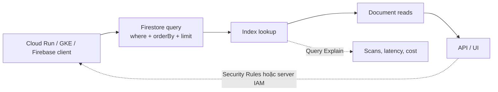

# Queries, indexes và giới hạn truy vấn Firestore

Ứng dụng bán hàng lưu các tài liệu `orders/{orderId}` trong **Cloud Firestore**. Một màn hình cần lấy *20 đơn PAID mới nhất của một tenant*, màn hình khác đếm tổng đơn và dashboard cần tra cứu sự kiện trong các subcollections. Với Firestore, khả năng truy vấn và chi phí phụ thuộc trực tiếp vào **cấu trúc document, toán tử, thứ tự sắp xếp và indexes**; không thể áp dụng tùy ý thói quen SQL như `JOIN` hoặc `OFFSET` cho mọi workload.

Bài thuộc chương **Firestore và Firebase** của module `CLOUD_PROVIDERS_GCP`. Người học sẽ viết query, xây dựng và tối ưu index, nhận diện giới hạn, bảo vệ dữ liệu bằng Security Rules/IAM, đo độ trễ và kiểm soát chi phí. Ví dụ chính sử dụng **Firestore Standard edition, Native mode, Core operations** và Firebase Admin SDK cho môi trường server; điểm khác biệt với **Enterprise edition** được nêu riêng vì quy tắc indexing và billing không giống nhau.

> **Phạm vi và an toàn:** Firestore Standard edition **yêu cầu index cho truy vấn và tự động tạo single-field indexes**. Firestore Enterprise edition ở Native mode **không bắt buộc index và không tự tạo single-field indexes**; nếu chưa tạo index, truy vấn có thể quét toàn collection, chậm và tốn read units. Cũng có Enterprise mode tương thích MongoDB với API khác. Trước khi thao tác, xác định **edition, mode, database ID, project, region và quyền**. Lab ưu tiên Emulator; các lệnh `firebase deploy` hoặc tạo index trên cloud có tác động thật và cần phê duyệt.

## 1. Mục tiêu học tập

Sau bài này, bạn có thể:

1. Phân biệt **document lookup**, **collection query**, **collection group query**, lọc `where`, `orderBy` và aggregation.
2. Sử dụng equality, range, `in`, `array-contains`, `OR`, `not-in` và hiểu giới hạn kết hợp toán tử.
3. Viết **pagination bằng cursor** thay cho offset để tránh đọc bỏ qua tốn phí.
4. Giải thích **single-field**, **composite**, **collection-group** và **index exemption**; chọn thứ tự fields hợp lý.
5. Chẩn đoán lỗi thiếu index, xây dựng `firestore.indexes.json` và triển khai index có kiểm soát.
6. Nhận diện các giới hạn **30 DNF disjunctions**, **10 inequality fields**, index entries/document và chi phí index scans.
7. Dùng **Query Explain** và metrics để tối ưu, phân biệt Security Rules và IAM.
8. Thực hiện lab local có dữ liệu mẫu và giải các tình huống truy vấn thực tế.

## 2. Mô hình dữ liệu và phạm vi query

Ví dụ ứng dụng nhiều tenant:

```text
orders/
  o-1001
    tenantId: "t1"
    status: "PAID"
    totalCents: 2500
    createdAt: <Timestamp>
    tags: ["web", "priority"]
    payload: <map lưu nội dung không dùng để tìm kiếm>
    events/
      e-1
        kind: "payment"
        occurredAt: <Timestamp>
  o-1002
    tenantId: "t1"
    status: "PENDING"
    ...
  o-1003
    tenantId: "t2"
    status: "PAID"
    ...
```

| Loại truy vấn | Phạm vi | Ví dụ |
| --- | --- | --- |
| **Document lookup** | Một document path xác định. | `orders/o-1001`; không phải query lọc nhiều docs. |
| **Collection query** | Documents trực tiếp trong `orders`. | Đơn của `tenantId == "t1"`. |
| **Subcollection query** | Một `orders/o-1001/events`. | Sự kiện của đúng một order. |
| **Collection group query** | Mọi collections có **ID `events`**, ở nhiều vị trí phân cấp. | Sự kiện `kind == "payment"` của nhiều orders. |
| **Aggregation query** | Trả `count`, `sum`, `average` từ dữ liệu/index phù hợp. | Đếm đơn PAID không tải mọi document về client. |

Firestore là document database, không tự hỗ trợ relational JOIN như PostgreSQL. Thiết kế dữ liệu thường **denormalize có chủ đích** và tối ưu cho các **access patterns** sẽ được truy vấn. Nếu cần báo cáo join/analytics phức tạp trên lượng lớn dữ liệu, cân nhắc **BigQuery** hoặc pipeline đồng bộ dữ liệu thay vì cố mô phỏng SQL join trên client.



## 3. Các toán tử lọc: chọn đúng ngữ nghĩa

Các ví dụ bên dưới sử dụng **JavaScript server SDK (`firebase-admin/firestore`)** và collection `orders`. Tên trường phải khớp kiểu dữ liệu thực; Firestore không ép string `"2500"` thành number `2500` để so sánh.

| Toán tử | Câu hỏi | Chú ý |
| --- | --- | --- |
| `==` | `status == "PAID"` | Equality; document thiếu field không match. |
| `<`, `<=`, `>`, `>=` | `totalCents >= 1000` | Range/inequality; tính đến thứ tự index. |
| `!=` | `status != "CANCELLED"` | Chỉ xét documents có field; có ràng buộc kết hợp. |
| `in` | `status in ["PAID","PENDING"]` | Tương đương OR nhiều equality trên một field; chịu giới hạn DNF. |
| `not-in` | `status not-in ["CANCELLED"]` | Tối đa 10 values; bỏ qua field thiếu và `null`; giới hạn tổ hợp nghiêm ngặt. |
| `array-contains` | `tags` chứa `"priority"` | Tìm phần tử trong array, không phải substring của string. |
| `array-contains-any` | `tags` chứa một trong nhiều values | OR trên array memberships; tối đa 30 values/disjunctions theo giới hạn áp dụng. |
| `OR`, `AND` | Kết hợp các điều kiện. | OR có thể bị giới hạn khi chuyển sang DNF. |

Ví dụ Core API (trích đoạn đặt trong hàm async sau khi đã có `db`):

```javascript
const orders = db.collection("orders");

// Equality + sort + limit: thường cần composite index ở Standard.
const recentPaid = await orders
  .where("tenantId", "==", "t1")
  .where("status", "==", "PAID")
  .orderBy("createdAt", "desc")
  .limit(20)
  .get();

// Một field range.
const expensive = await orders
  .where("totalCents", ">=", 5000)
  .orderBy("totalCents", "asc")
  .limit(20)
  .get();

// Membership và array membership.
const twoStates = await orders
  .where("status", "in", ["PAID", "PENDING"])
  .get();
const priority = await orders
  .where("tags", "array-contains", "priority")
  .get();
```

### 3.1. Toán tử `!=` và `not-in` không phải “mọi document khác X”

Nếu document không có field `status`, query `where("status","!=","CANCELLED")` **không** trả nó. Với `not-in`, documents có `status = null` cũng không match; danh sách so sánh có `null` có thể làm query không có kết quả. Muốn hiển thị “mọi trạng thái trừ CANCELLED” theo đúng nghiệp vụ, nên **gán trạng thái hợp lệ khi tạo document**, thay vì dựa vào sự vắng mặt của field.

### 3.2. `orderBy` cũng lọc theo sự tồn tại

`orderBy("createdAt","desc")` **loại documents không có `createdAt`**, ngay cả khi các điều kiện khác match. Một inequality trên field cũng có tác dụng yêu cầu field đó tồn tại. Nếu migration dữ liệu cũ bỏ trống `createdAt`, phân trang sẽ âm thầm không thấy những bản ghi này.

**Giải pháp:** backfill field có giá trị hợp lệ, chuẩn hóa schema ứng dụng, hoặc thiết kế query riêng cho dữ liệu legacy. Không giả định null và missing là một.

## 4. Composite queries, DNF và các giới hạn

### 4.1. Truy vấn OR và giới hạn 30 disjunctions (Standard)

Firestore Standard edition chuyển `or`, `in`, `array-contains-any` sang **disjunctive normal form (DNF)**: một OR của nhiều nhóm AND. Số nhóm OR cuối cùng **không được vượt 30**, và đây là giới hạn cố định.

Ví dụ:

```text
status IN [5 giá trị] AND region IN [6 giá trị]
→ 5 × 6 = 30 disjunctions: chạm mức tối đa.

status IN [5 giá trị] AND region IN [10 giá trị]
→ 5 × 10 = 50 disjunctions: KHÔNG HỢP LỆ.
```

Một lỗi phổ biến là chỉ đếm số `where` thấy trên code, trong khi kết hợp nhiều `in`/`OR` làm số nhánh tăng theo tích. Hãy giảm số values, chia query có kiểm soát rồi deduplicate/merge phía server khi cần, hoặc thiết kế field tổng hợp phù hợp; **chia query** có thể làm tăng reads và chi phí.

### 4.2. Bảng giới hạn quan trọng cho Standard Core queries

| Hạn chế | Giá trị / quy tắc | Ví dụ |
| --- | --- | --- |
| Tổng số OR branches sau DNF | **30 disjunctions** | `5 × 10 = 50` ⇒ lỗi. |
| Số values của `not-in` | **Tối đa 10** | Không dùng 11 trạng thái bị loại. |
| `not-in` không kết hợp với | `in`, `array-contains-any`, `or` hoặc `!=` | Đổi mô hình query/filter. |
| Số `not-in` hoặc `!=` | Chỉ **một** trong một query. | Không dùng hai phép phủ định trên hai fields. |
| `array-contains` | Tối đa **một trong mỗi DNF disjunction**, không cùng `array-contains-any` trong disjunction đó. | Tách logic khi cần. |
| Range/inequality fields | **Tối đa 10 fields**. | Không thiết kế bộ lọc tự do với hàng chục sliders. |
| Filters + sort orders + parent path | **Tối đa 100** khi tính theo DNF. | Collection con thêm parent path component. |

Các con số này áp dụng cho **Standard edition/Core query limitations**, không được suy rộng làm quy tắc tất cả Enterprise Pipeline/MongoDB operations. Với Enterprise, kiểm tra limits riêng của **edition và query API** được chọn.

### 4.3. Inequality nhiều fields: hợp lệ nhưng có thể tốn kém

Firestore Standard hỗ trợ range trên nhiều fields trong giới hạn, ví dụ:

```javascript
const q = db.collection("products")
  .where("priceCents", ">=", 2000)
  .where("rating", ">=", 4.5)
  .orderBy("priceCents", "asc")
  .orderBy("rating", "desc")
  .limit(25);
```

**Thứ tự fields trong index quyết định số index entries được scan.** Nếu lọc `priceCents >= 2000` loại được 95% records còn `rating >= 4.5` chỉ loại 10%, đặt field giá có selectivity cao trước trong index thường tốt hơn. Nếu sắp xếp theo field ít chọn lọc trước, index scan có thể rộng dù cuối cùng chỉ trả vài documents.

Đây là lý do cần đo bằng **Query Explain** thay vì tạo composite index theo thứ tự tùy ý. Query nhiều range fields có thể bị tính phí **index entries read** bên cạnh document reads.

## 5. Indexes: cấu trúc quyết định khả năng truy vấn

### 5.1. Ba loại cần phân biệt

| Index | Được tạo thế nào (Standard) | Ứng dụng |
| --- | --- | --- |
| **Single-field** | Thường tự động theo field (ascending, descending, array). | Filter/order trên một field. |
| **Composite** | Thường tạo thủ công qua Console/Firebase CLI. | Equality kết hợp sort hoặc nhiều fields/ranges. |
| **Collection-group scope** | Cần index đúng scope/query shape. | Truy vấn mọi subcollections có cùng ID, ví dụ `events`. |

Một index có **query scope**: `COLLECTION` hoặc `COLLECTION_GROUP`. Một composite index cho collection `orders` **không đương nhiên** hỗ trợ query collection group `events`, kể cả field names trùng nhau.

Firestore Standard có thể **merge single-field indexes** cho một số query, nhưng với `array-contains` + nhiều filters/sorts thì **composite index phù hợp** thường hiệu quả hơn. Một index được xây dựng không phải tức thời: backfill có thể mất thời gian, query sẽ chỉ dùng khi index sẵn sàng.

### 5.2. Thứ tự fields trong composite index

Ví dụ để tìm 20 đơn đã thanh toán của tenant t1, mới nhất trước:

```javascript
db.collection("orders")
  .where("tenantId", "==", "t1")
  .where("status", "==", "PAID")
  .orderBy("createdAt", "desc")
  .limit(20);
```

Composite index `tenantId ASC, status ASC, createdAt DESC` là một phương án phù hợp:

```text
Index ordering:
 tenantId ASC  →  status ASC  →  createdAt DESC  →  __name__ (tie-breaker)
    equality       equality        sort/scan
```

Với equality, chọn ascending/descending ở fields equality không thay đổi bản chất equality matching, nhưng **sorting direction** ở field `createdAt` phải đáp ứng query. Firestore Standard thường tự thêm `__name__` để quyết định thứ tự ổn định khi giá trị indexed fields bằng nhau. Nếu cần thứ tự ID riêng, thiết kế index và cursor tương ứng.

### 5.3. Exemption: bớt index khi không truy vấn field

Mỗi document write có thể cập nhật nhiều index entries (**index fanout**), làm tăng write latency và index storage. Có thể miễn single-field indexes cho:

- `payload` chứa map/text dài chỉ để hiển thị, không dùng làm filter/order.
- Mảng lớn không dùng để `array-contains`.
- TTL timestamp hoặc field thời gian tăng liên tục **không cần query**; nếu field tăng đều và được index, high-write hotspot có thể trở thành bottleneck.

**Cẩn trọng:** miễn index đồng nghĩa queries phụ thuộc field đó có thể thất bại (Standard). Kiểm kê access patterns trước khi thêm exemption. Nếu collection có rất nhiều writes với indexed timestamp tăng tuần tự, hướng dẫn Firestore nêu giới hạn khoảng **500 writes/s** cho collection trong tình huống cụ thể này; **không coi 500/s là hard limit chung cho mọi collection**.

### 5.4. Khác biệt với Enterprise

| Chủ đề | **Standard Native/Core** | **Enterprise Native/Core** |
| --- | --- | --- |
| Index bắt buộc? | **Có**; query thiếu index phù hợp có thể lỗi. | **Không**; query thiếu index có thể chạy bằng full collection scan. |
| Single-field tự động? | **Có** theo cấu hình default. | **Không**; tạo index chủ động. |
| Tác động của thiếu index | Query lỗi hoặc cần index mới. | Query có thể chậm/tốn read units dù không báo thiếu index. |
| Billing reads/writes | Chủ yếu theo document reads/writes và index-entry reads khi áp dụng. | Theo **read/write units** dựa trên lượng bytes và index work. |
| Chẩn đoán | Missing-index link, Query Explain/index scans. | Query Explain/Insights để phát hiện full scans và giảm read units. |

Đừng dùng quy tắc “mỗi field đều có index mặc định” với Enterprise. Ngược lại, đừng giả định ở Standard một query composite thiếu index sẽ tự scan cả collection và chạy bình thường.

## 6. Quản lý index bằng Console và Firebase CLI

### 6.1. Từ lỗi thiếu index tới bản cấu hình

Trong **Standard edition**, một query không có index phù hợp thường trả lỗi kèm liên kết **Create index** dẫn đến Firebase Console. Quy trình an toàn:

1. Đọc **query filters, sort direction, collection scope** trong lỗi.
2. Đối chiếu tập query của ứng dụng; không tạo index cho truy vấn sai hoặc có thể đơn giản hóa.
3. Tạo index trong môi trường staging, đợi trạng thái **Ready/Enabled** và chạy lại query.
4. Đưa index definition vào version control/IaC; review quyền `datastore.indexes.create` trước deploy.
5. Kiểm tra index entries, read costs và write latency khi dữ liệu lớn.

Để quản lý như mã nguồn, tạo tệp `firestore.indexes.json` **trong dự án ứng dụng của người học**:

```json
{
  "indexes": [
    {
      "collectionGroup": "orders",
      "queryScope": "COLLECTION",
      "fields": [
        {"fieldPath": "tenantId", "order": "ASCENDING"},
        {"fieldPath": "status", "order": "ASCENDING"},
        {"fieldPath": "createdAt", "order": "DESCENDING"}
      ]
    },
    {
      "collectionGroup": "events",
      "queryScope": "COLLECTION_GROUP",
      "fields": [
        {"fieldPath": "kind", "order": "ASCENDING"},
        {"fieldPath": "occurredAt", "order": "DESCENDING"}
      ]
    }
  ],
  "fieldOverrides": [
    {
      "collectionGroup": "orders",
      "fieldPath": "payload",
      "indexes": []
    }
  ]
}
```

**Giải thích:** index đầu phục vụ lọc tenant/trạng thái và sort thời gian; index thứ hai phục vụ `collectionGroup("events")`; exemption `payload` loại index đơn trường không cần thiết. Đừng thêm exemption cho field vẫn dùng trong equality/sort hoặc collection-group query mà chưa đánh giá tác động.

Trong `firebase.json`:

```json
{
  "firestore": {
    "rules": "firestore.rules",
    "indexes": "firestore.indexes.json"
  },
  "emulators": {
    "firestore": {"port": 8080}
  }
}
```

Ví dụ quản lý index bằng CLI (chỉ đọc trước, thay đổi thật sau):

```bash
PROJECT_ID="orders-dev"

# CHỈ ĐỌC danh sách index trên project được chọn.
firebase firestore:indexes --project "$PROJECT_ID"

# THAY ĐỔI INDEX CLOUD: chỉ chạy khi đã review JSON,
# chắc chắn đang ở project/staging cho phép và có quyền.
firebase deploy --only firestore:indexes --project "$PROJECT_ID"
```

Lệnh deploy **không phải read-only**. Đọc diff trước khi cập nhật cấu hình index, vì thay đổi `fieldOverrides` hoặc xóa index có thể làm queries đang chạy không còn được hỗ trợ. Index creation/backfill mất thời gian; đợi hoàn tất và xác minh logs/console trước khi chuyển traffic.

### 6.2. Giới hạn tài nguyên index (Standard)

| Giới hạn | Giá trị được công bố | Ý nghĩa |
| --- | ---: | --- |
| Composite indexes / database | **200** nếu chưa bật billing, **1.000** nếu đã bật billing (có thể yêu cầu tăng). | Tránh tạo index cho mọi tổ hợp filter tùy ý. |
| Single-field configurations / database | **200 / 1.000** theo billing tương ứng. | Exemption và TTL trên cùng field tính theo cấu hình field. |
| Fields / composite index | **100** | Index quá rộng là tín hiệu thiết kế sai. |
| Index entries / document | **40.000** | Array/map lớn và nhiều composite indexes dễ bùng nổ entries. |
| Kích thước mỗi index entry | **7,5 KiB** | Tránh index payload lớn. |
| Tổng kích thước index entries / document | **8 MiB** | Index fanout có giới hạn riêng với document size. |
| Indexed field value | **1.500 bytes**; giá trị dài hơn bị truncate trong index. | Queries dùng giá trị bị truncate có thể cho kết quả không nhất quán. |

**Lưu ý:** bảng là quota/index limits cho Standard edition, không phải mức hiệu năng cam kết. Xác minh bảng [Usage and limits](https://firebase.google.com/docs/firestore/quotas) theo edition/region của database trước khi lên production. Index giới hạn không thay thế giới hạn kích thước document (khoảng 1 MiB) hay API request.

## 7. Sắp xếp, cursor pagination và aggregation

### 7.1. Cursor thay cho offset

Khi hiển thị “20 đơn mỗi trang”, nên lấy trang đầu rồi dùng **DocumentSnapshot cuối làm cursor**:

```javascript
const baseQuery = db.collection("orders")
  .where("tenantId", "==", "t1")
  .orderBy("createdAt", "desc");

const firstPage = await baseQuery.limit(20).get();
const lastDoc = firstPage.docs[firstPage.docs.length - 1];

if (lastDoc) {
  const secondPage = await baseQuery
    .startAfter(lastDoc)
    .limit(20)
    .get();
  console.log(secondPage.docs.map(doc => doc.id));
}
```

`startAfter(lastDoc)` không lặp lại document ở điểm cắt; `startAt(lastDoc)` bao gồm điểm cắt. Dùng **DocumentSnapshot cursor** tránh ambiguity khi nhiều documents có cùng `createdAt` nhờ thứ tự document ID tie-breaker phù hợp. Pagination không phải snapshot cố định của database: records có thể được thêm/sửa/xóa giữa hai lần tải trang; nếu cần danh sách cố định, định nghĩa watermark/snapshot strategy.

Với **offset(100)**, Firestore phải duyệt qua documents bị bỏ qua và tính phí đọc cho những documents đó theo Standard pricing. Vì vậy **offset không phải cách tiết kiệm reads**; cursor + `limit` thường phù hợp hơn.

### 7.2. Aggregation trả kết quả nhỏ

Thay vì tải 10.000 documents rồi đếm trên client, sử dụng server-side aggregation khi phù hợp:

```javascript
const countSnapshot = await db.collection("orders")
  .where("tenantId", "==", "t1")
  .where("status", "==", "PAID")
  .count()
  .get();

console.log("Số đơn PAID:", countSnapshot.data().count);
```

Firestore hỗ trợ **`count()`, `sum()`, `average()`** cho những truy vấn/SDK phù hợp. Aggregations đọc index và không tải toàn bộ matching documents, nhưng **vẫn có phí và latency theo số index entries được scan**; với một số trường hợp lớn có thể vượt timeout. Nếu cần bộ đếm realtime, tải rất cao hoặc dashboard báo cáo phức tạp, cân nhắc counters pre-aggregated hoặc BigQuery.

## 8. Lab local: seed, query, phân trang và collection group

Lab dùng **Firebase Emulator Suite** để tránh ghi dữ liệu và phát sinh phí Cloud Firestore thật. Người học tạo thư mục lab riêng, có Node.js và Java runtime phù hợp Firebase Emulator. Worker **không tạo các tệp lab này** trong repository học liệu.

### 8.1. Chuẩn bị

```bash
mkdir firestore-query-lab
cd firestore-query-lab
npm init -y
npm install firebase-admin
npm install --save-dev firebase-tools
```

Tạo `firebase.json` và `firestore.indexes.json` như mục 6. Trong `firestore.rules` dành **riêng cho lab server Admin SDK**, thiết lập deny-by-default:

```text
rules_version = '2';
service cloud.firestore {
  match /databases/{database}/documents {
    match /{document=**} {
      allow read, write: if false;
    }
  }
}
```

**Firebase Admin SDK** trong script Node dùng server credentials và **bỏ qua Firestore Security Rules** kể cả khi có rules deny; lab chỉ nhằm thử query. Đừng copy quy tắc này cho ứng dụng web/mobile cần quyền truy cập. Nếu muốn test client SDK và security rules, dùng emulator client với Auth mock và bộ security rules riêng, có cả test cho truy vấn bị từ chối.

Chạy Emulator:

```bash
# Terminal A: Emulator dùng project giả, không gọi database cloud.
npx firebase emulators:start \
  --only firestore \
  --project demo-firestore-lab
```

### 8.2. Script Node.js có thể chạy

Tạo `demo.mjs`:

```javascript
import { initializeApp } from "firebase-admin/app";
import { getFirestore, Timestamp } from "firebase-admin/firestore";

const projectId = "demo-firestore-lab";
const app = initializeApp({ projectId });
const db = getFirestore(app);

// Guard: chỉ cho phép script này tác động Emulator.
if (!process.env.FIRESTORE_EMULATOR_HOST) {
  throw new Error("Chưa đặt FIRESTORE_EMULATOR_HOST");
}

const orders = db.collection("orders");
const records = [
  ["o-1001", "t1", "PAID", 2500, "2026-11-01T10:00:00Z", ["priority"]],
  ["o-1002", "t1", "PENDING", 1300, "2026-11-02T10:00:00Z", ["web"]],
  ["o-1003", "t1", "PAID", 5000, "2026-11-03T10:00:00Z", ["web"]],
  ["o-1004", "t2", "PAID", 8100, "2026-11-04T10:00:00Z", ["priority"]]
];

for (const [id, tenantId, status, totalCents, iso, tags] of records) {
  await orders.doc(id).set({
    tenantId, status, totalCents, tags,
    createdAt: Timestamp.fromDate(new Date(iso))
  });
}
await orders.doc("o-1001").collection("events").doc("e-1").set({
  kind: "payment",
  occurredAt: Timestamp.fromDate(new Date("2026-11-01T10:01:00Z"))
});

// Query 1: equality + sort.
const paid = orders
  .where("tenantId", "==", "t1")
  .where("status", "==", "PAID")
  .orderBy("createdAt", "desc");

const first = await paid.limit(1).get();
console.log("Trang 1:", first.docs.map(d => d.id)); // o-1003

if (!first.empty) {
  const second = await paid.startAfter(first.docs[0]).limit(1).get();
  console.log("Trang 2:", second.docs.map(d => d.id)); // o-1001
}

// Query 2: aggregation, chỉ đếm đơn của tenant t1.
const count = await orders.where("tenantId", "==", "t1").count().get();
console.log("Tổng đơn t1:", count.data().count); // 3

// Query 3: đọc across subcollections có collection ID events.
const events = await db.collectionGroup("events")
  .where("kind", "==", "payment")
  .orderBy("occurredAt", "desc")
  .get();
console.log("Events:", events.docs.map(d => d.ref.path));
```

Trong Terminal B (Bash):

```bash
# Chỉ ghi dữ liệu vào Emulator trên loopback.
export FIRESTORE_EMULATOR_HOST="127.0.0.1:8080"
node demo.mjs
```

Kết quả dự kiến: `Trang 1: [ 'o-1003' ]`, `Trang 2: [ 'o-1001' ]`, `Tổng đơn t1: 3`, một sự kiện ở `orders/o-1001/events/e-1`. Chạy lại script sẽ **ghi đè cùng các document IDs trong Emulator**, không tạo thêm records.

**Giới hạn kiểm thử:** Emulator giúp thử business/query logic, nhưng **không phải bằng chứng mọi composite indexes, quota, Query Explain và performance giống production**. Cần staging Firestore **Standard edition** riêng để kiểm tra index build, Security Rules client, IAM, transaction contention và hóa đơn, với approval trước khi ghi.

### 8.3. Thử một query không có `createdAt`

Thêm một document `orders/o-legacy` có `tenantId=t1` và `status=PAID` nhưng **không có `createdAt`**. Chạy lại query `paid` ở trên: `o-legacy` **không xuất hiện** do `orderBy("createdAt")`. Bài học là chuẩn hóa schema/backfill field, không phải tăng số lượng index.

## 9. Query Explain: đo index scans trước khi tối ưu

**Query Explain** giúp xác định index đang dùng, số index entries scan, số documents scan và read operations. Chạy từ **Firestore server client library** với IAM; không yêu cầu Firebase client authentication. Ví dụ Node Admin SDK trên môi trường **staging cloud**, chỉ sau khi đã cấp quyền:

```javascript
const q = db.collection("products")
  .where("priceCents", ">=", 2000)
  .where("rating", ">=", 4.5);

// Plan only: không thực thi query trên dữ liệu.
const plan = await q.explain({ analyze: false });
console.log(plan.metrics.planSummary);

// Thực thi và thu runtime stats: CÓ TÍNH PHÍ như query thật.
const analyzed = await q.explain({ analyze: true });
console.log(analyzed.metrics.planSummary);
console.log(analyzed.metrics.executionStats);
```

**Plan-only vẫn có mức phí tối thiểu (một read operation theo Standard pricing)**, còn `analyze: true` **thực thi** query, nên được tính phí reads/index scans tương ứng. Không chạy phân tích trên production bằng truy vấn rộng chỉ để “xem chuyện gì xảy ra”.

Quy trình tối ưu:

1. Ghi lại query shape, số kết quả, latency p95, `indexesUsed` và `index_entries_scanned`.
2. Tìm field inequality có **selectivity** cao nhất, sắp xếp composite index sao cho giảm scan.
3. Thử staging với dữ liệu đại diện, so plan/index entries/latency/cost trước và sau.
4. Xác minh indexes khác vẫn hỗ trợ các query đang chạy và write latency/storage không tăng bất thường.

**Query Explain không thay thế load testing**: một query đơn lẻ không phản ánh cache, contention, p99, high-write hotspots hay listeners realtime. Enterprise có Query Explain và cost model khác; kiểm tra hướng dẫn riêng cho Core/Pipeline queries của edition đó.

## 10. Security Rules, IAM và truy vấn nhiều tenant

**Firestore Security Rules không phải bộ lọc dữ liệu.** Với Firebase Web/Mobile SDK, Firestore đánh giá **tập kết quả query có thể trả**; nếu query có khả năng trả document trái rule, **cả query bị từ chối**, không trả phần “được phép”.

Ví dụ một rule minh họa cho client có custom claim `tenantId`:

```text
rules_version = '2';
service cloud.firestore {
  match /databases/{database}/documents {
    match /orders/{orderId} {
      allow get: if request.auth != null
        && resource.data.tenantId == request.auth.token.tenantId;
      allow list: if request.auth != null
        && request.query.limit <= 20
        && resource.data.tenantId == request.auth.token.tenantId;
      allow create, update, delete: if false;
    }
  }
}
```

Để client có thể liệt kê, query phải bao gồm ràng buộc **`where("tenantId","==",currentTenantId)`** và `limit(20)`, với tenant ID đến từ danh tính được kiểm soát. **Không tin tenant ID tự truyền trong query param**; với ứng dụng thực cần ngăn người dùng tự chọn tenant khác khi backend ghi token/claims.

**Đặc biệt:** Firebase Admin SDK, server SDK và backend sử dụng IAM/ADC **bỏ qua Security Rules**. Cloud Run/GKE API phải tự xác minh caller/tenant và chủ động gắn filter. Dù query có composite index đúng, nó **không tự cấp quyền** đọc dữ liệu.

Collection-group queries cần rules thích hợp (thường `rules_version = '2'` và recursive wildcard) cho collection ID mục tiêu. Không cấp `allow read: if true` trên mọi `events` chỉ để hết lỗi `PERMISSION_DENIED`.

## 11. Chi phí, scaling và giới hạn thiết kế

| Tác nhân | Rủi ro | Cách tối ưu |
| --- | --- | --- |
| Đọc quá nhiều documents | Chi phí reads, network và latency. | `where` có chọn lọc, `limit`, pagination cursor. |
| Query nhiều range fields | Scan nhiều index entries, tính phí ngoài document reads khi áp dụng. | Index ordering theo selectivity, Query Explain. |
| `offset` lớn | Trả ít documents nhưng vẫn trả phí cho các docs bị bỏ qua. | `startAfter` theo DocumentSnapshot. |
| Index fanout lớn | Tăng write latency, index storage, quota. | Giảm indexes không dùng, exemptions cho payload lớn. |
| Realtime listeners không cần thiết | Reconnects và thay đổi documents tạo reads. | Chỉ listen màn hình cần realtime, unsubscribe đúng lúc. |
| Trường timestamp tăng tuần tự được index | Hotspot ở index space khi write rate cao. | Exempt nếu không cần query, phân tán document IDs. |
| Aggregation trên dữ liệu cực lớn | Index scan tăng latency và phí, có timeout. | Counters precomputed, partitioning/BigQuery khi phù hợp. |
| Enterprise query thiếu index | Full collection scan, read units lớn. | Tạo indexes theo query shape, Query Explain/Insights. |

### 11.1. Sizing chi phí minh họa

Một API chạy query `limit(20)` 1.000 lần/ngày và mỗi lần trả đủ 20 documents:

\[
20 \times 1.000 = 20.000\ \text{document results/ngày}
\]

Trong **Standard edition**, đây là mức cơ sở để ước lượng **document reads** (nếu mỗi lần từ server và không có điều kiện caching khác); còn tính phí **index entries read** theo hình dạng query, listener reconnects, minimum charge và quy tắc hiện hành. **Không suy ra đúng tiền** chỉ từ phép nhân này khi chưa xem bảng giá, region, free tier và thống kê Query Explain.

### 11.2. Bảo vệ ứng dụng khỏi query không giới hạn

- Bắt buộc `limit` ở endpoints danh sách; whitelist fields được filter/sort.
- Không cho client truyền tự do hàng chục `in` values hoặc tổ hợp DNF vượt quota.
- Dùng `tenantId` và **server authorization** cho multi-tenant queries.
- Chuẩn hóa field types; giá tiền nên dùng **integer cents** thay floating point nếu nghiệp vụ cần chính xác.
- Kiểm soát độ dài arrays/maps và indexes để tránh 40.000 entries/document.
- Dùng random/distributed document IDs cho write-heavy collections; không dùng IDs tăng tuần tự nếu tạo hotspot.

## 12. Troubleshooting nhanh

| Hiện tượng | Nguyên nhân khả dĩ | Cách xử lý |
| --- | --- | --- |
| `FAILED_PRECONDITION: query requires an index` | Standard thiếu composite/collection-group index hoặc index đang build. | Mở link index, review query scope/fields/direction, đợi Ready. |
| Query chạy nhưng trả thiếu dữ liệu | `orderBy`/inequality loại documents thiếu field; filter sai type. | Kiểm tra schema, missing vs null, backfill. |
| `INVALID_ARGUMENT` với nhiều `in` | DNF vượt 30, `not-in` kết hợp sai. | Tính DNF, giảm values/tách query, không vượt limits. |
| Read costs cao dù ít results | Index scan rộng, `offset` lớn, listeners/reconnects. | Query Explain, index order, cursors, cache phù hợp. |
| Write latency tăng sau khi thêm index | Index fanout/large arrays, sequential indexed field. | Giảm index thừa, exemptions, đo index storage/hotspot. |
| `PERMISSION_DENIED` ở client | Rules không cho phép **toàn bộ query** hoặc thiếu auth. | Kiểm tra tenant constraint, Rules emulator tests. |
| Server SDK đọc được nhưng Web SDK bị từ chối | Admin bypass Rules; client chịu Rules. | Phân biệt IAM và Rules; không nới Rules vô điều kiện. |
| Enterprise query rất chậm dù không lỗi | Index không bắt buộc nên full scan. | Query Explain/Insights, tạo index phù hợp. |
| `count()` trên tập lớn chậm | Aggregation quét nhiều index entries. | Cân nhắc precomputed counters/BigQuery. |

## 13. Bài tập vận dụng có đáp án

**Bài 1 — Chọn index.** Query `tenantId=="t1" AND status=="PAID" ORDER BY createdAt DESC` cần composite index nào ở Standard?

*Đáp án:* Một lựa chọn là **`tenantId ASC, status ASC, createdAt DESC`** với scope `COLLECTION` cho `orders`; xác minh qua index suggestion/Query Explain.

**Bài 2 — DNF.** Hai `in` filters có 5 và 8 values. Query có hợp lệ theo giới hạn Standard không?

*Đáp án:* `5 × 8 = 40` disjunctions, **vượt 30**; chia hoặc thiết kế lại điều kiện có kiểm soát.

**Bài 3 — Missing field.** Document thiếu `createdAt` có match query filter `status=="PAID"` và `orderBy("createdAt")` không?

*Đáp án:* **Không.** `orderBy` chỉ trả documents có field đó; cần chuẩn hóa/backfill.

**Bài 4 — Not-in.** `where("status","not-in",["CANCELLED"])` có bao gồm documents thiếu `status` hoặc `status=null`?

*Đáp án:* **Không.** `not-in` không phải cách lấy cả missing/null; tối đa 10 comparison values và không kết hợp tùy ý với `in`/`or`.

**Bài 5 — Pagination.** API hiển thị trang thứ 100 bằng `offset(1980).limit(20)`. Làm sao giảm reads?

*Đáp án:* **Cursor pagination** bằng `startAfter(lastDoc)` và `limit(20)`, cache/bookmark cursor nếu cần nhảy trang; offset vẫn tính phí reads cho documents bị bỏ qua.

**Bài 6 — Collection group.** Tại sao index scope `COLLECTION` cho `orders` không tự phục vụ `collectionGroup("events")`?

*Đáp án:* Khác **collection ID và query scope**. Phải tạo index `COLLECTION_GROUP` cho `events` theo filter/sort; client còn cần Security Rules cho group.

**Bài 7 — Giới hạn entries.** Một document có array rất lớn được index và vượt 40.000 index entries. Nên xử lý thế nào?

*Đáp án:* Tách/mô hình lại dữ liệu, giới hạn array và miễn index nếu field không được truy vấn; không tạo thêm composite indexes trên mảng đó.

**Bài 8 — Standard vs Enterprise.** Một query thiếu composite index: Standard trả lỗi, Enterprise Native vẫn chạy nhưng chậm. Vì sao?

*Đáp án:* **Standard bắt buộc index**; **Enterprise không yêu cầu và không tự tạo index**, nên có thể full scan và tiêu tốn read units. Tạo index cần thiết theo Query Explain.

**Bài 9 — Rules.** Client chạy query không có `where("tenantId","==",...)` nhưng Rules chỉ cho đọc đơn thuộc tenant. Firestore có tự lọc documents theo Rules không?

*Đáp án:* **Không.** Security Rules **không phải filters**; query có thể bị từ chối toàn bộ. Client phải đặt constraints phù hợp, server phải tự enforce tenant auth.

**Bài 10 — Đếm đơn.** Dashboard chỉ cần số đơn đã thanh toán, có nên tải toàn bộ documents rồi `length`?

*Đáp án:* Thường không. Dùng **`count()` aggregation** nếu phù hợp; với dataset cực lớn, yêu cầu realtime hoặc nhiều dimensions, cân nhắc counters/BigQuery và chi phí index scans.

## 14. Checklist trước production

- [ ] Xác định database **edition/mode**, query API và chi phí đúng edition.
- [ ] Thống kê access patterns và schema: field types, null/missing, tenant ID, document IDs.
- [ ] Có composite/collection-group indexes cho mọi query quan trọng ở Standard.
- [ ] Index fields đúng thứ tự equality/range/order; xác minh Query Explain và staging.
- [ ] `in`/`OR` không vượt 30 DNF branches; `not-in` và inequalities tuân giới hạn.
- [ ] Dùng cursor + `limit` thay offset cho danh sách dài.
- [ ] Có index exemptions hợp lý cho payload/arrays/TTL fields không dùng để query.
- [ ] Kiểm soát quota index entries/document, index entry size, số indexes và write hotspots.
- [ ] Client Security Rules được test; server SDK dùng IAM và kiểm tra tenant authorization.
- [ ] Query Explain, p95 latency, read/write/index costs và hot documents có dashboard.
- [ ] Có kế hoạch rollout index/backfill, migration schema và rollback nếu query bị lỗi.
- [ ] Đã thử lỗi index thiếu, missing field, DNF vượt mức, denied Rules và tải cao.

## 15. Tổng kết

Truy vấn Firestore tốt bắt đầu từ **access pattern**: chọn document/collection/group phù hợp, viết filters và sort có ý nghĩa, giới hạn kết quả và dùng cursor. **Standard edition** đòi hỏi indexes (single-field tự động, composite/collection-group tùy query); **Enterprise edition** cho phép query thiếu index nhưng có thể quét toàn collection. Các giới hạn DNF, inequality, index fanout và field existence khiến những truy vấn “trông hợp lý” vẫn có thể sai hoặc tốn kém.

Trước production, hãy **đo Query Explain và billable reads**, quản lý indexes như mã nguồn, kiểm tra authorization (Rules/IAM) và thử với dữ liệu/tải thực. **Index đúng tăng khả năng tìm kiếm, nhưng không thay thế Security Rules, tenant isolation hay thiết kế dữ liệu tốt.**

### Tài liệu chính thức

- [Firestore editions: Standard vs Enterprise](https://firebase.google.com/docs/firestore/compare-editions-for-native-mode)
- [Firestore — Queries và giới hạn toán tử](https://firebase.google.com/docs/firestore/query-data/queries)
- [Range filters trên nhiều fields](https://firebase.google.com/docs/firestore/query-data/multiple-range-fields)
- [Index overview (Standard)](https://firebase.google.com/docs/firestore/query-data/index-overview)
- [Index management và missing-index errors](https://firebase.google.com/docs/firestore/query-data/indexing)
- [Firebase CLI index config reference](https://firebase.google.com/docs/reference/firestore/indexes)
- [Firestore quotas và index limits](https://firebase.google.com/docs/firestore/quotas)
- [Order, limit và cursors](https://firebase.google.com/docs/firestore/query-data/query-cursors)
- [Aggregation queries](https://firebase.google.com/docs/firestore/query-data/aggregation-queries)
- [Query Explain](https://firebase.google.com/docs/firestore/query-explain)
- [Firestore Security Rules và queries](https://firebase.google.com/docs/firestore/security/rules-query)
- [Firestore pricing](https://firebase.google.com/docs/firestore/pricing)
- [Best practices for Firestore](https://firebase.google.com/docs/firestore/best-practices)
