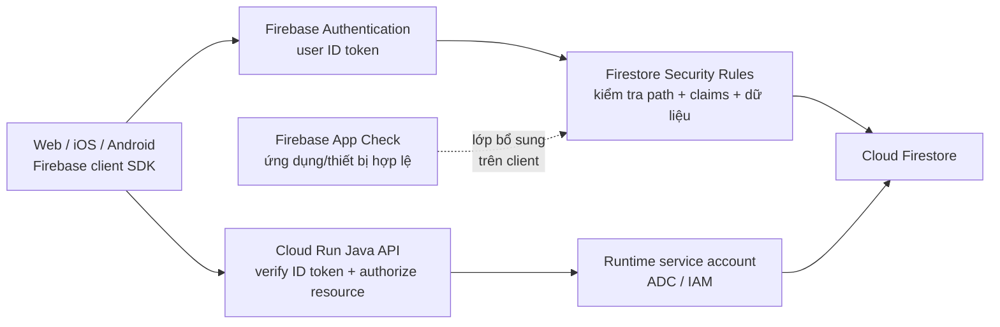

# Security Rules, IAM và ranh giới client, server

Một website đặt hàng dùng **Firebase Authentication** để đăng nhập, **Cloud Firestore** để đọc lịch sử đơn hàng và **Cloud Run Java** để xác nhận thanh toán. Khi người dùng sửa ID của đơn hàng trong trình duyệt, hệ thống phải từ chối truy cập đơn của người khác. Nhưng nếu chỉ cấu hình **Firestore Security Rules** mà backend Java dùng **Admin SDK** để đọc mọi dữ liệu rồi trả về không kiểm tra quyền, lỗ hổng vẫn tồn tại: **server SDK không chịu Security Rules**.

Bài thuộc chương **Firestore và Firebase** của module **CLOUD_PROVIDERS_GCP**, kết nối việc tổ chức project/IAM, Cloud Run, GKE, lưu trữ và cơ sở dữ liệu với bảo mật nhiều lớp, phát hành có kiểm thử và giám sát chi phí. Trọng tâm là xác định **ranh giới tin cậy giữa client và server**, dùng Security Rules cho Firebase web/mobile SDK, IAM cho backend và authorization nghiệp vụ ở từng đường truy cập.

> Mọi project, tenant, UID, service account, dữ liệu và lệnh deploy trong bài đều là ví dụ. Không áp rules mẫu trực tiếp lên production nếu chưa kiểm thử toàn bộ đường đọc/ghi và chuẩn bị rollback. Không nhúng service account private key, access token hay thông tin khách hàng vào frontend hoặc log.

## Mục tiêu

Sau bài học, bạn có thể:

1. Phân biệt **Firebase Auth**, **Firestore Security Rules**, **Google Cloud IAM**, **App Check** và backend authorization.
2. Viết Rules v2 với `request.auth`, `resource`, `request.resource`, `get/list/create/update/delete` và validation các trường.
3. Thiết kế Rules ngăn đọc chéo **tenant/owner**, hiểu vì sao **Rules không phải bộ lọc query**.
4. Giải thích vì sao **Java server/Admin SDK dùng ADC + IAM**, không được “bảo vệ” bởi Rules của Firebase client.
5. Xác minh Firebase ID token trên Cloud Run, kiểm tra tenant/owner trước khi trả dữ liệu; quản lý custom claims an toàn.
6. Dùng Firebase Emulator Suite để kiểm thử **allow/deny** trước khi deploy, nhận diện rủi ro rules chồng lấn.
7. Chọn IAM tối thiểu, kiểm soát chi phí đọc Rules và lập runbook xử lý `PERMISSION_DENIED`.

## 1. Bốn lớp kiểm soát: không dùng thay nhau



| Thành phần | Kiểm tra gì? | Áp dụng cho | **Không** làm được |
| --- | --- | --- | --- |
| **Firebase Authentication** | Người dùng đăng nhập, có ID token hợp lệ | Client và backend xác minh token | Tự quyết định ai được xem đơn nào |
| **Firestore Security Rules** | Đường dẫn document, auth claims, dữ liệu trước/sau ghi | **Web/mobile Firebase Firestore SDK** | Chặn thao tác Java Admin/server SDK |
| **Google Cloud IAM** | Principal Google/service account có permission Firestore | **Server SDK/Admin SDK, Google OAuth IAM API calls** | Tự kiểm tra order owner hoặc tenant ID trong từng document |
| **Firebase App Check** | Request xuất phát từ ứng dụng/thiết bị được xác minh theo cơ chế attestation | Client Firebase SDK được hỗ trợ | Thay thế đăng nhập, authorization hoặc IAM |
| **Backend authorization** | User đã xác minh có quyền thao tác với tài nguyên cụ thể không | Cloud Run/GKE/API server | Tự thay thế IAM để gọi Firestore |

**Ranh giới cốt lõi:**

- Web/mobile Firebase SDK gọi Firestore → **Rules** được đánh giá cho request (và Firebase Auth claims nếu có).
- Java server SDK/Firebase Admin SDK dùng **Application Default Credentials (ADC)** → **IAM** được đánh giá; **Rules bị bỏ qua**.
- Client gọi Java API → Java phải **xác minh ID token** và **kiểm tra quyền nghiệp vụ**, rồi chính Java dùng IAM tới Firestore.
- Những API requests dùng Google OAuth credentials theo đường server/IAM cũng không được coi như Firebase client SDK. Đừng suy đoán chỉ từ giao thức HTTP mà mọi call đều đi qua Rules.

**Đề xuất kiến trúc:** cho client tự đọc những dữ liệu ít nhạy cảm đã được Rules khóa chặt; để backend sở hữu những write có hệ quả quan trọng như cập nhật giá, xác nhận thanh toán, đổi role, hoàn tiền hoặc chuyển tenant.

## 2. Security Rules hoạt động như thế nào?

Security Rules là ngôn ngữ **allow**, không có một rule `deny` ưu tiên cao hơn `allow`. Nếu không có `allow` khớp và trả `true`, request bị từ chối. Nếu **hai `match` chồng lấn**, chỉ cần **một `allow` trả `true`** là request được phép.

### Cấu trúc tối thiểu

```javascript
rules_version = '2';
service cloud.firestore {
  match /databases/{database}/documents {
    match /profiles/{uid} {
      allow get: if request.auth != null && request.auth.uid == uid;
    }
  }
}
```

- `rules_version = '2'`: cú pháp Rules v2; cần thiết khi dùng một số kiểu recursive wildcard/collection group queries.
- `match /databases/{database}/documents`: áp vào database Firestore theo đường dẫn, các `match` bên trong chọn documents.
- `request.auth.uid`: UID từ Firebase Auth được dịch vụ xác minh; **không** phải field `uid` do client tự gửi.
- `get` đọc **một document**; `list` đọc qua **query hoặc collection listing**; `read` bao gồm cả hai.
- `create`, `update`, `delete` có thể được tách thay vì `write`; giúp không vô tình cho phép xóa/sửa.

**Ví dụ nguy hiểm cần tránh:**

```javascript
// Không dùng trên production:
match /{document=**} {
  allow read, write: if request.auth != null;
}
```

Nó cho **bất kỳ tài khoản đã đăng nhập** quyền đọc/sửa mọi documents, gồm dữ liệu tenant khác. Quy tắc `allow ... if false` ở chỗ khác **không thể phủ định** một `allow` rộng đã trả `true`.

### Các biến quan trọng

| Biến / hàm | Ý nghĩa | Ví dụ |
| --- | --- | --- |
| `request.auth.uid` | ID người dùng Firebase Auth | Chỉ đọc `profiles/{uid}` của chính mình |
| `request.auth.token` | Verified ID token claims, gồm custom claims do server cấp | `tenant_id` hoặc `admin` |
| `resource.data` | Dữ liệu document **hiện có** | `ownerUid` trước update |
| `request.resource.data` | Trạng thái document **sau write được đề xuất** | Chặn đổi `ownerUid`, `totalMinor` |
| `request.time` | Thời điểm request theo Rules | So với server timestamp |
| `get(path)`, `exists(path)` | Đọc document liên quan trong Rules | Kiểm tra membership trong tổ chức |
| `getAfter(path)` | Xem trạng thái sau batch/transaction trước commit | Bảo vệ bất biến xuyên documents |

Rules **không phải nơi chạy business workflow**: không gọi API thanh toán, không sửa documents khác, không tạo token hay xóa dữ liệu. Một rule chỉ quyết định **cho phép hoặc từ chối** request.

## 3. Ví dụ Rules đa tenant có kiểm soát

Giả sử dữ liệu:

```text
profiles/{uid}
  displayName: string
  createdAt: timestamp

tenants/{tenantId}/orders/{orderId}
  ownerUid: string
  status: "PENDING" | "PAID" | "CANCELLED"
  totalMinor: int
```

Yêu cầu: user chỉ được xem **profile của mình**; đơn hàng chỉ được xem nếu **tenant trong verified claim** khớp path và `ownerUid` bằng UID. **Không** cho client ghi trạng thái đơn; chỉ Java backend (sau kiểm tra nghiệp vụ) có quyền đó.

Lưu thành `firestore.rules` trong **dự án thực hành riêng**:

```javascript
rules_version = '2';
service cloud.firestore {
  match /databases/{database}/documents {
    function signedIn() {
      return request.auth != null;
    }
    function sameTenant(tenantId) {
      return signedIn() &&
             request.auth.token.tenant_id == tenantId;
    }

    match /profiles/{uid} {
      allow get: if signedIn() && request.auth.uid == uid;
      allow list: if false;

      allow create: if signedIn() && request.auth.uid == uid &&
        request.resource.data.keys().hasOnly(['displayName', 'createdAt']) &&
        request.resource.data.keys().hasAll(['displayName', 'createdAt']) &&
        request.resource.data.displayName is string &&
        request.resource.data.displayName.size() <= 80 &&
        request.resource.data.createdAt == request.time;

      allow update: if signedIn() && request.auth.uid == uid &&
        request.resource.data.diff(resource.data).affectedKeys()
          .hasOnly(['displayName']) &&
        request.resource.data.displayName is string &&
        request.resource.data.displayName.size() <= 80;

      allow delete: if false;
    }

    match /tenants/{tenantId}/orders/{orderId} {
      allow get: if sameTenant(tenantId) &&
                 resource.data.ownerUid == request.auth.uid;

      // List chỉ hợp lệ nếu query giới hạn kết quả VÀ lọc owner.
      allow list: if sameTenant(tenantId) &&
                  request.query.limit <= 20 &&
                  resource.data.ownerUid == request.auth.uid;

      // Giá, tenant, chủ đơn và trạng thái do backend quản lý.
      allow create, update, delete: if false;
    }
  }
}
```

**Cách hiểu:**

1. Không có rule chung `allow read, write: if true`; mọi document khác bị **deny by default**.
2. `sameTenant` dựa vào **custom claim do privileged backend đặt**, không dựa vào `tenantId` trong request body.
3. `allow get` đối chiếu **owner thực tế**; đổi order ID trên URL không vượt quyền.
4. `allow list` yêu cầu query limit ≤ 20 **và chứng minh mọi document tiềm năng đều thuộc owner**. Đây không phải cơ chế tự lọc.
5. `create` profile chỉ cho các fields đã duyệt; `update` không được thêm `role/admin/createdAt` hay đổi trường ngoài `displayName`. `serverTimestamp()` từ SDK được Rules đánh giá bằng `request.time`.

### Rules không tự lọc kết quả query

Nếu user Alice chạy `getDocs(collection(db, "tenants/t-a/orders"))`, request có thể đọc đơn của Bob. **Firestore từ chối cả query**, không tự loại Bob khỏi kết quả. Query muốn qua rule phải có:

```javascript
// JavaScript Firebase Web SDK v9 modular; chỉ là truy vấn minh họa.
const q = query(
  collection(db, "tenants", "t-a", "orders"),
  where("ownerUid", "==", user.uid),
  limit(10)
);
const snap = await getDocs(q);
```

Nếu không có `where("ownerUid", "==", user.uid)` hoặc `limit`, request bị từ chối theo policy này, **ngay cả khi dữ liệu thực tế của collection chỉ có đơn của Alice**. Rules đánh giá **tập dữ liệu mà query có thể trả về**; không đọc thử hết collection để rồi lọc.

**Lưu ý:** rule trên chỉ phù hợp cho **truy vấn trực tiếp subcollection `/tenants/{id}/orders`**; không tự cấp quyền `collectionGroup("orders")`. Collection group cần match recursive phù hợp Rules v2 và điều kiện chặt chẽ riêng, nếu không rất dễ mở rộng quyền ngoài ý định.

## 4. Web client: dùng Firebase Auth và query đúng rule

Ví dụ dự án Firebase Web đã cấu hình `firebaseConfig`, người dùng đã đăng nhập và có custom claim `tenant_id` do server cấp. Firebase config công khai của Web SDK **không phải service account private key**; bảo mật dựa trên Auth, Rules, App Check và hạn chế sử dụng, không dựa trên việc giấu `apiKey` frontend.

```javascript
import { initializeApp } from "firebase/app";
import { getAuth, onAuthStateChanged } from "firebase/auth";
import {
  getFirestore, collection, doc, getDoc, getDocs,
  query, where, limit, setDoc, serverTimestamp
} from "firebase/firestore";

const app = initializeApp(firebaseConfig); // Lấy từ Firebase Console
const auth = getAuth(app);
const db = getFirestore(app);

onAuthStateChanged(auth, async (user) => {
  if (!user) return; // UI chuyển sang màn hình đăng nhập.

  const tenantId = "tenant-a"; // Giá trị UI; Rules vẫn kiểm chứng token claim.
  const q = query(
    collection(db, "tenants", tenantId, "orders"),
    where("ownerUid", "==", user.uid),
    limit(10)
  );

  try {
    const result = await getDocs(q);
    const orders = result.docs.map(d => ({ id: d.id, ...d.data() }));
    console.log("Number of allowed orders:", orders.length);

    // Người dùng được tạo profile của mình với fields cho phép.
    // Chỉ thực hiện khi chưa có document; đừng ghi đè profile cũ.
    const profileRef = doc(db, "profiles", user.uid);
    if (!(await getDoc(profileRef)).exists()) {
      await setDoc(profileRef, {
        displayName: "Demo user",
        createdAt: serverTimestamp()
      });
    }
  } catch (err) {
    // Dùng logger không chứa token/PII; phân biệt permission-denied.
    console.error("Firestore request rejected:", err.code);
  }
});
```

**Không coi biến `tenantId` trong UI là quyền truy cập**: người dùng hoàn toàn có thể sửa nó trong DevTools. Rules mới là nơi xác minh `tenant_id` trong ID token. Với dữ liệu nhạy cảm hơn, để **Cloud Run backend** kiểm tra quyền rồi trả dữ liệu đã được lọc theo business rules.

### Những write phải giữ phía server

Giá tiền, thanh toán, trạng thái giao hàng, `ownerUid`, `tenantId`, role của nhân viên và kết quả xử lý đơn là **server-owned**. Cho user tự `setDoc` những trường này chỉ vì họ đã đăng nhập là thiết kế lỗi. Nếu ứng dụng cho phép client tạo yêu cầu mua hàng, hãy tách `checkoutRequests` (dữ liệu do user đề xuất) khỏi `orders` do backend xác nhận, hoặc gọi API server với validated input.

## 5. Java server/Admin SDK: IAM chứ không phải Rules

Cloud Run Java xử lý thanh toán có thể đọc hoặc ghi `/tenants/{tenantId}/orders/{orderId}` **dù Security Rules ghi `allow write: if false`**. Đó là **hành vi có chủ đích** của server/admin SDK: nó dùng **Google credentials** (ADC), được Cloud Firestore cấp quyền bằng **IAM**. Security Rules chỉ bảo vệ đường Firebase client.

### Bootstrap với identity gắn vào Cloud Run

Ví dụ trong bước khởi tạo ứng dụng Java (dependencies `firebase-admin` và Google Auth libraries được quản lý bằng BOM/build):

```java
import com.google.auth.oauth2.GoogleCredentials;
import com.google.firebase.FirebaseApp;
import com.google.firebase.FirebaseOptions;

// Khởi tạo một lần tại startup. Cloud Run lấy ADC từ runtime service account.
if (FirebaseApp.getApps().isEmpty()) {
  FirebaseApp.initializeApp(FirebaseOptions.builder()
      .setCredentials(GoogleCredentials.getApplicationDefault())
      .build());
}
```

Không chạy `gcloud auth application-default login` trên production runtime, không phát hành JSON private key và **không** nhúng Firebase Admin credentials trong browser/mobile bundle. Runtime identity của Cloud Run cần IAM Firestore thích hợp, ví dụ `roles/datastore.user` trên phạm vi được chấp thuận. Vai trò này cấp quyền thao tác dữ liệu đáng kể; **không mặc định giới hạn theo collection hoặc `ownerUid`**. Có thể sử dụng IAM Conditions theo database nếu tổ chức cần phạm vi hẹp hơn, nhưng logic phân quyền **từng document/tenant** vẫn phải do ứng dụng kiểm tra.

### Xác thực caller và kiểm tra owner trước khi đọc

Một API nhận `Authorization: Bearer <Firebase ID token>` qua HTTPS. Middleware phải tách header, kiểm tra token rỗng và chuyển lỗi đúng 401; method Java sau đây chỉ minh họa **phần đã nhận chuỗi token**:

```java
import com.google.cloud.firestore.DocumentSnapshot;
import com.google.firebase.auth.FirebaseAuth;
import com.google.firebase.auth.FirebaseToken;
import com.google.firebase.cloud.FirestoreClient;

public final class OrderAuthorizationService {
  public record OrderView(String orderId, String status) {}

  public OrderView getForCaller(
      String firebaseIdToken, String tenantId, String orderId)
      throws Exception {
    // Xác thực chữ ký, issuer, audience, expiry của Firebase Auth token.
    FirebaseToken principal = FirebaseAuth.getInstance()
        .verifyIdToken(firebaseIdToken);

    // Claim tenant do server cấp, KHÔNG tin tenantId lấy từ UI.
    if (!tenantId.equals(principal.getClaims().get("tenant_id"))) {
      throw new SecurityException("Access denied");
    }

    // Server SDK được IAM cho phép, nên Security Rules KHÔNG kiểm tra.
    DocumentSnapshot order = FirestoreClient.getFirestore()
        .collection("tenants").document(tenantId)
        .collection("orders").document(orderId)
        .get().get();

    if (!order.exists()
        || !principal.getUid().equals(order.getString("ownerUid"))) {
      throw new SecurityException("Access denied");
    }
    String status = order.getString("status");
    if (status == null) {
      throw new IllegalStateException("Invalid stored order");
    }
    // Chỉ trả fields public; không trả toàn bộ snapshot/PII.
    return new OrderView(order.getId(), status);
  }
}
```

Đoạn code **chưa phải một HTTP controller đầy đủ**: tầng HTTP phải ánh xạ token sai → **401**, thiếu quyền → **403/404 theo chính sách**, lỗi Firestore tạm thời → **5xx** có kiểm soát; áp request timeout, logging đã loại PII và rate limit. Nếu yêu cầu phát hiện tài khoản bị disabled/token revoked ngay, `verifyIdToken(token, true)` kiểm tra thêm revocation (có thể thêm network call/latency); cân nhắc theo độ nhạy và threat model.

**Lỗi nguy hiểm:** backend dùng Admin SDK đọc order theo `orderId` rồi **trả về ngay** vì “Rules đã chặn client đọc trái phép”. Rules **không được chạy** trên đường này. Phải kiểm tra **tenant claim + owner/resource permission** tại server trước khi trả dữ liệu hoặc thực hiện side effect.

### Quyền IAM phục vụ backend

| Principal | Cần làm | Hướng phân quyền |
| --- | --- | --- |
| Firebase client user | Chỉ đọc đơn của mình qua SDK | Firebase Auth + **Rules**, không cấp project IAM |
| Cloud Run runtime SA | Truy cập dữ liệu Firestore ở backend | `roles/datastore.user` hoặc custom role/condition theo thiết kế, không `roles/editor` |
| CI/CD deploy rules | Kiểm thử và publish Rules phiên bản mới | Quyền Firebase Rules có kiểm soát, deploy từ repo |
| Nhân viên vận hành | Xem logs, kiểm toán, hỗ trợ người dùng | Quyền đọc đúng scope; không dùng admin key chia sẻ |
| Security auditor | Đánh giá IAM bindings và các request bị từ chối | IAM viewer/audit logs theo chính sách |

IAM cấp ở **project/database** không giống Rules cấp theo **document path**. Tách service account cho từng workload, thu hồi quyền không cần thiết, dùng IAM Policy Troubleshooter khi gặp 403 từ server SDK và không cấp Owner chỉ để xử lý nhanh.

## 6. Custom claims, App Check và ranh giới tin cậy

### Custom claims do privileged server cấp

Giả sử mỗi user thuộc một tenant. Nhân viên quản trị đã xác minh quan hệ user–tenant mới được dùng Admin SDK cấp claim:

```java
// Chỉ chạy trong backend có quyền quản trị Auth và đã xác minh membership.
FirebaseAuth.getInstance().setCustomUserClaims(
    uid, java.util.Map.of("tenant_id", "tenant-a"));
```

**Không cho client tự gọi endpoint cấp claim theo `tenantId` tùy ý.** `setCustomUserClaims` thay thế bộ custom claims hiện có, nên phải bảo toàn các claims cần thiết khi cập nhật. Claims nằm trong **Firebase ID token**, có giới hạn kích thước và chỉ cập nhật đến client khi token được làm mới/đăng nhập lại; `getIdToken(true)` buộc refresh khi cần. Với thu hồi quyền khẩn cấp, cân nhắc revoke sessions và kiểm tra quyền thời gian thực ở backend/Rules tùy yêu cầu, không dựa hoàn toàn vào một claim cũ.

**Trong nhiều-tenant SaaS**, nếu một user có thể thuộc nhiều tenants, chỉ một `tenant_id` trong ID token không đủ linh hoạt. Có thể dùng membership documents do backend ghi, kiểm tra bằng `get()` trong Rules hoặc xác thực ở API server. Cần tính thêm chi phí Rules document reads và độ trễ; chặn client tự cấp membership.

### App Check bảo vệ ứng dụng, không bảo vệ từng đơn hàng

**Firebase App Check** dùng tín hiệu attestation để giảm request từ client không hợp lệ; có thể bật enforcement cho Cloud Firestore sau giai đoạn theo dõi metrics. Tuy nhiên, App Check **không xác minh người dùng**, **không cấp role** và **không ngăn user đăng nhập hợp lệ đọc dữ liệu tenant khác nếu Rules sai**.

Các lớp cần kết hợp theo **đúng đường truy cập**: client trực tiếp dùng Auth, Rules và App Check; client gọi backend thì backend xác minh Auth, phân quyền nghiệp vụ rồi dùng IAM tới Firestore. Kèm rate limiting, monitoring và kiểm thử. Khi bật App Check enforcement, chuẩn bị đường nâng cấp client cũ và theo dõi tỷ lệ requests bị từ chối, tránh tự làm gián đoạn ứng dụng hợp lệ.

## 7. Kiểm thử Rules bằng Firebase Emulator Suite

Rules phải có **test tự động với các tình huống bị từ chối**, không chỉ chạy `getDoc` thành công trong Console. Emulator giúp giả lập Firebase Auth users/claims và document state **không đụng production Firestore**.

### Tạo môi trường thử nghiệm trên máy riêng

Trong dự án lab JavaScript/Node.js đã có Firebase CLI:

```bash
# Thực hiện ngoài repository bài học. Cần Node.js và Java cho Firestore emulator.
# Lần đầu: chọn Firestore trong trình thiết lập.
firebase init
# Tiếp theo chọn Firestore emulator (hoặc kiểm tra cấu hình đã có).
firebase init emulators
npm install --save-dev firebase @firebase/rules-unit-testing

# firebase.json phải trỏ "firestore.rules" đúng tên file.
# Chạy tests dưới Firestore emulator riêng.
firebase emulators:exec --only firestore "node rules.test.mjs" \
  --project demo-firestore-rules
```

Không chạy `firebase deploy` trong bước kiểm thử. Nếu `firebase.json` không cấu hình rules file và tests không tự nạp rules, emulator có thể dùng policy **mở rộng ngoài ý định**; luôn truyền rules rõ trong test setup.

### Một bài test đầy đủ cho tenant isolation

Lưu thành `rules.test.mjs`:

```javascript
import { readFileSync } from "node:fs";
import {
  initializeTestEnvironment, assertSucceeds, assertFails
} from "@firebase/rules-unit-testing";
import {
  doc, collection, query, where, limit,
  getDoc, getDocs, setDoc, updateDoc, serverTimestamp
} from "firebase/firestore";

const env = await initializeTestEnvironment({
  projectId: "demo-firestore-rules",
  firestore: { rules: readFileSync("firestore.rules", "utf8") }
});

try {
  // Chỉ dùng bypass TRONG EMULATOR để seed dữ liệu test.
  await env.withSecurityRulesDisabled(async ctx => {
    const db = ctx.firestore();
    await setDoc(doc(db, "tenants/tenant-a/orders/o1"),
      { ownerUid: "alice", status: "PAID", totalMinor: 10000 });
    await setDoc(doc(db, "tenants/tenant-a/orders/o2"),
      { ownerUid: "bob", status: "PAID", totalMinor: 20000 });
    await setDoc(doc(db, "tenants/tenant-b/orders/o3"),
      { ownerUid: "alice", status: "PAID", totalMinor: 30000 });
  });

  const alice = env.authenticatedContext(
    "alice", { tenant_id: "tenant-a" }).firestore();
  const anonymous = env.unauthenticatedContext().firestore();

  // Đọc đúng tenant và owner: ALLOW.
  await assertSucceeds(getDoc(doc(alice,
    "tenants/tenant-a/orders/o1")));

  // Cùng tenant nhưng khác owner: DENY.
  await assertFails(getDoc(doc(alice,
    "tenants/tenant-a/orders/o2")));

  // Đúng owner nhưng khác tenant trong claim: DENY.
  await assertFails(getDoc(doc(alice,
    "tenants/tenant-b/orders/o3")));

  // Chưa đăng nhập: DENY.
  await assertFails(getDoc(doc(anonymous,
    "tenants/tenant-a/orders/o1")));

  // Query phải lọc owner VÀ giới hạn số kết quả.
  await assertSucceeds(getDocs(query(
    collection(alice, "tenants/tenant-a/orders"),
    where("ownerUid", "==", "alice"), limit(10))));
  await assertFails(getDocs(query(
    collection(alice, "tenants/tenant-a/orders"), limit(10))));

  // Frontend tuyệt đối không được cập nhật đơn hàng.
  await assertFails(setDoc(doc(alice,
    "tenants/tenant-a/orders/o4"),
    { ownerUid: "alice", status: "PAID" }));

  // Chỉ cho profile tự tạo với fields được phép.
  await assertSucceeds(setDoc(doc(alice, "profiles/alice"), {
    displayName: "Alice", createdAt: serverTimestamp()
  }));
  await assertFails(updateDoc(doc(alice, "profiles/alice"),
    { role: "admin" }));
} finally {
  await env.cleanup();
}
```

**Kỳ vọng:** lệnh test kết thúc thành công khi mọi `assertSucceeds` được phép và mọi `assertFails` thực sự bị từ chối. Nếu một request lẽ ra fail nhưng được allow, đó là **lỗ hổng Rules**, không phải test nên đổi thành `assertSucceeds`. Các tests phải chạy với **schema dữ liệu và queries giống client thật**; bổ sung kiểm thử gỡ quyền tenant, batch writes, field updates, collection group và claims refresh nếu ứng dụng dùng.

### Deploy Rules theo quy trình có kiểm soát

```bash
# Chỉ sau khi emulator tests + review PASS.
# THAY ĐỔI production/staging access policies.
firebase deploy --only firestore:rules --project retail-staging-01
```

`firebase.json` phải trỏ đúng tệp `firestore.rules` và **đúng database** dự định triển khai. Firebase CLI deploy có thể **ghi đè cấu hình Rules đang sửa tay trong Console**; nên quản lý trong Git/GitOps, review diff, triển khai staging/canary và giữ phiên bản trước để rollback. Thay đổi Rules cần thời gian propagation: có thể **đến khoảng 1 phút với new queries/listeners**, và **đến 10 phút với active listeners** theo tài liệu; không đo thành công ngay sau lệnh deploy duy nhất.

## 8. Một số bẫy bảo mật và vận hành

| Bẫy | Hậu quả | Cách phòng |
| --- | --- | --- |
| `allow read, write: if request.auth != null` trên cả database | Mọi user đăng nhập có quyền rộng | Deny-by-default, match path cụ thể |
| Match chồng lấn và một match allow quá rộng | Rule hạn chế bị “vượt” vì **OR** | Kiểm tra recursive wildcard, test deny |
| Kiểm tra owner bằng field client có thể sửa | User tự chuyển quyền | Chặn mutation của `ownerUid/tenantId` |
| `getDocs` không có where/limit | Query bị từ chối toàn bộ | Thiết kế query khớp Rules |
| Dùng Admin SDK trong Cloud Run nhưng chỉ viết Rules | Backend có thể trả tài liệu mọi tenant | Verify Firebase token và authorize **mỗi resource** |
| Lưu private service account key trong web/mobile | Lộ credential server đặc quyền | Chỉ dùng Firebase client SDK; backend dùng attached SA/ADC |
| Tưởng App Check thay Auth | Client app hợp lệ vẫn có thể là user không đủ quyền | App Check + Auth + Rules/authorization |
| Custom claim đổi nhưng token chưa refresh | Role/quyền cũ còn hiệu lực tạm thời | Token refresh, revoke strategy, online checks nếu cần |
| Dùng `get()/exists()` cho membership quá nhiều | Tăng chi phí, latency hoặc vượt access call limits | Thiết kế document/cache và budgets |
| Sửa Rules trong Console lẫn Git/CLI | Deploy sau ghi đè policy mới | Git làm nguồn sự thật, review/rollback |
| Test chỉ happy path | Không phát hiện IDOR/cross-tenant | Ma trận allow/deny + Emulator |

### Rules document access calls và chi phí

Security Rules có thể gọi `get()`, `exists()`, `getAfter()` để tham chiếu dữ liệu khác. Firestore giới hạn **10 document access calls** cho mỗi single-document request/query và **20** cho multi-document reads/transactions/batched writes (có giới hạn mỗi operation). Các lời gọi cache có thể không tính lặp trong giới hạn, nhưng **Rules-dependent reads có thể bị tính phí** kể cả khi request cuối cùng bị từ chối. Tránh đọc membership/role documents không cần thiết cho mọi request, đặc biệt trong realtime listeners.

Rules evaluation, indexing và database costs là **vấn đề khác nhau**: client queries có thể làm phát sinh document reads, indexes và network; server IAM calls cũng có read/write charges. Chỉ có quyền đọc không đồng nghĩa truy vấn dài là miễn phí. Giới hạn `request.query.limit` là một lớp phòng vệ, không thay quota/budget/cost monitoring.

## 9. Runbook xử lý `PERMISSION_DENIED`

### Nếu lỗi từ Firebase web/mobile SDK

1. Xác minh người dùng đã đăng nhập, `request.auth.uid` và **token đã refresh** chứa đúng `tenant_id` (không log raw token).
2. Kiểm tra document path, `ownerUid` và tên trường; `get` khác `list`.
3. Với query: kiểm tra `where/limit`, Rules là **all-or-nothing**, không tự lọc.
4. Kiểm tra Rules đang deploy trên **đúng project/database**, thứ tự/overlap matches và hiệu lực propagation.
5. Reproduce bằng **Emulator Rules Tests** với mock claims và data giống production; kiểm tra Rules evaluation trace.
6. Nếu App Check enforcement bật, kiểm tra App Check metrics để phân biệt request bị chặn trước Rules.

### Nếu lỗi từ Cloud Run Java server SDK

1. Xác minh Cloud Run **runtime service account** (không nhầm user login, CI deployer hoặc default compute SA).
2. Kiểm tra ADC và IAM permissions trên project/database, org policies/IAM Conditions; dùng IAM Policy Troubleshooter khi cần.
3. Kiểm tra database ID, project ID, connectivity/quota và status của Firestore.
4. Kiểm tra **backend authorization riêng**: token Firebase có hợp lệ không, tenant/owner mapping có đúng không?
5. **Không sửa Security Rules để chữa lỗi 403 từ Admin SDK**; Rules không áp vào đường truy cập đó.

**Không tự cấp `roles/editor` hay tắt App Check/Rules toàn dự án để “thử sửa lỗi”**. Khoanh vùng request path, credential type và principal trước.

## 10. Tình huống: Java API tạo lỗ hổng dù Rules đúng

Ứng dụng của công ty có rule chỉ cho user Alice đọc `/tenants/a/orders/o1`. Một endpoint Java lại nhận `GET /orders/{orderId}`, dùng Firestore Admin SDK tìm theo ID và trả toàn bộ document. Bob đoán được ID của Alice, gọi endpoint Java bằng Firebase token của Bob. Vì Java **không kiểm tra `ownerUid`**, Bob đọc được dữ liệu dù client SDK của Bob **bị Rules từ chối**.

**Nguyên nhân:** IAM cho Cloud Run SA đọc Firestore là quyền của **ứng dụng server**, không phải quyền của Bob. Quy tắc client không được thực thi trong server SDK. Đây là dạng **Broken Object Level Authorization (BOLA/IDOR)**.

**Sửa thiết kế:** xác minh token trong Java, lấy tenant/UID từ identity đã xác minh, query theo tenant và order ID, kiểm tra owner/role nghiệp vụ, trả dữ liệu đã lọc, test Bob→Alice phải 403/404, log request ID/UID dạng phù hợp mà không log PII. Khi xử lý write thanh toán, dùng transaction/conditional update và idempotency; Rules không bảo đảm đúng logic server.

## 11. Bài tập và đáp án

### Bài 1 — SDK nào dùng Rules?

Một browser dùng Firebase Web SDK để đọc Firestore; một Java Cloud Run service dùng Firestore Admin SDK để đọc cùng document. Cơ chế phân quyền khác nhau thế nào?

<details>
<summary>Đáp án</summary>

Browser chịu **Firestore Security Rules** và Firebase Auth; Java server SDK dùng **ADC/IAM**, bỏ qua Rules. Java phải kiểm tra authorization nghiệp vụ.
</details>

### Bài 2 — Rules không phải filters

Rule cho phép owner đọc đơn của mình, nhưng `getDocs(collection(...orders))` bị từ chối dù tất cả đơn hiện tại đều của Alice. Vì sao?

<details>
<summary>Đáp án</summary>

Firestore xét dữ liệu query **có thể** trả về, không lọc từng kết quả. Cần `where("ownerUid","==",alice.uid)` và `limit` đúng rule.
</details>

### Bài 3 — Một allow quá rộng

Một `match` deny mọi write, nhưng một recursive `match /{document=**}` khác `allow write: if request.auth != null`. User đã đăng nhập có được ghi không?

<details>
<summary>Đáp án</summary>

Có. Các allow trong Rules chồng lấn kết hợp bằng **OR**; `if false` không ghi đè một allow khác. Phải xóa/sửa allow rộng và test negative cases.
</details>

### Bài 4 — Client sửa ownerUid

Rule update chỉ kiểm tra `request.resource.data.ownerUid == request.auth.uid`. User đang sở hữu order có thể đổi owner hoặc trường khác không?

<details>
<summary>Gợi ý đáp án</summary>

Nếu không có ràng buộc dữ liệu trước/sau và allowed fields, user có thể tự sửa các trường khác (ví dụ giá, role, status) dù ownerUid vẫn khớp. Dùng `diff(...).affectedKeys().hasOnly([...])` và chặn server-owned writes.
</details>

### Bài 5 — Custom claim

Server vừa đổi `tenant_id` từ A sang B, nhưng client vẫn có ID token cũ. Rules lập tức đọc tenant mới không?

<details>
<summary>Đáp án</summary>

Không nhất thiết. Claim mới có hiệu lực khi **ID token được phát hành/làm mới**; có thể dùng `getIdToken(true)` và chính sách revoke/online check phù hợp với yêu cầu bảo mật.
</details>

### Bài 6 — App Check

App Check báo request đến từ ứng dụng hợp lệ. Có đủ để cho đọc mọi đơn hàng không?

<details>
<summary>Đáp án</summary>

Không. App Check bảo vệ nguồn ứng dụng/thiết bị; **Auth và Rules/backend authorization** vẫn phải kiểm tra user, tenant và owner.
</details>

### Bài 7 — Java server 403

Server SDK trên Cloud Run bị `PERMISSION_DENIED` khi đọc Firestore. Có nên đổi Rules từ `if false` sang `if true` không?

<details>
<summary>Đáp án</summary>

Không. Server dùng IAM; kiểm tra attached runtime service account, ADC, permission và database/project đúng, không làm Rules lỏng hơn.
</details>

### Bài 8 — Emulator test cần gì?

Bạn đã test Alice đọc order của Alice thành công. Nêu ít nhất ba ca kiểm thử bị từ chối trước production.

<details>
<summary>Gợi ý đáp án</summary>

Bob đọc order của Alice; Alice đọc order tenant B; unauthenticated get; list không có filter owner; client cố sửa `status` hoặc `role`. Các ca phải dùng `assertFails` và chạy trong Emulator.
</details>

## 12. Checklist production

- [ ] Xác định đường dữ liệu: Firebase web/mobile SDK → Rules; Java/Admin SDK → IAM + backend authorization.
- [ ] Rules deny-by-default, `match` đúng document path, không có wildcard allow rộng.
- [ ] Tách `get/list/create/update/delete`; kiểm tra `request.auth`, tenant, owner và allowed fields.
- [ ] Query client có `where/limit` phù hợp Rules; không dựa vào Rules như bộ lọc.
- [ ] Không cho client tự ghi dữ liệu server-owned (giá/owner/role/payment).
- [ ] Java API xác minh Firebase ID token, tenant/owner trước khi đọc/ghi, trả response đã lọc.
- [ ] Runtime Cloud Run dùng attached SA/ADC; không ship private key; IAM đúng scope.
- [ ] Custom claims do server cấp, có refresh/revoke plan; App Check được xem là lớp bổ sung.
- [ ] Emulator tests có đủ allow/deny, cross-tenant, malicious updates và query semantics.
- [ ] Rules deploy từ Git/CI có review, đúng project/database, rollback và propagation monitoring.
- [ ] Theo dõi `permission-denied` ở client, IAM 403 ở server, access calls/reads, quotas, alert và Billing.
- [ ] Có audit/playbook BOLA/IDOR, không log token, secret hoặc dữ liệu khách hàng.

## Tài liệu tham khảo chính thức

- [Get started with Cloud Firestore Security Rules](https://firebase.google.com/docs/firestore/security/get-started): cơ chế Rules v2 và khác biệt client/server SDK.
- [Structuring Cloud Firestore Security Rules](https://firebase.google.com/docs/firestore/security/rules-structure): `match`, operations và database paths.
- [Writing conditions for Firestore Rules](https://firebase.google.com/docs/firestore/security/rules-conditions): `request.auth`, `resource`, `request.resource`, `getAfter`.
- [Securely query data](https://firebase.google.com/docs/firestore/security/rules-query): Rules không phải filters, `where` và `request.query.limit`.
- [Control access to specific fields](https://firebase.google.com/docs/firestore/security/rules-fields): `keys().hasOnly` và `diff().affectedKeys()`.
- [How Security Rules work](https://firebase.google.com/docs/rules/rules-behavior): đánh giá Rules chồng lấn, OR.
- [Test Firestore Security Rules](https://firebase.google.com/docs/firestore/security/test-rules-emulator): Emulator Suite và `@firebase/rules-unit-testing`.
- [Install and configure Local Emulator Suite](https://firebase.google.com/docs/emulator-suite/install_and_configure): `firebase init emulators`, cấu hình cổng và CI.
- [Cloud Firestore IAM](https://firebase.google.com/docs/firestore/security/iam): IAM roles và service agents.
- [Firestore server client libraries](https://firebase.google.com/docs/firestore/client/libraries): quyền truy cập của SDK backend.
- [Firebase Authentication custom claims](https://firebase.google.com/docs/auth/admin/custom-claims): cấp role, token refresh và bảo mật.
- [Verify ID tokens](https://firebase.google.com/docs/auth/admin/verify-id-tokens): xác minh token phía backend.
- [Enable App Check enforcement](https://firebase.google.com/docs/app-check/enable-enforcement): cấu hình App Check.
- [Cloud Firestore pricing](https://cloud.google.com/firestore/pricing): document reads/writes, Rules access calls, lưu trữ.


