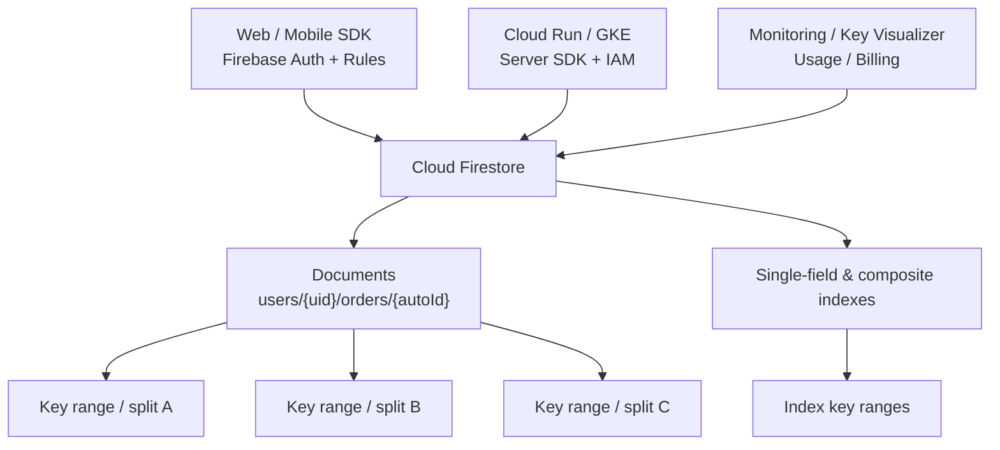
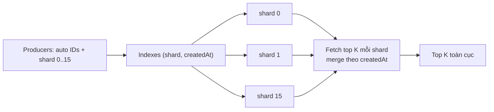

# Thiết kế Firestore tránh hotspot và chi phí đọc ngoài dự kiến

Một ứng dụng bán hàng dùng **Cloud Firestore** để hiển thị đơn hàng theo thời gian thực. Lúc mới ra mắt, hệ thống phản hồi nhanh và chi phí thấp. Khi chiến dịch bắt đầu, một số lệnh ghi bị `DEADLINE_EXCEEDED`, danh sách đơn hàng cập nhật chậm, còn số **document reads** trên hóa đơn tăng nhanh hơn lượng người dùng. Nguyên nhân có thể không phải Firestore “thiếu máy chủ”, mà là **document ID tăng tuần tự, index tập trung ghi, một document bị cập nhật quá thường xuyên, truy vấn đọc thừa hoặc realtime listener bị tạo lại liên tục**.

Bài thuộc chương **Firestore và Firebase** của mô-đun `CLOUD_PROVIDERS_GCP`, trong lộ trình từ project/IAM/VPC đến Compute Engine, GKE, Cloud Run, lưu trữ, cơ sở dữ liệu, tự động hóa phát hành và quản trị độ tin cậy/chi phí. Nội dung tập trung vào **Cloud Firestore Standard edition, mô hình document của Firebase/Native mode**, với mục tiêu thiết kế dữ liệu **phân tán tải**, xây dựng truy vấn **đọc vừa đủ** và quan sát **chi phí thực tế**. Firestore Enterprise và MongoDB compatibility có mô hình chỉ số/billing khác, cần xem tài liệu tương ứng trước khi áp dụng các phép tính dưới đây.

## 1. Mục tiêu học tập

Sau bài học, bạn có thể:

1. Phân biệt hotspot trên **document key**, **index key**, **một document được cập nhật thường xuyên** và hotspot do tăng traffic đột ngột.
2. Dùng **automatic document IDs** thay cho timestamp/sequence IDs khi ghi đồng thời.
3. Giải thích giới hạn **500 writes/s với trường indexed tăng tuần tự** và quy tắc ramp-up **500/50/5**.
4. Chọn giữa **single-field index exemption**, **sharded timestamps** và **distributed counters** theo nhu cầu truy vấn.
5. Thiết kế collection/subcollection và composite indexes dựa trên query pattern, tránh index fanout không cần thiết.
6. Tính các nguồn chi phí: **document reads/writes/deletes**, **index entry reads**, **storage/indexes**, **network**, realtime listeners, aggregation và Security Rules.
7. Dùng **cursor pagination** thay `offset`, giới hạn kết quả, quản lý vòng đời listener và Query Explain.
8. Phân biệt **Firebase Security Rules** của SDK web/mobile với **IAM** của server/Admin SDK.
9. Chạy lab **Firestore Emulator** để thử dữ liệu mẫu, pagination và counter, không đụng database thật.
10. Lập checklist tối ưu p95/p99, error rate, billable reads và chi phí trước/sau thay đổi.

**Phạm vi an toàn:** toàn bộ mã ghi dữ liệu trong lab mặc định trỏ tới **Firestore Emulator trên máy học viên**. Không triển khai rules/indexes, không import dữ liệu và không chạy load test trên production. Các lệnh hoặc cấu hình có thể thay đổi Firestore thật được đánh dấu rõ để yêu cầu review.

## 2. Firestore mở rộng bằng cách phân phối key range

Firestore lưu **documents** trong **collections**; mỗi document chứa fields, có thể chứa subcollections. Nền tảng tự phân tách các dải khóa (splits) để phân tán truy cập và tăng khả năng phục vụ khi lưu lượng lớn.



Khả năng tự mở rộng **không loại bỏ mọi hotspot**. Nếu thao tác liên tục nhắm vào một vùng khóa hẹp hoặc một index có giá trị tăng dần, Firestore không thể phân tải hiệu quả ngay tức thì.

| Loại hotspot | Ví dụ | Hướng xử lý |
| --- | --- | --- |
| **Document key range** | IDs `order-000001`, `order-000002`… | Dùng auto-ID phân bố ngẫu nhiên |
| **Index key range** | Mọi document mới có `createdAt` được index và tăng liên tục | Exempt index nếu không query; nếu cần order, dùng sharded timestamps |
| **Single-document contention** | Mọi người cập nhật `stats/global` một lần/like | Distributed counters hoặc chia dữ liệu |
| **Traffic ramp quá nhanh** | Import 50.000 writes/s vào collection mới | Tăng tải theo **500/50/5**, ghi phân bố key |
| **Hot query/large listener** | Màn hình luôn nghe hàng chục nghìn documents | Giới hạn query, tách scope, giảm fan-out |

**Phân biệt:** tăng read cost là vấn đề **số lần đọc**; hotspot là vấn đề **phân bố tải và latency**. Chúng có thể cùng xuất hiện nhưng không được sửa bằng một giải pháp chung.

## 3. Thiết kế document ID để không dồn ghi vào cuối collection

**Không nên** dùng document IDs được sắp xếp theo thời gian hoặc tăng tuần tự:

```text
orders/000001
orders/000002
orders/000003

events/2026-11-19T09:00:01Z
events/2026-11-19T09:00:02Z
```

Các IDs gần nhau về thứ tự từ điển làm writes tập trung vào vùng khóa hẹp. Firestore có thể tự tạo splits nhưng cần thời gian; ở tải cao, các lần ghi liên tiếp vẫn đụng nhau.

**Nên** để SDK tạo IDs phân bố:

```javascript
const newOrder = db.collection("orders").doc();
await newOrder.set({
  tenantId: "demo-tenant",
  externalOrderId: "ORD-001",
  status: "paid",
  createdAt: new Date()
});
console.log("Generated document ID:", newOrder.id);
```

`externalOrderId` có thể giữ mã nghiệp vụ dễ đọc, còn **đường dẫn document** dùng auto-ID. Nếu cần đảm bảo external ID duy nhất hoặc truy vấn bằng nó, thiết kế lookup/index/transaction và kiểm tra write contention; đổi document ID thành random **không tự khử** hotspot của một index tăng tuần tự.

### 3.1. Theo tenant: collection hay subcollection?

Hai mô hình hợp lý:

```text
orders/{autoId}
  tenantId: "tenant-a"
  createdAt: Timestamp

tenants/{tenantId}/orders/{autoId}
  createdAt: Timestamp
```

| Mô hình | Ưu điểm | Đổi lại |
| --- | --- | --- |
| Collection toàn cục + `tenantId` | Query nhiều tenant theo quyền server linh hoạt | Mọi query phải giới hạn tenant; composite indexes/rules phức tạp |
| Subcollection theo tenant | Phạm vi truy cập và truy vấn mỗi tenant rõ | Cần collection-group query nếu muốn gom cross-tenant; phải thiết kế index/rules tương ứng |

Đừng giữ toàn bộ orders dưới dạng **một array trong `tenants/{id}`**: document sẽ tăng kích thước, nhiều clients ghi tranh chấp, và mỗi lần đọc lấy toàn bộ payload. Firestore có giới hạn document size; mô hình “một tenant = một document khổng lồ” thường không chịu được tải thật.

## 4. Hai con số 500 dễ nhầm

### 4.1. Indexed sequential field: khoảng 500 writes/s

Nếu collection chứa **trường được index với giá trị tăng/giảm tuần tự giữa các documents** — ví dụ `createdAt` hoặc số thứ tự — thì theo hướng dẫn Firestore, **mức ghi tối đa tới collection là 500 writes/s** trong trường hợp đó. Đây là hotspot ở **index keys**, dù document IDs đã được phân tán.

Ví dụ:

```javascript
// Mỗi order có auto-ID nhưng createdAt tăng liên tục.
await db.collection("telemetry").doc().set({
  createdAt: new Date(),
  deviceId: "device-7",
  rawPayload: "..."
});
```

Nếu **không truy vấn/lọc/sắp xếp theo `createdAt`**, tạo **single-field index exemption** cho nó. Nếu **cần** sắp xếp theo thời gian với lưu lượng vượt giới hạn, phải xem **sharded timestamps** hoặc thay đổi kiến trúc đọc.

**Lưu ý chính xác:** không phải mọi trường timestamp đều gây limit này. Điều kiện là **giá trị indexed tăng/giảm có trật tự xuyên qua các documents**; timestamps phân bố ngẫu nhiên không có cùng hiện tượng. Exemption single-field không được cho phép truy vấn yêu cầu một index khác vẫn chứa trường tuần tự mà không xem xét lại hotspot.

### 4.2. Quy tắc 500/50/5: tăng lưu lượng dần

Khi mở collection mới hoặc chuyển lượng truy cập lớn sang vùng document keys chưa được làm nóng:

1. Bắt đầu tối đa khoảng **500 operations/second** trên vùng dữ liệu mới, với thao tác phân bố đều trong key space.
2. Tăng **không quá 50% mỗi 5 phút** nếu metrics ổn định.
3. Chỉ tiếp tục tăng sau khi latency, errors, retries và contention đạt ngưỡng cho phép.

```text
Thời điểm      Tốc độ mục tiêu tối đa gần đúng
0 phút         500 ops/s
5 phút         750 ops/s
10 phút        1.125 ops/s
15 phút        1.687 ops/s
```

**Đây là hướng dẫn ramp-up**, không phải hard limit “collection chỉ cho 500 ops/s”. Sau khi hệ thống có thời gian chia splits và key phân bố tốt, throughput có thể cao hơn nhiều. Ngược lại, **nếu index tuần tự còn tồn tại**, ramp-up không xóa được nút thắt 500 writes/s do index.

Với migration sang collection mới, nên **phân phối traffic theo hash ổn định của user/tenant IDs**, tăng tỷ lệ theo nấc. Không chuyển toàn bộ tenants cùng lúc rồi trông chờ Firestore điều chỉnh ngay.

## 5. Tránh tranh chấp trên một document: distributed counters

Firestore không cho cập nhật một document duy nhất ở tốc độ vô hạn. Ví dụ `products/sku-1` bị hàng nghìn users tăng `likes` mỗi giây sẽ tạo contention và retries. **Không có một con số writes/s cố định an toàn cho mọi document**; giới hạn thực tế phụ thuộc kích thước, index fanout và transaction workload.

Thay vì:

```javascript
await db.doc("counters/likes").update({
  count: FieldValue.increment(1)
});
```

có thể chia thành nhiều shards:

```text
counters/likes
  shards/0    count: 103
  shards/1    count: 98
  shards/2    count: 121
  ...
  shards/15   count: 110
```

Mỗi lượt ghi chọn ngẫu nhiên một shard; tổng = sum(count của các shard). Với 16 shards, writes phân bố hơn trên nhiều documents. **Nhược điểm:** đọc tổng cần đọc **16 documents**, nếu gọi thường xuyên sẽ tạo chi phí đọc đáng kể. Có thể định kỳ cập nhật một **roll-up total** (có độ trễ) để client chỉ đọc một document.

**Không** dùng distributed counter cho việc cần một điều kiện giao dịch tuyệt đối như “chỉ còn 1 vé cuối” mà chưa thiết kế transaction/serializability. Counter shards tốt cho thống kê cộng dồn như likes, views, downloads.

## 6. Index fanout: nhiều index làm ghi chậm và tăng storage

Firestore tự tạo **single-field indexes** cho nhiều fields; **composite indexes** phục vụ query tổ hợp. Mỗi write có thể phải cập nhật nhiều index entries, làm tăng **write latency**, I/O và dung lượng index.

| Field/data | Có cần index? | Khuyến nghị |
| --- | --- | --- |
| `tenantId` / `status` dùng filter | Có | Duy trì index theo query |
| `createdAt` dùng `orderBy` | Có, nhưng cần tránh hotspot ở tải rất cao | Index/sharded timestamp theo access pattern |
| `rawPayload` JSON/text lớn không query | Không | Single-field exemption |
| `expiresAt` chỉ dùng TTL | Thường không query | Exempt index, cấu hình TTL riêng |
| Array/map lớn chỉ lưu metadata | Nếu không `array-contains`/query field | Tắt indexing không dùng |
| Fields cho query hiếm/không còn tồn tại | Không cần giữ mọi composite index cũ | Review và loại bỏ theo quy trình |

**Index entries không được tính thành từng document write riêng** trong bảng giá Standard, nhưng chúng làm tốn **index storage**, ảnh hưởng latency và có thể được **tính phí index entry reads khi query**. Không suy “thêm index miễn phí vì vẫn chỉ 1 document write”.

### 6.1. Ví dụ `firestore.indexes.json`

Chỉ minh họa trên một **collection group telemetry** mà ứng dụng **không truy vấn** `createdAt`/`rawPayload`:

```json
{
  "indexes": [],
  "fieldOverrides": [
    {
      "collectionGroup": "telemetry",
      "fieldPath": "createdAt",
      "indexes": []
    },
    {
      "collectionGroup": "telemetry",
      "fieldPath": "rawPayload",
      "indexes": []
    },
    {
      "collectionGroup": "telemetry",
      "fieldPath": "expiresAt",
      "indexes": []
    }
  ]
}
```

`indexes: []` ở **field override** nghĩa là bỏ single-field indexes của field đó trong collection group. **Không deploy nguyên file lên project thật** nếu nó đang có composite indexes khác: việc áp bộ cấu hình mới có thể xóa/đổi index hiện hữu. Hãy **export, review và merge** index config với IaC của dự án.

Cấu hình TTL cho `expiresAt` là chính sách **khác** với việc bỏ indexing; `indexes: []` một mình **không làm dữ liệu tự hết hạn**. Nếu cần TTL, thêm `ttl: true` trên field override và kiểm tra giá, retention cũng như tác động xóa dữ liệu.

## 7. Nếu thực sự cần truy vấn theo timestamp ở tốc độ ghi cao

Một màn hình “50 tin gần nhất” cần sắp xếp thời gian, nhưng millions of events/day có thể biến indexed `createdAt` thành hot index range. Không thể vừa **bỏ index createdAt** vừa yêu cầu Firestore thực thi `orderBy("createdAt")` ở cùng query pattern.

**Sharded timestamps** phân chia sự kiện thành các dải index:

```json
{
  "tenantId": "tenant-a",
  "shard": 7,
  "createdAt": "2026-11-19T09:00:00Z",
  "event": "OrderCreated"
}
```

Producer chọn shard phân bố (ví dụ hash/seed hoặc random trong 0..15). Mỗi shard có index phục vụ `shard + createdAt`, vì vậy writes chia ra nhiều vùng index. Reader phải **query nhiều shards** và merge kết quả theo thời gian, có giới hạn từng query.



Đánh đổi cần nêu trong design review:

- **Thêm N queries/read requests** để lấy global top K; chi phí và latency của feed tăng nếu N lớn.
- Phải giữ **cursor per shard** để phân trang đúng, không dùng một offset chung.
- Thêm trường shard và composite indexes, tăng complexity vận hành.
- Nếu chỉ ~100 writes/s và query đơn giản, giải pháp sharding có thể là **overengineering**.
- Nếu query theo tenant, cần xác định shards theo tenant/collection scope để không dồn dữ liệu một tenant nóng.

Đây là giải pháp **thay đổi data model**, không phải chỉ tăng quota. Dựa trên mẫu tải thực và hướng dẫn **Sharded timestamps** chính thức để xác định số shards, index exemptions và composite indexes.

## 8. Thiết kế query trước khi quyết định schema/index

Firestore là database document có indexes, không phải hệ thống join và full-text search tùy ý. Hãy xuất phát từ các màn hình/API thật.

Giả sử người dùng xem **20 đơn paid mới nhất**:

```javascript
const q = db
  .collection("users")
  .doc(userId)
  .collection("orders")
  .where("status", "==", "paid")
  .orderBy("createdAt", "desc")
  .limit(20);

const snapshot = await q.get();
```

Query này cần index phù hợp cho `status ASC + createdAt DESC` (hoặc được hệ thống đáp ứng bằng index hiện hữu). Nếu Firebase/Firestore trả link tạo composite index, review query pattern trước khi tạo, không bấm tạo mọi đề xuất một cách vô hạn.

**Quy tắc tốt:**

1. **Giới hạn phạm vi**: trong `users/{uid}/orders` hoặc filter `tenantId` rõ ràng.
2. **Có `limit`** và pagination; tránh query `get()` toàn bộ collection.
3. Chỉ giữ fields cần phục vụ màn hình trong document nhỏ; đưa blob/large payload sang Cloud Storage.
4. Composite index theo các query được dùng thực, thay vì index mọi tổ hợp fields.
5. Tránh bắt client tải hàng nghìn documents rồi sort/filter local.
6. Dùng aggregation `count()` khi chỉ cần tổng, không tải toàn bộ docs.
7. Khi yêu cầu nhiều điều kiện range/inequality, đo **index entries scanned** bằng Query Explain.

**Giới hạn quan trọng:** Firestore Security Rules **không phải bộ lọc kết quả**. Query của web/mobile phải thỏa điều kiện mà rules có thể chứng minh cho toàn bộ tập kết quả; không thể query toàn collection rồi kỳ vọng rules tự bỏ các documents bị cấm.

## 9. Tính chi phí Firestore Standard: không chỉ đếm requests

Ở Standard edition, các nhóm chi phí chính:

| Nhóm tính phí | Nguồn phát sinh |
| --- | --- |
| **Document reads** | `get()`, query results, listener initial snapshots/changes, skipped docs từ offset, rule dependency reads |
| **Index entry reads** | Query dùng nhiều range fields, aggregations và các trường hợp có tính phí |
| **Document writes** | `set`/`update`, transaction/batch writes; batch không làm writes thành miễn phí |
| **Deletes/TTL deletes** | `delete` và managed TTL operations theo biểu giá |
| **Storage** | Documents, indexes, metadata overhead, PITR/backup nếu dùng |
| **Network** | Data egress, cross-region access tùy mô hình |
| **Khác** | Backup/restore/clone, managed bulk operations và các sản phẩm tích hợp |

**Đừng lấy “1 API request = 1 Firestore read” làm công thức.** Một API request có thể gọi nhiều queries, mỗi query trả nhiều docs, kèm rule checks và index entries.

Ngay cả query **không trả document nào** vẫn có mức tính phí **tối thiểu một document read** theo quy tắc Standard. Free quota chỉ áp dụng cho database đủ điều kiện trong project; **TTL, PITR và backup** có điều kiện tính phí riêng, không mặc nhiên nằm trong free quota.

### 9.1. Tính document reads từ product usage

Ví dụ một ứng dụng có:

- **12.000 users hoạt động/ngày**.
- Mỗi user mở trang danh sách **5 lần/ngày**.
- Mỗi lần app đọc **15 documents**.

```text
Document reads do danh sách:
12.000 × 5 × 15 = 900.000 reads/ngày

Trong 30 ngày:
900.000 × 30 = 27.000.000 reads/tháng
```

Đây là **ước lượng phần đọc kết quả**, chưa tính realtime updates, listeners reconnect, Security Rules dependent reads, index entry reads, truy cập profile hoặc retries. Nếu màn hình mở 5 lần nhưng lập lại truy vấn dù dữ liệu không đổi, chi phí vẫn phát sinh.

Để tối ưu: giảm tần suất re-fetch, dùng caching hợp lý, giữ listener đúng vòng đời khi cần realtime, trả 15 thay vì 200 docs và theo dõi **reads per active user**.

### 9.2. Phí index entry reads

Với query bị tính index entries, Standard edition thường tính **1 read cho mỗi nhóm tối đa 1.000 index entries** được đọc. **Query có tối đa một range field** được miễn phí đọc index entries. Những điểm dễ bỏ sót:

- `orderBy` có thể được xem là range field **khi query đã có một range field khác**.
- Trường `__name__` luôn được coi là range field, kể cả khi dùng trong một equality filter.
- Vector KNN query có đơn vị đọc index entries riêng (100 entries per billable read theo biểu giá hiện hành).
- Aggregation `count()`/`sum()`/`avg()` tính theo index entries; có minimum billable read.

Ví dụ query được tính 2.200 index entries đọc: **ceil(2.200/1.000) = 3 billable index reads**, cộng document reads nếu có. Một query trả 20 docs **không chắc chỉ tốn 20 reads** khi có nhiều range fields.

Dùng **Query Explain** để xác nhận kế hoạch, `index_entries_scanned` và `billing_details`, không dự đoán hoàn toàn từ cấu trúc SQL-like conditions.

## 10. Cursor pagination thay offset: đọc ít và nhanh hơn

**Anti-pattern**:

```javascript
// Không khuyến nghị: bỏ 1.000 docs nhưng vẫn bị tính reads skipped.
const q = db.collection("orders")
  .orderBy("createdAt", "desc")
  .offset(1000)
  .limit(20);
```

Theo mô hình tính phí, việc `offset(1000)` khiến **1.000 documents bị bỏ qua vẫn tính reads**, cộng các documents được trả về (và index entry cost nếu có). Với 20 docs được trả, riêng document reads có thể là **1.020**, thay vì 20 khi dùng cursor đúng.

**Nên** dùng `startAfter(lastDocumentSnapshot)`:

```javascript
const base = db.collection("orders")
  .orderBy("createdAt", "desc")
  .limit(20);

const page1 = await base.get();
const last = page1.docs[page1.docs.length - 1];

if (last) {
  const page2 = await db.collection("orders")
    .orderBy("createdAt", "desc")
    .startAfter(last)
    .limit(20)
    .get();
  console.log("Page 2 size:", page2.size);
}
```

**Điều kiện vận hành:**

- Nếu đang filter theo user/status, **giữ nguyên filters/orderBy** khi tạo trang sau.
- Cursor từ document snapshot giúp phân biệt records có cùng `createdAt`. Với value-based cursor, cần tie-breaker (document ID) để tránh mất/trùng hàng.
- Không dùng `get()` lại trang đầu mỗi lần scroll; cache page snapshots/cursors phù hợp.
- Pagination không tạo snapshot nhất quán xuyên qua hàng loạt request: dữ liệu có thể đổi giữa các trang. Nếu cần export chính xác, dùng cơ chế batch/export được thiết kế riêng.

## 11. Realtime listener: chi phí theo docs chuyển động, không theo thời gian giữ socket

Realtime query `onSnapshot` thường thực hiện **lần đọc kết quả ban đầu** rồi phát cập nhật. Với Standard edition, bạn bị tính document read khi một document được **thêm**, **cập nhật** hoặc **rời tập kết quả vì fields thay đổi**. Nếu document chỉ bị **xóa**, trường hợp đó không bị tính read bổ sung cho chính việc remove theo billing rule tương ứng.

```javascript
import { onSnapshot, query, where, orderBy, limit } from "firebase/firestore";

const q = query(
  ordersRef,
  where("status", "==", "open"),
  orderBy("createdAt", "desc"),
  limit(20)
);

const unsubscribe = onSnapshot(q, (snapshot) => {
  // Chỉ cập nhật UI cho dữ liệu cần thiết.
  renderOrders(snapshot.docs);
});

// Khi component unmount, user rời màn hình hoặc chuyển account:
unsubscribe();
```

**Không để listener tồn tại khi màn hình đã rời**, không đăng ký một listener mới mỗi render, và không đồng thời mở nhiều listeners có cùng phạm vi dữ liệu mà không đo. Ngược lại, **listener sống ổn định** thường tiết kiệm hơn polling cùng query mỗi vài giây vì không đọc lại toàn bộ tập kết quả nếu không đổi.

### 11.1. Reconnect có thể làm hóa đơn tăng

Với **mobile/web SDKs**:

- Khi bật **offline persistence** và listener ngắt kết nối **hơn 30 phút**, Firestore có thể tính reads như **một query mới** khi kết nối lại.
- Khi **không bật offline persistence**, mỗi lần disconnect/reconnect có thể bị tính như query mới.
- Thay đổi Security Rules/dependent documents cũng có thể khiến rules phải đọc lại các documents tham chiếu.
- Tần suất listener update cao trên một feed liên tục có thể tốn hơn query định kỳ; phải đo theo nhu cầu UX.

Ví dụ 10.000 clients đang nghe mỗi client 20 docs: **200.000 initial document reads** (giả định không có caching/discount riêng). Nếu mỗi client nhận thêm 8 doc updates hợp lệ trong ngày: **80.000 reads khác**. Chỉ riêng hai nguồn này là **280.000 document reads/ngày** trước reconnect/index/rule reads.

**Không** nhầm “một listener connection được giữ 24 giờ” với “chỉ một billable read trong 24 giờ”.

## 12. Security Rules: chính sách truy cập cũng có thể tạo reads

Firestore dùng **hai cơ chế quyền khác nhau**:

| Client | Cơ chế chính |
| --- | --- |
| Firebase web/mobile SDK | **Firebase Authentication + Firestore Security Rules** |
| Admin SDK, server client libraries, backend trên Cloud Run/GKE | **Google Cloud IAM/ADC**, **bỏ qua Firestore Security Rules** |

Đây là ranh giới bảo mật quan trọng: code chạy bằng **Admin SDK** có thể đọc/ghi theo IAM mà không bị chặn bởi rules dành cho mobile/web. Vì thế phải giới hạn service account theo least privilege và triển khai tenant authorization ở backend.

### 12.1. Rules mẫu theo đường dẫn user

Ví dụ nếu orders được lưu tại `users/{uid}/orders/{orderId}` và **client chỉ được đọc**:

```javascript
rules_version = '2';
service cloud.firestore {
  match /databases/{database}/documents {
    match /users/{uid}/orders/{orderId} {
      allow get: if request.auth != null && request.auth.uid == uid;
      allow list: if request.auth != null
                  && request.auth.uid == uid
                  && request.query.limit <= 20;
      allow create, update, delete: if false;
    }
  }
}
```

Nếu dùng client SDK, nên query **trong subcollection của chính user**, giới hạn tối đa 20 docs. Quy tắc này không cho phép client ghi orders; backend chịu trách nhiệm xác thực giao dịch rồi lưu bằng IAM riêng.

**Không dùng** `allow read, write: if true;` trên production. Cần kiểm thử cả request hợp lệ và cross-tenant unauthorized bằng **`@firebase/rules-unit-testing`** trên emulator, không chỉ dựa vào một ví dụ UI.

### 12.2. Rules `get()`/`exists()` tạo reads phụ

Giả sử rule đọc thêm `users/{uid}/permissions` và `teams/{teamId}` để kiểm tra quyền. Những **dependent document reads** cần thiết để đánh giá rule có thể **bị tính phí ngoài reads của query chính**. Firestore thường chỉ tính một lần cho mỗi dependent document trong một request; không được suy rằng kiểm tra rules “miễn phí”.

Thay vì mỗi record phải tra nhiều documents phụ, cân nhắc:

- Dùng **Firebase Auth custom claims** cho quyền phù hợp, nhưng quản lý thời gian propagation/revocation.
- Chuyển dữ liệu authorization vào cấu trúc phù hợp, tránh duplications thiếu kiểm soát.
- Giữ rules đơn giản, dùng emulator test và đo dependent reads.
- Với backend, dùng IAM và kiểm tra tenant/user authorization trong code theo principal, không dựa vào rules vốn bị bypass.

**Rules không phải filter:** một query có thể bị từ chối toàn bộ nếu rules không chứng minh được tất cả documents có thể được trả đều được phép xem.

## 13. TTL, thời gian lưu và xóa dữ liệu

Firestore hỗ trợ **Time-to-live (TTL)** để tự xóa những documents có timestamp hết hạn, nhưng:

- TTL xóa **không ngay tức thì**; expired docs có thể còn xuất hiện trong query trước khi worker xóa.
- Xóa document cha **không xóa subcollections** bên dưới.
- **TTL deletes có phí riêng và không thuộc free quota**, theo pricing.
- Field TTL được index mặc định trên Standard nếu không exempt; indexing timestamp tăng tuần tự có thể tạo hotspot.
- Khi bật TTL cho collection group đã có dữ liệu, nó có thể tác động tới rất nhiều documents hết hạn; cần kiểm kê/backup/approval.

Ví dụ `expiresAt` chỉ dùng retention, **không query**, có thể cấu hình:

```json
{
  "fieldOverrides": [
    {
      "collectionGroup": "telemetry",
      "fieldPath": "expiresAt",
      "ttl": true,
      "indexes": []
    }
  ]
}
```

Đây là **trích đoạn** của index config, không được deploy thay thế file đang có mà chưa merge. TTL không dùng để thay thế workflow xóa theo đúng một thời điểm pháp lý hoặc transactional cascade. Khi cần xóa ngay/chặt chẽ, thiết kế explicit delete/workflow, cân nhắc backup/PITR và kiểm tra dữ liệu còn ở subcollections.

## 14. Tính chi phí theo kịch bản, không chỉ dự báo QPS

Một bảng dự toán có thể tách 5 nhóm:

```text
Monthly billable document reads =
  list/get reads
+ initial listener reads
+ listener changes/reconnect reads
+ skipped offset reads
+ Security Rules dependent reads

Monthly billable index reads =
  query index entries / billing unit
+ aggregation/index-specific charges

Monthly other charges =
  document writes + deletes/TTL
+ stored documents + index storage
+ network egress + backup/PITR nếu dùng
```

**Lưu ý:** công thức là khung định lượng, không phải cách cộng máy móc từng event. Firestore có exemptions, cache behavior, minimum query charges và billing rules theo edition. Phải dùng **Query Explain và Billing/Usage metrics** để đối chiếu.

### 14.1. Bài toán API feed

Một trang web có 30.000 users hoạt động/ngày, mỗi user tải danh sách 6 lần/ngày. Phiên bản cũ trả 100 docs, phiên bản mới trả 20:

```text
Cũ: 30.000 × 6 × 100 = 18.000.000 document reads/ngày
Mới: 30.000 × 6 × 20 = 3.600.000 document reads/ngày

Giảm = 14.400.000 document reads/ngày
     = 80% (phần đọc kết quả)
```

**Không khẳng định hóa đơn giảm đúng 80%**: còn index reads, listeners, writes, backup/storage và những request khác. Nhưng thay đổi **`limit(100)` thành `limit(20)`** khi UX cho phép là một tối ưu mạnh và dễ kiểm chứng.

### 14.2. Tại sao count không nên tải mọi document?

Muốn đếm 8.000 đơn paid, anti-pattern là query trả đủ 8.000 documents rồi dùng `snapshot.size`. Aggregation `count()` dùng index và thường có chi phí đọc thấp hơn nhiều. Nó **vẫn có phí** theo index entries/minimum charge; không mặc định chỉ đúng một read với mọi số lượng entries.

## 15. Lab: thử bằng Firestore Emulator để không phát sinh cloud reads

Lab dùng **Firebase Local Emulator Suite** trên máy có Node.js, npm, Java runtime phù hợp, Firebase CLI và thư mục demo riêng. Không cần project thật; dùng project ID bắt đầu bằng `demo-` để tránh nhầm Firebase production.

**Trước khi chạy:** các mã trong bài học chỉ để tạo file trong **thư mục lab của người học**, không ghi gì thêm vào repository `/java-learning`. Emulator **không phản ánh chính xác cloud latency, index enforcement hay billing**, vì vậy kết quả dùng để kiểm tra logic/data shape; muốn đo throughput/cost phải sử dụng staging được cấp phép với ngân sách.

### 15.1. Tạo thư mục local và dependency

```bash
mkdir firestore-cost-lab
cd firestore-cost-lab
npm init -y
npm install firebase-admin

# Firebase CLI được cài qua npm hoặc gói chính thức.
firebase --version
```

Có thể cài Firebase CLI bằng `npm install -g firebase-tools` trên máy lab nếu chưa có. Không chạy `firebase deploy` hoặc `gcloud firestore databases create` trong bài.

### 15.2. `firebase.json`

```json
{
  "emulators": {
    "firestore": {
      "host": "127.0.0.1",
      "port": 8080
    }
  },
  "firestore": {
    "rules": "firestore.rules",
    "indexes": "firestore.indexes.json"
  }
}
```

### 15.3. `firestore.rules` và `firestore.indexes.json`

Tạo file rules đúng mẫu ở Mục 12.1. Tạo file indexes:

```json
{
  "indexes": [
    {
      "collectionGroup": "orders",
      "queryScope": "COLLECTION",
      "fields": [
        {"fieldPath": "status", "order": "ASCENDING"},
        {"fieldPath": "createdAt", "order": "DESCENDING"}
      ]
    }
  ],
  "fieldOverrides": [
    {
      "collectionGroup": "orders",
      "fieldPath": "rawPayload",
      "indexes": []
    },
    {
      "collectionGroup": "orders",
      "fieldPath": "expiresAt",
      "indexes": []
    }
  ]
}
```

**Có chủ đích:** `createdAt` vẫn được index trong `orders` để hỗ trợ danh sách sắp xếp. Lab chỉ có vài writes nên không chạm hotspot. Khi production collection cần vượt 500 writes/s với trường tuần tự này, phải **thay design** (chẳng hạn sharded timestamps) thay vì áp index exemption tùy tiện làm hỏng truy vấn.

## 16. Node.js lab: auto IDs, query giới hạn và cursor

Tạo file `lab.js` trong thư mục lab:

```javascript
const { initializeApp } = require("firebase-admin/app");
const { getFirestore, FieldValue } = require("firebase-admin/firestore");

const projectId = "demo-firestore-cost";
initializeApp({ projectId });
const db = getFirestore();

async function run() {
  const orders = db.collection("users").doc("demo-user")
    .collection("orders");
  const baseTime = Date.now();

  // 6 documents có IDs phân tán, dữ liệu giả, không có PII.
  for (let i = 0; i < 6; i++) {
    await orders.doc().set({
      status: "paid",
      createdAt: new Date(baseTime - i * 60000),
      amountCents: 1000 + i * 100,
      rawPayload: "lab-only",
      expiresAt: new Date(baseTime + 86400000)
    });
  }

  const q = orders.where("status", "==", "paid")
    .orderBy("createdAt", "desc")
    .limit(2);

  const page1 = await q.get();
  console.log("Page 1 IDs:", page1.docs.map(d => d.id));

  if (!page1.empty) {
    const last = page1.docs[page1.docs.length - 1];
    const page2 = await orders.where("status", "==", "paid")
      .orderBy("createdAt", "desc")
      .startAfter(last)
      .limit(2)
      .get();
    console.log("Page 2 IDs:", page2.docs.map(d => d.id));
  }

  const countSnapshot = await orders.where("status", "==", "paid")
    .count().get();
  console.log("Paid orders:", countSnapshot.data().count);

  // Chỉ minh họa phân tán ghi; xem Mục 18 về đọc tổng.
  const shard = Math.floor(Math.random() * 8);
  const shardRef = db.collection("counters").doc("paidOrders")
    .collection("shards").doc(String(shard));
  await shardRef.set({ count: FieldValue.increment(1) },
                     { merge: true });
  console.log("Counter shard updated:", shard);
}

run().catch(error => {
  console.error(error);
  process.exitCode = 1;
});
```

**Bắt buộc:** code này dùng **Admin SDK**, do đó **không kiểm thử Firestore Security Rules**. Cần `@firebase/rules-unit-testing` và mocked auth context riêng để kiểm tra allow/deny của mobile/web. Tuy nhiên, code đủ minh họa auto-ID, `limit`, `startAfter`, aggregation và sharded counter write.

## 17. Chạy emulator và kiểm tra lab

Dùng **một lệnh** để Firebase CLI tự chạy emulator, thực hiện script rồi dừng:

```bash
firebase emulators:exec \
  --only firestore \
  --project demo-firestore-cost \
  "node lab.js"
```

Kết quả mong đợi:

- Console in hai trang, mỗi trang **2 IDs** khác nhau.
- `Paid orders: 6`.
- Một shard counter `0..7` được cập nhật.
- Không có request nào được gửi đến Firestore production nếu emulator được kết nối đúng.

**Kiểm tra môi trường:** Firebase Admin SDK tự trỏ emulator khi `FIRESTORE_EMULATOR_HOST` được Firebase CLI cung cấp hoặc được cấu hình rõ `127.0.0.1:8080`, **không có tiền tố `http://`**. Project ID trong SDK phải khớp `--project demo-firestore-cost`.

Nếu emulator báo thiếu Java, port 8080 bận hoặc thiếu Firebase CLI, sửa môi trường local. **Không** đổi `projectId` sang project thật để vượt lỗi. Nếu emulator hỗ trợ relaxed index enforcement, query thành công **không chứng minh composite index đã sẵn sàng ở production**; cần kiểm tra trên staging khi có approval.

### 17.1. Thử Security Rules riêng

Viết tests bằng `@firebase/rules-unit-testing` với auth giả lập:

| Test | Kỳ vọng |
| --- | --- |
| UID `demo-user` đọc document trong `users/demo-user/orders` | Allow |
| UID `other-user` đọc cùng document | Deny |
| Không đăng nhập | Deny |
| UID đúng nhưng query `limit=100` | Deny |
| UID đúng, query `limit=20` | Allow nếu index/query hợp lệ |
| Web client thử tạo order | Deny; chỉ backend được phép ghi |

Không dùng Admin SDK để thực hiện các test này: **Admin SDK bỏ qua rules** nên sẽ cho kết quả sai mục đích.

## 18. Đọc distributed counter và đánh đổi chi phí

Sau khi đã có các shards:

```javascript
const shards = await db.collection("counters").doc("paidOrders")
  .collection("shards").get();

const total = shards.docs.reduce(
  (sum, doc) => sum + (doc.data().count || 0), 0
);
console.log("Total:", total);
```

Nếu tạo 20 shards, **mỗi lần đọc tổng trực tiếp** có thể yêu cầu **20 document reads** (khi 20 shards đều tồn tại). Nếu giao diện hiển thị tổng liên tục cho 100.000 users, cách này tốn kém.

Giải pháp phù hợp hơn là một **roll-up document** được cập nhật định kỳ/bằng batch, để client đọc 1 document với độ trễ chấp nhận được. Không để mỗi lần ghi shard cũng cập nhật roll-up document đồng bộ, vì như vậy lại tạo **single-document hotspot**.

Đây là ví dụ rõ nhất cho trade-off **tăng write throughput nhưng làm reads đắt hơn**. Tối ưu phải dựa trên cả **read/write ratio**, không chỉ giảm một metric.

## 19. Query Explain và quan sát billable reads trong môi trường thật

Sau khi lab local đạt, bước tiếp theo trong dự án thật là dùng **Firestore staging đã được phê duyệt**, không chạy ngẫu nhiên trên production.

### 19.1. Query Explain

**Query Explain** dùng server client libraries để hiển thị index plan và, trong chế độ **analyze**, thống kê **execution, index entries scanned và billing**.

- **Default/plan-only:** không chạy query, nhưng vẫn tính **một read operation** cho explain request theo pricing.
- **Analyze:** thực thi query thật, tính phí query như bình thường và có thể ảnh hưởng tải.
- Chỉ dùng với quyền IAM của server principal; không dựa vào Firebase Auth client token cho Query Explain.
- Query Explain dùng cho **polled queries**, không phân tích live listeners.
- Dựa vào kết quả, thay filter/orderBy/index, chạy benchmark lại và ghi sự thay đổi latency/read units.

**Ví dụ truy vấn cần review:** dùng `where("age", ">=", 18).orderBy("createdAt")` có hai range fields theo quy tắc tính phí; có thể phải tính index entry reads. Tránh suy “có `limit(20)` nên scan tối đa 20 index entries”.

### 19.2. Dashboards và cảnh báo

| Công cụ | Theo dõi | Cần phân tích khi |
| --- | --- | --- |
| **Firebase/Firestore Usage** | Reads, writes, deletes theo ngày | Reads tăng nhanh hơn DAU hoặc launches |
| **Cloud Monitoring** | Document operations, request latency, active listeners/connections | p95/p99, retries, quota hoặc traffic bất thường |
| **Key Visualizer** | Hot document/index key ranges | Sequential IDs/index hoặc traffic ramp quá nhanh |
| **Query Explain** | Index plan, entries scanned, billable read metrics | Query trả ít docs nhưng đọc nhiều entries |
| **Cloud Billing** | SKU document/index reads, storage, network, TTL/PITR/backup | Dự toán khác hóa đơn |
| **Security Rules tests/logs** | Denials, dependent reads và correctness | Query bị deny hoặc chi phí rules tăng |

**Không lấy số liệu Usage dashboard làm hóa đơn chính thức** nếu khác Billing; dashboards có thể đếm/hiển thị theo cách và độ trễ khác. **Key Visualizer** hữu ích với workloads đủ điều kiện xuất heatmap và có thời gian quan sát; emulator không mô phỏng các heatmap đó.

### 19.3. Alert đáng có

- Billable document reads/ngày và reads/active user.
- Index entry reads hoặc query scans tăng sau một lần đổi index.
- p95/p99 read/write latency, `DEADLINE_EXCEEDED`, `ABORTED`.
- Listener count và connections tăng bất thường.
- Storage/index growth, TTL delete volume và network egress.
- Budget alerts theo project/billing account, cùng ngưỡng escalation.

**Budget alert không tự giới hạn hóa đơn.** Bảo vệ thực tế là query limits, listener lifecycle, index review, quotas/rate limits ở app và owner theo dõi mỗi release.

## 20. Một ca thiết kế: feed đơn hàng trong khuyến mại

Hệ thống bắt đầu có 2.000 writes/s, 30.000 người dùng, hiển thị 20 đơn mới nhất của mỗi tenant. Thiết kế cũ:

```text
orders/{timestampAsId}
  tenantId, createdAt, status, rawJson, ...
UI:
  onSnapshot(collection("orders"))   // nghe toàn bộ collection
Batch import:
  2.000 writes/s ngay khi triển khai
```

**Ba lỗi cùng tồn tại:** IDs tăng tuần tự, `createdAt` indexed tuần tự tạo hotspot và listener không giới hạn gây reads/fan-out lớn.

Thiết kế đề xuất:

1. `orders/{autoId}` hoặc `tenants/{tenantId}/orders/{autoId}`.
2. Nếu write rate per collection/index vượt ngưỡng và cần chronological queries, thiết kế **sharded timestamps**; nếu không query thời gian ở một collection, exempt `createdAt`.
3. Giữ `rawJson` lớn ngoài query hoặc Cloud Storage; bỏ index không dùng.
4. UI query theo **tenant + status + createdAt**, `limit(20)` và cursor; quản lý unsubscribe khi rời trang.
5. Ramped migration theo 500/50/5; không chuyển 2.000 writes/s trong giây đầu.
6. Test Firebase Security Rules theo UID/tenant trên emulator; backend Admin SDK kiểm tra tenant trong code.
7. Theo dõi **Key Visualizer, writes latency, billable document/index reads, p99, Billing** trước/sau.
8. Nếu người dùng chỉ cần báo tổng, dùng aggregation/roll-up thay vì tải mọi order.

**Đánh đổi:** sharding timestamp làm query phức tạp và có thể tăng reads. Khi chỉ 20 writes/s, giữ thiết kế đơn giản thay vì tạo 16 shards không cần thiết.

## 21. Troubleshooting nhanh

| Triệu chứng | Nguyên nhân thường gặp | Hướng kiểm tra |
| --- | --- | --- |
| Ghi mới chậm dù auto-ID | Indexed `createdAt` tăng tuần tự | Index definitions, 500 writes/s, Key Visualizer |
| `DEADLINE_EXCEEDED` sau import | Tăng traffic đột ngột, hotspot key/index | 500/50/5, key ranges và retry backoff |
| Counter bị contention | Cùng một document nhận quá nhiều updates | Distributed counter, roll-up |
| Query trả 20 docs nhưng reads cao | Multiple range fields/index entries scanned hoặc offset | Query Explain và Billing |
| Trang thứ 50 đọc đắt | Dùng `offset`, bị tính skipped documents | Cursor `startAfter` |
| Realtime reads tăng khi người dùng mở app lại | Listeners bị tạo lại, reconnect, offline persistence | Listener lifecycle, reconnect stats |
| Rules có nhiều reads | `get()`/`exists()` đọc dependent docs | Rule evaluation, test và pricing |
| Client web bị `PERMISSION_DENIED` | Rules/query không tương thích hoặc sai UID | Emulator rules unit tests, query scope |
| Admin SDK đọc được dù rules deny | Admin SDK dùng IAM và bypass rules | IAM scopes, backend tenant auth |
| Write latency tăng sau thêm index | Index fanout/index build, field indexed lớn | Indexes metrics, exemptions |
| TTL xóa chưa xảy ra | TTL không tức thì, policy chưa active | TTL status, expiry type, monitor |
| Xóa document cha nhưng dữ liệu con còn | TTL/delete không cascade subcollections | Explicit cleanup workflow |
| Index missing trên production | Composite index chưa tạo/đang build | Console index link, config deploy và readiness |
| Chi phí cao dù ít users | Polling quá nhiều, listeners scope lớn, rules reads | Read/user, query limits, snapshots |
| Dữ liệu feed lẫn tenant | Query thiếu tenant filter hoặc backend auth sai | Data model, Security Rules/IAM |
| Emulator chạy nhưng prod chậm | Emulator không mô phỏng splitting, billing, indexes đầy đủ | Staging load test, Monitoring |

**Quy trình điều tra:** đọc metrics đọc/ghi và latency → phân biệt document-key/index-key hotspots → kiểm query plan/index → listener/reconnect → rules/IAM → đo lại p99 và billable reads. Không mở public rules hoặc tăng quota vô điều kiện để che lỗi.

## 22. Bài tập tự luyện

### Bài 1 — document ID

Collection có `orders/100001`, `orders/100002`…, tải ghi tăng mạnh. Vì sao rủi ro?

**Đáp án:** IDs tăng tuần tự làm writes tập trung vào key range gần nhau. Dùng auto-ID; external order number lưu field riêng.

### Bài 2 — auto-ID đã đủ chưa?

App chuyển sang auto-ID nhưng vẫn index `createdAt` tăng liên tục với 1.500 writes/s.

**Đáp án:** Chưa đủ; hotspot vẫn ở sequential index. Nếu không query theo createdAt, exempt; nếu cần query theo thời gian, cân nhắc sharded timestamps.

### Bài 3 — 500/50/5

Collection mới bắt đầu ở 500 ops/s. Sau 10 phút, mức ramp mục tiêu theo quy tắc tối đa gần đúng?

**Đáp án:** 500 × 1,5 × 1,5 = **1.125 ops/s**, nếu key phân bố đều và latency/errors ổn định. Không áp cho indexed sequential field để vượt hard bottleneck.

### Bài 4 — offset và chi phí

Query `offset(800).limit(20)` trả 20 documents. Số reads document tối thiểu liên quan tới offset và kết quả?

**Đáp án:** Khoảng **820 document reads** (800 skipped + 20 returned), chưa tính index entries/rules. Dùng cursor pagination.

### Bài 5 — listener billing

5.000 users mỗi người nghe 12 docs ban đầu, chưa có thay đổi. Ước lượng initial reads?

**Đáp án:** **60.000 document reads**, giả sử không có cache/ngoại lệ khác. Giữ listener dài hạn không miễn phí snapshot ban đầu.

### Bài 6 — distributed counter

Một counter dùng 20 shards, giao diện đọc tổng 2.000 lần/ngày bằng cách đọc tất cả shards.

**Đáp án:** Khoảng **40.000 document reads/ngày** khi cả 20 shards tồn tại. Có thể dùng roll-up tổng cập nhật theo chu kỳ để giảm reads.

### Bài 7 — Rule dependency

Security Rules cho mỗi query phải đọc thêm 2 documents permission. Có thể bỏ chi phí vì đó chỉ là kiểm tra bảo mật?

**Đáp án:** Không. Dependent reads cần để đánh giá `get()`/`exists()` có thể được tính phí; tối ưu mô hình quyền nhưng không làm yếu security.

### Bài 8 — Admin SDK và rules

Backend dùng Admin SDK đọc được `users/other-user/orders`, dù rules chỉ cho đúng UID.

**Đáp án:** Admin SDK bypass rules và dùng IAM. Backend phải tự kiểm tra tenant/user authorization và IAM tối thiểu.

### Bài 9 — TTL

Bật TTL để xóa documents sau 30 ngày, dùng field `expiresAt` tăng theo thời gian. Nên làm gì?

**Đáp án:** Đánh giá exempt indexing field TTL nếu không dùng query, kiểm tra TTL setup/chi phí và việc xóa không tức thì hoặc cascade.

### Bài 10 — bài toán feed

30.000 users/ngày × 6 lần mở × 100 docs lần đầu, sau tối ưu còn 20 docs/lần. Giảm bao nhiêu reads kết quả?

**Đáp án:** Giảm từ **18 triệu** xuống **3,6 triệu reads/ngày**: tiết kiệm **14,4 triệu** (80% phần kết quả). Hóa đơn tổng không nhất thiết giảm đúng 80% vì còn index/rules/listener/storage.

## 23. Checklist thiết kế và thay đổi

- [ ] Chọn Firestore **Standard** đúng với data/query model, phân biệt billing Enterprise nếu dùng.
- [ ] Document IDs phân tán; không dùng timestamps/sequences làm khóa ghi ở tải cao.
- [ ] Tách large/hot documents; không lưu toàn bộ dữ liệu động của tenant vào một document.
- [ ] Đã xác định các **indexed sequential fields** và giới hạn write rate liên quan.
- [ ] Migrating/backfill tuân thủ **500/50/5**, retries có backoff, key phân bố đều.
- [ ] Không tạo index cho `rawPayload`/TTL field nếu không query.
- [ ] Nếu cần timestamp queries ở tải lớn, đánh giá shards + merge/cursor/cost.
- [ ] Composite indexes dựa trên query thật, không giữ mọi index cũ.
- [ ] Queries giới hạn `limit`, có scope tenant/user và dùng cursor, không offset.
- [ ] Aggregations thay thế đọc mọi documents khi chỉ cần tổng.
- [ ] Realtime listeners có unsubscribe, không bị nhân đôi/reconnect vô ích.
- [ ] Đã tính index entry reads, Security Rules dependent reads, storage/index size, TTL và egress.
- [ ] Security Rules và IAM được kiểm thử độc lập; server SDK kiểm tra tenant authorization.
- [ ] Dùng emulator cho logic/rules, staging cho index/cost/throughput.
- [ ] Có dashboards reads/DAU, billable reads, p95/p99, Key Visualizer và budget alerts.
- [ ] Dự đoán thay đổi chi phí trước/sau release và có người sở hữu rollback.

## 24. Dọn lab và giới hạn áp dụng

Với `firebase emulators:exec`, Firestore Emulator khởi động tạm thời rồi dừng; dữ liệu chỉ tồn tại cục bộ nếu bạn không bật import/export/persistence riêng. Có thể xóa **thư mục lab local** sau khi bảo đảm không còn tệp cần giữ. **Không cần xóa database hoặc project trên Google Cloud** vì bài này không tạo tài nguyên thật.

Không thực hiện những lệnh sau trên project production chỉ để thử bài:

- `firebase deploy --only firestore:indexes`: có thể thay index definitions, trigger build và ảnh hưởng query/write.
- `firebase deploy --only firestore:rules`: có thể mở/chặn quyền client thật.
- Import hàng triệu documents, bulk delete hoặc TTL trên collection production: có thể tăng phí/làm mất dữ liệu.
- Thay `document ID`/schema cho hệ thống đang chạy mà chưa có dual-read/dual-write, canary và rollback plan.

**Nếu áp dụng production:** xuất index/rules configs hiện tại, đo baseline, thử thay đổi trên staging, migrate theo tỷ lệ và giữ logs/monitoring đủ lâu. Không coi emulator là bằng chứng đã xử lý hotspot; cần workload thật, Key Visualizer và Billing để xác nhận.

## 25. Tài liệu Google Cloud và Firebase chính thức

- [Cloud Firestore best practices](https://firebase.google.com/docs/firestore/best-practices): IDs, index fanout, sequential indexed fields, 500/50/5 và cursor.
- [Understand reads and writes at scale](https://firebase.google.com/docs/firestore/understand-reads-writes-scale): splits, ramping, hotspot/latency.
- [Sharded timestamps](https://firebase.google.com/docs/firestore/solutions/shard-timestamp): sharding index theo thời gian.
- [Distributed counters](https://firebase.google.com/docs/firestore/solutions/counters): shards và trade-off read costs.
- [Index overview](https://firebase.google.com/docs/firestore/query-data/index-overview): single-field/composite indexes.
- [Index definition reference](https://firebase.google.com/docs/reference/firestore/indexes): `firestore.indexes.json`, field overrides/TTL.
- [Understand Cloud Firestore billing](https://firebase.google.com/docs/firestore/pricing): document/index reads, listeners, offsets, aggregation, rules dependencies.
- [Cloud Firestore Standard pricing](https://cloud.google.com/firestore/pricing): giá theo region, storage, TTL và free quota.
- [Realtime queries at scale](https://firebase.google.com/docs/firestore/real-time_queries_at_scale): listener lifecycle, cost và performance.
- [Query Explain](https://firebase.google.com/docs/firestore/query-explain): query plan, index entries/billing.
- [Key Visualizer](https://firebase.google.com/docs/firestore/key-visualizer/key-visualizer): hotspot document/index keys.
- [Security Rules are not filters](https://firebase.google.com/docs/firestore/security/rules-query): query scope và authorization.
- [Security Rules unit tests](https://firebase.google.com/docs/firestore/security/test-rules-emulator): emulator và mocked auth.
- [Firebase Local Emulator Suite](https://firebase.google.com/docs/emulator-suite/connect_firestore): cấu hình `FIRESTORE_EMULATOR_HOST` cho Admin SDK.
- [Firestore TTL](https://firebase.google.com/docs/firestore/ttl): expiry, indexing exemptions và deletes.
- [Monitor Firestore usage](https://firebase.google.com/docs/firestore/monitor-usage): Usage, Cloud Monitoring và cảnh báo.
- [Firestore quotas](https://firebase.google.com/docs/firestore/quotas): giới hạn document/index/field.

**Kết luận:** một thiết kế Firestore tốt phải cân bằng **khả năng phân phối ghi** và **số lần đọc được tính phí**. Hãy dùng IDs phân tán, loại bỏ index không cần, thiết kế shards chỉ khi workload đòi hỏi, tăng lưu lượng theo 500/50/5, dùng queries có limit/cursor và quản lý vòng đời listeners. Sau mỗi thay đổi, kiểm chứng bằng **Key Visualizer, Query Explain, Usage/Billing và SLO** thay vì chỉ thấy ứng dụng “vẫn chạy”.
