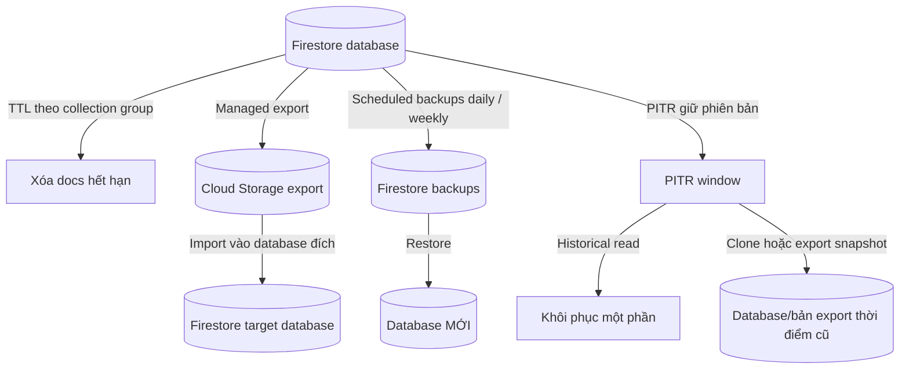
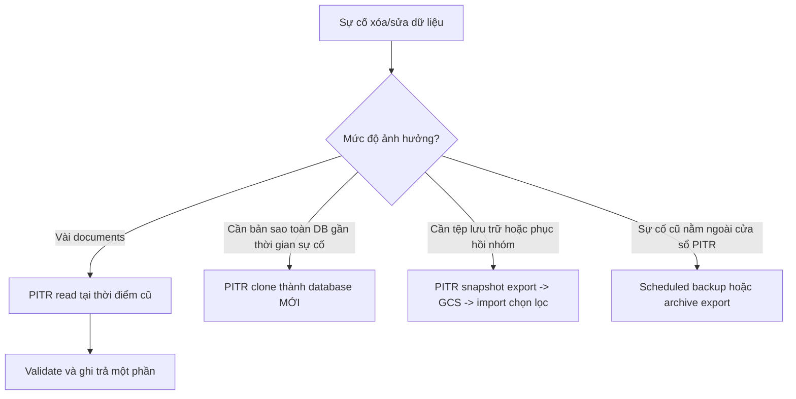

# TTL policies, export, import và phục hồi Firestore

> **Chương:** Firestore và Firebase  
> **Module:** CLOUD_PROVIDERS_GCP  
> **Phạm vi module:** Khám phá Google Cloud từ tổ chức project, IAM và VPC đến Compute Engine, GKE, Cloud Run, dịch vụ lưu trữ và cơ sở dữ liệu. Qua các tình huống triển khai, người học biết lựa chọn dịch vụ, bảo vệ tài nguyên, tự động hóa phát hành và theo dõi độ tin cậy cùng chi phí.

Ứng dụng có thể lưu phiên đăng nhập, thông báo tạm, giỏ hàng chưa thanh toán hoặc lịch sử sự kiện trong **Cloud Firestore**. Dữ liệu tạm nên tự hết hạn; dữ liệu quan trọng phải phục hồi được sau khi người dùng xóa nhầm, deploy lỗi hoặc ứng dụng ghi sai. Hai mục tiêu này khác nhau:

- **TTL policy** tự xóa document khi tới hạn, nhằm quản lý vòng đời/lưu trữ.
- **Managed export/import** chuyển dữ liệu document qua **Cloud Storage**, dùng cho lưu trữ dài hạn, kiểm tra ngoại tuyến hoặc di chuyển.
- **Scheduled backups và Point-in-time recovery (PITR)** hỗ trợ phục hồi dữ liệu ở thời điểm trước sự cố.

Bài học tập trung vào **Firestore in Native mode** (đặc biệt là **Standard edition**) cùng các công cụ Google Cloud CLI; những khác biệt với Enterprise edition được nêu khi có ý nghĩa. Phần thực hành ưu tiên **kiểm kê chỉ đọc** trên database sandbox đã có. Lệnh tạo TTL, export, import hoặc restore được tách rõ là **tùy chọn**, chỉ dành cho tài nguyên riêng được chủ sở hữu phê duyệt.

## Mục tiêu học tập

Sau bài này, bạn có thể:

1. Đặt TTL theo **collection group + timestamp field**, hiểu vì sao xóa không tức thời và không xóa subcollections.
2. Phân biệt index exemption trên TTL field, Security Rules, document permissions và các side effects của delete triggers.
3. Export/import toàn database hoặc theo **collection groups**, đọc operation state và metadata trong Cloud Storage.
4. Giải thích giới hạn của import: **không mang index definitions**, **ghi đè IDs trùng**, **không xóa các document ngoài phạm vi**.
5. Chọn **scheduled backup, PITR read/export/clone hoặc managed export** theo tình huống và RPO/RTO.
6. Xây dựng quy trình kiểm chứng bản sao, bảo vệ bucket, phục hồi có kiểm soát, giám sát chi phí và cleanup.

## 1. Bốn cơ chế khác nhau



| Cơ chế | Mục đích | Điểm giới hạn quan trọng |
|---|---|---|
| **TTL** | Tự xóa document tạm đã hết hạn | Xóa bất đồng bộ, thường trong **24 giờ**; **không phải** backup |
| **Managed export/import** | Lưu document ở GCS hoặc chuyển dữ liệu | Export thường **không là snapshot nguyên tử** tại lúc bắt đầu; import vào database có thể ghi đè |
| **Scheduled backup** | Bản sao nhất quán theo thời điểm, định kỳ daily/weekly | Backup giữ dữ liệu/indexes nhưng **không gồm TTL policies và Firebase Security Rules**; restore tạo database mới |
| **PITR** | Đọc/khôi phục trạng thái gần thời điểm xảy ra lỗi | Khi bật, lưu phiên bản tối đa **7 ngày**, thời điểm lịch sử theo phút; phải chuẩn bị trước |

**Chọn giải pháp theo câu hỏi:** “dữ liệu nên biến mất sau bao lâu?” → TTL; “cần file archive/di chuyển?” → export; “lỡ xóa cả database?” → backup; “deploy sai cách đây 20 phút?” → PITR hoặc clone/read theo thời điểm. Một hệ thống quan trọng thường cần **nhiều cơ chế kết hợp**, không chọn một thay tất cả.

## 2. TTL: xóa theo thời điểm hết hạn

TTL policy xác định **một field cho một collection group** làm thời gian hết hạn document. Với **Firestore Standard edition**, field phải là kiểu **Timestamp/Date and time**; chuỗi ISO như `"2026-12-31T00:00:00Z"` không tự trở thành TTL timestamp. Ở Enterprise edition, TTL còn có quy tắc cho field kiểu array chứa timestamp, cần kiểm tra tài liệu theo edition.

```text
sessions/u_101  { userId: "...", expireAt: Timestamp(2026-11-20T08:00:00Z) }
sessions/u_102  { userId: "...", expireAt: null }
sessions/u_103  { userId: "...", expireAt: Timestamp(2026-11-19T07:00:00Z) }

TTL policy: collection group = sessions, field = expireAt, offset = 0
  u_101: đủ điều kiện xóa khi qua expireAt
  u_102: không tự hết hạn (null không phải Timestamp)
  u_103: đã đủ điều kiện xóa, nhưng có thể vẫn còn trong truy vấn
```

### 2.1. Những điều TTL **không** bảo đảm

- **Không xóa ngay** lúc đồng hồ chạm `expireAt`. Document hết hạn vẫn có thể trả về ở query/get đến khi hệ thống thực sự xóa; thông thường xóa trong khoảng **24 giờ**, không phải SLA thời gian thực.
- **Không xóa đệ quy**: xóa `users/u1` **không** tự xóa `users/u1/orders/*`. Nếu nghiệp vụ cần cascade cleanup, phải thiết kế riêng.
- **Không xóa theo transaction**: nhiều docs cùng TTL không nhất thiết biến mất đồng thời hay theo thứ tự.
- **Không mặc định xóa docs thiếu field hoặc null**. Khi cập nhật `expireAt` sang tương lai trước khi doc thực bị xóa, TTL dùng giá trị mới.
- **Có side effects**: TTL deletion kích hoạt snapshot listeners và Firestore-triggered Cloud Run functions, có thể tăng số invocation và gây retry/ghi chéo.

**TTL không phải access-control boundary**: với phiên đăng nhập hết hạn, ứng dụng và backend phải **kiểm tra `expireAt` trước khi cho phép dùng phiên**, thay vì tin document đã bị xóa. Firebase Security Rules phải được thiết kế độc lập; Firestore Rules **không phải bộ lọc query** và Admin SDK/server IAM thường không chịu các Rules dành cho client.

### 2.2. Expiration offset: hai cách định nghĩa field

| Cách | Giá trị lưu trong document | TTL policy |
|---|---|---|
| **Đặt thời điểm hết hạn trực tiếp** | `expireAt = thời điểm tạo + 7 ngày` | `--enable-ttl`, offset mặc định `0` |
| **Đặt thời điểm bắt đầu + khoảng giữ chung** | `createdAt = thời điểm tạo` | `--expiration-offset=7d` |

Chọn **một cách nhất quán**. Nếu document đã lưu `expireAt=createdAt+7d`, **đừng** thêm offset `7d` nữa (sẽ giữ 14 ngày). Khi thay đổi offset cho collection group đã có dữ liệu, tác động có thể là xóa hàng loạt các documents trước đó chưa hết hạn theo policy cũ.

### 2.3. TTL trên collection group, không phải đường dẫn riêng

Collection group tên `sessions` bao gồm các collection có **ID cuối là `sessions`** ở mọi cấp, ví dụ `sessions/*` và `organizations/org-1/sessions/*`. Policy không tự phân biệt tenant/parent path. Nếu chỉ muốn TTL trong một nhóm tài liệu, thiết kế **collection IDs hoặc field values phù hợp** trước khi bật.

Một collection group chỉ có **một TTL field**; có giới hạn field-level configurations theo sản phẩm (tài liệu hiện hành ghi **1.000**); một field có cả TTL policy và single-field index exemption được tính như một field configuration. Kiểm tra quota thực tại project trước khi triển khai hàng loạt.

## 3. TTL fields, indexes và chi phí xóa

Firestore Standard edition thường tự tạo **single-field indexes**. Nếu nhiều docs được ghi liên tục với timestamp tăng dần, index trên `expireAt` có thể tạo **index hotspot** và giới hạn write throughput.

**Khuyến nghị:** nếu ứng dụng **không query/filter/sort** dựa trên `expireAt`, thêm **single-field index exemption** cho field TTL ở collection group tương ứng. Việc tắt index một trường có thể ảnh hưởng truy vấn hiện tại; hãy kiểm tra query/index dependencies và composite indexes trước.

| Cấu hình | Tác dụng |
|---|---|
| TTL field có index | Vẫn xóa theo TTL, nhưng chi phí index và nguy cơ hotspot ở write-heavy collection |
| TTL field có **single-field index exemption** | TTL vẫn hoạt động; tránh index đơn lẻ không dùng |
| TTL trên field kiểu string/null | Không khiến document tự hết hạn như Timestamp hợp lệ |

**Chi phí:** mỗi TTL deletion tính vào chi phí **document delete** của Firestore, cộng chi phí hoạt động của listeners/triggers nếu có. Bật policy cho collection group chứa hàng triệu docs hết hạn có thể tạo **làn sóng xóa bất đồng bộ**. Cần budget, alert, quy trình chọn đúng group/field và rollback; **tắt TTL không thể khôi phục docs đã xóa**.

## 4. Managed export/import: dữ liệu, phạm vi và tính nhất quán

**Managed export** sao chép documents từ Firestore vào các file Cloud Storage. **Managed import** đọc output đã export và nạp documents vào database đích (cùng hoặc khác project nếu đủ điều kiện và quyền).

### 4.1. Điều export thực sự bao gồm

- **Export toàn bộ:** các documents hiện có trong database theo định dạng managed export.
- **Export collection groups:** chỉ các groups có IDs được chọn, **không tự kéo theo subcollections có ID khác**. Ví dụ export group `orders` không tự export subcollection `orders/{id}/items` có collection ID `items`.
- **Không có index definitions, TTL policies hoặc Firebase Security Rules** trong managed document export. Quản lý các cấu hình này riêng bằng version control/IaC/console theo quy trình.
- Export **thông thường không phải snapshot chính xác tại lúc bắt đầu**: dữ liệu có thể thay đổi trong lúc chạy và xuất hiện ở kết quả. Khi cần ảnh chụp nhất quán theo phút, dùng **PITR snapshot export** sau khi đã bật PITR và chọn thời gian hợp lệ.

### 4.2. Điều import thực sự làm

- Giữ **document IDs** từ bản export; nếu doc cùng ID tồn tại ở đích, **import ghi đè** document đó.
- Docs **không xuất hiện trong export** vẫn tồn tại ở đích. Vì vậy import **không phải** “rollback database về y hệt trạng thái cũ”.
- Index được cập nhật theo **định nghĩa index hiện tại của database đích**, không tự tạo lại index từ bản export.
- Managed import **không kích hoạt Cloud Functions/Firestore triggers** như ghi document thông thường; **snapshot listeners** có thể nhận updates.
- Nếu muốn **import chọn lọc theo collection groups**, nguồn phải là một **export có `--collection-ids`**; không thể dùng một full export rồi tùy tiện chỉ import vài groups bằng flag đó.

**Không chỉnh tay các file binary/metadata của export.** Output có metadata dạng `.overall_export_metadata`; thư mục prefix và tên metadata phải khớp. Khi import qua Console thường chọn file metadata, còn `gcloud firestore import` dùng **đường dẫn prefix/thư mục export** theo hướng dẫn.

### 4.3. Ví dụ dữ liệu sau import

Giả sử:

| ID | Export tại thời điểm cũ | Database hiện tại |
|---|---|---|
| `orders/1` | `status=PENDING` | `status=PAID` |
| `orders/2` | `status=NEW` | Không còn tồn tại |
| `orders/3` | Không có | `status=CANCELLED` |

Sau **import vào cùng collection**: `orders/1` có thể trở lại `PENDING`, `orders/2` được tạo lại, còn `orders/3` **vẫn tồn tại**. Đây có thể là lỗi nghiệp vụ nghiêm trọng nếu dùng import như lệnh “undo tất cả”.

## 5. Scheduled backups và phục hồi nguyên database

Firestore có **scheduled backup** hằng ngày hoặc hằng tuần. Mỗi backup là **bản sao nhất quán ở một thời điểm**, bao gồm **dữ liệu và index configurations**, nhưng **không bao gồm TTL policies hoặc Firebase Security Rules**. Backup nằm **cùng location** với database nguồn.

| Thuộc tính | Scheduled backup |
|---|---|
| Tần suất | Daily / weekly; tối đa **mỗi loại một schedule** cho database |
| Giờ thực thi | Hệ thống chọn; weekly chọn ngày, **không chọn chính xác giờ trong ngày** |
| Retention | Cấu hình được, tối đa **14 tuần** |
| Khôi phục | **Restore vào database MỚI**, ID chưa tồn tại, không overwrite tại chỗ |
| Chi phí | Backup storage và restore tính theo kích thước backup |
| Không tự chứa | TTL policies, Firebase Security Rules |

**Không gộp nhầm:** xóa source database không nhất thiết xóa backup liên quan; xóa backup thì không thể khôi phục từ backup đã xóa. Một lịch backup chạy đều không chứng minh RTO đạt yêu cầu nếu chưa từng thử restore và cutover.

### 5.1. RPO và RTO phải được định nghĩa

- **RPO (Recovery Point Objective):** mức mất dữ liệu tối đa chấp nhận được tính theo thời gian.
- **RTO (Recovery Time Objective):** thời gian tối đa từ lúc sự cố được phát hiện đến khi dịch vụ khôi phục chức năng.

Ví dụ: backup hằng ngày có thể khiến mất các thay đổi sau thời điểm backup gần nhất nếu chỉ dùng backup; **RPO thực tế phải tính theo thời gian backup hoàn thành và sự cố**, không phải đúng bằng 24 giờ ở mọi tình huống. RTO còn gồm restore, kiểm chứng, cài lại Rules/TTL và đổi cấu hình ứng dụng.

## 6. PITR: khôi phục gần thời điểm xảy ra lỗi

**Point-in-time recovery** giữ phiên bản lịch sử để khôi phục sau ghi sai/xóa nhầm:

- Khi **PITR enabled**, Firestore giữ các phiên bản có thể phục hồi tối đa **7 ngày**; không thể ngay lập tức đọc đủ 7 ngày sau khi mới bật.
- Các mốc lịch sử ngoài **1 giờ gần nhất** có độ phân giải **một phút**, không phải từng microsecond. Kiểm tra `earliestVersionTime` trước khi chọn timestamp.
- Khi không bật PITR, Firestore vẫn hỗ trợ một số khả năng đọc/clone ở phạm vi **1 giờ gần nhất** theo điều kiện sản phẩm; muốn **export tại timestamp quá khứ**, phải bật PITR.
- **Historical read** có thể khôi phục vài documents bị sửa; **clone** tạo **database mới** cùng location với source từ mốc quá khứ, gồm dữ liệu và indexes.
- **PITR export** dùng `--snapshot-time` ở phút hợp lệ (RFC 3339), xuất toàn bộ hoặc theo collection groups, rồi mới import có kiểm soát.



**PITR không phải log mọi thay đổi từng mili-giây**, cũng không thay backup dài hạn. PITR có chi phí lưu trữ; không nằm trong free tier. Trước khi tắt PITR, xác minh chiến lược DR vì disable sẽ làm mất khả năng đọc dữ liệu trong PITR window theo quy tắc sản phẩm.

## 7. IAM, Cloud Storage và bảo vệ bản sao

| Chủ thể | Quyền/phạm vi cần xét |
|---|---|
| Người kiểm kê | Quyền xem database/TTL, import-export operations, schedules/backups |
| Người cấu hình TTL | Permission `datastore.indexes.update` trên project phù hợp |
| Operator export/import | Permission `datastore.databases.export` / `datastore.databases.import`, ví dụ role chuyên biệt Import Export Admin |
| Firestore **service agent** | Truy cập **Cloud Storage bucket** của export/import |
| Operator backup/restore | `roles/datastore.backupsViewer`, `roles/datastore.backupSchedulesAdmin`, `roles/datastore.restoreAdmin` theo hành động |
| PITR clone operator | `datastore.databases.clone`; chỉ cấp khi thực sự cần |

Firestore service agent thường có dạng:

```text
service-PROJECT_NUMBER@gcp-sa-firestore.iam.gserviceaccount.com
```

**Xác minh identity thật** ở Console → Firestore → Import/Export → “jobs run as”. Một số database cũ còn dùng App Engine default service account; nếu có VPC Service Controls thì cần cân nhắc chuyển sang service-specific Firestore service agent theo hướng dẫn.

**Bucket export:**

- Dùng bucket ở **location gần database**, theo yêu cầu residency, egress và chính sách tổ chức; bucket **Requester Pays** hoặc loại bucket không hỗ trợ không dùng cho managed export/import.
- Nếu bucket khác project, chủ bucket phải cấp quyền đủ cho Firestore service agent của project nguồn/đích. Tài liệu hướng dẫn **Storage Admin ở phạm vi bucket** cho import/export; không cấp Storage Admin toàn project khi không cần.
- Không để export chứa PII/secret ở bucket công khai; quản lý IAM, CMEK, retention, lifecycle rules và Audit Logs.
- **Không coi Firebase Security Rules bảo vệ GCS export**. Bucket sử dụng **Cloud Storage IAM/ACL policies** tương ứng; server SDK/service agent thường đi theo IAM, không phụ thuộc Firestore client Rules.

**Không xuất dữ liệu khách hàng thật sang project sandbox của cá nhân.** Dữ liệu được phục hồi cần kiểm tra cả **database IAM, Firebase Rules, indexes, TTL, triggers, Secret Manager và ứng dụng** — backup dữ liệu không tự khôi phục mọi phụ thuộc.

## 8. Lab A — Kiểm kê chỉ đọc trên database sandbox

> **Điều kiện:** project có Billing, một Firestore **Native-mode database đã tồn tại**, quyền xem cấu hình và (nếu làm lab export) một Cloud Storage bucket riêng được chủ sở hữu phê duyệt. Nếu không có, chỉ làm các bài tập thiết kế ở mục 14. **Không tự tạo database hay dùng production.**

### 8.1. Biến và trạng thái database

Chạy trong Cloud Shell/Bash (không chạy trong repository học liệu):

```bash
PROJECT_ID="my-firestore-sandbox"
DATABASE_ID="(default)"       # Thay bằng named database nếu lab dùng tên khác
TTL_GROUP="sessions_lab"      # Collection group riêng, KHÔNG dùng collections production
TTL_FIELD="expireAt"
BUCKET="my-firestore-export-lab-bucket"  # Bucket riêng ĐÃ tồn tại và được phép dùng

gcloud auth list --filter="status:ACTIVE"
gcloud projects describe "$PROJECT_ID" \
  --format="table(projectId,name,lifecycleState)"
gcloud firestore databases list --project="$PROJECT_ID"
gcloud firestore databases describe \
  --database="$DATABASE_ID" --project="$PROJECT_ID" \
  --format="yaml(name,locationId,type,pointInTimeRecoveryEnablement,earliestVersionTime,versionRetentionPeriod,deleteProtectionState)"
```

**Kiểm tra `type=FIRESTORE_NATIVE` và `locationId` trước các bước sau.** Database Standard và Enterprise có khác biệt về index/TTL. Biến `DATABASE_ID='(default)'` phải **có dấu quote** trong shell khi dùng trực tiếp; tránh vô tình chỉ định một database khác hoặc mặc định không như mong muốn.

### 8.2. Đọc TTL, backups và operations

```bash
gcloud firestore fields ttls list \
  --project="$PROJECT_ID" --database="$DATABASE_ID"

gcloud firestore backups schedules list \
  --project="$PROJECT_ID" --database="$DATABASE_ID"

gcloud firestore backups list \
  --project="$PROJECT_ID" \
  --format="table(name,database,state)"

gcloud firestore operations list \
  --project="$PROJECT_ID" --database="$DATABASE_ID"

# Chỉ đọc, cần Storage metadata permission.
gcloud storage buckets describe "gs://$BUCKET"
```

Nếu bucket chưa tồn tại, **không tự dùng tên production**. Kiểm tra location, owner, IAM và chi phí với quản trị viên rồi mới cân nhắc lab export. Chỉ vì lệnh `list` không hiển thị backup không có nghĩa dữ liệu không thể cứu bằng PITR; hai cơ chế có lịch sử và cấu hình riêng.

## 9. Lab B — Thiết kế và thử TTL trên collection group riêng

### 9.1. Đặt Timestamp thật vào document

Khi ứng dụng tạo session, ghi field kiểu **Firestore Timestamp**:

```javascript
// Minh họa giá trị Timestamp: đoạn này CHỈ tính giá trị, chưa ghi DB.
const { Timestamp } = require("@google-cloud/firestore");

const createdAt = Timestamp.now();
const expireAt = Timestamp.fromMillis(
  Date.now() + 7 * 24 * 60 * 60 * 1000
);
// document trong collection group sessions_lab:
// { userId: "user-lab-01", createdAt, expireAt }
```

Khi ứng dụng thực sự ghi doc vào database sandbox, cần chọn đúng `sessions_lab`, không ghi đè documents đang có. Có thể đặt TTL ngày mai thay vì trong quá khứ để không xóa nhầm. **Không thử TTL bằng cách sửa timestamps trên collection dữ liệu thực.**

### 9.2. Tạo policy là **thao tác có nguy cơ xóa dữ liệu**

Chỉ nếu chủ project xác nhận `sessions_lab` là group riêng, không có collections trùng tên ở nhánh khác, đã kiểm kê docs và có bản phục hồi:

```bash
# CHỈ chạy với database sandbox/collection group thuộc riêng lab.
gcloud firestore fields ttls update "$TTL_FIELD" \
  --project="$PROJECT_ID" \
  --database="$DATABASE_ID" \
  --collection-group="$TTL_GROUP" \
  --enable-ttl

# Kiểm tra policy đã được tạo và trạng thái provisioning:
gcloud firestore fields ttls list \
  --project="$PROJECT_ID" \
  --database="$DATABASE_ID" \
  --collection-group="$TTL_GROUP"
```

TTL policy có thể cần **từ 10 phút trở lên** để chuyển sang trạng thái hoạt động. Nếu documents đã có timestamp quá khứ, chúng sẽ trở thành ứng viên xóa khi policy active. Đừng coi “chưa biến mất sau 5 phút” là lỗi. Với field `createdAt`, có thể khai báo `--expiration-offset=7d` thay vì tính `expireAt`; **không dùng cả hai cách cộng 7 ngày cùng lúc**.

### 9.3. Theo dõi và hoàn nguyên

| Kiểm tra | Kết quả mong đợi |
|---|---|
| Policy status | Policy active sau provisioning |
| Document có `expireAt` tương lai | Vẫn tồn tại trước thời điểm hết hạn |
| Document thiếu `expireAt` | Không bị TTL xóa theo field đó |
| Document đã hết hạn | Có thể còn trong query, thường bị xóa trong 24h |
| Subcollections của doc bị xóa | **Không** bị xóa đệ quy |
| Listeners/triggers | Có thể nhận delete events; chú ý vòng lặp trigger |

Nếu policy chỉ dành riêng lab và không còn cần nữa:

```bash
# CHỈ disable policy do lab tạo, đã xác nhận tác động với owner.
gcloud firestore fields ttls update "$TTL_FIELD" \
  --project="$PROJECT_ID" \
  --database="$DATABASE_ID" \
  --collection-group="$TTL_GROUP" \
  --disable-ttl
```

**Disable không phục hồi docs đã xóa.** Không disable policy production đang được các teams khác dựa vào. Nếu policy tồn tại từ trước, chỉ khôi phục cấu hình gốc được ghi lại trong preflight.

## 10. Lab C — Managed export từ collection group riêng

### 10.1. Phạm vi và tính phí

Đây là phần **tùy chọn có tính phí**. Chỉ export nhóm `sessions_lab` không chứa dữ liệu nhạy cảm, vào bucket có quyền riêng, không bật Requester Pays và đã kiểm tra residency.

```bash
# Tên thư mục/prefix riêng cho lần export, tránh ghi đè output cũ.
EXPORT_DEST="gs://$BUCKET/firestore-lessons/$(date -u +%Y%m%dT%H%M%SZ)"
printf 'Export destination: %s\n' "$EXPORT_DEST"

# CHỈ khi được phê duyệt export document từ database sandbox:
gcloud firestore export "$EXPORT_DEST" \
  --project="$PROJECT_ID" \
  --database="$DATABASE_ID" \
  --collection-ids="$TTL_GROUP"
```

**Đừng export toàn database** nếu mục đích chỉ là lab một collection group. Managed export thu **1 document read/document được xuất**; GCS tính phí lưu trữ, network nếu có. Việc export không chuyển quyền sở hữu dữ liệu hay tự làm sạch dữ liệu nhạy cảm.

### 10.2. Kiểm tra operation và đường dẫn thật

```bash
gcloud firestore operations list \
  --project="$PROJECT_ID" --database="$DATABASE_ID"

# OPERATION_NAME được lấy từ output thật của export/operations list.
# Không tự đoán tên operation.
# gcloud firestore operations describe "$OPERATION_NAME" \
#   --project="$PROJECT_ID"

# Xem các thư mục/file đã sinh trong prefix:
gcloud storage ls --recursive "$EXPORT_DEST"
```

Chỉ coi export dùng được khi **operation DONE/success** và có metadata cùng các data files hợp lệ. Cloud Storage prefix thực tế có thể có folder con do service tạo; **ghi lại EXPORT_PATH thật** và file `.overall_export_metadata`, không tự lắp ghép theo timestamp chưa xác minh.

### 10.3. Import **chỉ vào database sandbox đích**

**Không chạy import trực tiếp lên database nguồn/production.** Cần một **database đích riêng đã tồn tại**, đã được owner phê duyệt rằng có thể ghi đè documents cùng IDs.

```bash
# Điền bằng ID thực của database đích KHÁC source.
RESTORE_DATABASE_ID="import-lab-target"

# Điền đường prefix export THỰC từ output hoàn tất ở bước trước.
EXPORT_PATH="gs://BUCKET/EXACT_SUCCESSFUL_EXPORT_FOLDER/"

# Kiểm tra database đích tồn tại/đúng project trước khi import:
gcloud firestore databases describe \
  --project="$PROJECT_ID" --database="$RESTORE_DATABASE_ID"

# CHỈ thực thi sau review dữ liệu, quyền và khả năng overwrite IDs:
# gcloud firestore import "$EXPORT_PATH" \
#   --project="$PROJECT_ID" \
#   --database="$RESTORE_DATABASE_ID" \
#   --collection-ids="$TTL_GROUP"
```

**Tại sao lệnh import được comment?** Import có thể **ghi đè dữ liệu** dù chỉ thuộc một collection group. Bài lab hoàn chỉnh ở mức đọc/thiết kế nếu không có database đích riêng. Với một full export, không dùng `--collection-ids` để import riêng một group. Sau import, so document IDs, dữ liệu mẫu, indexes/Rules/TTL của đích trước khi cho ứng dụng đọc.

## 11. Lab D — Backup, PITR và kịch bản phục hồi

### 11.1. Tạo backup schedule (tùy chọn)

Chỉ trên database sandbox **chưa có daily schedule**, được owner cấp quyền và chấp thuận **backup storage cost**:

```bash
# CHỈ khi chưa có daily schedule và đã được duyệt tạo/retention.
gcloud firestore backups schedules create \
  --project="$PROJECT_ID" \
  --database="$DATABASE_ID" \
  --recurrence=daily \
  --retention=7d

gcloud firestore backups schedules list \
  --project="$PROJECT_ID" \
  --database="$DATABASE_ID"

gcloud firestore backups list \
  --project="$PROJECT_ID" \
  --format="table(name,database,state)"
```

**Không có lệnh tạo backup ngay lập tức bằng schedule:** daily backup chạy theo thời điểm do hệ thống chọn. Nếu team muốn weekly, dùng `--recurrence=weekly --day-of-week=MON --retention=14w` thay vì tạo thêm nhiều weekly schedules. Cần backup ở trạng thái sẵn sàng trước khi thử restore.

### 11.2. Restore backup tạo **database mới**, không thay database nguồn

Nếu đã có một backup **READY/AVAILABLE** thật thuộc lab, owner có thể thử restore:

```bash
# Lấy BACKUP_ID và LOCATION từ 'gcloud firestore backups list/describe',
# không dùng chuỗi placeholder làm lệnh production.
LOCATION="asia-southeast1"       # THAY theo location thật của backup
BACKUP_ID="BACKUP_ID_FROM_LIST"  # THAY theo ID thật
NEW_DB_ID="restore-check-lab"   # Phải CHƯA tồn tại

# CHỈ sau khi được duyệt create database mới và đã kiểm tra IAM/cost:
# gcloud firestore databases restore \
#   --project="$PROJECT_ID" \
#   --source-backup="projects/$PROJECT_ID/locations/$LOCATION/backups/$BACKUP_ID" \
#   --destination-database="$NEW_DB_ID"
```

Sau khi restore hoàn tất, cần **xem dữ liệu, indexes và quyền truy cập**. Vì backup **không gồm TTL policies hoặc Firebase Security Rules**, phải áp lại theo version/config đã được duyệt; nếu TTL được bật lại ngay, các docs với `expireAt` quá khứ có thể **bị xóa lần nữa**. Với bản DR phục vụ điều tra, giữ TTL chưa bật và hạn chế truy cập trước khi quyết định.

### 11.3. Clone từ PITR tại timestamp hợp lệ

```bash
# Điều kiện: dữ liệu lịch sử có sẵn theo earliestVersionTime.
# Chọn thời điểm UTC tròn phút nằm trong cửa sổ cho phép.
PITR_TIME="2026-11-19T03:00:00Z"  # MINH HỌA, phải thay mốc hợp lệ thực
CLONE_DB_ID="pitr-investigation-lab" # ID chưa tồn tại

# CHỈ trên project sandbox có đủ quyền và quota để tạo database mới:
# gcloud firestore databases clone \
#   --project="$PROJECT_ID" \
#   --source-database="projects/$PROJECT_ID/databases/$DATABASE_ID" \
#   --snapshot-time="$PITR_TIME" \
#   --destination-database="$CLONE_DB_ID"
```

**Không hardcode ngày mẫu để chạy thật**: đối chiếu `earliestVersionTime` và thời gian hiện tại. PITR enabled cho tối đa **7 ngày theo phút**; nếu disabled, clone có thể lấy mốc trong **1 giờ gần nhất** theo tài liệu hiện hành. Clone cũng tạo **database mới**; không tự động đổi traffic/app sang database clone.

### 11.4. Export snapshot từ PITR

Khi PITR **đã enabled**, cần một bản export **đúng mốc lịch sử**:

```bash
# Chỉ khi PITR đã enabled, PITR_TIME là mốc UTC tròn phút hợp lệ.
# gcloud firestore export "$EXPORT_DEST" \
#   --project="$PROJECT_ID" \
#   --database="$DATABASE_ID" \
#   --snapshot-time="$PITR_TIME" \
#   --collection-ids="$TTL_GROUP"
```

**Khác export thường:** `--snapshot-time` chọn một snapshot lịch sử nhất quán ở phút hỗ trợ. Không dùng flag này nếu PITR đang disabled, kể cả còn dữ liệu lịch sử trong 1 giờ gần nhất; export sẽ báo lỗi.

## 12. Runbook phục hồi sau sự cố

Giả sử lúc **10:15** phát hiện bản deploy lúc **10:05** đã xóa nhầm documents trong `orders`. Không vội import full export vào database đang nhận traffic.

1. **Khoanh vùng:** ngừng writer gây lỗi, giữ log, xác định timestamp cuối cùng trước sai sót. Không xóa backup hoặc tắt PITR.
2. **Chọn phương pháp:** với vài docs → PITR historical read rồi ghi lại đúng keys; nhiều dữ liệu → PITR clone **database mới**; lỗi cũ hơn PITR window → backup hoặc archive export.
3. **Bảo vệ nguồn:** kiểm tra IAM, backup/PITR timestamp, checksum/metadata của export, khóa truy cập theo owner; không ghi đè nguồn.
4. **Phục hồi vào môi trường cách ly:** tạo database mới từ backup/clone hoặc import vào database sandbox khác. Nhớ import **không xóa docs ngoài export**.
5. **Kiểm chứng:** so document count theo tập đã xác định, IDs, trường quan trọng, subcollections, indexes, security rules, TTL configs và data consistency; thử các query nghiệp vụ.
6. **Chọn cách cutover:** chuyển app sang database mới hoặc **replay chọn lọc** documents vào database chính có transaction/validation; xem xung đột với writes hợp lệ diễn ra sau mốc khôi phục.
7. **Giám sát:** kiểm tra permissions, error rate, listeners/triggers, PITR/backup costs và độ trễ sau khôi phục; ghi lại RPO/RTO thực tế.
8. **Hậu kiểm:** sửa nguyên nhân gốc, thêm test/runbook và diễn tập theo lịch.

**Khôi phục dữ liệu không đồng nghĩa khôi phục toàn hệ thống.** Firebase Security Rules, Cloud Functions, auth, composite indexes, TTL policies, secrets và các tích hợp bên ngoài có vòng đời riêng. Khi dữ liệu quá khứ đã quá hạn TTL, cần quyết định **giữ để điều tra** hay **tái áp TTL** có chủ đích.

## 13. Monitoring, chi phí và troubleshooting

### 13.1. Chi phí cần theo dõi

| Nguồn chi phí | Cơ chế |
|---|---|
| **TTL** | Tính document delete operations và event-trigger workload |
| **Managed export** | Thông thường **1 Firestore read mỗi document exported** + GCS storage/transfer |
| **Managed import** | Thông thường **1 Firestore write mỗi document imported** + công việc index hiện có |
| **Scheduled backups** | Backup storage và restore theo dung lượng backup |
| **PITR** | Dung lượng lưu phiên bản lịch sử; historical reads/export tính read operations |
| **Cloud Storage** | Dung lượng export, operation/lifecycle/egress, retention/CMEK nếu sử dụng |

**Quan trọng:** export/import costs có thể **chưa xuất hiện trong Firestore Usage tab** và **budget alerts có thể chỉ cập nhật sau operation hoàn tất**. Không dựa vào dashboard thời gian thực để chắc chắn chi phí bằng 0. Dùng Cloud Billing labels/report và budget owner rõ ràng; alert không tự dừng chi tiêu.

### 13.2. Bảng xử lý lỗi

| Triệu chứng | Cần kiểm tra | Hướng xử lý |
|---|---|---|
| TTL policy mãi chưa active | Operations state, permissions, provisioning | Đợi ít nhất nhiều phút, xem operation details |
| Doc hết hạn vẫn hiện | Xóa bất đồng bộ; field sai kiểu/null/offset | Kiểm tra Timestamp, TTL field/group và thời gian thực |
| TTL xóa doc ngoài mong muốn | Collection group trùng tên hoặc offset sai | Dừng policy theo runbook, điều tra phạm vi; restore từ PITR/backup |
| TTL doc parent bị xóa nhưng subcollection còn | TTL không cascade | Thiết kế cleanup riêng, không tự đệ quy production |
| Writes chậm sau thêm TTL field | Sequential timestamp index hotspot | Xem index exemption và write metrics |
| Export lỗi access denied | Firestore operator IAM hoặc GCS service agent permission | Xác minh “jobs run as”, bucket IAM, VPC-SC |
| Export xong nhưng folder rỗng/sai | Operation chưa success, prefix/metadata khác dự kiến | Xem operations và GCS path thực |
| Import bị từ chối | Destination DB/IAM, bucket permission, metadata export | Kiểm tra project, database ID, format và source |
| Import ghi đè dữ liệu hiện tại | IDs trùng; đây là semantics mặc định | Dùng database riêng, làm diff/backup trước |
| Import không dựng lại indexes/Rules | Export chỉ chứa documents | Deploy configuration riêng theo version control |
| Backup restore không vào DB cũ | Restore bắt buộc **database ID mới** | Tạo target mới và kiểm chứng/cutover |
| PITR báo timestamp quá cũ | Trước `earliestVersionTime` hoặc sai phút | Chọn mốc hợp lệ, xem retention window |
| PITR export báo phải enable PITR | Feature disabled | Không thể dùng `--snapshot-time` khi disabled |
| Phục hồi xong docs lại biến mất | TTL policy có thể đã được bật với timestamps cũ | Giữ TTL off khi điều tra, xác minh trước enable |

**Quan sát vận hành:** dùng Firestore Monitoring (reads/writes/deletes, storage, latency), Cloud Audit Logs (IAM, TTL, backup/restore, export/import), operation progress và GCS bucket access logs. Không bật logging payload dữ liệu nhạy cảm không giới hạn.

## 14. Bài tập và đáp án gợi ý

### Bài 1 — TTL có phải bảo mật không?

Phiên đăng nhập đã hết hạn 10 phút nhưng document còn tồn tại. Nhóm cho rằng đây là lỗi Firestore và cho phép dùng session cho đến khi TTL delete.

**Đáp án:** sai thiết kế. TTL bất đồng bộ, thường xóa trong 24h; backend/Rules phù hợp phải **không cho session hết hạn hoạt động** dựa trên timestamp, không dựa vào việc doc đã bị xóa.

### Bài 2 — Kiểu dữ liệu TTL

Document có `expireAt = "2026-11-20T08:00:00Z"` (string). Policy đặt TTL trên `expireAt`. Có tự xóa đúng giờ không?

**Đáp án:** không. Với Standard edition, TTL field phải là **Timestamp/Date and time**, không phải string. Cần migrate field an toàn trước khi bật policy.

### Bài 3 — Xóa parent/subcollection

`users/u1` hết hạn TTL nhưng `users/u1/orders/o1` vẫn có. Điều đó có bất thường không?

**Đáp án:** không. Firestore TTL **không** tự xóa subcollections; phải có lifecycle/cascade policy riêng.

### Bài 4 — Export theo group

Nhóm export `--collection-ids=orders` rồi mong import lại cả `orders/{id}/items`. Vì sao thiếu?

**Đáp án:** `items` là **collection group khác**, không tự được export cùng `orders`. Phải xuất các groups cần thiết hoặc full export nếu phù hợp.

### Bài 5 — Import có phải rollback tuyệt đối?

Export cũ có `orders/1`, `orders/2`. Database mới phát sinh `orders/3`. Import dữ liệu cũ vào đó có xóa `orders/3` không?

**Đáp án:** không. Import ghi đè docs cùng ID và bổ sung doc thiếu, nhưng **không xóa** docs không xuất hiện trong export. Dùng database mới/so sánh dữ liệu cho mục tiêu rollback nguyên trạng.

### Bài 6 — Chọn phương pháp phục hồi

Ứng dụng viết sai vào 12 documents cách đây 20 phút; backup gần nhất là hôm qua. Chọn cách phục hồi ít mất dữ liệu hơn?

**Đáp án:** PITR historical read và ghi trả **chọn lọc** nếu timestamp hợp lệ, kiểm tra xung đột writes hợp lệ. Backup hôm qua có thể tạo RPO tệ hơn.

### Bài 7 — Backup có đem theo Rules và TTL không?

Team restore từ scheduled backup sang database mới, indexes đã có nhưng các Rules/TTL không được khôi phục. Đúng hay sai?

**Đáp án:** đúng theo thiết kế backup: **dữ liệu và index configs** được giữ, **TTL policies và Firebase Security Rules** phải thiết lập riêng. Cần kiểm soát truy cập trước khi cutover.

### Bài 8 — Khác biệt export snapshot

Một export bình thường chạy từ 10:00 đến 10:15. Có thể khẳng định mọi docs đều ở trạng thái 10:00 không? Làm sao có ảnh chụp 10:00?

**Đáp án:** không; export thường có thể bao gồm thay đổi trong quá trình chạy. Nếu PITR enabled và timestamp hợp lệ tròn phút, dùng **`--snapshot-time`** để lấy trạng thái lịch sử.

### Bài 9 — Tính chi phí tương đối

Export 200.000 documents, import lại 200.000 documents, chưa tính GCS storage/transfer. Những nhóm thao tác Firestore nào được tính?

**Đáp án:** xấp xỉ **200.000 document reads** cho export và **200.000 document writes** cho import (theo cơ chế billing managed operations). Không gộp hai lần thành 200.000 tổng.

### Bài 10 — Phục hồi và TTL

Restored document có `expireAt` của tuần trước; nhóm định enable lại TTL ngay trên restored database để “giữ giống production”. Rủi ro?

**Đáp án:** TTL có thể xóa lại documents đang cần kiểm tra. Giữ TTL disabled trong giai đoạn điều tra, xác minh chính sách retention và chỉ enable khi đã chấp thuận.

## 15. Checklist production và cleanup

### 15.1. Checklist

| Kiểm tra | Tiêu chí đạt |
|---|---|
| **Dữ liệu** | Xác định nhóm tài liệu tạm và dữ liệu có nghĩa vụ lưu giữ |
| **TTL policy** | Group/field đúng, Timestamp thật, offset không nhân đôi |
| **TTL behavior** | Không dựa vào TTL để chặn quyền truy cập; triggers/subcollections được xử lý |
| **Index** | Kiểm tra single-field index exemption cho TTL timestamp khi không query |
| **Export** | Full vs collection groups, chọn GCS bucket/billing/retention đúng |
| **Import** | Hiểu overwrite document IDs, không xóa docs ngoài phạm vi, index/Rules riêng |
| **Backup** | Daily/weekly, retention <=14 tuần, backup status, diễn tập restore |
| **PITR** | Enabled trước sự cố, kiểm tra earliestVersionTime và mốc phút hợp lệ |
| **RPO/RTO** | Mục tiêu đo được, backup/clone/import/cutover được diễn tập |
| **Security** | Firestore IAM/Rules + GCS IAM/service agent + CMEK/VPC-SC theo chính sách |
| **Chi phí** | Deletes, reads/writes, backup/PITR/GCS storage, operations được giám sát |
| **Vận hành** | Runbook, incident owner, logging/audit, kiểm tra dependencies |

### 15.2. Dọn đúng phạm vi lab

**Lab A chỉ đọc**: không tạo resource, không cần dọn Firestore. **Lab B/C/D tùy chọn** có thể để lại TTL policy, GCS export, backup schedule hoặc database phục hồi; **không xóa chúng chỉ vì kết thúc bài** khi chưa có owner xác nhận.

1. Ghi lại operations, backup IDs, GCS export prefixes và database IDs đã tạo **riêng**; kiểm tra có data/retention policy cần giữ hay không.
2. Với TTL policy chỉ do lab tạo, có thể `--disable-ttl` sau khi review; việc disable **không hoàn tác xóa**.
3. Với backup schedule chỉ do lab tạo, cân nhắc xóa **schedule** sau khi owner đồng ý; việc này không tự làm biến mất backup đã tồn tại.
4. Với export bucket, chỉ xóa **prefix riêng của lab** sau khi kiểm tra path, retention, legal hold và permissions. Không xóa bucket dùng chung.
5. Với restored/clone database, phải xác minh không còn consumers và có phê duyệt hủy **database được tạo riêng**, không được nhầm với `(default)` hoặc database nguồn.
6. Đối chiếu Billing Reports sau cleanup; charges có thể hiển thị trễ và budget alerts không bảo vệ tuyệt đối.

**Không thực hiện một lệnh delete recursive mẫu** trong bài vì một giá trị bucket/database sai có thể phá dữ liệu không thể khôi phục. Cleanup là thao tác vận hành có xác nhận ownership, không phải phần bắt buộc để chứng minh đã hiểu TTL/export/PITR.

## Ghi nhớ

**TTL quyết định khi nào document đủ điều kiện bị xóa, không quyết định khi nào client phải mất quyền truy cập. Managed export/import phục vụ chuyển/lưu documents nhưng không tự tái tạo index/Rules và không hoàn tác toàn bộ trạng thái đích. Scheduled backup tạo bản sao nhất quán để restore vào database mới; PITR hỗ trợ phục hồi gần thời gian sự cố bằng historical read, clone hoặc snapshot export.** Một kế hoạch Firestore DR tốt phải tính RPO, RTO, IAM, TTL after restore, chi phí và diễn tập end-to-end.

## Tài liệu tham khảo chính thức

- [Firestore — Manage data retention with TTL policies](https://cloud.google.com/firestore/native/docs/ttl)
- [Firestore — Exporting and importing data](https://cloud.google.com/firestore/native/docs/manage-data/export-import)
- [Firestore — Back up and restore data](https://cloud.google.com/firestore/native/docs/backups)
- [Firestore — Point-in-time recovery overview](https://cloud.google.com/firestore/native/docs/pitr)
- [Firestore — Work with PITR](https://cloud.google.com/firestore/native/docs/use-pitr)
- [Firestore — Plan disaster recovery](https://cloud.google.com/firestore/native/docs/disaster-recovery)
- [Firestore — Standard edition indexing best practices](https://cloud.google.com/firestore/native/docs/standard-index-overview)
- [Firestore — Security rules](https://firebase.google.com/docs/firestore/security/get-started)
- [Firestore — IAM permissions and roles](https://cloud.google.com/firestore/native/docs/security/iam)
- [Firestore — Pricing](https://cloud.google.com/firestore/pricing)
- [gcloud — Update TTL field](https://cloud.google.com/sdk/gcloud/reference/firestore/fields/ttls/update)
- [gcloud — Managed export](https://cloud.google.com/sdk/gcloud/reference/firestore/export)
- [gcloud — Managed import](https://cloud.google.com/sdk/gcloud/reference/firestore/import)
- [gcloud — Restore from backup](https://cloud.google.com/sdk/gcloud/reference/firestore/databases/restore)
- [gcloud — Clone from PITR](https://cloud.google.com/sdk/gcloud/reference/firestore/databases/clone)
