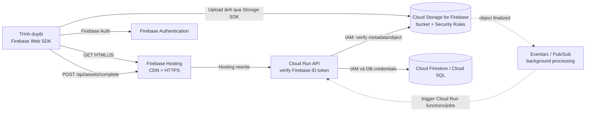
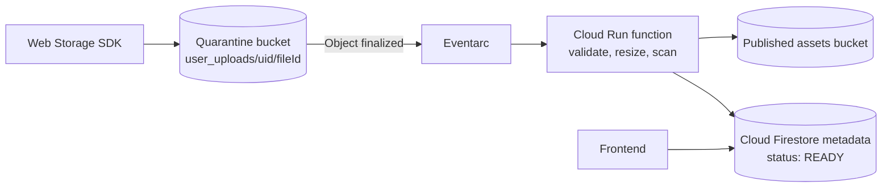

# Firebase Hosting, Cloud Storage for Firebase và backend GCP

## 1. Bài toán và mục tiêu

Một ứng dụng web quản lý ảnh sản phẩm cần giao diện truy cập nhanh, hỗ trợ upload trực tiếp từ trình duyệt, lưu ảnh an toàn và có một API kiểm tra metadata trước khi lưu thông tin ảnh vào database. Một cách thiết kế trên Google Cloud là:

- **Firebase Hosting:** phân phối HTML/CSS/JavaScript qua CDN, HTTPS và custom domain.
- **Cloud Storage for Firebase:** lưu ảnh trong **Google Cloud Storage bucket**, cho phép ứng dụng web/mobile upload/download qua Firebase SDK với **Firebase Security Rules**.
- **Backend GCP:** Cloud Run/Cloud Run functions/GKE hoặc dịch vụ khác thực thi nghiệp vụ, đọc metadata/object bằng **IAM**, tích hợp Firestore/Cloud SQL, Pub/Sub/Eventarc khi cần.

Bài thuộc chương **Firestore và Firebase** trong module **CLOUD_PROVIDERS_GCP**, kết nối project, IAM, VPC, Cloud Run, GKE, lưu trữ và database. Mục tiêu là **chọn đúng ranh giới trách nhiệm**, triển khai luồng web → upload → backend an toàn, tự động hóa phát hành và quản lý độ tin cậy cùng chi phí.

Sau bài học, bạn có thể:

1. Phân biệt **Firebase Hosting**, **Firebase App Hosting**, **Cloud Storage for Firebase** và **Cloud Run**.
2. Hiểu Firebase project liên kết Google Cloud project, bucket mặc định, Blaze/billing và vùng dữ liệu.
3. Dùng `firebase.json` cấu hình CDN static, SPA fallback và **rewrite** `/api/**` tới Cloud Run.
4. Viết **Storage Security Rules** theo Firebase Auth UID, kích thước và MIME type; không nhầm Rules với Google Cloud IAM.
5. Upload từ Firebase Web SDK và gọi API Cloud Run sau khi upload xong.
6. Thiết kế xác thực backend bằng **Firebase ID token**, App Check, service account, IAM và quy trình xử lý file không tin cậy.
7. Kiểm thử với Emulator Suite/preview channel, theo dõi lỗi, chi phí và tình huống vận hành.

> **Phạm vi thực hành:** Các project, bucket, domain và service account bên dưới đều là tên giả định. Lệnh deploy và Cloud Storage/Cloud Run có thể phát sinh phí; chỉ thực hiện trên project lab được phép. Trong STEP 4, mọi ví dụ file bên dưới **chỉ là nội dung hướng dẫn**, không tạo thêm file ngoài Markdown được giao.

## 2. Sơ đồ kiến trúc



**Ba đường truy cập phải phân biệt:**

| Đường | Danh tính/quyền | Đối tượng xử lý |
| --- | --- | --- |
| Browser → Hosting | Public static content theo Hosting config | `index.html`, bundled JS/CSS, assets |
| Browser → Storage Firebase SDK | **Firebase Auth/App Check + Storage Security Rules** | Upload/download vào bucket theo path từng user |
| Cloud Run → Cloud Storage / database | **Google Cloud service account + IAM**, có thể thêm DB auth | Backend đọc metadata, xử lý dữ liệu, kiểm chứng nghiệp vụ |

**Hosting không phải nơi chứa file người dùng upload.** Static assets triển khai được quản lý theo Hosting releases/CDN; ảnh runtime nằm trong **Cloud Storage bucket**, có vòng đời, quyền và chi phí khác. **Hosting rewrite không tự xác minh người dùng**: backend phải kiểm tra token và authorization với mọi API nhạy cảm.

## 3. Chọn sản phẩm đúng

| Nhu cầu | Sản phẩm nên xét | Vì sao |
| --- | --- | --- |
| SPA, website tĩnh, tài nguyên JS/CSS có CDN | **Firebase Hosting** | Deploy đơn giản, SSL/CDN và preview |
| Next.js/Angular SSR có quy trình framework/build chuyên biệt | **Firebase App Hosting** (kiểm tra framework được hỗ trợ) | Quản lý framework-aware deploy/Cloud Run/Cloud CDN tích hợp |
| API container, xử lý ảnh theo HTTP, microservice | **Cloud Run** | Chạy container theo request và scale |
| HTTP/event handler nhỏ | **Cloud Run functions** | Hàm triển khai nguồn, trigger phù hợp |
| Ảnh/video/user files | **Cloud Storage for Firebase** | Direct upload, resumable operations và Firebase Rules |
| User profile/metadata có realtime sync | **Cloud Firestore** | Document DB + SDK + Security Rules riêng |
| Quan hệ/transaction SQL | **Cloud SQL** | Backend xử lý qua driver/connector, không truy cập trực tiếp từ browser |
| Task dài/batch | **Cloud Run jobs / GKE** | Background xử lý đến khi hoàn tất |

**Firebase Hosting và App Hosting là hai sản phẩm khác nhau.** Hosting có thể dùng rewrites để truy cập Cloud Run nhưng không tự chuyển một SPA thành ứng dụng server-side rendering. Nếu website chỉ có HTML/JS build sẵn, Hosting thường đủ đơn giản.

## 4. Firebase project, Google Cloud project và bucket mặc định

**Firebase project được xây trên một Google Cloud project.** Hai console hiển thị những góc khác nhau của cùng nền tảng: Firebase Console cấu hình web app/Auth/Rules/Hosting; Google Cloud Console quản lý Billing, IAM, Cloud Run, VPC, Cloud Logging, Storage và API quotas.

### Những điều kiện mới cần nhớ

- Từ giai đoạn cập nhật Storage sau tháng **9/2024**, bucket mặc định mới dùng tên **`PROJECT_ID.firebasestorage.app`**; legacy default buckets có thể dùng **`PROJECT_ID.appspot.com`**.
- **Cloud Storage for Firebase yêu cầu gói Blaze (pay-as-you-go)**, kể cả khi lưu lượng thực tế nằm trong free usage allowance. Tạo/duy trì bucket hoặc sử dụng backend Cloud Run yêu cầu project có billing phù hợp.
- **Default Storage bucket có location riêng**, không mặc nhiên trùng với Cloud Firestore database, Hosting CDN hoặc region Cloud Run. Chọn region theo độ trễ, data residency, phí và dịch vụ xử lý.
- Một Firebase project có thể sử dụng **nhiều Storage buckets**; ứng dụng phải chọn đúng bucket/URL và rules tương ứng. Không hard-code `appspot.com` cho project mới.

Ví dụ:

```text
Google Cloud / Firebase project: acme-media-lab
Web app ID:               1:123456789:web:example (minh họa)
Hosting:                  https://acme-media-lab.web.app
Default Storage bucket:   acme-media-lab.firebasestorage.app
Cloud Run API:            media-api / asia-southeast1
Firestore database:       (default), location được chọn độc lập
```

**Firebase web configuration (apiKey, authDomain, projectId, storageBucket, appId)** là thông tin cấu hình công khai trong frontend, **không phải service-account secret**. Tuy nhiên cần giới hạn được quota/API keys theo sản phẩm và **tuyệt đối không embed Admin SDK service account JSON, private key hay Cloud SQL password** vào JavaScript bundle.

## 5. Firebase Hosting: CDN, HTTPS, rewrites và routing

Firebase Hosting phân phối files trong thư mục `public` (ví dụ `dist` sau Vite build), tự cấp `*.web.app` / `*.firebaseapp.com` và hỗ trợ custom domain + managed TLS. Deploy tạo **versions/releases**; preview channels cho phép kiểm thử trước production.

Thứ tự xử lý request quan trọng (giản lược từ tài liệu):

1. Reserved namespaces `/__/*`.
2. Redirects được cấu hình.
3. **Static file khớp chính xác** trong thư mục đã deploy.
4. Rewrite đầu tiên khớp path.
5. Custom hoặc default 404.

### `firebase.json` cho SPA + Cloud Run API

```json
{
  "hosting": {
    "public": "dist",
    "ignore": [
      "firebase.json",
      "**/.*",
      "**/node_modules/**"
    ],
    "rewrites": [
      {
        "source": "/api/**",
        "run": {
          "serviceId": "media-api",
          "region": "asia-southeast1"
        }
      },
      {
        "source": "**",
        "destination": "/index.html"
      }
    ],
    "headers": [
      {
        "source": "/index.html",
        "headers": [
          {
            "key": "Cache-Control",
            "value": "no-cache"
          }
        ]
      },
      {
        "source": "/assets/**",
        "headers": [
          {
            "key": "Cache-Control",
            "value": "public,max-age=31536000,immutable"
          }
        ]
      }
    ]
  },
  "storage": {
    "rules": "storage.rules"
  }
}
```

**Lưu ý cấu hình:**

- Đặt `/api/**` **trước** `**`; nếu đảo ngược, SPA fallback có thể trả `index.html` cho một yêu cầu API chưa có static file.
- `/api/**` được forward đến Cloud Run với **path và query gốc**; backend nên định nghĩa routes `/api/...`. Rewrite **không đổi** URL hiển thị cho browser.
- **Static file ưu tiên hơn rewrite**. Không tạo `dist/api/status` hay các file trùng route API rồi kỳ vọng Cloud Run luôn nhận request.
- `Cache-Control: immutable` chỉ phù hợp với assets **có hash trong tên file**. Không dùng TTL dài cho `index.html` hoặc dữ liệu cá nhân.
- Tùy region/backend, Hosting-to-Cloud Run có giới hạn phương thức/timeout và vị trí được hỗ trợ; tra docs trước khi chọn workload xử lý dài.

**Kiểm thử:** `GET /dashboard` được trả về SPA, còn `GET /api/health` phải trả JSON từ Cloud Run. Nếu `/api/health` trả HTML, kiểm tra rewrite order và static precedence trước.

## 6. Cloud Storage for Firebase khác Hosting và GCS trực tiếp ra sao?

Cloud Storage for Firebase dùng **Google Cloud Storage bucket thật**. Đây không phải một loại lưu trữ tách biệt: objects vẫn có names, metadata, generations, storage classes, location và GCS pricing. Điều khác biệt nằm ở **Firebase SDK, Authentication/App Check integration và Storage Security Rules** dành cho client.

| Trường hợp | Cách truy cập | Lớp cấp quyền chính |
| --- | --- | --- |
| Người dùng web upload ảnh | `firebase/storage` SDK | **Firebase Security Rules** với `request.auth` |
| Người dùng web xem file riêng | Firebase Storage SDK đọc theo rules | **Firebase Security Rules** |
| Backend Cloud Run kiểm tra/xử lý object | Google Cloud Storage SDK / Firebase Admin SDK | **Google Cloud IAM**, không dựa vào client rules |
| Batch/ETL quản lý objects | `gcloud storage`/Cloud Storage APIs | **Cloud IAM**, có thể thêm org policies/VPC SC |
| Website tải favicon/logo | Firebase Hosting static deploy | **Hosting public CDN**, không dùng Storage rules |

**Security Rules không phải ACL thay thế IAM cho mọi đường truy cập.** Backend dùng Admin SDK hoặc Google Cloud server client với service account có thể **bỏ qua Firebase Security Rules**. Vì vậy một ruleset chặt chẽ **không bảo vệ** đường backend nếu bạn cấp `roles/storage.admin` rộng và tin input người dùng.

### Download URL và dữ liệu riêng tư

`getDownloadURL()` trả URL có token truy cập để chia sẻ file. **Không coi tokenized download URL là một API luôn kiểm tra Security Rules tại mỗi lần xem**; người cầm link có thể truy cập theo cơ chế download token cho đến khi token được đổi/thu hồi. Với tài liệu riêng tư, ưu tiên SDK authenticated downloads, backend xác thực hoặc signed URL ngắn hạn theo chính sách. Không log/download URL vào hệ thống quan sát hoặc analytics nếu file nhạy cảm.

## 7. Thiết kế đường dẫn object và Storage Security Rules

Một lựa chọn dễ kiểm soát:

```text
user_uploads/
  <firebase-auth-uid>/
    <random-file-id>.jpg
    <random-file-id>.png
```

**Không tin vào đường dẫn tự do do client nhập.** Client đặt path theo UID hiện tại và random ID; Security Rules từ chối ghi vào UID khác. Dùng filename gốc làm metadata không bảo mật, nhưng **không** dùng nó làm key trực tiếp nếu có ký tự bất thường, trùng tên hoặc chứa PII.

**`storage.rules`:** rules dưới đây chỉ cho phép user tạo file ảnh tối đa 5 MiB trong namespace của chính mình, không cho overwrite/delete/list. Đây là ruleset lab, production cần policy riêng cho việc xóa tài khoản và quản lý nội dung.

```javascript
rules_version = '2';
service firebase.storage {
  match /b/{bucket}/o {
    match /user_uploads/{userId}/{fileId} {
      allow get: if request.auth != null
                 && request.auth.uid == userId;
      allow list: if false;
      allow create: if request.auth != null
                    && request.auth.uid == userId
                    && resource == null
                    && request.resource.size <= 5 * 1024 * 1024
                    && request.resource.contentType.matches('image/(jpeg|png|webp)');
      allow update, delete: if false;
    }
  }
}
```

**Giải thích:**

- `request.auth.uid` lấy từ Firebase Auth ID token do SDK gửi, không phải một HTTP header tự khai báo.
- `allow create` chỉ áp dụng thao tác tạo object; `allow update, delete: if false` chặn ghi đè/xóa qua SDK.
- `request.resource` chứa **metadata mới** như size và contentType. **MIME type có thể giả mạo**: backend/virus scanner cần đọc magic bytes và validate thực tế trước khi công bố ảnh.
- `allow get` cho owner tải file theo rules; `allow list: if false` ngăn liệt kê cả thư mục qua Firebase SDK.
- Không đặt `allow read, write: if true` hoặc `request.auth != null` cho **toàn bucket** trong production; người dùng đăng nhập không đồng nghĩa được quyền đọc file của người khác.

**Rules là các điều kiện cấp quyền.** Nếu sau này thêm một `match /{allPaths=**}` với `allow read: if true`, một quyền rộng hơn có thể làm lộ objects dù match owner ở trên chặt. Phải test **toàn ruleset**, không chỉ một block riêng.

## 8. Các lớp bảo vệ bổ sung

| Lớp | Bảo vệ | Không thay thế |
| --- | --- | --- |
| **Firebase Authentication** | Xác thực user/UID, custom claims | Kiểm tra file thực sự là ảnh sạch |
| **Storage Security Rules** | Phân quyền create/read/update/delete trên object paths | Cloud IAM của server/Admin SDK |
| **Firebase App Check** | Attestation ứng dụng/thiết bị, giảm request giả mạo | Firebase Auth và business authorization |
| **Cloud IAM** | Quyền service account/backend với Cloud Storage/Firestore | Rules cho direct Firebase SDK |
| **Cloud Run backend validation** | Ownership/business state, malware/format scan, rate limits | Kiểm tra quyền ở browser |
| **Cloud Storage config** | Bucket location, encryption, retention, lifecycle, public access prevention | Xác thực user theo Firebase UID |

Với App Check, nên triển khai SDK/attestation trước, **xem metrics** rồi mới bật **enforcement** cho Cloud Storage nhằm tránh khóa nhầm người dùng hợp lệ. **App Check và Firebase Auth là hai cơ chế bổ sung**, không phải hai tên gọi của cùng token.

Khi Security Rules cần xét quyền theo nhóm, có thể dùng `firestore.get()`/`firestore.exists()` tới **Cloud Firestore database mặc định**, nhưng mỗi lần đánh giá có giới hạn số document lookups và có thể tính **Firestore reads**. Đừng đọc hàng loạt membership documents trong một rule. Với dữ liệu quyền phức tạp, cân nhắc backend authorization thay vì làm ruleset khó kiểm tra.

## 9. Chuẩn bị lab: frontend + Storage + Cloud Run

Giả định tổ chức đã cấp một Firebase/Google Cloud project:

```text
PROJECT_ID:       acme-media-lab
Firebase Hosting: https://acme-media-lab.web.app
Storage bucket:   acme-media-lab.firebasestorage.app
Cloud Run service: media-api
Region:           asia-southeast1
Runtime SA:       media-api-sa@acme-media-lab.iam.gserviceaccount.com
```

**Preflight trong Firebase Console:**

1. Tạo/chọn project lab và web app; sao chép **Firebase Web config** thực tế.
2. Bật Firebase Authentication provider **Anonymous** trong lab (production chọn provider/identity phù hợp); kiểm tra authorized domains.
3. Bật gói **Blaze** và tạo Storage default bucket ở region phù hợp; xác minh **bucket ID thực**, không giả định ID ví dụ sẵn có.
4. Bật Cloud Run API, Cloud Build/Artifact Registry API và cấp IAM deployer/SA theo nguyên tắc tối thiểu.
5. Chuẩn bị Firebase CLI, `gcloud`, Node.js và một local frontend build tool như Vite.

**Kiểm tra quyền trước khi thay đổi:**

```bash
# CHỈ ĐỌC trong project thực tế
gcloud auth list
gcloud config get-value project
gcloud storage buckets describe \
  gs://acme-media-lab.firebasestorage.app \
  --project=acme-media-lab
gcloud run services list \
  --project=acme-media-lab \
  --region=asia-southeast1
```

Nếu project/bucket chưa tồn tại, lệnh `describe` trả 404 là bình thường; quay lại bước chuẩn bị, **không tạo bucket tự động bằng script** khi chưa có Billing và chính sách data residency được phê duyệt.

## 10. Lab A — web app upload ảnh qua Firebase Storage SDK

Ví dụ dùng **Vite vanilla JavaScript**; các file trong mục này được người học tạo trong thư mục lab, không phải file của module.

### 10.1. Khởi tạo frontend

```bash
# THAO TÁC Ở MÁY LAB CỦA NGƯỜI HỌC
npm create vite@latest media-web -- --template vanilla
cd media-web
npm install
npm install firebase
```

Thay nội dung `index.html` bằng giao diện tối thiểu:

```html
<!doctype html>
<html lang="vi">
  <head>
    <meta charset="UTF-8" />
    <meta name="viewport" content="width=device-width, initial-scale=1.0" />
    <title>Firebase Storage lab</title>
  </head>
  <body>
    <main>
      <h1>Tải ảnh lên bộ lưu trữ riêng</h1>
      <input id="photo" type="file" accept="image/jpeg,image/png,image/webp" />
      <button id="upload">Upload ảnh</button>
      <pre id="status" aria-live="polite"></pre>
    </main>
    <script type="module" src="/src/main.js"></script>
  </body>
</html>
```

### 10.2. Cấu hình Firebase app và upload

`src/main.js` (thay các placeholder bằng **Firebase Web app config** thực tế trong Firebase Console):

```javascript
import { initializeApp } from "firebase/app";
import { getAuth, signInAnonymously } from "firebase/auth";
import {
  getStorage, ref, uploadBytesResumable
} from "firebase/storage";

const app = initializeApp({
  apiKey: "FIREBASE_WEB_API_KEY",
  authDomain: "acme-media-lab.firebaseapp.com",
  projectId: "acme-media-lab",
  storageBucket: "acme-media-lab.firebasestorage.app",
  appId: "FIREBASE_WEB_APP_ID",
});
const auth = getAuth(app);
const storage = getStorage(app);

const status = document.querySelector("#status");
const button = document.querySelector("#upload");
const fileInput = document.querySelector("#photo");

let user = null;
button.disabled = true;
signInAnonymously(auth)
  .then(({ user: signedInUser }) => {
    user = signedInUser;
    button.disabled = false;
    status.textContent = "Sẵn sàng. UID: " + user.uid;
  })
  .catch((error) => {
    status.textContent = "Auth failed: " + error.code;
  });

button.addEventListener("click", async () => {
  if (!user || !fileInput.files?.length) return;
  const file = fileInput.files[0];
  const types = ["image/jpeg", "image/png", "image/webp"];
  if (!types.includes(file.type) || file.size > 5 * 1024 * 1024) {
    status.textContent = "Chỉ chấp nhận JPEG/PNG/WebP tối đa 5 MiB.";
    return;
  }

  const path = `user_uploads/${user.uid}/${crypto.randomUUID()}`;
  const uploadTask = uploadBytesResumable(
    ref(storage, path),
    file,
    { contentType: file.type }
  );
  button.disabled = true;
  try {
    await new Promise((resolve, reject) => {
      uploadTask.on("state_changed",
        (snapshot) => {
          const pct = Math.round(
            snapshot.bytesTransferred / snapshot.totalBytes * 100
          );
          status.textContent = `Đã tải ${pct}%`;
        },
        reject,
        resolve
      );
    });

    const idToken = await user.getIdToken();
    const response = await fetch("/api/assets/complete", {
      method: "POST",
      headers: {
        "Content-Type": "application/json",
        "Authorization": `Bearer ${idToken}`
      },
      body: JSON.stringify({ path })
    });
    if (!response.ok) throw new Error(`Backend HTTP ${response.status}`);
    const body = await response.json();
    status.textContent = `Upload và kiểm tra xong: ${body.path}`;
  } catch (error) {
    status.textContent = "Lỗi: " + (error.code || error.message);
  } finally {
    button.disabled = false;
  }
});
```

**Luồng thực tế:** Firebase Authentication xác thực user ẩn danh trong lab → Storage SDK lấy token và gửi upload → Storage Security Rules kiểm tra UID/path/metadata → sau khi upload xong, client gọi Cloud Run API cùng **Firebase ID token**. Frontend chỉ hiển thị kết quả **sau khi backend xác nhận**.

**Giới hạn của demo:** `signInAnonymously` dùng cho thử nghiệm, không đại diện danh tính khách hàng lâu dài; ứng dụng production nên sử dụng provider phù hợp, liên kết accounts và quản lý lifecycle. Kiểm tra ở frontend **không thay Security Rules/server validation**: mọi JavaScript có thể bị sửa bởi người gọi.

### 10.3. Preview frontend tại máy cá nhân

```bash
npm run dev
```

Trong chế độ Vite local, `/api/**` **chưa được Firebase Hosting rewrite**; nếu frontend gọi `/api/assets/complete`, Vite dev server có thể trả 404 hoặc HTML. Để chạy end-to-end trên máy cá nhân, cấu hình Vite development proxy tới backend lab **hoặc** dùng Firebase Hosting emulator với cách định tuyến được hỗ trợ. Không đưa token người dùng vào một HTTP endpoint không được phê duyệt.

**Đối với Storage/Auth emulators**, dùng Firebase Emulator Suite (mục 15) để thử rules và auth offline. Nếu upload chạy với project thật, Storage SDK gửi tới bucket thật, vẫn phát sinh phí; **không nhầm `npm run dev` là chế độ giả lập toàn bộ Firebase**.

## 11. Lab B — Cloud Run API xác minh token và object

Làm API bằng Python Flask chạy trên Cloud Run. Đường `/api/assets/complete` yêu cầu Firebase ID token, kiểm tra user ID/path, rồi đọc object metadata với **service account**.

### 11.1. Backend source

**`backend/app.py`:**

```python
import os
from flask import Flask, jsonify, request
from firebase_admin import auth, initialize_app
from google.cloud import storage
from google.api_core.exceptions import NotFound

app = Flask(__name__)
initialize_app(options={"projectId": os.environ["FIREBASE_PROJECT_ID"]})
storage_client = storage.Client()
bucket_name = os.environ["STORAGE_BUCKET"]

@app.get("/api/health")
def health():
    return jsonify({"status": "ok"}), 200

@app.post("/api/assets/complete")
def complete():
    bearer = request.headers.get("Authorization", "")
    if not bearer.startswith("Bearer "):
        return jsonify({"error": "unauthorized"}), 401
    try:
        claims = auth.verify_id_token(bearer[len("Bearer "):])
    except Exception:
        # Không để lộ token/chi tiết kiểm tra cho client.
        return jsonify({"error": "invalid_token"}), 401

    payload = request.get_json(silent=True) or {}
    path = payload.get("path", "")
    uid = claims["uid"]
    if (not isinstance(path, str)
            or not path.startswith(f"user_uploads/{uid}/")
            or len(path.split("/")) != 3):
        return jsonify({"error": "forbidden_path"}), 403

    blob = storage_client.bucket(bucket_name).blob(path)
    try:
        blob.reload()
    except NotFound:
        return jsonify({"error": "object_not_found"}), 404

    allowed_types = {"image/jpeg", "image/png", "image/webp"}
    if (blob.content_type not in allowed_types
            or blob.size is None
            or blob.size > 5 * 1024 * 1024):
        return jsonify({"error": "invalid_object_metadata"}), 422

    response = jsonify({
        "path": path,
        "generation": blob.generation,
        "status": "metadata_verified"
    })
    response.headers["Cache-Control"] = "private, no-store"
    return response, 200
```

**`backend/requirements.txt`:**

```text
flask>=3,<4
gunicorn>=22,<25
firebase-admin>=6,<8
google-cloud-storage>=2,<4
```

**`backend/Dockerfile`:**

```dockerfile
FROM python:3.12-slim
WORKDIR /app
COPY requirements.txt .
RUN pip install --no-cache-dir -r requirements.txt
COPY app.py .
CMD ["sh", "-c", "exec gunicorn --bind 0.0.0.0:${PORT:-8080} app:app"]
```

**Phạm vi ví dụ:** backend chỉ kiểm tra **metadata**, không xác nhận bytes thực là ảnh hợp lệ, malware-free hoặc đã được phép công bố. Production cần quét file tại bucket quarantine, kiểm tra magic bytes/decoder, status trong database, chống duplicate completion, quota/rate limit và business authorization. Khi nhận một `path` hợp lệ nhưng object vừa bị thay thế bởi backend khác, dùng **generation precondition/conditional updates** để tránh race.

### 11.2. Cloud Run service account quyền tối thiểu

```bash
# THAY ĐỔI IAM - chỉ trong project LAB
gcloud iam service-accounts create media-api-sa \
  --project=acme-media-lab \
  --display-name="Media API runtime"

# Quyền CHỈ ĐỌC object metadata và nội dung trên bucket lab
gcloud storage buckets add-iam-policy-binding \
  gs://acme-media-lab.firebasestorage.app \
  --member="serviceAccount:media-api-sa@acme-media-lab.iam.gserviceaccount.com" \
  --role="roles/storage.objectViewer" \
  --project=acme-media-lab
```

**`roles/storage.objectViewer`** được cấp trong phạm vi bucket lab, không phải `roles/storage.admin` trên toàn project. Operator deploy cần quyền Cloud Run deploy/Cloud Build/Artifact Registry và `iam.serviceAccounts.actAs` trên runtime SA; không dùng Editor/Owner mặc định cho service account.

### 11.3. Deploy API

Từ thư mục chứa thư mục `backend`:

```bash
# THAY ĐỔI: build image từ source và deploy Cloud Run
gcloud run deploy media-api \
  --project=acme-media-lab \
  --region=asia-southeast1 \
  --source=backend \
  --service-account=media-api-sa@acme-media-lab.iam.gserviceaccount.com \
  --set-env-vars="FIREBASE_PROJECT_ID=acme-media-lab,STORAGE_BUCKET=acme-media-lab.firebasestorage.app" \
  --max-instances=3 \
  --allow-unauthenticated
```

**Cảnh báo về `--allow-unauthenticated`:** tài liệu Firebase Hosting → Cloud Run sử dụng dịch vụ **cho phép gọi không cần IAM identity** để Hosting có thể forward request. Vì vậy Cloud Run URL trực tiếp **cũng truy cập được** ở tầng mạng/IAM. Đây là lý do **mọi endpoint nhạy cảm phải xác minh Firebase ID token trong code**; `/api/health` là endpoint public tối thiểu.

Nếu tổ chức cần **Cloud Run hoàn toàn private ở tầng IAM/ingress**, không dùng nguyên mẫu public rewrite này: đánh giá kiến trúc **external HTTPS load balancer có backend auth/IAP**, API Gateway/Apigee hoặc cơ chế được tài liệu Firebase Hosting hỗ trợ trong môi trường cụ thể. **Không giả định một Hosting rewrite tự cấp ID token Google IAM cho Cloud Run.**

## 12. Lab C — deploy Hosting và Storage Rules

Ở thư mục gốc frontend (`media-web`), dùng Firebase CLI và chọn đúng project trước deploy:

```bash
# Thực hiện bởi người học, không chạy trong worker repository
npm install -g firebase-tools
firebase login
firebase use --add

# Firebase CLI hỗ trợ init Hosting và Storage; kiểm tra config sau init.
firebase init hosting
firebase init storage

# Kiểm tra/thay firebase.json như mục 5 và storage.rules như mục 7.
npm run build

# THAY ĐỔI HOSTING + STORAGE RULES trong project đang chọn
firebase deploy --only hosting,storage
```

**Lưu ý:** `firebase init` có thể cập nhật lại phần `hosting` trong `firebase.json`. Hãy **kiểm tra lại thứ tự rewrites** sau init; `public` phải trỏ đến `dist` đã build. Đừng deploy nếu CLI đang chọn nhầm project production.

Sau deploy, thử:

```bash
# CHỈ ĐỌC HTTP
curl -i "https://acme-media-lab.web.app/api/health"
curl -i "https://acme-media-lab.web.app/dashboard"

# THỬ AUTH: request thiếu token phải bị từ chối
curl -i -X POST \
  -H "Content-Type: application/json" \
  -d '{"path":"user_uploads/another-user/demo"}' \
  "https://acme-media-lab.web.app/api/assets/complete"
```

**Kỳ vọng:** `/api/health` trả JSON `status: ok`; `/dashboard` trả HTML SPA; `POST /api/assets/complete` không có token trả **401**. Khi upload ảnh thật từ frontend, Rules cho phép đúng UID và API trả `metadata_verified`. Nếu `curl /api/health` lại trả HTML `index.html`, đây là dấu hiệu rewrite hoặc static precedence sai.

**Deploy Storage Rules ảnh hưởng client thật trên bucket**, không chỉ phiên bản frontend preview. Chỉ deploy rules sau khi đã test quyền đọc/ghi hợp lệ và các trường hợp phải bị từ chối.

## 13. Phân biệt Firebase Auth ID token, App Check token và IAM

| Token/danh tính | Ai cung cấp | Backend dùng để làm gì? |
| --- | --- | --- |
| **Firebase ID token** | Firebase Authentication SDK | Xác minh **user UID/claims** bằng Admin SDK; kiểm tra ownership/business role |
| **Firebase App Check token** | App Check SDK/attestation | Xác minh yêu cầu từ ứng dụng hợp lệ hơn; hạn chế abuse, **không thay user auth** |
| **Google OIDC identity token** | Service account/Google IAM | Service-to-service authentication vào Cloud Run/IAP theo audience |
| **Google OAuth access token** | Google Auth/IAM | Gọi Google Cloud APIs (Storage, Firestore, Secret Manager...) |
| **Firebase web API key** | Frontend config | Định danh/config client, **không phải secret**, không cấp quyền admin |
| **Service account credentials** | Google runtime ADC/metadata server | Quyền backend gọi GCP; **tuyệt đối không đưa vào browser** |

**Flow xác thực trong lab:**

```text
Browser → Firebase Auth sign-in → lấy Firebase ID token
        → POST /api/assets/complete (Authorization: Bearer <Firebase ID token>)
        → Cloud Run Admin SDK verify_id_token()
        → kiểm tra UID khớp path
        → Storage client dùng Cloud Run runtime SA (IAM objectViewer)
        → đọc metadata, trả kết quả
```

Việc xác minh token phải diễn ra **ở backend** cho tất cả thao tác dữ liệu nhạy cảm. Với quyền admin, không tin `uid`, `isAdmin` hoặc `price` chỉ vì client gửi trong JSON. Nếu dùng custom claims, kiểm tra chữ ký/issuer/audience qua Admin SDK, xử lý cập nhật token, và kiểm tra role/tenant tại data store theo yêu cầu.

**App Check cho custom Cloud Run API** cần phía client gửi App Check token và backend **verify** theo hướng dẫn, thay vì chỉ bật App Check enforcement trên Cloud Storage rồi suy rằng mọi request tới Cloud Run đã được bảo vệ.

## 14. Backend GCP: xử lý ảnh theo sự kiện và đồng bộ dữ liệu

Upload ảnh thành công **không đảm bảo ảnh hợp lệ để công bố ngay**. Có thể thêm pipeline:



**Hai mô hình tích hợp:**

1. **Synchronous confirmation API** (Lab B): client upload rồi gọi API; thích hợp kiểm metadata, tạo bản ghi metadata, trả acknowledgement.
2. **Asynchronous processing**: Eventarc direct Cloud Storage finalized event kích hoạt Cloud Run function; có thể chạy scan/thumbnail, ghi output bucket, cập nhật Firestore `status=READY`; hợp khi xử lý tốn CPU hoặc có dependency cần retry.

**Lỗi từng phần cần xử lý:** upload xong nhưng API response timeout; API ghi Firestore xong rồi client retry; function được Eventarc gọi nhiều lần. Dùng **idempotency key** dựa trên `bucket + objectName + generation`, Cloud Storage generation preconditions và Firestore transaction/unique document ID. Không coi delivery là exactly-once.

### Firestore là metadata, không phải object storage

Ví dụ document:

```json
{
  "ownerUid": "firebase-uid-example",
  "objectPath": "user_uploads/firebase-uid-example/uuid-file",
  "generation": "1723456789000000",
  "contentType": "image/jpeg",
  "processingStatus": "READY",
  "createdAt": "server timestamp"
}
```

Đây là **schema minh họa**, `createdAt` phải được tạo bằng **server timestamp** thực trong code. Một Firestore document chỉ chứa metadata và đường dẫn, **không nhúng toàn bộ bytes ảnh** vào document. Nếu clients đọc Firestore trực tiếp, phải triển khai **Firestore Security Rules riêng**; Storage Rules **không tự cấp quyền** đối với metadata Firestore.

## 15. Kiểm thử: Emulator Suite, preview channels và CI/CD

### 15.1. Kiểm tra Storage Rules mà không thao tác dữ liệu thật

Firebase Emulator Suite hỗ trợ **Authentication, Cloud Storage, Hosting và Firestore** (theo bộ emulators đang dùng). Để kiểm thử:

```bash
# Lệnh chạy ở thư mục lab đã firebase init tương ứng
firebase emulators:start --only auth,storage,hosting
```

SDK frontend phải trỏ rõ tới emulators trong cấu hình lab, ví dụ:

```javascript
import { connectAuthEmulator } from "firebase/auth";
import { connectStorageEmulator } from "firebase/storage";

// Chỉ bật trong môi trường development được kiểm soát.
connectAuthEmulator(auth, "http://127.0.0.1:9099");
connectStorageEmulator(storage, "127.0.0.1", 9199);
```

Emulator **không thay thế hoàn toàn môi trường production**: một số behavior Google IAM, App Check enforcement, CDN cache, VPC, billing và service-to-service auth khác runtime thật. Chỉ bật emulator khi đang ở môi trường local, **không** deploy `connectStorageEmulator` vào bundle production.

**Ma trận test Storage Rules** nên có:

| Tình huống | Kỳ vọng |
| --- | --- |
| UID A tạo `user_uploads/A/id-1`, ảnh JPEG 100 KiB | **Allow** |
| UID A tạo `user_uploads/B/id-2` | **Deny** |
| User chưa đăng nhập tạo object | **Deny** |
| UID A upload ảnh > 5 MiB | **Deny** |
| UID A upload `application/pdf` | **Deny** |
| UID A đọc object của UID B | **Deny** |
| UID A upload đè file đã tồn tại | **Deny** |
| UID A liệt kê toàn bộ prefix | **Deny** |
| UID A đọc đúng file của mình | **Allow** |

Có thể dùng `@firebase/rules-unit-testing` để viết tự động các phép kiểm tra `assertSucceeds`/`assertFails` với auth context giả định, đồng thời chạy e2e với SDK thật ở staging.

### 15.2. Hosting preview và Cloud Run revision

```bash
# THAY ĐỔI preview content - không deploy live Hosting
firebase hosting:channel:deploy media-preview --expires 7d
```

Preview URL riêng giúp QA giao diện, nhưng **không tự cô lập** Auth, Storage bucket, Security Rules hoặc backend production. Cấu hình rewrite mặc định có thể trỏ tới **Cloud Run revision hiện tại**. Nếu cần đồng bộ Hosting frontend và Cloud Run revision, có thể thêm `"pinTag": true` vào cấu hình `run` để Hosting release/preview **pin Cloud Run revision**, theo giới hạn Cloud Run tags và yêu cầu của docs. Preview không phải sandbox dữ liệu nếu nó vẫn dùng Firebase project production.

### 15.3. Phát hành an toàn

1. Kiểm tra `firebase.json`, `storage.rules`, backend code bằng code review; không commit credentials.
2. Chạy unit tests cho Rules, token verification, API request validation và backend authorization.
3. Deploy **backend vào staging**, chạy e2e upload và Eventarc processing; xác minh quan sát lỗi.
4. Build assets có hash, deploy **Hosting preview channel**; kiểm tra rewrites và cache.
5. Triển khai **Rules qua pipeline riêng có phê duyệt**, vì Rules áp dụng ở bucket cho **mọi client**.
6. Promote frontend/backend theo version tương thích; giám sát 401/403, 404, 5xx, upload error và chi phí.
7. Nếu rollback Hosting static version, kiểm tra **Cloud Run revision và Rules có đang tương thích**; rollback Hosting **không tự rollback** các Storage Rules hoặc database migration.

## 16. Cache, hiệu năng và file upload lớn

**Hosting** phù hợp cache static có hash, HTML ngắn TTL và CDN. **Cloud Storage SDK** phù hợp resumable uploads, đặc biệt kết nối di động không ổn định; Cloud Run không nên làm proxy byte stream cho tất cả file upload trừ khi cần server-side kiểm soát trước khi ghi.

| Đường | Tối ưu | Rủi ro |
| --- | --- | --- |
| HTML `index.html` | `no-cache` / revalidate | TTL dài gây frontend cũ gọi API mới |
| JS/CSS hashed assets | `max-age=31536000,immutable` | Chỉ an toàn nếu asset filenames đổi khi nội dung đổi |
| `/api/**` dynamic | Backend trả `Cache-Control: private, no-store` cho user-specific JSON | CDN/browser cache có thể lộ dữ liệu nếu cache public |
| Storage direct upload | `uploadBytesResumable`, progress, size limit | Bỏ sót dữ liệu khi client rớt mạng, retry upload trùng |
| Image processing | Eventarc + Cloud Run worker, object generation IDs | Event redelivery, ảnh độc hại, vòng lặp output → trigger |

**Firebase Hosting có request timeout tối đa 60 giây với dynamic rewrites tới Cloud Run.** Không để browser chờ API xử lý video 10 phút: tạo job/background flow, trả `202 Accepted` cùng operation ID và cho frontend theo dõi trạng thái.

**Cache-control phải áp đúng tầng:** Firebase Hosting `headers` quản lý static content theo match; dynamic response từ Cloud Run nên tự đặt cache headers. Không dựa vào `firebase.json` để bảo đảm mọi response của backend mang `no-store` khi backend xử lý dữ liệu riêng tư.

## 17. Monitoring, logs và xác nhận kết quả nghiệp vụ

Quan sát **từng lớp**, vì frontend hiện “upload thành công” không có nghĩa backend đã kiểm tra hoặc xử lý ảnh xong:

| Lớp | Tín hiệu / nguồn | Cần cảnh báo khi |
| --- | --- | --- |
| **Firebase Hosting** | Usage: storage, bandwidth, request/traffic, release history | Băng thông tăng bất thường, sau deploy lỗi tải assets |
| **Firebase Authentication** | Sign-in errors/provider status | Tỷ lệ login thất bại đột biến |
| **Storage for Firebase** | Upload failures, bucket bytes, object count, operation/egress metrics | Gặp 403/permission-denied hàng loạt, upload quá chậm |
| **Security Rules / App Check** | Emulator tests, App Check metrics, Rules evaluation theo công cụ hỗ trợ | Client hợp lệ bị từ chối sau rules deploy |
| **Cloud Run API** | Request count, p95 latency, HTTP 401/403/429/5xx, runtime logs | Có 5xx, latency vượt SLO hoặc invalid-token rate tăng |
| **Cloud Storage/IAM** | Cloud Audit Logs, error codes từ Google Cloud Storage SDK | Service account không đọc được metadata/object |
| **Firestore metadata** | Documents ở `UPLOADED/PROCESSING/READY/FAILED`; query theo owner | Object đã upload nhưng không được xử lý đúng hạn |
| **Eventarc / Pub/Sub** | Delivery/retry/dead-letter, function errors | Pipeline ảnh tồn đọng hoặc chạy trùng |
| **Cloud Billing** | Budget alert, cost by SKU/project/labels | Cost tăng sau thay đổi ảnh hoặc CDN cache |

### Tìm backend logs

```bash
# CHỈ ĐỌC, cần quyền Logging và đúng project
gcloud logging read \
  'resource.type="cloud_run_revision" AND resource.labels.service_name="media-api"' \
  --project=acme-media-lab \
  --freshness=1h \
  --limit=50 \
  --format=json
```

Ứng dụng nên log **request ID, route, latency, error class, Firebase UID đã được ẩn/băm theo chính sách và object generation**; không log token, download URL có token, tên file chứa PII hoặc toàn bộ payload. Cloud Run request log và Storage audit log có thể ở **những resource types khác nhau**.

### Một business SLO mẫu

```text
99,9% upload hợp lệ hoàn tất và có trạng thái READY trong 2 phút
Không cho user A đọc/ghi file của user B
P95 /api/assets/complete < 1 giây (chỉ metadata)
100% objects FAILED/quarantine có quy trình xử lý hoặc xóa theo chính sách
```

Đây là **SLO ứng dụng giả định**, không phải SLA của Firebase/Google Cloud. Khi backend chỉ kiểm metadata như Lab B, trạng thái **`metadata_verified` không đồng nghĩa `READY`** cho nội dung ảnh; phải có pipeline scan/duyệt riêng trước khi công bố.

## 18. Chi phí, quota và kiểm soát vòng đời

**Cloud Storage for Firebase yêu cầu Blaze**, nhưng điều đó **không đồng nghĩa mọi thao tác đều bị tính phí**; có các free allowances theo sản phẩm/region/SKU. Không coi Firebase Hosting miễn phí là lý do để bỏ qua chi phí Cloud Run/Storage.

| Thành phần | Phát sinh từ | Cách giảm lãng phí |
| --- | --- | --- |
| **Firebase Hosting** | Storage versions, data transfer, CDN | Compress, hashed assets, TTL phù hợp, xóa preview/release dư thừa theo chính sách |
| **Cloud Storage for Firebase** | Object GiB-months, upload/download operations, egress, replication/region | Resize trước upload, lifecycle dọn file tạm, chọn location/class |
| **Cloud Run** | Requests, vCPU/RAM duration, instance/network | Metadata check nhanh, giới hạn max instances/concurrency, tránh giữ request lâu |
| **Cloud Firestore** | Reads/writes/deletes, indexes/storage và network | Tránh polling liên tục, chỉ lưu metadata cần thiết |
| **Firebase Auth** | Tùy provider/quota, ví dụ SMS authentication | Chọn phương thức phù hợp và chống bot |
| **App Check** | Attestation provider quotas/cost theo nhà cung cấp | Quan sát metrics trước enforcement |
| **Eventarc/Cloud Run functions** | Events, compute, retry/deliveries | Tránh loop bucket → function → bucket; idempotency |
| **Cloud Build/Artifact Registry/Logging** | Builds, image storage, log ingestion | CI/CD có cache và log sampling/redaction |

### Ước lượng đơn giản

Giả sử **5.000 users**, mỗi user upload **3 ảnh × 2 MiB**:

```text
5.000 × 3 × 2 MiB = 30.000 MiB ≈ 29,3 GiB ảnh nguồn
15.000 object create operations (chưa tính retries)
Nếu mỗi ảnh được xem 10 lần: khoảng 293 GiB dữ liệu ảnh truyền ra
```

**Đây chưa phải hóa đơn**: ảnh có thể được nén, thumbnail có size khác, download cache/CDN/token URLs tác động traffic, operations có pricing theo region, retention/versioning/replication tăng số bytes lưu. Kiểm tra [Firebase pricing](https://firebase.google.com/pricing), [Cloud Storage pricing](https://cloud.google.com/storage/pricing), [Cloud Run pricing](https://cloud.google.com/run/pricing) và Billing export.

**Dọn dữ liệu:** Rules demo chỉ cho **create/get**, không cho delete. Khi user muốn xóa ảnh hoặc xóa tài khoản, cung cấp **backend API được xác thực** hoặc scheduled lifecycle cleanup dùng service account riêng, xóa theo `generation`/precondition và audit. Đừng để không xóa được objects tạo thành chi phí và vi phạm chính sách retention. Nếu bucket có retention policy/legal hold, phải tuân thủ giới hạn xóa và không hứa rằng delete luôn thành công tức thì.

## 19. Troubleshooting: từ lỗi đến lớp nguyên nhân

| Triệu chứng | Khả năng cao | Kiểm tra / xử lý |
| --- | --- | --- |
| Firebase Hosting trả 404 tại SPA route | Chưa có `** → /index.html` hoặc build sai directory | `firebase.json`, `dist/index.html` và Hosting release |
| `/api/health` trả HTML thay vì JSON | Rewrite `**` đứng trước `/api/**` hoặc static file đè route | Rewrite order, exact static match |
| Hosting → Cloud Run 404/502 | Sai `serviceId`/region, Cloud Run chưa deploy, backend route sai | `gcloud run services describe`, Cloud Run logs, URL path |
| Hosting → Cloud Run 504 | Backend xử lý quá 60 giây | Trả 202 + background job; không kéo dài timeout bằng client retry |
| Firebase Storage `storage/unauthorized` | Rules từ chối, user chưa đăng nhập hoặc UID/path sai | Auth state, Storage Rules emulator tests, đúng bucket |
| Firebase Storage `bucket-not-found` | Nhầm `.appspot.com`/`.firebasestorage.app` hoặc bucket chưa tạo | Firebase Console Storage, `storageBucket` config |
| Upload `storage/quota-exceeded` | Billing/quota hoặc plan chưa đủ | Blaze status, bucket quota, project Billing |
| Upload thất bại khi App Check enforce | SDK/App Check token thiếu hoặc provider chưa setup | App Check metrics, domain config, test/staging |
| Cloud Run API trả 401 | Không có/hết hạn Firebase ID token hoặc backend verify sai project | Auth SDK, projectId, Authorization header (không log token) |
| Cloud Run trả 403 với owner path đúng | Business validation sai hoặc Storage service account thiếu IAM | Logs phân biệt app 403 với Storage 403 |
| Backend `blob.reload()` trả 404 | Object path sai, upload chưa hoàn tất hoặc đã xóa | Object generation/path, bucket ID, eventual app state |
| Frontend dev `/api` 404 | Vite dev server không chạy Firebase Hosting rewrite | Vite proxy hoặc Hosting emulator |
| Ảnh được upload nhưng không có metadata | API timeout sau upload, Cloud Run deployment lỗi | Client retry idempotent, storage object metadata, Firestore ledger |
| Có nhiều thumbnails/event invocations | Eventarc redelivery hoặc output lưu cùng source bucket | Idempotency key, tách input/output, Eventarc logs |
| Cloud Storage phí tăng bất thường | Download tokens phát tán, ảnh gốc quá lớn, thiếu lifecycle | Bucket metrics, Billing SKU, object size và hot objects |

### Runbook chẩn đoán 6 bước

1. Xác định **Firebase/Google Cloud project, Hosting site, Storage bucket, Cloud Run service/region**, thời điểm sự cố.
2. Thử tải `/index.html` và `/api/health` riêng, phân biệt lỗi static routing và lỗi backend.
3. Xác minh Firebase Auth user/UID, Storage Rules path và App Check enforcement; thử Rules bằng emulator.
4. Xem Cloud Run request logs, xác thực ID token, runtime SA và Storage IAM; không mở bucket public để sửa 403.
5. Kiểm tra object path/generation và metadata/business state trong Firestore; xác định **upload lỗi hay xử lý sau upload lỗi**.
6. Khắc phục ở lớp nhỏ nhất, kiểm thử lại trường hợp hợp lệ/bất hợp lệ và giám sát metrics/costs sau triển khai.

**Không** tăng quyền `roles/storage.admin` hoặc chuyển Rules sang `allow read, write: if true` chỉ để upload thành công nhanh: đó là mở rộng phạm vi sự cố bảo mật.

## 20. Ba tình huống kiến trúc

### 20.1. Ứng dụng hồ sơ người dùng

Frontend SPA deploy ở Hosting, mỗi user có avatar trong `user_uploads/{uid}/...` và document metadata trong Firestore. Upload qua Firebase SDK với Rules theo UID; Cloud Run/Cloud Run function kiểm tra ảnh và tạo thumbnail đã duyệt.

**Quyết định:** avatar sau khi được duyệt có thể được phục vụ qua CDN; file gốc vẫn private. Không lấy một `getDownloadURL` tồn tại lâu dài làm cơ chế cấp quyền duy nhất cho file riêng.

### 20.2. Ứng dụng thương mại điện tử với backend Cloud SQL

Hosting phân phối web app; `/api/**` rewrite tới Cloud Run đặt hàng. Cloud Run xác minh Firebase ID token, kiểm tra product/order ownership, rồi truy cập **Cloud SQL** qua service account/connector và database credentials; ảnh sản phẩm lưu trong Storage hoặc public assets bucket.

**Quyết định:** browser **không** kết nối Cloud SQL trực tiếp và không lưu DB password trong Firebase config. Các phương thức ghi đơn hàng phải có idempotency key, transaction và authorization ở backend.

### 20.3. Media upload lớn hoặc xử lý video dài

Browser upload trực tiếp lên Cloud Storage for Firebase (hoặc theo một kiến trúc signed URL được backend cấp có kiểm soát), sau đó Eventarc/Cloud Run jobs xử lý encode. API trả `202 Accepted` cùng operation ID; web app theo dõi `PROCESSING/READY/FAILED` trong Firestore.

**Quyết định:** không gửi video qua một Firebase Hosting dynamic rewrite kéo dài nhiều phút vì giới hạn request timeout; dùng background processing và checkpoint. Với ảnh/video riêng tư, áp dụng retention, malware scanning, content policy và lifecycle cleanup.

## 21. Bài tập và câu hỏi kiểm chứng

1. **Phân loại dịch vụ:** Hosting có phải bucket lưu ảnh do user upload? **Không**; Hosting giữ static releases, ảnh lưu trong Cloud Storage for Firebase.
2. **Tên bucket:** Project mới sau tháng 9/2024 có default bucket dạng gì? **Đáp án:** thông thường `PROJECT_ID.firebasestorage.app`; legacy có thể `PROJECT_ID.appspot.com`.
3. **Billing:** Có thể dùng Cloud Storage for Firebase mà không bật Blaze chỉ vì upload dưới 5 MiB không? **Không**; cần Blaze theo chính sách sản phẩm hiện hành.
4. **Rewrite:** `firebase.json` đặt `** → /index.html` trước `/api/** → Cloud Run`. Điều gì có thể xảy ra? **Đáp án:** API trả SPA HTML/không tới backend.
5. **Hosting static precedence:** Có static file `dist/api/health` và rewrite `/api/**`. Request `/api/health` đi đâu? **Gợi ý:** static exact-match có ưu tiên cao hơn rewrite.
6. **Storage Rules:** UID A upload `user_uploads/B/a.jpg`. Có được phép không? **Không**, vì `request.auth.uid != userId`.
7. **Giả mạo MIME type:** Tại sao file có `contentType=image/png` và size 100 KiB vẫn cần kiểm tra phía server trước công bố? **Gợi ý:** metadata có thể giả mạo; cần kiểm tra bytes thực/scan.
8. **IAM:** Cloud Run dùng Google Cloud Storage SDK để đọc object; Rules từ chối client UID khác. Backend có bị Rules chặn không? **Không**; SDK server đi qua IAM và phải tự authorize request.
9. **Token:** So sánh Firebase ID token, App Check token và Google IAM OIDC token. Loại nào chứng minh UID của user cuối? **Đáp án:** Firebase ID token.
10. **Public Cloud Run:** Vì sao lab dùng `--allow-unauthenticated` vẫn không được để `/api/assets/complete` public về nghiệp vụ? **Gợi ý:** IAM-level anonymous invocation cho Hosting rewrite; backend phải verify Firebase ID token ở mọi protected endpoint.
11. **Preview channel:** Preview Hosting có đảm bảo dùng Storage/Auth/backend staging không? **Không**; Firebase config và rewrites có thể trỏ production. Nêu cách tách project/resources.
12. **Timeout:** API cần xử lý video 5 phút; có nên gọi qua Hosting rewrite rồi chờ kết quả không? **Không**; dùng 202 + job/event-driven status.
13. **Tính storage/egress:** 10.000 users × 2 ảnh × 3 MiB bằng bao nhiêu data ảnh nguồn? **Đáp án:** 60.000 MiB ≈ 58,6 GiB, chưa tính thumbnails và downloads.
14. **Tình huống tổng hợp:** Thiết kế web upload tài liệu riêng: Hosting SPA, Auth + App Check, Storage Rules, Cloud Run xác thực và scan, Firestore metadata, event processing, lifecycle xóa account và SLO. Giải thích ít nhất ba chỗ có thể phát sinh lỗi từng phần.

## 22. Checklist triển khai production

- [ ] Chọn đúng Firebase Hosting/App Hosting/Cloud Run cho static, SSR và backend APIs.
- [ ] Firebase project/Google Cloud project, Blaze billing và Google Cloud APIs đã được kiểm tra.
- [ ] `storageBucket` dùng bucket ID thực (`.firebasestorage.app` hoặc legacy `.appspot.com`).
- [ ] Location bucket, Cloud Run region, data residency và egress được phê duyệt.
- [ ] `firebase.json` có `/api/**` rewrite **trước** SPA fallback; static precedence đã được test.
- [ ] `index.html` không cache dài; hashed assets có TTL phù hợp; private API trả `no-store`.
- [ ] Storage Rules áp theo UID/ownership, MIME/size, giới hạn create/update/delete/list.
- [ ] Rules đã test bằng Emulator Suite; không có wildcard rule công khai vô ý.
- [ ] Firebase Auth ID token được verify ở **backend**, không tin client path/price/admin flags.
- [ ] App Check bật sau khi đã quan sát metrics; custom Cloud Run endpoints tự verify App Check nếu dùng.
- [ ] Cloud Run runtime SA chỉ có IAM Storage/Firestore/Cloud SQL đúng nhiệm vụ.
- [ ] Không để credentials/Admin SDK keys trong frontend hoặc code repository.
- [ ] File untrusted được validate/scan, quarantine trước khi công bố và xử lý idempotent theo generation.
- [ ] Firestore metadata có Security Rules riêng nếu client truy cập trực tiếp.
- [ ] Auth/Storage/Hosting/backend **staging** và production tách đúng phạm vi; preview không bị nhầm là sandbox.
- [ ] CI/CD deploy Hosting, Storage Rules và Cloud Run có kiểm thử, approval và rollback tương thích.
- [ ] Có monitoring request/Storage errors, event retries, metadata business states và budget alerts.
- [ ] Có quy trình xóa user/file, retention/lifecycle, revocation download tokens và compliance.
- [ ] Đã benchmark file size, upload retries, concurrency, cache hit rate, network egress và chi phí.

## 23. Tài liệu chính thức

1. [Firebase Hosting overview](https://firebase.google.com/docs/hosting).
2. [Configure Firebase Hosting behavior and rewrites](https://firebase.google.com/docs/hosting/full-config).
3. [Serve dynamic content with Cloud Run and Hosting](https://firebase.google.com/docs/hosting/cloud-run).
4. [Hosting preview and release channels](https://firebase.google.com/docs/hosting/manage-hosting-resources).
5. [Get started with Cloud Storage for Firebase on web](https://firebase.google.com/docs/storage/web/start).
6. [Upload files with Firebase Web SDK](https://firebase.google.com/docs/storage/web/upload-files).
7. [Download files with Firebase Web SDK](https://firebase.google.com/docs/storage/web/download-files).
8. [Cloud Storage for Firebase Security Rules](https://firebase.google.com/docs/storage/security).
9. [Cloud Storage Rules core syntax](https://firebase.google.com/docs/storage/security/core-syntax).
10. [Security Rules conditions](https://firebase.google.com/docs/storage/security/rules-conditions).
11. [Firebase Storage bucket and billing changes](https://firebase.google.com/docs/storage/faqs-storage-changes-announced-sept-2024).
12. [Firebase Auth for web](https://firebase.google.com/docs/auth/web/start).
13. [Verify Firebase ID tokens with Admin SDK](https://firebase.google.com/docs/auth/admin/verify-id-tokens).
14. [Firebase App Check](https://firebase.google.com/docs/app-check).
15. [Firebase Local Emulator Suite](https://firebase.google.com/docs/emulator-suite).
16. [Authenticate service-to-service for Cloud Run](https://cloud.google.com/run/docs/authenticating/service-to-service).
17. [Cloud Storage IAM](https://cloud.google.com/storage/docs/access-control/iam).
18. [Google Cloud Firestore Security Rules](https://firebase.google.com/docs/firestore/security/get-started).
19. [Firebase pricing](https://firebase.google.com/pricing).
20. [Cloud Run pricing](https://cloud.google.com/run/pricing).

**Ghi nhớ:** **Firebase Hosting** phân phối frontend, **Cloud Storage for Firebase** lưu files với client-side **Security Rules**, còn **Cloud Run/backend GCP** xử lý nghiệp vụ bằng service account và **IAM**. Ranh giới quyền quan trọng nhất là **Firebase Auth/Rules cho browser, IAM cho server**. Triển khai thành công phải kiểm soát **rewrites, xác thực, App Check, file validation, replay/idempotency, cache, monitoring và chi phí** — không chỉ thấy upload trả về `200`.
