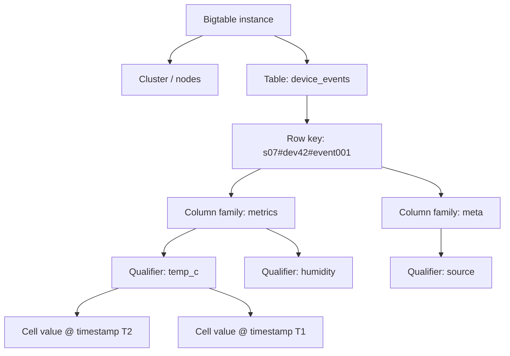
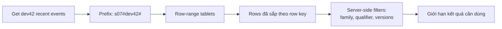
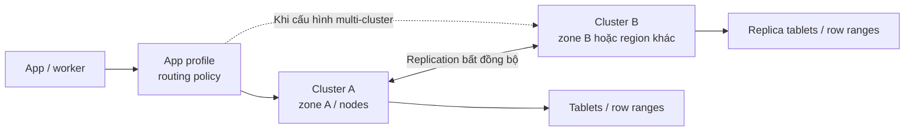

# Bigtable và mô hình wide-column cho dữ liệu quy mô lớn

Một nền tảng IoT nhận hàng triệu bản ghi nhiệt độ, vị trí và trạng thái thiết bị mỗi ngày. Ứng dụng cần lấy **dữ liệu gần nhất của một thiết bị** hoặc quét **các bản ghi trong một khoảng thời gian**, với tải đọc/ghi lớn và độ trễ thấp. Đây là bài toán phù hợp để đánh giá **Google Cloud Bigtable**: cơ sở dữ liệu NoSQL dạng **wide-column**, có thể mở rộng theo quy mô dữ liệu và thông lượng.

Bài thuộc chương **Bigtable và Memorystore** của module `CLOUD_PROVIDERS_GCP`. Trọng tâm là mô hình dữ liệu Bigtable, thiết kế row key dựa trên truy vấn, tránh hotspots, tối ưu vòng đời dữ liệu, bảo vệ IAM và theo dõi hiệu năng/chi phí. Bigtable khác **Memorystore** (cache hoặc datastore trong bộ nhớ), **Firestore** (document database), **Cloud SQL/AlloyDB** (relational) và **BigQuery** (analytics). Chọn đúng dịch vụ giúp hệ thống đơn giản hơn việc cố dùng một database cho mọi workload.

> **Lưu ý vận hành:** Ví dụ project, instance và bảng là giả định. Tạo Bigtable instance/cluster, ghi dữ liệu và xóa tài nguyên **có thể phát sinh phí hoặc mất dữ liệu**. Chỉ chạy trong sandbox được ủy quyền. Các ví dụ shell dành cho Bash/Cloud Shell. Giới hạn sản phẩm và giá thay đổi theo edition/region; kiểm tra tài liệu Google Cloud trước khi áp dụng production.

## 1. Mục tiêu học tập

Sau bài này, bạn có thể:

1. Mô tả cấu trúc **instance → cluster → table → row → column family → qualifier → cell versions**.
2. Thiết kế **row key** hỗ trợ point lookup/prefix/range scan, phân biệt với truy vấn SQL tùy ý.
3. Nhận diện **sparse rows, wide columns, timestamp versions**, dữ liệu dạng bytes và chính sách **garbage collection (GC)**.
4. Giải thích cách phân bố row ranges thành tablets/nodes và tránh **hotspot** do keys tăng tuần tự.
5. Thực hành tạo bảng, column families, ghi và đọc dữ liệu bằng `cbt`; viết ví dụ Java Data API.
6. Phân biệt **single-cluster routing** và **multi-cluster routing**, read-your-writes và eventual consistency.
7. Theo dõi latency, throughput, CPU, storage, Key Visualizer và tổng chi phí.
8. Chọn khi nào nên dùng Bigtable, Firestore, BigQuery, Cloud SQL hoặc Memorystore.

## 2. Bigtable là gì và phù hợp với dữ liệu nào?

Bigtable là dịch vụ lưu trữ NoSQL **key-value/wide-column** được tối ưu cho **khối lượng dữ liệu lớn và truy cập theo row key/range**. Bảng không yêu cầu mọi dòng có cùng tập cột; các cột vắng mặt không chiếm không gian như cột rỗng trong một bảng quan hệ cố định.

| Workload | Bigtable phù hợp khi | Cần cân nhắc thêm |
| --- | --- | --- |
| **IoT/time series** | Lấy dữ liệu của thiết bị theo khoảng thời gian, ghi nhiều bản ghi. | Row key, time bucketing, write hotspots. |
| **Clickstream/event serving** | Truy xuất lịch sử sự kiện theo user/session. | Retention, dữ liệu nhạy cảm, replay. |
| **AdTech/recommendation features** | Point lookups và range scans khối lượng lớn. | Cập nhật feature, feature TTL, phục vụ online. |
| **Telemetry/log lookup** | Dữ liệu lớn, biết khóa truy vấn. | Nếu cần SQL phân tích toàn dữ liệu thì BigQuery thích hợp hơn. |
| **Order/payment transactions** | Chỉ khi access pattern đơn giản và cần throughput key-based. | Quan hệ, JOIN, transaction nhiều rows: Cloud SQL/AlloyDB thường phù hợp hơn. |

Bigtable có **GoogleSQL for Bigtable** và một số khả năng như continuous materialized views tùy tính năng/edition, nhưng **không phải PostgreSQL**. Không thiết kế với giả định có thể JOIN nhiều tables, lọc bất kỳ field nào với secondary indexes tự động và ACID transactions nhiều rows như cơ sở dữ liệu quan hệ. Bắt đầu từ access patterns dự kiến.

## 3. Mô hình dữ liệu wide-column



Trong Bigtable, một **cell** được xác định bởi **row key + column family + qualifier + timestamp**. Giá trị của cell là **bytes**, ứng dụng chịu trách nhiệm biểu diễn/giải mã kiểu dữ liệu (UTF-8, protobuf, JSON, số nguyên binary...). Nhiều phiên bản cùng cột có thể tồn tại với các timestamp khác nhau.

### 3.1. Ví dụ một row

**Row key:** `s07#dev42#20261119T081500Z`

| Column family | Qualifier | Timestamp (minh họa) | Value |
| --- | --- | --- | --- |
| `metrics` | `temp_c` | 08:15:00 | `22.8` |
| `metrics` | `humidity` | 08:15:00 | `61` |
| `meta` | `source` | 08:15:00 | `edge-gateway` |
| `metrics` | `temp_c` | 08:15:01 | `22.9` |

Không phải mọi row đều cần có cột `humidity` hoặc `meta:source`. Đây là đặc trưng **sparse data**: tập qualifiers có thể khác nhau theo row, giúp lưu trữ những thuộc tính phát sinh theo thời gian mà không phải thay schema cho mỗi cột mới.

**Hai kiểu lưu lịch sử cần phân biệt:**

- **Nhiều rows theo event time**: mỗi phép đo là row riêng, ví dụ `s07#dev42#20261119T081500Z`. Dễ quét theo thời gian/giới hạn batch.
- **Nhiều cell versions trong một row**: nhiều giá trị `metrics:temp_c` tại các timestamps khác nhau. Hữu ích cho một số trường hợp, nhưng một row quá lớn/nóng dễ tạo bottleneck; không mặc định nhét mọi phép đo nhiều năm vào một row duy nhất.

### 3.2. Column family và qualifier

Column family được **tạo trước** khi ghi dữ liệu; qualifiers có thể xuất hiện linh hoạt khi ghi. Chia family theo **nhóm dữ liệu liên quan và chính sách giữ dữ liệu**:

| Family | Ví dụ qualifiers | Chính sách dự kiến |
| --- | --- | --- |
| `metrics` | `temp_c`, `humidity`, `battery` | Giữ theo thời gian, ví dụ 30 ngày. |
| `meta` | `source`, `firmware` | Chỉ giữ phiên bản mới nhất. |

GC policy cấu hình **ở cấp family**, không tùy ý theo từng qualifier trong cùng family. Đừng tạo một family cho từng thiết bị hoặc từng phép đo. Số family quá lớn làm tăng overhead; hướng dẫn schema của Bigtable khuyên dùng khoảng **tối đa 100 families/table** vì hiệu năng có thể giảm sau đó.

### 3.3. Timestamp không nhất thiết là thời gian sự kiện

Timestamp của cell có thể được client chỉ định hoặc do dịch vụ gán theo cơ chế ghi. Nếu thiết bị offline rồi upload chậm, timestamp lúc ghi **khác** với thời điểm phép đo. Với time-series, hãy quyết định:

1. **Event time** đưa vào row key để hỗ trợ range scan theo lịch sử.
2. Cell timestamp phục vụ versioning, retention hoặc conflict policy khi hợp lệ.
3. Timestamp ngoài thực tế có độ chính xác, timezone và thứ tự arrival không đảm bảo.

Đừng dùng timestamp như một ID toàn cục duy nhất nếu nhiều sự kiện có cùng thời điểm. Bổ sung event ID/sequence nếu cần bảo đảm không ghi đè.

## 4. Row key: thiết kế theo truy vấn trước khi chọn schema

**Row key là index nền tảng** của Bigtable. Các rows được sắp theo **thứ tự từ điển trên bytes** (lexicographical), không theo số học nếu bạn ghi chuỗi `"2"` và `"10"` không padding. Truy cập hiệu quả nhất thường là:

1. **Point lookup** theo một key đầy đủ.
2. **Prefix scan** lấy các rows cùng tiền tố.
3. **Range scan** từ start key tới end key có thứ tự liền kề.

### 4.1. Mẫu row key cho IoT

Giả sử yêu cầu sản phẩm là “lấy 50 phép đo mới nhất của **một thiết bị**”. Một mẫu key:

```text
<device_bucket>#<device_id>#<reverse_timestamp_fixed_width>#<event_id>

s07#dev42#8230559099999#e001
s07#dev42#8230559100999#e002
s12#dev99#8230559099999#e777
```

- `device_bucket` là một hash/shard **ổn định theo device ID**, giúp các thiết bị phân bố trên không gian key; application tính được bucket khi đọc.
- `device_id` giữ các sự kiện của **một thiết bị** nằm trong cùng prefix, thuận tiện scan.
- `reverse_timestamp = MAX_TIMESTAMP - event_timestamp` (định dạng số có chiều rộng cố định) giúp **mới nhất đứng trước** trong cùng prefix.
- `event_id` xử lý hai sự kiện cùng timestamp và hỗ trợ dedup.

**Chú ý:** ví dụ `8230559099999` chỉ để minh họa kiểu reverse timestamp, không phải thời gian tính chính xác. Nếu use case cần truy vấn **tất cả thiết bị trong một ngày**, schema theo device prefix không tự tối ưu cho yêu cầu đó; cân nhắc bảng/continuous materialized view khác hoặc pipeline sang BigQuery.

### 4.2. Vì sao timestamp đầu key gây hotspot?

```text
KHÔNG NÊN (mọi thiết bị cùng ghi gần cuối keyspace):
20261119T081500Z#dev42
20261119T081501Z#dev99
20261119T081502Z#dev12

ĐỀ XUẤT (nhiều prefix thiết bị/hash bucket):
s07#dev42#...
s12#dev99#...
s03#dev12#...
```

Nếu tất cả writes đổ vào một dải key tăng đơn điệu, tablet/node chứa dải đó dễ **hotspot**, dù tổng CPU cluster chưa cao. Random/hash prefix phân phối writes nhưng có đánh đổi: muốn quét tất cả thiết bị theo một mốc thời gian sẽ phải fan-out nhiều prefixes, vì vậy **không có row key tối ưu cho mọi truy vấn**.

### 4.3. Nguyên tắc schema thực hành

| Quy tắc | Tại sao |
| --- | --- |
| Dùng key ngắn, có ý nghĩa và xác định được trước khi đọc. | Giảm lưu trữ, tránh scan toàn table. |
| Row key **không quá 4 KiB** (hard limit). | Đảm bảo đúng giới hạn Bigtable. |
| Pad số/timestamp để sắp đúng thứ tự byte. | `0002` và `0010` sắp như mong muốn. |
| Tránh global timestamp, sequential integer ID hay một row siêu nóng. | Hạn chế write hotspot. |
| Chọn prefix theo access pattern hay dùng nhất. | Prefix/range đọc hiệu quả hơn scan + filter sâu. |
| Tránh row khổng lồ; khuyến nghị dữ liệu một row dưới khoảng **100 MiB**. | Read/mutation/compaction tốn tài nguyên; hard limit row lớn hơn nhưng không nên chạm tới. |
| Thiết kế key không chứa PII/secret có thể lộ trong logs/metrics. | Hỗ trợ least privilege và bảo vệ dữ liệu. |

### 4.4. Các giới hạn liên quan (theo tài liệu hiện hành)

| Thành phần | Mức nên giữ | Hard limit |
| --- | --- | --- |
| Row key | Ngắn nhất phục vụ lookup | **4 KiB** |
| Qualifier | Gọn, tránh nhiều cột rỗng | **16 KiB** |
| Một cell value | Khoảng **10 MiB** hoặc nhỏ hơn | **100 MiB** |
| Tổng cell values trong một row | Khoảng **100 MiB** hoặc nhỏ hơn | **256 MiB** |
| Một mutation | Càng nhỏ càng tốt | **200 MiB** |

Giới hạn **quy mô dữ liệu** không đồng nghĩa mức **hiệu năng tối ưu**. Một row có kích thước dưới hard limit vẫn có thể trở thành hotspot nếu bị cập nhật hàng nghìn lần mỗi giây.

## 5. Reads, scans, filters và transactional boundary



### 5.1. Row key trước, filter sau

Để truy xuất phép đo của `dev42`, dùng `prefix=s07#dev42#`. Nếu biết start/end time, mã hóa thành key range. Sau đó thêm filter để giảm cột/versions trả về.

**Sai lầm phổ biến:** lưu row keys không hỗ trợ access pattern, rồi dùng regex/filter trên value với hy vọng Bigtable tìm nhanh như index của RDBMS. Một filter có thể giảm dữ liệu trả về **nhưng không tự biến một table scan thành index lookup nhanh**.

### 5.2. Tính nguyên tử của một row

Các thao tác `RowMutation` cập nhật **một row** có thể được áp dụng nguyên tử. Bigtable hỗ trợ một số dạng read-modify-write/conditional mutation **trên một row** khi app profile/routing cho phép. Không suy ra có một ACID transaction tổng quát cho nhiều rows/bảng.

Ví dụ cập nhật trạng thái cảm biến và giá trị nhiệt độ trong cùng row dễ đảm bảo nhất quán hơn ghi một nửa vào hai rows khác nhau. Với nghiệp vụ chuyển tiền giữa hai accounts, dùng Cloud SQL/AlloyDB hoặc thiết kế Saga/idempotency nếu chọn database NoSQL vì lý do cụ thể.

### 5.3. GoogleSQL for Bigtable có thay đổi mô hình không?

GoogleSQL for Bigtable hỗ trợ một tập cú pháp truy vấn và khả năng quản lý **row key schema**, có thêm lựa chọn cho một số workloads. Nhưng Bigtable Data API và chiến lược row-key design vẫn là nền tảng truy cập hiệu quả. **Không coi đây là PostgreSQL đầy đủ có JOIN, foreign keys, secondary indexes tự động hoặc transactions nhiều rows**.

## 6. Cell versions và garbage collection

Một qualifier có thể có **nhiều giá trị theo timestamps**. Ví dụ `metrics:temp_c` được ghi lại hai lần trên cùng row. Khi đọc, client có thể chọn **chỉ phiên bản mới nhất** hoặc các versions phù hợp theo filter. Điều này không có nghĩa Bigtable tự giữ lịch sử vô hạn miễn phí.

**Garbage collection (GC)** là cơ chế loại các phiên bản cell theo chính sách ở **column family**. Các chính sách phổ biến:

| Policy | Ý nghĩa |
| --- | --- |
| `maxversions=1` | Chỉ giữ phiên bản mới nhất cho mỗi column, những phiên bản cũ đủ điều kiện GC. |
| `maxage=30d` | Các phiên bản có timestamp quá 30 ngày đủ điều kiện GC. |
| `maxage=30d or maxversions=3` | Xóa phiên bản nếu **quá 30 ngày hoặc** nằm ngoài ba phiên bản mới nhất. |
| `maxage=30d and maxversions=3` | Chỉ xóa khi **đồng thời** quá 30 ngày và nằm ngoài ba phiên bản mới nhất. |

**AND và OR mang nghĩa khác nhau**. Với `and`, một phiên bản cũ quá 30 ngày vẫn được giữ nếu nó nằm trong ba phiên bản mới nhất. Chính sách GC được áp dụng **bất đồng bộ**, dữ liệu đủ điều kiện có thể chưa bị xóa ngay. Vì vậy:

- Không dùng GC như một **công cụ xóa tức thời theo yêu cầu pháp lý**; thực hiện quy trình xóa phù hợp và kiểm tra backup/retention.
- Trong thời gian GC chưa chạy, phiên bản cũ có thể còn trong storage và ảnh hưởng mức sử dụng.
- Kiểm tra GC khi thay schema hoặc khi để nhiều versions; giữ lịch sử có phí.
- Đặt chính sách khác nhau cho `metrics` và `meta` nếu thời gian lưu của chúng khác nhau.

## 7. Instance, cluster, nodes và replication

Bigtable phân tán các **row ranges** thành các **tablets** để nhiều nodes có thể xử lý đồng thời. Một **instance** chứa tables và một hoặc nhiều **clusters**; mỗi cluster nằm ở một zone, có năng lực compute và bản dữ liệu liên quan. Tăng nodes hoặc autoscaling giúp nâng tổng throughput khi tải được phân phối tốt, nhưng **không giải quyết được một hàng/hot key duy nhất bị quá tải**.



### 7.1. App profile quyết định đường đi và consistency

| Routing | Hành vi | Đánh đổi |
| --- | --- | --- |
| **Single-cluster routing** | Mọi requests qua profile được gửi vào một cluster chỉ định. | Read-your-writes phù hợp khi **đọc/ghi cùng cluster**; failover sang cluster khác cần điều phối theo policy. |
| **Multi-cluster routing** | Dịch vụ điều hướng tới cluster gần/phù hợp và có thể tự failover. | Replication **eventually consistent**; cùng row có thể tạm đọc bản cũ khi khác cluster. |

**Single-row conditional/transactional operations** có yêu cầu routing phù hợp và không được mặc định sử dụng trên multi-cluster routing. Khi cần các thao tác read-modify-write bảo đảm tính nhất quán, kiểm tra **single-cluster routing + allow single-row transactions**.

Ví dụ nghiệp vụ: service ghi cảm biến rồi ngay lập tức đọc lại để hiển thị đúng giá trị vừa ghi nên sử dụng **same-cluster routing** hoặc một cơ chế được kiểm chứng; dashboard analytics có thể chấp nhận eventual consistency và tận dụng multi-cluster routing/replication.

**Replication khác backup**: nếu ứng dụng xóa nhầm một hàng, thao tác xóa cũng có thể được replicate. Cần **backups, khôi phục thử, RPO/RTO và retention** riêng. Không suy ra multi-cluster tự giải quyết mọi lỗi logic hoặc bảo đảm zero-data-loss khi failover.

### 7.2. Storage SSD/HDD và capacity

- **SSD** thường phù hợp cho lưu lượng truy vấn latency thấp/đa dạng; **HDD** có thể phù hợp access patterns khác nhưng không mặc định nhanh như SSD khi random access.
- Storage type được chọn khi tạo instance/cluster theo giới hạn hỗ trợ; không đổi tùy tiện sau khi chạy production.
- Compute/throughput, storage, replication, backups và network là **các nhóm chi phí riêng**; thêm cluster để phục vụ đa region làm tăng lưu trữ và replication overhead.
- Khi cần xử lý batch lớn mà không làm giảm latency online, cân nhắc **Bigtable Data Boost** khi tính năng/edition phù hợp, hoặc xuất dữ liệu sang BigQuery.

## 8. Lab cbt: tạo bảng wide-column, ghi và đọc rows

**Mục tiêu:** thao tác với một bảng nhỏ `device_events_lab` trong **Bigtable instance sandbox đã tồn tại**. Nếu chưa có instance, xem mục 8.1; ưu tiên dùng instance lab của tổ chức thay vì tạo mới chỉ để chạy vài lệnh.

### 8.1. Chuẩn bị instance theo Console

Tại **Google Cloud Console → Bigtable → Create instance**, khi được phép:

1. Chọn project sandbox có billing và **Bigtable Admin API / Data API** được bật.
2. Chọn instance ID/cluster ID chỉ dành cho lab, edition và **SSD/HDD** theo chính sách.
3. Chọn region/zone, số nodes/autoscaling hợp lệ, tránh tạo nhiều clusters nếu không cần HA.
4. Kiểm tra quota, IAM, chi phí compute **kể cả lúc bảng rỗng** và kế hoạch cleanup.
5. Chờ instance/cluster chuyển trạng thái phục vụ trước khi thao tác bảng.

Việc tạo instance là **thay đổi hạ tầng có phí**; bài này không mặc định tạo cluster trong project production. Sau khi có instance, sử dụng `cbt`:

```bash
PROJECT_ID="iot-lab"
INSTANCE_ID="iot-bigtable-lab"
TABLE_ID="device_events_lab"

# CHỈ ĐỌC: xác minh danh sách instances và cluster.
gcloud bigtable instances list --project="$PROJECT_ID"
gcloud bigtable clusters list \
  --project="$PROJECT_ID" --instances="$INSTANCE_ID"

# cbt cần được cài và có ADC/Google Cloud credentials phù hợp.
# Trên môi trường có gcloud component manager:
# gcloud components install cbt

# CHỈ ĐỌC: liệt kê tables trong instance chỉ định.
cbt -project="$PROJECT_ID" -instance="$INSTANCE_ID" ls
```

Các lệnh `cbt` dùng `-project=` và `-instance=` để **không phụ thuộc file `~/.cbtrc` hoặc context của shell khác**. Nếu đã có table trùng tên, **không ghi đè**, chọn table ID khác và xác nhận nó thuộc sandbox.

### 8.2. Tạo table và column families

```bash
# TẠO TÀI NGUYÊN THẬT: chỉ chạy một lần trong instance lab.
cbt -project="$PROJECT_ID" -instance="$INSTANCE_ID" \
  createtable "$TABLE_ID"

cbt -project="$PROJECT_ID" -instance="$INSTANCE_ID" \
  createfamily "$TABLE_ID" metrics

cbt -project="$PROJECT_ID" -instance="$INSTANCE_ID" \
  createfamily "$TABLE_ID" meta

# THAY ĐỔI GC POLICY: dùng dữ liệu thử, không đổi family production.
cbt -project="$PROJECT_ID" -instance="$INSTANCE_ID" \
  setgcpolicy "$TABLE_ID" metrics maxage=30d

cbt -project="$PROJECT_ID" -instance="$INSTANCE_ID" \
  setgcpolicy "$TABLE_ID" meta maxversions=1

# CHỈ ĐỌC: kiểm tra families và policies.
cbt -project="$PROJECT_ID" -instance="$INSTANCE_ID" ls "$TABLE_ID"
```

`metrics` dùng retention theo tuổi, còn `meta` chỉ giữ bản mới nhất. **GC bất đồng bộ**: thiết lập hôm nay không có nghĩa các cell cũ biến mất ngay.

### 8.3. Ghi dữ liệu mẫu

```bash
# GHI DỮ LIỆU THẬT vào table lab, không thực thi trong production.
cbt -project="$PROJECT_ID" -instance="$INSTANCE_ID" \
  set "$TABLE_ID" "s07#dev42#20261119T081500Z" \
  metrics:temp_c=22.8 metrics:humidity=61 meta:source=edge-gateway

cbt -project="$PROJECT_ID" -instance="$INSTANCE_ID" \
  set "$TABLE_ID" "s07#dev42#20261119T081600Z" \
  metrics:temp_c=23.1 metrics:humidity=60

cbt -project="$PROJECT_ID" -instance="$INSTANCE_ID" \
  set "$TABLE_ID" "s12#dev99#20261119T081500Z" \
  metrics:temp_c=19.4 meta:source=edge-gateway
```

Các values `22.8`, `61` đang được CLI ghi thành **text/bytes**, không phải kiểu numeric có schema PostgreSQL. Nếu cần xử lý số học, client phải parse/encode rõ. Mỗi phép đo ở một row khác nhau; tránh nhét toàn bộ chuỗi nhiều năm vào một row.

### 8.4. Point lookup và prefix scan

```bash
# CHỈ ĐỌC đúng một row.
cbt -project="$PROJECT_ID" -instance="$INSTANCE_ID" \
  lookup "$TABLE_ID" "s07#dev42#20261119T081500Z"

# CHỈ ĐỌC các rows của dev42 (prefix scan).
cbt -project="$PROJECT_ID" -instance="$INSTANCE_ID" \
  read "$TABLE_ID" prefix="s07#dev42#" count=10

# CHỈ ĐỌC với cột được chọn.
cbt -project="$PROJECT_ID" -instance="$INSTANCE_ID" \
  read "$TABLE_ID" prefix="s07#dev42#" columns=metrics:temp_c count=10
```

Kỳ vọng: lookup trả row đầu và các cells; prefix scan trả **hai rows** của `dev42`, không trả `dev99`. `count=10` là giới hạn bản ghi trả về, không thay thế thiết kế key/range đúng; một query không có prefix/range có thể phải đọc phạm vi rất lớn.

**Lưu ý về thứ tự:** lab đơn giản dùng timestamp **tăng dần** sau prefix nên thứ tự row key trả về là **cũ trước, mới sau**. Với màn hình “50 phép đo mới nhất”, cần triển khai **reverse timestamp** hoặc một phương án truy vấn khác đã benchmark; chỉ thêm `count=50` vào prefix scan hiện tại sẽ lấy các rows đầu tiên chứ **không bảo đảm mới nhất**.

### 8.5. Cleanup lab

Trước khi xóa, xác minh tên instance/table và owner:

```bash
# CHỈ ĐỌC:
cbt -project="$PROJECT_ID" -instance="$INSTANCE_ID" ls

# XÓA THẬT TOÀN BỘ bảng lab: chỉ khi TABLE_ID do bạn tạo
# và không có dữ liệu của người khác.
# cbt -project="$PROJECT_ID" -instance="$INSTANCE_ID" deletetable "$TABLE_ID"
```

Không xóa **instance** dùng chung và không xóa dữ liệu thật để thử GC. Sau cleanup, kiểm tra Bigtable compute/storage và các tài nguyên backup/snapshot còn tạo phí, nếu có.

## 9. Java client: ghi một row, đọc một row và prefix scan

Ứng dụng Java trên Compute Engine/GKE/Cloud Run nên dùng **Bigtable Data API client library** với **Application Default Credentials (ADC)**. Tạo và dùng chung `BigtableDataClient` khi ứng dụng khởi động, không tạo một client mới cho mỗi HTTP request; đóng client khi ứng dụng shutdown.

Ví dụ Maven dependency (thêm vào `pom.xml` đã có Java 21; pin phiên bản theo BOM/chính sách dependency của dự án):

```xml
<dependency>
  <groupId>com.google.cloud</groupId>
  <artifactId>google-cloud-bigtable</artifactId>
  <version>2.85.0</version>
</dependency>
```

Đặt lớp sau tại `src/main/java/example/BigtableReadWrite.java`:

```java
package example;

import com.google.cloud.bigtable.data.v2.BigtableDataClient;
import com.google.cloud.bigtable.data.v2.models.Query;
import com.google.cloud.bigtable.data.v2.models.Row;
import com.google.cloud.bigtable.data.v2.models.RowCell;
import com.google.cloud.bigtable.data.v2.models.RowMutation;
import com.google.cloud.bigtable.data.v2.models.TableId;

public class BigtableReadWrite {
    public static void main(String[] args) throws Exception {
        String project = System.getenv("BT_PROJECT");
        String instance = System.getenv("BT_INSTANCE");
        String table = System.getenv("BT_TABLE");
        if (project == null || instance == null || table == null) {
            throw new IllegalArgumentException("Missing BT_PROJECT/BT_INSTANCE/BT_TABLE");
        }

        String rowKey = "s07#dev42#20261119T081700Z";
        try (BigtableDataClient client = BigtableDataClient.create(project, instance)) {
            // Ghi nguyên tử các cell thuộc cùng một row.
            RowMutation mutation = RowMutation.create(table, rowKey)
                .setCell("metrics", "temp_c", "23.3")
                .setCell("metrics", "humidity", "59");
            client.mutateRow(mutation);

            // Point read: không tồn tại thì row = null.
            Row row = client.readRow(TableId.of(table), rowKey);
            if (row != null) {
                System.out.println("Found " + row.getKey().toStringUtf8());
                for (RowCell cell : row.getCells()) {
                    System.out.printf("%s:%s = %s%n",
                        cell.getFamily(),
                        cell.getQualifier().toStringUtf8(),
                        cell.getValue().toStringUtf8());
                }
            }

            // Prefix scan: tất cả hàng đã sắp theo key của dev42.
            for (Row event : client.readRows(Query.create(table)
                    .prefix("s07#dev42#"))) {
                System.out.println("event=" + event.getKey().toStringUtf8());
            }
        }
    }
}
```

Chạy thử **chỉ với table sandbox đã tạo** và phiên làm việc có quyền:

```bash
export BT_PROJECT="iot-lab"
export BT_INSTANCE="iot-bigtable-lab"
export BT_TABLE="device_events_lab"

# Lệnh build/run của ứng dụng Maven có exec-maven-plugin được cấu hình.
mvn -q compile exec:java -Dexec.mainClass=example.BigtableReadWrite
```

Để chạy được từ Maven, `pom.xml` phải có **maven-compiler-plugin** với `release=21` và **exec-maven-plugin** hoặc cách chạy JAR tương đương. Đoạn dependency ở trên là **phần cần thêm**, không phải một `pom.xml` đầy đủ. Phiên bản thư viện được minh họa bằng API Java đang được tài liệu tham chiếu; nâng cấp và quét phụ thuộc theo quy trình CI.

**IAM:** app read-only thường dùng `roles/bigtable.reader`, app read/write dùng `roles/bigtable.user` ở mức table/resource phù hợp. Không cấp `roles/bigtable.admin` cho một consumer chỉ đọc. Workload identity/attached service account tốt hơn file key JSON; IAM kiểm soát Bigtable API còn application phải tự enforce tenant/row access nếu các tenants chia sẻ table.

**Cảnh báo:** ví dụ Java gọi `mutateRow` mỗi lần chạy. Nếu không chỉ định timestamp, những lần chạy có thể tạo thêm phiên bản cell tới khi GC loại bỏ. Khi cần idempotency, thiết kế **row key/event ID và timestamp/conditional mutations** rõ ràng; retry của HTTP/SDK không bảo đảm xử lý nghiệp vụ exactly-once.

## 10. Hiệu năng, giám sát, tối ưu và chi phí

### 10.1. Đọc CPU + Key Visualizer cùng với latency

| Tín hiệu | Ý nghĩa | Hành động phù hợp |
| --- | --- | --- |
| **Read/write latency p50, p95, p99** | Người dùng có bị ảnh hưởng khi tải cao? | So sánh theo app profile, cluster và use case. |
| **Cluster CPU utilization / node count** | Tổng năng lực compute có đủ? | Đánh giá autoscaling sau khi loại trừ hotspot. |
| **Hot tablets / Key Visualizer heatmap** | Lưu lượng tập trung vào key ranges nào? | Sửa row-key distribution/time bucketing. |
| **Read rows/bytes & write throughput** | Khối lượng truy cập và tốc độ tăng. | Benchmark dữ liệu/row size thực tế. |
| **Disk/storage utilization & growth** | Chi phí và tác động performance; version retention. | GC, chọn SSD/HDD, điều chỉnh capacity. |
| **Replication latency/failover** | Đọc cũ khi multi-cluster routing; vùng bị lỗi. | Kiểm tra app profiles và consistency SLO. |
| **Errors / throttling / deadline exceeded** | Capacity, IAM, network hoặc client config. | Logs, quota, backoff, timeout và retry budget. |

**Hotspot chẩn đoán:** nếu p99 latency cao và Key Visualizer chỉ một đoạn row-key rất nóng trong khi cluster CPU chưa quá tải, **thêm nodes chưa chắc cải thiện**. Trước tiên phân tích key design, chia tải sang nhiều key ranges hoặc thay cách phân mảnh dữ liệu.

### 10.2. Autoscaling và chọn storage

Bigtable hỗ trợ chọn node capacity bằng thủ công hoặc **autoscaling** với mục tiêu CPU/storage khi cấu hình được hỗ trợ. Autoscaling phản ứng theo thời gian và quota; không tức thì. Đặt **min/max nodes, CPU target và storage utilization target** theo p95 latency, tải dự báo và ngân sách. Khi thêm clusters, mỗi cluster còn phải xử lý replication; không chỉ tính tổng nodes của một cluster.

**SSD** thường được chọn cho random/low-latency reads. **HDD** có chi phí lưu trữ thấp hơn nhưng đặc tính hiệu năng khác. Đừng chọn HDD chỉ nhìn giá/GB khi request pattern là point reads độ trễ thấp.

### 10.3. Chi phí end-to-end

| Khoản mục | Điều chi phối |
| --- | --- |
| **Compute/nodes** | Edition, node capacity, số clusters, thời gian hoạt động. |
| **Data storage** | SSD/HDD, bytes lưu, số phiên bản cell, replication. |
| **Network/replication** | Traffic giữa zones/regions, client egress và failover. |
| **Backup** | Kích thước, loại và thời hạn giữ backup. |
| **Data Boost / batch** | Dịch vụ processing bổ sung khi dùng. |
| **Ứng dụng và pipeline** | Cloud Run/GKE, Pub/Sub/Dataflow, Logging/Monitoring, BigQuery. |

Một instance mới với nhiều nodes và replication có thể phát sinh phí **ngay khi chưa có dữ liệu hữu ích**. Phép tính “Bigtable giá rẻ vì lưu được nhiều TB” không đủ: hãy so **chi phí trên mỗi triệu reads/writes đạt SLO** hoặc mỗi GB dữ liệu được phục vụ, và kiểm tra tổng bill theo region.

## 11. Chọn Bigtable, Firestore, BigQuery, Cloud SQL hay Memorystore?

| Nhu cầu chính | Lựa chọn nên đánh giá | Vì sao |
| --- | --- | --- |
| Time-series hàng TB/PB, truy xuất theo key/prefix/range với QPS lớn | **Bigtable** | Wide-column, scale-out, latency thấp theo key. |
| App mobile/web, document model, query field/compound indexes, realtime listeners | **Firestore** | SDK/Firebase integration và document queries phù hợp. |
| Phân tích SQL trên lịch sử lớn, JOIN/aggregation ad hoc | **BigQuery** | OLAP engine với scan/aggregation phân tán. |
| Giao dịch đặt hàng đa bảng, foreign keys, JOIN, ACID | **Cloud SQL/AlloyDB** | Relational transactional semantics. |
| Session cache, rate-limit counters, dữ liệu tạm cần độ trễ cực thấp | **Memorystore** | In-memory Redis/Memcached-style use cases, không thay thế kho dữ liệu lịch sử. |

Ví dụ kiến trúc hợp lý: **Pub/Sub → Dataflow → Bigtable** để ghi time-series; **Cloud Run/GKE** đọc Bigtable theo row key; **BigQuery** nhận bản dữ liệu phục vụ analytics; **Memorystore** cache kết quả nóng khi có nhu cầu cụ thể. Không thêm cả năm dịch vụ vào hệ thống nhỏ nếu một hoặc hai dịch vụ đáp ứng SLO.

## 12. An toàn và xử lý sự cố

### 12.1. Phân quyền và kiểm soát đường truy cập

- Phân tách **Bigtable Admin API** (tạo instances/tables/GC) và **Data API** (đọc/ghi cells). Quản trị không phải quyền mọi workload cần.
- Cấp **`roles/bigtable.reader`** cho chỉ đọc và **`roles/bigtable.user`** cho đọc/ghi ở phạm vi table/authorized view được hỗ trợ; dùng service accounts riêng cho producer/consumer.
- Với Cloud Run/GKE, dùng ADC/workload identity thay key JSON trong source. Kiểm tra policy mạng/egress, IAM, encryption và VPC Service Controls khi áp dụng.
- Không ghi user email, token hoặc identifiers nhạy cảm vào row key dưới dạng rõ nếu không có chính sách chấp thuận; key có thể xuất hiện trong logs/traces.
- Giới hạn retries, exponential backoff và timeout khi gọi Bigtable; phải có idempotency theo business key.

### 12.2. Troubleshooting

| Hiện tượng | Nguyên nhân thường gặp | Hướng điều tra |
| --- | --- | --- |
| `PERMISSION_DENIED` | SA thiếu role/ADC không đúng project. | Xác minh principal thực, table policy và Bigtable API. |
| `NOT_FOUND` cho table/instance | Nhầm ID/project hoặc resource chưa tạo. | `gcloud bigtable instances list`, `cbt ls`, tên table. |
| Prefix scan chậm | Thiết kế key không nhóm dữ liệu cần đọc; scan rất rộng. | Kiểm tra row key schema, giới hạn range và Key Visualizer. |
| Reads không thấy dữ liệu vừa ghi | Multi-cluster routing, replication lag hoặc key/timestamp sai. | App profile, vùng routing, row lookup cùng cluster. |
| Write latency cao, CPU toàn cluster chưa cao | Hot tablet từ key tăng tuần tự hoặc một device quá nóng. | Key Visualizer, hash/time bucketing, giảm writes trên hot row. |
| Storage tăng nhanh | Quá nhiều cell versions, GC chưa chạy, payload lớn. | `setgcpolicy` theo family, metrics và index design khi có. |
| Một workload làm ảnh hưởng workload khác | Tables dùng chung cluster/nodes; batch scan tranh tài nguyên. | App profile/workload isolation, Data Boost hoặc pipeline khác. |
| Reads sau failover tạm trả bản cũ | Replication bất đồng bộ chưa bắt kịp. | Consistency SLO, fallback behavior, replication metrics. |

## 13. Bài tập vận dụng có đáp án

**Bài 1 — Chọn database.** Một hệ thống giữ 3 năm dữ liệu telemetry nhiều TB, thường chỉ đọc 100 bản ghi mới nhất của từng thiết bị. Bigtable hay Firestore/BigQuery?

*Đáp án:* **Bigtable** là ứng viên mạnh nếu row key cho phép lấy dữ liệu theo thiết bị và thứ tự thời gian. BigQuery phù hợp phân tích toàn lịch sử; Firestore khi document/SDK/query semantics quan trọng hơn.

**Bài 2 — Thiết kế row key.** Tại sao `20261119T081500Z#dev42` có thể gây hotspot khi hàng nghìn thiết bị cùng gửi?

*Đáp án:* Timestamp đầu key làm writes dồn vào dải keys gần nhau theo thời gian. Thêm device/hash prefix và chọn bucketing dựa trên access pattern.

**Bài 3 — Thứ tự key.** Với `s07#dev42#20261119T081500Z` và `s07#dev42#20261119T081600Z`, prefix scan trả bản mới nhất trước không?

*Đáp án:* **Không.** Timestamp tăng dần được sắp cũ trước. Cần reverse timestamp với fixed width hoặc query strategy khác để đọc mới nhất trước.

**Bài 4 — Sparse columns.** Một row chỉ có `metrics:temp_c`, không có `metrics:humidity`. Có phải thay schema/điền null?

*Đáp án:* Không. **Qualifier linh hoạt** và hàng sparse không cần cột giống nhau. Chỉ tạo trước column family `metrics`.

**Bài 5 — Nhiều phiên bản.** Cấu hình `maxversions=1` giúp dữ liệu cũ biến mất ngay sau write mới?

*Đáp án:* **Không.** GC là bất đồng bộ; phiên bản cũ có thể tồn tại thêm một thời gian. Nếu cần xóa có kiểm soát, dùng quy trình delete/retention đúng mục đích.

**Bài 6 — AND/OR trong GC.** Policy `maxage=30d and maxversions=3` có xóa một cell version 40 ngày tuổi nếu nó đang là phiên bản mới thứ hai không?

*Đáp án:* **Không**, vì điều kiện vượt ba phiên bản **chưa** thỏa. `or` sẽ cho phép loại version khi chỉ cần một điều kiện được thỏa.

**Bài 7 — Transaction.** Chuyển tiền từ tài khoản A sang B cần cập nhật hai row keys nguyên tử. Bigtable `RowMutation` có đảm bảo được không?

*Đáp án:* Không. `RowMutation` nguyên tử **trong một row**; đây không phải transaction đa row. Cân nhắc Cloud SQL/AlloyDB hoặc workflow có idempotency/compensation được chứng minh.

**Bài 8 — Consistency.** Sau khi ghi ở cluster A, đọc ở cluster B qua multi-cluster app profile thấy giá trị cũ. Có bất thường?

*Đáp án:* Có thể là hành vi **eventual consistency** khi replication chưa kịp. Với read-your-writes nghiêm ngặt, chọn single-cluster routing cho read/write theo thiết kế phù hợp.

**Bài 9 — Scale-out.** Cluster CPU trung bình 35% nhưng một tablet rất nóng và p99 tăng. Có nên tăng nodes vô hạn?

*Đáp án:* **Không.** Kiểm tra Key Visualizer/hot key; phân phối lại row keys, bucketing/hashing hoặc giảm contention trước khi nâng capacity.

**Bài 10 — Chi phí.** Đội tạo hai clusters với nhiều nodes cho dự án thử có vài chục rows. Tại sao hóa đơn vẫn đáng kể?

*Đáp án:* Compute nodes/replication/backup có thể tính phí theo tài nguyên hoạt động, không chỉ số rows. Dùng sandbox có budget, giới hạn thời gian và cleanup đúng owner.

## 14. Checklist trước production

- [ ] Xác định query patterns; chọn Bigtable vì point/prefix/range lookups chứ không vì tên “Big Data”.
- [ ] Row key ngắn, dễ tính, có fixed-width timestamp, không gây global write hotspot.
- [ ] Đã kiểm thử thêm thiết bị/traffic skew, một device rất nóng và Key Visualizer.
- [ ] Column families theo nhóm dữ liệu/retention; qualifiers linh hoạt, tránh family bùng nổ.
- [ ] GC policy đúng `maxage`/`maxversions` và AND/OR; không dùng GC thay xóa tức thời.
- [ ] App profiles và replication phù hợp read-your-writes/HA, có kế hoạch failover.
- [ ] Không dựa vào multi-row transactions; idempotency/conditional mutations được thiết kế.
- [ ] IAM read/write/admin tách biệt, Workload Identity/ADC và network policy phù hợp.
- [ ] Client library được tái sử dụng, retry budget/backoff và shutdown an toàn.
- [ ] Đã đo p95/p99, throughput, CPU, hot tablets, storage, replication lag và budget.
- [ ] Có backups/restore test, retention, DR runbook và cleanup sandbox.
- [ ] Dự toán node compute + SSD/HDD storage + replication + backups + network + pipeline.

## 15. Tổng kết

**Bigtable wide-column** tổ chức dữ liệu theo **row key đã sắp byte**, các **column families/qualifiers** linh hoạt và **cell versions** theo timestamp. Điểm mạnh là **point lookups và prefix/range scans quy mô lớn** khi row key được thiết kế đúng; điểm yếu của thiết kế sai là **hotspot, table scan rộng, chi phí không cần thiết và khó hỗ trợ truy vấn ad hoc**.

Để dùng Bigtable hiệu quả, hãy đi theo thứ tự: **định nghĩa access patterns → thiết kế row key và column families → thử đọc/ghi bằng `cbt`/SDK → đặt GC → benchmark latency/hotspots → chọn app profile/replication → giám sát chi phí**. Bigtable không thay thế mọi nhu cầu của Firestore, BigQuery, Cloud SQL hay Memorystore: chọn chúng theo loại dữ liệu, tính nhất quán và SLO thực tế.

### Tài liệu Google Cloud tham khảo

- [Bigtable overview](https://cloud.google.com/bigtable/docs/overview)
- [Understand the Bigtable data model](https://cloud.google.com/bigtable/docs/storage-model)
- [Schema design best practices](https://cloud.google.com/bigtable/docs/schema-design)
- [Quotas and limits](https://cloud.google.com/bigtable/quotas)
- [cbt CLI reference](https://cloud.google.com/bigtable/docs/cbt-reference)
- [Create an instance and write data with cbt](https://cloud.google.com/bigtable/docs/create-instance-write-data-cbt-cli)
- [Configure garbage collection](https://cloud.google.com/bigtable/docs/configuring-garbage-collection)
- [Replication overview](https://cloud.google.com/bigtable/docs/replication-overview)
- [App profiles and routing](https://cloud.google.com/bigtable/docs/routing)
- [Read data with Java client](https://cloud.google.com/bigtable/docs/reading-data)
- [IAM roles for Bigtable](https://cloud.google.com/bigtable/docs/access-control)
- [Key Visualizer and hotspots](https://cloud.google.com/bigtable/docs/keyvis-overview)
- [Bigtable pricing](https://cloud.google.com/bigtable/pricing)
