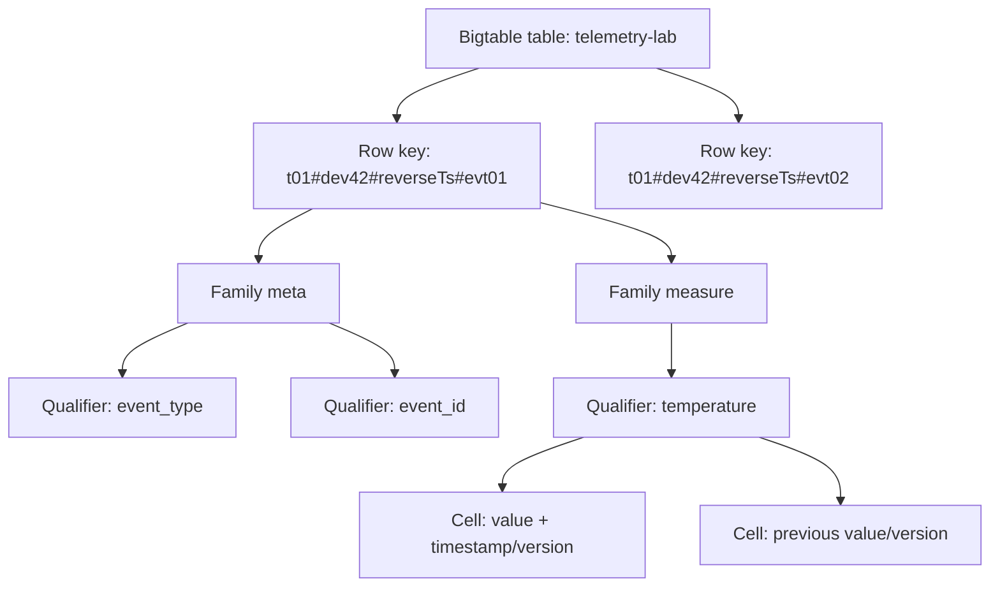
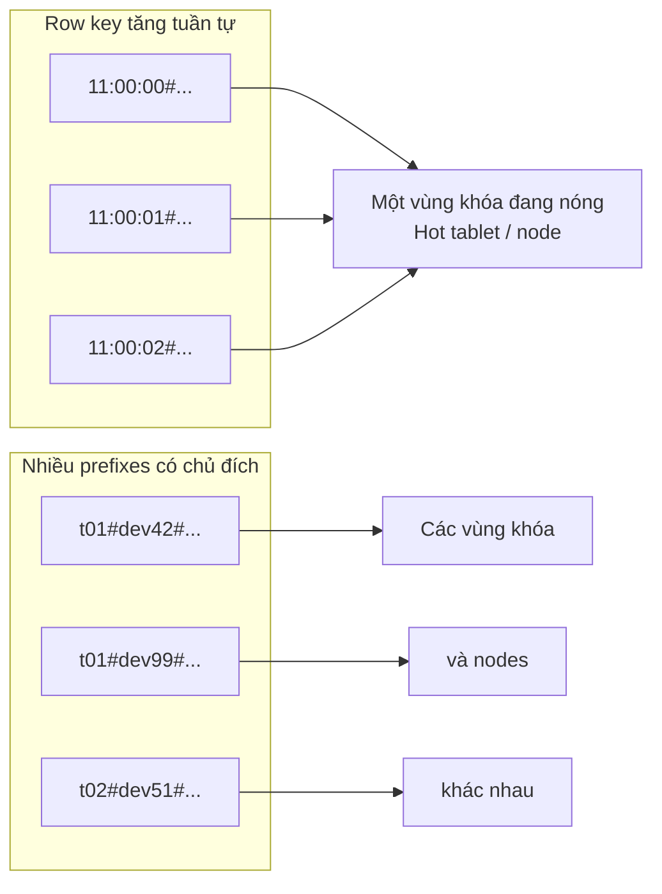
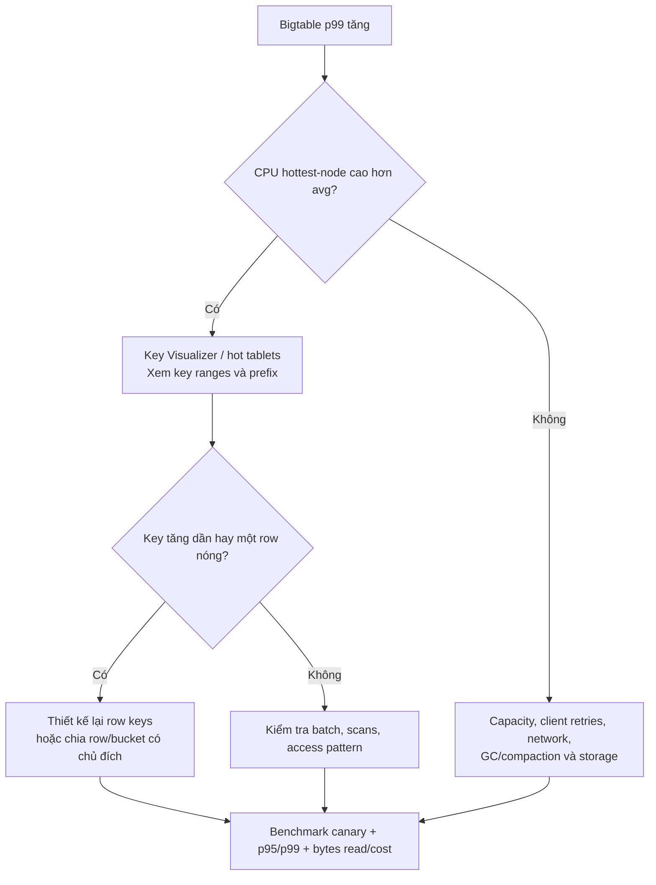

# Thiết kế row keys, column families và tránh hotspot

## 1. Bài toán: Bigtable có nhiều node nhưng API Java vẫn chậm

Một hệ thống **Java/Spring Boot** chạy trên **GKE hoặc Cloud Run** thu nhận hàng triệu sự kiện IoT mỗi giờ. Mỗi sự kiện có `tenantId`, `deviceId`, thời gian và giá trị đo. API cần đọc **20 lần đo gần nhất của một thiết bị** và đôi khi đọc dữ liệu trong một khoảng thời gian. Dù Bigtable có thể mở rộng thông lượng, p99 ghi tăng mạnh khi toàn bộ row keys bắt đầu bằng `20261119T...`: những bản ghi mới liên tục tập trung vào một vùng khóa.

**Bigtable** là cơ sở dữ liệu NoSQL dạng **wide-column**, lưu rows theo **row key sắp xếp từ điển trên bytes**. Nó phù hợp lưu lượng đọc/ghi lớn, truy vấn khóa chính/prefix/range và dữ liệu time series; **không tự hỗ trợ các phép JOIN hoặc transaction xuyên nhiều rows như Spanner/Cloud SQL**. Thiết kế row key quyết định nơi dữ liệu nằm và cách truy vấn; **column family** quyết định nhóm cột và **chính sách lưu các phiên bản cell**.

Bài học trong chương **Bigtable và Memorystore** của mô-đun **CLOUD_PROVIDERS_GCP** tập trung vào ba quyết định: **row key**, **column families** và **tránh hotspot**. Ta sẽ kết nối kiến thức IAM, networking, Java client, tự động hóa triển khai, theo dõi SLO và chi phí. **Memorystore** chỉ được so sánh đúng vai trò cache, không áp đặt mô hình column family của Bigtable cho Redis/Valkey.

**Mục tiêu:** sau bài học, bạn biết thiết kế khóa theo access pattern; chọn timestamp thường/đảo; cân nhắc deterministic bucket, range scans và fan-out; tổ chức families/qualifiers/GC; dùng Java và `cbt`; phát hiện điểm nóng bằng **Key Visualizer**; thay đổi schema an toàn.

> **Giới hạn lab:** tất cả ví dụ tạo/xóa table hoặc ghi cell chỉ dành cho **Bigtable instance thử nghiệm đã được phê duyệt**, không chạy trên production. Instance/node, storage, backup và đọc/ghi vẫn có thể tính phí. Không tạo hoặc xóa cả instance để thử một lệnh schema.

## 2. Mô hình lưu trữ: table → row → family → qualifier → cell



| Khái niệm | Ý nghĩa | Lưu ý thiết kế |
| --- | --- | --- |
| **Table** | Tập rows có chung mục đích | Không cần tạo table mới cho mỗi ngày hoặc tenant |
| **Row key** | Định danh duy nhất của row, **tối đa 4 KiB** | Sắp xếp **lexicographic theo bytes**, không tự hiểu số/ngày |
| **Column family** | Nhóm logic được tạo trước, ví dụ `meta`, `measure` | **GC policy** và nhiều cấu hình ở cấp family; nên khoảng **≤100 families/table** |
| **Qualifier** | Tên cột trong family, tạo khi ghi | Bảng sparse; không cần khai báo từng qualifier |
| **Cell** | Giá trị tại (row, family, qualifier, timestamp) | Có nhiều phiên bản; cần giới hạn bằng GC policy |
| **Row mutation** | Thay đổi các cells của một row | Có tính **atomic ở cấp một row**, không xuyên nhiều rows |

Bigtable lưu bytes; kiểu số, Protobuf/JSON và ngày giờ do **mã ứng dụng/encoding** quyết định. Với một row dài, mức khuyến nghị là **dưới 100 MiB**, giới hạn cứng **256 MiB**; một cell value nên **dưới 10 MiB**. Không ghi toàn bộ lịch sử hàng năm vào **một row** chỉ vì mọi sự kiện thuộc cùng thiết bị.

**Tư duy quan trọng:** xác định **truy vấn đọc** trước, rồi chọn row key và families. Đừng thiết kế Bigtable như một bảng SQL có indexes trên mọi cột.

## 3. Access patterns quyết định thứ tự các segment

Giả sử ứng dụng cần:

1. **R1:** lấy 20 readings mới nhất của `tenant=t01, device=dev42`.
2. **R2:** lấy readings của thiết bị trong khoảng `10:00–11:00 UTC`.
3. **R3:** tra sự kiện theo `eventId` để kiểm tra dedup.
4. **R4:** thống kê mọi thiết bị trong ngày.

Một thiết kế ban đầu cho **R1/R2**:

```text
<tenantId>#<deviceId>#<reverseTime19>#<eventId>

t01#dev42#9223370262784700000#evt01
t01#dev42#9223370262784701000#evt02
t01#dev99#9223370262784702000#evt03
```

Các số ở đây chỉ minh họa cấu trúc **19 chữ số**; giá trị chính xác phải được sinh bằng một thuật toán thống nhất, không gõ tay theo thời gian.

- Prefix `t01#dev42#` cho phép quét các rows **của cùng thiết bị**, không phải toàn table.
- `reverseTime19` đưa readings **mới nhất đứng trước** các readings cũ khi duyệt tăng dần theo khóa.
- `eventId` giúp phân biệt hai sự kiện có cùng độ phân giải timestamp. Nếu cần **idempotent ingest**, phải dùng **row key ổn định** cho cùng business event, không sinh `UUID` mới mỗi lần retry.
- **R3** không hiệu quả nếu chỉ biết `eventId` mà không biết tenant/device/time; có thể cần bảng lookup thứ hai hoặc thiết kế lại quyền truy cập.
- **R4** phải quét nhiều device prefixes; hãy cân nhắc pipeline tổng hợp (Dataflow/BigQuery) hoặc materialized view, không lọc bằng regex toàn table rồi kỳ vọng hiệu suất của range scan.

| Query | Row key phù hợp | Đánh đổi |
| --- | --- | --- |
| Theo device và thời gian | `tenant#device#reverseTs#eventId` | Quét prefix nhanh; một device quá nóng có thể nghẽn |
| Theo tenant, device và ngày | `tenant#device#yyyymmdd#time#eventId` | Scan ngày tiện, mới nhất trước phải đảo thứ tự |
| Theo event ID đã biết | `eventId` hoặc lookup `eventId → rowKey` | Truy vấn device/time có thể không còn tối ưu |
| Toàn tenant/ngày | `tenant#date#device#time` | Date prefix có thể tạo hotspot nếu tenant rất nóng |

**Chọn access pattern chính** và mô hình dữ liệu bổ sung cho nhu cầu khác; mỗi bảng/lookup phụ sẽ tăng storage, chi phí ghi và logic đồng bộ. Bigtable hiện có **continuous materialized views cho index bất đồng bộ** trong các trường hợp được hỗ trợ, nhưng đó không phải một **JOIN hoặc index đồng bộ tổng quát** cho mọi kiểu truy vấn.

## 4. Tại sao hotspot xuất hiện?

Bigtable phân chia key space thành các **tablets**, phân phối và điều chỉnh vị trí chúng giữa nodes. Các writes vào **một khoảng khóa hẹp**, hoặc liên tục cập nhật **một row**, có thể quá tải tablet/node đang giữ vùng đó. Khi workload nóng ở một phần nhỏ dữ liệu, thêm nodes chưa chắc giải quyết ngay vì **lưu lượng không được chia đều**.



**Các mẫu cần tránh hoặc đánh giá kỹ:**

- `2026-11-19T11:00:01Z#device`: timestamp **ở đầu**, các writes mới có xu hướng về cùng vùng.
- `00000001, 00000002, ...`: ID tăng dần, hàng mới tập trung ở cuối key space.
- `tenantA#deviceHot`: **một row** nhận hàng nghìn updates/giây; row có thể phình theo cell versions.
- `tenantA#...` với **rất ít tenants**, một tenant nhận phần lớn traffic: prefix cardinality thấp và có nguy cơ hotspot.
- Băm **toàn bộ key** một cách mù quáng: làm mất tính liên tục của các row ranges phục vụ queries.

**Không phải mọi key bắt đầu bằng tenant đều sai.** Nếu mỗi tenant có hàng triệu device IDs và traffic phân bố tốt, nhiều contiguous ranges có thể được tự chia. Cần dùng số liệu **writes/reads per key range** thay vì chỉ nhìn vẻ ngoài của khóa.

## 5. Timestamp thường, reverse timestamp và thứ tự bytes

### 5.1. Lexicographic khác thứ tự số

```text
Thứ tự chuỗi: "10" < "2"  (theo ký tự đầu).
Thứ tự số:    2 < 10.

Khóa đúng nếu cần sort theo số:
device#0000000002
device#0000000010
```

Timestamp trong row key nên ở **độ rộng cố định** và dùng **UTC**. Với Java, có thể tính `epochMicros` rồi biểu diễn 19 chữ số:

```java
long epochMicros = Math.multiplyExact(instant.toEpochMilli(), 1_000L);
String ordered = String.format(java.util.Locale.ROOT, "%019d", epochMicros);
String reverse = String.format(
    java.util.Locale.ROOT, "%019d", Long.MAX_VALUE - epochMicros);
```

**Quy ước:** ví dụ dùng **độ chính xác milliseconds** được đổi sang microseconds; không tự tạo dữ liệu chính xác microsecond nếu nguồn chỉ đo milliseconds. Nếu nhiều events có cùng thời gian, thêm **eventId/sequence ổn định**. Long.MAX_VALUE là hằng số của thuật toán đảo; tất cả writers/readers phải dùng cùng đơn vị và cách đệm zero.

### 5.2. Khi nào dùng reverse time?

Với prefix `tenant#device#`, thời gian thường cho ra **cũ → mới**, còn `reverseTime` cho ra **mới → cũ** khi quét theo thứ tự khóa tăng dần:

```text
Tiến tới thời gian mới:  t2 > t1
reverse(t2) = MAX - t2 < MAX - t1 = reverse(t1)

Đọc prefix tăng dần => thấy t2 trước t1.
```

Reverse timestamp **không tự chữa hotspot**: `reverseTs#tenant#device` vẫn dồn writes vào vùng gần đầu bảng. Hãy đặt một **giá trị có cardinality đủ lớn phía trước**. Với query theo khoảng thời gian, tính **hai biên reversed** rồi lập range đúng thứ tự lexicographic; cần nhớ biên thời gian lớn hơn tạo reverse value **nhỏ hơn**.

## 6. Khi một device/tenant quá nóng: bucket hay không?

Nếu `tenant#device#reverseTime#eventId` đã tốt cho đọc nhưng một device nhận **một tỷ lệ lớn writes**, có thể chọn **deterministic buckets**:

```text
<bucket2>#<tenant>#<device>#<reverseTime19>#<eventId>

01#t01#dev42#...#evt123
0a#t01#dev42#...#evt124
0f#t01#dev42#...#evt125
```

Tính bucket từ **eventId** để cùng event luôn đến cùng row:

```java
static String bucketOf(String eventId) {
    int shard = Math.floorMod(eventId.hashCode(), 16);
    return String.format(java.util.Locale.ROOT, "%02x", shard);
}
```

**Ba đánh đổi bắt buộc:**

1. **Write:** 16 prefixes có thể giảm tập trung hơn một prefix, nếu event IDs phân tán.
2. **Read:** muốn lấy toàn bộ `dev42` phải đọc **tối đa 16 bucket prefixes**, rồi **merge theo reverseTime/eventId** để tạo danh sách mới nhất **toàn cục**. Đọc một bucket không đủ.
3. **Migration:** đổi 16 thành 32 buckets thay đổi row keys. Phải version hóa thuật toán/key schema và có kế hoạch backfill/dual-read.

**Cảnh báo:** nếu hash theo `deviceId` thay vì `eventId`, mọi event từ cùng một **device nóng** vẫn đi vào **một bucket**, không giải quyết được vấn đề. Nhưng nếu hash eventId, lại phải fan-out reads. Chỉ shard khi workload và Key Visualizer chứng minh cần; tài liệu Google Cloud **không khuyến nghị băm tùy tiện mọi row key**, vì làm mất lợi thế prefix/range và khó chẩn đoán.

**Không đảm bảo mỗi bucket nằm trên một node riêng:** Bigtable phân phối tablets động, và dữ liệu nhỏ có thể chưa được split. Thêm bucket không phải quota throughput tuyến tính 16 lần.

## 7. Column families, qualifiers và cell versions

Column family là **nhóm cột có lifecycle và retention tương đồng**, không phải một bảng SQL thu nhỏ:

```text
Table telemetry-lab
Row t01#dev42#reverseTs#evt123
  meta:event_id          = "evt123"
  meta:event_type        = "temperature"
  measure:value          = "23.8"
  measure:unit           = "C"

Lưu trong Bigtable:
(row key, family, qualifier, timestamp) -> bytes
```

**Các lựa chọn thực dụng:**

- `meta`: định danh/loại sự kiện; `measure`: dữ liệu đo; thêm `audit` **khi retention hoặc nhóm dữ liệu cần đọc khác biệt thật sự**. Tách family **không tự tạo IAM theo family**; muốn hạn chế tập columns được truy cập cần thiết kế **authorized views/IAM** theo tính năng được hỗ trợ.
- **Qualifiers** được tạo theo lần ghi, không cần ALTER TABLE; đặt tên **ngắn, ổn định**, không tạo hàng triệu qualifier tùy ý cho một row.
- Bigtable sparse: cột không tồn tại không tiêu thụ storage trong row đó.
- Family hợp lý giúp đọc tập cột cần thiết; **GC policy áp dụng ở family**, không cài TTL riêng cho từng qualifier trong family.
- Nếu luôn đọc mọi field cùng nhau và có hàng nghìn cột nhỏ, **protobuf** trong một cell có thể giảm overhead; nhưng truy vấn/filter riêng field phức tạp hơn.

**Giới hạn thực tế:** khuyến nghị khoảng **≤100 column families/table**, row **<100 MiB**, cell value **<10 MiB**, row key **≤4 KiB**. Table không nên chứa rows khổng lồ; row mutation **atomic trong một row**, nhưng cập nhật hai rows không là transaction phân tán tự động.

## 8. Garbage collection (GC): TTL và số phiên bản

Mỗi cell có **timestamp của cell version**, có thể có nhiều values theo cùng qualifier. GC quản lý **số versions và độ tuổi** ở cấp family:

| Policy | Mục tiêu | Ví dụ |
| --- | --- | --- |
| `maxversions=1` | Chỉ giữ phiên bản mới nhất của mỗi qualifier | State hiện tại |
| `maxage=30d` | Xóa cells quá 30 ngày sau khi GC chạy | Event TTL |
| `maxversions=1 or maxage=30d` | Loại phiên bản cũ **hoặc** mọi phiên bản quá 30 ngày | Latest value nhưng không giữ mãi |
| `maxversions=2 and maxage=30d` | Chỉ xóa nếu **vừa** quá 30 ngày **vừa** nằm ngoài 2 versions mới nhất | Giữ ít nhất 2 versions, kể cả quá 30 ngày |

> Với chính sách nghiêm ngặt “không còn dữ liệu sau 30 ngày”, **không** dùng `and` vì nó có thể giữ phiên bản mới nhất lâu hơn 30 ngày. Chọn `or` theo semantics; kiểm thử policy trước triển khai.

**Điểm dễ bỏ qua:**

- Với `cbt`/Google Cloud client libraries, family **mặc định không có TTL và có thể giữ không giới hạn versions** nếu chưa đặt GC; khác mặc định HBase client thường chỉ giữ 1 version.
- GC chạy **bất đồng bộ qua compaction**: data hết hạn có thể còn đọc được tới **khoảng một tuần** và vẫn phát sinh phí cho đến khi bị loại bỏ.
- Nếu ứng dụng cần luôn chỉ thấy dữ liệu còn hạn, **thêm filters tại read time**; không lấy việc “GC đã được cấu hình” làm bảo đảm response không có cell quá tuổi.
- Thay GC policy có thể tác động **dữ liệu đã ghi**; điều chỉnh retention ở replicated instances có thêm điều kiện và có thể tạm khác nhau giữa các clusters.
- Cell timestamp để tính tuổi GC không đồng nghĩa row-key timestamp. Nếu client tự ghi timestamp từ sự kiện cũ, cell có thể **đủ điều kiện hết hạn ngay**; chọn timestamp theo chính sách giữ dữ liệu của doanh nghiệp.

**Công thức retention không thể thay backup:** GC là xóa dữ liệu quá hạn, không bảo đảm khả năng khôi phục sau xóa nhầm. Tính năng backup/replication phải được thiết kế riêng theo RPO/RTO.

## 9. Lab cbt: bảng, column families và GC policy

Lab dùng **Bigtable instance thử nghiệm đã tồn tại** và không tạo cluster mới. Cần Billing, `bigtable.googleapis.com` và `bigtableadmin.googleapis.com`, quyền phù hợp để quản lý table và ghi/đọc dữ liệu. Cài **`cbt`** từ Google Cloud CLI nếu môi trường cho phép:

```bash
gcloud config set project LAB_PROJECT_ID
gcloud components install cbt

# Chỉ đọc để xác nhận instance/cluster và table thực tế:
gcloud bigtable instances describe LAB_INSTANCE \
  --project=LAB_PROJECT_ID
gcloud bigtable instances tables list \
  --instance=LAB_INSTANCE --project=LAB_PROJECT_ID
```

### 9.1. Tạo bảng lab với hai families

Để tránh nhầm `~/.cbtrc` đang dùng trong project khác, chỉ rõ hai flags:

```bash
# Chỉ thực hiện sau khi xác nhận table ID chưa tồn tại:
cbt -project=LAB_PROJECT_ID -instance=LAB_INSTANCE \
  createtable telemetry-lab

cbt -project=LAB_PROJECT_ID -instance=LAB_INSTANCE \
  createfamily telemetry-lab meta
cbt -project=LAB_PROJECT_ID -instance=LAB_INSTANCE \
  createfamily telemetry-lab measure
```

**Không ghi dữ liệu vào family chưa tạo.** Việc tạo qualifiers như `meta:event_id` chỉ xảy ra khi ghi cells; không cần lệnh tạo “column” trước.

### 9.2. Đặt chính sách giữ dữ liệu có chủ đích

Giả sử readings lab giữ tối đa **30 ngày** và chỉ lấy một version mới nhất cho mỗi qualifier:

```bash
cbt -project=LAB_PROJECT_ID -instance=LAB_INSTANCE \
  setgcpolicy telemetry-lab meta "maxversions=1 or maxage=30d"

cbt -project=LAB_PROJECT_ID -instance=LAB_INSTANCE \
  setgcpolicy telemetry-lab measure "maxversions=1 or maxage=30d"

# Kiểm tra lại cấu hình GC thực tế:
cbt -project=LAB_PROJECT_ID -instance=LAB_INSTANCE \
  ls telemetry-lab
```

Hai families có cùng retention ở **lab cho dễ hiểu**. Production có thể tách family để có retention riêng, ví dụ telemetry ngắn hạn và audit lâu hơn, nhưng phải xác định **compliance, backup và quyền**. Đổi GC thành chính sách ngắn hơn là thao tác có thể **xóa dữ liệu** khi compaction chạy; không thử trên table thật.

### 9.3. Ghi một số rows và đọc prefix

```bash
cbt -project=LAB_PROJECT_ID -instance=LAB_INSTANCE \
  set telemetry-lab "t01#dev42#9000000000000000100#evt01" \
  meta:event_id=evt01 measure:value=23.8

cbt -project=LAB_PROJECT_ID -instance=LAB_INSTANCE \
  set telemetry-lab "t01#dev42#9000000000000000000#evt02" \
  meta:event_id=evt02 measure:value=24.1

cbt -project=LAB_PROJECT_ID -instance=LAB_INSTANCE \
  set telemetry-lab "t01#dev99#9000000000000000200#evt03" \
  meta:event_id=evt03 measure:value=19.7

cbt -project=LAB_PROJECT_ID -instance=LAB_INSTANCE \
  read telemetry-lab prefix="t01#dev42#" count=20 cells-per-column=1
```

Các reverse timestamps được **tự chọn cho việc quan sát thứ tự chuỗi**, không phải timestamps tính từ một thời gian sự kiện thật. Vì vậy chúng **không trùng** thuật toán Java ở mục sau; dữ liệu lab này chỉ chứng minh prefix scan và thứ tự bytes. Khi triển khai cùng ứng dụng, **chỉ dùng một chuẩn mã hóa row key**, không trộn hai quy ước.

**Quan sát mong đợi:** row có suffix `9000000000000000000` xuất hiện trước `9000000000000000100` vì chuỗi số nhỏ hơn đứng trước; `dev99` không thuộc prefix `dev42`. Nếu chỉ dùng regex mà không giới hạn prefix/range, Bigtable có thể phải scan nhiều rows, tăng latency và chi phí.

## 10. Java 21: sinh row key, ghi và đọc theo prefix

Ví dụ Java dùng **Google Cloud Bigtable Data API**, không phải HBase compatibility API. Chạy trên **lab project** với ADC; code có thể dùng trong Spring Boot service nhưng đoạn sau là **CLI class độc lập** để giảm độ phức tạp.

### 10.1. Maven `pom.xml`

```xml
<?xml version="1.0" encoding="UTF-8"?>
<project xmlns="http://maven.apache.org/POM/4.0.0"
         xmlns:xsi="http://www.w3.org/2001/XMLSchema-instance"
         xsi:schemaLocation="http://maven.apache.org/POM/4.0.0 https://maven.apache.org/xsd/maven-4.0.0.xsd">
  <modelVersion>4.0.0</modelVersion>
  <groupId>dev.example</groupId>
  <artifactId>bigtable-key-lab</artifactId>
  <version>1.0.0</version>
  <properties>
    <maven.compiler.release>21</maven.compiler.release>
    <project.build.sourceEncoding>UTF-8</project.build.sourceEncoding>
  </properties>
  <dependencyManagement>
    <dependencies>
      <dependency>
        <groupId>com.google.cloud</groupId>
        <artifactId>libraries-bom</artifactId>
        <version>26.90.0</version>
        <type>pom</type>
        <scope>import</scope>
      </dependency>
    </dependencies>
  </dependencyManagement>
  <dependencies>
    <dependency>
      <groupId>com.google.cloud</groupId>
      <artifactId>google-cloud-bigtable</artifactId>
    </dependency>
  </dependencies>
  <build>
    <plugins>
      <plugin>
        <groupId>org.apache.maven.plugins</groupId>
        <artifactId>maven-compiler-plugin</artifactId>
        <version>3.13.0</version>
      </plugin>
    </plugins>
  </build>
</project>
```

Google Cloud Java Libraries BOM quản lý các versions tương thích; cập nhật lên bản được hỗ trợ, chạy tests và scan CVEs trước production. Không thêm version tùy ý vào từng transitive dependency.

### 10.2. `TelemetryLab.java`: một row cho mỗi event

```java
package dev.example.bigtable;

import com.google.cloud.bigtable.data.v2.BigtableDataClient;
import com.google.cloud.bigtable.data.v2.models.Query;
import com.google.cloud.bigtable.data.v2.models.Row;
import com.google.cloud.bigtable.data.v2.models.RowMutation;
import com.google.cloud.bigtable.data.v2.models.TableId;
import java.time.Instant;
import java.util.Locale;

public final class TelemetryLab {
    private TelemetryLab() {}

    // Chỉ chấp nhận ID lab dùng chữ/số, dấu '-' và '_':
    // '#' được giữ làm delimiter giữa các segment.
    private static String segment(String value) {
        if (!value.matches("[A-Za-z0-9_-]{1,64}")) {
            throw new IllegalArgumentException("Invalid key segment");
        }
        return value;
    }

    static long micros(Instant timestamp) {
        // Table thông thường dùng timestamp granularity theo MILLISECONDS.
        // Chuyển từ epoch milliseconds, nhân 1.000 để ra microseconds.
        return Math.multiplyExact(timestamp.toEpochMilli(), 1_000L);
    }

    static String rowKey(
            String tenant, String device, Instant timestamp, String eventId) {
        long reverse = Long.MAX_VALUE - micros(timestamp);
        return segment(tenant) + "#" + segment(device) + "#"
            + String.format(Locale.ROOT, "%019d", reverse)
            + "#" + segment(eventId);
    }

    public static void main(String[] args) throws Exception {
        if (args.length != 3) {
            throw new IllegalArgumentException(
                "Usage: LAB_PROJECT_ID LAB_INSTANCE telemetry-lab");
        }
        String projectId = args[0];
        String instanceId = args[1];
        String tableId = args[2];
        Instant time = Instant.parse("2026-11-19T10:00:00Z");
        String key = rowKey("t01", "dev42", time, "evt-java-001");

        try (BigtableDataClient client =
                BigtableDataClient.create(projectId, instanceId)) {
            long cellTimestampMicros = micros(time);
            RowMutation mutation = RowMutation
                .create(TableId.of(tableId), key)
                .setCell("meta", "event_id",
                    cellTimestampMicros, "evt-java-001")
                .setCell("meta", "event_type",
                    cellTimestampMicros, "temperature")
                .setCell("measure", "value",
                    cellTimestampMicros, "23.8")
                .setCell("measure", "unit",
                    cellTimestampMicros, "C");
            client.mutateRow(mutation); // Một row mutation nguyên tử.

            Query query = Query.create(TableId.of(tableId))
                .prefix("t01#dev42#")
                .limit(20);
            for (Row row : client.readRows(query)) {
                System.out.println(row.getKey().toStringUtf8());
            }
        }
    }
}
```

**Các điểm có chủ đích:**

- `rowKey` gồm tenant, device, **reverse epoch microseconds đệm 19 chữ số**, và event ID ổn định.
- `setCell` truyền cell timestamp microseconds là **bội của 1.000** (granularity mặc định của table là milliseconds). Với table enterprise có microsecond granularity khác, phải xác nhận cấu hình và dữ liệu nguồn.
- Một `mutateRow` gồm nhiều changes **atomic trong cùng một row**; không phải transaction xuyên hai events/rows.
- Query đọc `prefix("t01#dev42#")` và `limit(20)`, **không scan cả bảng**. Nếu đồng thời có nhiều events cùng thời gian, thứ tự trong timestamp đó theo `eventId`, không tự bảo đảm thứ tự causal.
- Với **cùng eventId nhưng timestamp thay đổi khi retry**, row key sẽ khác: hãy lấy timestamp bất biến từ **event payload/source** và có event ID bền vững để tránh duplicate rows.

### 10.3. Chạy local trong thư mục dự án lab

```bash
gcloud auth application-default login
mvn -q clean package

# Thí dụ chạy với classpath dependencies qua exec plugin nếu đã thêm plugin;
# hoặc dùng IDE/Maven run configuration với main class bên trên.
# Không chạy tại repository chứa bài học này.
```

Lab dùng timestamp **cố định** để quan sát idempotent row key. Nếu chạy lại nhiều lần, `mutateRow` ghi lại các cells cùng key/timestamp (không tạo row khác); vẫn phải xác định business semantics khi duplicate events có **khác payload**.

### 10.4. Nếu dùng bucket cho một thiết bị nóng

```java
static String bucketedKey(
        String tenant, String device, Instant timestamp, String eventId) {
    int n = Math.floorMod(eventId.hashCode(), 16);
    String bucket = String.format(Locale.ROOT, "%02x", n);
    return bucket + "#" + rowKey(tenant, device, timestamp, eventId);
}
```

Đây là **biến thể** thay thế cho row key không bucket, không được ghi trộn vào cùng table nếu reader chưa hỗ trợ. Để lấy 20 readings mới nhất **của một device trên toàn bộ 16 buckets**, ứng dụng phải **đọc nhiều prefixes**, merge kết quả theo `reverseTime/eventId` rồi cắt 20; **không** dùng `Query.prefix("t01#dev42#")` vì tiền tố thực bây giờ là `bucket#t01#dev42#`.

## 11. Key Visualizer và các tín hiệu phát hiện hotspot

**Key Visualizer** là heatmap Bigtable cho thấy phân bố truy cập theo **row key ranges**, giúp phát hiện hotspot, scan rộng và rows quá lớn. Đội vận hành nên mở **Bigtable → Instance → Tables → Key Visualizer**, chọn bảng, metric và khoảng thời gian có lỗi.

**Điều kiện hiện hành:** Key Visualizer thường chỉ sẵn cho table có **ít nhất 1 GiB dữ liệu mỗi cluster**; dữ liệu có thể cần **vài ngày tới một tuần** sau khi tạo table, và có độ phân giải **15 phút**, xem tối đa **14 ngày** lịch sử. Vì vậy **table lab vài rows không có heatmap** là hành vi bình thường, không phải tool lỗi.

| Dấu hiệu | Cách hiểu ban đầu | Việc cần kiểm chứng |
| --- | --- | --- |
| Dải nóng hẹp gần cuối key space | Timestamp/ID tăng dần hoặc batch chỉ ghi cuối bảng | Row key samples, write distribution |
| Một dải đứng yên luôn đỏ | Một key/range được đọc/ghi quá nhiều | Single-row counters, hot tenant/device |
| Nhiều vùng nóng phân tán | Traffic rộng, có thể cần capacity | CPU avg vs hottest node |
| Read-heavy ở prefix lớn | Quét quá rộng hoặc thiếu access-pattern key | Request row count, prefix/range, p99 |
| Hot rows tăng kích thước | Quá nhiều cell versions/qualifiers | Row size, GC retention, repeated writes |

Kết hợp **Cloud Monitoring**: `CPU utilization high-granularity of hottest node`, **average cluster CPU**, read/write p95/p99, rows read/written, storage utilization per node, retries và app-side RPC latency. Nếu **hottest node CPU cao nhưng CPU trung bình thấp**, nghi hotspot; **tăng nodes** chỉ là biện pháp giảm áp lực ngắn hạn, không chắc giải quyết schema.

**Key Visualizer không hiển thị nghĩa vụ SQL/JPA:** Bigtable dùng row-key range reads và filters; không có query planner kiểu Spanner hay Cloud SQL để tự tối ưu một `WHERE` bất kỳ. Truy vấn GoogleSQL for Bigtable có **structured row key schema (Preview)** trong trường hợp hỗ trợ, nhưng schema đó giúp decode segments cho SQL và **không thay đổi thứ tự lưu trữ hay tối ưu mọi Data API ReadRows**.

## 12. Chiến lược giảm hotspot mà không phá access pattern

**Ưu tiên thay đổi ít rủi ro trước:**

1. **Giảm single-row updates**: đổi từ `device#metric` ghi lặp hàng nghìn lần sang **row per event/window** nếu use case cho phép.
2. **Đưa định danh đủ phân tán lên trước timestamp**, ví dụ `tenant#device#time` thay vì `time#tenant#device`.
3. **Đo traffic skew thực**; nếu một tenant nóng, chọn segment granular hơn khi truy vấn cần thiết.
4. **Chỉ thêm bucket/hash có tính quyết định** khi một entity/range vẫn nóng; mô phỏng N bucket reads và merge cost trước.
5. **Batching/bulk writes với limits và backoff** ở Java client; cache một số aggregate counters có TTL ở ứng dụng/Redis khi hợp lý.
6. **Autoscaling Bigtable clusters** cho **tải phân bố tương đối đều**; cân nhắc **pre-splitting** ban đầu khi import dữ liệu lớn nhưng splits chỉ được giữ ưu tiên trong khoảng **24 giờ**, không sửa row key sai.
7. Sau thay đổi, so **hottest-node CPU, p95/p99 và Key Visualizer** với cùng traffic window, quan sát tác động tới cost và các bảng khác trong cùng instance.

| Phương án | Lợi ích | Đánh đổi |
| --- | --- | --- |
| Đảo reverse timestamp | Đọc newest-first với prefix entity | Không giúp phân tán hot entity |
| Prefix device ID | Nhóm dữ liệu cùng device, quét range nhanh | Device cực nóng có thể dồn writes |
| Stable bucket theo event ID | Phân tán write của một hot device | Fan-out + merge cho mọi đọc theo device |
| Pre-split trước ingest | Giảm thời gian tập trung khi nạp lượng lớn ban đầu | Không có bảo đảm key range luôn ở một node |
| Thêm Bigtable nodes | Tăng capacity toàn cluster | Không tự loại bỏ single row hotspot |
| Dùng Redis/Valkey cache | Giảm một phần read load, hỗ trợ counter/tốc độ cao | Cache consistency, eviction, memory cost |

**Sai lầm thường gặp:** chọn `bucket=hash(deviceId)%16` và tuyên bố giải quyết hotspot do **một** device. Cách đó chỉ phân tán **nhiều devices khác nhau**, còn mọi writes của cùng device vẫn vào một bucket. Hotspot của một row duy nhất cần **phân chia dữ liệu theo nhiều rows**, không chỉ thêm cluster.

## 13. Bigtable và Memorystore: cùng dữ liệu nhưng khác trách nhiệm

Chương có cả **Bigtable** và **Memorystore** vì nhiều hệ thống Java dùng chúng bổ trợ nhau, không phải vì hai dịch vụ có cùng schema.

| Tiêu chí | Bigtable | Memorystore for Redis/Valkey |
| --- | --- | --- |
| Chức năng chính | **Lưu trữ rộng và bền vững** cho row-key/range workloads | **In-memory cache** hoặc dữ liệu ngắn hạn, truy cập rất nhanh |
| Mô hình key | Row key có **sắp xếp bytewise**; families/qualifiers/versions | Key-value + data structures/cache TTL; **không có column family Bigtable** |
| Truy vấn | Point read, prefix/range scan, filters | Lệnh key/data-structure của Redis/Valkey |
| Retention | GC theo family, delayed compaction | Expiration/eviction theo cấu hình; semantics khác Bigtable |
| Scale/điểm nóng | Tablets/nodes, phân phối theo row key ranges | Hot keys/CPU/slot distribution theo loại sản phẩm và cluster mode |
| Nguồn dữ liệu | Thường là **system of record** cho telemetry dài hạn | Thường **cache** không phải nguồn dữ liệu duy nhất |

Ví dụ Java API hay đọc readings mới nhất: Bigtable lưu **sự kiện gốc**, Memorystore có thể cache `device:dev42:latest` với TTL ngắn và chính sách **cache-aside/invalidation**. **Đừng lưu dữ liệu kinh doanh không thể tái tạo chỉ trong cache**; tránh cache bị stale sau khi ghi Bigtable. Nếu cần giao dịch mạnh giữa nhiều rows, phân tích **Spanner/Cloud SQL** thay vì dùng cache để vá thiếu transaction.

**Lưu ý thiết kế chung:** Redis hot key cũng có thể gây nghẽn, nhưng shard/slot hashing của Memorystore **không tương đương prefix/range locality** của Bigtable; đừng dùng nguyên thuật toán bucketing hai chiều mà không đo.

## 14. IAM, tính đúng đắn, chi phí và rollout schema

### 14.1. Phân quyền theo công việc

| Danh tính | Quyền phù hợp | Nguyên tắc |
| --- | --- | --- |
| Spring Boot read-only consumer | `roles/bigtable.reader` trên tài nguyên phù hợp | Không được tạo/xóa table hay đổi GC |
| Java ingest service | `roles/bigtable.user` nếu cần mutate rows | Không cấp Bigtable Admin chỉ để ghi dữ liệu |
| Platform operator | `roles/bigtable.admin` hoặc role quản trị hẹp khi phù hợp | Thay schema/GC qua change review |
| Auditor | Quyền xem metadata/metrics/Cloud Audit Logs | Không cần quyền đọc payload riêng tư |

Sử dụng **Workload Identity Federation for GKE** hoặc **Cloud Run runtime service account** và **Application Default Credentials** cho Java; không lưu JSON service account keys trong image. Kiểm soát network, IAM và **VPC Service Controls** nếu cần ranh giới dữ liệu tổ chức; dữ liệu cá nhân phải được che/ẩn trong row key và logs. Row key không nên chứa email/số điện thoại; **Key Visualizer và log truy vết** có thể hiển thị prefixes.

### 14.2. Schema migration là thay đường truy cập, không chỉ đổi string

Đổi `tenant#device#reverseTime#id` thành `bucket#tenant#device#reverseTime#id` **không tự di chuyển dữ liệu cũ**. Một kế hoạch an toàn:

1. Định nghĩa **schema version v2**, format/encoding và bộ test key thành công trước.
2. Tạo **table v2** hoặc phân vùng có version rõ ràng trong project được phép; không trộn hai formats nếu reader chưa hỗ trợ.
3. **Backfill theo key range có checkpoint**, kiểm tra idempotency/event ID; tránh full scan gây quá tải cluster.
4. **Dual-write** trong giai đoạn ngắn **chỉ khi đã có cơ chế xử lý partial failure**, vì two-row writes không atomic; cần outbox/replay/reconciliation.
5. **Dual-read/canary**, so số records, newest-event ordering, p95/p99, bytes read và chi phí.
6. Chuyển traffic theo đợt, giữ rollback path, **không xóa table cũ** trước khi xác minh dữ liệu/retention/backup.

Với time series, nếu event có **eventId trùng** và retry dùng cùng rowKey/timestamp, mutate lại có thể idempotent cho dữ liệu bất biến. Nếu payload cùng eventId mâu thuẫn, cần xử lý ở **business layer**; Bigtable không phân xử thứ tự nghiệp vụ thay bạn.

### 14.3. Chi phí đo theo access pattern

Các chi phí có thể gồm **Bigtable compute/nodes hoặc processing capacity**, storage SSD/HDD, replication, backup, network transfer, logs/metrics và Data Boost khi sử dụng. Một thiết kế **hash bucket nhiều prefixes** có thể giảm hotspot nhưng tăng **reads RPC/bytes returned**, vì Java phải query N buckets để lấy top 20. GC chậm xóa cũng làm phí storage tồn tại sau thời điểm TTL.

Ví dụ **công suất giả định, không phải bảng giá**:

```text
1.000.000 devices × 144 readings/ngày = 144.000.000 rows/ngày.
Sau 30 ngày: 4.320.000.000 rows trước khi xét TTL/compaction.

Nếu mỗi row trung bình 100 B payload + key/metadata overhead:
payload đơn thuần ≈ 432 GB (hệ thập phân) sau 30 ngày;
storage thực còn phụ thuộc compression, index nội bộ và cell versions.

Một request mới nhất/device:
  key thường  -> 1 prefix scan.
  16 buckets -> tới 16 prefix scans + merge để có top 20 toàn cục.
```

Không suy từ payload bytes trực tiếp ra hóa đơn. Thực tế cần **measure bytes/row, compression, GC lag, storage per node, cost per million readings và p99**, rồi so hai phương án với workload giống nhau. **Budget alerts** không tự dừng Bigtable billing.

## 15. Runbook khi thấy latency hoặc hotspot

| Triệu chứng | Nguyên nhân đáng kiểm tra | Hành động ưu tiên |
| --- | --- | --- |
| Hottest-node CPU cao, average thấp | Hot tablet/row-key range | Key Visualizer, phân bố keys, key rewrite/bucket |
| CPU toàn cluster cao | Tải phân bố rộng, thiếu capacity | Autoscaling/nodes, query/ingest rate, batching |
| p99 writes tăng với ID tuần tự | Tail-end key hotspot | Đổi prefix, thêm high-cardinality trước timestamp |
| Nhiều writes vào một row | Repeated updates/counters và nhiều versions | Row-per-event hoặc aggregate strategy |
| `read prefix` trả rất nhiều rows | Prefix quá rộng, chưa giới hạn results | Thu hẹp key range, `limit`, filter |
| Lookup chỉ có eventId phải scan toàn table | Event ID nằm ở suffix | Bảng lookup/continuous materialized view phù hợp |
| Data quá 30 ngày vẫn xuất hiện | GC bất đồng bộ, thiếu read filter | Kiểm tra family policy, read-time timestamp filter |
| Chạy lab không thấy Key Visualizer | Table dưới 1 GiB hoặc mới tạo | Dùng metrics/CLI; chờ điều kiện đủ, không tạo dữ liệu giả khổng lồ |
| Storage tiếp tục tăng | Cell versions/family không TTL, GC lag | `cbt ls`, retention, row size, compaction |
| Hai phiên bản Java đọc khác dữ liệu | Key schema/encoding khác nhau | Kiểm tra schema version, dual-read, data verification |
| Ghi thất bại `PERMISSION_DENIED` | Thiếu IAM/ADC hoặc sai project/instance | Identity thực, role, resource path, app profile |



Khi xử lý incident, **không xóa table**, thay GC thành TTL rất ngắn hoặc hash toàn bộ keys ngay để “dẹp đồ thị đỏ”. Đầu tiên xác định **đọc hay ghi**, khoảng khóa nóng, yêu cầu truy vấn và tác động từng thay đổi; giữ nguyên data source cho việc đối soát.

## 16. Cleanup, bài tập và checklist

### Cleanup lab

Trước khi dọn, xác nhận **tên instance/project/table đúng**, không có Java client hay data pipeline dùng table:

```bash
# Chỉ đọc để kiểm tra:
gcloud bigtable instances tables describe telemetry-lab \
  --instance=LAB_INSTANCE --project=LAB_PROJECT_ID

cbt -project=LAB_PROJECT_ID -instance=LAB_INSTANCE \
  ls telemetry-lab

# Chỉ khi owner xác nhận table này do lab tạo, không còn consumers:
# gcloud bigtable instances tables delete telemetry-lab \
#   --instance=LAB_INSTANCE --project=LAB_PROJECT_ID
```

**Xóa table là mất dữ liệu của table**; có chính sách undelete với điều kiện/giới hạn, không được coi là rollback backup an toàn. Không xóa instance/node vì table demo, và kiểm tra Billing sau cleanup.

### Bài A — Sửa row key dễ hotspot

Cho keys `20261119T100001#t01#dev42`, `20261119T100002#t01#dev99`, `20261119T100003#t02#dev51`. Giải thích nguy cơ hotspot. Đề xuất khóa phù hợp cho **20 readings gần nhất theo device** và một khóa khác nếu **truy vấn theo ngày toàn tenant** là chủ yếu.

### Bài B — Reverse timestamp và lexical sorting

Với `t2 > t1`, chứng minh `MAX-t2 < MAX-t1` và giải thích vì sao khóa `tenant#device#reverseTime` trả newest-first khi scan tăng dần. Số `3` và `20` sắp theo lexicographic khác numeric như thế nào? Vì sao phải zero-pad?

### Bài C — Bucket của thiết bị nóng

Một device tạo **40% traffic** trong một tenant; nhóm đề xuất `hash(deviceId)%16`. Giải thích vì sao vẫn có thể hot. Đổi bucket theo **eventId**, viết giả mã fan-out reads 16 prefixes rồi merge top 20; nêu chi phí tăng và cơ chế tránh duplicate trên retry.

### Bài D — Column family và TTL

Thiết kế hai families `meta` và `measure`, cần giữ **latest version** của mỗi qualifier nhưng tối đa **30 ngày**. So sánh `maxversions=1 or maxage=30d` với `maxversions=1 and maxage=30d`. Vì sao sau 30 ngày read API vẫn có thể thấy cell cũ?

### Bài E — Lab Java + cbt

Trên Bigtable **instance test** đã có, tạo `telemetry-lab`, hai families, đặt GC; ghi 3 rows và chạy `cbt read prefix=...`. Chạy Java `TelemetryLab` từ IDE/test project để ghi một event với key bất biến, sau đó xác nhận prefix scan. Báo cáo key shape, số rows và diễn giải tại sao **một row mutation không atomic với row thứ hai**.

### Bài F — Hotspot và monitoring

Cluster có CPU trung bình **25%** nhưng **hottest-node CPU 95%**, write latency tăng 4 lần. Liệt kê thứ tự kiểm tra Key Visualizer/metrics, tìm range nóng, kế hoạch canary schema rồi so p99/cost. Nếu table chỉ có 20 MiB và mới tạo trong ngày, vì sao Key Visualizer có thể chưa có dữ liệu?

### Bài G — Chọn Bigtable hay Memorystore

Ứng dụng cần lưu 5 năm readings, đồng thời hiển thị giá trị đo gần nhất dưới SLO chặt. Hãy thiết kế **Bigtable làm nguồn bền vững** và **Memorystore làm cache tùy chọn**. Nêu quy tắc invalidate/TTL, tình huống cache stale và lý do Redis TTL không thay Bigtable GC hoặc backup.

### Checklist trước production

- [ ] Tôi đã liệt kê read/write access patterns trước khi chọn row key.
- [ ] Tôi hiểu Bigtable **sort row keys theo bytes**, không phải số hay timestamp tự động.
- [ ] Tôi không đặt timestamp/ID tuần tự ở đầu key khi workload write-heavy.
- [ ] Tôi dùng reverse timestamp đúng đơn vị và có eventId ổn định.
- [ ] Tôi chỉ thêm hash/bucket sau khi đánh giá **fan-out reads và hot entity**.
- [ ] Tôi giới hạn row/cell size, qualifiers và số column families hợp lý.
- [ ] Tôi đặt **GC policy theo family**, hiểu `or`/`and` và sự trì hoãn compaction.
- [ ] Tôi đã kiểm tra **high-granularity CPU of hottest node**, Key Visualizer và p99.
- [ ] Tôi có IAM/service account tối thiểu, không log PII trong row keys.
- [ ] Tôi có kế hoạch migration/dual-read/rollback, đo storage và cost per query.
- [ ] Tôi phân biệt Bigtable durable storage với Memorystore cache.

**Kết luận:** Bigtable mở rộng tốt khi **row key phù hợp truy vấn** và workload **phân tán trên key ranges**. Column families giúp nhóm dữ liệu và xác định retention, nhưng không chữa hotspot do row key sai. Với Java trên Google Cloud, ưu tiên **prefix/range reads có chủ đích, tránh timestamp-leading keys, đo Key Visualizer/hottest-node CPU và chỉ shard khi thật sự cần**, đồng thời giữ GC, IAM, backup và chi phí trong vòng đời vận hành.

## 17. Tài liệu Google Cloud tham khảo

- [Bigtable schema design best practices](https://cloud.google.com/bigtable/docs/schema-design)
- [Bigtable time series schema patterns](https://cloud.google.com/bigtable/docs/schema-design-time-series)
- [Bigtable quotas and limits](https://cloud.google.com/bigtable/quotas)
- [Create and manage Bigtable tables/families](https://cloud.google.com/bigtable/docs/managing-tables)
- [Bigtable garbage collection overview](https://cloud.google.com/bigtable/docs/garbage-collection)
- [Configure garbage collection policies](https://cloud.google.com/bigtable/docs/configuring-garbage-collection)
- [cbt CLI reference](https://cloud.google.com/bigtable/docs/cbt-reference)
- [Bigtable client libraries — Java Maven BOM](https://cloud.google.com/bigtable/docs/reference/libraries)
- [Java: Write a row](https://cloud.google.com/bigtable/docs/samples/bigtable-writes-simple)
- [Java: Read rows by prefix](https://cloud.google.com/bigtable/docs/samples/bigtable-reads-prefix)
- [Key Visualizer overview and eligibility](https://cloud.google.com/bigtable/docs/keyvis-overview)
- [Monitor Bigtable instances and hottest-node CPU](https://cloud.google.com/bigtable/docs/monitoring-instance)
- [Troubleshoot latency and hotspots](https://cloud.google.com/bigtable/docs/latency)
- [Bigtable row key schemas (Preview)](https://cloud.google.com/bigtable/docs/manage-row-key-schemas)
- [Bigtable pricing](https://cloud.google.com/bigtable/pricing)
- [Memorystore overview](https://cloud.google.com/memorystore/docs/overview)
