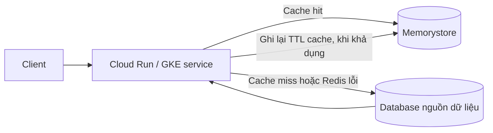
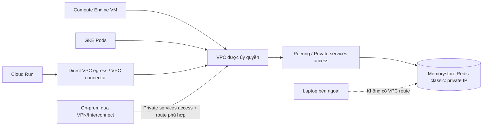
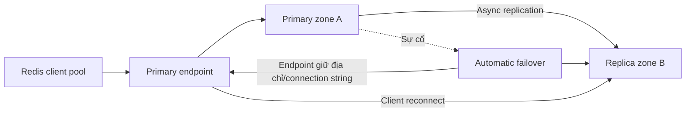

# Networking, xác thực và khả dụng cho Memorystore

> **Chương:** Bigtable và Memorystore  
> **Module:** CLOUD_PROVIDERS_GCP  
> **Phạm vi module:** Khám phá Google Cloud từ tổ chức project, IAM và VPC đến Compute Engine, GKE, Cloud Run, dịch vụ lưu trữ và cơ sở dữ liệu. Qua các tình huống triển khai, người học biết lựa chọn dịch vụ, bảo vệ tài nguyên, tự động hóa phát hành và theo dõi độ tin cậy cùng chi phí.

Một ứng dụng Cloud Run dùng Redis để giữ cache sản phẩm hoặc bộ đếm giới hạn truy cập. Ứng dụng có thể gặp ba loại lỗi rất khác nhau: **không có đường mạng đến Redis**, **đường mạng có nhưng không qua xác thực**, hoặc **Redis đang failover và kết nối bị ngắt**. Cấu hình đúng cần kết hợp **VPC + quyền truy cập dữ liệu + TLS + HA + retry/fallback** thay vì chỉ tăng cấu hình máy.

Bài này lấy **Memorystore for Redis (Basic/Standard Tier, không phải Redis Cluster)** làm ví dụ thực hành chính; đồng thời nêu khác biệt quan trọng với **Memorystore for Redis Cluster**, **Memorystore for Valkey** và **Memorystore for Memcached**. Các phiên bản sản phẩm dùng **networking và phương thức xác thực khác nhau**. Lab ưu tiên kiểm kê **instance sandbox đã có**, không hướng dẫn tạo Redis production hoặc gây failover thật.

## Mục tiêu học tập

Sau bài học, bạn có thể:

1. Xác định đường đi **Cloud Run/GKE/VM → VPC → Memorystore**, chọn **Direct VPC egress**, Serverless VPC Access hay VPC networking tương ứng.
2. Phân biệt **DIRECT_PEERING**, **PRIVATE_SERVICE_ACCESS** (Redis classic) và **Private Service Connect** (Redis Cluster/Valkey).
3. Tách **Google Cloud IAM control plane**, **Redis AUTH**, **IAM database authentication** trên sản phẩm hỗ trợ và **TLS in transit**.
4. Chọn **Basic vs Standard**, hiểu primary/replica, failover, read endpoint, mất kết nối và **asynchronous replication**.
5. Thiết kế client connection pool, timeout, exponential backoff, cache fallback và quan sát Cloud Monitoring.
6. Kiểm tra đường kết nối bằng `gcloud`, `redis-cli` hoặc Python **chỉ với lệnh đọc** trên instance sandbox.

## 1. Memorystore là một nhóm sản phẩm, không phải một kiểu Redis duy nhất

| Sản phẩm | Networking phổ biến | Data-plane authentication | Khả dụng |
|---|---|---|---|
| **Memorystore for Redis** (Basic/Standard) | Private IP qua VPC peering: `DIRECT_PEERING` hoặc `PRIVATE_SERVICE_ACCESS` | Redis **AUTH string** tùy chọn; **IAM chỉ quản lý instance**, không thay thế AUTH | Basic một node; Standard replica + automatic failover |
| **Memorystore for Redis Cluster** | Private Service Connect (PSC), service connection policy hoặc user-registered connections | **IAM authentication** hoặc **basic token-based authentication** khi cấu hình | Shards, replicas, automatic failover nếu thiết kế đủ replicas |
| **Memorystore for Valkey** | PSC và cấu hình VPC phù hợp | **IAM authentication** hoặc cơ chế auth được sản phẩm hỗ trợ, kết hợp TLS | Cluster Mode Enabled/Disabled; HA khi đủ replicas, theo zone policy |
| **Memorystore for Memcached** | Private VPC | **Không có xác thực ở cấp instance** | Cache đa node; ứng dụng phải chịu mất cache/nodes |

**Cảnh báo thuật ngữ:** các lệnh `gcloud redis instances ...` dành cho Redis **classic**; `gcloud redis clusters ...` dành cho **Redis Cluster**. Không dùng kết quả của một nhóm để suy ra config nhóm khác. Với Memorystore for Valkey, dùng bộ lệnh `gcloud memorystore instances ...` tương ứng phiên bản CLI.

### 1.1. Vai trò Memorystore trong hệ thống



Memorystore thường phù hợp làm **cache, session store hoặc data structure tốc độ cao**, nhưng **cache không tự động là nguồn dữ liệu bền vững**. Nếu Redis hỏng, có thể cần lấy lại từ Cloud SQL/Firestore/Spanner hoặc chấp nhận degrade theo nghiệp vụ. Các thao tác như thanh toán, chuyển tiền, phát hành vé cần **nguồn dữ liệu authoritative** và cơ chế giao dịch riêng.

## 2. VPC networking của Memorystore for Redis classic

Memorystore for Redis classic cấp **địa chỉ IP nội bộ** cho instance và kết nối tới VPC của khách hàng qua peering. **Không có một public Redis endpoint** để bạn từ laptop ngoài Internet kết nối trực tiếp.



### 2.1. Hai connection modes của Redis classic

| Tiêu chí | `DIRECT_PEERING` | `PRIVATE_SERVICE_ACCESS` |
|---|---|---|
| Thiết lập | Memorystore tự tạo VPC peering khi tạo instance | Admin chuẩn bị **private services access** và IP range trước |
| Shared VPC | Không phù hợp cho instance đặt trong **service project** dùng host VPC | **Bắt buộc** trong trường hợp đó |
| Kết nối on-prem qua VPN/Interconnect | Không phải lựa chọn được hỗ trợ cho mục tiêu này | **Phù hợp**, với route exchange/firewall được cấu hình |
| Quản lý dải IP tập trung | Hạn chế | Tốt hơn khi nhiều dịch vụ Google managed cùng dùng allocated ranges |
| Thay mode instance đã tạo | **Không thể đổi tại chỗ** | Muốn chuyển mode phải **tạo instance mới**, IP có thể đổi |

**Khuyến nghị thiết kế mới:** thường ưu tiên **PRIVATE_SERVICE_ACCESS** theo tài liệu hiện hành, đặc biệt nếu có Shared VPC, on-prem hoặc quản lý địa chỉ IP tập trung. Kết nối private services access yêu cầu network admin cấp đúng allocated range và cấu hình kết nối `servicenetworking.googleapis.com`; tránh range chồng lấn với VPC/on-prem.

**VPC peering không bắc cầu:** client ở VPC A không tự truy cập Redis thuộc VPC B chỉ vì A và B đều peering tới mạng thứ ba. Cần kiến trúc VPC/PSC/peering, routing và IAM được hỗ trợ cụ thể, không tự thêm route rồi coi đã có kết nối.

### 2.2. Các yêu cầu kiểm tra khi không kết nối được

1. **Project/region:** instance ở đúng project và region, trạng thái `READY`.
2. **Authorized network:** mạng client có đúng VPC được cấp cho instance hay không.
3. **Private routing:** Cloud Run có Direct VPC egress hoặc Serverless VPC Access; VM/GKE có đường đi tới VPC.
4. **IP allocation/peering:** PSA/peering tồn tại và không bị xóa.
5. **Firewall/egress/DNS:** traffic ra đúng private IP và **port của instance**, không bị policy chặn.
6. **Redis AUTH/TLS:** chỉ kiểm tra sau khi biết TCP có đường đi.

**Cloud Shell không mặc định ở VPC private của bạn.** Chạy `redis-cli` trên Cloud Shell hoặc máy cá nhân thường bị timeout dù có quyền IAM Console. Dùng **VM sandbox trong VPC được ủy quyền**, môi trường phát triển có VPN/Interconnect hợp lệ hoặc ứng dụng Cloud Run đã cấu hình VPC egress.

## 3. Cloud Run, GKE, VM và kết nối từ bên ngoài

| Nguồn gọi | Đường đến Redis classic | Cần lưu ý |
|---|---|---|
| **Compute Engine VM** | VM NIC ở authorized VPC, route/egress phù hợp | Cùng network không đồng nghĩa Redis AUTH/TLS đã cấu hình |
| **GKE** | VPC-native/IP aliasing, network và egress hợp lệ | IP của Pod, NetworkPolicy, DNS/firewall, node/service routing |
| **Cloud Run services/jobs/functions** | **Direct VPC egress** (thường khuyến nghị) hoặc **Serverless VPC Access connector** | Chọn VPC/subnet/region, egress routing và IAM phù hợp |
| **Shared VPC** | Host network + private services access của Redis classic | Service project và VPC host có quyền cấu hình riêng |
| **On-premise** | VPN/Interconnect + **PRIVATE_SERVICE_ACCESS**, route exchange hợp lệ | Không mở Redis ra Internet; kiểm tra asymmetric routing và firewall |

### 3.1. Direct VPC egress của Cloud Run

Direct VPC egress đưa traffic outbound từ Cloud Run vào subnet của VPC **không cần managed VPC Access connector**. Khi Redis ở private IP RFC 1918, cấu hình `private-ranges-only` thường đủ; nếu dùng route đặc biệt, kiểm tra `all-traffic` và NAT/egress cho các API ngoài VPC.

```bash
# Ví dụ THAM KHẢO, không chạy trên Cloud Run service production.
# Network/subnet phải được network admin chấp thuận, cùng location hỗ trợ.
# gcloud run services update APP_SERVICE \
#   --project=PROJECT_ID --region=REGION \
#   --network=AUTHORIZED_VPC \
#   --subnet=APP_SUBNET \
#   --vpc-egress=private-ranges-only
```

Đừng coi đây là một lệnh kết nối Redis độc lập: Cloud Run service vẫn cần **Redis host/port + TLS/AUTH**, subnet đủ IP và đường mạng tới peering/PSA. Direct VPC egress chỉ xử lý **network path**, không cấp quyền đọc/ghi dữ liệu Redis.

### 3.2. Serverless VPC Access connector

Nếu Direct VPC egress không phù hợp với workload, Cloud Run có thể dùng **Serverless VPC Access connector**. Connector là tài nguyên khác, có quota/capacity/chi phí và cần đúng project, VPC, region. Cần chọn `--vpc-connector` và `--vpc-egress` theo tài liệu Cloud Run; không tự tạo connector mới khi project đã có cấu hình chung.

**Không dùng Cloud SQL Auth Proxy cho Redis**. Cloud SQL là dịch vụ database khác, proxy của Cloud SQL không chuyển Redis protocol.

## 4. Redis classic: IAM, AUTH và TLS là ba lớp riêng

```text
Google Cloud IAM
  └─ Ai được phép xem/tạo/sửa instance hoặc lấy AUTH string?
                        │
                        ▼
Networking: authorized VPC + private IP/port
                        │
                        ▼
TLS in transit (nếu instance bật)
  └─ Mã hóa traffic + xác minh CA của Redis server
                        │
                        ▼
Redis AUTH (nếu instance bật)
  └─ Client gửi AUTH string qua kênh đã thiết lập?
                        │
                        ▼
Các lệnh Redis: GET/SET/INCR/... theo khả năng engine
```

**IAM quản trị Redis classic không phải Redis user/password.** Principal có `roles/redis.viewer` vẫn không thể `GET` qua mạng nếu thiếu VPC path và AUTH; ngược lại, một process có đường VPC, AUTH string đúng có thể thao tác Redis mà **không có role IAM đọc instance**. Bảo vệ đường mạng và secret vì Redis classic **không cung cấp IAM login per-connection như Redis Cluster/Valkey**.

### 4.1. Redis AUTH của instance classic

- `AUTH` là tính năng tùy chọn; khi bật, instance có một **AUTH string 36 ký tự**, riêng từng instance.
- Client phải gửi `AUTH` trước khi dùng commands; string đóng vai trò **shared secret**, không phân quyền theo từng end-user.
- Xem AUTH string đòi permission `redis.instances.getAuthString`; lệnh có thể tiết lộ secret, vì vậy **không chạy trong log CI, ticket hoặc terminal được chia sẻ**.
- Khi thay đổi AUTH, **connection đang mở có thể có hành vi khác nhau tùy Redis version**. Lập kế hoạch cập nhật Secret Manager/app, reconnect và rollback trước khi xoay secret.

```bash
# Tham khảo cú pháp; LỆNH DƯỚI TRẢ SECRET, KHÔNG CHẠY TRONG BÀI LAB CHỈ ĐỌC:
# gcloud redis instances get-auth-string REDIS_INSTANCE \
#   --project=PROJECT_ID --region=REGION
```

Đưa AUTH string vào **Secret Manager** bằng quy trình quản trị. Trong app production dùng secret injection/credential provider đúng chính sách, không commit mật khẩu vào Git, Dockerfile, URL Redis, logs hoặc file `.env` chia sẻ.

### 4.2. In-transit encryption cho classic

TLS của Redis classic sử dụng **TLS 1.2 trở lên** và CA certificates do instance cung cấp. **Bật TLS khi tạo instance** bằng `--transit-encryption-mode=SERVER_AUTHENTICATION`; **không thể bật thêm TLS trên instance classic đã tạo mà không có TLS** bằng cách update thông thường. Khi TLS bật, Redis chỉ nhận client **dùng TLS**; client plaintext sẽ bị chặn.

| Chế độ | Cách kết nối |
|---|---|
| Không TLS | TCP tới **port instance báo**, thường `6379`; đường VPC riêng **không** chứng minh client traffic được TLS mã hóa |
| Có TLS | TCP tới **port TLS instance báo**, thường `6378`, với CA của instance |
| Có AUTH + TLS | Dùng TLS **và** AUTH secret; TLS bảo vệ cả thông điệp AUTH |

**Không dùng `--insecure`, `ssl_cert_reqs=None` hay `verify=False` như giải pháp production**. Nếu client báo chứng chỉ không tin cậy, cung cấp **CA đúng của instance** và triển khai CA rotation, không tắt xác thực certificate.

**CA rotation:** tài liệu Redis classic nêu CA có thể luân chuyển theo lifecycle; ứng dụng cần nạp các CA hợp lệ được cung cấp và có logic reconnect/backoff khi server certificate thay đổi. TLS tăng overhead CPU/memory và giới hạn client connections tùy tier/version/capacity.

### 4.3. Redis ACL có phải thay AUTH string classic?

Không mặc định có Redis ACL/per-user identities trên Redis classic chỉ vì open-source Redis 6 có lệnh ACL. Memorystore **giới hạn theo phiên bản và dòng sản phẩm**. Nếu cần identity riêng theo workload, token ngắn hạn hoặc chính sách IAM DB access, đánh giá **Redis Cluster/Valkey IAM authentication** hoặc kiến trúc proxy quản lý quyền, không đoán Redis classic đã có tính năng đó.

## 5. Redis Cluster và Valkey: networking/auth khác Redis classic

### 5.1. Private Service Connect của Redis Cluster

Redis Cluster dùng **Private Service Connect service connectivity automation** thông qua **service connection policy** (service class `gcp-memorystore-redis`) hoặc **user-registered PSC connections**. Trong nhiều cấu hình có hai endpoints cho mỗi VPC:

1. **Discovery endpoint**: client dùng để tìm cluster/topology và kết nối.
2. **Endpoint nội bộ dành riêng**: phục vụ hạ tầng cluster, **không** là nơi client gửi `redis-cli`.

Một cluster có thể phục vụ nhiều VPC theo điều kiện/networking mode được hỗ trợ. Redis client cần hỗ trợ **cluster topology và redirects** (`MOVED`/`ASK`) thay vì luôn coi Redis là một host đơn. Truy cập các shards/replicas đòi network reachability tới endpoints/node paths, không chỉ endpoint đầu tiên.

### 5.2. IAM authentication trên Redis Cluster và Valkey

Khi sản phẩm/instance bật IAM auth:

- **Redis Cluster:** cấp role `roles/redis.dbConnectionUser` hoặc permission `redis.clusters.connect` cho đúng principal.
- **Memorystore for Valkey:** cấp role `roles/memorystore.dbConnectionUser` theo IAM model của Valkey.
- Client gửi IAM **access token** bằng Redis/Valkey AUTH, cần **credential refresh** cho connections mới; token thường có thời hạn khoảng **một giờ** nếu phát hành mặc định.
- **IAM auth không tự bật TLS**. Nên bật in-transit encryption riêng để token không đi dưới dạng plaintext.

**Tính tương thích:** Redis Cluster còn có lựa chọn **basic token-based authentication**. Phương án tạo instance, IAM roles, discovery endpoint/port và TLS CA phải đối chiếu **documentation đúng dòng sản phẩm**; không dùng `gcloud redis instances get-auth-string` của classic để lấy credential cho Cluster/Valkey.

### 5.3. Memcached: bảo mật dựa vào VPC

Memorystore for Memcached **không có instance-level AUTH**. Do đó network exposure, VPC segmentation và access tới client environment là rào chắn rất quan trọng; không đưa Memcached endpoint vào mạng tin cậy kém. Memcached là cache dễ mất dữ liệu, không dùng như database bền vững.

## 6. Khả dụng của Redis classic: Basic và Standard

| Tiêu chí | **Basic Tier** | **Standard Tier** |
|---|---|---|
| Nodes | Một primary | Primary + replica; có thể dùng read replicas theo cấu hình |
| Cross-zone protection | Không | Có replication/automatic failover khi đủ điều kiện |
| Automatic failover | Không | Có |
| Trường hợp dùng | Cache có thể cold-start/rebuild | Cache/session có SLO cao hơn, cần HA trong region |
| Mất dữ liệu | Có thể mất toàn cache khi node hỏng/restart | **Có thể mất acknowledged writes** vì replication bất đồng bộ |
| Đọc replicas | Không | Có khi bật read replicas; có **read endpoint** và **replication lag** |

**Basic không nâng thành Standard tại chỗ**: cần tạo instance Standard mới rồi chuyển dữ liệu/cutover theo kế hoạch. Chọn Standard từ đầu nếu ứng dụng có yêu cầu HA; nhưng **Standard không bằng backup, DR đa vùng hoặc giao dịch durable**.

### 6.1. Failover Standard Tier diễn ra thế nào?



Theo tài liệu Google Cloud, failover thường làm **rớt kết nối tới primary endpoint**; client kết nối lại cùng địa chỉ/connection string sau khi hệ thống chuyển sang primary mới. Thời gian gián đoạn tham khảo có thể ở mức **vài chục giây**, biến thiên theo sự cố và maintenance, **không phải SLA cho mỗi request**. Read replica đã lên primary sẽ ngắt các read connections của chính nó trong lúc chuyển vai.

**Replication bất đồng bộ** nghĩa là dữ liệu đã ACK ở primary nhưng chưa kịp replicate có thể **bị mất khi failover**. Vì vậy không dùng Redis như hệ thống nguồn duy nhất cho payment, inventory hoặc quyết toán nếu không có bền vững/đối soát bên ngoài.

### 6.2. Persistence, backup và khả năng phục hồi

- **RDB snapshots/persistence** có thể được bật theo tier/chế độ và cách tạo instance; xác minh `persistenceConfig` thật, không giả định mọi instance có snapshot.
- **Standard + snapshots** giúp giảm một số rủi ro nhưng không biến Redis thành database ACID/nguồn dữ liệu authoritative.
- Cache có thể cần **warm-up** sau failover/restart; tránh một lúc tất cả clients đánh DB nguồn gây **cache stampede**.
- Đối với DR vùng khác, phải thiết kế **nguồn dữ liệu gốc, tái tạo cache, failover application và DNS/config routing**; cross-zone HA không phải cross-region replication.

### 6.3. Kết nối bền vững sau failover

Client nên có:

1. **Connection pooling** vừa đủ, kết nối lặp lại/timeout hợp lý, không tạo TCP connection cho mọi request.
2. **Exponential backoff + jitter** và số lần thử hữu hạn cho network errors, reset/timeout.
3. **Circuit breaker** khi Redis outage kéo dài; giảm tải Redis và database nguồn.
4. **Fallback có giới hạn** (đọc DB gốc khi cache miss/error) và **TTL + request coalescing** để tránh stampede.
5. Phân biệt lệnh **idempotent** (`GET`, `SET key value` theo ngữ cảnh) với thao tác có side effect (`INCR`, `LPUSH`). **Không retry mù quáng** khi mất response của lệnh đã thực hiện, có thể tăng bộ đếm hoặc ghi trùng.

## 7. Lab A — Kiểm kê instance Redis sandbox, chỉ đọc

> **Điều kiện:** có một Memorystore for Redis classic instance đã được tạo riêng trong **project sandbox**, ở trạng thái READY, cùng một VM/GKE/Cloud Run environment đã có đường mạng được network admin duyệt. Nếu chưa có, chỉ làm lab thiết kế/đọc metrics. **Không tự tạo instance mới để làm bài** vì Redis được tính phí khi cấp phát.

### 7.1. Biến và kiểm tra metadata

Trong Cloud Shell/Bash:

```bash
PROJECT_ID="my-memorystore-sandbox"
REGION="asia-southeast1"        # Đổi theo region của instance thực
REDIS_INSTANCE="redis-cache-lab" # Instance riêng đã có

gcloud auth list --filter="status:ACTIVE"
gcloud projects describe "$PROJECT_ID" \
  --format="table(projectId,name,lifecycleState)"
gcloud redis instances list \
  --project="$PROJECT_ID" --region="$REGION"

gcloud redis instances describe "$REDIS_INSTANCE" \
  --project="$PROJECT_ID" --region="$REGION" \
  --format="yaml(name,state,region,tier,memorySizeGb,host,port,readEndpoint,readEndpointPort,connectMode,authorizedNetwork,authEnabled,transitEncryptionMode,readReplicasMode,replicaCount,persistenceConfig)"
```

**Xác nhận:** instance thuộc đúng project/network, `state: READY`, `tier`, `connectMode`, `authEnabled`, `transitEncryptionMode` và port thực. **Không thử `redis-cli` từ Cloud Shell** nếu chưa có network path hợp lệ.

### 7.2. Thu thập host/port an toàn

```bash
REDIS_HOST="$(gcloud redis instances describe "$REDIS_INSTANCE" \
  --project="$PROJECT_ID" --region="$REGION" \
  --format='value(host)')"
REDIS_PORT="$(gcloud redis instances describe "$REDIS_INSTANCE" \
  --project="$PROJECT_ID" --region="$REGION" \
  --format='value(port)')"
printf 'Host=%s Port=%s\n' "$REDIS_HOST" "$REDIS_PORT"
```

**Host là private IP**, không phải public service URL; port lấy từ instance, không tự hardcode `6379`. Đừng nhầm `readEndpoint` với primary endpoint nếu cần lệnh ghi. Lệnh metadata trên không truy vấn các Redis keys.

### 7.3. Kiểm tra network ở VM sandbox trong authorized VPC

Nếu đã có **Compute Engine VM sandbox** trong VPC được phê duyệt, chạy lệnh sau **trên VM đó** (nhập lại `REDIS_HOST`/`REDIS_PORT` đã ghi), không chạy trên repo khóa học:

```bash
# Read-only TCP reachability test; không gửi Redis password.
timeout 5 bash -c "cat < /dev/null > /dev/tcp/$REDIS_HOST/$REDIS_PORT" \
  && echo "TCP reachable" \
  || echo "TCP unreachable / timeout"
```

Kết quả **TCP reachable** chỉ chứng minh đường mạng và port đang chấp nhận kết nối, **không** chứng minh Redis AUTH hay TLS thành công. TCP timeout thường là vấn đề VPC/peering/firewall/port/egress; **`NOAUTH`** khi chạy Redis command lại là vấn đề authentication.

### 7.4. Thử `PING`/`INFO` với đúng security mode

**Chỉ khi có Redis CLI trên VM sandbox được phép đọc**, chọn **một** trong các nhánh sau.

**Nhánh 1 — Instance không bật AUTH và TLS (lab riêng, network giới hạn):**

```bash
# Không phù hợp để dùng cho dữ liệu nhạy cảm.
redis-cli -h "$REDIS_HOST" -p "$REDIS_PORT" PING
redis-cli -h "$REDIS_HOST" -p "$REDIS_PORT" INFO replication
```

**Nhánh 2 — Instance có AUTH + TLS:**

```bash
# REDIS_CA_FILE là PEM CA được owner cấp từ Memorystore instance.
# redis-cli --askpass sẽ hỏi password tương tác, tránh lộ trên command line.
# Không dùng --insecure hoặc --no-auth-warning làm biện pháp bảo mật.
REDIS_CA_FILE="/path/to/approved/server_ca.pem"
redis-cli --tls --cacert "$REDIS_CA_FILE" \
  --askpass -h "$REDIS_HOST" -p "$REDIS_PORT" PING

redis-cli --tls --cacert "$REDIS_CA_FILE" \
  --askpass -h "$REDIS_HOST" -p "$REDIS_PORT" INFO replication
```

**CA:** nếu instance bật TLS, tải **đúng server CA certificate(s)** từ Memorystore Instance details hoặc trường `serverCaCerts` của `gcloud redis instances describe`. Chỉ lưu ở **máy client được phép**, với permissions thích hợp. Nếu instance chỉ bật TLS nhưng **không AUTH**, bỏ `--askpass`; nếu bật AUTH nhưng **không TLS**, dùng `--askpass` song lưu ý secret không có bảo đảm TLS trên đường truyền. Không gửi AUTH string ra chat, logs hoặc source code.

**Kỳ vọng:** `PING → PONG`. Với Standard, `INFO replication` cho biết vai trò primary/replica và trạng thái replication theo engine/config. Nếu thiếu network/credentials, bỏ qua phần runtime test và hoàn thành bảng chẩn đoán ở mục 12.

## 8. Lab B — Ví dụ Python client có pool và fallback

Đây là **mã mẫu để chạy trong VM/Cloud Run sandbox có VPC path**; bước này **không thay đổi Redis instance configuration**. Ứng dụng thật phải lấy AUTH từ Secret Manager/secret injection được phê duyệt, không lấy string trong file code.

### 8.1. Chuẩn bị

```bash
# Trong virtualenv riêng của người học:
python -m pip install "redis>=5,<7"

# Environment settings do operator cung cấp an toàn:
# REDIS_HOST, REDIS_PORT, REDIS_USE_TLS, REDIS_CA_FILE
# REDIS_AUTH lấy từ Secret Manager/injection, KHÔNG commit vào Git.
```

### 8.2. `cache_client.py` — chỉ đọc `PING` và `GET` key thử

```python
import logging
import os
import random
import time

import redis

LOG = logging.getLogger(__name__)
logging.basicConfig(level=logging.INFO)

host = os.environ["REDIS_HOST"]
port = int(os.environ["REDIS_PORT"])
use_tls = os.environ.get("REDIS_USE_TLS", "false").lower() == "true"
password = os.environ.get("REDIS_AUTH") or None

if use_tls:
    ca_path = os.environ["REDIS_CA_FILE"]
else:
    ca_path = None

pool_options = {
    "host": host,
    "port": port,
    "password": password,
    "socket_connect_timeout": 2,
    "socket_timeout": 2,
    "health_check_interval": 30,
    "max_connections": 8,
    "decode_responses": True,
}
if use_tls:
    pool_options.update({
        "connection_class": redis.SSLConnection,
        "ssl_ca_certs": ca_path,
        "ssl_cert_reqs": "required",
    })

pool = redis.ConnectionPool(**pool_options)
client = redis.Redis(connection_pool=pool)


def get_cache_or_none(key: str):
    """Hạn chế retry với GET (idempotent), trả None để app fallback."""
    for attempt in range(3):
        try:
            client.ping()
            return client.get(key)
        except (redis.exceptions.ConnectionError,
                redis.exceptions.TimeoutError) as exc:
            LOG.warning("Redis unavailable: attempt=%s type=%s",
                        attempt + 1, type(exc).__name__)
            if attempt < 2:
                time.sleep(min(2.0, 0.2 * (2 ** attempt))
                           + random.uniform(0, 0.1))
    return None


try:
    result = get_cache_or_none("lab:nonexistent:key")
    print("Cache value:", "<miss-or-unavailable>" if result is None else result)
finally:
    client.close()
    pool.disconnect()
```

**Mục đích:** mô phỏng network retry, có **pool giới hạn 8 connections**, không tạo/ghi Redis key và không log AUTH secret. Trong sản phẩm thật:

- **Phân biệt cache miss với Redis outage:** hàm minh họa gộp hai trường hợp; ứng dụng nên ghi metrics riêng (hit/miss/error) và có fallback DB/source.
- **TLS dùng `redis.SSLConnection`** khi tạo pool trực tiếp; tránh truyền tùy tiện tham số `ssl` vào connection class không hỗ trợ. Kiểm tra TLS CA/certificate của instance.
- **Không retry `INCR` hoặc thao tác ghi không idempotent** khi đã mất response mà không rõ server đã áp dụng lệnh chưa.
- Khi chạy trong Cloud Run, giữ client/pool ở **application scope**, không tạo một pool mới cho từng request.

## 9. Availability và client behavior: tình huống thực tế

### 9.1. Khi Redis failover trong lúc đọc cache

```text
T = 0s    Ứng dụng cache GET trả 200 nhanh.
T = 10s   Node primary lỗi; Redis reset connections.
T = 11s   Client GET gặp ConnectionError; không trả 500 ngay cho mọi user.
T = 12s   Backoff + jitter, mở connection mới; nếu chưa phục hồi thì fallback DB.
T = ~30s  Redis Standard thường đã có primary mới (thời gian minh họa).
T > 30s  Client warm-up cache có giới hạn, không bắn ồ ạt xuống DB.
```

Đây là **timeline giả định** để giải thích, không phải thời gian cam kết. Cache miss và failover có thể làm tăng tải tới database nguồn; cần **request coalescing, TTL jitter, circuit breaker và rate limit fallback**.

### 9.2. Với dữ liệu session cần gì?

Nếu session của người dùng chỉ nằm trong Redis Standard, một acknowledged write vẫn có thể mất khi failover; user có thể bị đăng xuất. Nếu nghiệp vụ yêu cầu session không mất, cần lưu trạng thái bền vững bên ngoài hoặc thiết kế chấp nhận làm mới phiên. **Không dùng “Standard có replica” làm cam kết RPO=0.**

### 9.3. Read replicas có thể trả dữ liệu cũ

Standard Tier có **read endpoint** khi bật read replicas. Vì replication bất đồng bộ, **read-your-write consistency** có thể không bảo đảm nếu vừa ghi primary đã đọc qua replica. Với luồng cần nhất quán, đọc primary hoặc chấp nhận eventual consistency rõ ràng; đừng ghi vào read endpoint.

## 10. Monitoring: phát hiện quá tải, mất kết nối và failover

Trong **Google Cloud Console → Memorystore for Redis → instance → Monitoring**, theo dõi ít nhất:

| Metric/nhóm metric | Tín hiệu |
|---|---|
| `redis.googleapis.com/clients/connected` | Số connections hiện tại; gần maxclients thì connection mới dễ bị từ chối |
| `redis.googleapis.com/stats/reject_connections_count` | Số lần bị từ chối do max clients/memory |
| `redis.googleapis.com/stats/cpu_utilization_main_thread` | Main-thread CPU tăng, có thể gây latency |
| `redis.googleapis.com/stats/memory/usage_ratio` | Memory pressure, nguy cơ eviction |
| `redis.googleapis.com/stats/evicted_keys` | Cache entries bị evict do memory limit |
| `redis.googleapis.com/stats/keyspace_misses` | Cache misses tăng; cần đối chiếu cache hit ratio |
| Instance uptime / failover events | Gián đoạn do maintenance/failover |
| Network bytes in/out, server latency | Tải mạng và độ trễ phía Redis |

Đồng thời phải đo **client-side**: connect timeout, TLS handshake fail, AUTH fail, GET p50/p95/p99, retry attempts, circuit breaker state, pool exhaustion và fallback DB requests. **Cloud Monitoring của Redis không thay thế logs của ứng dụng** và không giải thích đầy đủ lỗi Cloud Run VPC egress.

### 10.1. Alert cơ bản

1. **Connected clients** gần mức giới hạn và reject count tăng.
2. **Memory usage** cao kéo dài, evicted keys tăng nhanh.
3. **Cache misses** tăng đột biến đồng thời database source CPU tăng.
4. **Connection errors** tăng, uptime reset hoặc Redis failover event.
5. **P95 cache latency** vượt SLO, backoff/reconnect kéo dài.

Đặt threshold theo baseline/capacity thực của instance, không dùng một con số chung cho mọi tier. Alert chi phí cũng cần chú ý: Memorystore tính phí **capacity cấp phát và tier**, không đợi có traffic mới tính; VPC egress/connector, logs và hạ tầng client có thể tăng phí.

## 11. Security checklist: ai được truy cập Redis?

| Lớp | Tiêu chí an toàn |
|---|---|
| **Network** | Private IP, authorized VPC, PSA/PSC đúng sản phẩm, firewall/route tối thiểu |
| **Control plane IAM** | Chỉ operator cần thiết có quyền tạo/update/get AUTH string |
| **Data plane auth** | Redis classic AUTH secret; Redis Cluster/Valkey IAM/token theo khả năng sản phẩm |
| **TLS** | TLS khi có thể, đúng CA/cert chain, không disable verification |
| **Secrets** | Secret Manager, rotation runbook, không lộ qua command args/logs |
| **Runtime identity** | Cloud Run/GKE/VM dùng SA/Workload Identity phù hợp cho việc đọc secrets/IAM auth |
| **High availability** | Standard/replicas theo SLA/RPO, xác minh persistence và failover behavior |
| **Ứng dụng** | Connection pool, timeout, retry có jitter, circuit breaker, fallback |
| **Cache lifecycle** | TTL, eviction policy, giới hạn memory, cache stampede mitigation |
| **Observability** | Metrics Redis + ứng dụng, alerts, audit changes, incident runbook |

**Lưu ý đặc biệt với Redis classic:** người có thể kết nối private IP và biết AUTH string có quyền thực thi nhiều Redis commands. Không coi một VPC lớn nhiều tenant là security boundary đủ mạnh; tách instance hoặc áp phân đoạn mạng/layer ứng dụng khi cần cô lập workloads.

## 12. Troubleshooting theo từng tầng

| Triệu chứng | Phân loại | Kiểm tra đầu tiên |
|---|---|---|
| `gcloud redis instances describe` bị 403 | **Control-plane IAM** | Project/role `redis.instances.get`; không suy ra đường Redis bị lỗi |
| TCP timeout tới private IP | **Network** | VPC/subnet/PSA/peering, firewall, region, port, Cloud Run egress |
| Cloud Shell timeout nhưng VM VPC kết nối | **Network path** | Cloud Shell không nằm trong authorized VPC |
| Shared VPC service project tạo Redis lỗi | **Connect mode** | Dùng `PRIVATE_SERVICE_ACCESS`, allocated range/peering |
| On-prem không đến Redis qua DIRECT_PEERING | **Architecture** | PSA + VPN/Interconnect + custom routes, không chỉ IAM |
| `NOAUTH Authentication required` | **Redis AUTH** | Client chưa gửi đúng AUTH string |
| `WRONGPASS invalid username-password pair` | **Redis credentials** | Redis classic AUTH secret, token/username theo sản phẩm khác |
| `wrong version number`/TLS handshake lỗi | **TLS mismatch** | Redis instance mode, port TLS, CA chain, client hỗ trợ TLS |
| CA verification failed | **Certificate trust** | Dùng CA đúng và rotate đầy đủ; không tắt SSL verification |
| IAM user có Viewer mà `GET` không được | **Data-plane auth** | IAM control plane không phải Redis AUTH classic |
| Cloud Run 403 khi lấy secret | **Secret Manager IAM** | Runtime SA có `secretmanager.versions.access` đúng secret |
| Cluster client chỉ biết một node rồi lỗi `MOVED` | **Cluster discovery** | Client cluster-aware, discovery endpoint và các PSC paths |
| Connections reset sau maintenance/failover | **HA lifecycle** | Retry/backoff, reconnect, timeout, Redis uptime |
| Key vừa `SET` biến mất sau failover | **Async replication/data durability** | Replication lag, RDB persistence, nguồn dữ liệu bền vững |
| Đọc read replica thấy giá trị cũ | **Read lag** | Dùng primary khi cần read-after-write |
| `maxclients` hoặc TLS conn limit | **Connection saturation** | Pool size × instances, Monitoring, giảm churn |
| Nhiều misses sau restart | **Cold cache** | Warm-up, fallback rate limit, TTL jitter, source DB load |

### 12.1. Runbook 6 bước

```text
1. Xác nhận sản phẩm: Redis classic / Redis Cluster / Valkey / Memcached
2. Kiểm tra instance READY, đúng project/region và endpoint/port
3. Kiểm tra VPC/PSA/PSC, Cloud Run egress và TCP reachability
4. Kiểm tra AUTH/IAM token và TLS CA (không log secrets)
5. Nếu có reset/timeouts: kiểm tra failover, replicas, memory và pool
6. Khôi phục traffic có kiểm soát; theo dõi cache misses, DB fallback và cost
```

**Không khắc phục bằng cách** gán Owner toàn project, tắt TLS verification, mở public ingress, dừng Redis instance production hoặc ép manual failover khi chưa xác định nguyên nhân.

## 13. Bài tập có đáp án

### Bài 1 — Ba lớp của lỗi kết nối

Cloud Run không kết nối được Redis classic; `gcloud redis instances describe` thành công nhưng TCP timeout. Có nên cấp thêm `roles/redis.admin` cho runtime SA?

**Đáp án:** không. `describe` thành công chỉ kiểm tra IAM control plane, TCP timeout liên quan VPC/egress/peering/port/firewall. Chọn Direct VPC egress hoặc VPC connector phù hợp và đúng authorized network.

### Bài 2 — Shared VPC và on-prem

Một nhóm dùng Redis classic trong service project của Shared VPC và client on-prem đi qua Cloud VPN. Chọn `DIRECT_PEERING` hay `PRIVATE_SERVICE_ACCESS`?

**Đáp án:** `PRIVATE_SERVICE_ACCESS` với IP allocation/peering, route exchange và firewall đúng thiết kế. `DIRECT_PEERING` không phù hợp cho hai yêu cầu này.

### Bài 3 — IAM khác Redis AUTH

Operator có `roles/redis.viewer` và truy cập được VM trong VPC. Khi gọi `GET` nhận `NOAUTH`. Vì sao?

**Đáp án:** instance classic bật Redis AUTH; IAM Viewer không phải mật khẩu của data plane. Cần AUTH string đúng do owner cấp qua secret management, cùng TLS nếu bật.

### Bài 4 — TLS không thể bổ sung tại chỗ

Instance Redis classic đã chạy plaintext không TLS. Nhóm muốn chuyển ngay sang TLS chỉ bằng cách bật flag lúc update và không cần migrate. Điều gì chưa đúng?

**Đáp án:** Redis classic hỗ trợ bật TLS **khi tạo instance**; không có thao tác bật TLS tại chỗ như flag update bình thường. Cần tạo instance thay thế cấu hình TLS, lập kế hoạch dữ liệu/địa chỉ/consumer cutover và chi phí.

### Bài 5 — Sự cố failover

Redis Standard vừa failover. Có `ConnectionError` trong 20 giây, sau đó client tự reconnect cùng IP và tiếp tục chạy; một key mới ghi gần sự cố bị mất. Hiện tượng này có thể đúng không?

**Đáp án:** có. Standard dùng async replication, reset connections khi failover, IP/connection string vẫn giữ; acknowledged writes có thể mất nếu chưa replicate. Cần retry/backoff, cache fallback và nguồn dữ liệu bền vững.

### Bài 6 — Cache hay nguồn dữ liệu?

Một hệ thống dùng Redis Standard làm nơi **duy nhất** lưu số dư ví điện tử vì “có replica”. Rủi ro chính?

**Đáp án:** Standard HA không bảo đảm RPO=0/durability. Dùng database/ledger giao dịch authoritative và chỉ dùng Redis cho cache, rate limits hoặc state có thể phục hồi theo chính sách.

### Bài 7 — Redis Cluster bị MOVED

Client dùng Redis Cluster nhưng chỉ kết nối một TCP endpoint và không xử lý `MOVED`. Cần làm gì?

**Đáp án:** dùng **cluster-aware client**, discovery endpoint đúng, PSC paths tới nodes/shards và auth/TLS theo product. Đừng cấu hình Redis Cluster như một Redis classic single endpoint.

### Bài 8 — Tính tổng connections

Cloud Run tối đa **40 instances**; mỗi instance có pool **20 connections**. Tối đa bao nhiêu connections từ service này và cần lưu ý gì?

**Đáp án:** lý thuyết tới **800 connections** (chưa tính jobs/VM/client khác). So với maxclients/TLS giới hạn theo tier/version, đặt pool tối thiểu hợp lý và theo dõi `clients/connected` cùng `reject_connections_count`.

## 14. Cleanup và checklist production

### 14.1. Kết thúc lab an toàn

Lab A chỉ dùng `gcloud ... list/describe` và các lệnh Redis **PING/INFO/GET** trên instance đã có; không tạo instance, VPC connection, SA hoặc sửa dữ liệu. **Không cần lệnh xóa tài nguyên Cloud**.

1. Đóng `redis-cli`, Python client và connection pool chỉ do lab mở.
2. Nếu operator tạm tải PEM CA xuống VM lab, dọn file cục bộ theo chính sách; **không xóa CA khỏi trust store** của ứng dụng khác.
3. Không dùng `FLUSHALL`, `FLUSHDB`, `CONFIG SET`, `KEYS *` hay `MONITOR` để “dọn” một Redis dùng chung.
4. Không xóa Redis instance, VPC peering/PSA/PSC, subnet, Cloud Run/GKE resources hoặc IAM bindings của workload khác.
5. Ghi lại latency/connection/eviction metrics trước/sau test; kiểm tra chi phí vì instance tiếp tục tính phí theo capacity khi không có traffic.

### 14.2. Checklist trước production

| Hạng mục | Tiêu chí đạt |
|---|---|
| **Đúng sản phẩm** | Redis classic/Cluster/Valkey/Memcached và CLI, auth model phù hợp |
| **Network** | Authorized VPC + mode PSA/peering/PSC, IP route/firewall/egress |
| **Serverless** | Direct VPC egress hoặc VPC connector đủ subnet/quota/region |
| **Data-plane security** | Redis AUTH hoặc IAM auth đúng dòng sản phẩm, không trộn với IAM Viewer |
| **TLS** | Client TLS-capable, đúng port/CA chain, cert rotation runbook |
| **IAM/secrets** | Least privilege cho control plane, getAuthString/Secret Manager được giới hạn |
| **HA** | Tier/replicas/zone, read lag, failover retry, không giả định RPO=0 |
| **Client** | Pool, timeouts, jitter/backoff, idempotent retry, circuit breaker |
| **Fallback** | Source of truth + cache rebuild, stampede mitigation, bảo vệ database |
| **Monitoring** | Connections, CPU, memory, evictions, misses, app errors, alerts |
| **Cost** | Capacity tier, storage/persistence, egress/connector và budget |
| **DR/cleanup** | Runbook đã diễn tập, không xóa tài nguyên dùng chung |

## Ghi nhớ

**Memorystore Redis classic có private IP và network modes khác Redis Cluster/Valkey.** IAM quản trị instance, Redis AUTH bảo vệ Redis commands, còn TLS bảo vệ dữ liệu truyền — ba lớp không thay thế nhau. **Standard Tier** có replication/failover nhưng vẫn mất connections, có thể mất acknowledged writes và không thay nguồn dữ liệu bền vững. Kết nối production cần **VPC route phù hợp, credential/TLS đúng sản phẩm, pool/retry có giới hạn, fallback và metrics**.

## Tài liệu tham khảo chính thức

- [Memorystore for Redis — Networking](https://cloud.google.com/memorystore/docs/redis/networking)
- [Memorystore for Redis — Supported environments](https://cloud.google.com/memorystore/docs/redis/supported-environments)
- [Memorystore for Redis — Connect from Cloud Run](https://cloud.google.com/memorystore/docs/redis/connect-redis-instance-cloud-run)
- [Cloud Run — Direct VPC egress and connectors](https://cloud.google.com/run/docs/configuring/connecting-vpc)
- [Memorystore for Redis — About Redis AUTH](https://cloud.google.com/memorystore/docs/redis/about-redis-auth)
- [Memorystore for Redis — Manage AUTH](https://cloud.google.com/memorystore/docs/redis/manage-redis-auth)
- [Memorystore for Redis — About in-transit encryption](https://cloud.google.com/memorystore/docs/redis/about-in-transit-encryption)
- [Memorystore for Redis — Manage in-transit encryption](https://cloud.google.com/memorystore/docs/redis/manage-in-transit-encryption)
- [Memorystore for Redis — Redis tiers](https://cloud.google.com/memorystore/docs/redis/redis-tiers)
- [Memorystore for Redis — High availability](https://cloud.google.com/memorystore/docs/redis/high-availability-for-memorystore-for-redis)
- [Memorystore for Redis — Best practices](https://cloud.google.com/memorystore/docs/redis/general-best-practices)
- [Memorystore for Redis — Supported monitoring metrics](https://cloud.google.com/memorystore/docs/redis/supported-monitoring-metrics)
- [Memorystore for Redis Cluster — Networking](https://cloud.google.com/memorystore/docs/cluster/networking)
- [Memorystore for Redis Cluster — IAM authentication](https://cloud.google.com/memorystore/docs/cluster/about-iam-auth)
- [Memorystore for Valkey — IAM authentication](https://cloud.google.com/memorystore/docs/valkey/about-iam-auth)
- [Memorystore for Valkey — HA and replicas](https://cloud.google.com/memorystore/docs/valkey/ha-and-replicas)
- [Memorystore for Memcached — Overview](https://cloud.google.com/memorystore/docs/memcached/memcached-overview)
