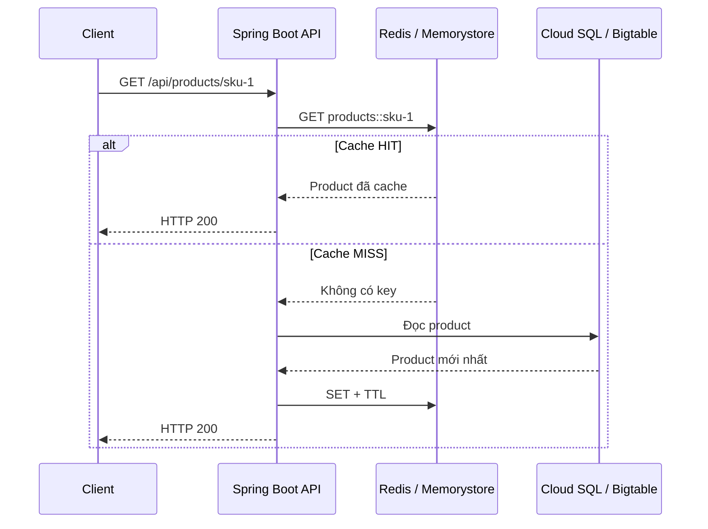
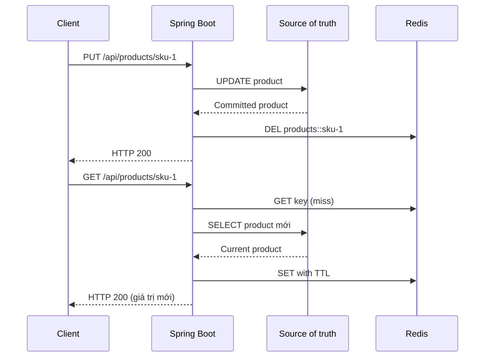
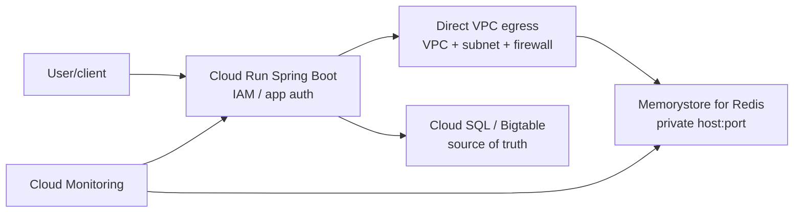

# Thực hành bộ nhớ đệm cho API Spring Boot

Một API danh mục sản phẩm viết bằng **Spring Boot** đọc dữ liệu từ Cloud SQL hoặc Bigtable. Khi nhiều người cùng xem một sản phẩm, ứng dụng liên tục đọc lại thông tin ít thay đổi. **Redis cache** có thể giảm độ trễ và số lần truy vấn nguồn, nhưng cũng tạo rủi ro **dữ liệu cũ, quá tải khi cache hết hạn, lỗi kết nối và chi phí bộ nhớ** nếu dùng sai.

Bài thuộc chương **Bigtable và Memorystore** của mô-đun `CLOUD_PROVIDERS_GCP`, trong lộ trình Google Cloud về project, IAM, VPC, Compute Engine, GKE, Cloud Run, lưu trữ, cơ sở dữ liệu và vận hành độ tin cậy/chi phí. Bài thực hành dùng **Java 21 + Spring Boot 4.1.2 + Spring Cache + Redis**. Trước tiên chạy Redis **trên máy học viên**; phần Google Cloud hướng dẫn kết nối đến **Memorystore for Redis** đã tồn tại, không tự tạo instance có phí.

## 1. Kết quả học tập

Sau bài này, bạn có thể:

1. Phân biệt **source of truth** (Cloud SQL/Bigtable), **cache** (Redis/Memorystore) và cache cục bộ trong JVM.
2. Giải thích **cache-aside**, cache **hit/miss**, TTL, eviction, key prefix và invalidation.
3. Dựng một API Spring Boot dùng `@Cacheable`/`@CacheEvict` để giảm số lượt đọc nguồn dữ liệu.
4. Đo cache hit bằng API và `redis-cli`; thử hết hạn TTL và cập nhật dữ liệu.
5. Kết nối dịch vụ chạy trên Cloud Run/GKE tới Memorystore qua VPC, cân nhắc AUTH và TLS.
6. Xử lý các lỗi phổ biến: Redis không reachable, serialization, dữ liệu cũ, cache stampede và memory pressure.
7. Chọn Redis Basic/Standard, giám sát hiệu năng và ước lượng chi phí theo tải.
8. Phân biệt giới hạn của **Spring Cache** với yêu cầu nhất quán/transaction nghiệp vụ.
9. Hoàn thành bài tập về TTL, hit ratio, cache keys, HA, IAM và khôi phục khi cache lỗi.

**Nguyên tắc lab:** chỉ tạo các file ví dụ trong **thư mục demo riêng trên máy học viên**. Bài này chỉ ghi tài liệu Markdown vào repository. Không dùng database, Redis instance hoặc service production để chạy thử `FLUSHALL`, load test hoặc API cập nhật dữ liệu.

## 2. Kiến trúc cache-aside cho API đọc



**Cache-aside** nghĩa là ứng dụng đọc cache trước; khi miss mới đọc nguồn và lưu kết quả. Redis **không** phải cơ sở dữ liệu có bản ghi chính trong thiết kế này: có thể xóa toàn bộ cache rồi tải lại từ nguồn.

| Trường hợp | Dữ liệu trả về | Điểm cần quan sát |
| --- | --- | --- |
| **Cold miss** | Đọc nguồn, đưa vào cache | Lần đầu có độ trễ nguồn |
| **Warm hit** | Trả từ Redis | Nhanh hơn nếu cache đặt gần app |
| **TTL expired** | Miss, đọc lại nguồn | Nhiều key hết hạn cùng lúc có thể gây spike |
| **Source write** | Cập nhật nguồn trước, rồi invalidate cache | Cần chặn dữ liệu cũ/race |
| **Evicted key** | Miss dù chưa tới TTL | Memory pressure/eviction policy |
| **Redis outage** | Có thể trả lỗi nếu chưa cấu hình fallback | Cần chiến lược resilience riêng |

**Thước đo thành công** không phải chỉ thấy HTTP 200. Cần **source query rate giảm, p95/p99 tốt hơn, hit ratio hợp lý, dữ liệu sau cập nhật đúng và cache cost nhỏ hơn lợi ích**.

## 3. Memorystore, Redis và Bigtable đóng vai trò gì?

| Thành phần | Dữ liệu/đặc tính | Vai trò trong ví dụ |
| --- | --- | --- |
| **Cloud SQL** | Quan hệ, transaction, JOIN, ràng buộc nghiệp vụ | Nguồn dữ liệu sản phẩm/giá khi cần ACID |
| **Bigtable** | Wide-column/key-value quy mô rất lớn, đọc theo row key hiệu quả | Nguồn dữ liệu cho workloads key-based, time-series, thông lượng cao |
| **Memorystore for Redis** | Key-value trong bộ nhớ, rất nhanh, TTL và eviction | **Lớp cache có thể tái tạo**, không là nguồn thật |
| **Caffeine/in-process map** | Bộ nhớ của một JVM | L1 cache cực nhanh nhưng **không chia sẻ giữa instances** |

**Không dùng Bigtable như “Redis persistence” theo mặc định.** Với dữ liệu lớn có row-key access nhanh, Bigtable có thể đáp ứng trực tiếp mà không cần thêm cache; phải đo độ trễ và chi phí trước. Nếu dùng Bigtable làm nguồn, cache-key và invalidation cần phản ánh **row key, row version và phạm vi tenant**.

### 3.1. Chọn loại Memorystore hợp lý

Memorystore trên Google Cloud có nhiều sản phẩm: **Memorystore for Redis** (Basic/Standard), **Memorystore for Redis Cluster** và **Memorystore for Valkey**. Chúng khác về sharding, giao thức/khả năng tương thích, HA và cách kết nối. Bài này dùng **Memorystore for Redis không phân mảnh (single-primary)** với client Lettuce mặc định của Spring Data Redis.

- **Basic tier:** một Redis node, phù hợp cache có thể mất toàn bộ dữ liệu và warm-up lại.
- **Standard tier:** primary và replica, có **automatic failover**; vẫn có khoảng gián đoạn kết nối khi failover.
- **Read replicas:** tùy cấu hình Standard, tăng khả năng phục vụ lượt đọc; không đồng nghĩa mọi lệnh ghi được phân tán.
- **Redis Cluster/Valkey:** chỉ chuyển sang cấu hình client cluster-aware khi dự án thật chọn sản phẩm ấy.

**Tier Basic/Standard không được chuyển trực tiếp qua lại** bằng nút nâng cấp tại chỗ; cần chuẩn bị instance mới và chuyển endpoint dữ liệu/cache nếu đổi tier. Với API quan trọng, hãy đánh giá Standard theo SLO, không coi HA là không bao giờ miss hoặc không bao giờ ngắt kết nối.

## 4. Quyết định cache gì, cache bao lâu?

Một cache hiệu quả thường chứa **dữ liệu đọc nhiều, ít đổi, tái tạo được**, chẳng hạn chi tiết sản phẩm, catalog và configuration không bí mật.

| Loại dữ liệu | Ví dụ TTL | Lý do |
| --- | --- | --- |
| Mô tả sản phẩm | 30 giây–5 phút | Có thể chấp nhận một độ trễ cập nhật nhỏ |
| Danh mục ít thay đổi | Vài phút | Giảm query nguồn; cần invalidate khi publish |
| Giá/khuyến mại | Vài giây hoặc **không cache nếu rủi ro cao** | Staleness ảnh hưởng thanh toán |
| Số dư, tồn kho chốt giao dịch | Không dùng cache làm dữ liệu quyết định cuối | Cần kiểm tra source/transaction tại thời điểm ghi |
| API trả 404 | Có thể negative-cache TTL rất ngắn | Tránh lặp miss, nhưng không che item mới tạo |
| Dữ liệu cá nhân/tokens | Chỉ cache khi có chính sách riêng | Bảo mật, tenant isolation, retention, revocation |

**TTL không phải cam kết dữ liệu luôn đúng**: khi update nguồn, entry trong Redis có thể còn hợp lệ cho tới TTL trừ khi chủ động invalidate hoặc cập nhật entry. Với dữ liệu ảnh hưởng tiền, xác thực, quyền và tồn kho, backend cần kiểm tra source of truth trước quyết định nghiệp vụ.

### 4.1. Thiết kế key và version

Ví dụ:

```text
products::sku-1
products::sku-2
tenant-a:products:v2:sku-1
tenant-b:products:v2:sku-1
```

Trong bài Spring Cache mặc định thêm **cache name prefix**, ví dụ `products::sku-1`. Production nên đưa **tenant, locale, currency, version schema** vào cache key nếu những yếu tố đó ảnh hưởng kết quả, tránh trả dữ liệu của tenant khác.

Không đưa password, token, số thẻ hay PII vào **tên key** vì chúng có thể lộ qua logs, diagnostics hoặc dumps. Với key rất dài, đo memory overhead và cân nhắc hash ổn định có namespace.

## 5. Chuẩn bị lab hoàn toàn cục bộ

Yêu cầu: **JDK 21**, **Maven 3.9+**, Docker, `curl`, và quyền tạo thư mục trên máy. Kết nối Internet dùng tải dependencies/container image. Có thể dùng Maven Wrapper nếu nhóm đã cấp; không cần GCP credentials cho phần này.

Tạo dự án ở thư mục lab, không nằm trong repository học liệu:

```text
spring-redis-cache-lab/
├── pom.xml
└── src/main/
    ├── java/example/cache/
    │   ├── CacheLabApplication.java
    │   ├── CacheConfiguration.java
    │   ├── Product.java
    │   ├── ProductRepository.java
    │   ├── ProductService.java
    │   └── ProductController.java
    └── resources/
        └── application.yaml
```

Để bài dễ kiểm chứng, `ProductRepository` sẽ dùng **ConcurrentHashMap làm giả database và bộ đếm source reads**. Đây chỉ là nguồn dữ liệu mô phỏng trong **một JVM**: không dùng nó thay Cloud SQL/Bigtable trên Cloud Run production vì mỗi instance có bản riêng, restart mất dữ liệu. Khi triển khai thật phải thay lớp repository bằng nguồn **bền vững và dùng chung**.

## 6. Maven dependencies cho Spring Boot 4.1.2

File `pom.xml`:

```xml
<project xmlns="http://maven.apache.org/POM/4.0.0"
         xmlns:xsi="http://www.w3.org/2001/XMLSchema-instance"
         xsi:schemaLocation="http://maven.apache.org/POM/4.0.0
           https://maven.apache.org/xsd/maven-4.0.0.xsd">
  <modelVersion>4.0.0</modelVersion>
  <groupId>example</groupId>
  <artifactId>spring-redis-cache-lab</artifactId>
  <version>0.0.1-SNAPSHOT</version>
  <parent>
    <groupId>org.springframework.boot</groupId>
    <artifactId>spring-boot-starter-parent</artifactId>
    <version>4.1.2</version>
    <relativePath/>
  </parent>
  <properties>
    <java.version>21</java.version>
  </properties>
  <dependencies>
    <dependency>
      <groupId>org.springframework.boot</groupId>
      <artifactId>spring-boot-starter-webmvc</artifactId>
    </dependency>
    <dependency>
      <groupId>org.springframework.boot</groupId>
      <artifactId>spring-boot-starter-cache</artifactId>
    </dependency>
    <dependency>
      <groupId>org.springframework.boot</groupId>
      <artifactId>spring-boot-starter-data-redis</artifactId>
    </dependency>
  </dependencies>
  <build>
    <plugins>
      <plugin>
        <groupId>org.springframework.boot</groupId>
        <artifactId>spring-boot-maven-plugin</artifactId>
      </plugin>
    </plugins>
  </build>
</project>
```

- `spring-boot-starter-webmvc`: nhận HTTP requests.
- `spring-boot-starter-cache`: Spring Cache annotations.
- `spring-boot-starter-data-redis`: Redis client **Lettuce** và Spring Data Redis.
- Spring Boot BOM quản lý version dependencies; **không** tự thêm version Lettuce không tương thích.

Mẫu dùng Spring Boot **4.1.2 (phát hành 10/2026)** và Java 21. Khi dùng trong dự án thật, cập nhật bản vá được hỗ trợ và chạy test phù hợp chính sách dependency/security; không mặc định sample được pin mãi.

## 7. application.yaml: kết nối, TTL và namespace

File `src/main/resources/application.yaml`:

```yaml
server:
  port: ${PORT:8080}

spring:
  data:
    redis:
      host: ${REDIS_HOST:127.0.0.1}
      port: ${REDIS_PORT:6379}
      connect-timeout: 1s
      timeout: 1s
  cache:
    type: redis
    cache-names: products
    redis:
      time-to-live: 30s
      cache-null-values: false
      use-key-prefix: true
```

**Giải thích:**

- `spring.cache.type: redis`: bảo đảm cache provider là Redis, không vô tình fallback sang map của JVM.
- `time-to-live: 30s`: mỗi entry có TTL, không phải “mỗi 30 giây xóa toàn bộ Redis”.
- `cache-null-values: false`: không cache kết quả null khi sản phẩm không tồn tại.
- `use-key-prefix: true`: tên cache trở thành phần của Redis key, tránh đụng namespace.
- `REDIS_HOST/REDIS_PORT`: endpoint của local Redis; khi chuyển GCP chỉ thay endpoint và cấu hình bảo mật.
- Timeout client ngắn giúp tránh HTTP request treo lâu do kết nối Redis, nhưng **không** tự cấu hình fallback.

**Bảo mật:** sample local không dùng Redis AUTH/TLS. Nếu Memorystore bật AUTH, inject secret qua biến môi trường **`SPRING_DATA_REDIS_PASSWORD`** từ Secret Manager; nếu bật in-transit encryption, cần **`SPRING_DATA_REDIS_SSL_ENABLED=true`** và CA/truststore hợp lệ. Không viết password vào YAML, Dockerfile hoặc Git, không tắt certificate validation.

## 8. Bootstrap Spring Boot và cấu hình @EnableCaching

File `src/main/java/example/cache/CacheLabApplication.java`:

```java
package example.cache;

import org.springframework.boot.SpringApplication;
import org.springframework.boot.autoconfigure.SpringBootApplication;

@SpringBootApplication
public class CacheLabApplication {
    public static void main(String[] args) {
        SpringApplication.run(CacheLabApplication.class, args);
    }
}
```

File `src/main/java/example/cache/CacheConfiguration.java`:

```java
package example.cache;

import org.springframework.cache.annotation.EnableCaching;
import org.springframework.context.annotation.Configuration;

@Configuration
@EnableCaching
public class CacheConfiguration {
}
```

`@EnableCaching` bật Spring Cache interceptors. **Chỉ thêm dependency chưa đủ**: nếu quên annotation, method `@Cacheable` sẽ vẫn gọi repository mỗi lần. Đặt cấu hình caching riêng giúp test dễ vô hiệu hóa caching khi cần.

**Cơ chế proxy:** annotations được Spring áp dụng khi phương thức được gọi **qua Spring bean proxy**. Gọi `this.getProduct(id)` từ một method khác trong **cùng bean** thường bỏ qua caching; tách method được cache sang service riêng như ví dụ.

## 9. Product và repository mô phỏng

File `src/main/java/example/cache/Product.java`:

```java
package example.cache;

import java.io.Serializable;

public record Product(
        String id,
        String name,
        long priceCents
) implements Serializable {
    private static final long serialVersionUID = 1L;
}
```

File `src/main/java/example/cache/ProductRepository.java`:

```java
package example.cache;

import java.util.concurrent.ConcurrentHashMap;
import java.util.concurrent.ConcurrentMap;
import java.util.concurrent.atomic.AtomicLong;
import org.springframework.stereotype.Repository;

@Repository
public class ProductRepository {
    private final ConcurrentMap<String, Product> data =
            new ConcurrentHashMap<>();
    private final AtomicLong sourceReads = new AtomicLong();

    public ProductRepository() {
        data.put("sku-1", new Product("sku-1", "Keyboard", 9900));
        data.put("sku-2", new Product("sku-2", "Mouse", 4900));
    }

    public Product findById(String id) {
        sourceReads.incrementAndGet();
        try {
            Thread.sleep(200); // Giả lập truy vấn database 200 ms.
        } catch (InterruptedException e) {
            Thread.currentThread().interrupt();
            throw new IllegalStateException("Interrupted", e);
        }
        return data.get(id);
    }

    public Product update(String id, String name, long priceCents) {
        return data.computeIfPresent(id,
            (key, old) -> new Product(id, name, priceCents));
    }

    public long sourceReads() {
        return sourceReads.get();
    }
}
```

`AtomicLong` đo **số lần ứng dụng gọi nguồn**, không phải chỉ số có giá trị khi chạy nhiều replicas. `Thread.sleep(200)` chỉ là mô phỏng latency: **không thêm sleep vào repository thật** và không dùng số đo này để kết luận hiệu năng Bigtable/Cloud SQL.

**Serialization:** record implements `Serializable` vì Redis CacheManager mặc định có thể dùng Java/JDK serialization cho values. Đó là **lựa chọn đơn giản riêng lab**, không khuyến nghị làm định dạng cache lâu dài trên Redis có thể nhận dữ liệu không tin cậy. Production cần thiết kế JSON/Protobuf serializer, type whitelist, version schema và tránh deserialize bytes không được kiểm soát.

## 10. Service: @Cacheable và @CacheEvict

File `src/main/java/example/cache/ProductService.java`:

```java
package example.cache;

import org.springframework.cache.annotation.Cacheable;
import org.springframework.cache.annotation.CacheEvict;
import org.springframework.stereotype.Service;

@Service
public class ProductService {
    private final ProductRepository repository;

    public ProductService(ProductRepository repository) {
        this.repository = repository;
    }

    @Cacheable(
        cacheNames = "products",
        key = "#p0",
        unless = "#result == null"
    )
    public Product getProduct(String id) {
        return repository.findById(id);
    }

    @CacheEvict(cacheNames = "products", key = "#p0")
    public Product updateProduct(String id, String name, long priceCents) {
        return repository.update(id, name, priceCents);
    }

    public long sourceReadCount() {
        return repository.sourceReads();
    }
}
```

- **Lần đọc đầu** `getProduct("sku-1")`: Redis miss → chạy repository 200 ms → cache.
- **Lần đọc tiếp** trước 30 giây: Redis hit → **không** chạy repository.
- **Update thành công**: cập nhật source rồi `@CacheEvict` xóa key tương ứng; lần GET sau phải đọc source mới.
- `#p0` tham chiếu argument đầu tiên, không phụ thuộc metadata tên tham số của Java compiler.
- `unless` ngăn lưu null, tránh cache một 404 mãi khi sản phẩm được tạo sau đó.

**Đây chưa phải giao dịch phân tán.** Source write có thể thành công còn Redis evict thất bại (hoặc GET đồng thời ghi giá trị cũ vào cache). Với production phải xác định **mức stale data chấp nhận được**, dùng TTL/bounded retries/transactional outbox, versioned keys hoặc event invalidation nếu cần.

`@CachePut` có thể dùng để ghi giá trị mới vào cache sau update, nhưng chỉ khi dữ liệu trả về đã **chính xác và commit thành công**. Nếu source khác Redis, thiết kế write-through không tự tạo atomicity giữa hai hệ thống.

## 11. Controller: GET, PUT và chỉ số lab

File `src/main/java/example/cache/ProductController.java`:

```java
package example.cache;

import org.springframework.http.ResponseEntity;
import org.springframework.web.bind.annotation.*;

@RestController
@RequestMapping("/api/products")
public class ProductController {
    private final ProductService service;

    public ProductController(ProductService service) {
        this.service = service;
    }

    @GetMapping("/{id}")
    public ResponseEntity<Product> get(@PathVariable String id) {
        Product product = service.getProduct(id);
        return product == null
            ? ResponseEntity.notFound().build()
            : ResponseEntity.ok(product);
    }

    public record UpdateRequest(String name, long priceCents) {}

    @PutMapping("/{id}")
    public ResponseEntity<Product> put(
            @PathVariable String id,
            @RequestBody UpdateRequest request) {
        if (request.name() == null || request.name().isBlank()
                || request.priceCents() < 0) {
            return ResponseEntity.badRequest().build();
        }
        Product result = service.updateProduct(
            id, request.name(), request.priceCents());
        return result == null
            ? ResponseEntity.notFound().build()
            : ResponseEntity.ok(result);
    }

    @GetMapping("/_lab/source-reads")
    public long sourceReads() {
        return service.sourceReadCount();
    }
}
```

**Cảnh báo:** endpoint `PUT` và `/_lab/source-reads` trong ví dụ **không có authentication** vì chỉ dành cho máy local. Không expose API này công khai, không bật `--allow-unauthenticated` trong Cloud Run; production phải có authn/authz, input validation, audit và source data store bền vững.

### 11.1. Thứ tự ghi và invalidation

Luồng update mong muốn:



Nếu nguồn là Cloud SQL transaction, evict nên xảy ra **sau commit**, không trước commit. Với nhiều writers, cache invalidation thường cần **event/message hoặc shared version**; phương pháp đơn giản chỉ đáng tin khi tất cả đường ghi đều đi qua cùng invalidation policy.

## 12. Khởi động Redis local và Spring Boot

Trong terminal local, chạy Redis riêng, **chỉ publish cổng tới loopback**:

```bash
docker run -d --name redis-cache-lab \
  -p 127.0.0.1:6379:6379 \
  redis:7-alpine \
  redis-server --save "" --appendonly no

docker exec redis-cache-lab redis-cli PING
# Mong đợi: PONG
```

Vào thư mục `spring-redis-cache-lab` (nơi chứa `pom.xml`):

```bash
java -version
mvn -version
mvn spring-boot:run
```

Khi chạy thành công, API local nghe `http://127.0.0.1:8080`. Redis container tắt persistence để nhấn mạnh **cache có thể tạo lại**; việc này **không phù hợp cho nơi dùng Redis làm dữ liệu chính**.

**Không truy cập Redis local từ Internet.** Bind cổng `127.0.0.1` và không mở security group/firewall ngoài máy. Nếu port 6379/8080 đã được dùng, đổi port map và `REDIS_PORT` hoặc `PORT` cho đúng.

## 13. Kiểm thử cache MISS → HIT và TTL

Mở terminal khác chạy Bash:

```bash
# Trước lần gọi đầu:
curl -sS http://127.0.0.1:8080/api/products/_lab/source-reads
# Dự kiến: 0 (nếu vừa khởi động, chưa có request)

curl -i http://127.0.0.1:8080/api/products/sku-1
curl -sS http://127.0.0.1:8080/api/products/_lab/source-reads
# Dự kiến: 1

curl -i http://127.0.0.1:8080/api/products/sku-1
curl -sS http://127.0.0.1:8080/api/products/_lab/source-reads
# Vẫn 1 nếu gọi lần hai trước TTL 30 giây.
```

Mỗi lần **miss** chạy `Thread.sleep(200)`, còn **hit** không gọi repository. Đây là cách kiểm chứng đơn giản để phân biệt “response nhanh vì cache” với “response nhanh vì source đang rảnh”.

### 13.1. Xem TTL trong Redis

```bash
docker exec redis-cache-lab redis-cli --scan \
  --pattern 'products::*'

docker exec redis-cache-lab redis-cli \
  TTL 'products::sku-1'
```

Với key đã cache, `TTL` trả số giây còn lại (dương). `-2` nghĩa là key không tồn tại/đã hết hạn; `-1` nghĩa là key tồn tại nhưng **không có TTL** — cần kiểm tra config nếu bài yêu cầu 30 giây.

Để kiểm thử expiry:

```bash
sleep 31
curl -i http://127.0.0.1:8080/api/products/sku-1
curl -sS http://127.0.0.1:8080/api/products/_lab/source-reads
# Nếu trước đó 1, bây giờ tăng thành 2.
```

**Không dùng `KEYS *` trên Redis production** vì có thể gây ảnh hưởng latency khi tập key lớn; dùng `SCAN` có giới hạn để kiểm tra một namespace được cho phép. Giá trị cache dùng JDK serialization của lab có thể không đọc được như JSON qua `redis-cli GET` — điều đó không đồng nghĩa key bị hỏng.

## 14. Kiểm thử UPDATE → EVICT → GET mới

Ngay sau khi `GET` đã được cache:

```bash
curl -i -X PUT \
  -H "Content-Type: application/json" \
  -d '{"name":"Keyboard Pro","priceCents":12900}' \
  http://127.0.0.1:8080/api/products/sku-1

# Key phải bị evict dù chưa tới TTL 30 giây.
docker exec redis-cache-lab redis-cli \
  EXISTS 'products::sku-1'

curl -i http://127.0.0.1:8080/api/products/sku-1
curl -sS http://127.0.0.1:8080/api/products/_lab/source-reads
```

Kỳ vọng:

- `PUT` trả product mới `Keyboard Pro`, `priceCents=12900`.
- `EXISTS` là `0` ngay sau eviction (nếu chưa có GET khác).
- GET sau update trả product mới và **source read counter tăng**.
- GET tiếp theo trước TTL dùng Redis hit.

**Giới hạn lab:** việc PUT mô phỏng update trong JVM, không có ACID database, không có giao dịch nhiều resources. Production thay repository bằng Cloud SQL/Bigtable và thiết kế đảm bảo invalidation **sau khi dữ liệu nguồn commit thành công**.

## 15. Xem Redis statistics và phân biệt cache efficiency

```bash
docker exec redis-cache-lab redis-cli INFO stats
docker exec redis-cache-lab redis-cli INFO memory
```

Các chỉ số hữu ích:

| Redis metric | Ý nghĩa |
| --- | --- |
| `keyspace_hits` | Lookups thấy key |
| `keyspace_misses` | Lookups không thấy key |
| `evicted_keys` | Keys bị loại do memory limit |
| `expired_keys` | Keys hết TTL |
| `used_memory` / `maxmemory` | Bộ nhớ thực và giới hạn cache |
| `connected_clients` | Kết nối đang hoạt động |
| `instantaneous_ops_per_sec` | Ops/s gần thời điểm xem |

Ước lượng:

\[
\text{Hit ratio} =
\frac{\text{hits}}{\text{hits}+\text{misses}}\times100\%
\]

Ví dụ **9.000 hits + 1.000 misses** ⇒ **90% hit ratio**. Nhưng metric toàn Redis bao gồm cả lookup từ ứng dụng khác và traffic thử nghiệm; production cần đo thêm **Spring method cache hit/miss, source QPS, request p95/p99** theo service/version.

**Không tối ưu hit ratio bằng cách cache dữ liệu sai hoặc quá cũ**. Nếu 100% cache hits nhưng giá sản phẩm không phản ánh thay đổi quan trọng, hệ thống không đạt đúng nghiệp vụ.

## 16. Kiểm kê Memorystore hiện có trên Google Cloud

Chỉ thực hiện phần này nếu project đã có **Memorystore for Redis instance được cấp quyền**. Tạo instance mới tốn phí theo bộ nhớ/tier kể cả không có traffic.

```bash
PROJECT_ID="YOUR_AUTHORIZED_LAB_PROJECT"
REGION="YOUR_REDIS_REGION"
REDIS_INSTANCE="YOUR_EXISTING_REDIS_INSTANCE"

gcloud --version
gcloud auth list

# Chỉ đọc: liệt kê và kiểm tra cấu hình.
gcloud redis instances list \
  --project="$PROJECT_ID" \
  --region="$REGION"

gcloud redis instances describe "$REDIS_INSTANCE" \
  --project="$PROJECT_ID" \
  --region="$REGION" \
  --format="yaml(name,state,tier,memorySizeGb,host,port,authorizedNetwork,connectMode,authEnabled,transitEncryptionMode,redisVersion)"
```

Xác minh: instance `READY`, đúng region/tier, authorized VPC, endpoint private, Redis AUTH và transit encryption modes. Nếu không có IAM để xem, xin role chỉ đọc phù hợp; không tự cấp `roles/redis.admin`.

**Không gọi `gcloud redis instances delete` hoặc `redis-cli FLUSHALL` để “dọn lab” khi đang dùng instance có sẵn**. Redis keys có thể thuộc nhiều service; production cần namespace/owner và quy trình cleanup từng key rõ ràng.

## 17. Kết nối Spring Boot trên Cloud Run tới Memorystore

**Mô hình kết nối:** Cloud Run dùng **Direct VPC egress** (được Google Cloud khuyến nghị) hoặc **Serverless VPC Access connector** để truy cập Redis endpoint **private IP**. Cloud Run không thể gọi trực tiếp IP private của Memorystore chỉ bằng cách set `REDIS_HOST` nếu chưa có network path.



### 17.1. Preflight mạng và endpoint

```bash
HOST="$(gcloud redis instances describe "$REDIS_INSTANCE" \
  --project="$PROJECT_ID" --region="$REGION" \
  --format="value(host)")"
PORT="$(gcloud redis instances describe "$REDIS_INSTANCE" \
  --project="$PROJECT_ID" --region="$REGION" \
  --format="value(port)")"

# In endpoint (không phải AUTH secret).
printf 'Redis endpoint: %s:%s\n' "$HOST" "$PORT"
```

Với Cloud Run, VPC/subnet cho Direct VPC egress phải có **IP capacity đủ** cho số instances và network/firewall hợp lệ; Memorystore phải ở VPC được authorized. Thường đặt Cloud Run và Redis **cùng region** để tránh tăng latency/egress; cross-region routing cần xác minh hỗ trợ và chi phí.

### 17.2. Deploy chỉ khi có quyền và image đã kiểm thử

**Không chạy trên production**. Ví dụ sau giả định đã có image chứa **bài lab** trong Artifact Registry, project có Cloud Run API/IAM và VPC sẵn, team đã phê duyệt:

```bash
SERVICE="spring-redis-cache-lab"
NETWORK="YOUR_AUTHORIZED_VPC"
SUBNET="YOUR_VPC_SUBNET"
IMAGE="YOUR_REGION-docker.pkg.dev/YOUR_PROJECT/YOUR_REPO/app:VERSION"

# GHI: tạo/cập nhật Cloud Run service, có thể phát sinh phí.
gcloud run deploy "$SERVICE" \
  --project="$PROJECT_ID" \
  --region="$REGION" \
  --image="$IMAGE" \
  --network="$NETWORK" \
  --subnet="$SUBNET" \
  --vpc-egress=private-ranges-only \
  --set-env-vars="REDIS_HOST=$HOST,REDIS_PORT=$PORT" \
  --min-instances=0 \
  --max-instances=1 \
  --no-allow-unauthenticated
```

**Cảnh báo kiến trúc:** controller PUT và repository in-memory chỉ phù hợp **lab local**. Trước khi deploy trên Cloud Run để kiểm tra đường mạng, phải dùng dữ liệu **giả và có giới hạn truy cập**; không nhận người dùng thật. Với production, thay repository bằng Cloud SQL/Bigtable, thêm security và kiểm thử đa instance/failover. `--max-instances=1` không biến in-memory map thành durable DB, và instance vẫn có thể restart.

Nếu Memorystore bật **AUTH**, bắt buộc thêm secret config của runtime và cấp quyền Secret Manager tối thiểu. Nếu bật **TLS**, cần cấu hình Spring Data Redis SSL cùng CA/truststore hợp lệ cho kết nối TLS; cấu hình không TLS trong lab sẽ không hoạt động.

### 17.3. GKE hoặc VM

GKE/Compute Engine dùng VPC path tương ứng để kết nối Redis; GKE Workload Identity/VM service account phục vụ quản trị/secret access, **không thay thế Redis AUTH** ở data plane. Kiểm tra DNS, firewall, region và connection pooling của pods. Không tạo một Redis client/connection mới cho **mỗi HTTP request**.

## 18. IAM, AUTH, TLS và phân tách quyền

| Lớp | Kiểm soát | Ghi nhớ |
| --- | --- | --- |
| **Google Cloud IAM** | Ai được xem, tạo, cập nhật Memorystore instance | **Không** tự cấp quyền Redis `GET/SET` ở data plane |
| **VPC/private endpoint** | Ai có đường mạng tới Redis | Không expose Redis trực tiếp lên Internet |
| **Redis AUTH** | Client phải dùng AUTH string nếu tính năng được bật | Secret riêng, không lưu trong Git; rotation có thể ngắt/đòi reconnect |
| **In-transit encryption** | TLS 1.2+ và trust CA | Client phải bật SSL đúng certificate/truststore |
| **Application authorization** | Ai được gọi GET/PUT trong API | Phân biệt users/tenants; đừng dựa vào việc Redis private |
| **Source DB IAM/roles** | Quyền đọc/ghi Cloud SQL/Bigtable | Cache không được mở rộng quyền nguồn |

Với **Memorystore for Redis**, Redis AUTH là tùy chọn; **AUTH string** khác với OAuth IAM access token. Nếu bật Redis AUTH, client phải cung cấp password đúng qua `SPRING_DATA_REDIS_PASSWORD`/secret injection. **Không đọc hoặc in AUTH string** bằng `gcloud` ra terminal/shared logs chỉ để thử kết nối; phối hợp owner đưa secret vào Secret Manager.

TLS được Memorystore hỗ trợ, nhưng khi bật phải sử dụng **secure endpoint và CA** theo tài liệu, không chỉ thêm `ssl.enabled=true` nếu Java chưa tin certificate. Redis Standard tier vẫn có thời gian failover/reconnect; dùng retry có **backoff và jitter**.

## 19. Xử lý cache outage, stampede và tính nhất quán

### 19.1. Redis lỗi thì API có hoạt động không?

Mặc định `RedisCacheManager` trong sample có thể **ném exception** khi Redis không reachable; một GET bị cache lỗi có thể trả **HTTP 500** dù source vẫn khỏe. Muốn “cache lỗi thì đọc source”, production phải **chủ động** thiết kế:

1. Timeout ngắn, connection reuse, circuit breaker/rate limit.
2. Cho phép cache **read failure** bypass Redis để đọc nguồn với QPS giới hạn.
3. Gắn metrics/alerts cho fallback; nếu tất cả clients đồng thời bypass, source có thể quá tải.
4. **Không âm thầm bỏ qua lỗi cache eviction sau cập nhật** nếu dữ liệu cũ sẽ gây sai nghiệp vụ; dùng invalidation retry, versioned key hoặc fail-closed policy phù hợp.

**Tránh retry vô hạn** hoặc lập một Redis request khác trong mỗi catch khi Redis đang down. Cần phân biệt endpoint health của ứng dụng với Redis availability để tránh liveness restart storm do cache tạm lỗi.

### 19.2. Cache stampede và hot key

Nếu một key rất phổ biến hết TTL cùng lúc, nhiều request đều miss và cùng truy vấn source:

```text
TTL hết ở t=30s:
1.000 request trong 1s -> cùng GET key (miss)
không single-flight/locking -> hàng trăm lượt đọc source
Redis phục hồi, source lại bị quá tải.
```

Các cách giảm:

- **TTL jitter** để keys không cùng hết hạn đúng một thời điểm.
- **Single-flight** trong mỗi instance, hoặc distributed locking nếu thật sự cần (xử lý lock expiry và failure).
- **Stale-while-revalidate** cho thông tin chấp nhận cũ tạm thời.
- Pre-warm một số keys quan trọng trước campaign.
- Rate limit và giới hạn concurrency khi source chậm.

`@Cacheable(sync=true)` có thể giúp đồng bộ các concurrent callers theo khả năng của provider nhưng **không phải distributed lock toàn hệ thống** khi nhiều Cloud Run instances. Không coi nó là giải pháp stampede tuyệt đối.

### 19.3. Cập nhật từ nhiều service

Nếu một service khác cập nhật nguồn nhưng không invalidate Redis, API có thể đọc dữ liệu cũ tới TTL. Với nhiều writers:

- Giữ key namespace/version thống nhất.
- Phát event từ một **outbox transaction** sau DB commit, consumer xóa cache liên quan.
- Dùng version tag/ETag để ngăn ghi cache bằng version cũ.
- Định nghĩa consistency contract: eventual freshness trong 30s hay bắt buộc đọc nguồn cho thao tác tiền tệ.

**Cache eviction/invalidation không tương đương một distributed transaction** giữa Redis và Cloud SQL/Bigtable.

## 20. Memory, eviction và TTL: tránh OOM dù cache hit cao

Memorystore tính phí theo **capacity provisioned**, không theo số key thực. Redis cần bộ nhớ cho payload, metadata, allocator fragmentation, client buffers và replica/maintenance overhead.

Một ví dụ lập kế hoạch thô:

```text
100.000 keys × 2 KiB payload ≈ 195 MiB raw payload
+ Redis object/key overhead
+ fragmentation/connection buffers
+ memory reserved for system/replication/TLS

Dung lượng thực tế cần đo bằng INFO memory/Cloud Monitoring.
```

| `maxmemory-policy` | Hành vi |
| --- | --- |
| `volatile-lru` (mặc định Memorystore for Redis) | Evict keys **có TTL**, theo LRU |
| `allkeys-lru` | Evict bất kỳ key theo LRU, phù hợp cache có thể tái tạo |
| `allkeys-lfu` | Ưu tiên giữ keys truy cập thường xuyên |
| `noeviction` | Không evict, trả lỗi khi full memory |

Nếu sử dụng `volatile-lru` nhưng phần lớn keys **không có TTL**, cache có thể chạm maxmemory và không đủ keys để evict. Với dữ liệu hoàn toàn có thể tái tạo, cân nhắc **`allkeys-lru`/`allkeys-lfu`** theo workload và security policy, đồng thời theo dõi eviction rate.

Google Cloud khuyến nghị xem **System Memory Usage Ratio**, cảnh báo ở ngưỡng khoảng **80%**; các đợt maintenance/failover có thể cần headroom cao hơn. Nếu system memory overload, Redis có thể từ chối writes dù vẫn có reads, gây cache miss storm.

**Không dùng Redis cache làm nơi lưu thông tin duy nhất về đơn hàng, tiền hoặc sessions cần bền vững** khi chưa thiết kế persistence/HA/recovery riêng.

## 21. Monitoring, SLO và chi phí

| Tín hiệu | Ý nghĩa | Hành động khi bất thường |
| --- | --- | --- |
| Cache hit ratio | Tỷ lệ requests dùng giá trị sẵn có | Xem key/TTL/query pattern nếu thấp |
| Source QPS | Số lượt thật sự đọc Cloud SQL/Bigtable | Đo giảm tải, phát hiện miss storm |
| p50/p95/p99 API latency | Trải nghiệm người dùng | Tách Redis/network/source latency |
| Redis operations/s | Throughput command | So với max connections, CPU/network |
| Used memory/maxmemory | Capacity của cache | Scale hoặc đổi TTL/eviction |
| **System memory usage ratio** | Bộ nhớ tính cả hệ thống | Alert ~80%; chuẩn bị maintenance |
| Evicted/expired keys | Chìa khóa bị đẩy ra hoặc hết TTL | Kiểm tra working set/TTL |
| Connected clients | Pool/connection churn | Reuse connections, giới hạn per-instance |
| Failover/uptime/connection errors | Khả năng sẵn sàng | Reconnect/backoff, warm-up kế hoạch |
| Cost by SKU | Redis provisioned size/tier, VPC/egress, Cloud Run | So savings DB QPS với Redis baseline |

### 21.1. Ước lượng lợi ích cache

Giả sử API nhận **800 GET/s**, hit ratio **90%**, mỗi cache miss tương ứng **một source read**:

```text
Without cache: 800 source reads/s
With cache:    800 × (1 - 0,90) = 80 source reads/s
Avoided:       720 source reads/s
              = 90% lượt đọc nguồn ở steady state
```

Nhưng **không kết luận hóa đơn database giảm đúng 90%**: Cloud SQL compute provisioned có thể không giảm, Bigtable billing/phân bổ node khác, Redis có phí theo provisioned capacity, network/observability và background jobs. Cần so **TCO và SLO trước/sau** cùng peak traffic.

### 21.2. Khi nào không nên thêm Redis?

- Source đã trả về trong vài ms và lượng đọc ít, không có bottleneck.
- Dữ liệu không được phép cũ và invalidation phức tạp hơn lợi ích.
- App không có quyền kết nối private VPC, compliance không cho dùng Redis theo yêu cầu.
- Chi phí Redis/ops/on-call cao hơn lợi ích giảm query.
- Hệ thống vốn có **CDN/HTTP caching** đủ đáp ứng tài nguyên công khai mà không cần Redis.

**Cache nên làm hệ thống đơn giản và rẻ hơn ở mức tổng thể**, không chỉ làm một request nhanh hơn khi đo riêng.

## 22. Kịch bản triển khai thật với Bigtable hoặc Cloud SQL

### 22.1. Cloud SQL làm nguồn

`ProductRepository.findById` thực tế dùng Spring Data JDBC/JPA hoặc query SQL có index theo product ID. Cache được xét **sau khi** database auth/tenant filters đã quyết định đúng. Khi cập nhật giá, transaction commit thành công rồi mới invalidate; cân nhắc event outbox nếu có nhiều writers.

### 22.2. Bigtable làm nguồn

Repository dùng **Bigtable client library** đọc row key; Bigtable phù hợp khóa truy cập được thiết kế phân bố và scan ranges cần thiết. Không trộn lẫn Redis key với Bigtable row key khi tenant/locale hoặc phiên bản dữ liệu ảnh hưởng response. Nếu cache Bigtable row:

- Đưa row key, columns/qualifiers cần hiển thị và data version vào cache key hoặc payload.
- Đảm bảo cache value nhỏ và có TTL hợp lý.
- Khi cập nhật row bằng một service khác, dùng event/invalidation theo entity.
- Đo Bigtable read p95 và hotspot theo **row key**, vì Redis không tự khắc phục row-key hotspot khi cache miss storm.

### 22.3. Quy trình rollout có kiểm soát

1. Đo baseline source QPS, p95/p99, reads/second và bill.
2. Cache **một endpoint đọc** ít rủi ro với TTL ngắn; đo cache hit, stale read.
3. Áp auth/tenant-aware keys và invalidation sau write.
4. Dùng canary/lưu lượng nhỏ, bảo vệ source khi cache cold.
5. Mở rộng cache namespace và capacity theo metrics, có rollback qua feature flag.
6. Diễn tập Redis outage/failover để xác nhận **hệ thống không mất dữ liệu chính**.

## 23. Troubleshooting nhanh

| Triệu chứng | Nguyên nhân thường gặp | Kiểm tra |
| --- | --- | --- |
| GET lần nào cũng chậm | Quên `@EnableCaching`, self-invocation, cache type sai | CacheConfiguration, service proxy, reads counter |
| Lần hai vẫn miss | TTL quá ngắn, key khác, null, Redis không lưu | `TTL`, namespace, serialization |
| `Connection refused` local | Docker Redis chưa chạy hoặc sai port | `docker ps`, `redis-cli PING` |
| Cloud Run timeout tới Redis | Chưa cấu hình Direct VPC egress/subnet/firewall | Network, authorized VPC, region |
| `NOAUTH Authentication required` | Redis AUTH bật nhưng chưa cấp secret | `SPRING_DATA_REDIS_PASSWORD`, owner config |
| TLS handshake failed | TLS/CA/truststore sai, gọi cổng non-TLS | TLS mode, Redis CA, Java truststore |
| `SerializationException` | Cache value không Serializable/schema không khớp | Serializer, đổi key version, migration |
| PUT xong GET còn giá cũ | Eviction thất bại, service khác ghi, race GET | Invalidation sau commit, event log, TTL |
| 500 khi Redis down | Spring Cache mặc định ném exception | Error policy/fallback/circuit breaker |
| Nhiều DB reads lúc TTL hết | Cache stampede/hot key | Jitter, single-flight, pre-warm |
| `OOM command not allowed` | Memory max/system overload, eviction policy | System memory ratio, TTL, keys size |
| Hit ratio cao nhưng p99 vẫn xấu | Network RTT, serialization, hot key, source khác | Tracing Redis vs source |
| Mỗi pod có giá khác nhau | Source in-memory hoặc L1 cache riêng | Thay source bằng shared durable DB |
| Costs vẫn tăng | Provisioned Redis/Standard, Cloud Run network | Billing, working set, tier/size |
| Cache hit nhưng lộ tenant | Thiếu tenant trong cache key hoặc authz backend | Namespace và security review |

**Không chữa lỗi connection bằng cách mở Redis public**, không chạy `FLUSHALL`/`KEYS *` trên shared instance, không bật Redis insecure mode để qua test.

## 24. Bài tập tự luyện

### Bài 1 — cache hit

API nhận 500 GET/s, hit ratio 80%, mỗi miss dùng 1 source read. Source reads/s còn bao nhiêu?

**Đáp án:** 500 × 20% = **100 source reads/s**, giảm khoảng 400/s so với không cache (steady state).

### Bài 2 — TTL hay invalidation?

Giá sản phẩm đổi từ 99.000 lên 129.000, cache TTL 10 phút. Có thể để client tiếp tục thấy giá cũ tới khi hết TTL?

**Đáp án:** Không nên với quyết định thanh toán. Cần invalidation/update sau source commit và **luôn xác minh giá tại giao dịch cuối**; TTL chỉ là lớp dự phòng.

### Bài 3 — lỗi @Cacheable

Service A có method `getProduct` với `@Cacheable` nhưng tự gọi `this.getProduct("sku-1")` từ method khác.

**Đáp án:** Spring proxy thường không intercept self-invocation; tách method ra bean riêng hoặc thiết kế lời gọi qua proxy được quản lý.

### Bài 4 — private endpoint

Cloud Run đã set `REDIS_HOST` đúng private IP của Memorystore nhưng vẫn timeout.

**Đáp án:** Cần Direct VPC egress hoặc Serverless VPC Access, đúng authorized VPC/subnet/route/firewall, cùng region khi phù hợp.

### Bài 5 — Basic hay Standard?

Một cache catalog bị mất dữ liệu vài phút không ảnh hưởng nghiêm trọng và có thể warm lại; service production yêu cầu HA cao.

**Đáp án:** Basic có thể phù hợp sandbox/low risk; Standard có failover và replication phù hợp HA cao hơn nhưng vẫn có connection interruption/cold misses. Chọn theo SLO và chi phí.

### Bài 6 — IAM và AUTH

Runtime service account có quyền xem Memorystore instance; app kết nối Redis bị `NOAUTH`.

**Đáp án:** IAM quản lý control plane, không đăng nhập Redis data plane. Cần AUTH string được cấp qua Secret Manager và client config phù hợp; không in secret ra logs.

### Bài 7 — nhiều instance

API có 10 Cloud Run instances; mỗi instance dùng ConcurrentHashMap lưu product và PUT vào map tại một instance.

**Đáp án:** Dữ liệu sẽ khác giữa instances và bị mất khi restart. Phải dùng Cloud SQL/Bigtable hoặc nguồn bền vững chung; Redis chỉ cache kết quả.

### Bài 8 — cache stampede

1.000 requests đồng thời cùng miss product nổi tiếng sau 30s. Tăng TTL lên 30 phút có luôn đúng không?

**Đáp án:** Không; giảm miss nhưng tăng nguy cơ stale. Dùng single-flight/locking phù hợp, jitter, pre-warm hoặc stale-while-revalidate, kết hợp source backpressure.

### Bài 9 — eviction

Memorystore sử dụng `volatile-lru`, phần lớn keys không có TTL, memory đạt max. Vì sao writes có thể bị từ chối?

**Đáp án:** `volatile-lru` chỉ evict keys có TTL. Nếu không còn candidates, có thể không giải phóng được memory; set TTL hoặc dùng `allkeys-*` khi toàn bộ dữ liệu tái tạo được.

### Bài 10 — chi phí

500.000 keys × 1 KiB payload có gần 500 MiB dữ liệu raw. Có nên cấp Memorystore đúng 500 MiB?

**Đáp án:** Không. Cần cộng key/object overhead, memory fragmentation, client/replication/TLS buffers, growth và maintenance headroom. Đo `used_memory`/system memory ratio và chọn size/tier hợp lệ theo pricing.

## 25. Checklist vận hành và dọn lab

**Trước khi bật cache cho production**

- [ ] Source of truth bền vững: Cloud SQL/Bigtable, không phải JVM map hay Redis cache.
- [ ] Xác định endpoint cacheable và freshness contract; không cache dữ liệu nhạy cảm tùy tiện.
- [ ] Cache keys gồm tenant/locale/schema version khi kết quả khác nhau.
- [ ] TTL, key prefix và serialization có chủ đích; không JDK-deserialize dữ liệu không tin cậy.
- [ ] Viết tests MISS/HIT/TTL/PUT→EVICT, case null/404 và race.
- [ ] Có fallback/circuit breaker/backpressure khi Redis lỗi, đồng thời quan sát fallback.
- [ ] Đã xử lý stampede/hot keys ở traffic peak.
- [ ] Memorystore tier/size/network/TLS/AUTH/Secret Manager phù hợp.
- [ ] IAM data source/app; không lộ keys/secrets và không expose Redis.
- [ ] Có dashboard hit ratio/source QPS/p95/p99/memory/eviction/connections/Billing.
- [ ] Kế hoạch canary, rollback, incident và failover đã được diễn tập.

**Dọn lab local:**

```bash
# Dừng Spring Boot ở terminal của nó (Ctrl+C) trước.
docker stop redis-cache-lab
docker rm redis-cache-lab
```

Nếu chạy image/deploy Cloud Run **riêng chỉ cho lab**, kiểm tra service owner, revisions, build artifacts và budget trước khi xóa theo quy trình của team. **Không xóa** Memorystore instance đang dùng chung, VPC/subnet, Secret Manager secrets hoặc Cloud SQL/Bigtable source chỉ để cleanup.

**Chi phí cần nhớ:** tạo Redis local không phát sinh phí GCP; **Memorystore có phí provisioned capacity** và có thể thêm phí Standard/replica/network, Cloud Run, logging hoặc source DB. Một cache tốt phải giảm **độ trễ hoặc tổng chi phí** đủ để bù thêm một hệ thống cần vận hành.

## 26. Tài liệu chính thức và bước tiếp theo

- [Spring Boot 4.1 — Caching](https://docs.spring.io/spring-boot/reference/io/caching.html): `@Cacheable`, `@CacheEvict`, RedisCacheManager và TTL.
- [Spring Boot — Redis client configuration](https://docs.spring.io/spring-boot/reference/data/nosql.html): Lettuce, `spring.data.redis.*`, SSL.
- [Spring Boot 4.1.2 release](https://spring.io/blog/2026/10/23/spring-boot-4-1-2-available-now/): ví dụ chọn version 4.1.x.
- [Spring Data Redis cache reference](https://docs.spring.io/spring-data/redis/reference/redis/redis-cache.html): TTL, serializer, locking writer.
- [Memorystore for Redis overview](https://cloud.google.com/memorystore/docs/redis/redis-overview): mô hình Redis managed.
- [Redis Basic and Standard tiers](https://cloud.google.com/memorystore/docs/redis/redis-tiers): HA và khả năng failover.
- [Connect from Cloud Run](https://cloud.google.com/memorystore/docs/redis/connect-redis-instance-cloud-run): Direct VPC egress.
- [Memorystore Redis AUTH](https://cloud.google.com/memorystore/docs/redis/about-redis-auth): AUTH string và lifecycle.
- [In-transit encryption](https://cloud.google.com/memorystore/docs/redis/about-in-transit-encryption): TLS, CA và connection limits.
- [Redis supported configs](https://cloud.google.com/memorystore/docs/redis/supported-redis-configurations): eviction policies.
- [Memorystore memory best practices](https://cloud.google.com/memorystore/docs/redis/memory-management-best-practices): headroom và system memory alerts.
- [Memorystore monitoring metrics](https://cloud.google.com/memorystore/docs/redis/supported-monitoring-metrics): memory, hit ratio, evictions, ops.
- [Memorystore pricing](https://cloud.google.com/memorystore/docs/redis/pricing): provisioned capacity, tier và region.
- [Bigtable overview](https://cloud.google.com/bigtable/docs/overview): row-key workload và nguồn dữ liệu bền vững.

**Kết luận:** với Spring Boot, `@Cacheable` giúp giảm lặp đọc, còn `@CacheEvict` và TTL kiểm soát thời gian dữ liệu tồn tại trong Redis. Nhưng cache chỉ hiệu quả khi **key đúng phạm vi, invalidation đúng thời điểm, source chịu được cold misses và Memorystore có network/security/monitoring phù hợp**. Hãy thử toàn bộ MISS → HIT → TTL → UPDATE/EVICT trên Redis local, rồi quyết định triển khai Memorystore dựa trên SLO, tải thật và tổng chi phí.
