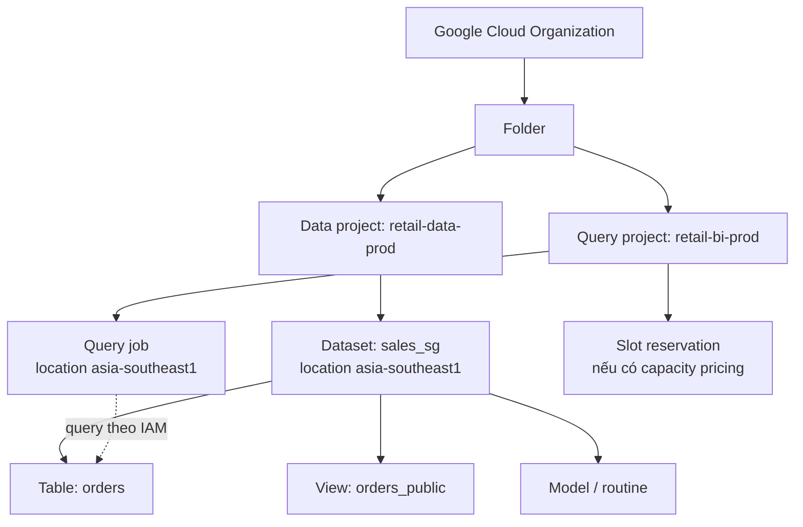

# Projects, datasets, tables và vị trí dữ liệu BigQuery

Một ứng dụng Java trên Cloud Run ở Singapore phát sinh đơn hàng, bộ phận BI chạy truy vấn từ project riêng, còn nhóm tuân thủ yêu cầu dữ liệu phân tích phải lưu tại vị trí được phê duyệt. Nếu chọn nhầm dataset location là `US`, chỉ thay region của Cloud Run **không chuyển dữ liệu BigQuery về Singapore**. Để thiết kế đúng, cần hiểu **project nào chứa dữ liệu**, **dataset nào đặt vị trí**, **bảng thuộc dataset nào** và **job thực thi ở đâu**.

Bài thuộc chương **BigQuery** của module **CLOUD_PROVIDERS_GCP**, nối kiến thức tổ chức project, IAM, Cloud Run/GKE, dịch vụ lưu trữ/cơ sở dữ liệu với triển khai, bảo vệ dữ liệu, kiểm soát độ tin cậy và chi phí. Trọng tâm là cấu trúc tài nguyên và **regional/multi-region locations**; partitioning và clustering được giới thiệu ở mức đủ để thực hành.

> Tên project, dataset, table và số liệu trong bài chỉ là ví dụ. Tạo hoặc xóa dữ liệu, chạy query, di chuyển dataset có thể phát sinh phí hoặc mất dữ liệu. Chỉ thực hành trên project được cấp phép, không dùng thông tin khách hàng thật. Các tính năng liên vùng ở **Preview** phải được kiểm tra trạng thái hỗ trợ trước khi dùng.

## Mục tiêu

Sau bài này, bạn có thể:

1. Phân biệt **organization/folder/project**, **dataset**, **table/view**, **job** và **reservation**.
2. Đọc đúng identifier `project.dataset.table` trong GoogleSQL và `project:dataset.table` trong `bq`.
3. Chọn region hoặc `US`/`EU` dựa trên residency, locality, độ trễ, quota và chi phí, không nhầm multi-region với sao chép xuyên region.
4. Giải thích job location, giới hạn kết hợp dữ liệu ở các locations và ngoại lệ **global queries Preview**.
5. Tạo dataset regional, table partitioned/clustered, nạp dữ liệu giả và chạy query bằng `bq`/SQL.
6. Xem metadata trong Console, `bq show`, `INFORMATION_SCHEMA` và Java client.
7. Phân quyền riêng cho **query/execution project** và **data project**; kiểm tra chi phí và lập kế hoạch chuyển dữ liệu.

## 1. Cây tài nguyên BigQuery



| Tài nguyên | Vai trò | Thuộc tính vị trí |
| --- | --- | --- |
| **Organization/folder** | Quản trị chính sách/IAM kế thừa | Không phải vị trí dữ liệu của table |
| **Project** | Billing, quotas, APIs, IAM, tài nguyên dữ liệu hoặc query jobs | **Không có một BigQuery region duy nhất** |
| **Dataset** | Container của tables, views, models, routines; ranh giới phân quyền/retention | **`location` chọn khi tạo** |
| **Table/view** | Dữ liệu vật lý hoặc truy vấn logic | Thuộc dataset và kế thừa location |
| **Job** | Query/load/copy/extract; có project, ID và location | Phải tương thích với resources/job type |
| **Reservation/slots** | Công suất tính toán capacity-based | Gắn với location; không tự áp cho mọi region |

Một **project có thể chứa nhiều datasets ở nhiều locations**. Mỗi dataset gắn với một project và một location chính, ngoại trừ tính năng **cross-region replication** được cấu hình rõ ràng. Một table thường thuộc **đúng một dataset**; không thể đặt một table ở Singapore và table khác ở Tokyo trong cùng dataset.

### Định danh và ranh giới billing

```text
GoogleSQL:  `retail-data-prod.sales_sg.orders`
             project        dataset table

bq CLI:    retail-data-prod:sales_sg.orders
REST:      projects/retail-data-prod/datasets/sales_sg/tables/orders
```

Trong GoogleSQL, identifier có project ID chứa dấu gạch nối nên đặt trong **backticks**. `retail-bi-prod` có thể tạo job truy vấn bảng trong `retail-data-prod` nếu IAM cho phép, nhưng **không làm bảng chuyển project hay region**.

Với mô hình on-demand, **storage** thường tính ở project chứa bảng, trong khi **query processing** tính ở project chạy job. Với reservations/capacity, chi phí theo mô hình/assignment/location liên quan. Đội ngũ dùng một project cho lab nhỏ hoặc tách **data project**, **compute/query project**, **dev/staging/prod projects** khi cần quản trị ngân sách và bảo mật.

## 2. Dataset: đơn vị tổ chức và đặt dữ liệu

Khi tạo dataset, cần xác định:

| Thuộc tính | Ví dụ | Tác động |
| --- | --- | --- |
| Dataset ID | `sales_sg` | Duy nhất trong project; không đổi tên trực tiếp |
| Location | `asia-southeast1` | Vị trí lưu BigQuery core customer data; **không sửa trực tiếp sau khi tạo** |
| Default table expiration | 7 ngày trong lab | Mặc định cho **bảng mới**; bảng hết hạn bị xóa |
| Time travel / retention | Theo chính sách và giới hạn | Khôi phục dữ liệu lịch sử trong window; không thay backup/DR |
| Access policies | Data viewer/editor, authorized views | IAM cho dataset/table, bảo mật cột/hàng khi cần |
| Labels/tags | `env=dev`, `team=analytics` | Tổ chức, governance, lọc báo cáo chi phí |

**Không thể đổi trực tiếp tên hoặc location của dataset đã tạo.** Muốn chuyển `sales_sg` từ Singapore sang Tokyo, cần tạo dataset mới ở Tokyo rồi **copy/migrate/recreate** dữ liệu, views, permissions, jobs và các phụ thuộc theo quy trình được hỗ trợ; không có một câu `ALTER SCHEMA SET LOCATION` áp dụng ngay cho dataset hiện có.

### Những đối tượng thường gặp trong dataset

| Đối tượng | Dữ liệu và đặc tính |
| --- | --- |
| **Native table** | BigQuery quản lý storage; có schema, partition/clustering và expiration |
| **View** | Định nghĩa SQL, thường không lưu toàn bộ kết quả; vẫn có dataset/location |
| **Materialized view** | Lưu kết quả được quản lý, có chính sách refresh và chi phí riêng |
| **External/BigLake table** | Dữ liệu tại nguồn ngoài; colocation/permissions và transfer cần kiểm tra |
| **Model/routine** | Tài nguyên phân tích khác thuộc dataset, có giới hạn location/permissions theo loại |

**Partition** (ví dụ chia bảng theo ngày) và **cluster** (tổ chức dữ liệu theo cột) không thay đổi region hay tạo bản sao xuyên vùng. Chúng chỉ giúp tối ưu quét dữ liệu, truy vấn và thời hạn lưu trữ.

## 3. Region và multi-region không phải một

BigQuery hỗ trợ **regions** như `asia-southeast1` (Singapore), `asia-northeast1` (Tokyo), `europe-west4` (Netherlands), và **multi-region identifiers** `US`, `EU`.

| Location | Ý nghĩa | Trường hợp thường chọn |
| --- | --- | --- |
| `asia-southeast1` | Một region ở Singapore | Ingestion và analytics gần Cloud Run/GCS Singapore |
| `asia-northeast1` | Một region ở Tokyo | Nhu cầu data residency/traffic ở Nhật |
| `US` | BigQuery chọn **một region bên trong Mỹ** | Quy định lưu trú trong phạm vi US |
| `EU` | BigQuery chọn **một region trong EU** | Quy định lưu trú BigQuery Core Customer Data tại EU |

**Quan trọng:** `US`/`EU` trong BigQuery **không tự tạo redundancy xuyên nhiều regions**. Theo tài liệu location hiện hành, BigQuery lưu và nhân bản data **ở hai zones trong một region** bên trong location; muốn phục hồi khi cả region mất cần phương án **managed DR, dataset replication** hoặc kiến trúc dự phòng được thiết kế/kiểm thử riêng.

```text
Dataset A: location = US
Dataset B: location = us-central1

US có thể chứa một region ở Iowa về mặt địa lý,
nhưng trong BigQuery US != us-central1 (hai resource locations).

Tương tự EU != europe-west4.
```

Không chọn region chỉ dựa vào nơi người quản trị đang ngồi. Trước khi tạo dataset, cân nhắc:

- **Residency/compliance** của dữ liệu, logs, export, backup, CMEK, replica và nơi xử lý.
- **Nguồn/đích** Cloud Storage, Cloud Run/GKE, Dataflow/Spark, BI tools, Cloud SQL/Spanner federation.
- **Latency/băng thông/transfer fees**, yêu cầu đối với external datasets và region-specific product support.
- **Compute capacity**: slots/reservations theo location, quota và budgets.
- **RTO/RPO**: multi-region label không phải DR guarantee; cần kế hoạch sự cố vùng riêng.

Đối với Cloud Storage, quy tắc colocation giữa **GCS regional/dual/multi-region bucket** và BigQuery dataset có khác biệt giữa **load** và **external table queries**. Ví dụ bucket trong cùng quốc gia chưa chắc đã tránh toàn bộ data transfer charges; xem tài liệu địa điểm của hai dịch vụ và ước tính chi phí trước khi thiết kế pipeline.

## 4. Query job location và dữ liệu liên vùng

Job có `projectId`, `jobId` và `location`. Với **query thông thường**, location của job phải tương thích với **mọi dataset nguồn/đích**. Chỉ cần một `FROM` trỏ dataset khác region là có thể lỗi, dù câu SQL đúng.

| Cấu hình | Location | Kết luận cho query thông thường |
| --- | --- | --- |
| Table A | `asia-southeast1` | Đọc tại Singapore |
| Table B | `asia-southeast1` | JOIN với A hợp lệ về location |
| Query job | `asia-southeast1` | Đặt tường minh để tránh mặc định sai |
| Table C | `US` | Không cùng location; không JOIN thông thường với A |
| Reservation | `asia-southeast1` | Chỉ có tác dụng cho jobs/assignments đúng location |

**Đặt location:** BigQuery Studio → Query settings; `bq query --location=asia-southeast1`; API job reference; Java `JobId`. Trong script GoogleSQL có thể đặt `SET @@location = 'asia-southeast1';` làm statement đầu tiên theo cú pháp áp dụng. Nếu không chọn location, BigQuery suy từ resources/destination/connection, sau đó dùng project default; nếu chưa có default và không suy ra được có thể chọn `US`.

### Ngoại lệ: global queries (Preview)

Theo tài liệu mới, **global queries Preview** cho phép truy vấn giữa **nhiều regions** khi organization/project đã bật và caller có permission riêng. Nó **không** khiến location constraints biến mất đối với mọi project:

1. Project chạy job cần bật **global query execution** ở region thực thi; data projects/regions cần cho phép **global data access**.
2. Caller cần `bigquery.jobs.createGlobalQuery` ngoài quyền query/data thông thường.
3. Dữ liệu/trung gian có thể **được chuyển tạm thời qua region khác**; đánh giá residency, transfer fees, permissions và giới hạn tính năng.
4. Không bật Preview trên production chỉ để tránh thiết kế colocation; ưu tiên dữ liệu đồng vị trí hoặc copy/pipeline có governance rõ.

### Kiểm tra metadata đúng vùng

Query `INFORMATION_SCHEMA` cần qualifier đúng region, ví dụ:

```sql
-- Chạy với job location asia-southeast1.
SELECT schema_name, location, creation_time
FROM `retail-dev-01.region-asia-southeast1.INFORMATION_SCHEMA.SCHEMATA`
WHERE schema_name = 'sales_sg_lab';
```

Dataset `INFORMATION_SCHEMA.TABLES` cho biết bảng/view trong dataset; metadata views không tự đổi vị trí dữ liệu. Với khả năng sao chép region mới, có thể xem thêm replication/sync status khi đã cấu hình.

## 5. Lab: tạo dataset Singapore và bảng đơn hàng

Lab dùng **Cloud Shell/Bash**, BigQuery API đã bật, project `retail-dev-01` được phép tính phí và người thực hiện có quyền tạo dataset/table/jobs. Thay mọi giá trị ví dụ trước khi chạy. **Không thực thi trên data project production**.

### 5.1 Preflight chỉ đọc

```bash
PROJECT_ID="retail-dev-01"
DATASET_ID="sales_sg_lab"
TABLE_ID="orders"
LOCATION="asia-southeast1"

gcloud auth list
gcloud config get-value project
gcloud services list --enabled --project="$PROJECT_ID" \
  --filter="config.name:bigquery.googleapis.com"
bq ls --project_id="$PROJECT_ID"
```

Nếu API chưa được bật, người có quyền Service Usage phải bật `bigquery.googleapis.com`. Vai trò **`roles/bigquery.user`** có quyền tạo dataset trong project; để tạo table và chạy job còn cần các permissions theo scope cụ thể. Không cấp `roles/owner` chỉ để vượt lỗi.

### 5.2 Tạo dataset ở region rõ ràng

```bash
# THAY ĐỔI tài nguyên; có thể phát sinh chi phí khi lưu/đọc dữ liệu.
bq mk --dataset \
  --location="$LOCATION" \
  --description="BigQuery Singapore training dataset" \
  "$PROJECT_ID:$DATASET_ID"

# READ-ONLY: xác nhận location và danh sách tables.
bq show --format=prettyjson "$PROJECT_ID:$DATASET_ID"
bq ls "$PROJECT_ID:$DATASET_ID"
```

Output mong đợi chứa `"location": "asia-southeast1"`. Dataset cùng tên đã tồn tại nhưng ở location khác thì **không ghi đè hay xóa để sửa**; dùng tên lab mới hoặc quy trình migration.

### 5.3 Tạo table partitioned + clustered

```bash
# THAY ĐỔI TABLE. Phải sửa project/dataset literal trong SQL
# nếu PROJECT_ID hoặc DATASET_ID phía trên đã được thay.
bq query --project_id="$PROJECT_ID" --location="$LOCATION" \
  --use_legacy_sql=false \
  'CREATE TABLE IF NOT EXISTS `retail-dev-01.sales_sg_lab.orders` (
     order_id STRING NOT NULL,
     tenant_id STRING NOT NULL,
     amount_minor INT64 NOT NULL,
     status STRING,
     created_at TIMESTAMP NOT NULL
   )
   PARTITION BY TIMESTAMP_TRUNC(created_at, DAY)
   CLUSTER BY tenant_id
   OPTIONS (
     require_partition_filter = TRUE,
     description = "Lab orders partitioned by day and clustered by tenant"
   )'

bq show --format=prettyjson "$PROJECT_ID:$DATASET_ID.$TABLE_ID"
```

**Giải thích:** partition chia dữ liệu theo ngày từ `created_at`; cluster theo `tenant_id` để giúp giới hạn lượng data scan khi filter tenant; `require_partition_filter=TRUE` buộc các truy vấn có lọc phân vùng. Không yếu tố nào trong ba thiết lập đó tạo **region thứ hai**, sao chép data hoặc thay IAM.

### 5.4 Chèn hai đơn giả và truy vấn

```bash
# THAY ĐỔI data; ngày cố định giúp lab có kết quả tái lập.
bq query --project_id="$PROJECT_ID" --location="$LOCATION" \
  --use_legacy_sql=false \
  'INSERT INTO `retail-dev-01.sales_sg_lab.orders`
    (order_id, tenant_id, amount_minor, status, created_at)
   VALUES
    ("ord-1001", "tenant-a", 145000, "PAID",
      TIMESTAMP "2026-11-19 02:00:00+00"),
    ("ord-1002", "tenant-b", 99000, "PAID",
      TIMESTAMP "2026-11-19 03:00:00+00")'

# Dry-run: kiểm tra query/ước lượng bytes, không chạy query đọc.
bq query --project_id="$PROJECT_ID" --location="$LOCATION" \
  --use_legacy_sql=false --dry_run \
  'SELECT tenant_id, SUM(amount_minor) AS amount_minor
   FROM `retail-dev-01.sales_sg_lab.orders`
   WHERE created_at >= TIMESTAMP "2026-11-19 00:00:00+00"
     AND created_at < TIMESTAMP "2026-11-20 00:00:00+00"
     AND tenant_id = "tenant-a"
   GROUP BY tenant_id'

# THỰC THI query với ngưỡng bytes tối đa để bảo vệ ngân sách lab.
bq query --project_id="$PROJECT_ID" --location="$LOCATION" \
  --use_legacy_sql=false --maximum_bytes_billed=1000000000 \
  'SELECT tenant_id, COUNT(*) AS order_count,
          SUM(amount_minor) AS amount_minor
   FROM `retail-dev-01.sales_sg_lab.orders`
   WHERE created_at >= TIMESTAMP "2026-11-19 00:00:00+00"
     AND created_at < TIMESTAMP "2026-11-20 00:00:00+00"
     AND tenant_id = "tenant-a"
   GROUP BY tenant_id'
```

Nếu chạy một lần trên bảng vừa tạo, kỳ vọng `tenant-a` có **1 đơn, 145000 đơn vị tiền nhỏ nhất**. INSERT sẽ chèn thêm nếu chạy lại; khi thực hành lại hãy dùng dataset mới hoặc dọn test có kiểm soát để không nhầm kết quả. `--dry_run` và `--maximum_bytes_billed` chỉ giúp quản lý phí **query processing**, không giới hạn mọi phí lưu trữ, load, write, export, external transfer hoặc reservations.

### 5.5 Xem metadata bằng `INFORMATION_SCHEMA`

```bash
# READ-ONLY metadata ở region Singapore.
bq query --project_id="$PROJECT_ID" --location="$LOCATION" \
  --use_legacy_sql=false \
  'SELECT schema_name, location, creation_time
   FROM `retail-dev-01.region-asia-southeast1.INFORMATION_SCHEMA.SCHEMATA`
   WHERE schema_name = "sales_sg_lab"'

bq query --project_id="$PROJECT_ID" --location="$LOCATION" \
  --use_legacy_sql=false \
  'SELECT table_name, table_type, creation_time
   FROM `retail-dev-01.sales_sg_lab.INFORMATION_SCHEMA.TABLES`
   WHERE table_name = "orders"'
```

`INFORMATION_SCHEMA.SCHEMATA` (region-qualified) và `INFORMATION_SCHEMA.TABLES` không trả về rows của bảng đơn hàng, chỉ metadata. Một dataset ở `US` phải được kiểm tra qua **`region-us`**, không phải `region-asia-southeast1`. Nếu caller chỉ được xem một số datasets/tables, metadata trả về cũng chịu IAM và visibility constraints.

### 5.6 Dọn lab đúng tài nguyên

```bash
# DỪNG lại kiểm tra ID và quyền sở hữu trước khi xóa.
bq show --format=prettyjson "$PROJECT_ID:$DATASET_ID"
bq ls "$PROJECT_ID:$DATASET_ID"

# Chỉ trên dataset LAB, dữ liệu không còn cần giữ:
# bq rm --table --force "$PROJECT_ID:$DATASET_ID.$TABLE_ID"
# bq rm --dataset --force "$PROJECT_ID:$DATASET_ID"
```

Lệnh xóa được **comment** cố ý. Không xóa dataset chứa tài nguyên thuộc người khác, không dùng `--recursive` trên production để “sửa” một lỗi location. Kiểm tra bills/retention sau khi dọn.

## 6. Java SDK: chỉ định data project và job location

Trên Cloud Run/GKE, Java dùng **`com.google.cloud:google-cloud-bigquery`** (phiên bản do Google Cloud Libraries BOM quản lý) với **Application Default Credentials (ADC)** từ attached service account/Workload Identity. Không lưu service account JSON key trong repo hoặc biến frontend.

Ví dụ dưới đây **chỉ đọc** table lab đã được tạo và dùng project thực thi có thể khác project chứa bảng:

```java
import com.google.cloud.bigquery.BigQuery;
import com.google.cloud.bigquery.BigQueryOptions;
import com.google.cloud.bigquery.FieldValueList;
import com.google.cloud.bigquery.JobId;
import com.google.cloud.bigquery.QueryJobConfiguration;
import com.google.cloud.bigquery.TableResult;

public final class QueryOrdersByLocation {
  public static void main(String[] args) throws Exception {
    String jobProject = "retail-bi-dev";     // Project tính query/job.
    String dataProject = "retail-dev-01";   // Project chứa dataset.
    String region = "asia-southeast1";     // Dataset và job cùng location.

    BigQuery bq = BigQueryOptions.newBuilder()
        .setProjectId(jobProject)
        .build()
        .getService(); // ADC từ runtime identity.

    String sql = "SELECT tenant_id, COUNT(*) AS n "
        + "FROM `" + dataProject + ".sales_sg_lab.orders` "
        + "WHERE created_at >= TIMESTAMP '2026-11-19 00:00:00+00' "
        + "AND created_at < TIMESTAMP '2026-11-20 00:00:00+00' "
        + "GROUP BY tenant_id";

    QueryJobConfiguration cfg = QueryJobConfiguration.newBuilder(sql)
        .setUseLegacySql(false)
        .setMaximumBytesBilled(1_000_000_000L)
        .build();

    // JobId có location rõ ràng, cần thiết với non-US/EU locations.
    JobId jobId = JobId.newBuilder()
        .setProject(jobProject)
        .setLocation(region)
        .setRandomJob()
        .build();

    TableResult result = bq.query(cfg, jobId);
    for (FieldValueList row : result.iterateAll()) {
      System.out.println(row.get("tenant_id").getStringValue()
          + " = " + row.get("n").getLongValue());
    }
  }
}
```

**Để chạy được:** project `retail-bi-dev` phải tồn tại, caller có quyền tạo jobs ở project đó, và runtime SA có quyền đọc bảng `retail-dev-01.sales_sg_lab.orders`. Ví dụ Java dùng dataset/table từ lab, nên không chạy nếu lab chưa tạo hoặc dữ liệu đã dọn. Trong ứng dụng thật, **dùng query parameters** cho giá trị nhận từ người dùng, không ghép trực tiếp tenant ID, input SQL hoặc tên bảng do client điều khiển.

## 7. IAM: ai tạo job, ai đọc dữ liệu?

### Hai quyền độc lập

Ví dụ Cloud Run SA `sa-bi@retail-bi-dev.iam.gserviceaccount.com` đọc dataset ở project khác:

| Nơi cấp | Quyền/role gợi ý | Dùng để làm gì? |
| --- | --- | --- |
| **Query project** `retail-bi-dev` | `roles/bigquery.jobUser` | Tạo jobs (`bigquery.jobs.create`) |
| **Data project/dataset** `retail-dev-01.sales_sg_lab` | `roles/bigquery.dataViewer` trên dataset hoặc table | Đọc schema/data (`bigquery.tables.getData`) |
| **Data project/dataset** khi cần ghi | `roles/bigquery.dataEditor` hoặc role/custom permission tối thiểu | Tạo/cập nhật tables đúng phạm vi |
| **Dataset creator** | `bigquery.datasets.create` (ví dụ `roles/bigquery.user` ở project) | Tạo dataset mới; không mặc định cần Admin toàn project |
| **Quản trị** | Quyền IAM/BigQuery phù hợp | Quản lý policy, location, transfers và bảo mật |

**`roles/bigquery.jobUser` một mình không đọc được dữ liệu** của dataset riêng. Ngược lại, `dataViewer` trên bảng mà **không có `jobs.create` ở execution project** có thể vẫn không chạy được SQL job thông thường. IAM ở project/folder có thể **kế thừa**, vì thế cấp `dataViewer` trên toàn data project thường rộng hơn cần thiết.

### Bảo vệ ở cấp bảng/hàng/cột

- Dataset/table IAM để cấp quyền tổng thể theo vai trò.
- **Row-level access policies** để người dùng/nhóm chỉ thấy các rows được phép, không tin query `WHERE tenant_id=...` do client tự chọn là biện pháp authorization.
- **Column-level security/policy tags/data masking** để che cột PII.
- Authorized views/datasets, audit logs, CMEK và org policy location restrictions khi phù hợp.

Đừng coi việc tạo dataset ở EU là đủ tuân thủ pháp luật: query exports, external tables, logs, regional reservations, credentials và replication policies cũng cần đánh giá. Với các thao tác nhạy cảm, phân tách service account cho ingest, transform và read-only BI.

## 8. Chuyển dataset location: copy không phải đổi thuộc tính

Vì dataset location cố định, chuyển từ `asia-southeast1` sang `asia-northeast1` thường gồm:

1. **Khảo sát:** liệt kê tables, partitioning, clustering, views, routines, scheduled queries, transfers, connections, IAM, row/column policies, encryption và downstream consumers.
2. **Tạo dataset mới** tại location đích; đánh giá data residency, org policies, transfer fees, quota và budgets.
3. **Chuyển dữ liệu** bằng dataset copy/cross-region copy hỗ trợ (BigQuery Data Transfer Service) hoặc phương án export/load/recreate; những loại resource không được copy tự động cần xử lý riêng.
4. **Đối soát:** row counts, checksums/aggregates, time windows, schema/table metadata, tests về quyền và số liệu tài chính.
5. **Chuyển luồng đọc/ghi** có kiểm soát: cập nhật SQL references, job locations, BI dashboards, CI/IaC, scheduled jobs và service accounts.
6. **Giữ rollback** trong thời gian xác định, theo dõi jobs lỗi/chi phí và dữ liệu đến trễ; chỉ xóa dataset cũ sau khi đã duyệt.

### Ba phương án không giống nhau

| Cách làm | Điểm mạnh | Giới hạn |
| --- | --- | --- |
| **Dataset copy** qua BigQuery Data Transfer Service | Tự động copy nhiều bảng/partitions, hỗ trợ một số cặp locations | Có **giới hạn loại tài nguyên**, beta/Pre-GA và không tự cutover consumers |
| **Recreate + export/load** | Kiểm soát mapping/schema/biến đổi dữ liệu | Tốn pipeline, cần GCS staging phù hợp location/transfer |
| **Cross-region dataset replication/managed DR** | Duy trì bản sao để phục hồi/đổi primary khi đủ điều kiện | Không phải thay đổi đơn giản `location` của dataset; có phí/quota/failover rules |

**Không tự tin rằng `bq cp` trên tables sẽ copy tự do qua mọi region.** Copy jobs thông thường có location constraints; kiểm tra công cụ cross-region copy/replication chính thức. Tránh dùng một global query Preview thay cho quy trình data migration lâu dài nếu có residency hoặc audit constraints.

## 9. Quan sát, tối ưu chi phí và xử lý sự cố

| Tín hiệu | Nơi xem | Mục đích |
| --- | --- | --- |
| Dataset/table location | BigQuery Studio, `bq show`, `INFORMATION_SCHEMA.SCHEMATA` | Phát hiện dataset đặt sai region |
| Query job location/status | Jobs Explorer, `bq show -j`, `INFORMATION_SCHEMA.JOBS` | Lỗi location, quota và jobs thất bại |
| Bytes processed/billed, slot-ms | Job statistics/Cloud Monitoring/Billing | Cost drivers của query |
| Storage active/long-term | Dataset/table storage metadata, Billing | Giữ dữ liệu và retention |
| Reservation utilization | Capacity management theo region | Tránh job rơi về on-demand không dự kiến |
| Cross-region copy/replication | Transfer runs, replication sync status | Theo dõi độ trễ và phí dữ liệu liên vùng |
| Unauthorized queries | Cloud Audit Logs, IAM | Phân biệt `jobs.create` với `tables.getData` |

### Các nguyên nhân lỗi thường gặp

| Triệu chứng | Nguyên nhân khả dĩ | Hướng kiểm tra |
| --- | --- | --- |
| `Dataset not found in location US` | Dataset nằm Singapore nhưng job location là US | `bq show` dataset, `--location` và job reference |
| `US` và `us-central1` JOIN không chạy | Hai **resource locations** khác nhau | Colocate/copy; Preview global queries chỉ khi đã bật/đủ quyền |
| Java query chạy mặc định sai region | `JobId` thiếu location hoặc project default sai | `JobId.setLocation`, query project và dataset metadata |
| 403 khi tạo job | Thiếu `bigquery.jobs.create` ở execution project | `roles/bigquery.jobUser` đúng nơi |
| 403 khi đọc table | Thiếu `tables.getData` trên data project/dataset | `dataViewer` scope hẹp, policy tags/row restrictions |
| Reservation có nhưng job vẫn on-demand | Reservation location/assignment không khớp | Location của reservation, query job và edition |
| Dataset EU nhưng GCS source xa region | Transfer/data-access locality khác nhau | Bucket location, external/load charges và chính sách |
| Delete/copy làm thiếu views/permissions | Không phải mọi dataset resources được tự động mang theo | Migration inventory, diff metadata và cutover tests |
| P95 query cao và bill tăng | Full scan, thiếu partition filter, cluster sai | Dry run, bytes billed, partition pruning, query plan |

### Thực hành vận hành an toàn

1. Ghi đúng `job_project`, `data_project`, `dataset_location`, SQL và job ID khi báo lỗi.
2. Xem dataset metadata trước khi thay cấu hình query, IAM hoặc GCS bucket.
3. Dùng `--dry_run`, `--maximum_bytes_billed`, partition filters, quotas và Budget Alerts.
4. Với dữ liệu ở nhiều vùng, kiểm tra quyền **được chuyển dữ liệu ra khỏi location** trước khi bật global query/transfer.
5. Sau thay đổi, so sánh bytes/slot-ms, kết quả SQL, latency p95 và phí theo labels/project.

## 10. Case study: data project Singapore, BI project ở Nhật

Đội retail dùng Cloud Run tại Singapore ghi dữ liệu đơn vào `retail-data-prod.sales_sg.orders` (location `asia-southeast1`). Nhóm BI có project riêng `retail-bi-prod` và trụ sở tại Tokyo.

**Thiết kế đúng:** BI job được tạo trong `retail-bi-prod` với **location `asia-southeast1`**, SA BI được `jobUser` trên project BI và `dataViewer` trên dataset nguồn. **Vị trí người phân tích ở Tokyo không yêu cầu đặt query job tại Tokyo**. Nếu cố chạy job ở `asia-northeast1` với table Singapore, query thông thường thất bại vì location mismatch.

Về lâu dài, nếu BI đọc lượng dữ liệu rất lớn nhiều lần từ Nhật và residency cho phép, có thể đánh giá **một dataset được copy/quản trị ở Tokyo** hoặc kiến trúc cross-region phù hợp. Nhưng copy dữ liệu không tự đồng bộ mọi thay đổi; phải thiết kế lịch chuyển, incremental updates, data freshness SLO, IAM và chi phí trước.

## 11. Bài tập tự kiểm tra

### Bài 1 — Cấu trúc tài nguyên

Trong `retail-data-prod.sales_sg.orders`, đâu là project, dataset và table?

<details>
<summary>Đáp án</summary>

`retail-data-prod` là project, `sales_sg` là dataset và `orders` là table. Tên SQL khác cú pháp `retail-data-prod:sales_sg.orders` của `bq`.
</details>

### Bài 2 — Chọn nơi lưu

Cloud Run ở Singapore, hầu hết ingest và phân tích cũng ở Singapore, không có yêu cầu US residency. Nên xem xét location nào trước?

<details>
<summary>Gợi ý đáp án</summary>

`asia-southeast1` là lựa chọn hợp lý để đánh giá đầu tiên vì locality. Vẫn phải kiểm tra pháp lý, GCS bucket, data pipelines, feature support và chi phí. Không có location đúng cho mọi công ty.
</details>

### Bài 3 — Multi-region có DR tự động?

Dataset có location `EU`. Có chắc BigQuery nhân bản dữ liệu sang nhiều regions để ứng dụng chịu mất cả region không?

<details>
<summary>Đáp án</summary>

Không. BigQuery `EU` tự chọn một region trong EU và lưu dữ liệu với zonal redundancy; cross-region DR cần replication/managed DR riêng và thử quy trình failover.
</details>

### Bài 4 — Job ở region khác

Dataset `asia-southeast1`; job chạy `US`. Chỉ sửa table identifier có giải quyết không?

<details>
<summary>Đáp án</summary>

Không. Với query thông thường phải chọn job location phù hợp dataset (`asia-southeast1`), hoặc dùng kiến trúc đặc biệt được hỗ trợ như global queries Preview khi đã bật/đủ quyền và được phép di chuyển dữ liệu.
</details>

### Bài 5 — Hai project, hai quyền

SA có `roles/bigquery.jobUser` tại project BI nhưng chưa có quyền trên bảng nguồn. Query có tự đọc được không?

<details>
<summary>Đáp án</summary>

Không. `jobUser` cho tạo jobs, không tự cấp quyền đọc table ở project khác. Cần `dataViewer` hoặc quyền dữ liệu tương đương trên dataset/table nguồn.
</details>

### Bài 6 — Table partition và dataset location

Thêm `PARTITION BY created_at` có làm bảng Singapore chia sang Nhật không?

<details>
<summary>Đáp án</summary>

Không. Partition theo thời gian tổ chức dữ liệu trong cùng table/dataset; location của dataset không đổi. Cú pháp SQL đúng cho `TIMESTAMP` là `PARTITION BY TIMESTAMP_TRUNC(created_at, DAY)`.
</details>

### Bài 7 — Dataset copy/move

DBA muốn đổi location của dataset hiện có từ Singapore sang Tokyo chỉ với `ALTER SCHEMA`. Nhận định đúng không?

<details>
<summary>Đáp án</summary>

Không. Location cố định từ khi tạo; phải tạo dataset đích và copy/migrate, kiểm tra schema/views/IAM, đổi job references/locations, giữ rollback, xét phí và residency.
</details>

### Bài 8 — Chi phí query

Vì sao `SELECT *` thiếu partition filter có thể làm tăng phí và `--dry_run` hữu ích?

<details>
<summary>Đáp án</summary>

BigQuery có thể quét nhiều bytes/partitions, làm tăng on-demand query processing hoặc dùng thêm slots. `--dry_run` kiểm tra SQL và ước lượng bytes trước khi thực thi; giới hạn scan còn phụ thuộc partitioning, clustering và filters.
</details>

### Bài 9 — Global queries Preview

Một người muốn bật global queries để JOIN dữ liệu US và EU. Nêu ít nhất hai việc phải duyệt.

<details>
<summary>Gợi ý đáp án</summary>

Quyền `bigquery.jobs.createGlobalQuery` và bật execution/data-access theo project/region, **residency**, dữ liệu tạm có thể chuyển qua vùng khác, transfer cost, feature limits và governance phê duyệt.
</details>

## 12. Checklist trước production

- [ ] Sơ đồ tổ chức/project/dataset/table và vai trò của data vs job project được ghi rõ.
- [ ] Dataset IDs, labels, retention và IAM được quản lý bằng IaC/change approval.
- [ ] Location chọn từ dữ liệu/traffic/residency/quotas/chi phí, **đặt tường minh khi tạo**.
- [ ] Biết `US`/`EU` không tự nhân bản qua regions để làm DR.
- [ ] Job locations, reservations, datasets nguồn/đích và external sources được đối chiếu.
- [ ] Không dùng global queries Preview khi chưa có approvals cho cross-region data movement.
- [ ] IAM tách `jobUser` trên execution project với `dataViewer/editor` trên dataset/table.
- [ ] Dữ liệu nhạy cảm có row/column security, policy tags, audit và controls được thử nghiệm.
- [ ] Query workloads có dry-run, maximum bytes billed, partition/clustering, budgets/alerts.
- [ ] Chuyển location có migration inventory, dữ liệu đối soát, rollback và monitoring.
- [ ] Job/slots/BigQuery storage/transfer/DR costs được theo dõi theo project/location.
- [ ] Lab/production có runbook dọn tài nguyên, không xóa nhầm dataset.

## Tài liệu tham khảo chính thức

- [BigQuery resource hierarchy](https://cloud.google.com/bigquery/docs/resource-hierarchy): organization, project, dataset/table và quan hệ quota/billing.
- [Introduction to datasets](https://cloud.google.com/bigquery/docs/datasets-intro): dataset objects, location, retention và replication.
- [Create datasets](https://cloud.google.com/bigquery/docs/datasets): tạo dataset, location bất biến.
- [BigQuery locations](https://cloud.google.com/bigquery/docs/locations): region, `US/EU`, job location, colocations, reservations.
- [Global queries — Preview](https://cloud.google.com/bigquery/docs/global-queries): truy vấn liên vùng, quyền riêng, residency và chi phí.
- [Manage datasets](https://cloud.google.com/bigquery/docs/managing-datasets): copy/recreate/migrate location.
- [Create partitioned tables](https://cloud.google.com/bigquery/docs/creating-partitioned-tables): partition, cluster và filter.
- [Run BigQuery queries](https://cloud.google.com/bigquery/docs/running-queries): `bq query`, dry-run và job settings.
- [INFORMATION_SCHEMA.SCHEMATA](https://cloud.google.com/bigquery/docs/information-schema-datasets-schemata): metadata dataset theo region.
- [BigQuery IAM roles](https://cloud.google.com/bigquery/docs/access-control): `jobUser`, `dataViewer`, resource-level IAM.
- [Java BigQuery API](https://cloud.google.com/java/docs/reference/google-cloud-bigquery/latest/com.google.cloud.bigquery.BigQuery): query with location-qualified `JobId`.
- [BigQuery pricing](https://cloud.google.com/bigquery/pricing) và [Cost control](https://cloud.google.com/bigquery/docs/control-costs): bytes, slots, storage và budgets.


