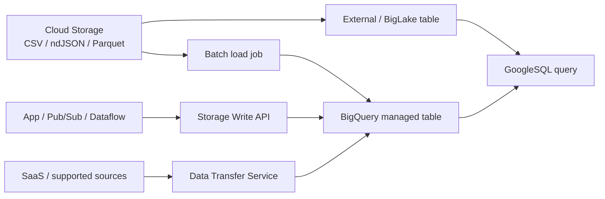

# Load jobs, external tables và lựa chọn nạp dữ liệu

Một hệ thống thương mại điện tử ghi sự kiện đơn hàng vào **Cloud Storage** mỗi giờ. Nhóm vận hành muốn làm báo cáo BigQuery nhanh, ít tốn chi phí; đội phân tích lại muốn đọc các file Parquet vừa xuất mà chưa cần tạo pipeline ETL. **BigQuery** có nhiều cách tiếp nhận dữ liệu: **batch load jobs**, **external tables**, **BigLake**, **streaming Storage Write API** và **Data Transfer Service**. Quyết định đúng phụ thuộc độ trễ, tần suất truy vấn, định dạng, quản trị quyền và tổng chi phí.

Bài thuộc chương **BigQuery** của module `CLOUD_PROVIDERS_GCP`. Người học vận dụng kiến thức Cloud Storage, IAM, Cloud Run/GKE và Pub/Sub để chọn cách nạp dữ liệu, bảo vệ tài nguyên, tự động hóa phát hành pipeline, theo dõi độ tin cậy và chi phí. Các tài nguyên ví dụ là giả định; lệnh tạo/ghi/xóa hạ tầng có thể phát sinh phí, chỉ dùng trong sandbox được phép.

## 1. Mục tiêu học tập

Sau bài này, bạn có thể:

1. Phân biệt **BigQuery managed (native) table**, **load job**, **external table**, **BigLake** và **streaming ingestion**.
2. Chọn CSV, newline-delimited JSON, Avro, Parquet hoặc ORC theo dữ liệu và schema.
3. Thực hiện **`bq load`**, kiểm tra job/schema, append/overwrite và xử lý dữ liệu lỗi.
4. Tạo **Cloud Storage external table** bằng SQL hoặc `bq mkdef`, hiểu giới hạn quyền và hiệu năng.
5. Dùng partitioning/clustering trên managed table, Hive partitioning/metadata caching khi cần.
6. Chọn **Storage Write API**, Pub/Sub → Dataflow, Data Transfer Service hay CTAS/scheduled queries.
7. Thiết kế ingestion có **idempotency, staging, data-quality gates, monitoring và ngân sách**.
8. Giải các bài tập lựa chọn cách đưa dữ liệu vào BigQuery theo yêu cầu thực tế.

## 2. BigQuery lưu dữ liệu ở đâu?



**Managed (native) table** nghĩa là BigQuery lưu trữ dữ liệu dưới định dạng tối ưu để truy vấn; có phí storage và query theo mô hình được chọn. **External table** là metadata/schema trỏ tới bytes bên ngoài, ví dụ Cloud Storage; nó không tự copy dữ liệu vào managed storage. **BigLake external table** cũng đọc dữ liệu ngoài nhưng dùng **connection/access delegation**, có thể dùng metadata caching.

| Cách tiếp cận | Dữ liệu chính ở đâu? | Tính mới / độ trễ | Điểm mạnh và đánh đổi |
| --- | --- | --- | --- |
| **Batch load job** | Sau nạp: BigQuery managed table. | Khi job hoàn tất. | Phù hợp lô theo giờ/ngày, truy vấn lặp; cần quản lý jobs/lịch chạy. |
| **External table thường** | Cloud Storage/Bigtable/Drive theo nguồn. | Theo nguồn ở thời điểm query, chịu giới hạn consistency. | Không copy; có thể chậm hơn, cần quyền **cả bảng lẫn nguồn**. |
| **BigLake external table** | Nguồn bên ngoài được hỗ trợ. | Theo query và metadata cache nếu bật. | Quản lý quyền qua connection identity; thêm bước cấu hình. |
| **Storage Write API** | BigQuery managed table. | Gần thời gian thực theo write stream. | Dữ liệu sẵn để truy vấn nhanh; phải kiểm soát retry, stream offsets/duplicates. |
| **Data Transfer Service** | BigQuery managed table. | Theo lịch/connector được hỗ trợ. | Tự động hóa ingestion từ nguồn nhất định; có quota/phí phụ thuộc connector. |
| **CTAS/`INSERT`/`LOAD DATA` SQL** | Thường managed table. | Khi query/job hoàn tất. | Chuyển đổi bằng SQL; có chi phí xử lý query khi thích hợp. |

**External table không phải streaming.** Nó cho phép query file đang nằm ở ngoài BigQuery. Nếu file vừa đến, khả năng nhìn thấy file mới tùy URI pattern, metadata caching, quyền và trạng thái nguồn.

## 3. Chọn định dạng nguồn và hợp đồng schema

| Định dạng | Lợi ích | Rủi ro |
| --- | --- | --- |
| **CSV** | Dễ đọc và trao đổi dữ liệu phẳng. | Header/delimiter, quote, date/time, BOM, NULL; không hỗ trợ nested/repeated fields. |
| **ndJSON** (`NEWLINE_DELIMITED_JSON`) | Mỗi dòng một JSON object; linh hoạt với nested fields. | Một JSON array toàn file **không** phải ndJSON; schema drift, số lớn, type mismatch. |
| **Avro** | Binary, self-describing schema, hỗ trợ đọc song song và compression theo block. | Schema evolution/type conversion phải tương thích. |
| **Parquet** | Columnar, hiệu quả với data lake; có schema embedded. | File schema không đồng nhất, partition layout, type conversions. |
| **ORC** | Columnar, phù hợp một số pipeline Hadoop. | Schema conversion, file compatibility. |

### 3.1. Dữ liệu mẫu sử dụng xuyên suốt

File `orders.csv`:

```csv
order_id,tenant_id,event_date,amount_cents,status
O-1001,t1,2026-11-19,2500,PAID
O-1002,t1,2026-11-19,1300,PENDING
O-1003,t2,2026-11-18,8100,PAID
```

| Cột | BigQuery type | Ý nghĩa |
| --- | --- | --- |
| `order_id` | STRING | Business ID; dùng dedup/idempotency. |
| `tenant_id` | STRING | Tenant để filter và áp business authorization. |
| `event_date` | DATE | Ngày sự kiện, phù hợp partitioning. |
| `amount_cents` | INT64 | Tiền theo đơn vị cents để tránh sai số floating-point. |
| `status` | STRING | Trạng thái tại lúc tạo snapshot. |

Trong production, nên bổ sung `event_id`, `source_version`, `ingested_at` và metadata batch để xử lý update/duplicates. Một `order_id` không đại diện cho duy nhất một sự kiện nếu đơn có nhiều thay đổi.

### 3.2. Explicit schema hay autodetect?

**Explicit schema** xác định rõ kiểu `DATE`, `INT64`, NULLABLE/REQUIRED và cột hợp lệ. `--autodetect` tiện khi thử nhưng có thể đoán sai: CSV toàn cột string có thể không nhận dạng header đúng; một cột số lỗi hoặc timestamp thiếu timezone sẽ gây bất ngờ.

Với Parquet/Avro/ORC, schema thường nằm trong file nhưng vẫn phải kiểm tra **schema compatibility** giữa các files trong wildcard. Với production, version schema và test cả trường hợp thừa/thiếu cột.

### 3.3. Location và quyền truy cập nguồn

Vị trí **Cloud Storage bucket** và **BigQuery dataset/job** phải tương thích theo quy định BigQuery location; không nên nghĩ bucket ở region bất kỳ có thể dùng cho dataset bất kỳ. URI wildcard yêu cầu identity thực hiện load có **`storage.objects.list`** ngoài quyền đọc. Load job không nhận Cloud Storage object generation number trong URI như `gs://...#123`.

External table thường đòi quyền Cloud Storage ở **thời điểm query**; quyền table/dataset đơn thuần không cho phép đọc file nếu thiếu quyền nguồn.

## 4. Load jobs: batch ingest vào managed table

**Load job** đọc file từ local hoặc Cloud Storage rồi ghi vào BigQuery managed table. Nó hỗ trợ CSV, ndJSON, Avro, Parquet, ORC và có thể chạy qua `bq load`, API, Console hoặc GoogleSQL `LOAD DATA`. Phù hợp khi dữ liệu đến theo lô, dashboard chịu được độ trễ từ phút tới giờ, và truy vấn được chạy nhiều lần trên dữ liệu ổn định.

### 4.1. Append, overwrite và nguyên tử

| Mục tiêu | Cách làm | Đánh đổi |
| --- | --- | --- |
| Thêm batch | `bq load` mặc định / `--noreplace`. | Append, chạy lại cùng batch có thể tạo duplicate rows. |
| Thay toàn bộ bảng | `--replace`. | Overwrite; nhầm bảng có thể gây mất dữ liệu. |
| Thay một partition | Partition decorator hoặc SQL có filter đúng. | Chỉ an toàn khi kiểm chứng partition đích. |
| Chỉ tạo nếu đích rỗng/chưa có | API `WRITE_EMPTY` và kiểm tra tiền điều kiện. | Hữu ích với bảng bất biến theo batch. |

Một load job thành công được commit **nguyên tử đối với job đó**: query không thấy dữ liệu tải dở nửa chừng. Nhưng nếu chạy **hai jobs append cùng file**, dữ liệu vẫn có thể bị ghi trùng. Thiết kế idempotency dựa trên source manifest/object identity, batch ID, staging + dedup/`MERGE` hoặc job identity phù hợp.

### 4.2. Lỗi định dạng và chất lượng

Options phổ biến: `--skip_leading_rows`, `--field_delimiter`, `--max_bad_records`, `--ignore_unknown_values`, `--autodetect`. Với dữ liệu quan trọng, bắt đầu bằng **`max_bad_records=0`**; nếu chủ đích cho phép bỏ qua record lỗi cần thu thập metrics/cảnh báo và xác nhận business totals.

CSV lỗi do header, BOM, quoted newline hoặc DATE sai; ndJSON lỗi khi là JSON array thay vì một object mỗi dòng. Gzip CSV/ndJSON có thể **giảm khả năng xử lý song song** so với bản không nén; kiểm thử thời gian load chứ đừng chỉ nhìn kích thước file.

### 4.3. Hạn mức load jobs

Theo tài liệu BigQuery quotas hiện hành, hạn mức mặc định đáng chú ý là **1.500 load jobs/table/ngày**, **100.000 load jobs/project/ngày** và **15 TB input/job**. Các điều kiện/cách đếm tùy table/job, có thể thay đổi; kiểm tra [BigQuery quotas](https://cloud.google.com/bigquery/quotas) trước khi thiết kế vài chục nghìn jobs nhỏ mỗi ngày. Đôi khi **gom nhiều URIs/file vào một load job** hiệu quả hơn gọi load riêng từng file.

## 5. Thực hành 1 — Nạp CSV local và Cloud Storage

**Tiền điều kiện:** Cloud Shell/Bash có `gcloud` và `bq` CLI, project sandbox có BigQuery API/billing; principal có `bigquery.jobs.create`, quyền tạo/ghi bảng và đọc Cloud Storage. Lệnh dưới đây dùng tên giả định, không chạy trên production.

### 5.1. Xác minh và tạo dataset

```bash
PROJECT_ID="orders-lab"
LOCATION="asia-southeast1"
DATASET="ingestion_lab"
BUCKET="orders-ingestion-lab"

# CHỈ ĐỌC.
gcloud auth list
gcloud config get-value project
bq ls --project_id="$PROJECT_ID"

# TẠO DATASET THẬT: chỉ nếu chưa tồn tại, đã được phê duyệt.
bq --location="$LOCATION" mk --dataset "$PROJECT_ID:$DATASET"
```

Lưu CSV ở mục 3.1 vào file **`orders.csv` trong thư mục lab riêng** (UTF-8, có header). Người học không cần ghi file này vào repository học liệu.

### 5.2. Tạo native table có partition/clustering

Trong BigQuery SQL editor, sửa project ID cho đúng và chạy:

```sql
-- TẠO BẢNG THẬT trong dataset sandbox.
CREATE TABLE IF NOT EXISTS `orders-lab.ingestion_lab.orders_native` (
  order_id STRING,
  tenant_id STRING,
  event_date DATE,
  amount_cents INT64,
  status STRING
)
PARTITION BY event_date
CLUSTER BY tenant_id, status
OPTIONS (description = 'Lab orders, partitioned and clustered');
```

**Partitioning** giúp bỏ qua partitions không liên quan khi query filter `event_date`. **Clustering** nhóm khối theo `tenant_id` và `status` để giảm scans trong một số queries; không phải secondary index như B-tree.

### 5.3. Nạp CSV local với schema explicit

```bash
# GHI BẢNG THẬT: mặc định APPEND.
bq --location="$LOCATION" load \
  --source_format=CSV \
  --skip_leading_rows=1 \
  --max_bad_records=0 \
  "$PROJECT_ID:$DATASET.orders_native" \
  ./orders.csv \
  'order_id:STRING,tenant_id:STRING,event_date:DATE,amount_cents:INT64,status:STRING'

# CHỈ ĐỌC: schema và một vài rows.
bq show "$PROJECT_ID:$DATASET.orders_native"
bq head -n 5 "$PROJECT_ID:$DATASET.orders_native"
```

Nếu bảng ban đầu rỗng, dự kiến có **3 rows**. Chạy lại `bq load` có thể **append thêm 3 rows**, không tự dedup theo `order_id`. `--replace` chỉ nên dùng nếu muốn overwrite cả bảng và đã xác nhận hậu quả.

### 5.4. Nạp từ Cloud Storage vào staging

```bash
# CHỈ ĐỌC: bucket phải có sẵn, location tương thích.
gcloud storage buckets describe "gs://$BUCKET" \
  --project="$PROJECT_ID"

# THAY ĐỔI CLOUD STORAGE: tải file lab.
gcloud storage cp ./orders.csv \
  "gs://$BUCKET/landing/orders-2026-11-19.csv"

# THAY ĐỔI BIGQUERY: nạp file vào bảng staging.
bq --location="$LOCATION" load \
  --source_format=CSV \
  --skip_leading_rows=1 \
  --max_bad_records=0 \
  "$PROJECT_ID:$DATASET.orders_stage" \
  "gs://$BUCKET/landing/orders-2026-11-19.csv" \
  'order_id:STRING,tenant_id:STRING,event_date:DATE,amount_cents:INT64,status:STRING'

# CHỈ ĐỌC.
bq head -n 5 "$PROJECT_ID:$DATASET.orders_stage"
```

Trong production nên dùng mô hình **landing → staging → serving**: kiểm tra tổng rows, giá trị NULL, trùng key, số tiền và schema rồi mới hợp nhất. Wildcard như `gs://bucket/landing/orders-*.csv` chỉ an toàn khi các file cùng format và schema tương thích.

### 5.5. Kiểm tra load job và errors

```bash
# CHỈ ĐỌC: jobs gần đây.
bq --location="$LOCATION" ls -j --max_results=20 "$PROJECT_ID"

# Thay JOB_ID thật từ lệnh list:
bq --location="$LOCATION" show -j \
  --format=prettyjson "$PROJECT_ID:JOB_ID"
```

Đọc `status.errorResult`, `errors`, `statistics.load.inputFiles`, `outputRows`, `badRecords` và thời gian chạy. Job ở `DONE` **không tự có nghĩa thành công** nếu `errorResult` hiện diện. Lưu job ID, source URI, file checksum, schema version và batch ID để điều tra hoặc chạy lại.

## 6. External tables: truy vấn dữ liệu không cần load

**Cloud Storage external table** chỉ lưu metadata/schema trong BigQuery, còn bytes ở Cloud Storage. Khi `SELECT`, BigQuery truy cập file gốc. Cách này phù hợp data lake/raw staging hoặc thử truy vấn nhanh; nếu cùng dữ liệu được đọc thường xuyên, native table có thể hiệu quả hơn.

### 6.1. Tạo external table qua GoogleSQL

```sql
-- TẠO/THAY EXTERNAL TABLE THẬT, chỉ trong dataset lab.
CREATE OR REPLACE EXTERNAL TABLE `orders-lab.ingestion_lab.orders_external` (
  order_id STRING,
  tenant_id STRING,
  event_date DATE,
  amount_cents INT64,
  status STRING
)
OPTIONS (
  format = 'CSV',
  uris = ['gs://orders-ingestion-lab/landing/orders-2026-11-19.csv'],
  skip_leading_rows = 1
);

-- QUERY có thể phát sinh phí.
SELECT tenant_id, COUNT(*) AS order_count,
       SUM(amount_cents) AS total_cents
FROM `orders-lab.ingestion_lab.orders_external`
GROUP BY tenant_id
ORDER BY tenant_id;
```

`CREATE OR REPLACE` có thể thay một external table đang được sử dụng; chỉ áp dụng tên sandbox. Với nguồn CSV cần xử lý header đúng, cho dù nội dung xuất hiện ngay trong bucket.

### 6.2. Tạo external table bằng `bq mkdef`

```bash
# GHI FILE LOCAL trong thư mục lab.
bq mkdef --source_format=CSV \
  "gs://$BUCKET/landing/orders-2026-11-19.csv" > orders_external_def

# TẠO BẢNG EXTERNAL THẬT; schema explicit.
bq --location="$LOCATION" mk --table \
  --external_table_definition=orders_external_def \
  "$PROJECT_ID:$DATASET.orders_external_cli" \
  'order_id:STRING,tenant_id:STRING,event_date:DATE,amount_cents:INT64,status:STRING'
```

Mẫu `mkdef` tối giản trên **chưa khai báo `skip_leading_rows=1`**, vì vậy external table CSV có header này cần cập nhật option trong definition file trước khi query. Để thực hành nhanh với file có header, nên dùng SQL đầy đủ ở mục 6.1; không coi mọi `mkdef` tối giản là dùng ngay được.

### 6.3. Giới hạn external table thường

- Caller cần quyền **BigQuery jobs/table** và quyền **Cloud Storage object access**, trừ khi dùng cơ chế ủy quyền như BigLake.
- Không có cam kết snapshot consistency của nguồn khi file bị thay đổi **trong lúc truy vấn**. Ưu tiên immutable files/manifests.
- External tables thường không hỗ trợ **clustering** như native table; partitioning chỉ cho một số trường hợp, chẳng hạn Hive partition layout.
- Không dùng **copy job** để copy trực tiếp external table như native table; có thể materialize bằng `CREATE TABLE AS SELECT`.
- Dry run cho một số external queries có thể báo **0 bytes/lower bound**, không phải ước tính chắc chắn chi phí.
- Truy vấn lặp nhiều lần hoặc SLO nghiêm ngặt có thể hưởng lợi từ **load vào managed table**.

### 6.4. Materialize qua CTAS

```sql
-- GHI BẢNG MANAGED THẬT bằng query job.
CREATE TABLE `orders-lab.ingestion_lab.orders_from_external`
PARTITION BY event_date
CLUSTER BY tenant_id
AS SELECT *
FROM `orders-lab.ingestion_lab.orders_external`;
```

**CTAS** vừa đọc dữ liệu external, vừa ghi bản dữ liệu mới trong BigQuery storage. Nó **không tự cập nhật** khi file mới tới; cần scheduled/incremental pipeline riêng. Query tạo bảng và lưu trữ native có thể phát sinh phí.

## 7. BigLake: ủy quyền truy cập và metadata caching

**BigLake external table** đọc dữ liệu ở Cloud Storage nhưng dùng **BigQuery connection service account** để thực hiện truy cập nguồn. Caller được cấp BigQuery permissions phù hợp mà không nhất thiết có quyền đọc bucket trực tiếp.

| Đặc tính | External table thường | BigLake external |
| --- | --- | --- |
| Source data ở Cloud Storage | Có | Có |
| Caller cần IAM bucket trực tiếp | Thông thường **có** | **Không**, nếu connection/access delegation được cấu hình đúng |
| Connection identity quản trị quyền nguồn | Không | **Có** |
| Metadata caching | Không phải chế độ BigLake tương đương | **Có thể bật** cho file/partition metadata |
| Tự copy vào native storage | Không | Không |

Metadata caching **không phải query result cache**. Nó lưu metadata về files/partitions để giảm việc listing/pruning. Với Cloud Storage BigLake tables, cấu hình cache freshness có khoảng hỗ trợ **30 phút đến 7 ngày**. Tùy loại bảng, chọn auto-refresh hoặc manual refresh theo độ mới dữ liệu cần. Không để cache quá lâu nếu báo cáo cần thấy file mới ngay.

Ví dụ định hướng (cần connection đã có và được cấp IAM; không chạy trên production chưa review):

```sql
CREATE EXTERNAL TABLE `orders-lab.ingestion_lab.orders_biglake`
WITH CONNECTION `orders-lab.asia-southeast1.lake_connection`
OPTIONS (
  format = 'PARQUET',
  uris = ['gs://orders-ingestion-lab/parquet/orders/*.parquet'],
  max_staleness = INTERVAL 1 HOUR,
  metadata_cache_mode = 'AUTOMATIC'
);
```

Đây là mẫu kiến trúc, **không tự tạo connection**. Cần xác minh cú pháp, region, schema files, identity của connection và quyền truy cập nguồn theo chính sách trước khi triển khai.

### 7.1. Hive partitioning cho file lake

```text
gs://orders-ingestion-lab/parquet/orders/event_date=2026-11-19/part-000.parquet
gs://orders-ingestion-lab/parquet/orders/event_date=2026-11-20/part-001.parquet
```

Khi cấu hình **Hive partitioning**, BigQuery lấy giá trị partition từ path và có thể tránh đọc các files không liên quan. Điều này khác `PARTITION BY` native table: external partition pruning phụ thuộc layout, URI prefix, các options như `require_hive_partition_filter` và metadata; phải đo trên dữ liệu thật.

## 8. Khi nào dùng streaming, transfer hoặc pipeline ETL?

### 8.1. BigQuery Storage Write API

Khi sự kiện phải truy vấn được sau **vài giây hoặc gần thời gian thực**, ứng dụng/Dataflow có thể ghi bằng **BigQuery Storage Write API (gRPC)** thay vì tạo load job cho từng microbatch.

| Chế độ Storage Write API | Semantics | Khi dùng |
| --- | --- | --- |
| **Default stream** | **At-least-once**; rows sẵn để query khi write được xác nhận. | Dữ liệu có business/event ID để dedup, throughput cao. |
| **Application-created committed stream + offsets** | Có thể đạt **exactly-once trong phạm vi từng stream** khi ứng dụng quản lý offset đúng. | Cần tránh append trùng ở lớp write stream, chấp nhận quản lý state. |
| **Pending stream** | Data chỉ xuất hiện sau khi stream được finalize/commit theo giao thức. | Batch ingestion cần kiểm soát thời điểm công bố dữ liệu. |

**Exactly-once trong một stream không đồng nghĩa đúng một hiệu ứng nghiệp vụ end-to-end**: publisher có thể phát cùng event hai lần, pipeline restart và database upstream vẫn có duplicate. Hãy dùng `event_id` và chính sách dedup, không chỉ stream offsets.

Storage Write API thường thích hợp hơn hàng nghìn load jobs nhỏ vì tránh job quotas. Tuy nhiên nó có **pricing, stream/throughput quotas, backpressure, retry, schema evolution và client complexity** riêng. Không chọn streaming chỉ vì có thể: nếu báo cáo chấp nhận delay 1 giờ, batch load thường đơn giản hơn.

### 8.2. Pub/Sub → BigQuery subscription hoặc Dataflow

- **Pub/Sub BigQuery subscription:** export message trực tiếp vào table có schema tương thích; phù hợp raw event landing, ít biến đổi. Cần kiểm soát Pub/Sub service agent IAM, delivery failures và duplicates.
- **Pub/Sub → Dataflow → BigQuery:** phù hợp parse, enrich, validate, windowing, deduplicate, schema mapping hoặc cần dead-letter cho payload lỗi. Có pipeline runtime cost và backlog/worker monitoring.
- **Cloud Run/worker → Storage Write API:** phù hợp khi ứng dụng tự kiểm soát ingestion và có retry/buffer/monitoring đầy đủ.

Không gửi thẳng sự kiện thanh toán vào bảng phân tích rồi coi đó là commit transaction nghiệp vụ. BigQuery phục vụ analytics, không thay thế hệ thống OLTP và quy trình idempotent update.

### 8.3. BigQuery Data Transfer Service và scheduled queries

**BigQuery Data Transfer Service** tự động hóa tải từ nguồn được hỗ trợ, ví dụ một số SaaS/Google products hoặc file Cloud Storage theo cấu hình chuyển. Thời gian nạp theo **schedule/connector limits**, không phải luôn realtime. **Scheduled queries** chạy GoogleSQL định kỳ để chuyển dữ liệu đã có trong BigQuery/external source sang bảng phục vụ.

Chọn transfer khi connector phù hợp và không muốn viết/duy trì extractor; chọn load jobs khi mình kiểm soát file batches; chọn scheduled query/CTAS khi cần biến đổi **bằng SQL**. Đừng lẫn một transfer đã `SUCCEEDED` với việc toàn bộ business records đạt quality gates: kiểm tra row counts, freshness và lỗi từng source.

## 9. Làm ingestion idempotent và có data-quality gate

### 9.1. Tại sao retries có thể tạo dữ liệu trùng?

Giả sử một file `orders-2026-11-19.csv` đã load thành công, nhưng orchestrator mất response và chạy lại. Hai load jobs `WRITE_APPEND` có thể khiến cùng 3 rows xuất hiện **hai lần**. Không có ràng buộc unique key kiểu PostgreSQL được thực thi mặc định trên BigQuery để tự ngăn duplicate.

Thiết kế nên kết hợp:

1. **Manifest:** giữ `batch_id`, source URI, object generation/checksum và processing status trong nơi lưu trạng thái bền vững.
2. **Staging:** load dữ liệu vào bảng theo batch, kèm `event_id` hoặc khóa nghiệp vụ.
3. **Quality gate:** xác minh schema, row count, NULL, uniqueness, totals, thời gian và checksum.
4. **Dedup/`MERGE`:** chỉ xuất bản mỗi business key/version một lần vào bảng phục vụ.
5. **Checkpoint & retry:** ghi nhận load job ID, tránh khởi tạo job trùng khi gọi API bị timeout; retry có backoff và quota budget.

Ví dụ `MERGE` minh họa với `orders_stage` và `orders_native`:

```sql
-- THAY ĐỔI BẢNG PHỤC VỤ. Chỉ chạy trên dữ liệu lab.
MERGE `orders-lab.ingestion_lab.orders_native` T
USING (
  SELECT * EXCEPT (rn)
  FROM (
    SELECT s.*,
           ROW_NUMBER() OVER (
             PARTITION BY order_id ORDER BY event_date DESC
           ) AS rn
    FROM `orders-lab.ingestion_lab.orders_stage` s
  )
  WHERE rn = 1
) S
ON T.order_id = S.order_id
WHEN MATCHED THEN UPDATE SET
  tenant_id = S.tenant_id,
  event_date = S.event_date,
  amount_cents = S.amount_cents,
  status = S.status
WHEN NOT MATCHED THEN INSERT
  (order_id, tenant_id, event_date, amount_cents, status)
  VALUES
  (S.order_id, S.tenant_id, S.event_date, S.amount_cents, S.status);
```

**Cảnh báo:** ví dụ chọn phiên bản có `event_date` mới nhất nhưng nếu nhiều sự kiện một ngày, kết quả có thể **không quyết định**. Production cần `event_timestamp`, `source_sequence`/`event_id` làm tie-breaker; bảng staging có thể lưu lịch sử append-only còn bảng serving giữ trạng thái mới nhất. `MERGE` cũng không tự giải quyết việc bản ghi đích vốn đã trùng từ trước; cần kiểm tra data quality.

### 9.2. Quality SQL để xác minh batch

```sql
-- CHỈ ĐỌC, tính phí query theo cấu hình.
SELECT
  COUNT(*) AS row_count,
  COUNTIF(order_id IS NULL OR order_id = '') AS bad_keys,
  COUNT(*) - COUNT(DISTINCT order_id) AS duplicate_keys,
  SUM(amount_cents) AS total_cents
FROM `orders-lab.ingestion_lab.orders_stage`;
```

Đối chiếu `row_count` và `total_cents` với manifest/source ledger. Với dữ liệu lớn, các phép `COUNT(DISTINCT)` có thể tốn tài nguyên; dùng scheduled checks hoặc metadata/approximate diagnostics có giới hạn hiểu biết. Không chỉ kiểm tra “bảng có rows” rồi coi ingestion đạt.

## 10. Hiệu năng, bảo mật và chi phí

### 10.1. So đường nạp theo chi phí toàn pipeline

| Chi phí / độ trễ | Batch load → native | External / BigLake | Streaming Write API |
| --- | --- | --- | --- |
| Ingestion | Batch load thường có ưu đãi/không tính phí nạp theo shared slot pool; vẫn có quotas. | Không có bước ingest copy. | Có phí streaming/write theo bảng giá/API. |
| Storage | BigQuery managed storage. | Cloud Storage + metadata, không có managed copy. | BigQuery managed storage. |
| Query | Tận dụng native partition/clustering/columnar execution. | Query external source, file listing/I/O và metadata caching có thể ảnh hưởng. | Query native table sau khi write có hiệu lực. |
| Freshness | Sau khi job hoàn thành. | Theo source files/cache/listing. | Gần thời gian thực với write stream phù hợp. |
| Vận hành | Job scheduling, quota, schema/quality gate. | Source IAM, consistency, schema, external file lifecycle. | Client offsets/retries, throughput, streaming monitoring. |

Không kết luận “external luôn rẻ” chỉ vì không có BigQuery storage: Cloud Storage bytes/operations, BigQuery external query processing, cross-region transfer, retries và cache/connection đều có thể phát sinh chi phí. Dùng [BigQuery pricing](https://cloud.google.com/bigquery/pricing) và Cloud Billing theo **region/SKU** để so với SLO.

### 10.2. IAM và dữ liệu nhạy cảm

| Principal | Quyền tối thiểu cần kiểm tra |
| --- | --- |
| **Load job principal** | `bigquery.jobs.create`, quyền cập nhật destination table, đọc GCS objects/bucket khi cần. |
| **BigQuery query user** | Quyền tạo job và đọc table/dataset tương ứng. |
| **External table thường** | BigQuery query permissions **và** GCS object permissions trên source. |
| **BigLake connection service account** | Chỉ đọc GCS bucket/prefix được phép; query user không cần quyền GCS trực tiếp nếu access delegation đúng. |
| **Dataflow/Cloud Run ingestion identity** | Role BigQuery Write phù hợp cùng Pub/Sub/Storage access đúng nguồn; không dùng Owner. |

Tách **deployment**, **data loading**, **querying** và **source object access**. Với dữ liệu nhạy cảm, xem data location, encryption/CMEK khi cần, row-level/column-level security, policy tags, VPC Service Controls, audit logs và retention. **Không đưa account key JSON vào CSV, source code hoặc repo**; ưu tiên workload identity/ADC.

### 10.3. Quan sát job và độ mới dữ liệu

- **Job health:** `PENDING/RUNNING/DONE`, `errorResult`, retries, load `badRecords/outputRows`, bytes, thời gian và quota.
- **Data freshness:** `MAX(event_timestamp/ingested_at)` hoặc watermark theo batch; alert khi trễ hơn SLA.
- **Data correctness:** source file count/size/checksum, row counts, duplicates, NULL, tổng tiền.
- **External queries:** source bucket/object permissions, số files, path layout, metadata-cache freshness, p95 latency và billed bytes.
- **Streaming:** append errors, offsets, duplicates, backlog, schema changes và write throughput.
- **Finance:** bytes storage/scan, slots/reservations, Cloud Storage operations, network transfer và query costs.

BigQuery `INFORMATION_SCHEMA.JOBS_BY_PROJECT` hoặc Cloud Logging/Monitoring giúp điều tra jobs theo thời gian và principal; phạm vi metadata nhìn thấy phụ thuộc IAM. Không dựa vào trạng thái `DONE` của một job mà bỏ qua error result hoặc dữ liệu đầu ra.

## 11. Sự cố thường gặp và cách xử lý

| Triệu chứng | Nguyên nhân có thể | Kiểm tra |
| --- | --- | --- |
| Load fail `locationMismatch` | Dataset/job location không tương thích với bucket. | Dataset location, bucket region/multi-region và job location. |
| CSV thiếu cột, sai kiểu | Header chưa skip, BOM/delimiter, schema mismatch. | `--skip_leading_rows`, explicit schema, file sample. |
| JSON load fail | File là JSON array, không phải ndJSON; kiểu dữ liệu sai. | Một object mỗi dòng, schema, source encoding. |
| Load trùng rows | Retry append/đọc cùng file nhiều lần. | Manifest/job ID, staging, dedup/`MERGE`. |
| External table `Access Denied` | Query user thiếu GCS access hoặc BigLake connection SA thiếu quyền. | Principal thực, bucket IAM, BigQuery connection. |
| External query chậm | Nhiều files nhỏ, thiếu partition pruning, Parquet không hợp workload. | URI/layout, Hive partition, caching, CTAS/native. |
| BigLake không thấy file mới | Metadata cache chưa refresh, source file/prefix chưa đúng. | Cache mode/max staleness, source listing. |
| Batch load bị quotaExceeded | Quá nhiều jobs/table, bursts hoặc quota project. | Gom files/batches, lịch chạy, Storage Write API khi phù hợp. |
| Streaming tạo bản ghi trùng | Default stream at-least-once, retry chưa có dedup. | Event ID, stream offsets, app idempotency. |
| Job `DONE` nhưng bảng không có rows | Job error hoặc đã nạp sang project/dataset/table khác. | `errorResult`, job destination, row stats. |

## 12. Bài tập vận dụng có đáp án

**Bài 1 — Tần suất.** Một pipeline xuất Parquet sang Cloud Storage mỗi giờ, dashboard chạy hàng trăm queries trên cùng tập dữ liệu. Nên chọn gì?

*Đáp án:* **Batch load vào managed table**, có partition/clustering và staging/quality gates, thường là baseline tốt khi dữ liệu theo lô, truy vấn lặp nhiều.

**Bài 2 — Khám phá dữ liệu.** Nhóm phân tích muốn thử SQL trên 50 file Parquet ở data lake, chưa muốn copy dữ liệu.

*Đáp án:* **External table**; nếu cần ủy quyền IAM không cho user đọc bucket trực tiếp và governance tốt hơn, đánh giá **BigLake**.

**Bài 3 — Sai header.** `bq load` CSV báo parse error dù các dòng dữ liệu đúng, file có header `order_id,tenant_id,...`.

*Đáp án:* Đặt **`--skip_leading_rows=1`**, cung cấp schema explicit và kiểm tra BOM/delimiter.

**Bài 4 — Retry append.** Job nạp 3 rows thành công nhưng orchestrator chạy lại `WRITE_APPEND`; cuối cùng bảng có 6 rows. Làm sao sửa?

*Đáp án:* Không dựa vào append để dedup. Dùng batch manifest/job identity, **staging → quality gate → `MERGE`** theo business/event ID hoặc bảng bất biến riêng từng batch.

**Bài 5 — Yêu cầu realtime.** 10.000 messages/s cần truy vấn vài giây sau khi phát sinh. Có nên chạy một load job cho mỗi message?

*Đáp án:* **Không.** Đánh giá **Storage Write API** hoặc Pub/Sub → Dataflow/BigQuery subscription theo mức transform; xem throughput, offset/idempotency, quota và phí streaming.

**Bài 6 — Quyền external.** User được cấp `bigquery.dataViewer` trên external table nhưng query Cloud Storage bị 403.

*Đáp án:* External table thường đòi **quyền nguồn GCS**; BigLake có thể cho **access delegation** qua connection identity. Không cấp Storage Admin toàn project chỉ để hết lỗi.

**Bài 7 — Bảng external và native.** Một external table đang query CSV trên GCS. Sau khi tạo CTAS vào native table, upload thêm CSV mới thì native table tự đổi theo?

*Đáp án:* **Không.** CTAS là materialization tại thời điểm chạy; cần pipeline incremental/load/`MERGE` hoặc scheduled query.

**Bài 8 — Data freshness.** BigLake table bật metadata caching 1 giờ nhưng yêu cầu nhìn thấy file mới trong 1 phút.

*Đáp án:* Có xung đột về kỳ vọng **staleness**. Điều chỉnh caching/refresh chiến lược hoặc chọn ingestion/managed table theo SLO; không giả định metadata cache là dữ liệu live.

**Bài 9 — Partitioning.** Dataset có 2 năm orders partition theo `event_date`. Dashboard lọc `tenant_id` nhưng không có filter ngày.

*Đáp án:* Query có thể scan nhiều partitions dù cluster theo tenant. Cần filter `event_date` khi được, cân nhắc `require_partition_filter` và đo billed bytes.

**Bài 10 — SQL query costs.** Load job batch có thể có phí ingestion thấp nhưng BigQuery bill vẫn tăng. Vì sao?

*Đáp án:* **Native storage, query processing, slots/reservations, GCS storage/operations, egress và logging** vẫn có phí. Đo toàn pipeline, không chỉ load job.

## 13. Checklist trước production

- [ ] Xác định freshness SLO, tần suất truy vấn, query shapes và giới hạn ngân sách.
- [ ] Chọn batch, external/BigLake, transfer hay streaming theo yêu cầu thực, không theo thói quen.
- [ ] Kiểm tra region/bucket location, service account, IAM và source permissions.
- [ ] Định nghĩa schema version, header/encoding, bad records policy, nullability và số học tiền tệ.
- [ ] Load jobs có batch ID/source manifest, retry/backoff, quotas và kiểm tra `errorResult`.
- [ ] Nạp vào staging, xác minh rows/unique keys/totals rồi `MERGE`/publish table.
- [ ] Native tables partition/cluster theo query filters, dùng pruning và dry run đúng bối cảnh.
- [ ] External URI/file schema ổn định, BigLake access delegation và metadata staleness được review.
- [ ] Storage Write API có semantics offset/dedup rõ; không tuyên bố end-to-end exactly-once quá mức.
- [ ] Có alerts cho job failures, schema drift, freshness, backlog, bytes scanned và costs.
- [ ] Dữ liệu nhạy cảm có encryption, policy tags/row access, retention và audit logs phù hợp.
- [ ] Có runbook backfill, rollback, data reconciliation và cleanup chỉ trên tài nguyên lab.

### 13.1. Dọn tài nguyên lab an toàn

Sau khi ghi nhận kết quả, chỉ xóa **bảng và object được tạo riêng** khi xác nhận không có người khác sử dụng:

```bash
# CHỈ ĐỌC: xem table và object hiện có.
bq ls "$PROJECT_ID:$DATASET"
gcloud storage ls "gs://$BUCKET/landing/"

# XÓA THẬT: lệnh minh họa, cố ý để comment.
# bq rm -f -t "$PROJECT_ID:$DATASET.orders_stage"
# bq rm -f -t "$PROJECT_ID:$DATASET.orders_external"
# bq rm -f -t "$PROJECT_ID:$DATASET.orders_external_cli"
# bq rm -f -t "$PROJECT_ID:$DATASET.orders_from_external"
# bq rm -f -t "$PROJECT_ID:$DATASET.orders_native"
# gcloud storage rm "gs://$BUCKET/landing/orders-2026-11-19.csv"
```

Không xóa bucket/dataset dùng chung hoặc BigLake connection của nhóm khác. Xóa external table **không xóa source files**; xóa managed table có thể làm mất dữ liệu phân tích đang dùng. Luôn kiểm tra backup/retention và owner trước khi xóa.

## 14. Tổng kết

**Load job** chuyển dữ liệu vào BigQuery managed storage, phù hợp batch định kỳ và truy vấn lặp lại. **External table** truy vấn trực tiếp tệp nguồn; **BigLake** tăng khả năng quản trị quyền và metadata caching khi dữ liệu vẫn ở lake. **Storage Write API** dành cho ingestion độ trễ thấp, còn **Data Transfer Service/Dataflow/scheduled queries** là các cách tự động hóa theo nguồn và mức biến đổi.

Lựa chọn đúng dựa trên **freshness + query performance + chi phí + bảo mật + độ tin cậy**. Dù chọn con đường nào, production ingestion phải có schema contract, monitoring, kiểm soát duplicate, quality gate và khả năng đối soát/backfill.

### Tài liệu Google Cloud tham khảo

- [Introduction to loading data](https://cloud.google.com/bigquery/docs/loading-data)
- [Load CSV data from Cloud Storage](https://cloud.google.com/bigquery/docs/loading-data-cloud-storage-csv)
- [Load newline-delimited JSON](https://cloud.google.com/bigquery/docs/loading-data-cloud-storage-json)
- [Load Parquet data](https://cloud.google.com/bigquery/docs/loading-data-cloud-storage-parquet)
- [Introduction to external tables](https://cloud.google.com/bigquery/docs/external-tables)
- [Create Cloud Storage external tables](https://cloud.google.com/bigquery/docs/external-data-cloud-storage)
- [Use metadata caching for external sources](https://cloud.google.com/bigquery/docs/metadata-caching-external-tables)
- [Introduction to external data sources and BigLake](https://cloud.google.com/bigquery/docs/external-data-sources)
- [Stream data using Storage Write API](https://cloud.google.com/bigquery/docs/write-api-streaming)
- [BigQuery Data Transfer Service](https://cloud.google.com/bigquery/docs/dts-introduction)
- [Quotas and limits](https://cloud.google.com/bigquery/quotas)
- [BigQuery pricing](https://cloud.google.com/bigquery/pricing)
