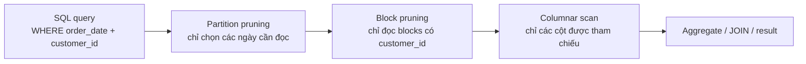

# Partitioning, clustering và pruning dữ liệu trong BigQuery

## 1. Vì sao phải tổ chức dữ liệu trước khi tối ưu SQL?

Một doanh nghiệp lưu ba năm đơn hàng trong **BigQuery**, được nạp từ Cloud Storage, Pub/Sub/Dataflow hoặc từ những dịch vụ chạy trên Cloud Run/GKE. Dashboard chỉ cần doanh thu **bảy ngày gần đây của một nhóm khách hàng**, nhưng truy vấn quét gần như toàn bộ lịch sử. BigQuery là kho dữ liệu phân tích dạng cột, có thể xử lý lượng dữ liệu lớn; tuy nhiên đọc quá nhiều dữ liệu làm tăng **bytes processed**, thời gian thực thi và chi phí trong mô hình **on-demand**.

Hai cách tổ chức bảng giúp tránh quét dữ liệu không liên quan:

- **Partitioning:** chia bảng thành các **partition** theo thời gian hoặc khoảng số nguyên; một truy vấn có bộ lọc phù hợp chỉ đọc những partitions cần thiết (**partition pruning**).
- **Clustering:** sắp xếp dữ liệu trong các **storage blocks** theo tối đa bốn cột; bộ lọc theo clustered columns cho phép bỏ qua blocks không liên quan (**block pruning**).

Bài học thuộc chương **BigQuery** của module **CLOUD_PROVIDERS_GCP**, kết nối kiến thức quản trị project/IAM, mạng, Cloud Run, GKE, các dịch vụ lưu trữ và cơ sở dữ liệu với tự động hóa, độ tin cậy và chi phí truy vấn.

**Sau bài học, bạn có thể:** chọn partitioning type và granularity; thiết kế thứ tự clustering columns; viết predicates giúp pruning; tạo bảng thực hành bằng GoogleSQL; đo bytes bằng `bq query --dry_run` và Job details; xử lý retention, streaming, DML, IAM và các lỗi làm mất pruning.

> **Phạm vi lab:** Tất cả tên project/dataset/table bên dưới là giả định. Các lệnh tạo bảng, INSERT, UPDATE hoặc xóa dữ liệu chỉ được chạy trong project lab đã được phê duyệt và có thể phát sinh phí BigQuery. Đừng dùng tên bảng production làm đích của `CREATE OR REPLACE`.

## 2. Mô hình lưu trữ: hai tầng pruning



Giả sử bảng `orders` chứa hai năm dữ liệu, mỗi ngày là một partition và mỗi partition được **CLUSTER BY customer_id, status**:

```text
orders
├── partition 2026-11-16
│   ├── blocks customer A...D
│   ├── blocks customer E...M
│   └── blocks customer N...Z
├── partition 2026-11-17
│   ├── blocks customer A...D
│   └── ...
└── partition 2026-11-18
    ├── blocks customer A...D
    └── ...
```

Truy vấn `WHERE order_date = DATE '2026-11-18' AND customer_id = 'C017'` có thể **loại các partitions của ngày khác trước**, sau đó **lọc blocks** theo khoảng giá trị customer. Cuối cùng BigQuery chỉ đọc các cột được tham chiếu, chẳng hạn `amount` và `customer_id`.

| Tầng | Dựa vào | Giảm được gì? | Độ chắc chắn dự toán |
| --- | --- | --- | --- |
| **Partition pruning** | Metadata partition + điều kiện partition key | Toàn bộ partitions không khớp | Dry run thường ước tính bytes tương đối tốt |
| **Block pruning** | Metadata min/max của clustered storage blocks | Các blocks không khớp giá trị cluster | Bytes thực giảm lúc chạy; dry run có thể chỉ tính **upper bound** |
| **Column pruning** | Danh sách cột cần đọc của bảng cột | Những cột không dùng | Tránh `SELECT *`, nhất là bảng có nhiều cột lớn |

**Pruning không phải lọc kết quả sau khi đọc toàn bảng.** Đó là khả năng **không đọc** một phần dữ liệu. Nhưng số partitions nhỏ không bảo đảm truy vấn luôn nhanh: JOIN shuffle, aggregation, UDF, skew và thiếu slot capacity vẫn có thể chiếm phần lớn thời gian.

## 3. Ba loại partitioning phổ biến

| Loại | Partition key | Dùng khi nào? | Cách lọc |
| --- | --- | --- | --- |
| **Time-unit column** | `DATE`, `TIMESTAMP` hoặc `DATETIME` thực trong bảng | Truy vấn theo **ngày nghiệp vụ / event time** | Lọc trực tiếp `order_date` hoặc `event_ts` |
| **Ingestion-time** | Thời gian BigQuery nhận/nạp row | Không có event date đáng tin cậy, ưu tiên thời gian nạp | `_PARTITIONTIME` hoặc `_PARTITIONDATE` |
| **Integer-range** | Cột `INT64` theo các khoảng số nguyên | Truy vấn theo account/tenant ID có khoảng số rõ ràng | Lọc cột số nguyên theo range |

### 3.1. Partitioning theo cột thời gian

```sql
-- Daily partition trên cột DATE
CREATE TABLE `acme-bq-lab.analytics_lab.orders_by_date` (
  order_id STRING, order_date DATE, amount NUMERIC
)
PARTITION BY order_date;

-- Hourly partition trên TIMESTAMP: hữu ích khi truy vấn theo giờ
CREATE TABLE `acme-bq-lab.analytics_lab.events_by_hour` (
  event_id STRING, event_ts TIMESTAMP, payload STRING
)
PARTITION BY TIMESTAMP_TRUNC(event_ts, HOUR);

-- Monthly partition trên DATE để hạn chế số partitions
CREATE TABLE `acme-bq-lab.analytics_lab.orders_by_month` (
  order_id STRING, order_date DATE, amount NUMERIC
)
PARTITION BY DATE_TRUNC(order_date, MONTH);
```

`DATE` hỗ trợ ngày/tháng/năm; `TIMESTAMP` và `DATETIME` còn hỗ trợ **giờ**. Partition boundaries của time partition dựa vào **UTC** khi thích hợp; phân biệt múi giờ nghiệp vụ với ngày UTC để không làm lệch báo cáo.

### 3.2. Partitioning theo ingestion time

```sql
CREATE TABLE `acme-bq-lab.analytics_lab.ingested_events` (
  event_id STRING,
  event_ts TIMESTAMP,
  source STRING
)
PARTITION BY _PARTITIONDATE
OPTIONS (require_partition_filter = TRUE);

SELECT event_id, event_ts
FROM `acme-bq-lab.analytics_lab.ingested_events`
WHERE _PARTITIONDATE = DATE '2026-11-19';
```

`_PARTITIONTIME` là pseudocolumn `TIMESTAMP`, còn `_PARTITIONDATE` là `DATE` của ingestion partition. Chúng không xuất hiện trong `SELECT *`, muốn hiển thị phải chỉ định tường minh và alias. **Ngày ingest khác ngày event xảy ra**: một dữ liệu hôm qua nạp hôm nay có thể nằm trong partition hôm nay.

Với dữ liệu vừa stream, các row đang ở write-optimized storage đôi khi tạm nằm trong `__UNPARTITIONED__` và có `_PARTITIONTIME IS NULL`. Đừng kết luận ingest thất bại chỉ vì truy vấn theo partition hôm nay chưa thấy những row đang trong buffer.

### 3.3. Partitioning theo khoảng số nguyên

```sql
CREATE TABLE `acme-bq-lab.analytics_lab.account_metrics` (
  account_id INT64, metric_date DATE, amount NUMERIC
)
PARTITION BY RANGE_BUCKET(
  account_id,
  GENERATE_ARRAY(0, 100000, 1000)
);

SELECT account_id, amount
FROM `acme-bq-lab.analytics_lab.account_metrics`
WHERE account_id BETWEEN 12000 AND 12999;
```

Khoảng `[12000,13000)` được tổ chức theo bucket size 1.000; giá trị ngoài range vào `__UNPARTITIONED__` và `NULL` vào `__NULL__`. **Integer-range partition không hỗ trợ `partition_expiration_days`**. Không chọn ID partitioning chỉ vì có cột `order_id`: ID phân bố ngẫu nhiên hoặc query chủ yếu theo ngày có thể gây nhiều partitions mà ít pruning.

## 4. Chọn partition key và độ hạt

### Nguyên tắc

1. **Bắt đầu từ WHERE của truy vấn thật**, không từ tên cột trông có vẻ tự nhiên.
2. Chọn **event/business date** nếu hầu hết reports lọc theo thời điểm giao dịch; chọn ingestion time nếu workflow quan tâm thời điểm vào warehouse.
3. Dùng **daily** cho truy vấn ngày/tuần/tháng thông thường; **hourly** khi dữ liệu rất lớn và thường lọc theo giờ; **monthly/yearly** nếu thời gian rất dài nhưng từng ngày rất nhỏ.
4. Một BigQuery native table có **một partitioning specification**, nhưng có thể kết hợp tối đa **bốn clustering columns**.
5. Không xem partitioning là cách tạo security boundary; quyền truy cập vẫn quản lý bằng IAM/row access policies/column policy tags.

Theo quotas hiện hành, BigQuery native partitioned table có giới hạn **10.000 partitions mỗi bảng** và các giới hạn load/copy/query modifications. **Nhiều partitions rất nhỏ** làm tăng metadata overhead và có thể giảm hiệu quả. Google khuyến nghị cân nhắc partitioning nếu kích thước trung bình partition **từ khoảng 10 GiB trở lên** hoặc cần ước tính chi phí ổn định trước query; đây là **hướng dẫn thiết kế**, không phải kích thước tối thiểu bắt buộc.

### Ví dụ chọn sai

Ứng dụng ghi **2.000 rows/ngày** (~2 MiB/ngày) nhưng chia partition theo **giờ** trong ba năm: số partitions lớn, hầu hết rất nhỏ; phần lớn reports chỉ lọc theo `order_date`. **Chuyển về daily/monthly**, hoặc cluster bảng không partitioned theo cột hay lọc, có thể phù hợp hơn.

Một bảng có **2 TiB/ngày** và dashboard luôn lọc **6 giờ gần nhất** có thể hưởng lợi từ hourly partitioning, nhưng cần kiểm tra quota và khối lượng streaming/backfill.

## 5. Partition pruning: viết WHERE để BigQuery bỏ qua partition

### Truy vấn tốt: lọc trực tiếp partition key

```sql
SELECT customer_id, SUM(amount) AS revenue
FROM `acme-bq-lab.analytics_lab.orders_by_date`
WHERE order_date BETWEEN DATE '2026-11-16' AND DATE '2026-11-18'
GROUP BY customer_id;
```

BigQuery chỉ cần partitions của ba ngày này. Với bảng time-unit partitioned theo `event_ts`, nên đặt range trực tiếp trên timestamp:

```sql
SELECT event_id
FROM `acme-bq-lab.analytics_lab.events_by_hour`
WHERE event_ts >= TIMESTAMP '2026-11-18 10:00:00+00'
  AND event_ts <  TIMESTAMP '2026-11-18 13:00:00+00';
```

**Half-open range** (`>= start AND < end`) dễ tránh đếm trùng ở ranh giới ngày/giờ, nhất là với `TIMESTAMP` có độ chính xác microsecond.

### Truy vấn làm mất hoặc giảm pruning

```sql
-- BẤT LỢI: bộ lọc theo partition key phụ thuộc vào dữ liệu truy vấn khác
SELECT o.order_id
FROM `acme-bq-lab.analytics_lab.orders_by_date` AS o
WHERE o.order_date = (
  SELECT MAX(p.report_date)
  FROM `acme-bq-lab.analytics_lab.report_parameters` AS p
);

-- TỐT HƠN: ứng dụng/scheduler tính ngày trước rồi truyền literal/parameter
SELECT order_id
FROM `acme-bq-lab.analytics_lab.orders_by_date`
WHERE order_date = @target_date;
```

Tham số `@target_date` được bind là `DATE` khi tạo query job; **đừng nối giá trị người dùng thẳng vào SQL**. Với bộ lọc động từ một subquery/join, BigQuery có thể không suy ra tập partitions trước scan nên không pruning hiệu quả. Không nhầm `CURRENT_DATE()` hoặc `CURRENT_TIMESTAMP()` với subquery dữ liệu: chúng có thể được optimizer coi là hằng trong một query để pruning.

**Không bọc partition column trong biểu thức phức tạp nếu có thể lọc trực tiếp.** Có những phép biến đổi mà optimizer vẫn pruning được; cách xác nhận đúng là **dry run/Job details**, không khẳng định mọi hàm trên cột đều vô hiệu hóa pruning.

## 6. `require_partition_filter`: guardrail chống full scan

```sql
CREATE TABLE `acme-bq-lab.analytics_lab.guarded_orders` (
  order_id STRING, order_date DATE, amount NUMERIC
)
PARTITION BY order_date
OPTIONS (require_partition_filter = TRUE);

-- Được chấp nhận: có predicate riêng trên partitioning column
SELECT order_id, amount
FROM `acme-bq-lab.analytics_lab.guarded_orders`
WHERE order_date >= DATE '2026-11-01';

-- Bị từ chối: thiếu predicate trên partitioning column
SELECT order_id
FROM `acme-bq-lab.analytics_lab.guarded_orders`
WHERE amount > 100;
```

BigQuery thường báo lỗi có dạng: `Cannot query over table ... without a filter that can be used for partition elimination`. Quy định còn tác động tới queries thông qua **views/materialized views** tham chiếu bảng.

Để bật cho bảng partitioned hiện hữu:

```sql
ALTER TABLE `acme-bq-lab.analytics_lab.orders_by_date`
SET OPTIONS (require_partition_filter = TRUE);
```

**Cần hiểu đúng:** Guardrail yêu cầu có một bộ lọc **chỉ tham chiếu partitioning column**; nó **không** bắt buộc truy vấn phải rất chọn lọc. Ví dụ `WHERE order_date IS NOT NULL` có thể vẫn đọc gần như tất cả partitions. Đừng dùng một predicate rộng để “vượt lỗi”; cần đưa **time window có ý nghĩa nghiệp vụ**.

**Cảnh báo rollout:** bật guardrail trên production có thể làm hỏng dashboards, scheduled queries, views, DML/MERGE hoặc ứng dụng cũ không truyền date filter. Kiểm kê dependencies và rollout theo giai đoạn trước khi bật.

## 7. Clustering: sort theo block, không phải index

Clustering **sắp xếp dữ liệu theo thứ tự các clustered columns** bên trong storage blocks thích ứng. Đây **không phải B-tree index** và không bảo đảm thứ tự rows trong kết quả `SELECT`; muốn thứ tự hiển thị, vẫn dùng `ORDER BY`.

```sql
CREATE TABLE `acme-bq-lab.analytics_lab.orders_clustered` (
  order_id STRING,
  customer_id STRING,
  status STRING,
  order_date DATE,
  amount NUMERIC
)
CLUSTER BY customer_id, status;
```

- Có tối đa **bốn top-level non-repeated clustering columns**, thuộc loại hỗ trợ như `STRING`, `INT64`, `NUMERIC`, `DATE`, `TIMESTAMP`, `BOOL`, `GEOGRAPHY`...
- **Thứ tự cột quyết định cách sắp xếp**: với `CLUSTER BY customer_id, status`, lọc `customer_id` thường prune blocks tốt hơn lọc **chỉ `status`**.
- BigQuery **tự động recluster** dữ liệu nền khi cần; không cần viết một `ORDER BY` cho mọi câu INSERT để duy trì clustering.
- Với clustered table **không partitioned**, clustering rõ hiệu quả hơn trên lượng dữ liệu lớn; nếu bảng lab chỉ vài KiB, các rows có thể nằm trong cùng block và không đo thấy lợi ích.

### Bộ lọc tốt và xấu

```sql
-- TỐT: equality trên cluster key đầu tiên, có thể thêm key thứ hai
SELECT SUM(amount)
FROM `acme-bq-lab.analytics_lab.orders_clustered`
WHERE customer_id = 'C017' AND status = 'PAID';

-- KÉM: chỉ lọc cluster key thứ hai
SELECT SUM(amount)
FROM `acme-bq-lab.analytics_lab.orders_clustered`
WHERE status = 'PAID';

-- KÉM: biến đổi cluster key bằng hàm thay vì so sánh trực tiếp
SELECT SUM(amount)
FROM `acme-bq-lab.analytics_lab.orders_clustered`
WHERE UPPER(customer_id) = 'C017';
```

Query chỉ lọc cột thứ hai **vẫn có thể được tối ưu một phần** tùy bố trí block, nhưng thường không tốt bằng leftmost key. Việc viết `WHERE status=... AND customer_id=...` thay vì đảo lại **không làm thay đổi cluster order** — yếu tố quyết định là **thứ tự trong `CLUSTER BY`**, không phải thứ tự text của predicates.

## 8. Kết hợp partitioning và clustering

```sql
CREATE TABLE `acme-bq-lab.analytics_lab.orders_optimized` (
  order_id STRING NOT NULL,
  order_date DATE NOT NULL,
  created_at TIMESTAMP,
  customer_id STRING NOT NULL,
  status STRING,
  amount NUMERIC
)
PARTITION BY order_date
CLUSTER BY customer_id, status
OPTIONS (
  require_partition_filter = TRUE,
  partition_expiration_days = 365,
  description = 'Orders lab: partition by order_date, cluster by customer and status'
);
```

Mẫu truy vấn:

```sql
SELECT customer_id, SUM(amount) AS revenue
FROM `acme-bq-lab.analytics_lab.orders_optimized`
WHERE order_date >= DATE '2026-11-16'
  AND order_date <  DATE '2026-11-19'
  AND customer_id = 'C017'
  AND status = 'PAID'
GROUP BY customer_id;
```

**Hai bước bỏ qua dữ liệu khác nhau:** partition filter chọn ba ngày; customer/status filters thu hẹp blocks trong các partition đã chọn. Nếu quên `order_date`, query bị từ chối do `require_partition_filter` dù `customer_id` rất chọn lọc.

**Không chọn cluster keys dựa trên số giá trị duy nhất một cách máy móc.** Hãy đo các filters phổ biến, selectivity, bytes thực, bảng/partition size và patterns JOIN/grouping. Một cột `status` có chỉ hai giá trị nhưng được lọc trong mọi query có thể vẫn hữu ích làm **cluster key thứ hai**; đặt đầu tiên có thể làm giảm hiệu quả các truy vấn lọc theo `customer_id`.

## 9. Lab A — tạo dataset và bảng partitioned + clustered

Lab sử dụng **BigQuery native GoogleSQL**, không cần Compute Engine/GKE hoặc nguồn dữ liệu production. Giả định:

```text
Project:  acme-bq-lab
Location: asia-southeast1
Dataset:  analytics_lab
Table:    orders_optimized
```

**Preflight:** Billing/BigQuery API được bật, người vận hành có `bigquery.datasets.create` nếu tạo dataset; `bigquery.tables.create` và `bigquery.tables.updateData` trong dataset; `bigquery.jobs.create` để chạy queries. Dùng project và location được phê duyệt, không đặt bản sao dữ liệu khách hàng thật vào dataset lab.

### 9.1. Tạo dataset

```bash
# THAY ĐỔI: chỉ thực hiện trong project LAB
bq --project_id=acme-bq-lab mk \
  --dataset \
  --location=asia-southeast1 \
  acme-bq-lab:analytics_lab

# CHỈ ĐỌC
bq --project_id=acme-bq-lab ls --datasets
bq show --format=prettyjson acme-bq-lab:analytics_lab
```

Nếu dataset đã tồn tại hoặc được dùng chung, **không xóa hoặc thay metadata**. Khi query, đặt job location **trùng location của dataset** để tránh lỗi cross-location.

### 9.2. Tạo bảng có bảo vệ partition filter

Chạy SQL trong BigQuery Studio hoặc `bq query --use_legacy_sql=false`:

```sql
CREATE TABLE `acme-bq-lab.analytics_lab.orders_optimized` (
  order_id STRING NOT NULL,
  order_date DATE NOT NULL,
  created_at TIMESTAMP,
  customer_id STRING NOT NULL,
  status STRING,
  amount NUMERIC
)
PARTITION BY order_date
CLUSTER BY customer_id, status
OPTIONS (
  require_partition_filter = TRUE,
  partition_expiration_days = 365,
  description = 'Partition/clustering learning lab'
);
```

Nếu đã tạo bảng ở mục 8 thì **không chạy lại CREATE TABLE**; hai ví dụ có cùng mục tiêu. Kiểm tra schema, clustering order và partitions:

```bash
# CHỈ ĐỌC
bq show --format=prettyjson \
  acme-bq-lab:analytics_lab.orders_optimized
```

Trong metadata kiểm tra `timePartitioning`, `clustering.fields`, `requirePartitionFilter` và `timePartitioning.expirationMs`. Đặt partition expiration **365 ngày** chỉ để minh họa; không áp dụng cho dữ liệu có retention pháp lý cao hơn.

### 9.3. Chèn dữ liệu giả và xác nhận kết quả

```sql
-- THAY ĐỔI DỮ LIỆU LAB. Không dùng trong môi trường thật.
INSERT INTO `acme-bq-lab.analytics_lab.orders_optimized`
  (order_id, order_date, created_at, customer_id, status, amount)
VALUES
  ('O-1001', DATE '2026-11-16', TIMESTAMP '2026-11-16 08:00:00+00', 'C017', 'PAID', 100.50),
  ('O-1002', DATE '2026-11-16', TIMESTAMP '2026-11-16 09:00:00+00', 'C018', 'NEW', 50.00),
  ('O-1003', DATE '2026-11-17', TIMESTAMP '2026-11-17 10:00:00+00', 'C017', 'PAID', 250.00),
  ('O-1004', DATE '2026-11-17', TIMESTAMP '2026-11-17 11:00:00+00', 'C019', 'PAID', 75.25),
  ('O-1005', DATE '2026-11-18', TIMESTAMP '2026-11-18 12:00:00+00', 'C017', 'NEW', 80.00),
  ('O-1006', DATE '2026-11-18', TIMESTAMP '2026-11-18 13:00:00+00', 'C017', 'PAID', 120.00);

-- CHỈ ĐỌC, tuân thủ require_partition_filter
SELECT order_date, customer_id, status, amount
FROM `acme-bq-lab.analytics_lab.orders_optimized`
WHERE order_date BETWEEN DATE '2026-11-16' AND DATE '2026-11-18'
ORDER BY order_date, customer_id;
```

**Kết quả:** sáu rows ở ba partitions. Ví dụ `C017` đã thanh toán có tổng `100.50 + 250.00 + 120.00 = 470.50`. **Không kỳ vọng đo được block pruning rõ rệt** trên sáu hàng: bảng quá nhỏ để phân thành nhiều clustered blocks.

## 10. Lab B — so sánh queries có và không có pruning

### 10.1. Đặt cùng câu hỏi nghiệp vụ, đổi phạm vi đọc

```sql
-- Q1: hai tầng pruning; ngày + customer_id và status
SELECT SUM(amount) AS revenue
FROM `acme-bq-lab.analytics_lab.orders_optimized`
WHERE order_date BETWEEN DATE '2026-11-16' AND DATE '2026-11-18'
  AND customer_id = 'C017'
  AND status = 'PAID';

-- Q2: có partition pruning nhưng thiếu clustered predicate
SELECT SUM(amount) AS revenue
FROM `acme-bq-lab.analytics_lab.orders_optimized`
WHERE order_date BETWEEN DATE '2026-11-16' AND DATE '2026-11-18';

-- Q3: bị từ chối vì thiếu partition filter bắt buộc
SELECT SUM(amount) AS revenue
FROM `acme-bq-lab.analytics_lab.orders_optimized`
WHERE customer_id = 'C017';
```

Q1 trả `470.50`, Q2 trả tổng doanh thu cả ba ngày, còn Q3 dự kiến **lỗi do require partition filter**. Không phải Q1 luôn có chi phí thấp hơn Q2 trên bảng nhỏ: block metadata, minimum bytes billed, result cache và dữ liệu thực ảnh hưởng quan sát.

### 10.2. Mở rộng bộ dữ liệu (tùy chọn, có thể phát sinh phí)

Nếu cần một bảng đủ lớn để benchmark, chỉ tăng số lượng dữ liệu trong **dataset lab** sau khi duyệt ngân sách. Ví dụ tạo **30.000 rows giả**:

```sql
-- THAY ĐỔI: 30 ngày x 1.000 bản ghi; không chạy nếu đã nạp lần trước
INSERT INTO `acme-bq-lab.analytics_lab.orders_optimized`
  (order_id, order_date, created_at, customer_id, status, amount)
SELECT
  FORMAT('LAB-%02d-%06d', d, n),
  DATE_ADD(DATE '2026-10-01', INTERVAL d DAY),
  TIMESTAMP(DATE_ADD(DATE '2026-10-01', INTERVAL d DAY)),
  FORMAT('C%04d', MOD(n, 200)),
  IF(MOD(n, 4) = 0, 'PAID', 'NEW'),
  CAST(MOD(n * 37, 10000) AS NUMERIC)
FROM UNNEST(GENERATE_ARRAY(0, 29)) AS d
CROSS JOIN UNNEST(GENERATE_ARRAY(1, 1000)) AS n;
```

Bộ dữ liệu 30.000 rows **vẫn có thể quá nhỏ** để BigQuery tách thành nhiều storage blocks, nên đây là lab cú pháp, **không phải benchmark chứng minh hệ số tiết kiệm cố định**. Với benchmark production, dùng bản sao có kích thước/độ phân bố tương đương thật và đo nhiều lần có kiểm soát.

### 10.3. `bq query --dry_run`: ước tính bytes trước khi chạy

```bash
# CHỈ ĐỌC/DRY RUN, không thực thi query và không dùng query slots
bq query \
  --project_id=acme-bq-lab \
  --location=asia-southeast1 \
  --use_legacy_sql=false \
  --dry_run \
  'SELECT customer_id, SUM(amount)
   FROM `acme-bq-lab.analytics_lab.orders_optimized`
   WHERE order_date BETWEEN DATE("2026-11-16") AND DATE("2026-11-18")
     AND customer_id = "C017"
   GROUP BY customer_id'
```

Dry run trả về bytes **ước lượng** cho câu query và giúp phát hiện lỗi SQL/`require_partition_filter`. **Lưu ý quan trọng:** đối với clustering, BigQuery chưa biết chính xác số blocks có thể bỏ qua cho đến khi query **thực thi**. Vì thế dry run có thể hiện bytes **lớn hơn số bytes đọc thực**; không khẳng định cluster không hoạt động chỉ vì dry run Q1/Q2 giống nhau.

Trong **on-demand pricing**, giới hạn `maximumBytesBilled` có thể kiểm tra **pre-execution upper bound** trước block pruning, nên query trên bảng clustered vẫn có thể bị từ chối dù số bytes thực lẽ ra nhỏ. Cách xử lý là tối ưu **partition/column predicates** trước, rồi cân nhắc giới hạn phù hợp; không nâng giới hạn vô điều kiện.

## 11. Lab C — đo hiệu quả sau khi chạy

Chạy Q1/Q2 một lần trong BigQuery Studio và xem **Execution details → Query plan, bytes processed/billed, slot milliseconds, cache hit**. Nếu query trả từ cache, không lấy bytes ≈ 0 làm bằng chứng pruning; thử với dữ liệu/query khác có kiểm soát và chỉ định rõ điều kiện benchmark.

### Metadata từng partition

```sql
-- CHỈ ĐỌC: INFORMATION_SCHEMA.PARTITIONS đang ở Preview
SELECT
  partition_id,
  total_rows,
  total_logical_bytes,
  storage_tier,
  last_modified_time
FROM `acme-bq-lab.analytics_lab.INFORMATION_SCHEMA.PARTITIONS`
WHERE table_name = 'orders_optimized'
ORDER BY partition_id DESC;
```

`partition_id` dạng `YYYYMMDD` cho daily, `__NULL__` nếu partition key NULL, hoặc `__UNPARTITIONED__` cho trường hợp ngoài range/streaming phù hợp. Lượt xem này có giới hạn truy vấn metadata tới **1.000 tables**; thêm `WHERE table_name` và chọn rõ cột cần dùng. `total_logical_bytes` là dữ liệu logical, **không tự bằng hóa đơn storage**, đặc biệt khi dùng physical storage billing.

### Query job statistics theo region

```sql
-- CHỈ ĐỌC: xem vài query jobs gần đây
SELECT
  creation_time,
  job_id,
  cache_hit,
  total_bytes_processed,
  total_bytes_billed,
  total_slot_ms,
  state,
  error_result.message AS error_message
FROM `acme-bq-lab.region-asia-southeast1.INFORMATION_SCHEMA.JOBS_BY_PROJECT`
WHERE creation_time >= TIMESTAMP_SUB(CURRENT_TIMESTAMP(), INTERVAL 1 DAY)
  AND job_type = 'QUERY'
ORDER BY creation_time DESC
LIMIT 20;
```

`INFORMATION_SCHEMA.JOBS_BY_PROJECT` yêu cầu quyền xem metadata jobs phù hợp và location qualifier **khớp nơi job chạy**. Bytes billed có minimum billing unit theo mô hình on-demand, không so trực tiếp một-một với `total_bytes_processed`. Với BigQuery Editions/reservations, **slot capacity** và công thức tính phí khác on-demand; cần nhìn cả `total_slot_ms` và billing model.

## 12. Column pruning và `LIMIT`: hai cạm bẫy

BigQuery lưu theo **cột**, vì vậy:

```sql
-- TỐT: chỉ đọc hai cột cần thiết
SELECT customer_id, amount
FROM `acme-bq-lab.analytics_lab.orders_optimized`
WHERE order_date = DATE '2026-11-18';

-- KÉM: truy vấn tất cả cột, dù client chỉ cần hai cột
SELECT *
FROM `acme-bq-lab.analytics_lab.orders_optimized`
WHERE order_date = DATE '2026-11-18';

-- LIMIT không thay cho partition filter hay column pruning
SELECT *
FROM `acme-bq-lab.analytics_lab.orders_optimized`
WHERE order_date = DATE '2026-11-18'
LIMIT 10;
```

`LIMIT 10` hạn chế **rows trả về** nhưng không bảo đảm BigQuery chỉ quét dữ liệu của 10 hàng. Với dữ liệu lớn, để giảm chi phí cần ưu tiên **bộ lọc partition, clustered key, projection các cột** và cân nhắc sample/aggregate/marts khi câu hỏi thực sự cần subset.

## 13. Join và biểu thức lọc có thể che mất pruning

### Tránh giả định join condition tự suy ra partition range

```sql
-- Minh họa: source report_parameters chỉ là bảng giả định,
-- optimizer có thể không suy ra partitions từ giá trị dynamic join.
SELECT o.order_id, o.amount
FROM `acme-bq-lab.analytics_lab.orders_optimized` AS o
JOIN `acme-bq-lab.analytics_lab.report_parameters` AS r
  ON o.order_date = r.report_date
WHERE r.report_id = 'R-20261118';

-- Ưu tiên predicate độc lập, xác định được tại plan-time:
SELECT order_id, amount
FROM `acme-bq-lab.analytics_lab.orders_optimized`
WHERE order_date = DATE '2026-11-18'
  AND customer_id = 'C017';
```

Nếu BI tool tạo dynamic filter từ dimension/join, hãy kiểm tra **query plan và dry run**. Với recurring reports, có thể truyền date range dưới dạng tham số; nhưng đừng thêm filter ngày giả khiến kết quả bị thiếu.

### Không dùng hàm không cần thiết trên cluster key

```sql
-- KÉM: UPPER(customer_id) cản trở block pruning
SELECT SUM(amount)
FROM `acme-bq-lab.analytics_lab.orders_optimized`
WHERE order_date = DATE '2026-11-18'
  AND UPPER(customer_id) = 'C017';

-- TỐT: chuẩn hóa customer_id ngay khi ingest, rồi so sánh trực tiếp
SELECT SUM(amount)
FROM `acme-bq-lab.analytics_lab.orders_optimized`
WHERE order_date = DATE '2026-11-18'
  AND customer_id = 'C017';
```

Để duy trì độ chính xác khi dùng normalized keys, thiết kế quy tắc hoa/thường/thứ tự ký tự ngay ở ingestion pipeline; không thay bằng một filter sai ngữ nghĩa chỉ để lấy tốc độ. Một số optimizer transformations vẫn hỗ trợ pruning, nhưng **so sánh trực tiếp và đo bằng thống kê job** dễ kiểm chứng nhất.

## 14. DML, MERGE và thay đổi cấu trúc bảng

Partitioning **không chỉ tác động SELECT**. Những DML `UPDATE`, `DELETE` và `MERGE` có thể phải đọc target và source partitions; thiếu filter có thể làm query đắt hoặc bị `require_partition_filter` từ chối.

```sql
-- THAY ĐỔI: UPDATE có partition predicate rõ ràng
UPDATE `acme-bq-lab.analytics_lab.orders_optimized`
SET status = 'SHIPPED'
WHERE order_date = DATE '2026-11-18'
  AND order_id = 'O-1006';

-- THAY ĐỔI: DELETE chỉ rows cụ thể trong một partition lab
DELETE FROM `acme-bq-lab.analytics_lab.orders_optimized`
WHERE order_date = DATE '2026-11-18'
  AND order_id = 'O-1005';
```

**Cẩn trọng:** DML thay dữ liệu làm thay đổi kết quả các bài tập sau đó. Chỉ chạy các câu trên khi bạn chủ ý thử DML trong lab, **không phải một bước bắt buộc**.

Với `MERGE`, đặt partition predicate thích hợp ở `USING`, `ON` hoặc `WHEN ... AND` theo plan của câu cụ thể, để optimizer prune **cả source và target**. Chỉ lọc bảng nguồn không tự chứng minh bảng đích được pruning. Khi query có `require_partition_filter`, xác minh query thực tế không lỗi trước khi đưa lên production.

### Đổi partitioning/clustering cho bảng đã có

- Có thể **thay đổi clustering specification** qua metadata theo tài liệu, nhưng **dữ liệu cũ của một bảng previously unclustered không tự được sắp xếp lại** chỉ vì thêm `CLUSTER BY`; cần quy trình backfill/rewrite theo hướng dẫn.
- Muốn đổi từ unpartitioned sang partitioned hoặc đổi **partition key/granularity**, thông thường tạo **bảng mới** bằng `CREATE TABLE ... PARTITION BY ... AS SELECT`, sau đó kiểm tra và cutover views/consumers; không giả định một `ALTER TABLE` đổi physical partitioning tại chỗ.
- Khi backfill nhiều partitions, dùng batch có checkpoint và kiểm tra **partition modification quotas**, schema, job location, dữ liệu late-arriving.
- Cần giữ quyền truy cập, row access policies/column security, labels, expiration và downstream views sau migration.

**Migration an toàn:** dry run truy vấn/bản sao nhỏ, thiết kế bảng đích, bulk load, reconcile rows/bytes và dashboards, chuyển tên/view hoặc consumers, giữ phương án rollback rồi mới dọn bảng cũ.

## 15. Partition expiration, retention và dữ liệu đến muộn

```sql
-- THAY ĐỔI policy của một bảng time-unit partitioned
ALTER TABLE `acme-bq-lab.analytics_lab.orders_optimized`
SET OPTIONS (
  partition_expiration_days = 90,
  require_partition_filter = TRUE
);
```

**Đừng chạy câu này trên bảng vừa chứa dữ liệu lịch sử cần giữ** nếu chưa có backup/retention plan. Partition expiration tính theo **ranh giới partition UTC**, không phải theo timestamp mỗi row được ingest. Với daily partition, dữ liệu cùng ngày hết hạn theo **mốc partition**; một số partitions cũ có thể **bị loại ngay** khi bạn giảm retention.

- **Table partition expiration** ghi đè **dataset default partition expiration** nếu có; table expiration (nếu cấu hình) có thể xóa **cả bảng** trước khi partition expiration.
- **Integer-range partitioned tables không có partition expiration**: dọn dữ liệu phải theo quy trình riêng.
- **Late-arriving data:** nếu ingest một record có `order_date` quá cũ so với retention, partition tương ứng có thể đã hoặc sẽ hết hạn; cần chính sách quarantine/backfill phù hợp.
- BigQuery **time travel/fail-safe** và Cloud Storage export không thay thế một chính sách lưu trữ dữ liệu có SLA/backup riêng. Không suy rằng row đã hết hạn luôn có thể lấy lại bằng SQL.

**Trong production:** lưu audit về retention changes và IAM quyền cập nhật table; dùng labels/budget alerts để theo dõi tác động storage. Cần kết hợp partition expiration với chính sách xóa dữ liệu nhạy cảm, không coi partitioning là công cụ quản lý pháp lý duy nhất.

## 16. Quota, hiệu năng và chi phí thực tế

| Vấn đề | Cần theo dõi | Cách khắc phục |
| --- | --- | --- |
| **Nhiều partitions nhỏ** | Partition count, logical bytes/partition | Tăng độ hạt từ hourly sang daily/monthly; cân nhắc bảng chỉ cluster |
| **Đạt quota partitions** | Giới hạn hiện hành **10.000 partitions/table** | Chọn granularity/range phù hợp, thiết kế lưu trữ lạnh |
| **Load/backfill quá nhiều partitions** | Partition modification quotas, job failures | Chia batch và giảm số partitions bị tác động |
| **Clustering hiệu quả thấp** | Bytes thực, cluster key order, blocks/tables size | Ưu tiên filters thường dùng; tránh hàm trên keys; đo sau khi chạy |
| **Query bị từ chối vì max bytes billed** | Dry-run upper bound, đặc biệt với clustering | Prune partitions/columns trước; đặt budget phù hợp |
| **Slot usage cao dù bytes thấp** | `total_slot_ms`, JOIN shuffles, skew/aggregations | Tối ưu SQL/joins và reservation capacity |
| **Storage tăng** | Active/long-term logical hoặc physical bytes, expiration | Retention, loại dữ liệu dư thừa, lifecycle policy |

### Ước lượng đơn giản

Giả định 730 ngày lịch sử, trung bình **5 GiB dữ liệu/ngày**, dashboard đọc đúng **7 ngày**:

```text
Không partition pruning: tối đa cỡ 730 × 5 GiB = 3.650 GiB
Có pruning đúng 7 ngày:    cỡ   7 × 5 GiB =    35 GiB
Tỷ lệ dữ liệu theo ngày:                7 / 730 ≈ 0,96%
```

Đây là **minh họa thể tích thô**, không phải hóa đơn: BigQuery đọc theo cột, blocks, compression/billing units, cache, table metadata và on-demand/slot-based pricing. Với cluster filter thêm, bytes thực có thể thấp hơn 35 GiB nhưng không có “hệ số tiết kiệm cố định” trước khi chạy.

### Hai mô hình định giá cần phân biệt

- **On-demand:** chi phí query gắn với **bytes billed** theo quy tắc SKU và minimum billable bytes; pruning/column selection thường giúp giảm trực tiếp.
- **Capacity-based (BigQuery Editions/reservations):** phí phụ thuộc vào capacity/slots và chính sách reservation/autoscaling; pruning giúp giảm công việc, latency và áp lực slot nhưng **không thể tính tiền tiết kiệm đơn giản bằng GiB bị loại**.

Nên dùng **BigQuery Job details**, `INFORMATION_SCHEMA.JOBS_BY_PROJECT`, Cloud Monitoring và **Cloud Billing export** để đo hiệu quả sau một khoảng đại diện, thay vì dự đoán qua số rows.

## 17. IAM, bảo mật và quản trị phân vùng

**Partitioning và clustering là tổ chức lưu trữ, không phải ranh giới ủy quyền.** Người có quyền query một bảng không tự bị giới hạn chỉ đọc partition của hôm nay, trừ khi có kiểm soát truy cập phù hợp.

| Danh tính | Quyền điển hình | Phạm vi nên cấp |
| --- | --- | --- |
| Dashboard/analyst | `roles/bigquery.jobUser` trên execution project; `roles/bigquery.dataViewer` trên dataset/bảng cần đọc | Không có quyền sửa DDL/retention |
| Data ingestion/ETL SA | Quyền ghi/load theo nguồn và bảng đích; `bigquery.jobs.create` | Chỉ những datasets pipelines được phép |
| Data platform engineer | Quyền tạo/sửa bảng, clustering/partition policy | Qua review/IaC, tách production approval |
| Billing/FinOps | Xem metrics/jobs/cost export phù hợp | Không cần quyền đọc toàn bộ dữ liệu nhạy cảm |

### Guardrails

1. Bật `require_partition_filter=TRUE` cho bảng lớn khi dashboards/queries đã tương thích.
2. Tổ chức dataset theo **data residency**, môi trường dev/prod; đừng tạo dataset ở region khác rồi cố query cross-location.
3. Áp dụng **row-level security, column-level access control, policy tags hoặc authorized views** khi phân quyền dữ liệu theo tenant/PII; cluster theo tenant không tự thực thi tenant isolation.
4. Giới hạn quyền thay `partition_expiration_days`: một lệnh có thể loại dữ liệu ngoài retention ngay.
5. Tách user/service accounts tạo jobs và accounts quản lý schema; áp dụng budget/slot quota và logging.
6. Đối với row-level security, **dry run có thể trả estimate 0 bytes** để ngăn suy diễn thông tin; không dựa vào con số này làm cam kết chi phí thực.

**Ví dụ nhiều tenant:** cluster theo `tenant_id` giúp giảm blocks cho truy vấn tenant, nhưng người dùng vẫn phải đi qua **IAM và row access policy / ứng dụng backend authorization**. Một câu SQL tùy ý có thể bỏ điều kiện tenant nếu ứng dụng không kiểm soát.

## 18. Troubleshooting: mất pruning ở đâu?

| Triệu chứng | Nguyên nhân có thể | Cách xử lý |
| --- | --- | --- |
| `Cannot query ... without a filter...` | Bảng bật `require_partition_filter` nhưng SQL không lọc partition column | Thêm range chính xác trên partition key; sửa view/dashboard |
| Query chạy nhưng bytes rất lớn | Date filter nằm trong subquery/join dynamic, thiếu projection | Đưa predicate literal/parameter vào scan; tránh `SELECT *` |
| Dry run của Q1/Q2 tương đương nhau | Cluster pruning chỉ tính chính xác khi chạy | So sánh bytes processed/billed và cache sau execution |
| Lọc `status` nhưng cluster không giúp nhiều | `CLUSTER BY customer_id, status`, bỏ qua leading key | Đánh giá workload để đổi cluster order hoặc filter theo customer |
| `UPPER(customer_id)` chậm | Cluster key bị biến đổi | Chuẩn hóa ở ingestion và lọc trực tiếp |
| Dataset lab 6 rows không đo được cluster benefit | Tất cả dữ liệu trong rất ít storage blocks | Benchmark trên copy lớn, có representative data |
| Dữ liệu hôm nay không thấy ở ingestion-time partition | Streaming buffer `__UNPARTITIONED__`, hoặc UTC lệch local time | Kiểm tra `_PARTITIONTIME IS NULL`, ingestion timestamp |
| Table mất partitions cũ | Partition expiration / table expiration thay đổi | Review `TABLE_OPTIONS`, audit logs và retention policy |
| Query sai ngày mặc dù event xảy ra hôm qua | Dùng ingestion-time thay cho event-time | Lọc đúng cột nghiệp vụ, quy đổi timezone |
| Bảng vượt quota | Too many daily/hourly partitions hoặc quá nhiều load modifications | Chọn coarser granularity, chia backfill jobs |
| `MERGE` rất tốn tiền / lỗi guardrail | Không prune target partitions | Xem target/source predicates và query plan |
| `Access Denied` khi chạy query | Thiếu `bigquery.jobs.create` hoặc `bigquery.tables.getData` | Cấp roles tối thiểu ở đúng project/dataset |
| `Location mismatch` | Query job khác location dataset | Chọn `--location`/job region trùng dataset |

### Runbook tối ưu một query production

1. **Ghi nhận baseline:** SQL đầy đủ, tham số, bytes processed/billed, slot milliseconds, duration, cache_hit và dataset location.
2. **Xem cấu trúc bảng:** partition key/type/granularity, require filter, clustering order, partition counts/bytes.
3. **Xác định bộ lọc pruning:** date range trên partition key, predicate đầu tiên trong cluster order và projected columns.
4. **Kiểm tra dry run:** xác nhận SQL hợp lệ và partition pruning theo mức ước tính; không dự đoán block pruning tuyệt đối.
5. **Chạy benchmark có giới hạn:** dùng representative dataset, kiểm tra thực tế qua Job details trong cùng conditions.
6. **Đánh giá dữ liệu đúng:** kết quả aggregates và edge cases (timezone, NULL, late events) không thay đổi.
7. **Triển khai có rollback:** quản lý DDL/IaC, giám sát query/cost, giữ bản sao/retention và ghi kết quả trước/sau.

**Không sửa partition key hoặc giảm retention production chỉ vì một dry run cao.** Đầu tiên hãy kiểm tra cách viết WHERE, chọn cột, cache và khối lượng công việc thực.

## 19. Ba tình huống thiết kế

### 19.1. Phân tích đơn hàng ba năm

**Nhu cầu:** dashboard theo ngày/tuần, thường lọc `customer_id` và `status`; backend Cloud Run ghi đơn vào Cloud SQL/Spanner, pipeline đưa events tới BigQuery.

**Đề xuất:** partition theo `order_date`, cluster `customer_id, status`, yêu cầu partition filter. BI queries nhận date range tường minh và chỉ chọn cột dashboard cần.

**Kiểm thử:** đối chiếu tổng doanh thu, so sánh bytes trên ngày đơn lẻ và toàn năm; kiểm tra late-arriving orders và timezone UTC của reporting date.

### 19.2. Telemetry IoT từ Pub/Sub/Dataflow

**Nhu cầu:** hàng tỷ events/ngày, truy vấn chủ yếu 30 phút gần nhất cho mỗi `device_id`; data ingest vào BigQuery qua Dataflow.

**Đề xuất:** cân nhắc hourly partition theo `event_ts` và cluster `device_id`; nếu 10.000 partitions hoặc pipeline metadata overhead thành vấn đề, đổi daily + clustering. Kiểm tra streaming data đang ở `__UNPARTITIONED__` nếu ingestion partitioning, xử lý late events/out-of-order.

**Kiểm thử:** so sánh p95 latency, bytes, slot ms và data freshness; không thay đổi event-time semantics khi chỉ tối ưu cost.

### 19.3. Báo cáo đa tenant cho SaaS

**Nhu cầu:** mỗi tenant xem 90 ngày dữ liệu của chính họ. Dataset chứa nhiều tenants, query thường có `tenant_id` + `order_date`.

**Đề xuất:** partition theo `order_date`, cluster `tenant_id` đầu tiên, thêm status nếu có lợi. **Không xem clustering là security**: áp row-level security/authorized view hoặc backend bảo đảm tenant authorization. Có budget alerts và kiểm thử query cố tình bỏ tenant filter.

**Kiểm thử:** tenant A không thể đọc tenant B, query 90 ngày có pruning, report không lọt dữ liệu do dynamic SQL hoặc tenant context giả mạo.

## 20. Bài tập tự kiểm tra

1. **Hai tầng pruning:** Partition theo `order_date` và cluster theo `customer_id` khác nhau thế nào? **Gợi ý:** partition bỏ toàn bộ partition; clustering bỏ storage blocks trong dữ liệu đã chọn.
2. **Chọn key:** Bảng có `event_ts` và `ingested_at`; báo cáo theo thời gian sự kiện, dữ liệu đến muộn một ngày. Nên partition theo cột nào? **Đáp án:** thường `event_ts` để query theo event-time prune đúng.
3. **Granularity:** Ba năm log 1 MiB/giờ, dashboard chỉ xem theo tháng. Vì sao partition giờ kém? **Gợi ý:** số partitions và metadata cao, mỗi partition quá nhỏ.
4. **Cluster order:** `CLUSTER BY country, customer_id, status`. `WHERE customer_id='C017'` có tối ưu tốt bằng lọc `country` + `customer_id` không? **Thường không** vì thiếu leading key `country`.
5. **Require filter:** `WHERE status='PAID'` trên bảng có `require_partition_filter=TRUE` có được không? **Không**; cần predicate qualifying trên partition column.
6. **Constant expression:** So sánh `WHERE order_date=DATE '2026-11-18'` với `WHERE order_date=(SELECT MAX(day)...)`. Truy vấn nào dễ prune hơn? **Đáp án:** literal/parameter đã biết lúc planning.
7. **Dry run:** Dry run Q1/Q2 cho cùng bytes dù Q1 filter cluster key. Có thể kết luận clustering không hiệu quả không? **Không**; đo bytes sau execution và loại cache.
8. **Bảng nhỏ:** Sáu rows ở ba partitions, tất cả query có bytes gần nhau. Có nên bỏ clustering ngay không? **Không**; benchmark tập dữ liệu đại diện và xét growth.
9. **Integer range:** `RANGE_BUCKET(account_id, GENERATE_ARRAY(0, 100000, 1000))`. Account ID 12.345 nằm trong partition nào? **Đáp án:** range bắt đầu 12.000.
10. **Expiration:** Partition theo ngày, TTL 90 ngày, nạp một row có `order_date` 200 ngày trước. Rủi ro gì? **Gợi ý:** partition hết hạn/không thể giữ lâu; cần late-data policy.
11. **DML:** UPDATE 1.000 rows nhưng bỏ partition predicate trên bảng lớn. Rủi ro? **Gợi ý:** quét nhiều partitions, tăng bytes hoặc bị guardrail từ chối.
12. **Bảo mật:** Table cluster theo `tenant_id`. Như vậy đủ ngăn user A đọc tenant B chưa? **Không**, cần quyền truy cập ở IAM/row policy/ứng dụng.
13. **Quan sát:** Từ Job details và `INFORMATION_SCHEMA.JOBS_BY_PROJECT`, nêu bốn chỉ số dùng so query trước/sau tối ưu. **Gợi ý:** total bytes processed, bytes billed, slot ms, duration/cache hit.
14. **Bài thực hành:** Trong project lab, tạo `orders_optimized`, chèn sáu rows và chạy `bq --dry_run` cho date-only, date+customer, query thiếu date. Ghi kết quả, lỗi guardrail và giải thích vì sao **không thể chứng minh** block pruning bằng số rows nhỏ.

## 21. Checklist production

- [ ] Partition type phản ánh **đường truy vấn thực tế** (event-time, ingestion-time hoặc integer ranges).
- [ ] Granularity hợp lý với kích thước partition và giới hạn **10.000 partitions/table**.
- [ ] Cluster tối đa bốn cột hỗ trợ; thứ tự left-to-right phù hợp filters phổ biến.
- [ ] Thử partition + cluster kết hợp khi lượng dữ liệu trong partitions đủ lớn.
- [ ] Có `WHERE` trực tiếp trên partition key với literal/parameter/time window thực.
- [ ] Bật `require_partition_filter` sau khi rà soát dashboards, views, DML và scheduled queries.
- [ ] Không dùng `SELECT *`/`LIMIT` thay cho pruning và column selection.
- [ ] Đã kiểm tra dry run lẫn **bytes thực** sau execution, không nhầm cluster estimate với thực tế.
- [ ] Đã phân biệt cache hit, on-demand bytes billed và Editions slot-based billing.
- [ ] Có retention/partition expiration phù hợp và chính sách late-arriving/backfill.
- [ ] Có kế hoạch quản lý schema, đổi partitioning/clustering, data reconciliation và rollback.
- [ ] Dataset location, Cloud Run/GKE service account, BigQuery IAM và policy tags phù hợp.
- [ ] Tenant/PII isolation không chỉ dựa vào vật lý clustering.
- [ ] Giám sát partition counts/bytes, job failures, query bytes/slot ms, cost trends và quota.
- [ ] Benchmark trên data phân bố đại diện, có baseline/result correctness trước khi rollout.

## 22. Tài liệu Google Cloud chính thức

1. [BigQuery partitioned tables overview](https://cloud.google.com/bigquery/docs/partitioned-tables).
2. [Create partitioned tables](https://cloud.google.com/bigquery/docs/creating-partitioned-tables).
3. [Query partitioned tables and partition pruning](https://cloud.google.com/bigquery/docs/querying-partitioned-tables).
4. [Manage partitioned tables and require partition filters](https://cloud.google.com/bigquery/docs/managing-partitioned-tables).
5. [BigQuery clustered tables overview](https://cloud.google.com/bigquery/docs/clustered-tables).
6. [Create clustered tables](https://cloud.google.com/bigquery/docs/creating-clustered-tables).
7. [Query clustered tables and block pruning](https://cloud.google.com/bigquery/docs/querying-clustered-tables).
8. [BigQuery partitioned table DML](https://cloud.google.com/bigquery/docs/using-dml-with-partitioned-tables).
9. [Optimize BigQuery query computation](https://cloud.google.com/bigquery/docs/best-practices-performance-compute).
10. [BigQuery dry runs and jobs](https://cloud.google.com/bigquery/docs/running-queries).
11. [INFORMATION_SCHEMA.PARTITIONS view](https://cloud.google.com/bigquery/docs/information-schema-partitions).
12. [INFORMATION_SCHEMA.JOBS views](https://cloud.google.com/bigquery/docs/information-schema-jobs).
13. [BigQuery quotas and limits](https://cloud.google.com/bigquery/quotas).
14. [BigQuery pricing](https://cloud.google.com/bigquery/pricing).
15. [BigQuery access control with IAM](https://cloud.google.com/bigquery/docs/access-control).
16. [Row-level security](https://cloud.google.com/bigquery/docs/row-level-security-intro).

**Ghi nhớ:** **Partitioning** giúp BigQuery bỏ qua partitions theo key/thời gian; **clustering** giúp bỏ qua storage blocks theo clustered columns; **column selection** tránh đọc cột thừa. Dùng bộ lọc có thể **prune được**, đo **dry run và bytes thực** đúng cách, quản lý retention/quota và kiểm soát IAM để tối ưu truy vấn mà không làm sai dữ liệu hoặc tăng rủi ro chi phí.
