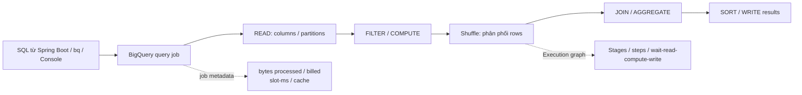
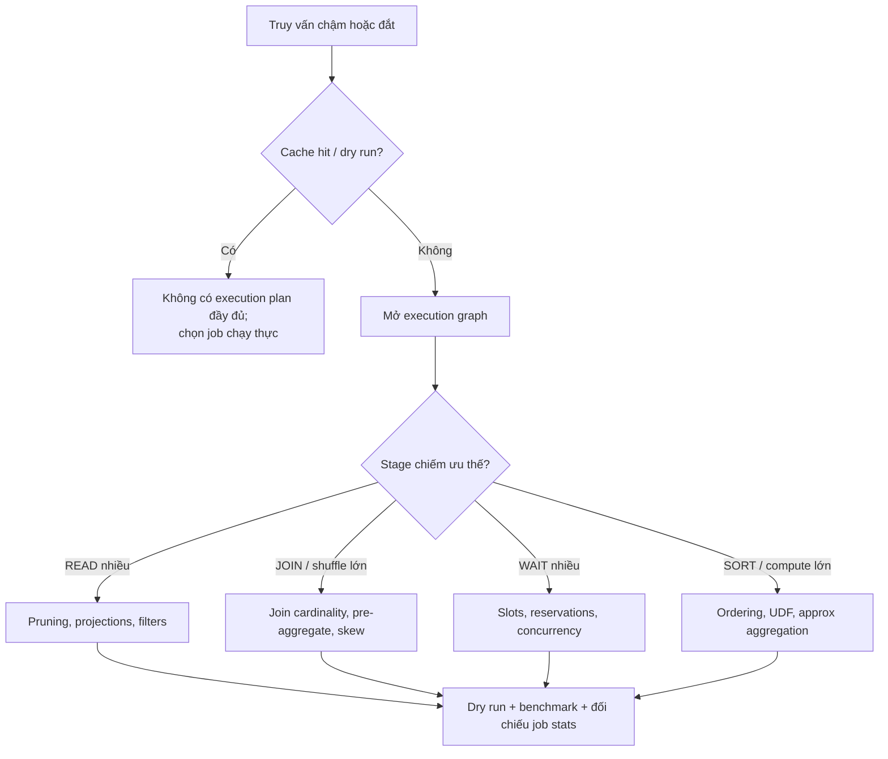
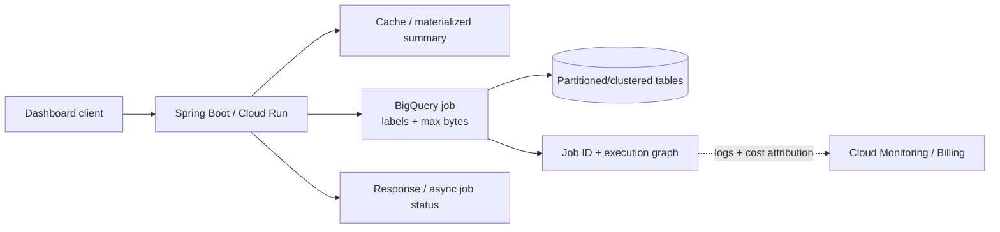

# Query plans và phân tích chi phí truy vấn

## 1. Bài toán: dashboard Java chậm và chi phí BigQuery tăng

Một hệ thống **Java/Spring Boot** chạy trên **Cloud Run** dùng **BigQuery** để tổng hợp doanh thu. Sau khi bổ sung tính năng lọc khách hàng, dashboard `GET /reports/revenue` chậm từ 3 lên 25 giây, còn chi phí truy vấn trong tháng tăng. Đội phát triển cần trả lời: BigQuery đọc quá nhiều dữ liệu, có JOIN tạo thêm hàng triệu rows, hay các jobs phải chờ slots? Truy vấn đang tính phí **theo bytes** hay workload đã nằm trong **reservation**?

BigQuery là kho dữ liệu phân tích (serverless data warehouse), có engine SQL phân tán; khác **Cloud SQL/Spanner**, đây không phải nơi thường dùng để thực hiện từng transaction OLTP nhỏ. Mỗi query có **job metadata**, và với query thực thi, BigQuery cung cấp **query plan/execution graph**, timeline, số bytes xử lý và sử dụng slots. Phân tích đúng giúp chọn biện pháp: **partition pruning, column pruning, cải thiện JOIN/aggregate, giảm shuffle** hoặc chỉnh capacity/concurrency.

Trong chương **BigQuery** của mô-đun **CLOUD_PROVIDERS_GCP**, bài này liên hệ SQL, IAM, Java client, Cloud Monitoring và FinOps để xây dựng **quy trình đo trước → chẩn đoán → tối ưu → đo sau**, tránh phỏng đoán từ mỗi con số thời gian.

**Mục tiêu học tập:**

1. Đọc các stage, steps và các chỉ số **READ, COMPUTE, WAIT, WRITE, shuffle** trong execution graph.
2. Phân biệt **total_bytes_processed, total_bytes_billed, total_slot_ms, elapsed time** và kết quả từ cache.
3. Ước lượng chi phí bằng **dry run** và dùng **maximum bytes billed** để chặn truy vấn vượt ngân sách on-demand.
4. Dùng **`INFORMATION_SCHEMA.JOBS_BY_PROJECT`** truy tìm queries tốn bytes/slots; không đếm trùng parent script.
5. Chẩn đoán scan rộng, JOIN nhân rows, skew/shuffle, slot contention và áp dụng SQL tối ưu có kiểm chứng.
6. Viết Java 21 **dry-run cost guard**, thực hành lab an toàn và theo dõi hóa đơn.

> **An toàn:** các truy vấn thống kê jobs và dry run cần quyền đọc metadata; **truy vấn phân tích thật, kể cả SELECT, có thể phát sinh chi phí**. Bài không chạy lệnh trên Google Cloud. Chỉ thực hành trong project/dataset được cấp phép; dùng `--dry_run` trước và kiểm tra location/bytes tối đa trước mọi query thật.

## 2. BigQuery thực thi truy vấn như thế nào?

Một câu SQL được optimizer chuyển thành **execution graph** gồm các **stages**. Mỗi stage có nhiều **steps** chạy song song bởi workers/slots; dữ liệu giữa stages có thể đi qua **shuffle** để JOIN, AGGREGATE, SORT.



BigQuery có thể **thêm repartition stages lúc truy vấn đang chạy** để giảm lệch phân bố. Vì vậy plan là **chứng cứ của một lần chạy**, không phải đồ thị bất biến giống hệt với mọi lần chạy.

### 2.1. Stage và step

| Thao tác | Ý nghĩa | Khi có vấn đề nên xem |
| --- | --- | --- |
| `READ` | Quét columns của table hoặc dữ liệu trung gian | Bytes/rows đọc, partition pruning, `SELECT *` |
| `FILTER` | Áp dụng điều kiện `WHERE/HAVING` | Lọc quá muộn, biểu thức chặn pruning |
| `COMPUTE` | Hàm/biểu thức SQL, UDF | CPU cao, xử lý chuỗi/JSON lặp lại |
| `JOIN` | Ghép hai nguồn | Output rows lớn hơn input, skew key, shuffle |
| `AGGREGATE` | `GROUP BY`, `COUNT`, `SUM` | Số groups/cardinality, bytes shuffle |
| `SORT` | `ORDER BY` | Sort dữ liệu lớn trước khi giới hạn |
| `WRITE` | Ghi kết quả hoặc shuffle trung gian | Shuffle output/spilled bytes |

**Đừng cộng thời gian từng stage để suy ra wall time**: nhiều stages/workers chạy **đồng thời**. Tổng `slot-ms` có thể lớn hơn elapsed milliseconds rất nhiều vì nhiều slots đang làm việc song song.

### 2.2. Thời gian trung bình và worker chậm nhất

Mỗi stage có các thành phần:

| Thành phần | Đang đo | Gợi ý |
| --- | --- | --- |
| `waitMsAvg` / `waitMsMax` | Thời gian workers chờ được lên lịch | Slot contention hoặc upstream bottleneck |
| `readMsAvg` / `readMsMax` | Thời gian đọc input | Quét dữ liệu quá nhiều hoặc block I/O |
| `computeMsAvg` / `computeMsMax` | Tính toán | Hàm đắt, join/aggregation skew |
| `writeMsAvg` / `writeMsMax` | Ghi output/shuffle | Dữ liệu trung gian lớn |
| `shuffleOutputBytes` | Bytes ghi vào shuffle | JOIN/AGGREGATE tạo dữ liệu nhiều |
| `shuffleOutputBytesSpilled` | Bytes shuffle bị spill xuống disk | Shuffle memory pressure, chậm đáng kể |
| `recordsRead` / `recordsWritten` | Rows vào/ra stage | JOIN nhân số dòng, filter quá muộn |

Nếu `computeMsMax` cao hơn `computeMsAvg` rất nhiều, một vài workers có thể chịu **data skew**. Nếu `waitMsMax` lớn nhưng `READ` ít, không nhất thiết phải thêm index: cần xem **reservation capacity, concurrent queries, upstream stages**.

## 3. Đọc Execution graph và Query performance insights

Trong Google Cloud Console:

1. Vào **BigQuery → Job history → Personal history/Project history**.
2. Mở đúng **query job** (project, region, user, timestamp, labels, job ID).
3. Xem **Execution graph** hoặc **Execution details**; chọn stage dài/tốn tài nguyên nhất.
4. Đọc **steps** và so `recordsRead → recordsWritten`, `shuffleOutputBytes`, wait/compute/read/write ratios.
5. Xem **Performance insights** nếu có (slot contention, high-cardinality JOIN, insufficient shuffle quota, partition skew).
6. So với một **job tương tự trước đó**, giữ SQL/data window/traffic/caching/capacity càng giống nhau càng tốt.



**Hai giới hạn quan trọng:**

- **Dry run** chỉ ước lượng/kiểm tra cú pháp, **không thực thi**, nên **không có execution graph như một query chạy thật**. **Result cache hit** cũng có thể không có plan vì không sử dụng tài nguyên thực thi.
- Performance insights là **gợi ý best-effort**, không phải nguyên nhân gốc chắc chắn. Query có thể chậm **trước stage đầu** hoặc **sau stage cuối** do metadata/optimization, nên không phải toàn bộ elapsed time đều nằm trong các stage.

## 4. Bốn con số thường bị nhầm

| Trường | Ý nghĩa | Có phải số tiền? |
| --- | --- | --- |
| `total_bytes_processed` | Bytes đọc/xử lý theo thống kê job | Không nhất thiết bằng bytes tính phí |
| `total_bytes_billed` | Bytes dùng cho tính phí **on-demand** (có rounding/free tier/rules) | Là đầu vào tính phí, không phải số USD |
| `total_slot_ms` | Tổng slot-milliseconds tiêu thụ bởi job | Đo compute usage; **không phải hóa đơn capacity** trực tiếp |
| `TIMESTAMP_DIFF(end_time,start_time,...)` | Elapsed runtime job | Không phải tổng CPU/slot time |
| `cache_hit` | Dùng lại kết quả được cache | Cache query thường không tính query processing bytes |

Một job chạy **10 giây**, tổng `total_slot_ms=500000` thì mức song song trung bình **xấp xỉ 50 slots** (500.000/10.000), **không phải 500.000 slots**. Con số này chỉ phản ánh mức trung bình, không thể thay peak slot demand từng stage.

**Cẩn thận:** một số trường bytes/plan có thể **NULL** hoặc bị hạn chế khi truy vấn table có **row-level access policies**, multi-statement script, failed jobs hoặc chế độ đặc biệt. `0 bytes billed` không tự chứng minh toàn bộ workload không có chi phí (storage, capacity reservation, external services vẫn có thể tính).

## 5. Hai mô hình chi phí compute

### 5.1. On-demand: tính theo bytes xử lý

Khi dùng **on-demand**, chi phí query phụ thuộc **số bytes billed** và **đơn giá/TiB** theo region/tier và quy tắc billing. Có **mức miễn phí tháng** theo chính sách BigQuery hiện hành, nhưng không tự trừ số miễn phí đó cho từng query khi so sánh hai phương án.

```text
Ví dụ GIẢ ĐỊNH:
  Tổng billed bytes tháng = 4 TiB
  Free allowance áp dụng = 1 TiB (nếu đủ điều kiện)
  Giá giả định = P USD/TiB

  Compute on-demand xấp xỉ = 3 × P USD
  + storage + ingest + egress + các dịch vụ liên quan.
```

**Query cost không chỉ là output size:** trả về 20 rows nhưng scan 5 TiB vẫn có thể bị tính theo scan. `LIMIT 20` trên **non-clustered table** thường không giúp giảm bytes processed. Ưu tiên **giảm cột, partition pruning và bảng được đọc**.

### 5.2. Capacity-based: reservations, editions và slot-hours

Khi dùng **BigQuery editions**, tổ chức trả cho **slot capacity** được cấp/commit/autoscale trong reservation, tính theo thời gian và mức giá edition. **Bytes billed của một query không quy trực tiếp thành USD** trong mô hình này. Cần đo tổng mức sử dụng và chi phí reservation, không lấy `total_bytes_billed × giá/TiB`.

| Mô hình | Đơn vị tài nguyên chính | Cách kiểm soát |
| --- | --- | --- |
| On-demand | Bytes billed của query | Dry run, maximum bytes billed, custom query quotas |
| Capacity-based | Slot-hours/edition/reservation/commitments | Baseline/max slots, autoscaling, reservations, workload assignment |

**Slot-ms vẫn hữu ích** để tìm query tiêu tốn compute và phân bổ nội bộ, nhưng **slot-ms/3.600.000 × giá slot-hour không phải chi phí thực của job** nếu reservation đã trả tiền lúc nhàn rỗi, có shared slots, autoscaler hay commitments. Một query tốt hơn có thể **giải phóng capacity cho workload khác** mà hóa đơn không giảm ngay.

### 5.3. Những khoản ngoài query compute

Storage **active/long-term**, physical/logical storage billing model, streaming ingest, BigQuery Storage API, BigQuery ML, external services, BigLake/remote functions, Cloud Storage và network egress có chính sách riêng. **Cloud Billing Reports** là nguồn đối soát hóa đơn, còn `INFORMATION_SCHEMA.JOBS` là **telemetry kỹ thuật** theo project/region.

## 6. Dry run và maximum bytes billed: hàng rào chi phí

### 6.1. Dry run bằng `bq`

Ví dụ dùng bảng public ở **US multi-region**, không chứa dữ liệu người dùng. Người chạy vẫn cần project Billing/IAM để tạo jobs metadata:

```bash
# Chỉ ước lượng, KHÔNG thực thi query và không tạo query result:
bq query --location=US --use_legacy_sql=false --dry_run \
  'SELECT state, COUNT(*) AS records
   FROM `bigquery-public-data.usa_names.usa_1910_2013`
   WHERE year BETWEEN 2010 AND 2015
   GROUP BY state'
```

Nếu muốn chạy thật trong **project lab** sau khi xem estimate, giới hạn bytes:

```bash
# Thay LIMIT_BYTES bằng một số nguyên phù hợp với ước lượng.
bq query --location=US --use_legacy_sql=false \
  --maximum_bytes_billed=LIMIT_BYTES \
  'SELECT state, COUNT(*) AS records
   FROM `bigquery-public-data.usa_names.usa_1910_2013`
   WHERE year BETWEEN 2010 AND 2015
   GROUP BY state'
```

**`--maximum_bytes_billed` là ngưỡng cho chi phí theo bytes**, hữu ích với on-demand. Nếu estimate vượt ngưỡng, BigQuery **từ chối query trước thực thi**. Không xem nó như ngân sách tiền tuyệt đối, đặc biệt với **capacity-based**, external services, storage hoặc workload không phải SELECT.

**Dry run là ước lượng upper bound** trong nhiều trường hợp; với **clustered table**, scan thực có thể thấp hơn estimate. Với **row-level security**, dry run có thể trả **0 bytes** để tránh lộ thông tin, không có nghĩa query thật miễn phí. Giá lấy từ [BigQuery Pricing](https://cloud.google.com/bigquery/pricing), không hard-code vào ứng dụng.

### 6.2. Xác nhận query plan sau khi thực thi

```bash
# Sau khi chạy một job thật đã được duyệt, xem metadata:
bq show --location=US --format=prettyjson -j LAB_PROJECT_ID:JOB_ID
```

Trong phần `statistics.query`, tìm `totalBytesProcessed`, `totalBytesBilled`, `totalSlotMs`, `cacheHit`, `queryPlan` và `timeline` khi được cung cấp. Nếu job quá nhỏ hoặc cache hit, không kỳ vọng plan có đủ stages.

## 7. Lab SQL: partition pruning, clustering và cột được đọc

Ví dụ sau dùng **dataset `LAB_PROJECT_ID.bq_cost_lab` chỉ trong project riêng** và bảng **`orders`** dữ liệu giả. Lệnh tạo dữ liệu là **tùy chọn**, chỉ chạy sau khi đã kiểm tra dataset location, IAM, Billing/quota; **không chạy trên production**.

### 7.1. Tạo dataset và bảng nhỏ có kiểm soát

```bash
# Chỉ LAB: tạo dataset US nếu chưa tồn tại trong project riêng.
bq --location=US mk --dataset LAB_PROJECT_ID:bq_cost_lab
```

```sql
-- CHỈ LAB; schema/table giả phục vụ thử plan.
CREATE TABLE `LAB_PROJECT_ID.bq_cost_lab.orders` (
  order_id INT64,
  order_date DATE,
  customer_id INT64,
  amount_minor INT64,
  status STRING
)
PARTITION BY order_date
CLUSTER BY customer_id
OPTIONS (require_partition_filter = TRUE);

INSERT INTO `LAB_PROJECT_ID.bq_cost_lab.orders`
SELECT n,
       DATE_SUB(CURRENT_DATE(), INTERVAL MOD(n, 30) DAY),
       MOD(n, 200),
       n * 100,
       IF(MOD(n, 3) = 0, 'PAID', 'CREATED')
FROM UNNEST(GENERATE_ARRAY(1, 10000)) AS n;
```

**Không chạy lại `INSERT` nếu muốn có đúng 10.000 rows**; dùng table lab mới hoặc làm sạch theo quy trình được duyệt. `require_partition_filter=TRUE` bắt buộc query có filter phù hợp để loại bỏ partitions, giúp tránh quét cả bảng do quên điều kiện thời gian.

### 7.2. Query phân tích tốt cho partition pruning

```sql
SELECT customer_id, COUNT(*) AS orders, SUM(amount_minor) AS revenue_minor
FROM `LAB_PROJECT_ID.bq_cost_lab.orders`
WHERE order_date BETWEEN DATE_SUB(CURRENT_DATE(), INTERVAL 6 DAY)
                     AND CURRENT_DATE()
  AND customer_id BETWEEN 10 AND 20
  AND status = 'PAID'
GROUP BY customer_id
ORDER BY revenue_minor DESC
LIMIT 10;
```

Truy vấn có predicate trên **partition column `order_date`**, giúp đọc 7 ngày thay vì 30 ngày. **Clustering theo customer_id** có thể bỏ qua storage blocks không liên quan, nhưng với dataset 10.000 rows nhỏ, mức tiết kiệm có thể **rất ít hoặc không quan sát được**. Trước khi bấm Run, thực hiện dry run trên SQL này và ghi lại estimate.

### 7.3. So với query chưa tối ưu

Trong table không bật `require_partition_filter` (hoặc thử trên bản copy lab), query như sau có thể tốn kém:

```sql
SELECT *
FROM `LAB_PROJECT_ID.bq_cost_lab.orders`
WHERE customer_id = 17
LIMIT 10;
```

Với **bảng lab hiện tại, câu trên phải bị từ chối** vì thiếu partition predicate; đừng bỏ cờ chỉ để chạy câu sai. Phần minh họa nhấn mạnh `LIMIT 10` không bảo đảm giảm bytes trên bảng không được clustered/pruned. Query tốt nên **chỉ chọn cột cần**, dùng **WHERE trên partition column** và filter clustering khi phù hợp.

### 7.4. Vì sao filter không luôn prune?

```sql
-- Tốt: filter trực tiếp partition column theo hằng/parameter.
WHERE order_date >= DATE '2026-11-01'
  AND order_date < DATE '2026-11-08'

-- Có nguy cơ kém hiệu quả hoặc không prune theo biểu thức:
WHERE DATE_ADD(order_date, INTERVAL 1 DAY) >= DATE '2026-11-01'
```

Một số biểu thức được optimizer tối ưu, nhưng **đừng giả định** biến đổi trên partition column luôn cho pruning tốt. Xác minh bằng **dry run bytes** và job stats. Nếu dùng **ingestion-time partitioned table**, filter qua `_PARTITIONTIME/_PARTITIONDATE` theo kiểu bảng đó, không áp dụng mọi cú pháp cho cùng một table.

## 8. Chẩn đoán JOIN, shuffle và data skew

Giả sử bảng `orders` có 1 triệu rows; bảng `customer_segments` lẽ ra có **một row mỗi customer**, nhưng bị trùng thành 10 rows cho một số khách hàng. Câu `JOIN` có thể làm **một order nhân ra 10 kết quả**, gây tăng dữ liệu trung gian và sai tổng tiền:

```sql
-- Rủi ro nếu một customer_id có nhiều segment rows:
SELECT o.customer_id, SUM(o.amount_minor) AS total_minor
FROM `LAB_PROJECT_ID.bq_cost_lab.orders` AS o
JOIN `LAB_PROJECT_ID.bq_cost_lab.customer_segments` AS s
  USING (customer_id)
WHERE o.order_date BETWEEN DATE '2026-11-01' AND DATE '2026-11-07'
GROUP BY o.customer_id;
```

**Bảng `customer_segments` không được tạo trong lab cơ bản**; đoạn này minh họa lỗi join và chỉ chạy sau khi bạn tạo bảng dữ liệu giả phù hợp. Trước khi JOIN, kiểm tra số bản ghi trên mỗi key:

```sql
-- Chỉ khi đã có bảng customer_segments lab:
SELECT customer_id, COUNT(*) AS copies
FROM `LAB_PROJECT_ID.bq_cost_lab.customer_segments`
GROUP BY customer_id
HAVING COUNT(*) > 1
ORDER BY copies DESC
LIMIT 20;
```

### Đọc dấu hiệu trên execution graph

| Dấu hiệu | Nguyên nhân có thể | Điều tra |
| --- | --- | --- |
| `JOIN recordsWritten` lớn gấp nhiều lần `recordsRead` | Join high cardinality / duplicate keys | Kiểm tra tính duy nhất của join keys, join type |
| `shuffleOutputBytes` lớn | JOIN/GROUP BY trên dữ liệu chưa lọc | Filter và pre-aggregate sớm khi hợp lý |
| `shuffleOutputBytesSpilled > 0` | Không đủ shuffle memory | Giảm dữ liệu trung gian, xem capacity |
| `computeMsMax >> computeMsAvg` | Hot key / skew partition | Kiểm tra phân bố dữ liệu theo join/group key |
| `waitMsAvg` cao | Contention/thiếu slots hoặc upstream delay | Reservation, concurrent jobs, timeline |

**Không dùng `SELECT DISTINCT` để che mọi JOIN sai.** Nó có thể tăng compute và xóa trùng hợp lệ; phải tìm đúng cardinality và grain của dữ liệu. Nếu mục tiêu chỉ kiểm tra có khách hàng thuộc segment, xem `EXISTS`/semi-join thay vì nhân các rows, tùy optimizer.

### Một số cải thiện có tác động lớn

- **Pre-aggregate** nguồn lớn trước JOIN nếu nghiệp vụ cho phép và cần giảm số rows.
- **Dùng bảng dimension sạch** với mỗi join key có grain rõ ràng; xử lý key trùng ở pipeline ingest.
- **Tránh cross join không kiểm soát:** N × M rows có thể khiến shuffle/output khổng lồ.
- **Dùng `APPROX_COUNT_DISTINCT`** nếu ước lượng đủ dùng; không thay thế `COUNT(DISTINCT)` khi cần số chính xác cho thanh toán.
- **Loại bỏ UDF/hàm lặp vô ích**, JSON parsing/timestamp casts trên hàng tỷ rows và columns không dùng.
- **Chọn filtered input trước join/sort**, nhưng luôn xác minh lại kết quả và plan; optimizer BigQuery tự thực hiện nhiều biến đổi, không phải mọi CTE đều vật lý hóa.

## 9. `INFORMATION_SCHEMA.JOBS_BY_PROJECT`: tìm queries tốn tài nguyên

BigQuery cung cấp metadata về jobs theo **region**, ví dụ `region-us` cho US multi-region hoặc `region-asia-southeast1` cho single region đó. **Location của query phải khớp location của INFORMATION_SCHEMA view**. Nếu một tổ chức có jobs ở nhiều regions, cần truy vấn **từng region**, không có view duy nhất tự gom toàn cầu.

**Quyền:** xem jobs của toàn project cần permission như `bigquery.jobs.listAll`, được cấp qua `roles/bigquery.resourceViewer` hoặc custom role phù hợp; job submission cần `bigquery.jobs.create` như `roles/bigquery.jobUser`. Không cấp `roles/bigquery.admin` chỉ để xem metadata. Truy vấn jobs có thể chứa **SQL text, user_email, labels** nhạy cảm; giới hạn quyền và logs.

### 9.1. Top jobs theo billed bytes và slot-ms

Ví dụ này chỉ truy vấn metadata **trong project lab ở location US**:

```sql
SELECT
  job_id,
  user_email,
  creation_time,
  statement_type,
  cache_hit,
  total_bytes_processed,
  total_bytes_billed,
  total_slot_ms,
  ROUND(SAFE_DIVIDE(
    total_slot_ms,
    TIMESTAMP_DIFF(end_time, start_time, MILLISECOND)
  ), 2) AS avg_slots,
  query_info.resource_warning AS resource_warning
FROM `LAB_PROJECT_ID.region-us.INFORMATION_SCHEMA.JOBS_BY_PROJECT`
WHERE creation_time >= TIMESTAMP_SUB(CURRENT_TIMESTAMP(), INTERVAL 7 DAY)
  AND job_type = 'QUERY'
  AND state = 'DONE'
  AND error_result IS NULL
  AND (statement_type IS NULL OR statement_type != 'SCRIPT')
ORDER BY total_bytes_billed DESC NULLS LAST
LIMIT 20;
```

Thay `ORDER BY total_bytes_billed` bằng `ORDER BY total_slot_ms` để tìm jobs tốn compute nhất. Với một **multi-statement script**, parent `SCRIPT` có thể chứa số liệu tài nguyên tổng hợp từ child jobs; **loại parent** để tránh cộng trùng.

**Quan trọng:** `total_bytes_billed` có thể NULL với **row-level access policies**, và trong **capacity-based pricing** nó không phản ánh đơn giá bytes thực tế. `avg_slots` là trung bình trong thời gian chạy, không phải peak slots của một stage.

### 9.2. Tổng hợp theo người dùng hoặc workload

```sql
SELECT
  user_email,
  COUNT(*) AS query_jobs,
  ROUND(SUM(IFNULL(total_bytes_billed, 0)) / POW(1024, 4), 3)
    AS billed_tib_observed,
  ROUND(SUM(IFNULL(total_slot_ms, 0)) / 3600000, 2)
    AS slot_hours_consumed_observed
FROM `LAB_PROJECT_ID.region-us.INFORMATION_SCHEMA.JOBS_BY_PROJECT`
WHERE creation_time >= TIMESTAMP_SUB(CURRENT_TIMESTAMP(), INTERVAL 7 DAY)
  AND job_type = 'QUERY'
  AND state = 'DONE'
  AND (statement_type IS NULL OR statement_type != 'SCRIPT')
GROUP BY user_email
ORDER BY billed_tib_observed DESC
LIMIT 20;
```

Đây là **mức tiêu thụ quan sát được**, không phải hóa đơn chính xác: `IFNULL` chỉ phục vụ demo aggregate, có thể che dữ liệu bytes **không có** do policy; một báo cáo production cần **đánh dấu số jobs có NULL bytes**, lọc lỗi/cache phù hợp và đối soát Cloud Billing theo **billing SKU, reservations và project**.

### 9.3. Performance insights từ job metadata

Với những job có đầy đủ thông tin, xem `query_info.performance_insights` và `query_info.resource_warning`:

```sql
SELECT job_id,
       query_info.resource_warning,
       query_info.performance_insights
FROM `LAB_PROJECT_ID.region-us.INFORMATION_SCHEMA.JOBS_BY_PROJECT`
WHERE creation_time >= TIMESTAMP_SUB(CURRENT_TIMESTAMP(), INTERVAL 7 DAY)
  AND job_type = 'QUERY'
  AND state = 'DONE'
  AND error_result IS NULL
  AND (statement_type IS NULL OR statement_type != 'SCRIPT')
  AND query_info.performance_insights IS NOT NULL
LIMIT 20;
```

Thông tin này có thể nêu **slot_contention, high_cardinality_joins, insufficient_shuffle_quota, partition_skew**. Không phải job nào cũng có insights; **NULL không phải bằng chứng truy vấn tối ưu**. `JOBS_BY_PROJECT` hỗ trợ metadata của jobs tạo gần đây (thời hạn lưu do dịch vụ quy định, thường tới **180 ngày**) và có quyền/region constraints.

## 10. Java 21: kiểm tra bytes trước khi gửi query

Java client **`com.google.cloud:google-cloud-bigquery`** hỗ trợ dry run, `QueryJobConfiguration.setMaximumBytesBilled` và truy vấn có parameters. Với ứng dụng Spring Boot, nên đặt kiểm tra này ở **phần chạy báo cáo/batch** hoặc trong công cụ review SQL, không nhất thiết dry run **mọi HTTP request** vì sẽ làm tăng latency và requests tới API.

### 10.1. `pom.xml` đơn giản

```xml
<?xml version="1.0" encoding="UTF-8"?>
<project xmlns="http://maven.apache.org/POM/4.0.0"
         xmlns:xsi="http://www.w3.org/2001/XMLSchema-instance"
         xsi:schemaLocation="http://maven.apache.org/POM/4.0.0 https://maven.apache.org/xsd/maven-4.0.0.xsd">
  <modelVersion>4.0.0</modelVersion>
  <groupId>dev.example</groupId>
  <artifactId>bigquery-cost-guard</artifactId>
  <version>1.0.0</version>
  <properties>
    <maven.compiler.release>21</maven.compiler.release>
    <project.build.sourceEncoding>UTF-8</project.build.sourceEncoding>
  </properties>
  <dependencies>
    <dependency>
      <groupId>com.google.cloud</groupId>
      <artifactId>google-cloud-bigquery</artifactId>
      <version>2.73.0</version>
    </dependency>
  </dependencies>
  <build>
    <plugins>
      <plugin>
        <groupId>org.apache.maven.plugins</groupId>
        <artifactId>maven-compiler-plugin</artifactId>
        <version>3.13.0</version>
      </plugin>
    </plugins>
  </build>
</project>
```

Version minh họa theo Java client tại thời điểm biên soạn; production nên dùng **Google Cloud Java BOM** và cập nhật bản được hỗ trợ. Auth dùng **Application Default Credentials**; không lưu service-account JSON key hoặc OAuth token trong Git.

### 10.2. `BigQueryDryRun.java` — chỉ ước lượng

```java
package dev.example.bigquery;

import com.google.cloud.bigquery.BigQuery;
import com.google.cloud.bigquery.BigQueryOptions;
import com.google.cloud.bigquery.Job;
import com.google.cloud.bigquery.JobInfo;
import com.google.cloud.bigquery.JobStatistics;
import com.google.cloud.bigquery.QueryJobConfiguration;

public final class BigQueryDryRun {
    private static final String SQL = """
        SELECT state, COUNT(*) AS records
        FROM `bigquery-public-data.usa_names.usa_1910_2013`
        WHERE year BETWEEN 2010 AND 2015
        GROUP BY state
        """;

    public static void main(String[] args) {
        if (args.length != 1) {
            throw new IllegalArgumentException(
                "Usage: LAB_PROJECT_ID (datasets in US location)");
        }

        BigQuery bigQuery = BigQueryOptions.newBuilder()
            .setProjectId(args[0])
            .build()
            .getService();

        QueryJobConfiguration config = QueryJobConfiguration.newBuilder(SQL)
            .setDryRun(true)
            .setUseLegacySql(false)
            .setUseQueryCache(false)
            .build();

        // Dry run: validation + estimate, không thực thi SQL.
        Job job = bigQuery.create(JobInfo.of(config));
        JobStatistics.QueryStatistics stats = job.getStatistics();
        long estimatedBytes = stats.getTotalBytesProcessed();
        long maxBytes = 1024L * 1024 * 1024; // 1 GiB, ví dụ.
        System.out.printf("Dry run estimated %d bytes%n", estimatedBytes);

        if (estimatedBytes > maxBytes) {
            throw new IllegalStateException("Estimate exceeds lab budget");
        }

        // Chỉ minh họa cấu hình của một job thật:
        // QueryJobConfiguration guarded = QueryJobConfiguration
        //     .newBuilder(SQL).setUseLegacySql(false)
        //     .setMaximumBytesBilled(maxBytes).build();
        // Không gửi guarded bằng bigQuery.query(...) trong lab này.
    }
}
```

Code kiểm tra **upper-bound estimate trước khi cho phép thực thi**; không tự chạy query thật. `maxBytes` là **giới hạn kỹ thuật theo bytes**, không phải đơn giá; nếu dùng **capacity reservation**, cần thêm kiểm soát reservation/slot usage. Với production, cân nhắc truy vấn **có named parameters**, labels `service/env/team` và timeout; tránh ghép trực tiếp input người dùng thành SQL.

**Về location:** ví dụ dùng public dataset ở **US**; khi project/dataset ở region khác, cần đặt **job location đúng nơi chứa dữ liệu**. `bq --location=US` trong mục 6 thể hiện tường minh; với Java khi chạy trong dự án nhiều locations, tạo `JobId`/job configuration theo location và xác minh trong job metadata thay vì dựa vào default.

## 11. Giá trị của caching, partitioning và materialized views

### 11.1. Result cache

BigQuery có **query result cache** cho các truy vấn đủ điều kiện. Cache hit có thể trả kết quả nhanh mà **không dùng query processing bytes**, nhưng **không phải mọi query có thể cache** (ví dụ dữ liệu thay đổi hoặc một số nguồn/đặc tính query). Vì vậy khi benchmark:

- Ghi `cache_hit`; không so lần chạy cache hit với lần chạy scan thật rồi kết luận SQL đã tối ưu.
- Khi cần đo compute thực, cân nhắc **tắt useQueryCache ở project lab**; sẽ phát sinh chi phí nên phải có limit.
- Không dùng result cache làm cơ chế đảm bảo freshness/transaction correctness.

### 11.2. Partitioning và clustering

**Partition** chia dữ liệu theo ngày/giờ/range và cho phép **pruning** theo filter. **Clustering** sắp xếp storage blocks theo một số cột, giúp bỏ qua blocks khi filter phù hợp; dry run trên clustered tables có thể **ước lượng cao hơn bytes thực tế** do block pruning động.

**Không tạo quá nhiều bảng chia theo từng ngày** nếu có thể dùng partitioned table: tăng overhead metadata/permissions và khó bảo trì. Chọn partition có đủ dữ liệu/đủ lớn và filter thường xuyên; đừng partition theo cột gần như unique hoặc tạo hàng nghìn partitions nhỏ không cần thiết.

### 11.3. Materialized view và bảng tổng hợp

Nếu dashboard luôn chạy cùng `SUM(amount_minor) GROUP BY date/customer` trên hàng tỷ orders, có thể tạo **materialized view** được hỗ trợ hoặc bảng summary cập nhật theo lịch. Đánh đổi là **storage, refresh cost, freshness/consistency** và complexity. Bảo đảm báo cáo tài chính có định nghĩa rõ **độ trễ dữ liệu**, không dùng số chưa cập nhật để thanh toán.

## 12. Tối ưu trong mô hình Java/Spring Boot

Với API đồng bộ, một BigQuery job có thể mất vài giây và còn có **API retry/quota/cold start**. Tách reporting workload khỏi giao dịch:



Trong production:

1. Dùng **JDBC/Hibernate/Cloud SQL/Spanner cho OLTP**, còn BigQuery cho tổng hợp phân tích; không query toàn BigQuery dataset cho mỗi lần nhấn nút.
2. Với báo cáo lớn, thiết kế **async job**: API tạo job, trả `jobId`, client poll trạng thái qua endpoint được xác thực, lấy kết quả đã sẵn sàng sau đó.
3. Giới hạn `maximumBytesBilled` ở query on-demand, `jobTimeoutMs` theo SLO và **IAM quotas**; không nhầm timeout với ngân sách.
4. Sử dụng **query parameters** thay string interpolation, chọn cột rõ ràng, bảo vệ tenant isolation qua authorized views/row-level security khi cần.
5. Gắn **job labels** ít cardinality như `service=orders-report`, `env=staging`; không dùng `userId`/`orderId` làm label có cardinality cao.
6. Log **jobId, region, labels, total_bytes_processed, total_slot_ms, cache_hit**, duration và errors; không log SQL có PII hoặc token.

**Không ngắt query chỉ vì HTTP client timeout** mà tưởng backend job đã dừng: cần kiểm tra job state và cân nhắc **`jobs.cancel`** theo quyền/nguồn lực, vì một job đang chạy có thể tiếp tục tiêu thụ capacity sau khi request Java đã đóng.

## 13. Runbook khi BigQuery query chậm, đắt hoặc bị lỗi

| Triệu chứng | Nguồn dữ liệu đầu tiên | Hành động gợi ý |
| --- | --- | --- |
| Billed bytes tăng mạnh | Dry run, `total_bytes_processed/billed`, SQL text | Partition/column pruning, bỏ `SELECT *` |
| `READ` lớn dù output nhỏ | Stage READ + referenced tables | Chọn cột, filter partitions, thay access pattern |
| `JOIN` tăng output gấp nhiều lần | `recordsRead` vs `recordsWritten`, keys | Sửa join grain, duplicate keys, pre-aggregate |
| `shuffleOutputBytesSpilled` cao | Shuffle graph, JOIN/AGGREGATE | Giảm intermediate data, đánh giá slots/shuffle quota |
| `computeMsMax` lớn hơn average | Distribution theo group/join keys | Xử lý skew/hot key, tách query nếu cần |
| `waitMsAvg` cao và pending units tăng | Query timeline, reservation utilization | Giảm concurrency, cân bằng lịch hoặc tăng capacity có tính toán |
| `total_slot_ms` cao nhưng billed bytes nhỏ | CPU/UDF/JOIN, capacity model | Cải thiện thuật toán, tránh tính toán lặp |
| Query có `LIMIT` nhưng vẫn tốn scan | Execution graph, table layout | Partition/cluster, giảm cột đọc |
| Query biến mất khỏi plan | Cache hit hoặc dry run | Chọn một job chạy thật có metadata |
| `maximum bytes billed` từ chối | Dry run upper bound, clustered scan estimate | Sửa query hoặc duyệt budget cao hơn |
| Metrics/job query bị thiếu hoặc NULL | Region/IAM, row-level policy, script parent | Xem job metadata và đúng permissions |
| Chi phí billing tăng nhưng metadata query không đổi | Storage, reservation, load/streaming/egress | Cloud Billing report theo SKU/project |

### Quy trình 7 bước

1. **Định danh:** ghi job ID, project, location, user/service account, SQL version và khoảng thời gian UTC.
2. **Phân loại chi phí:** on-demand hay capacity reservation? Ghi cả **bytes billed và slot-ms**, nhưng chọn đúng đơn vị để tính.
3. **Ước lượng:** dry run SQL hiện tại; nếu phải thử thật, đặt maximum bytes billed và test trên dataset lab/snapshot.
4. **Chẩn đoán graph:** xem READ → JOIN/AGGREGATE/SORT → shuffle → output và timeline; tìm stage **chiếm ưu thế**.
5. **Đưa giả thuyết:** thiếu partition pruning, JOIN nhân rows, skew, slot contention hoặc compute/UDF lặp.
6. **Canary:** đổi **một yếu tố** (SQL, partition/cluster, materialized summary hoặc reservation) và đo lại cùng workload; kiểm tra **kết quả nghiệp vụ chính xác**.
7. **Đối soát:** so job metadata, p95/p99, số rows và Cloud Billing; cập nhật CI/dry-run policy, rollback nếu plan xấu hơn.

**Không tối ưu bằng cách tăng slot reservation ngay khi thấy query chậm.** Nếu 90% thời gian là quét dữ liệu không cần thiết hoặc JOIN làm nổ số hàng, sửa SQL có thể tốt hơn tăng capacity. Ngược lại, SQL đã tối ưu nhưng pending units thường xuyên cao là dấu hiệu cần **lập lịch workloads hoặc điều chỉnh slots**.

## 14. IAM, bảo mật và ngân sách

| Persona | Quyền cần xem xét | Ghi nhớ |
| --- | --- | --- |
| Java reporting service | `roles/bigquery.jobUser` trên project thực thi + `roles/bigquery.dataViewer` trên dataset/table | Không cần BigQuery Admin |
| Phân tích jobs toàn project | `roles/bigquery.resourceViewer` hoặc custom role có `bigquery.jobs.listAll` | Job metadata/query text có thể nhạy cảm |
| Data platform operator | Quyền tạo/chỉnh table, reservation, assignment theo vai trò riêng | Không trộn quyền quản lý slots với quyền đọc mọi PII |
| FinOps/auditor | Billing viewer + job metadata cần thiết | Đối soát theo SKU, không suy hóa đơn từ slot-ms |

**Rủi ro dữ liệu:** `INFORMATION_SCHEMA.JOBS_BY_PROJECT` có thể tiết lộ SQL text, identifiers, user_email, labels và thông tin truy vấn; kế hoạch query cũng có table/column names. Dùng **parameterized SQL**, quyền dataset/table tối thiểu và row-level/column-level security khi cần. Tránh đưa giá trị nhạy cảm vào SQL comments, job labels hoặc log.

**Giới hạn nhiều lớp:** `maximumBytesBilled` cho query on-demand; **custom query quotas** ở cấp user/project có thể tạo hạn mức cứng theo ngày; **reservations** và autoscaling max slots cho capacity; Billing budgets/alerts để theo dõi. **Budget alert không tự ngừng query hoặc ngừng billing**. Đừng tắt audit logs/quota khi gặp lỗi `PERMISSION_DENIED` hoặc vượt budget.

**Chính sách môi trường:** tách dự án dev/staging/prod, gắn labels cho jobs, cho phép CI chạy **dry run** trên SQL thay đổi, yêu cầu review trước truy vấn có ước lượng >ngưỡng và trước khi tăng reservation/max slots. Có thể dùng **Query Optimizer/partition filter/authorized views** để giảm chi phí ngay ở thiết kế dữ liệu.

## 15. Cleanup lab và kiểm tra phạm vi

Nếu đã tạo table/dataset lab ở mục 7:

```bash
# Đọc metadata trước khi xóa:
bq --location=US ls LAB_PROJECT_ID:bq_cost_lab
bq show --format=prettyjson LAB_PROJECT_ID:bq_cost_lab.orders

# CHỈ sau khi owner xác nhận toàn bộ dataset do lab tạo,
# không còn bảng/dữ liệu/job của người khác:
# bq --location=US rm -r -f -d LAB_PROJECT_ID:bq_cost_lab
```

**Lệnh xóa được comment có chủ đích**; xóa dataset cũng xóa các tables bên trong và có thể phá pipeline khác. Không xóa public dataset, billing account hoặc reservation chung. Sau thực hành, xem **Job history, Cloud Billing reports, dataset/storage và alerts**; các chi phí BigQuery có thể được ghi nhận trễ.

## 16. Bài tập và checklist

### Bài A — Đọc execution graph

Query có stage READ **80 GiB**, JOIN nhận 2 triệu rows nhưng ghi 90 triệu rows, `shuffleOutputBytesSpilled` tăng. Nêu ba giả thuyết, chỉ số cần kiểm tra và hai thay đổi SQL/data model ưu tiên. Vì sao chỉ tăng slots không đủ chứng minh tối ưu?

### Bài B — Phân biệt các con số

Một job chạy **20 giây**, có `total_slot_ms=600000`, `total_bytes_processed=2 TiB`, `total_bytes_billed=2 TiB`. Tính **30 slots trung bình**. So cách quy đổi chi phí khi project dùng **on-demand** và khi job nằm trong **Enterprise reservation**; không dùng cùng một công thức giá cho hai chế độ.

### Bài C — Dry run và chặn chi phí

Dùng `bq query --dry_run` trên câu `SELECT state, COUNT(*)` ở mục 6. Ghi estimate, đặt `--maximum_bytes_billed` **thấp hơn estimate** trong lab, xác nhận query bị từ chối mà không scan thật. Đề xuất cách đưa dry run vào pull-request checks cho SQL reports.

### Bài D — Partition pruning

Với `bq_cost_lab.orders` partition theo `order_date`, viết hai queries: một có filter trong 7 ngày, một thiếu filter. Giải thích vì sao query thiếu filter **bị chặn** khi bật `require_partition_filter=TRUE` và tại sao `LIMIT 10` không bảo đảm giảm bytes quét.

### Bài E — JOBS_BY_PROJECT và governance

Viết query `INFORMATION_SCHEMA.JOBS_BY_PROJECT` tìm **top 10 jobs theo total_slot_ms** trong 7 ngày tại `region-us`, loại trừ `SCRIPT` parents và lọc `creation_time`. Đề xuất labels `team/env/service` và trình bày vì sao không coi tổng slot-ms chính là hóa đơn capacity.

### Bài F — Java dry-run

Sử dụng `BigQueryDryRun` trong Java 21, chạy bằng ADC và project lab, kiểm tra estimate trước khi query thật. Giải thích `setDryRun(true)` khác `setMaximumBytesBilled(...)` và quyền IAM cần cho Java runtime.

### Bài G — Sự cố sau phát hành

Spring Boot release mới làm dashboard từ 3 lên 25 giây, nhưng `total_bytes_billed` gần như không đổi; `waitMsAvg` và pending units tăng. Xây runbook phân biệt **slot contention** với dữ liệu skew/upstream bottleneck, kiểm tra reservation assignment và canary rollback.

### Checklist trước production

- [ ] Tôi biết BigQuery plan là **stages/steps/shuffle** và một số stages chạy song song.
- [ ] Tôi đọc được `READ/JOIN/AGGREGATE/WRITE` và wait/read/compute/write timing.
- [ ] Tôi phân biệt **bytes processed/billed, slot-ms, elapsed time và cache hit**.
- [ ] Tôi chọn đúng mô hình giá **on-demand theo TiB** hay **capacity theo slots**.
- [ ] Tôi chạy dry run, đặt maximum bytes billed ở trường hợp phù hợp.
- [ ] Tôi sử dụng partition pruning, chỉ chọn cột cần, hiểu giới hạn của `LIMIT`.
- [ ] Tôi kiểm tra join keys/cardinality, shuffle spill, skew và slot contention.
- [ ] Tôi truy vấn `INFORMATION_SCHEMA.JOBS_BY_PROJECT` đúng **region/IAM** và không double-count script parents.
- [ ] Tôi có Java cost guard, parameterized SQL và job labels ít cardinality.
- [ ] Tôi có baseline, đối chiếu SQL results, canary/rollback, Billing và SLO.

**Kết luận:** tối ưu BigQuery không chỉ là sửa câu SQL “chạy chậm”. Cần ghép **execution graph + job metadata + mô hình giá đang áp dụng**: đọc ít dữ liệu hơn để giảm bytes on-demand, xử lý JOIN/shuffle/capacity để giảm slot consumption, và xác minh kết quả/chi phí theo workload thật. Với Java trên Google Cloud, hãy **dry run và giới hạn chi phí trước khi chạy**, gắn nhãn jobs, quan sát đúng region và bảo vệ dữ liệu/permissions trong toàn bộ quy trình.

## 17. Tài liệu chính thức tham khảo

- [Query plan and timeline](https://cloud.google.com/bigquery/docs/query-plan-explanation)
- [Get query performance insights / execution graph](https://cloud.google.com/bigquery/docs/query-insights)
- [Optimize query computation](https://cloud.google.com/bigquery/docs/best-practices-performance-compute)
- [Estimate and control costs](https://cloud.google.com/bigquery/docs/best-practices-costs)
- [BigQuery pricing — on-demand và editions](https://cloud.google.com/bigquery/pricing)
- [INFORMATION_SCHEMA.JOBS views](https://cloud.google.com/bigquery/docs/information-schema-jobs)
- [JOBS_TIMELINE view](https://cloud.google.com/bigquery/docs/information-schema-jobs-timeline)
- [Query partitioned tables/pruning](https://cloud.google.com/bigquery/docs/querying-partitioned-tables)
- [Manage partition filter requirements](https://cloud.google.com/bigquery/docs/managing-partitioned-tables)
- [Clustered tables](https://cloud.google.com/bigquery/docs/clustered-tables)
- [Cache query results](https://cloud.google.com/bigquery/docs/cached-results)
- [Best practices for BigQuery materialized views](https://cloud.google.com/bigquery/docs/materialized-views-intro)
- [Java sample: dry run](https://cloud.google.com/bigquery/docs/samples/bigquery-query-dry-run)
- [Java QueryJobConfiguration](https://cloud.google.com/java/docs/reference/google-cloud-bigquery/latest/com.google.cloud.bigquery.QueryJobConfiguration)
- [BigQuery IAM roles](https://cloud.google.com/bigquery/docs/access-control)
- [Cloud Billing reports](https://cloud.google.com/billing/docs/how-to/reports)
