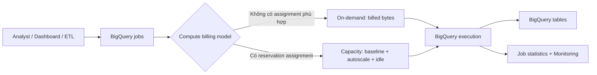
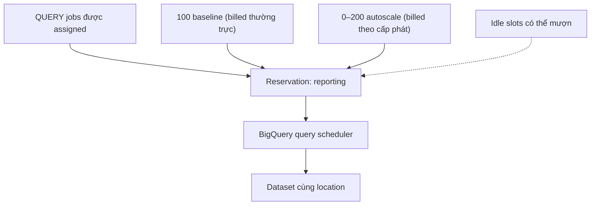
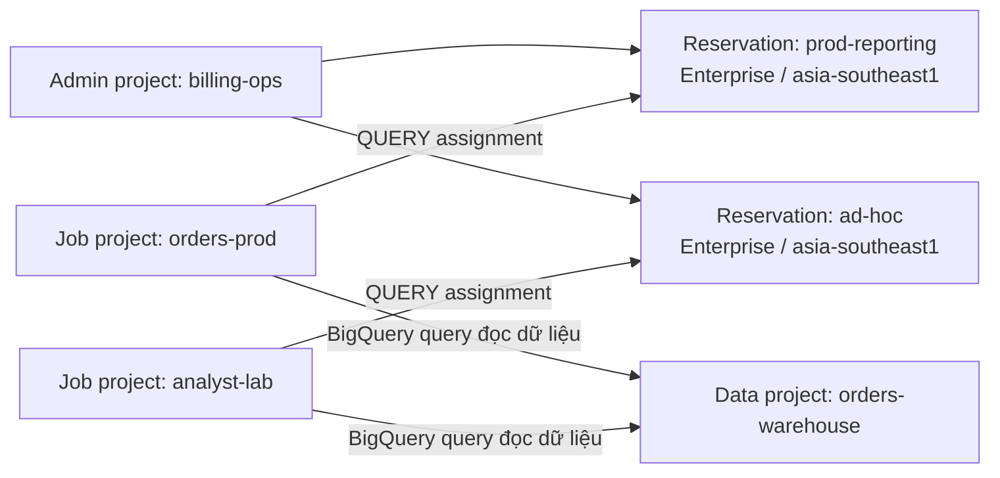
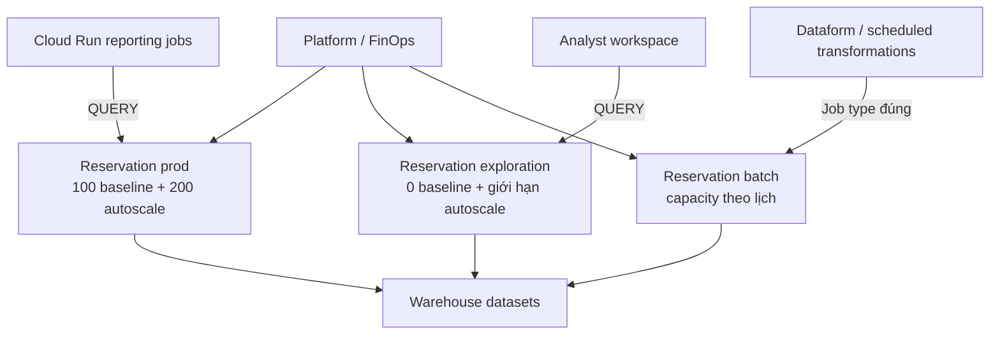

# On-demand analysis, reservations và slots

Một nhóm vận hành Orders dùng BigQuery để xem doanh thu theo ngày. Tháng đầu, nhóm chỉ chạy vài truy vấn mỗi tuần nên **on-demand analysis** đơn giản và dễ kiểm soát. Khi dashboard, lịch ETL và người dùng tăng, chi phí truy vấn biến động và jobs cạnh tranh compute. **BigQuery reservations và slots** giúp phân bổ năng lực xử lý theo workload, với baseline/autoscaling và cơ chế gán jobs rõ ràng.

Bài thuộc chương **BigQuery** của module `CLOUD_PROVIDERS_GCP`: liên hệ lựa chọn dịch vụ Google Cloud, IAM, triển khai Cloud Run/GKE, luồng dữ liệu từ Pub/Sub/Cloud Storage, quản trị chi phí và giám sát độ tin cậy. Mục tiêu là hiểu **cái gì được tính phí, job thực sự chạy trên pool nào và khi nào nên chuyển mô hình**.

> Project, dataset, bảng và chi phí ví dụ đều là giả định. Các lệnh tạo reservation, mua commitments, gán workload hoặc chạy truy vấn ghi dữ liệu có thể phát sinh phí và ảnh hưởng dự án khác. Chỉ thay đổi tài nguyên trong sandbox được phê duyệt. Giá, quota, editions và autoscaling cần đối chiếu [BigQuery pricing](https://cloud.google.com/bigquery/pricing) theo region.

## 1. Kết quả học tập

Sau bài này, bạn có thể:

1. Giải thích hai mô hình tính compute: **on-demand theo TiB** và **capacity-based theo slot-hours**.
2. Phân biệt **slot**, **slot-ms**, **reservation**, **baseline**, **autoscaling slots**, **idle slots** và **capacity commitment**.
3. Dùng `bq query --dry_run`, `--maximum_bytes_billed`, partitioning và clustering để quản lý chi phí on-demand.
4. Tạo reservation và **assignment** theo job type/location, kiểm tra job sử dụng pool nào.
5. Phân tích `INFORMATION_SCHEMA.JOBS_BY_PROJECT` theo bytes billed, slot time, concurrency, latency.
6. Cách ly production dashboard khỏi ETL/ad-hoc, tính bài toán hòa vốn và giám sát SLO/chi phí.

## 2. Jobs, slots và hai kiểu tính phí

BigQuery tạo **job** cho query, load, copy hoặc export. Một query có nhiều stages chạy song song. **Slot** là đơn vị năng lực compute ảo phục vụ job, **không tương đương một vCPU cố định hoặc một VM riêng của khách hàng**.



| Khái niệm | Ý nghĩa thực tế | Không được nhầm với |
| --- | --- | --- |
| `total_bytes_processed` | Bytes xử lý/đọc trong job theo thống kê | Số bytes trả về cho client |
| `total_bytes_billed` | Bytes dùng để tính **on-demand analysis** | Tổng phí trong mọi mô hình |
| `slot` | Một đơn vị compute được lập lịch | Một node Compute Engine |
| `total_slot_ms` | Tổng slot milliseconds của job | Wall-clock runtime |
| `reservation` | Pool compute có edition, location, baseline và autoscaling | Nơi lưu bảng hoặc dataset |
| `assignment` | Quy tắc gán job vào reservation theo nguồn và loại job | Quyền SELECT của người dùng |
| `commitment` | Cam kết mua capacity trong thời hạn để có giá phù hợp | Bảo đảm mọi query hết contention |

**Cả hai mô hình đều dùng slots để thực thi.** Trong on-demand người dùng trả tiền compute theo lượng dữ liệu xử lý; với capacity, người dùng quản lý reservations và trả phí capacity theo thời gian. Phí storage, network và một số services SKU **vẫn tính riêng**.

### 2.1. Slot-ms khác số giây chạy query

Giả sử job chạy **12 giây** và dùng trung bình **150 slots**:

```text
total_slot_ms = 12 s × 150 slots × 1.000 ms/s
              = 1.800.000 slot-ms
avg_slots     = 1.800.000 / 12.000 = 150 slots
```

Slot count thay đổi theo query stages; 150 là **trung bình**, không phải số slots ở mọi thời điểm. Query chờ slots có thể kéo dài wall-clock mà không làm slot-ms tăng tương ứng. Không lấy slot-ms nhân giá TiB để suy ra tiền on-demand.

### 2.2. On-demand analysis: trả phí cho dữ liệu xử lý

Khi không có reservation assignment hợp lệ cho loại job/location tương ứng, query thông thường chạy **on-demand**. Công thức ước tính:

```text
Tiền analysis ≈ (total_bytes_billed / 2^40) × giá mỗi TiB
```

Đơn giá theo location và ngày sử dụng, có thể có free tier. On-demand có **mức tối thiểu tính bytes** theo quy tắc BigQuery (tài liệu hiện nêu tối thiểu 10 MiB cho mỗi referenced table trong trường hợp áp dụng). Query trả 10 hàng từ bảng 1 TiB **không có nghĩa chỉ tính phí cho 10 hàng**.

On-demand có quota compute dùng chung, thường được mô tả khoảng **2.000 slots/project** theo mặc định và cơ chế fair scheduling; **đó không phải cam kết mỗi query luôn được 2.000 slots**. Nếu cần thay quota hoặc tối ưu burst, kiểm tra giới hạn hiện hành.

### 2.3. Capacity-based: trả phí cho capacity

Trong mô hình capacity, reservations cấp **baseline slots** và/hoặc **autoscaling slots**. Compute billing dựa trên **slots được cấp/billed theo thời gian**, không cộng bytes quét của từng query:

```text
Tiền capacity ≈ baseline_slot_hours × giá baseline/slot-hour
               + autoscaled_slot_hours × giá autoscale/slot-hour
               - discount/credits theo commitments (nếu có)
```

Đây chỉ là **công thức khái niệm**: edition, granularity, idle sharing, commitments và các SKU khác ảnh hưởng hóa đơn. Reservation không có job vẫn trả phí baseline được phân bổ. Autoscaling thường có **thời lượng tính phí tối thiểu một phút**, trừ khi đã bật cơ chế **fluid scaling** được hỗ trợ.

## 3. Chọn on-demand hay reservations?

| Nhu cầu | On-demand | Capacity-based |
| --- | --- | --- |
| Truy vấn thưa, mới thử nghiệm | Cấu hình tối thiểu, phù hợp | Baseline có thể nhàn rỗi và tốn phí |
| Dashboard/ETL ổn định nhiều giờ | Chi phí có thể biến động | Dự toán và commitment phù hợp nếu dùng nhiều |
| Cần cách ly prod và ad-hoc | Không có pool riêng theo workload | **Tạo reservations riêng**, đặt chính sách slots |
| Chi phí theo query | Bytes billed trực tiếp | Phân bổ lại **phí reservation** giữa các bên |
| Elastic compute | BigQuery tự cấp on-demand | Baseline + autoscaling trong quotas/capacity availability |
| Nhiều projects | Mỗi project tự thanh toán on-demand | Admin project quản lý pool và assignments |

Không có mô hình luôn rẻ hơn. Với query scan ít và chạy thưa, on-demand có thể hợp lý; workload dùng slots đều có thể lợi từ capacity/commitments. **Luôn đo tải thực** trước khi chốt baseline.

### 3.1. Có thể pha trộn

Tổ chức có thể cho `prod-reporting` chạy reservation Enterprise, còn `analyst-sandbox` dùng on-demand. Project **không có assignment phù hợp** thường fallback sang on-demand. Một **reservation `None`** có thể được dùng để chủ đích thoát khỏi assignment kế thừa khi muốn on-demand. Luôn kiểm tra assignment inheritance, **job type** và **job location**: tạo reservation đơn thuần **không chuyển jobs sang capacity**.

## 4. Kiểm soát on-demand trước khi chạy query

Giả sử có bảng `orders-lab.analytics.orders` với các cột `order_id`, `order_date DATE`, `country` và `amount NUMERIC`. Bảng chỉ minh họa; thay bằng dataset/table sandbox thực sự tồn tại. Một dataset phải ở location tương thích job, không tùy ý truy vấn chéo region.

### 4.1. Dry run và giới hạn bytes billed

```bash
PROJECT_ID="orders-lab"
LOCATION="asia-southeast1"
SQL='SELECT order_date, SUM(amount) AS revenue
     FROM `orders-lab.analytics.orders`
     WHERE order_date >= DATE_SUB(CURRENT_DATE(), INTERVAL 7 DAY)
     GROUP BY order_date'

# CHỈ KIỂM TRA: validator và ước tính, không chạy query thực.
bq query --project_id="$PROJECT_ID" --location="$LOCATION" \
  --use_legacy_sql=false --dry_run "$SQL"

# CÓ THỂ PHÁT SINH PHÍ: chỉ chạy sandbox, giới hạn 5 GiB.
bq query --project_id="$PROJECT_ID" --location="$LOCATION" \
  --use_legacy_sql=false --maximum_bytes_billed=5368709120 "$SQL"
```

**Dry run thường cho ước tính upper bound**, không nhất thiết bằng số bytes billed cuối cùng (đặc biệt clustered tables). Nếu estimated bytes vượt `maximum_bytes_billed`, query bị từ chối **trước khi chạy** và không bị tính compute cho query bị từ chối. Với bảng có row-level access policies, dry run có thể trả 0 bytes để tránh side-channel: **không được hiểu 0 bytes là chắc chắn miễn phí**.

### 4.2. Giảm bytes scanned đúng cách

| Cách làm | Tác dụng | Sai lầm hay gặp |
| --- | --- | --- |
| Chọn cột cần thiết | Giảm column scan | `SELECT *` rồi chỉ dùng 2 cột |
| Filter **partitioning column** | Partition pruning, giảm dữ liệu đọc | Lọc bằng điều kiện không cho pruning |
| Clustering theo key truy vấn | Block pruning trong trường hợp phù hợp | Cho rằng cluster luôn giảm mọi loại query |
| Materialized view/pre-aggregation | Giảm scan lặp nếu query được tối ưu | Quên maintenance/storage/cost riêng |
| Results cache | Có thể không quét lại cho cache hit | Giả định mọi query lặp đều dùng cache |
| Table preview hoặc `bq head` | Xem vài dòng không chạy full query | Dùng `SELECT * LIMIT 10` để “tiết kiệm bytes” |
| Job labels, custom cost controls | Truy nguyên owner và đặt guardrails | Coi `LIMIT` như giới hạn phí |

```sql
-- TẠO TÀI NGUYÊN: chỉ chạy nếu bảng chưa có trong sandbox.
CREATE TABLE `orders-lab.analytics.orders` (
  order_id STRING NOT NULL,
  order_date DATE NOT NULL,
  country STRING,
  amount NUMERIC
)
PARTITION BY order_date
CLUSTER BY country, order_id
OPTIONS (require_partition_filter = TRUE);
```

```sql
-- Partition pruning theo ngày, block pruning theo country.
SELECT country, SUM(amount) AS revenue
FROM `orders-lab.analytics.orders`
WHERE order_date BETWEEN DATE '2026-11-01' AND DATE '2026-11-07'
  AND country = 'VN'
GROUP BY country;
```

`require_partition_filter` buộc các queries đưa ra điều kiện filter phù hợp. Chỉ thêm WHERE trên cột ngày **không tự chuyển bảng hiện có thành partitioned**. Query `LIMIT 100` trên bảng không clustered vẫn có thể quét dữ liệu lớn trước khi trả 100 rows; **column projection + pruning** quan trọng hơn số dòng kết quả.

## 5. Capacity-based: editions, baseline, autoscaling và idle slots

BigQuery **editions** hiện có Standard, Enterprise và Enterprise Plus; tính năng, tính phí và giới hạn riêng tùy edition. Reservation quản lý **compute capacity của job**, không thay quyền đọc dữ liệu hoặc vị trí dataset.

### 5.1. Reservation sizing

Giả sử một reservation Enterprise:

| Cấu hình | Giá trị minh họa | Ý nghĩa |
| --- | ---: | --- |
| Baseline slots | 100 | Luôn dành sẵn/trả phí kể cả khi không chạy query |
| Maximum autoscaling slots | 200 | Có thể scale thêm **tối đa 200** slots |
| Maximum reservation size | 300 | **100 baseline + 200 autoscale**, nếu capacity có sẵn |
| Idle slot sharing | Bật (không ignore) | Có thể mượn capacity rảnh từ reservation khác đủ điều kiện |
| Edition | Enterprise | Quyết định tính năng và đơn giá |
| Location | `asia-southeast1` | Phải khớp location jobs được gán |



**Autoscale không luôn đạt mức tối đa**: nó phụ thuộc demand và capacity availability. Slots thường scale theo bội số 50; thời lượng billed có quy tắc tối thiểu (một phút mặc định, có cơ chế fluid scaling theo điều kiện). Một reservation **zero baseline** có thể phù hợp workload gián đoạn, nhưng **không có capacity bảo đảm khi nhu cầu đột ngột tăng** và phải cấu hình autoscaling/idle sharing cẩn thận.

### 5.2. Idle slots và isolation

Mặc định, reservations đủ điều kiện có thể dùng **idle slots** từ các pool khác cùng administration project/edition/location theo giới hạn hỗ trợ. `ignore_idle_slots=true` giúp tránh dựa vào tài nguyên rảnh đó, nhưng **không tự bảo đảm số slots đúng bằng reservation max ở mọi thời điểm**. Nếu production cần predictable latency, cân nhắc baseline thích hợp, isolate ad-hoc workload và giới hạn admission/concurrency.

Một số chính sách hiện hành phân biệt `ALL_SLOTS`, `AUTOSCALE_ONLY` và `IDLE_SLOTS_ONLY` (tính năng có thể ở Preview). **Không đồng thời dùng flags `--autoscale_max_slots` và `--max_slots/--scaling_mode`** trong một lệnh; hãy chọn đúng nhánh cấu hình hỗ trợ. Reservation sizing có thể mất tới một phút để áp dụng, và đôi khi usage vượt max do điều kiện scheduler mà không bị tính thêm vượt mức reservation billed.

### 5.3. Capacity commitments

**Commitment** mua capacity với thời hạn/điều kiện giá ưu đãi, không phải bước bắt buộc để dùng autoscaling. Commitment chỉ hợp lý khi workload sử dụng ổn định và tổ chức chấp nhận trách nhiệm tài chính trong kỳ cam kết. **Đừng mua commitment để thử bài học**: mua xong có thể bắt đầu phát sinh tiền ngay, và cam kết dài hạn có điều kiện hủy/renewal nghiêm ngặt.

## 6. Reservations và assignments vận hành thế nào?



**Admin project** sở hữu reservation/capacity và thanh toán capacity theo thiết kế; **job project** là nơi truy vấn được tạo và xét assignment, có thể khác **data project** chứa bảng. Ví dụ Cloud Run job trong `orders-prod` đọc bảng ở `orders-warehouse`: assignment cho `orders-prod`, **không phải mặc nhiên assignment cho `orders-warehouse`**.

| Assignment | Nhóm jobs được định tuyến | Rủi ro nếu bỏ quên |
| --- | --- | --- |
| `PROJECT + QUERY` | Queries được tạo trong project phù hợp | Chỉ gán project chứa dữ liệu nhưng jobs ở project khác |
| `FOLDER/ORGANIZATION + QUERY` | Projects thừa hưởng assignment khi đủ điều kiện | Project mới vô tình chạy trong pool lớn |
| Assignment theo identity/user | Cấp lịch xử lý cho principal nhất định theo tính năng hiện hành | Quy tắc identity có thể thay project-level assignment |
| `PIPELINE/BACKGROUND/CONTINUOUS` | Nhóm jobs riêng theo loại | Gán mỗi QUERY rồi nghĩ load/copy đều đã có slot |
| `None` | Chỉ định bỏ assignment inherited khi muốn on-demand | Vô tình mất kiểm soát capacity nếu không giám sát |

Reservation assignment phải phù hợp **location + job type + hierarchy/identity**, còn IAM của query job và bảng vẫn kiểm tra riêng. Khi assignment trỏ reservation **không có baseline, không có autoscale và không có idle slots sẵn**, assignment có thể ở trạng thái **pending**, query chạy on-demand. Sau khi thay assignment, xác nhận bằng **job statistics**, không chỉ nhìn giao diện cấu hình.

## 7. Lab bq CLI: tạo reservation và gán QUERY jobs

Lab giả định **admin project** `billing-ops` và **job project** `orders-prod` đã có, thuộc cùng tổ chức với quyền đúng. Đặt region `asia-southeast1` khớp jobs; hai projects là tên minh họa, không phải các tài nguyên đã được tạo.

### 7.1. Đọc metadata trước thay đổi

```bash
ADMIN_PROJECT="billing-ops"
JOB_PROJECT="orders-prod"
LOCATION="asia-southeast1"
RESERVATION="prod-reporting"

# CHỈ ĐỌC: reservations trong admin project/location.
bq ls --project_id="$ADMIN_PROJECT" \
  --location="$LOCATION" --reservation

# CHỈ ĐỌC: assignment đang áp cho job project.
# Lệnh show này có giới hạn trong Cloud Shell; dùng Console/SQL thay thế.
bq show --project_id="$ADMIN_PROJECT" \
  --location="$LOCATION" \
  --reservation_assignment \
  --assignee_type=PROJECT \
  --assignee_id="$JOB_PROJECT" \
  --job_type=QUERY
```

Không thay assignment nếu project đã thuộc pool của tổ chức: việc tạo nhiều assignments cùng scope/type có thể xung đột hoặc đổi ý nghĩa phân tuyến. Phân biệt **quyền tạo reservation** với **quyền gán projects/folders**; người vận hành cần `bigquery.reservations.create` và `bigquery.reservationAssignments.create` cùng quyền tương ứng ở assignee, không chỉ `bigquery.jobs.create`.

### 7.2. Tạo Enterprise reservation 100 + 200 slots

```bash
# THAY ĐỔI/TÍNH PHÍ: tạo baseline 100 + autoscale thêm tối đa 200.
# Không chạy nếu chưa có phê duyệt budget và quota/capacity.
bq mk --project_id="$ADMIN_PROJECT" \
  --location="$LOCATION" \
  --reservation \
  --edition=ENTERPRISE \
  --slots=100 \
  --autoscale_max_slots=200 \
  --ignore_idle_slots=false \
  "$RESERVATION"
```

Baseline 100 có thể bắt đầu phát sinh tiền ngay cả khi chưa gán jobs. `--autoscale_max_slots=200` là phần **tăng thêm**, không phải tổng maximum slots. Với ví dụ này, tổng cấu hình tối đa = 300 slots nếu cấp phát được; **không đặt cả `--max_slots` và `--autoscale_max_slots`**. Đối với scaling policies mới/Preview, cú pháp khác và không nên trộn vào lệnh này.

### 7.3. Gán query jobs của orders-prod

```bash
# THAY ĐỔI cách tính compute cho JOB_PROJECT khi assignment active.
bq mk --project_id="$ADMIN_PROJECT" \
  --location="$LOCATION" \
  --reservation_assignment \
  --reservation_id="$RESERVATION" \
  --assignee_type=PROJECT \
  --assignee_id="$JOB_PROJECT" \
  --job_type=QUERY
```

**Đợi ít nhất khoảng 5 phút theo tài liệu** trước khi chạy query nghiệm thu; assignment mới có thể chưa có hiệu lực ngay, và job vẫn bị tính on-demand. Nếu `orders-prod` nằm dưới assignment folder/org, kiểm tra độ ưu tiên của cả hierarchy/identity. Các jobs **đã chạy trước khi chuyển** không tự được hồi tố sang reservation.

Sau đó thực hiện **một query nhỏ đã dry-run** trong `orders-prod`, cùng `asia-southeast1`, để xác nhận `reservation_id` của job bằng mục 8. Việc gán QUERY không mặc định di chuyển LOAD/COPY/EXPORT/CONTINUOUS/BACKGROUND jobs: cần cấu hình assignment theo từng job type nếu muốn thay mô hình cho các workloads đó.

### 7.4. Thay đổi capacity và rollback assignment

```bash
# THAY ĐỔI/TÍNH PHÍ: tăng baseline lên 150, vẫn cho phép +200 autoscale.
bq update --project_id="$ADMIN_PROJECT" \
  --location="$LOCATION" \
  --reservation \
  --slots=150 \
  --autoscale_max_slots=200 \
  "$RESERVATION"
```

**Không gọi lệnh này trong production chỉ để test.** Thay capacity có thể mất tới một phút để tác động vào scheduler và làm thay đổi chi phí. Nếu cần quay project về on-demand, phải **di chuyển/xóa assignment theo runbook** hoặc chỉ định `None` sau khi kiểm tra inheritance; không xóa reservation khi vẫn có jobs cần capacity. Theo dõi job type/location và billing sau rollback.

## 8. Xác minh bằng INFORMATION_SCHEMA

**Không suy đoán phí từ tên reservation.** Với quyền xem metadata jobs (thường cần `bigquery.jobs.listAll`/role phù hợp), truy vấn `INFORMATION_SCHEMA.JOBS_BY_PROJECT` theo **job project và region thực tế**. View này là metadata, nhưng truy vấn metadata cũng cần quyền và phải tuân thủ giới hạn/khả năng hiển thị.

### 8.1. Jobs nào dùng on-demand, jobs nào dùng slots?

```sql
-- CHỈ ĐỌC: chạy trong project orders-prod, location asia-southeast1.
-- Thay project/location theo môi trường thật.
SELECT
  project_id,
  job_id,
  creation_time,
  reservation_id,
  total_bytes_processed,
  total_bytes_billed,
  total_slot_ms,
  ROUND(total_slot_ms / 3600000.0, 3) AS slot_hours_used,
  TIMESTAMP_DIFF(end_time, start_time, MILLISECOND) AS runtime_ms,
  ROUND(
    SAFE_DIVIDE(
      total_slot_ms,
      TIMESTAMP_DIFF(end_time, start_time, MILLISECOND)
    ), 2
  ) AS avg_slots
FROM `orders-prod.region-asia-southeast1.INFORMATION_SCHEMA.JOBS_BY_PROJECT`
WHERE creation_time >= TIMESTAMP_SUB(CURRENT_TIMESTAMP(), INTERVAL 7 DAY)
  AND job_type = 'QUERY'
  AND (statement_type IS NULL OR statement_type != 'SCRIPT')
  AND state = 'DONE'
ORDER BY creation_time DESC
LIMIT 100;
```

**Đọc kết quả đúng:** `reservation_id` cho biết reservation xử lý job khi có thông tin gán; nó có thể `NULL` với on-demand/không reservation. `total_bytes_billed` không nên được nhân đơn giá TiB để phân bổ compute của **capacity job**: phí đã gắn với reservation. `avg_slots` đo trung bình của **slot-ms/running wall time**, không phải peak slot demand. Với scripts đa câu lệnh, loại parent job bằng `statement_type != 'SCRIPT'` để tránh **đếm đôi** slot usage từ child jobs.

### 8.2. Xem slot usage theo thời gian

```sql
-- CHỈ ĐỌC: time slices một giây, phân nhóm từng phút.
SELECT
  TIMESTAMP_TRUNC(period_start, MINUTE) AS minute,
  ROUND(SUM(period_slot_ms) / 60000.0, 1) AS avg_slots,
  COUNT(DISTINCT job_id) AS active_jobs_in_minute
FROM `orders-prod.region-asia-southeast1.INFORMATION_SCHEMA.JOBS_TIMELINE_BY_PROJECT`
WHERE job_creation_time >= TIMESTAMP_SUB(CURRENT_TIMESTAMP(), INTERVAL 1 DAY)
  AND period_start >= TIMESTAMP_SUB(CURRENT_TIMESTAMP(), INTERVAL 1 HOUR)
GROUP BY minute
ORDER BY minute;
```

Mỗi hàng của `JOBS_TIMELINE_BY_PROJECT` là một khoảng thời gian 1 giây trong job. Một phút có 60.000 slot-ms cho **một slot dùng liên tục**, nên tổng `period_slot_ms / 60.000` là số slots trung bình trong phút đó. `active_jobs_in_minute` là số jobs **xuất hiện trong phút**, không phải độ đồng thời cực đại hay mức chờ tại một thời điểm. Để tìm contention/queueing, dùng thêm **Admin resource charts**, `estimated_runnable_units` và Monitoring.

### 8.3. Tính phí theo job hay theo reservation?

| Job metadata | On-demand | Capacity |
| --- | --- | --- |
| `total_bytes_billed` | Cơ sở chi phí analysis theo TiB | Vẫn là chỉ số hữu ích, **không tự thành phí query** |
| `total_slot_ms` | Giúp phân tích mức parallelism/hiệu suất | Giúp cost attribution/ước lượng capacity |
| `reservation_id` | Thường không gán reservation | Xác minh pool job thực sự sử dụng |
| Cloud Billing SKU | Analysis bytes (và các phí khác) | Slot-hours/baseline/autoscale/commitment (và phí khác) |

Muốn phân bổ phí pool cho team, dùng **cost attribution** từ Cloud Billing export hoặc mô hình phân bổ có xét baseline rảnh/commitment/idle slots. **Không lấy tổng slot-ms của mọi job rồi coi bằng chính xác tổng slot-hours đã billed**, vì baseline có thể được tính tiền khi không có job, còn autoscale có minimum-duration.

## 9. Sizing capacity và đánh giá hòa vốn

Số slots cần mua/phân bổ phụ thuộc số jobs đồng thời, độ phức tạp truy vấn, SQL plan, peak demand và **SLO**, không chỉ số TiB quét. Ví dụ từ `JOBS_BY_PROJECT`:

| Workload | Jobs/ngày | Giờ cao điểm | Avg slots/job | SLO |
| --- | ---: | --- | ---: | --- |
| Dashboard doanh thu | 500 | 09:00–11:00 | 40 | p95 dưới 10 giây |
| ETL biến đổi dữ liệu | 80 | 01:00–03:00 | 120 | Hoàn thành trước 05:00 |
| Ad-hoc analysts | Không cố định | Theo ca làm việc | 80 | Best-effort |

Các số liệu này **giả định**; không thể cộng `500 × 40` để thành số slots cần dùng vì jobs không chạy đồng thời. Hãy đo slot usage **theo giây/phút** và số runnable units để thấy thời điểm tranh chấp.

### 9.1. Quy trình sizing thực dụng

1. Thu **7–30 ngày** job history bao gồm peak, cuối tuần, tải batch và những ngày bất thường.
2. Phân loại theo job project, principal, labels, job type, data location và business criticality.
3. Đo **p50/p95 job runtime**, queue/wait time, `total_slot_ms`, ước lượng concurrent slots và peak demand.
4. Tối ưu query/partition/clustering trước khi đổi compute model; loại trừ scan thừa và cross join bất ngờ.
5. Chọn thử **baseline + autoscale max** theo SLO, quota và budget; **đặt jobs của ad-hoc vào pool riêng** nếu có nguy cơ tranh slots production.
6. Chuyển một project/nhóm nhỏ, đo ít nhất một chu kỳ tải; điều chỉnh có kiểm soát trước khi mua commitments.

**Capacity cao không đảm bảo query chạy nhanh tỷ lệ thuận**: nếu query bị nghẽn shuffle, skewed joins, low parallelism hoặc external API, thêm slots có thể tăng slot-ms mà cải thiện runtime ít. Với workloads có số lượng concurrent queries lớn, cần kiểm tra admission/concurrency limits, không chỉ max slots.

### 9.2. Bài toán hòa vốn minh họa

Giả sử một nhóm xử lý **12 TiB billed/ngày** dưới on-demand. Họ muốn so với reservation baseline 100 slots, chạy 24/7, và autoscale thêm 100 slots trong 3 giờ/ngày.

```text
On-demand TiB tháng ≈ 12 × 30 = 360 TiB
On-demand tháng     ≈ 360 × giá/TiB

Baseline slot-hours tháng ≈ 100 × 24 × 30 = 72.000 slot-hours
Autoscale slot-hours tháng≈ 100 × 3 × 30 = 9.000 slot-hours
Capacity tháng            ≈ (72.000 × giá baseline/slot-hour)
                          + (9.000 × giá autoscale/slot-hour)
                          - discounts/credits nếu có
```

Ví dụ chỉ để **thay đơn giá hiện hành vào cùng đơn vị**, chưa tính free tier, billing minimum, idle slots, commitments và những ngày tải thấp. Điều cốt lõi: **không so một giá TiB với một giá slot-hour trực tiếp**; quy đổi qua dữ liệu xử lý và **capacity billed theo thời gian**. Công thức autoscale trên giả định sử dụng đúng 100 slots suốt 3 giờ; nếu autoscaler chỉ tăng trong vài khoảng ngắn, slot-hours billed cần đọc từ metrics/Billing.

## 10. Tách workloads, giới hạn contention và cost governance

Một mô hình tổ chức:



Thiết kế này **minh họa chính sách**, không phải cấu hình bảo đảm có đủ slots trong mọi thời điểm. Zero-baseline ad-hoc cần autoscaler đúng và capacity availability; batch có thể điều chỉnh baseline theo lịch nhưng người quản trị vẫn trả tiền cho thời gian baseline được cấp.

### 10.1. Guardrails theo lớp

| Lớp | Kiểm soát | Giới hạn |
| --- | --- | --- |
| Query design | Partition filters, clustering, materialized views | Không thay capacity planning nếu demand quá cao |
| On-demand cost | Dry run, `maximum_bytes_billed`, custom cost controls | Chỉ trực tiếp giới hạn bytes, không phải slot-hours capacity |
| Assignment | Project/folder/identity + job type | Sai location/type có thể fallback on-demand |
| Capacity | Baseline/autoscale max, concurrency, project caps | Scheduler có tính best-effort, peak có thể bị queue |
| IAM | Data access vs job creation vs reservation admin | Reservation không thay quyền truy cập dữ liệu |
| Billing | Budgets, labels, cost attribution, anomaly alerts | Budget alert không tự động tắt BigQuery |
| Monitoring | Slot utilization, queue time, job failures và SQL insights | Chỉ số jobs không phản ánh toàn bộ baseline billed |

### 10.2. IAM tối thiểu và phân chia trách nhiệm

- **Analyst/job runner:** `roles/bigquery.jobUser` trên job project; `roles/bigquery.dataViewer`/data roles đúng datasets hoặc tables. Không cần quyền chỉnh reservation.
- **Platform capacity operator:** `roles/bigquery.resourceAdmin` hoặc custom role cho reservation resources và assignments, cùng quyền liên quan ở assignee. Không cấp BigQuery Admin toàn organization cho mọi developer.
- **Data owner:** quản lý tables/datasets, row-level security, column-level policy tags và encryption; **không suy rằng reservation assignment cấp quyền đọc bảng**.
- **FinOps:** Cloud Billing export, budgets, cost attribution và báo cáo tổng slot-hours; phân quyền xem dữ liệu nhạy cảm theo nhu cầu.

Job chạy dưới **identity của caller/service account**, không chạy dưới danh tính “reservation”. Việc chuyển on-demand sang reserved slots **không làm mất hiệu lực IAM, data masking, VPC Service Controls hoặc data residency**. Nếu data ở vùng khác, cần lập kế hoạch transfer/cross-region queries được hỗ trợ; **slot reservation ở region A không tự xử lý job ở region B**.

## 11. Quan sát SLO và phát hiện quá tải

Trong Google Cloud Console → **BigQuery → Monitoring / Resource utilization charts**, theo dõi:

| Tín hiệu | Câu hỏi cần trả lời | Hành động |
| --- | --- | --- |
| Assigned baseline/autoscaled slots | Pool hiện có capacity nào, bao nhiêu đang billed? | Điều chỉnh baseline/max, đối chiếu Billing |
| Utilized slots, borrowed/lent slots | Bao nhiêu slots đang thực sự xử lý jobs? | Phân biệt idle capacity và contention |
| Estimated runnable units | Có thêm work sẵn sàng chạy nhưng thiếu slots không? | Xem concurrency/capacity và SQL plan |
| Queued jobs / waiting time | Dashboard bị chờ do admission hoặc capacity? | Giới hạn ad-hoc, tăng pool có căn cứ |
| Query p95, failure rate | Người dùng có đạt SLO? | Theo dõi SQL plan, lỗi và dependency |
| Total slot-ms / bytes billed theo nhóm | Nơi nào tiêu thụ resource? | Cost attribution, labels, review queries |
| On-demand charges sau assignment | Có jobs fallback ngoài dự kiến? | Kiểm tra assignment, location, job type, propagation |

**Quotas** và **Monitoring** có thể hiện số slots khác nhau: baseline đang được dành chỗ nhưng không có job thì tính vào capacity/chi phí, còn utilization chỉ phản ánh slots đang làm việc. Borrowed slots có thể làm usage vượt baseline/max trong một số khoảng lấy mẫu; **không khẳng định có phí overage chỉ từ biểu đồ utilized slots**.

Với job chậm, xem **Execution details → Query plan/Execution graph** để tìm shuffle, skew, wait, spills và lượng bytes đọc; đừng chữa mọi sự cố bằng mua thêm slots. Dùng Cloud Audit Logs/Cloud Billing để phát hiện thay đổi reservation, assignment, commitment và cấu hình dữ liệu.

## 12. Case study Orders: ổn định dashboard doanh thu

Nhóm Orders có dữ liệu hóa đơn trong BigQuery:

- Cloud Run API tạo job truy vấn cho dashboard doanh thu, job project là `orders-prod`.
- Dataform/ETL chạy transformation lúc 02:00, job project là `orders-etl`.
- Analyst dùng `analyst-sandbox` để thăm dò dữ liệu; một số truy vấn JOIN lớn tiêu thụ nhiều slots.
- Bảng nguồn ở `orders-warehouse`, dataset location `asia-southeast1`.

Trước tối ưu, team dùng on-demand cho toàn bộ; dashboard p95 từ 7 giây tăng lên 38 giây khi có 40 analyst queries chạy đồng thời, và chi phí scan tăng mạnh vì `SELECT *`.

### 12.1. Kế hoạch cải tiến theo từng giai đoạn

1. **Baseline:** query `JOBS_BY_PROJECT` ở các job projects trong cùng location, ghi lại billed TiB, slot-ms, p95, peak runnable units và top expensive queries.
2. **Tối ưu SQL:** thêm partition filter theo `order_date`, thay `SELECT *` bằng cột cần thiết, cân nhắc pre-aggregated dashboard.
3. **Cách ly workload:** tạo reservation `prod-reporting` Enterprise (100 baseline + 200 autoscale); gán `orders-prod` `QUERY` vào pool này. Analyst tiếp tục on-demand hoặc chuyển vào pool ad-hoc khác theo budget.
4. **Kiểm tra propagation:** sau khi assignment active, chạy các queries đã được dry-run từ đúng `orders-prod` trong `asia-southeast1`, đối chiếu `reservation_id` và Billing.
5. **Đo SLO:** so p50/p95 dashboard, queued time, slot utilization, freshness của dữ liệu, errors và chi phí đầy đủ ít nhất qua một chu kỳ cao điểm.
6. **Điều chỉnh:** nếu nhiều borrowed slots/queued jobs, tối ưu SQL/concurrency trước; chỉ tăng baseline/max khi có lợi ích. Chưa mua commitment khi tải chưa ổn định.

Kết quả giả định sau cải tiến: dashboard p95 giảm còn **9 giây**, error rate không tăng, giảm bytes scanned và không còn bị analyst queries làm nghẽn. Số liệu **minh họa**, không phải benchmark của BigQuery hay cam kết capacity.

### 12.2. Sự cố: tạo reservation nhưng vẫn bị tính on-demand

Một ngày sau, FinOps thấy on-demand analysis charges mới của `orders-prod`. Điều tra tuần tự:

1. Query `JOBS_BY_PROJECT` tìm các jobs trong thời gian đó có `reservation_id` không gán hoặc không như dự kiến.
2. Kiểm tra **job project** thực sự là `orders-prod` hay một project khác đang chạy job thay mặt ứng dụng.
3. Kiểm tra **location** của job có đúng `asia-southeast1`; reservation không tự áp xuyên location.
4. Kiểm tra assignment đã **có hiệu lực**, đúng `QUERY`, đúng hierarchy/identity và không pending; các jobs chạy ngay sau assignment có thể vẫn on-demand.
5. Kiểm tra có job types khác (PIPELINE/BACKGROUND/ML/CONTINUOUS) chưa được gán không.
6. Đối chiếu Cloud Billing SKU và **thời điểm phát sinh**; không diễn giải chi phí từ kỳ cũ/không cùng thời gian như phí mới.

Nếu phát hiện một job project mới chưa được gán, cập nhật assignment theo phê duyệt hoặc để chủ đích ở on-demand kèm guardrails. **Không xóa reservation đã billed để “hoàn tiền”**; sửa quy trình assignment và cảnh báo fallback.

## 13. Troubleshooting nhanh

| Triệu chứng | Nguyên nhân khả dĩ | Kiểm tra/hành động |
| --- | --- | --- |
| Dry run 0 bytes nhưng query thật tốn tiền | Row-level security hoặc giới hạn dry-run | Query validator, Billing, quyền và dữ liệu thực |
| `LIMIT 10` vẫn scan hàng TB | Không có partition/cluster pruning | Column projection, filter partition, pre-aggregate |
| Query vượt `maximum_bytes_billed` | Estimate quá giới hạn, clustered estimate là upper bound | Tối ưu SQL hoặc tăng cap sau phê duyệt |
| Job chậm nhưng `total_slot_ms` thấp | Chờ slots, low parallelism hoặc external wait | Query timeline, runnable units và execution graph |
| Job dùng on-demand dù đã tạo reservation | Chưa gán project, pending/propagation, khác location/type | Assignment + `reservation_id` trong job history |
| `bq mk --reservation` không tạo được | Thiếu IAM, quota/edition/location hoặc slots không hợp lệ | Resource Admin, region, bội số 50, capacity availability |
| 100 baseline + 200 autoscale nhưng muốn 200 max | Nhầm auto slots với tổng maximum | Max size = baseline + autoscale max |
| Reservation có slot capacity nhưng job vẫn queue | Concurrency cap, job burst, skew, insufficient free slots | Resource charts, running jobs, policy và query plan |
| Autoscaling không đạt maximum | Capacity availability, quota hoặc policy | Autoscaler metrics, quotas, baseline và admission |
| Idle slots ít được mượn | Edition/location/admin project không khớp hoặc sharing policy | Kiểm tra `ignore_idle_slots` và nguồn idle capacity |
| Job usage vượt số baseline | Autoscaled/borrowed slots hoặc sampled utilization | Đối chiếu billed vs utilized/borrowed slots |
| Billing cao dù jobs ít | Baseline luôn billed, commitment/idle autoscale minimum | Cloud Billing export theo SKU + slot-hours |
| Không thấy jobs trong INFORMATION_SCHEMA | Sai region/project, thiếu `jobs.listAll`, khoảng thời gian sai | Region qualifier, job project và IAM |
| Job đang ở project không có quyền data | Assignment không cấp SELECT | BigQuery Data Viewer/row policies trên dataset/table |
| ETL ảnh hưởng dashboard | Cùng reservation, không có isolation hoặc concurrency quản lý | Tách job projects/reservations, chọn workload priority |

## 14. Bài tập thực hành

### Bài A — On-demand hay capacity?

Một team chỉ chạy 10 queries/ngày, mỗi query billed 500 GiB; team khác chạy dashboard mỗi phút và ETL suốt 8 giờ/ngày. Chọn mô hình khởi đầu cho từng team. Cần đo metrics nào trước khi kết luận capacity rẻ hơn?

### Bài B — Dry run và partition pruning

Tạo một bảng sandbox partitioned theo `order_date`, so sánh dry run cho `SELECT *` không có filter (nếu table cho phép) với query chọn hai cột có partition filter. Đặt `maximum_bytes_billed` phù hợp. Vì sao `LIMIT 10` không đảm bảo giảm phí?

### Bài C — Tính slot-ms

Một query chạy 20 giây với `total_slot_ms=2.400.000`. Tính số slots trung bình. Query thứ hai chạy 10 giây và dùng `1.800.000 slot-ms`; query nào tiêu thụ nhiều slot time hơn, query nào có peak slots cao hơn? Vì sao chưa thể suy peak chỉ từ hai con số?

### Bài D — Tạo reservation và assignment

Trên sandbox được duyệt, giả định reservation Enterprise có **100 baseline + 200 autoscaling slots** tại `asia-southeast1`. Viết `bq mk --reservation` và `bq mk --reservation_assignment` cho `orders-prod` QUERY. Kiểm tra project/region, quyền và thời gian propagation trước khi chạy job nghiệm thu. Khi nào assignment pending làm job chạy on-demand?

### Bài E — Phân tích INFORMATION_SCHEMA

Viết query nhóm jobs theo ngày và `reservation_id`, tính tổng billed TiB và slot-hours jobs. Loại `statement_type='SCRIPT'` parent records. Giải thích vì sao không thể lấy tổng slot-hours jobs rồi kết luận chính xác phí baseline đã billed.

### Bài F — Mô hình hòa vốn

Dùng số liệu **12 TiB/ngày**, baseline 100 slots chạy 24 giờ và 100 autoscaling slots trong 3 giờ/ngày. Đặt ký hiệu đơn giá theo TiB và slot-hour hiện hành; lập hai biểu thức ước tính 30 ngày. Nêu những biến cần bổ sung: idle slots, commitments, minimum duration, region và các SKU khác.

### Bài G — Phân lập workload

Một nhóm analyst làm p95 của dashboard production tăng từ 7 lên 38 giây. Đề xuất cách tách job projects, reservation assignments và quota/SQL tuning; cách xác minh không đẩy load vào primary ETL hoặc khiến jobs chuyển on-demand ngoài ý muốn.

### Bài H — IAM và quy trình rollback

Thiết kế hai roles: analyst có quyền tạo query + xem bảng, platform operator quản lý reservations/assignments. Khi chuyển workload sang capacity gây backlog cao, mô tả trình tự rollback có phê duyệt và theo dõi Billing mà không mất quyền truy cập dữ liệu.

### Câu hỏi tự kiểm tra

1. Slot có đồng nghĩa một vCPU của VM không?
2. On-demand tính theo `total_slot_ms` hay billed bytes?
3. Vì sao một query hoàn tất sớm vẫn có thể dùng nhiều slot-ms hơn query chậm?
4. Baseline 100, autoscale max 200 tương ứng reservation max bao nhiêu?
5. Reservation tự áp vào mọi jobs đọc dữ liệu từ một dataset hay không?
6. Vì sao phải kiểm tra job project và location khi gán reservation?
7. Reservation assignment cho `QUERY` có bao gồm mọi pipeline/background jobs không?
8. Tại sao `maximum_bytes_billed` không phải giới hạn phí capacity?
9. Vì sao một reservation không có jobs vẫn có thể phát sinh phí?
10. Hai hệ thống có cùng số billed TiB nhưng khác slot-hours có thể cần capacity khác nhau không?

## 15. Checklist triển khai và tài liệu chính thức

- [ ] Đã đo bytes billed, slot-ms, p95 và peak concurrency theo **job project/location**.
- [ ] On-demand jobs có dry run, `maximum_bytes_billed`, partition pruning và cost quotas.
- [ ] Quyết định model dựa trên workload/SLO và tổng giá theo region, không dựa riêng TiB scan.
- [ ] Reservation edition, baseline, autoscale max và idle sharing được giải thích/duyệt rõ.
- [ ] Assignments đúng hierarchy/identity, **job type** và location; xác minh sau propagation.
- [ ] Production, ad-hoc và batch được cách ly theo SLO, IAM và mức ưu tiên.
- [ ] Cloud Billing export/cost attribution và alerts bao phủ cả baseline idle, autoscale, on-demand fallback.
- [ ] Runbook có người duyệt thay capacity/assignment, cùng kế hoạch rollback và xác minh job statistics.

Tài liệu Google Cloud để kiểm tra trước khi triển khai:

- [Introduction to BigQuery workload management](https://cloud.google.com/bigquery/docs/reservations-intro)
- [Understand BigQuery slots](https://cloud.google.com/bigquery/docs/slots)
- [Understand reservations](https://cloud.google.com/bigquery/docs/reservations-workload-management)
- [Manage workload reservations](https://cloud.google.com/bigquery/docs/reservations-tasks)
- [Manage workload assignments](https://cloud.google.com/bigquery/docs/reservations-assignments)
- [Introduction to BigQuery editions](https://cloud.google.com/bigquery/docs/editions-intro)
- [Estimate and control costs](https://cloud.google.com/bigquery/docs/best-practices-costs)
- [JOBS information schema](https://cloud.google.com/bigquery/docs/information-schema-jobs)
- [JOBS_TIMELINE information schema](https://cloud.google.com/bigquery/docs/information-schema-jobs-timeline)
- [Monitor reservations](https://cloud.google.com/bigquery/docs/reservations-monitoring)
- [BigQuery capacity pricing](https://cloud.google.com/bigquery/pricing)
- [IAM roles for BigQuery](https://cloud.google.com/bigquery/docs/access-control)
- [BigQuery query performance best practices](https://cloud.google.com/bigquery/docs/best-practices-performance-overview)

**Ghi nhớ:** On-demand trả phí compute theo **bytes billed**, capacity-based theo **slots được billed theo thời gian**. Reservation cấp năng lực cho **jobs có assignment phù hợp**, không gắn trực tiếp với dataset. Hãy dry-run, tối ưu SQL, đo `reservation_id`/`total_slot_ms`, tính đủ baseline/autoscaling/idle costs và bảo vệ production SLO trước khi mua commitments.
