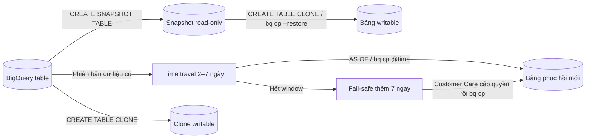
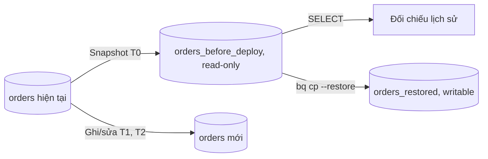

# Time travel, table snapshots và phục hồi dữ liệu BigQuery

> **Chương:** BigQuery  
> **Module:** CLOUD_PROVIDERS_GCP  
> **Phạm vi module:** Khám phá Google Cloud từ tổ chức project, IAM và VPC đến Compute Engine, GKE, Cloud Run, dịch vụ lưu trữ và cơ sở dữ liệu. Qua các tình huống triển khai, người học biết lựa chọn dịch vụ, bảo vệ tài nguyên, tự động hóa phát hành và theo dõi độ tin cậy cùng chi phí.

Một job ETL dùng `CREATE OR REPLACE TABLE` ghi đè bảng doanh thu; nhóm phân tích phát hiện lỗi sau 30 phút. Nếu bảng còn trong **time travel window**, BigQuery có thể đọc phiên bản cũ hoặc sao chép nó sang **bảng mới**. Nhưng sau vài ngày, lịch sử có thể hết hạn; muốn giữ một điểm khôi phục lâu hơn, nhóm phải chủ động tạo **table snapshots** hoặc lưu bản sao phù hợp.

Bài này phân biệt **time travel**, **table snapshot**, **table clone**, **fail-safe** và **copy/restore**, trình bày IAM, chi phí và quy trình khôi phục sau sự cố. Thực hành ưu tiên **đọc trên dataset sandbox có sẵn**; các lệnh tạo snapshot/restore là **tùy chọn có phê duyệt**, không chạy trên bảng production.

## Mục tiêu học tập

Sau bài này, bạn có thể:

1. Xác định cửa sổ **time travel** theo dataset (mặc định 7 ngày, cấu hình 2–7 ngày) và giới hạn **fail-safe** 7 ngày bổ sung.
2. Dùng GoogleSQL `FOR SYSTEM_TIME AS OF` để truy vấn **bảng còn tồn tại** tại mốc lịch sử hợp lệ.
3. Phục hồi **bảng đã xóa** bằng `bq cp` với time decorator `@<time>`, không nhầm với SQL time travel query.
4. Tạo, xem và khôi phục **table snapshot**, hiểu tính read-only, retention, vị trí dữ liệu và writable restore.
5. Phân biệt snapshot với clone, copy vật lý, fail-safe; xác định **RPO/RTO**, quyền và chi phí.
6. Thực hiện runbook phục hồi **không ghi đè nguồn**, so dữ liệu và phục hồi các phụ thuộc an toàn.

## 1. Bốn cơ chế lưu và phục hồi



| Cơ chế | Mục tiêu | Đặc tính |
|---|---|---|
| **Time travel** | Xem/khôi phục trạng thái gần đây | Lịch sử theo **dataset**, mặc định 7 ngày; truy vấn `AS OF` khi bảng còn tồn tại |
| **Table snapshot** | Giữ trạng thái bảng tại **thời điểm cố định** | **Read-only**, query được, có expiration riêng; giữ lâu hơn time travel |
| **Table clone** | Nhân bản nhẹ để test và sửa đổi | **Writable**, copy-on-write; không phải điểm bất biến |
| **Fail-safe** | Cứu dữ liệu khẩn cấp sau time travel | **Thêm 7 ngày**, không tự query/copy khi chưa được Cloud Customer Care cho phép |

**Bản copy thông thường** (`bq cp` không có `--snapshot`/`--restore`) là một table mới, khác snapshot và clone. **Extract/export ra Cloud Storage** là lựa chọn lưu trữ/cross-region khác, có yêu cầu định dạng, IAM, encryption và lifecycle riêng.

## 2. Time travel window và fail-safe

Mỗi dataset có thuộc tính `max_time_travel_hours`. Các bảng được hỗ trợ trong dataset đó dùng cùng cửa sổ truy cập lịch sử.

| Thuộc tính | Giá trị/giới hạn |
|---|---|
| Time travel mặc định | **168 giờ = 7 ngày** |
| Thời gian cấu hình | **48, 72, 96, 120, 144 hoặc 168 giờ** (2–7 ngày) |
| Phạm vi cấu hình | **Dataset**, không phải từng table |
| Timestamp hợp lệ | Nằm trong window **và không trước lúc bảng tạo** |
| Fail-safe sau window | **7 ngày**, cố định và không gia hạn |
| Hết cả fail-safe | Dữ liệu hết hạn **không thể phục hồi**, kể cả qua support |

Khi cần điều chỉnh thời gian giữ, DBA có thể dùng GoogleSQL (thay đúng dataset, chỉ sau change approval):

```sql
-- THAO TÁC THAY ĐỔI CẤU HÌNH DATASET; không chạy trong lab chỉ đọc.
-- 72 giờ = 3 ngày; chỉ cho phép 48–168 giờ theo bước 24 giờ.
ALTER SCHEMA `my-project.analytics_lab`
SET OPTIONS (max_time_travel_hours = 72);
```

Nếu một bảng bị xóa lúc 10:00 với time travel **3 ngày**, cần tự phục hồi bằng `bq cp` trong ba ngày đầu. Sau đó có thể có **7 ngày fail-safe** nhưng phải **liên hệ Cloud Customer Care** để xin quyền khẩn cấp trước khi copy. Không lập kế hoạch RTO như thể truy vấn SQL lúc nào cũng đọc được dữ liệu.

### 2.1. Các phiên bản dữ liệu không phải log từng ô

Khi `UPDATE`/`DELETE`/`MERGE`/`CREATE OR REPLACE` làm thay dữ liệu, BigQuery giữ các **storage blocks phiên bản trước**. Sửa một giá trị có thể kéo theo lưu trữ cả block của cột; mức tăng bytes lịch sử không bằng kích thước một ô thay đổi. Tài nguyên đang bị xóa dùng **cửa sổ tại thời điểm xóa**: nâng time travel từ 2 lên 7 ngày sau khi đã xóa không kéo dài tuổi phục hồi của bản xóa cũ.

Time travel bảo vệ **dữ liệu**, không tự lưu/khôi phục mọi metadata, IAM, tags, policy tags hoặc cấu hình pipeline. Nếu cần giữ dữ liệu 30–180 ngày theo kiểm toán, phải **tạo snapshot khi còn trong time travel** hoặc có kế hoạch archive độc lập.

### 2.2. Fail-safe là quy trình có hỗ trợ, không phải nút “Undo”

Tài liệu BigQuery hiện hành hướng dẫn:

1. Xác định project, dataset, tên bảng, **mốc dữ liệu còn đúng** và thời điểm sự cố.
2. Trong **7 ngày fail-safe**, liên hệ **Cloud Customer Care** xin **temporary fail-safe recovery access** cho dataset.
3. Khi được cấp quyền, operator chạy `bq cp` với **source table và time decorator @TIME** chính xác.
4. Copy từ fail-safe của bảng rất lớn có thể lâu, gặp timeout hoặc lỗi tạm. Khi đó thử lại **cùng source và timestamp**; quá trình khôi phục blocks có thể tiếp tục.
5. Phải hoàn tất trước khi **kết thúc fail-safe**, không chỉ mở ticket trước hạn.

Fail-safe **không cho phép `FOR SYSTEM_TIME AS OF` trên dữ liệu đã ra khỏi time travel**. Đây là đường cứu hộ có điều kiện cho những thao tác được hỗ trợ như **table deletion/replacement**, không phải kế hoạch backup có RPO/RTO chủ động.

## 3. Truy vấn lịch sử bằng `FOR SYSTEM_TIME AS OF`

GoogleSQL có thể đọc một **bảng native còn tồn tại** tại một timestamp quá khứ:

```sql
-- Bảng phải tồn tại >=1 giờ và cửa sổ time travel phải bao gồm mốc này.
SELECT order_id, total_amount, status
FROM `my-project.analytics.orders`
  FOR SYSTEM_TIME AS OF
    TIMESTAMP_SUB(CURRENT_TIMESTAMP(), INTERVAL 1 HOUR)
WHERE order_id = 'order-001';
```

Truy vấn đọc trạng thái table ở timestamp đã chỉ định, nhưng **không tự thay dữ liệu hiện tại**. Nếu bảng được tạo ít hơn một giờ trước hoặc cửa sổ đã hết hạn, BigQuery báo lỗi mốc lịch sử không hợp lệ.

### 3.1. Khi nào nên truy vấn lịch sử?

- Kiểm tra một số rows bị ghi sai và xác định **mốc trước sự cố**.
- So kết quả doanh thu trước và sau một job ETL/migration.
- Chọn đúng thời gian cho thao tác snapshot/copy tiếp theo.

**Không thể dùng `FOR SYSTEM_TIME AS OF` trên bảng đã bị xóa** vì bảng không còn trong catalog: SQL sẽ trả `Not found`. Phải sử dụng **`bq cp table@TIME new_table`** để phục hồi trước rồi mới query bảng mới.

### 3.2. Kiểm soát chi phí truy vấn lịch sử

**`LIMIT` không bảo đảm query rẻ**: BigQuery có thể scan nhiều dữ liệu trước khi trả vài rows. Với bảng lớn, dùng dry run/bytes estimate, chỉ chọn cột cần thiết, partition filter nếu phù hợp và `--maximum_bytes_billed`. **Lab A ở mục 10** có lệnh `bq query` chỉ đọc với ngưỡng billed bytes và thời điểm cách hiện tại 15 phút; chỉ thử trên table có sẵn từ trước mốc ấy.

## 4. Phục hồi table đã xóa/ghi đè bằng `bq cp`

### 4.1. Hiểu đúng time decorator

| Cú pháp | Ý nghĩa |
|---|---|
| `orders@-3600000` | Phiên bản **1 giờ trước**, offset **mili giây** |
| `orders@1732010400000` | Một mốc **Unix epoch milliseconds tuyệt đối** (chỉ minh họa) |
| `orders@0` | Dữ liệu lịch sử sớm nhất hiện còn khả dụng theo quy tắc BigQuery |

Đừng thêm dấu trừ trước số milliseconds tuyệt đối: `@-1732010400000` được hiểu là **lùi ~55 năm**, không phải thời điểm năm 2024. Với incident kéo dài, dùng mốc **tuyệt đối** đã xác minh thay vì offset tương đối vì `@-3600000` tiếp tục dịch theo thời gian hiện tại.

### 4.2. Sao chép phiên bản một giờ trước vào bảng MỚI

```bash
# Bảng nguồn phải từng tồn tại một giờ trước và còn trong time travel.
# Destination không được tồn tại; không ghi đè dữ liệu.
RESTORED_TABLE="orders_recovered_lab"

bq cp --location="$LOCATION" --no_clobber \
  "${PROJECT_ID}:${DATASET_ID}.${TABLE_ID}@-3600000" \
  "${PROJECT_ID}:${DATASET_ID}.${RESTORED_TABLE}"

bq show --format=prettyjson \
  "${PROJECT_ID}:${DATASET_ID}.${RESTORED_TABLE}"
```

`--no_clobber` làm lệnh **thất bại nếu đích đã tồn tại**. Nếu bảng nguồn bị xóa nhưng vẫn trong time travel, `bq cp` có thể cứu dữ liệu; SQL `AS OF` không đọc bảng đã xóa.

### 4.3. Chọn timestamp tuyệt đối để phục hồi

```bash
# Minh họa chuyển timestamp sự cố sang epoch milliseconds trên Cloud Shell.
# Thay bằng mốc thực trong time travel window!
RECOVERY_TIME_UTC="2026-11-19 03:04:00 UTC"
RECOVERY_MS="$(($(date -u -d "$RECOVERY_TIME_UTC" +%s) * 1000))"
printf 'Recovery timestamp (ms): %s\n' "$RECOVERY_MS"

# Chỉ khi được phép tạo destination mới trên dataset sandbox:
# bq cp --location="$LOCATION" --no_clobber \
#   "${PROJECT_ID}:${DATASET_ID}.${TABLE_ID}@${RECOVERY_MS}" \
#   "${PROJECT_ID}:${DATASET_ID}.orders_recovered_at_timestamp"
```

Giá trị ngày ví dụ sẽ nhanh chóng **hết thời hạn**, không chép nguyên vào production. Trên PowerShell, dùng `[DateTimeOffset]::Parse(...).ToUnixTimeMilliseconds()` thay GNU `date`. Mốc phải **sau khi table được tạo**, trước khi xóa và thuộc window hợp lệ.

### 4.4. Không giả định copy khôi phục cả metadata

Tài liệu Google Cloud lưu ý khi restore deleted table bằng time decorator, **tags không được sao chép**, **partitioning information có thể không được sao chép** vào đích. Cần kiểm tra lại:

1. Schema, partitioning/clustering, table expiration, labels/tags và policy tags.
2. Row-level access policies, authorized views, dataset permissions và CMEK.
3. Materialized views hoặc ứng dụng phụ thuộc bảng cũ.
4. IaC/Audit Logs chứa DDL và cấu hình trước sự cố.

**Không hỗ trợ** restore từng partition bằng cú pháp `table$PARTITION@TIME`; phải phục hồi **cả bảng** rồi tách dữ liệu nếu cần. **External table/materialized view** đã bị xóa không phục hồi trực tiếp bằng time travel table copy; phải dựng lại definition/nguồn dữ liệu. Không dùng `CREATE OR REPLACE` trên bảng nguồn khi còn writers hợp lệ.

## 5. Table snapshots: giữ điểm khôi phục dài hạn

**Table snapshot** là một table resource **read-only**, cố định tại một thời điểm; query như bảng thường nhưng không `INSERT/UPDATE/DELETE`. Khác time travel 2–7 ngày, snapshot có thể có retention **lâu hơn window** nếu không bị xóa/hết hạn.



### 5.1. Vì sao snapshot thường rẻ hơn full copy?

BigQuery dùng **shared storage blocks/copy-on-write**: lúc tạo snapshot, nhiều bytes còn được chia sẻ với base; khi dữ liệu nguồn bị sửa/xóa, các blocks mà snapshot cần giữ riêng có thể phát sinh chi phí. Nếu base bị xóa, bytes còn được snapshot giữ sẽ được tính vào tài nguyên thích hợp. **Snapshot không miễn phí** và không bảo đảm dung lượng luôn nhỏ khi bảng thay đổi mạnh.

Snapshot **chỉ bảo vệ một table và thời điểm được chọn**; nó không tự snapshot cả dataset, views, pipelines, routines, IAM, row policies, external source hoặc báo cáo downstream. Cần kế hoạch backup/metadata riêng cho hệ thống.

### 5.2. Location, organization và dataset tách biệt

Đặt snapshot ở một **dataset backup khác dataset nguồn**, cùng location và **cùng organization**, để khi dataset nguồn bị xóa nhầm vẫn còn backup độc lập. Nếu tạo snapshot khác location, BigQuery có thể xử lý như **bản table copy** thay vì snapshot chia sẻ blocks; cần kiểm tra sản phẩm, chi phí và residency. Đối với DR liên vùng, phải có phương án replication/export được duyệt, không giả định snapshot tự chuyển dữ liệu sang region khác.

### 5.3. Các giới hạn quan trọng

- Không snapshot **logical view, materialized view hoặc external table** như native base table.
- **Streaming buffer/write-optimized storage** ở source chưa được đưa vào managed storage sẽ **không có trong snapshot**.
- Snapshot **không tự giữ partition expiration** của nguồn trong mọi trường hợp; đối chiếu dataset default và metadata sau snapshot.
- Chỉ snapshot phiên bản lịch sử **còn trong time travel window**; không tạo snapshot tại mốc vượt hạn.
- Snapshot là read-only với data, nhưng **metadata, expiration, IAM** có thể đổi; lỡ đặt expiration ngắn có thể xóa mất điểm khôi phục.

## 6. Tạo table snapshot

> **Các lệnh tạo resource ở mục này chỉ thực hiện trên sandbox riêng**, khi owner đã phê duyệt region, IAM, retention và phí. Không dùng trên table production trong bài thực hành.

### 6.1. GoogleSQL `CREATE SNAPSHOT TABLE`

```sql
-- Dataset backup phải tồn tại, cùng location/organization với base.
CREATE SNAPSHOT TABLE `my-project.bq_backup_lab.orders_before_fix`
CLONE `my-project.analytics_lab.orders_lab`;
```

Để chụp phiên bản **một giờ trước** khi source **vẫn tồn tại**, đã có từ trước mốc và còn trong time travel:

```sql
CREATE SNAPSHOT TABLE `my-project.bq_backup_lab.orders_one_hour_ago`
CLONE `my-project.analytics_lab.orders_lab`
FOR SYSTEM_TIME AS OF
  TIMESTAMP_SUB(CURRENT_TIMESTAMP(), INTERVAL 1 HOUR);
```

**Snapshot không tự tạo dataset backup**; cả source và target phải được xác minh. Mốc `FOR SYSTEM_TIME AS OF` phải hợp lệ; khi source **đã bị xóa**, ưu tiên `bq cp @TIME` dựng lại trước.

### 6.2. `bq cp --snapshot` với retention 7 ngày

CLI sử dụng `bq cp --snapshot --no_clobber --expiration=604800 SOURCE TARGET`; thời hạn 604800 giây bằng 7 ngày. **Lab B ở mục 11** có đầy đủ biến, lệnh tạo và bước xác minh metadata. Giữ `--no_clobber` để không tạo snapshot trùng tên.

Chụp phiên bản **lịch sử** bằng `bq cp`:

```bash
# Chỉ khi source đã tồn tại 1h trước, dataset window còn cho phép.
# bq cp --location="$LOCATION" --snapshot --no_clobber \
#   "${PROJECT_ID}:${DATASET_ID}.${TABLE_ID}@-3600000" \
#   "${PROJECT_ID}:${BACKUP_DATASET_ID}.orders_snapshot_1h_ago"
```

**Encryption/CMEK:** snapshot tạo bằng SQL kế thừa key mã hóa nguồn, còn tạo bằng `bq cp` có thể dùng default key của dataset đích theo tài liệu. Cần xác minh CMEK region, key availability và quyền của BigQuery encryption service agent.

### 6.3. Xem snapshot metadata

```sql
SELECT
  table_name,
  base_table_catalog,
  base_table_schema,
  base_table_name,
  snapshot_time
FROM `my-project.bq_backup_lab.INFORMATION_SCHEMA.TABLE_SNAPSHOTS`
WHERE table_name = 'orders_snapshot_lab';
```

`TABLE_SNAPSHOTS` trả metadata, không trả data snapshot. Với dữ liệu đã được phép đọc:

```sql
SELECT COUNT(*) AS row_count
FROM `my-project.bq_backup_lab.orders_snapshot_lab`;
```

**COUNT(*) có thể phát sinh chi phí** theo loại query. Kiểm tra thời gian snapshot và expiration trong `bq show`; không giả định snapshot mới tạo chứa mọi bytes đang nằm trong streaming buffer.

## 7. Khôi phục snapshot thành writable table

Muốn cập nhật dữ liệu sau khôi phục, tạo một **table mới** từ snapshot, không đổi quyền để viết trực tiếp vào snapshot.

### 7.1. SQL clone từ snapshot

```sql
-- Table đích phải chưa tồn tại; là bảng có thể ghi sau khi tạo.
CREATE TABLE `my-project.analytics_lab.orders_from_snapshot_lab`
CLONE `my-project.bq_backup_lab.orders_snapshot_lab`;
```

### 7.2. CLI `bq cp --restore`

Sử dụng `bq cp --restore --no_clobber SNAPSHOT TARGET` với **tên table đích mới**. **Lab B ở mục 11** có lệnh chạy và kiểm chứng sau restore.

### 7.3. Bốn thao tác cần phân biệt

| Câu lệnh | Kết quả |
|---|---|
| `CREATE SNAPSHOT TABLE target CLONE source` | Snapshot **read-only** |
| `CREATE TABLE target CLONE source` | Clone **writable** |
| `CREATE TABLE target CLONE snapshot` | Table **writable** từ snapshot |
| `bq cp --restore snapshot target` | Table **writable** từ snapshot |
| `bq cp source@TIME target` | Table **writable** từ lịch sử, gồm cả deleted table còn trong window |

**Bất kể dùng cách nào:** tạo đích mới, kiểm chứng data/schema/security, không overwrite dữ liệu đang được ứng dụng ghi.

## 8. IAM và bảo mật dữ liệu khôi phục

Quyền đọc historical data nhạy cảm: bản lịch sử có thể chứa dữ liệu đã xóa có chủ ý theo chính sách. Cần giới hạn người thực hiện, log audit, retention và nơi lưu snapshot.

| Hành động | Permission quan trọng |
|---|---|
| Xem metadata/table | `bigquery.tables.list`, `bigquery.tables.get` |
| Query lịch sử/snapshot | `bigquery.tables.getData` + `bigquery.jobs.create` |
| Tạo snapshot | `bigquery.tables.createSnapshot` trên source, `bigquery.tables.create` trên đích và quyền đọc/job liên quan |
| Restore snapshot | `bigquery.tables.restoreSnapshot` trên snapshot + `bigquery.tables.create` trên dataset đích |
| Chỉnh window | `bigquery.datasets.update` |
| Restore deleted table | Quyền copy job, đọc lịch sử và tạo table đích theo IAM/resource policy |

**Row-level access policies:** nếu table **có hoặc từng có** row-level access policies, muốn truy cập historical data cần permission `bigquery.rowAccessPolicies.overrideTimeTravelRestrictions`, có trong `roles/bigquery.admin`. Không cấp Admin toàn project cho học viên để làm lab; nhờ operator được phê duyệt. Các lớp **column policy tags, IAM, authorized views, CMEK, VPC Service Controls** có thể tiếp tục ảnh hưởng phục hồi.

Restore **không tự tái lập hoàn toàn tags, policies, partitioning, IAM và pipeline dependencies**. Cần so cấu hình với IaC/Cloud Audit Logs trước khi đưa restored table vào production.

## 9. Storage billing, retention và RPO/RTO

### 9.1. Time travel không lưu bản sao nguyên table mỗi giờ

BigQuery giữ **phiên bản storage blocks**, vì vậy chi phí lịch sử phụ thuộc lượng dữ liệu thực sự bị thay đổi, không bằng số rows sửa. Một `UPDATE` nhỏ có thể tạo phiên bản của block chứa nhiều rows. Với snapshot/clone, khi nhiều phiên bản chia sẻ bytes, BigQuery cố tránh tính trùng storage; sau khi base table đổi/xóa, một phần bytes có thể được tính cho snapshot.

| Khoản mục | Logical storage billing | Physical storage billing |
|---|---|---|
| Active/long-term storage | Phí theo logical bytes | Phí theo compressed/physical bytes |
| Time travel + fail-safe | Đã bao gồm trong base storage pricing | **Tính riêng** dữ liệu lịch sử/fail-safe theo physical bytes |
| Snapshot/clone | Bytes phải giữ riêng theo mô hình snapshot/clone | Physical bytes phải giữ riêng theo mô hình snapshot/clone |
| SQL query lịch sử/snapshot | Có thể phát sinh query bytes processed/slot usage | Tương tự, tùy compute pricing |

**Không cho rằng snapshot miễn phí**: bảng có nhiều updates, deletes hoặc `CREATE OR REPLACE` có thể khiến snapshots giữ nhiều blocks riêng. Nếu bật physical storage billing, giảm time travel từ 7 xuống 2 ngày có thể giảm lưu trữ nhưng **tăng rủi ro không kịp phục hồi**. Budget chỉ cảnh báo, không tự chặn phí.

### 9.2. Xem dữ liệu lưu trữ qua `INFORMATION_SCHEMA`

```sql
-- Chỉ đọc metadata. Cột thể hiện lượng bytes, không phải hóa đơn hoàn chỉnh.
SELECT
  table_name,
  active_logical_bytes,
  active_physical_bytes,
  time_travel_physical_bytes,
  fail_safe_physical_bytes
FROM `my-project.analytics_lab.INFORMATION_SCHEMA.TABLE_STORAGE`
WHERE table_name = 'orders_lab';
```

Metadata có độ trễ; hóa đơn còn phụ thuộc cách tính active/long-term, snapshot ownership, query/copy jobs, CMEK và policy của project. Dùng **Billing Reports + Job history + INFORMATION_SCHEMA** để lập ngân sách. Khi cần snapshot định kỳ, áp **expiration** và owner thay vì tạo vô hạn.

### 9.3. Xác định RPO và RTO

- **RPO (Recovery Point Objective):** tổ chức chấp nhận mất tối đa bao nhiêu thời gian dữ liệu.
- **RTO (Recovery Time Objective):** khôi phục chức năng dịch vụ trong bao lâu.

| Kịch bản | Lựa chọn | Rủi ro cần tính vào RTO |
|---|---|---|
| Phát hiện ETL ghi sai sau 30 phút | Time travel, copy vào table mới | Chọn mốc đúng, copy, diff, cutover |
| Giữ trước mỗi schema/data migration | Snapshot trước release | Có snapshot, quyền restore, kiểm tra schema và consumers |
| Cần bản đọc lịch sử 90 ngày | Snapshot với retention phù hợp | Storage, expiry policy và snapshots phụ thuộc |
| Mất dữ liệu ngoài time travel nhưng còn fail-safe | Cloud Customer Care + copy job | Cấp quyền, phục hồi blocks lâu, giới hạn thời gian |
| Cần DR khác region | Copy/export/replication được thiết kế riêng | Data residency, egress, lag, IAM và mã hóa |

Chỉ có snapshot hoặc time travel **không chứng minh RTO đạt chuẩn**; cần diễn tập restore, kiểm tra quyền và thời gian copy trên table có kích thước tương tự production.

## 10. Lab A — Kiểm kê chỉ đọc một dataset đã có

> **Điều kiện:** project sandbox có BigQuery API, một native table đã có từ trước, danh tính chỉ đọc được phép xem metadata/historical data. Nếu không có dataset sandbox, làm bài tập ở mục 14; **không tạo dataset, snapshot hoặc quyền mới trên project công ty để thử**.

### 10.1. Xem dataset, bảng và thời gian lưu lịch sử

Trong Cloud Shell/Bash:

```bash
PROJECT_ID="my-bq-sandbox"
DATASET_ID="analytics_lab"
TABLE_ID="orders_lab"
LOCATION="asia-southeast1"

gcloud auth list --filter="status:ACTIVE"
bq show --format=prettyjson "${PROJECT_ID}:${DATASET_ID}"
bq show --format=prettyjson "${PROJECT_ID}:${DATASET_ID}.${TABLE_ID}"
bq ls --format=prettyjson "${PROJECT_ID}:${DATASET_ID}"
```

Kiểm tra `location`, `maxTimeTravelHours`, table creation/last modified, partition/cluster settings, expiration và encryption. Nếu cấu hình time travel không được trả rõ trong response, xác minh trên Console hoặc với DBA: mặc định là 168h nhưng dataset có thể được cấu hình ngắn hơn.

### 10.2. Truy vấn nhỏ có lịch sử

```bash
# Table lab phải có từ >=15 phút trước.
# Giới hạn query billed bytes để không scan dữ liệu quá mức.
bq query --use_legacy_sql=false --location="$LOCATION" \
  --maximum_bytes_billed=1000000000 \
  "SELECT COUNT(*) AS rows_15_minutes_ago
   FROM \`${PROJECT_ID}.${DATASET_ID}.${TABLE_ID}\`
   FOR SYSTEM_TIME AS OF
     TIMESTAMP_SUB(CURRENT_TIMESTAMP(), INTERVAL 15 MINUTE)"
```

**Kỳ vọng:** có row count tại mốc cũ; nếu table mới tạo chưa đủ 15 phút thì có thể báo invalid timestamp. Không cố thực hiện thay đổi table để nhìn thấy hai kết quả khác nhau. Với dữ liệu lớn, cân nhắc query trên tập nhỏ/partition an toàn và dùng dry run.

### 10.3. Xem snapshots đã được cấp quyền

```bash
BACKUP_DATASET_ID="bq_backup_lab"

# Chỉ đọc nếu dataset backup đã có và bạn được owner cho phép.
bq ls --format=prettyjson \
  "${PROJECT_ID}:${BACKUP_DATASET_ID}"
```

```sql
SELECT table_name, base_table_name, snapshot_time
FROM `my-bq-sandbox.bq_backup_lab.INFORMATION_SCHEMA.TABLE_SNAPSHOTS`
ORDER BY snapshot_time DESC
LIMIT 20;
```

Nếu dataset backup chưa có, **bỏ qua**. Không cần tạo dataset mới chỉ để hoàn thành phần đọc này.

## 11. Lab B — Snapshot và restore trên sandbox (tùy chọn)

### 11.1. Preflight thao tác ghi

Được thực hiện **chỉ khi** owner xác nhận:

1. Cả dataset nguồn và backup riêng cho lab, chứa dữ liệu không nhạy cảm và **cùng location/organization**.
2. Bảng nguồn không có streaming buffer cần giữ nguyên lúc snapshot.
3. Tên snapshot và restored table **chưa tồn tại**, không có consumers đang dùng.
4. IAM đủ `createSnapshot`/`restoreSnapshot` và quyền tại dataset đích; có budget và retention.

### 11.2. Tạo snapshot với thời hạn 7 ngày

```bash
BACKUP_DATASET_ID="bq_backup_lab"
SNAPSHOT_TABLE_ID="orders_snapshot_lab"

# THAO TÁC GHI: chỉ trên bảng lab đã được duyệt.
bq cp --location="$LOCATION" --snapshot --no_clobber \
  --expiration=604800 \
  "${PROJECT_ID}:${DATASET_ID}.${TABLE_ID}" \
  "${PROJECT_ID}:${BACKUP_DATASET_ID}.${SNAPSHOT_TABLE_ID}"

bq show --format=prettyjson \
  "${PROJECT_ID}:${BACKUP_DATASET_ID}.${SNAPSHOT_TABLE_ID}"
```

Xác minh metadata `type=SNAPSHOT`, `baseTableReference`, snapshot time, expiration và encryption key. Nếu lệnh gặp `Already Exists`, **không bỏ `--no_clobber`**; đặt một tên snapshot mới sau khi kiểm kê.

### 11.3. Restore vào table MỚI

```bash
RESTORE_FROM_SNAPSHOT="orders_restored_lab"

bq cp --location="$LOCATION" --restore --no_clobber \
  "${PROJECT_ID}:${BACKUP_DATASET_ID}.${SNAPSHOT_TABLE_ID}" \
  "${PROJECT_ID}:${DATASET_ID}.${RESTORE_FROM_SNAPSHOT}"

bq show --format=prettyjson \
  "${PROJECT_ID}:${DATASET_ID}.${RESTORE_FROM_SNAPSHOT}"
```

Bảng mới có thể ghi, nhưng **chưa được coi là đã sẵn sàng production**. So số rows, totals, partitions, schema, policy tags/row policies và quyền. Phần lab hoàn thành ngay cả khi operator chỉ lập kế hoạch mà không có quyền chạy copy jobs.

### 11.4. So sánh không cần sửa/xóa bảng nguồn

| Đường đọc | Kết quả nên thấy |
|---|---|
| `SELECT ... FROM source` | Trạng thái hiện tại |
| `SELECT ... FROM source FOR SYSTEM_TIME AS OF t` | Phiên bản tại `t` nếu còn trong window |
| `SELECT ... FROM snapshot` | Phiên bản lúc snapshot được tạo |
| `SELECT ... FROM restored table` | Phiên bản được restore, có thể thay đổi về sau |

Không cần thực hiện `DELETE` hay `UPDATE` để chứng minh tính bất biến; đối chiếu metadata và truy vấn là đủ cho lab không phá dữ liệu.

## 12. Runbook phục hồi sau sự cố

Giả sử ETL ghi thiếu dữ liệu lúc **10:05**, phát hiện lúc **10:15** và xác định dữ liệu đúng cuối cùng là **10:04**.

1. **Khoanh vùng và ngừng lỗi:** pause writer/job gây lỗi theo runbook, ghi job ID và hiện trạng; không xóa bảng hoặc giảm time travel window trong lúc điều tra.
2. **Xác định nguồn/mốc:** project, dataset, table ID, region, **timestamp UTC đúng**, table created/deleted times, snapshots và retention.
3. **Chọn cơ chế:** bảng còn sống → `AS OF`/`bq cp @TIME`; bảng đã xóa trong window → `bq cp @TIME`; có snapshot → `--restore`; ngoài window nhưng còn fail-safe → **Cloud Customer Care** trước.
4. **Tạo table đích mới** bằng `--no_clobber`, giữ nguyên bảng đang nhận writes; lưu metadata/cấu hình bằng IaC và Audit Logs.
5. **Validate dữ liệu:** row count, sums/checksums, business keys, partitioning/clustering, sampling theo partition/tenant và sự khác nhau hợp lệ sau 10:04.
6. **Validate bảo mật:** IAM, tags/policy tags, row access policies, CMEK, authorized views, dataset access.
7. **Cutover có kiểm soát:** chuyển view/table reference hoặc merge chọn lọc sau phê duyệt; không ghi đè các writes hợp lệ phát sinh sau sự cố.
8. **Theo dõi/hậu kiểm:** query failures, BI dashboards, scheduled queries, materialized views, RPO/RTO và phí; bổ sung snapshot trước migration sau này.

### 12.1. SQL kiểm tra số liệu phục hồi

Giả sử hai table có cùng cột `order_id` và `total_amount` kiểu `NUMERIC`:

```sql
SELECT 'restored' AS source,
       COUNT(*) AS row_count,
       SUM(total_amount) AS sum_amount
FROM `my-project.analytics_lab.orders_restored_lab`
UNION ALL
SELECT 'current' AS source,
       COUNT(*) AS row_count,
       SUM(total_amount) AS sum_amount
FROM `my-project.analytics_lab.orders_lab`;
```

**Không kết luận hai bên phải có count bằng nhau**: mốc phục hồi cũ hơn có thể thiếu những giao dịch hợp lệ xảy ra sau 10:04. So với sổ nguồn, ETL job history và partition/business date; không chỉ so tổng toàn bảng.

## 13. Troubleshooting

| Triệu chứng | Nguyên nhân khả dĩ | Xử lý |
|---|---|---|
| `Invalid snapshot time / Cannot read before...` | Mốc ngoài window hoặc trước table created | Đọc `maxTimeTravelHours`, created time, timestamp UTC |
| `Not found` với SQL `AS OF` sau xóa bảng | Không thể query deleted table | `bq cp table@TIME new_table` |
| `bq cp` lịch sử thất bại | Timestamp sai, table location, thiếu IAM hoặc quá hạn | Kiểm tra deletion time, decorator, Audit Logs |
| Dữ liệu chỉ còn trong fail-safe | Chưa có quyền phục hồi tạm | Liên hệ Cloud Customer Care, rồi copy với cùng @TIME |
| `Already Exists` khi tạo snapshot | Tên destination đã có | Giữ `--no_clobber`; dùng tên mới |
| Snapshot được tạo nhưng thiếu rows mới streaming | Chưa vào managed storage | Kiểm tra ingestion buffer, chờ ổn định rồi snapshot |
| Snapshot khác region/organization | Không thể chia sẻ blocks theo semantics snapshot | Đổi dataset backup hoặc dùng copy/DR riêng |
| `UPDATE snapshot` bị từ chối | Snapshot read-only | `bq cp --restore` sang writable table |
| Lịch sử bị access denied | Thiếu getData hoặc row-access special permission | Kiểm tra `overrideTimeTravelRestrictions` |
| Restored table thiếu tags/partitioning | Time travel copy không mang đủ metadata | Khôi phục bằng IaC/Audit Logs và review |
| Lỗi CMEK khi query/copy | Key disabled hoặc KMS IAM sai | Kiểm tra region/key và BigQuery encryption service agent |
| Phí storage tăng sau tạo snapshot | Nhiều modified blocks, base deleted hoặc expiration dài | TABLE_STORAGE, Billing Reports và lịch retention |
| Query tốn phí dù LIMIT nhỏ | Bytes processed lớn | Dry run, partition filter, maximum bytes billed |
| Views/BI phụ thuộc bị lỗi sau khôi phục | Table ID/permissions/schema thay đổi | Update dependencies, rebuild materialized views nếu cần |

### 13.1. Decision tree

```text
Cần khôi phục BigQuery table?
  ├─ Có bảng đang tồn tại?
  │    ├─ Timestamp trong window → SQL AS OF để kiểm tra → bq cp @TIME
  │    └─ Đã xóa, trong window   → bq cp @TIME sang bảng mới
  ├─ Có snapshot riêng?           → bq cp --restore / CREATE TABLE CLONE
  ├─ Ngoài window, trong fail-safe?
  │    └─ Cloud Customer Care grant → bq cp @TIME khẩn cấp
  └─ Ngoài mọi window             → kiểm tra archive/cross-region DR

Sau restore → data checks + IAM/metadata + controlled cutover.
```

## 14. Bài tập và đáp án

### Bài 1 — Khôi phục ETL sau 30 phút

Một bảng còn tồn tại, bị ghi sai 30 phút trước, time travel = 7 ngày. Cần kiểm tra dữ liệu cũ nhưng không thay nguồn.

**Đáp án:** `SELECT ... FROM table FOR SYSTEM_TIME AS OF timestamp_truoc_loi` với mốc còn trong window; nếu cần lưu thành table mới thì `bq cp table@TIME restored`.

### Bài 2 — Bảng đã xóa

`orders` bị `DROP TABLE` hai giờ trước; query `AS OF` lỗi Not found. Có thể làm gì?

**Đáp án:** trong time travel, dùng `bq cp orders@-7200000 orders_restored`. Không dùng SQL trên tên table đã xóa.

### Bài 3 — Dữ liệu đã sang fail-safe

Dataset đặt 3 ngày time travel, một table bị xóa cách đây 5 ngày. Có thể chạy `bq cp` ngay không?

**Đáp án:** không trong chế độ bình thường. Có thể còn **7 ngày fail-safe sau window**; xin temporary recovery access từ Cloud Customer Care rồi copy khẩn cấp, đảm bảo job hoàn tất trước hạn.

### Bài 4 — Giữ mốc 90 ngày

Muốn giữ bảng ở trạng thái trước migration trong 90 ngày, query được nhưng không thể sửa. Chọn gì?

**Đáp án:** **table snapshot read-only** trong dataset backup khác, expiration và IAM tương ứng. Clone writable, còn time travel tối đa 7 ngày.

### Bài 5 — Dữ liệu mới streaming

Một snapshot chụp ngay sau streaming thiếu một số rows. Có thể do đâu?

**Đáp án:** snapshot không bao gồm các rows còn trong **write-optimized/streaming buffer**; kiểm chứng ingestion state và thời điểm chụp.

### Bài 6 — Physical storage

Dataset dùng physical storage billing với nhiều UPDATE và 7 ngày time travel. Vì sao bill tăng?

**Đáp án:** các blocks phiên bản cũ làm tăng `TIME_TRAVEL_PHYSICAL_BYTES` và `FAIL_SAFE_PHYSICAL_BYTES` được tính riêng. Logical billing đã tính hai phần này vào giá storage cơ sở, nhưng snapshot/copy/query vẫn tốn chi phí khác.

### Bài 7 — Quyền đọc lịch sử

Table từng có row-level access policy. User có `bigquery.tables.getData` vẫn bị từ chối query AS OF.

**Đáp án:** cần `bigquery.rowAccessPolicies.overrideTimeTravelRestrictions` trên table; operator được phê duyệt hoặc role phù hợp phải xử lý, không trao admin toàn project vô cớ.

### Bài 8 — Không làm mất writes hợp lệ

Ứng dụng tiếp tục ghi bảng hiện tại. Có nên `CREATE OR REPLACE TABLE current AS SELECT ... AS OF 09:00` để quay về bản cũ?

**Đáp án:** không. Restore vào table mới, diff theo business key và hòa giải changes sau 09:00 trước controlled cutover.

### Bài 9 — Metadata sau restore

Dữ liệu phục hồi đúng nhưng partition settings/tags khác trước. Có phải copy sai rows?

**Đáp án:** không nhất thiết. Historical copy có giới hạn metadata; phục hồi partitioning, tags/IAM bằng IaC/Audit Logs rồi kiểm chứng.

### Bài 10 — Snapshot cross-region

Base ở `asia-southeast1`, muốn snapshot ở `us-central1` nhưng vẫn chia sẻ storage blocks. Có hợp lệ?

**Đáp án:** không. Snapshot chia sẻ blocks yêu cầu cùng region/location và organization; cross-region cần copy/replication/export theo kế hoạch DR riêng.

## 15. Checklist production và cleanup

### 15.1. Checklist triển khai

| Hạng mục | Tiêu chí đạt |
|---|---|
| **Time travel** | Window 48–168h phù hợp RPO, owner duyệt thay đổi |
| **Fail-safe** | Có liên hệ Cloud Customer Care và quy trình xin quyền khẩn cấp |
| **Snapshots** | Dataset backup tách biệt, cùng region/org, expiration + IAM |
| **Restore** | Table đích mới, `--no_clobber`, dữ liệu được validate |
| **Metadata** | Schema, partitions, clustering, tags, policies, expiration, CMEK |
| **Streaming** | Bảo đảm rows đã thoát streaming buffer trước mốc snapshot |
| **Bảo mật** | Row-level history restriction, policy tags và Audit Logs |
| **Cutover** | Giữ writes hợp lệ, kiểm tra downstream và rollback plan |
| **Chi phí** | Logical/physical model, changed blocks, query/copy jobs, retention |
| **Vận hành** | Diễn tập RPO/RTO, owner, alert và log incidents |

### 15.2. Cleanup an toàn

**Lab A chỉ đọc:** không tạo tài nguyên, không cần cleanup. **Lab B tùy chọn** có thể để lại snapshot/restore table có phí. Chỉ xóa khi owner xác nhận những table này **do lab tạo** và không còn cần làm bằng chứng:

```bash
# Chỉ kiểm kê metadata:
bq show --format=prettyjson \
  "${PROJECT_ID}:${BACKUP_DATASET_ID}.${SNAPSHOT_TABLE_ID}"
bq show --format=prettyjson \
  "${PROJECT_ID}:${DATASET_ID}.${RESTORE_FROM_SNAPSHOT}"

# Lệnh xóa CHỈ mang tính minh họa, không chạy khi chưa có phê duyệt:
# bq rm --table --force \
#   "${PROJECT_ID}:${DATASET_ID}.${RESTORE_FROM_SNAPSHOT}"
# bq rm --table --force \
#   "${PROJECT_ID}:${BACKUP_DATASET_ID}.${SNAPSHOT_TABLE_ID}"
```

**Không xóa** bảng nguồn, dataset, snapshots dùng chung hoặc làm thay đổi time travel window để dọn lab. Khi snapshot đã xóa và mốc nguồn đã vượt window, có thể **không tạo lại được** điểm khôi phục ấy. Xem Billing Reports sau thao tác vì dữ liệu phí có thể cập nhật trễ.

## Ghi nhớ

**Time travel** cho phép đọc các phiên bản **2–7 ngày** gần đây: `FOR SYSTEM_TIME AS OF` khi table còn tồn tại và `bq cp @TIME` khi cần khôi phục kể cả table đã xóa. **Table snapshot** giữ trạng thái read-only lâu hơn; dùng `bq cp --restore`/`CREATE TABLE CLONE` để có bảng mới writable. **Fail-safe** là thêm 7 ngày có điều kiện, cần Cloud Customer Care cấp quyền tạm chứ không thể tự query như thời gian bình thường. Mọi quy trình khôi phục phải kiểm chứng **dữ liệu, metadata, IAM, chi phí và downstream** trước khi mở traffic.

## Tài liệu tham khảo chính thức

- [BigQuery — Data retention with time travel and fail-safe](https://cloud.google.com/bigquery/docs/time-travel)
- [BigQuery — Access historical data](https://cloud.google.com/bigquery/docs/access-historical-data)
- [BigQuery — Restore deleted tables](https://cloud.google.com/bigquery/docs/restore-deleted-tables)
- [BigQuery — Update dataset time travel window](https://cloud.google.com/bigquery/docs/updating-datasets)
- [BigQuery — Introduction to table snapshots](https://cloud.google.com/bigquery/docs/table-snapshots-intro)
- [BigQuery — Create table snapshots](https://cloud.google.com/bigquery/docs/table-snapshots-create)
- [BigQuery — Restore table snapshots](https://cloud.google.com/bigquery/docs/table-snapshots-restore)
- [BigQuery — Table snapshot metadata](https://cloud.google.com/bigquery/docs/table-snapshots-metadata)
- [BigQuery — TABLE_SNAPSHOTS view](https://cloud.google.com/bigquery/docs/information-schema-snapshots)
- [BigQuery — Introduction to table clones](https://cloud.google.com/bigquery/docs/table-clones-intro)
- [BigQuery — TABLE_STORAGE view](https://cloud.google.com/bigquery/docs/information-schema-table-storage)
- [BigQuery — Row-level security with time travel](https://cloud.google.com/bigquery/docs/using-row-level-security-with-features)
- [BigQuery — Storage pricing](https://cloud.google.com/bigquery/pricing#storage)
