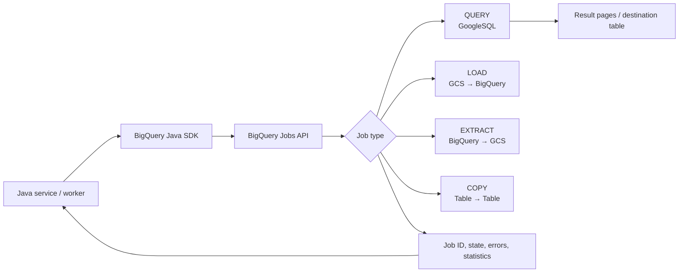
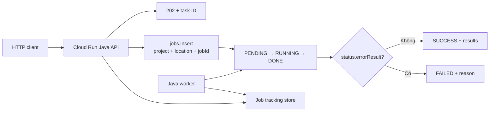

# BigQuery Java client và thực thi jobs từ ứng dụng

Một API Spring Boot cần đọc doanh thu theo ngày từ **BigQuery**, trong khi một worker Java khác phải nạp file Parquet từ **Cloud Storage** vào bảng phân tích mỗi giờ. Cả hai đều dùng BigQuery nhưng vòng đời request khác nhau: query nhỏ có thể chờ kết quả ngay, còn nạp dữ liệu hoặc truy vấn dài nên **tạo job, ghi nhận Job ID, theo dõi trạng thái và xử lý retry an toàn**.

Bài thuộc chương **BigQuery** của module `CLOUD_PROVIDERS_GCP`. Người học kết hợp kiến thức IAM, Cloud Storage, Cloud Run/GKE, Cloud SQL và các luồng dữ liệu để sử dụng **thư viện `google-cloud-bigquery` cho Java**, thực thi query/load/extract jobs, kiểm soát chi phí và quan sát độ tin cậy. Ví dụ dùng dữ liệu và project sandbox giả định; lời gọi BigQuery có thể phát sinh phí xử lý, lưu trữ hoặc egress.

> **Nguyên tắc:** BigQuery là hệ thống phân tích dữ liệu (OLAP), không phải nơi thực hiện transaction đặt hàng theo từng request như Cloud SQL/AlloyDB. Không gọi một full-table scan trên mỗi thao tác người dùng; xem xét cache, bảng tổng hợp, partition pruning hoặc batch processing nếu API có QPS cao.

## 1. Mục tiêu học tập

Sau bài này, bạn có thể:

1. Tạo và tái sử dụng **`BigQuery` client** với Application Default Credentials (ADC).
2. Phân biệt **query đồng bộ** với **job bất đồng bộ** (`QUERY`, `LOAD`, `EXTRACT`, `COPY`).
3. Dùng **GoogleSQL named parameters** thay nối chuỗi dữ liệu người dùng vào SQL.
4. Đặt **location, Job ID, labels, dry run, maximum bytes billed** để quản trị jobs.
5. Kiểm tra đúng **`DONE` và `status.errorResult`**, xử lý polling, timeout và gián đoạn.
6. Đọc **`TableResult`** an toàn với null/type/pagination, tránh tải vô hạn vào RAM ứng dụng.
7. Thiết kế **idempotent retry** cho load và DML jobs, phân biệt duplicate submission với duplicate business rows.
8. Dựng một lab Java/Maven, kiểm tra IAM, job metadata, chi phí và giải bài tập vận dụng.

## 2. BigQuery job là gì?

BigQuery jobs là các tác vụ chạy phía server. Ứng dụng gửi **job configuration** và nhận lại **job reference**, không phải tự tải toàn bộ bảng rồi tính toán bằng Java:



| Loại | Làm gì? | Khi dùng từ Java |
| --- | --- | --- |
| **QUERY** | Chạy GoogleSQL: `SELECT`, `INSERT`, `MERGE`, DDL, scripts. | API báo cáo, backfill có SQL, tổng hợp định kỳ. |
| **LOAD** | Nạp dữ liệu từ GCS/file được hỗ trợ vào managed table. | Worker nhận file/batch ready signal. |
| **EXTRACT** | Xuất bảng BigQuery ra Cloud Storage. | Xuất báo cáo, trao đổi data lake, archive. |
| **COPY** | Sao chép bảng hoặc snapshot theo các giới hạn của job. | Chuẩn bị môi trường, sao chép bảng phân tích. |

### 2.1. Trạng thái không đồng nghĩa kết quả

Jobs có trạng thái **`PENDING` → `RUNNING` → `DONE`**. **`DONE` là kết thúc, không phải thành công**. Phải kiểm tra `Job.getStatus().getError()` (REST: `status.errorResult`); `getExecutionErrors()` có thể cung cấp chi tiết hoặc lỗi không fatal. Một load job vẫn có thể “thành công” nhưng đã bỏ qua records lỗi nếu bạn cấu hình cho phép.

### 2.2. Query nhanh và job dài

- **`bigquery.query(QueryJobConfiguration)`**: phương thức tiện lợi, chờ query hoàn thành và trả `TableResult`. Hợp cho query nhỏ cần phản hồi trong luồng xử lý hiện tại.
- **`bigquery.create(JobInfo.of(jobId, config))`**: chủ động tạo job có **Job ID**, có thể lưu ID rồi trả `202 Accepted` từ API, polling từ worker khác, hỗ trợ retry và kiểm toán.
- **`Job.waitFor(...)`**: chờ hoàn thành nhưng có thể gặp timeout/interruption; **timeout phía client không đồng nghĩa BigQuery job đã dừng**.
- **`Job.getQueryResults(...)`**: lấy các trang kết quả của query job sau khi thành công.

Không nên chạy query hàng phút bên trong HTTP request rồi giữ connection chờ hàng giờ. Kiến trúc phù hợp thường là **submit job → lưu job reference → trả task ID → callback/poll status → đọc kết quả hoặc bảng đích**.

## 3. Chuẩn bị môi trường Java và quyền truy cập

### 3.1. IAM và Application Default Credentials

| Principal | Quyền tiêu biểu | Giới hạn |
| --- | --- | --- |
| Java query-only service | `roles/bigquery.jobUser` ở project chạy job; `roles/bigquery.dataViewer` ở dataset/bảng đọc. | Job User **không tự** cấp quyền xem mọi bảng. |
| Worker load dữ liệu | `bigquery.jobs.create`, quyền tạo/cập nhật bảng đích; quyền đọc GCS object và list khi wildcard. | Tách khỏi account quản trị project. |
| Worker extract | Quyền đọc bảng và tạo job; ghi GCS objects vào bucket đích. | Kiểm soát dữ liệu nhạy cảm/egress. |
| CI/CD/deployer | Quyền triển khai ứng dụng và sử dụng runtime service account theo policy. | Không cần dùng Owner cho runtime. |

Ở môi trường developer, **ADC** có thể lấy từ `gcloud auth application-default login`; danh tính này khác với `gcloud auth login`/CLI account trong một số cấu hình. Trên **Cloud Run, GKE Workload Identity Federation hoặc Compute Engine**, gắn **service account** cho workload để ADC hoạt động **không cần file JSON key**.

Trong Bash/Cloud Shell (chỉ đọc, ngoại trừ lệnh đăng nhập bị comment):

```bash
PROJECT_ID="orders-analytics-lab"
LOCATION="asia-southeast1"
DATASET_ID="java_jobs_lab"

gcloud auth list
gcloud config get-value project
gcloud services list --enabled --project="$PROJECT_ID" \
  --filter="name:bigquery.googleapis.com"
bq ls --project_id="$PROJECT_ID"

# Khi chạy trên máy developer được phép, tạo ADC nếu chưa có.
# gcloud auth application-default login
```

**Vị trí:** Đặt `location` của job tương thích với dataset nguồn/đích, ví dụ `asia-southeast1`; dataset ở `US` không thể tùy ý chạy job ở `asia-southeast1`. Tài nguyên GCS dùng cho LOAD/EXTRACT cũng cần tuân thủ quy tắc tương thích location. **Job ID và location phải đi cùng nhau khi tra cứu job**.

### 3.2. Cấu trúc Maven tối thiểu

Trong thư mục lab riêng **ngoài repository học liệu**, tạo `pom.xml`:

```xml
<project xmlns="http://maven.apache.org/POM/4.0.0"
         xmlns:xsi="http://www.w3.org/2001/XMLSchema-instance"
         xsi:schemaLocation="http://maven.apache.org/POM/4.0.0
           https://maven.apache.org/xsd/maven-4.0.0.xsd">
  <modelVersion>4.0.0</modelVersion>
  <groupId>example</groupId>
  <artifactId>bigquery-java-jobs-lab</artifactId>
  <version>1.0.0</version>
  <properties>
    <maven.compiler.release>17</maven.compiler.release>
    <project.build.sourceEncoding>UTF-8</project.build.sourceEncoding>
  </properties>
  <dependencies>
    <dependency>
      <groupId>com.google.cloud</groupId>
      <artifactId>google-cloud-bigquery</artifactId>
      <version>2.73.0</version>
    </dependency>
  </dependencies>
  <build>
    <plugins>
      <plugin>
        <groupId>org.apache.maven.plugins</groupId>
        <artifactId>maven-compiler-plugin</artifactId>
        <version>3.14.0</version>
      </plugin>
      <plugin>
        <groupId>org.codehaus.mojo</groupId>
        <artifactId>exec-maven-plugin</artifactId>
        <version>3.6.2</version>
      </plugin>
    </plugins>
  </build>
</project>
```

Ví dụ minh họa phiên bản `google-cloud-bigquery 2.73.0` trong tài liệu Java SDK tại thời điểm viết; **production nên quản lý phiên bản theo Google Cloud Libraries BOM và lock/CI policies**, không để nhiều Google Cloud libraries có version xung đột. Các ví dụ dùng **Java 17**.

### 3.3. Tạo dữ liệu sandbox cho bài

Nếu được cấp quyền tạo dữ liệu và đã kiểm tra project/dataset:

```bash
# THAY ĐỔI BIGQUERY THẬT, chỉ chạy một lần nếu dataset chưa tồn tại.
bq --location="$LOCATION" mk --dataset "$PROJECT_ID:$DATASET_ID"
```

Trong BigQuery SQL editor, chỉnh project ID mẫu và chạy **chỉ trong sandbox**:

```sql
CREATE TABLE IF NOT EXISTS `orders-analytics-lab.java_jobs_lab.orders_lab` (
  order_id STRING,
  tenant_id STRING,
  event_date DATE,
  amount_cents INT64,
  status STRING
)
PARTITION BY event_date
CLUSTER BY tenant_id;

-- CHÈN DỮ LIỆU THẬT: chạy lại sẽ tạo duplicate nếu không dọn trước.
INSERT INTO `orders-analytics-lab.java_jobs_lab.orders_lab`
  (order_id, tenant_id, event_date, amount_cents, status)
VALUES
  ('O-1001', 't1', DATE '2026-11-19', 2500, 'PAID'),
  ('O-1002', 't1', DATE '2026-11-19', 1300, 'PENDING'),
  ('O-1003', 't2', DATE '2026-11-18', 8100, 'PAID');
```

**Lưu ý:** `CREATE TABLE IF NOT EXISTS` không xác nhận bảng sẵn có có schema phù hợp. Chỉ dùng bảng riêng của lab và kiểm tra trước khi `INSERT`; BigQuery không tự enforce uniqueness của `order_id`.

## 4. Lab 1 — Query đồng bộ bằng Java và named parameters

Một API muốn đọc các đơn có số tiền lớn hơn ngưỡng `minAmount` của một ngày. **Không** xây SQL từ dữ liệu người dùng bằng string concatenation; dùng `@day` và `@min_amount`.

Tạo `src/main/java/example/QueryOrders.java`:

```java
package example;

import com.google.cloud.bigquery.BigQuery;
import com.google.cloud.bigquery.BigQueryOptions;
import com.google.cloud.bigquery.FieldValueList;
import com.google.cloud.bigquery.QueryJobConfiguration;
import com.google.cloud.bigquery.QueryParameterValue;
import com.google.cloud.bigquery.TableResult;

public final class QueryOrders {
  public static void main(String[] args) throws InterruptedException {
    String project = System.getenv("PROJECT_ID");
    if (project == null || project.isBlank()) {
      throw new IllegalArgumentException("PROJECT_ID required");
    }
    BigQuery bigquery = BigQueryOptions.newBuilder()
        .setProjectId(project)
        .build()
        .getService();

    // Project/dataset/table là identifiers cố định của ứng dụng,
    // không lấy tùy ý từ HTTP request.
    if (!project.matches("[a-z][a-z0-9-]{4,62}")) {
      throw new IllegalArgumentException("Invalid sandbox project ID");
    }
    String sql = """
        SELECT order_id, tenant_id, amount_cents
        FROM `%s.java_jobs_lab.orders_lab`
        WHERE event_date = @day AND amount_cents >= @min_amount
        ORDER BY amount_cents DESC
        LIMIT 10
        """.formatted(project);
    QueryJobConfiguration query = QueryJobConfiguration.newBuilder(sql)
        .setUseLegacySql(false)
        .addNamedParameter("day", QueryParameterValue.date("2026-11-19"))
        .addNamedParameter("min_amount", QueryParameterValue.int64(2000L))
        .setMaximumBytesBilled(100_000_000L)
        .build();

    TableResult result = bigquery.query(query);
    for (FieldValueList row : result.getValues()) {
      // Lấy một trang: tối đa 10 rows do LIMIT trong SQL.
      if (!row.get("order_id").isNull()) {
        System.out.printf("%s (%s): %d cents%n",
            row.get("order_id").getStringValue(),
            row.get("tenant_id").getStringValue(),
            row.get("amount_cents").getLongValue());
      }
    }
  }
}
```

Ví dụ chỉ cho phép project ID hợp lệ từ cấu hình ứng dụng rồi chèn vào **table identifier cố định**. Với lựa chọn dataset/table linh hoạt, phải **validate identifiers theo allowlist**; **GoogleSQL parameters không thay được table/dataset identifiers**.

Chạy trong lab đã có Maven và ADC:

```bash
export PROJECT_ID="orders-analytics-lab"
mvn -q compile exec:java -Dexec.mainClass=example.QueryOrders
```

Kỳ vọng: trả `O-1001` với `2500 cents` nếu dữ liệu giống ví dụ. **`setMaximumBytesBilled(100_000_000L)`** là hạn mức minh họa cho query nhỏ; với bảng lớn, query sẽ bị từ chối nếu ước lượng bytes vượt ngưỡng. **`LIMIT 10` không đảm bảo chi phí scan chỉ 10 rows**: BigQuery có thể cần đọc nhiều blocks/partitions trước khi giới hạn kết quả.

### 4.1. Thực tế về `TableResult`

- `row.get("column").getStringValue()/getLongValue()` phải khớp kiểu BigQuery; kiểm tra `isNull()` trước khi đọc cột nullable.
- `getValues()` chỉ duyệt **trang hiện tại**; `iterateAll()` tự duyệt nhiều trang và có thể kéo lượng dữ liệu lớn qua network.
- Với hàng triệu rows, **không trả trực tiếp qua JSON API** hoặc gom `List` tất cả vào heap; nên xuất kết quả vào bảng/GCS rồi đọc batch, hoặc dùng **BigQuery Storage Read API** cho workload đọc dữ liệu lớn.
- `getTotalRows()` là tổng rows kết quả (nếu có), **không** phải bytes scanned hay số rows trong một page.

## 5. Dry run và giới hạn chi phí trước query

**Dry run** kiểm tra query và ước tính bytes xử lý **không thực thi query**. Tạo `DryRunOrders.java`:

```java
package example;

import com.google.cloud.bigquery.BigQuery;
import com.google.cloud.bigquery.BigQueryOptions;
import com.google.cloud.bigquery.Job;
import com.google.cloud.bigquery.JobInfo;
import com.google.cloud.bigquery.JobStatistics;
import com.google.cloud.bigquery.QueryJobConfiguration;
import com.google.cloud.bigquery.QueryParameterValue;

public final class DryRunOrders {
  public static void main(String[] args) {
    String project = System.getenv("PROJECT_ID");
    if (project == null || !project.matches("[a-z][a-z0-9-]{4,62}")) {
      throw new IllegalArgumentException("Set valid PROJECT_ID");
    }
    BigQuery bigquery = BigQueryOptions.newBuilder()
        .setProjectId(project).build().getService();
    String sql = """
        SELECT COUNT(*) AS n
        FROM `%s.java_jobs_lab.orders_lab`
        WHERE event_date = @day
        """.formatted(project);
    QueryJobConfiguration config = QueryJobConfiguration.newBuilder(sql)
        .setUseLegacySql(false)
        .addNamedParameter("day", QueryParameterValue.date("2026-11-19"))
        .setDryRun(true)
        .setUseQueryCache(false)
        .build();

    Job job = bigquery.create(JobInfo.of(config));
    JobStatistics.QueryStatistics stats = job.getStatistics();
    System.out.println("Estimated bytes processed: "
        + stats.getTotalBytesProcessed());
  }
}
```

Dry run không tạo output rows, **không thay cho kiểm thử kết quả**. Ước tính có thể khác bytes thực tế, nhất là với **external tables**, clustering/pruning hoặc query phức tạp; `maximumBytesBilled` được BigQuery kiểm tra theo ước lượng trước chạy, có thể lớn hơn bytes billed thực khi clustered pruning. Với BigQuery Editions/Reservations, bytes processed và **slot consumption** là các khái niệm chi phí khác nhau. 

## 6. Lab 2 — Job bất đồng bộ: tạo, theo dõi và đọc kết quả

Giả sử một worker cần chạy báo cáo nhưng request HTTP của người dùng chỉ được chờ 3 giây. Giải pháp:

1. API nhận request, xác thực user và tạo **business request ID** ổn định.
2. Dùng request ID để quyết định **Job ID** và cấu hình job bất biến; submit một lần.
3. Ghi `project, location, jobId, query_version, status` vào bảng/queue trạng thái.
4. Trả `202 Accepted` cùng task ID; một worker khác lấy `Job.getStatus()` hoặc `waitFor()`.
5. Khi job thành công, cung cấp kết quả hoặc đường dẫn bảng đích; khi lỗi, ghi lý do và chính sách retry.



### 6.1. Java: submit và xử lý duplicate Job ID

Tạo `src/main/java/example/SubmitQueryJob.java`:

```java
package example;

import com.google.cloud.bigquery.BigQuery;
import com.google.cloud.bigquery.BigQueryException;
import com.google.cloud.bigquery.BigQueryOptions;
import com.google.cloud.bigquery.Job;
import com.google.cloud.bigquery.JobId;
import com.google.cloud.bigquery.JobInfo;
import com.google.cloud.bigquery.QueryJobConfiguration;
import java.util.Map;

public final class SubmitQueryJob {
  public static void main(String[] args) {
    String project = required("PROJECT_ID");
    String location = required("LOCATION"); // Cùng location với dataset.
    String requestKey = required("REQUEST_KEY"); // Ví dụ 20261119_t1_v1
    if (!requestKey.matches("[A-Za-z0-9_-]{1,80}")) {
      throw new IllegalArgumentException("Invalid request key");
    }

    BigQuery bq = BigQueryOptions.newBuilder()
        .setProjectId(project).build().getService();
    JobId id = JobId.newBuilder()
        .setProject(project)
        .setLocation(location)
        .setJob("report_" + requestKey)
        .build();

    QueryJobConfiguration config =
        QueryJobConfiguration.newBuilder(
            "SELECT 42 AS answer, CURRENT_DATE() AS executed_date")
        .setUseLegacySql(false)
        .setLabels(Map.of("service", "orders_api", "env", "lab"))
        .setMaximumBytesBilled(100_000_000L)
        .build();

    Job job;
    try {
      job = bq.create(JobInfo.of(id, config));
      System.out.println("Created " + id.getJob());
    } catch (BigQueryException e) {
      if (e.getCode() != 409) {
        throw e; // Auth, quota, syntax hoặc lỗi khác cần xử lý riêng.
      }
      // Server có thể đã nhận request trước khi mạng trả lỗi.
      job = bq.getJob(id);
      if (job == null) {
        throw new IllegalStateException("409 nhưng không tìm được job", e);
      }
      System.out.println("Reusing existing " + id.getJob());
    }

    // Không đợi: giao đầy đủ project/location/id cho status worker.
    System.out.printf("job=%s location=%s state=%s%n",
        job.getJobId().getJob(), location, job.getStatus().getState());
  }

  static String required(String name) {
    String value = System.getenv(name);
    if (value == null || value.isBlank()) {
      throw new IllegalArgumentException("Missing " + name);
    }
    return value;
  }
}
```

Chạy với **request key cố định cho cùng một yêu cầu**, không tự tạo key ngẫu nhiên khi retry:

```bash
export PROJECT_ID="orders-analytics-lab"
export LOCATION="asia-southeast1"
export REQUEST_KEY="20261119_t1_v1"

# TẠO QUERY JOB THẬT. Query ví dụ không quét bảng.
mvn -q compile exec:java -Dexec.mainClass=example.SubmitQueryJob
```

**Nhớ:** `Job ID` trong ví dụ là `report_20261119_t1_v1`. Nó phải được giữ qua retries **cùng nội dung job**. Nếu business request khác, dùng ID khác. Khi nhận 409, lấy **job hiện hữu và đối chiếu request/config đã lưu**; không coi một Job ID có sẵn với SQL khác là thành công.

### 6.2. Java: polling có timeout và kiểm tra lỗi đúng

Tạo `src/main/java/example/CheckQueryJob.java`:

```java
package example;

import com.google.cloud.RetryOption;
import com.google.cloud.bigquery.BigQuery;
import com.google.cloud.bigquery.BigQueryOptions;
import com.google.cloud.bigquery.FieldValueList;
import com.google.cloud.bigquery.Job;
import com.google.cloud.bigquery.JobId;
import com.google.cloud.bigquery.JobStatus;
import com.google.cloud.bigquery.TableResult;
import java.time.Duration;

public final class CheckQueryJob {
  public static void main(String[] args) throws InterruptedException {
    String project = System.getenv("PROJECT_ID");
    String location = System.getenv("LOCATION");
    String requestKey = System.getenv("REQUEST_KEY");
    if (project == null || location == null || requestKey == null) {
      throw new IllegalArgumentException("Set PROJECT_ID, LOCATION, REQUEST_KEY");
    }

    BigQuery bq = BigQueryOptions.newBuilder()
        .setProjectId(project).build().getService();
    JobId id = JobId.newBuilder().setProject(project)
        .setLocation(location).setJob("report_" + requestKey).build();

    Job job = bq.getJob(id);
    if (job == null) {
      throw new IllegalStateException("Job not found: " + id.getJob());
    }

    Job finished = job.waitFor(
        RetryOption.totalTimeoutDuration(Duration.ofMinutes(2)));
    if (finished == null) {
      throw new IllegalStateException("Job disappeared: " + id.getJob());
    }
    if (finished.getStatus().getState() != JobStatus.State.DONE) {
      System.out.println("Job chưa xong; theo dõi lại: " + id.getJob());
      return;
    }
    if (finished.getStatus().getError() != null) {
      throw new IllegalStateException(
          "Job failed: " + finished.getStatus().getError());
    }
    System.out.println("SUCCESS: " + id.getJob());

    // Mẫu query chỉ có một row, pageSize=10 là đủ.
    TableResult results = finished.getQueryResults(
        BigQuery.QueryResultsOption.pageSize(10));
    for (FieldValueList row : results.getValues()) {
      System.out.println("answer=" + row.get("answer").getLongValue());
    }
  }
}
```

Khi một query thực sự trả nhiều rows, có thể duyệt pages có kiểm soát:

```java
TableResult page = finished.getQueryResults(
    BigQuery.QueryResultsOption.pageSize(100));
int pageCount = 0;
while (page != null && pageCount++ < 5) {
  for (FieldValueList row : page.getValues()) {
    // Xử lý từng row, tránh lưu toàn bộ vào List.
    System.out.println(row);
  }
  page = page.hasNextPage() ? page.getNextPage() : null;
}
```

**Lưu ý:** `waitFor` có thể timeout/ném lỗi ở phía client; điều này **không chứng minh server job thất bại**. Nếu polling timeout, lưu reference rồi theo dõi tiếp hoặc đưa vào queue; **đừng lập tức tạo một job mới với UUID khác**. Khi thread bị interrupt, truyền `InterruptedException` lên tầng điều phối hoặc gọi `Thread.currentThread().interrupt()` trong catch; không nuốt interrupt và retry vô hạn.

### 6.3. Dùng Job ID để retry đúng mức

| Sự cố | Nên làm | Không nên |
| --- | --- | --- |
| `jobs.insert` thành công nhưng HTTP response bị mất | Gọi `getJob(project, location, jobId)`/submit lại cùng ID để biết trạng thái. | Tạo UUID mới, nhất là với `WRITE_APPEND`. |
| Trả `409 ALREADY_EXISTS` | Xác minh job ID hiện hữu và business request/config trùng. | Xem 409 luôn là job vừa hoàn tất thành công. |
| `waitFor` hết thời gian chờ | Poll tiếp theo ID cũ, giữ trạng thái PENDING/RUNNING. | Tạo job khác chỉ vì client timeout. |
| Job `DONE` có `status.errorResult` | Phân tích lỗi, xác định ghi gì vào sink, sửa rồi tạo job **mới** có tracking. | Đổi ID và chạy lặp mù quáng. |
| Job `DONE` không có lỗi | Đánh dấu job success rồi kiểm tra quality gates/manifest nếu là dữ liệu nghiệp vụ. | Chỉ dựa vào `DONE`. |

BigQuery từ chối **tạo lại cùng job ID**; đây là cơ chế quan trọng để tránh append trùng khi retry việc gửi job. Nhưng **job IDs khác nhau có thể cùng xử lý một file**, nên muốn exactly-once ở cấp business cần stable **batch ID, event ID, staging/`MERGE` và audit trail**.

## 7. Lab 3 — LOAD job từ Cloud Storage bằng Java

Giả sử GCS chứa file Parquet `gs://<bucket>/landing/orders-2026-11-19.parquet`, đã được kiểm thử schema tương thích với bảng đích. Java chỉ submit job, còn BigQuery thực hiện nạp; worker **không cần download toàn bộ file vào JVM heap**.

**Điều kiện:** bucket đã tồn tại, object và location tương thích dataset, service account được cấp `storage.objects.get`/`storage.objects.list` khi cần và BigQuery destination permissions. Thao tác **thay đổi bảng thật**:

```java
import com.google.cloud.bigquery.BigQuery;
import com.google.cloud.bigquery.BigQueryOptions;
import com.google.cloud.bigquery.FormatOptions;
import com.google.cloud.bigquery.Job;
import com.google.cloud.bigquery.JobId;
import com.google.cloud.bigquery.JobInfo;
import com.google.cloud.bigquery.LoadJobConfiguration;
import com.google.cloud.bigquery.TableId;

String project = "orders-analytics-lab";
String location = "asia-southeast1";
String sourceUri = "gs://orders-lab-bucket/landing/orders-2026-11-19.parquet";
TableId destination = TableId.of(project, "java_jobs_lab", "orders_stage");

BigQuery bq = BigQueryOptions.newBuilder()
    .setProjectId(project).build().getService();
LoadJobConfiguration config = LoadJobConfiguration
    .builder(destination, sourceUri)
    .setFormatOptions(FormatOptions.parquet())
    .setWriteDisposition(JobInfo.WriteDisposition.WRITE_APPEND)
    .build();
JobId id = JobId.newBuilder()
    .setProject(project).setLocation(location)
    .setJob("load_orders_20261119_batch_001")
    .build();
Job submitted = bq.create(JobInfo.of(id, config)); // Ghi dữ liệu THẬT.
Job done = submitted.waitFor();
if (done == null || done.getStatus().getError() != null) {
  throw new IllegalStateException("LOAD thất bại hoặc job biến mất");
}
System.out.println("Loaded batch: " + done.getJobId().getJob());
```

Đây là **đoạn code đặt bên trong method có `throws InterruptedException`** (không phải một Java file độc lập), nhằm tập trung vào cấu hình LOAD. Nếu dùng trong ứng dụng thật:

- Kiểm tra `bigquery.getTable(destination)` sau job và xác minh schema trước khi load; đừng tự tạo bảng mới theo schema không kiểm soát.
- `WRITE_APPEND` thêm records; chạy hai jobs **ID khác nhau** từ cùng file có thể tạo duplicates.
- `WRITE_TRUNCATE` thay toàn bộ bảng đích, có thể xóa dữ liệu ngoài batch. Chỉ dùng sau approval và đối soát rõ phạm vi; không dùng để “sửa lỗi tạm”.
- `WRITE_EMPTY` yêu cầu đích trống, hữu ích cho staging table bất biến theo batch.
- Kết quả load job được BigQuery commit nguyên tử ở cấp job, **không** mặc định dedup theo `order_id` hay đảm bảo data contract đúng.
- Với CSV/ndJSON, cần `FormatOptions.csv()/json()`, schema, header/encoding/bad-record policy; Parquet thường mang schema nội tại nhưng vẫn phải kiểm tra compatibility.

### 7.1. Kiến trúc idempotent cho ingestion

```text
GCS immutable batch + checksum/manifest
  → Java worker nhận batch_id
  → Job ID = hàm xác định từ batch_id + version
  → LOAD vào staging table dành riêng batch
  → đối soát source rows/amounts/schema/duplicates
  → BigQuery MERGE hoặc publish partition với commit policy
  → lưu completed batch_id + source URI/object generation + Job ID
```

Khi nhận lại cùng batch, tra tracking store/job ID và **không load lại vào cùng staging đích theo một job ID mới** nếu không có chính sách xử lý. Với mutable GCS object, một URI có thể trỏ tới bytes khác theo thời gian; lưu object generation/checksum riêng và coi **đổi nội dung** là một batch/version mới. Không đặt URI kèm generation fragment rồi kỳ vọng BigQuery LOAD hỗ trợ mọi dạng object version.

## 8. EXTRACT và COPY jobs: hướng dẫn ngắn

### 8.1. EXTRACT — bảng → Cloud Storage

```java
import com.google.cloud.bigquery.ExtractJobConfiguration;

// Bảng và bucket phải có thật; location/IAM tương thích.
// URI đích có wildcard để tạo nhiều shards nếu cần.
ExtractJobConfiguration exportConfig = ExtractJobConfiguration.of(
    TableId.of("orders-analytics-lab", "java_jobs_lab", "orders_lab"),
    "gs://orders-lab-bucket/export/orders-*.parquet",
    "PARQUET");
Job exportJob = bq.create(JobInfo.of(exportConfig));
Job exported = exportJob.waitFor();
if (exported == null || exported.getStatus().getError() != null) {
  throw new IllegalStateException("EXTRACT failed");
}
```

Mẫu dùng **`bq`/`Job` client và imports tương ứng** từ ví dụ LOAD; là **snippet trong method**, không phải file Java độc lập. Ghi file vào GCS **có thể phát sinh storage/network charges**; cần quyền xuất bảng, quyền ghi object và không xuất PII trái phép. Với bảng lớn, wildcard có thể tạo nhiều files. Không mặc định export một bảng sang Parquet là không có giới hạn format/schema.

### 8.2. COPY — bảng nguồn → bảng đích

```java
import com.google.cloud.bigquery.CopyJobConfiguration;

CopyJobConfiguration copyConfig = CopyJobConfiguration.newBuilder(
    TableId.of("orders-analytics-lab", "java_jobs_lab", "orders_copy"),
    TableId.of("orders-analytics-lab", "java_jobs_lab", "orders_lab")
).build();
Job copyJob = bq.create(JobInfo.of(copyConfig));
Job copied = copyJob.waitFor();
if (copied == null || copied.getStatus().getError() != null) {
  throw new IllegalStateException("COPY failed");
}
```

`COPY` tuân theo ràng buộc copy table, dataset location, quyền đọc nguồn/ghi đích. Cần chỉ định `writeDisposition` rõ nếu muốn overwrite thay vì mặc định và kiểm tra table đích; **COPY không đồng nghĩa CLONE/SNAPSHOT** hoặc chuyển dữ liệu qua regions miễn phí.

### 8.3. So sánh các APIs

| Use case | Java API | Idempotency cần chú ý |
| --- | --- | --- |
| Query trả vài rows | `BigQuery.query(config)` | Parameters, deadline/cost cap và kết quả an toàn. |
| Query dài / REST API trả task ID | `BigQuery.create(JobInfo)` → `Job.waitFor/getQueryResults` | Stable Job ID và tracking store. |
| GCS batch → table | `LoadJobConfiguration` | `WRITE_APPEND/TRUNCATE/EMPTY`, manifest/source version. |
| Table → GCS | `ExtractJobConfiguration` | Destination URI không được trùng ngoài ý muốn. |
| Table → table | `CopyJobConfiguration` | Destination existence/overwrite và region. |

## 9. Tích hợp với Cloud Run/Spring Boot: tránh giữ HTTP request chờ job dài

### 9.1. Chọn luồng xử lý

| Tình huống | Cách tích hợp | Giới hạn/đánh đổi |
| --- | --- | --- |
| API trả vài dòng tổng hợp, truy vấn đã tối ưu | Java `bigquery.query(...)`, thời gian chờ ngắn và cache khi phù hợp. | Đừng để người dùng kích hoạt full scans không giới hạn. |
| Báo cáo chạy hơn thời gian HTTP deadline | Submit `QUERY` job có stable ID → trả `202` → poll hoặc worker theo dõi. | Cần tracking store, TTL, quyền xem kết quả và cleanup. |
| GCS file đến theo giờ | Pub/Sub/Eventarc kích hoạt Cloud Run job/worker hoặc Scheduler → BigQuery LOAD. | Event có thể gửi lại; phải dedup bằng batch manifest/job ID. |
| Cần SQL nhiều bước theo lịch | Scheduled queries/Workflows hoặc BigQuery scripting. | Không cần tự viết vòng lặp HTTP polling cho mọi bước. |
| Query kết quả rất lớn | Query ghi destination table; batch extract/Storage Read API. | Không serialize hàng triệu rows vào response API. |

Đối với Java service trên Cloud Run/GKE, tạo và **tái sử dụng một `BigQuery` client** (dependency injection/singleton), không tạo một client cho từng row hoặc request. Client libraries có retry transport ở một số RPC, nhưng **không tự bảo đảm idempotency nghiệp vụ**; kết hợp job tracking, request ID, circuit breaker/rate limit và deadlines tại application layer.

### 9.2. Trạng thái task trong ứng dụng

Ví dụ một bảng trạng thái `job_requests` trong Cloud SQL/Firestore (phải thiết kế quyền và optimistic concurrency):

| Field | Giá trị ví dụ | Mục đích |
| --- | --- | --- |
| `request_id` | `report-20261119-t1` | Business dedup key, duy nhất cho yêu cầu logic. |
| `job_id` | `report_20261119_t1_v1` | BigQuery Job ID; không tạo lại khi retry. |
| `job_project` | `orders-analytics-lab` | Project tính phí chạy job. |
| `job_location` | `asia-southeast1` | Bắt buộc để tra cứu jobs regional. |
| `job_type` | `QUERY` | Biết cách đọc kết quả và áp permissions. |
| `state` | `SUBMITTED/RUNNING/SUCCEEDED/FAILED` | Trạng thái ở hệ thống ứng dụng. |
| `config_hash` | Hash cấu hình SQL, parameters và source batch. | Xác nhận Job ID trùng thuộc cùng payload. |
| `last_error` | Error code đã ẩn thông tin nhạy cảm. | Điều tra và chống retry storm. |

**Không lưu SQL có PII, service account tokens hoặc raw query parameters nhạy cảm vào status store/logs**. Nếu kết quả chứa dữ liệu tenant, endpoint `GET /reports/{id}` phải kiểm tra user/tenant IAM ở application layer; biết một Job ID **không** là bằng chứng được quyền đọc dữ liệu.

## 10. Chẩn đoán job và quan sát chi phí

### 10.1. Kiểm tra job trong Console/CLI

BigQuery **Jobs explorer/Job history** cho phép xem SQL, duration, slots, stages, bytes và lỗi tùy IAM. CLI cũng có thể đọc metadata:

```bash
# CHỈ ĐỌC: jobs trong project/l location đã chọn.
bq --location="$LOCATION" ls -j \
  --max_results=20 "$PROJECT_ID"

# CHỈ ĐỌC: thay JOB_ID thật của lần chạy.
bq --location="$LOCATION" show -j \
  --format=prettyjson "$PROJECT_ID:JOB_ID"
```

Chỉ dùng `--location` **phù hợp với job thực**, nếu không có thể nhận `NOT_FOUND` dù job tồn tại ở location khác. Đọc `status.state`, `status.errorResult`/`errors`, `statistics.query` hoặc `statistics.load`, labels, creation/start/end times. Trong Java, với `QUERY` job đã hoàn tất:

```java
import com.google.cloud.bigquery.JobStatistics;

JobStatistics.QueryStatistics stats = finished.getStatistics();
if (stats != null) {
  System.out.println("Processed bytes: " + stats.getTotalBytesProcessed());
  System.out.println("Billed bytes: " + stats.getTotalBytesBilled());
}
```

Đoạn trên là snippet bổ sung cho `CheckQueryJob`, chỉ dùng với **QUERY jobs**. Với query trả kết quả từ cache, bytes billed có thể bằng 0; với Editions/Reservations, xem thêm slot usage và chi phí capacity thay vì suy billing từ một trường bytes.

### 10.2. Query `INFORMATION_SCHEMA.JOBS_BY_PROJECT`

Khi dataset ở `asia-southeast1`, metadata jobs nằm ở vùng thông tin `region-asia-southeast1`. Ví dụ SQL **chỉ đọc**:

```sql
SELECT
  job_id, user_email, job_type, state,
  error_result.message AS error_message,
  total_bytes_processed, total_bytes_billed, total_slot_ms,
  creation_time
FROM `orders-analytics-lab.region-asia-southeast1.INFORMATION_SCHEMA.JOBS_BY_PROJECT`
WHERE creation_time >= TIMESTAMP_SUB(CURRENT_TIMESTAMP(), INTERVAL 1 DAY)
  AND job_type IN ('QUERY', 'LOAD', 'EXTRACT', 'COPY')
ORDER BY creation_time DESC
LIMIT 50;
```

**Giới hạn:** IAM quyết định bạn xem được jobs của ai; bảng thông tin khu vực có phạm vi/retention riêng và không thay thế audit logs lâu dài. Trường `user_email` là dữ liệu audit cần bảo vệ. Đối với query nặng, xem **query plan, partition pruning, join/shuffle, reservation slot usage và result cache** để tìm bottleneck thay vì chỉ tăng application threads.

### 10.3. Dấu hiệu vận hành nên alert

| Signal | Giới hạn/alert gợi ý |
| --- | --- |
| **Job failure rate** | `status.errorResult` tăng, phân loại invalidQuery/permission/quota. |
| **PENDING/RUNNING duration** | Job vượt SLO nhưng không lặp lại job ID. |
| **Bytes scanned/billed** | Vượt ngân sách truy vấn/cost per report. |
| **Load quality** | Row counts, source checksums, duplicate IDs, bad records. |
| **Data freshness** | `MAX(event_date/ingested_at)` không tiến đúng kỳ. |
| **Retries/409** | Retry storm, lỗi tracking state hoặc conflict Job ID. |
| **GCS & BigQuery IAM** | 403 khi thay service account/bucket location/CMEK key. |

## 11. Bảo mật và kiểm soát chi phí

### 11.1. SQL injection và quyền đọc dữ liệu

GoogleSQL **named parameters** thay thế **giá trị**, không thay identifiers, tên cột, table, sort direction hoặc đoạn SQL tùy ý. Nếu API cho phép user chọn table, phải dùng **allowlist** các dataset/tables đã được cấp quyền thay vì ghép trực tiếp query string từ HTTP.

BigQuery kiểm tra IAM của **principal chạy job** trên tables/datasets đọc/ghi; nhưng nếu một service account của backend có quyền rộng, ứng dụng **vẫn phải enforce tenant ownership** trước khi chọn dữ liệu. Row access policies, column policy tags và authorized views có thể giúp bổ sung bảo vệ dữ liệu ở BigQuery; không để người dùng tự gửi arbitrary SQL chạy bằng service account mạnh.

### 11.2. Chi phí từ ứng dụng

- **On-demand queries:** billed bytes processed (có tối thiểu/đơn vị tính theo chính sách), nên filter partition và tránh `SELECT *`. `LIMIT` không thay scan reduction.
- **Editions/Reservations:** compute slots/capacity/autoscaling, không dùng một `maximumBytesBilled` như dự toán toàn bộ chi phí.
- **Storage:** bảng staging/curated, kết quả query materialized, exports và phiên bản backup.
- **API/network:** Storage Read API, GCS egress, liên vùng và logging.
- **Job quotas/concurrency:** request burst và quá nhiều jobs nhỏ gây áp lực quota, queue và vận hành; gom batch khi có thể.

**Kiểm soát:** đặt budgets/alerts, project hoặc dataset IAM đúng phạm vi, `maximumBytesBilled`/dry-run cho truy vấn ad hoc, labels theo service/team, query cache phù hợp, partition/cluster/pruning và precomputed aggregates cho dashboard QPS cao. Giá/quota thay đổi; dùng trang giá và quota **ở thời điểm triển khai**, không hardcode một giá USD.

## 12. Test và xử lý lỗi

### 12.1. Phân tầng kiểm thử

1. **Unit tests (không cloud):** tạo `QueryJobConfiguration`, kiểm tra SQL có placeholders, named param types, max bytes, labels, Job ID naming và source-batch hash.
2. **Integration tests trên sandbox:** query một bảng nhỏ; thử `403` IAM, sai dataset location, query type mismatch và dữ liệu null.
3. **Retry tests:** mô phỏng HTTP timeout ngay sau `jobs.insert` rồi dùng **cùng Job ID**; xác minh chỉ có một job business.
4. **Load/export tests:** một file GCS immutable, append retry, bad rows, manifest/quality gate và cleanup.
5. **Load/SLO tests:** xác nhận p95 latency, job queueing, quota, pagination memory và chi phí ở traffic thực.

**Không chạy unit tests bằng cách gọi BigQuery API mặc định:** chúng có thể tạo jobs/phí và phụ thuộc mạng/IAM, khiến CI không ổn định. Trừ khi có nhu cầu cụ thể, unit tests chỉ kiểm tra cấu hình/logic; integration tests dùng project sandbox riêng.

### 12.2. Lỗi phổ biến và phản ứng

| Hiện tượng | Nguyên nhân | Cách xử lý |
| --- | --- | --- |
| `401/403 PERMISSION_DENIED` | ADC sai identity, thiếu `bigquery.jobs.create` hoặc table IAM. | Log principal đã ẩn PII, kiểm tra workload SA/project/dataset. |
| `404 NOT_FOUND` cho job | Sai project/`location`/Job ID hoặc job không tồn tại. | Tra theo bộ `(project, location, jobId)`; không tạo mới khi chưa xác minh. |
| `invalidQuery` | Cú pháp, SQL parameters sai type, column chưa có. | Sửa SQL/config, dry run với cùng params. |
| `bytesBilledLimitExceeded` | Pre-execution estimate vượt `maximumBytesBilled`. | Tối ưu partition/column scan hoặc duyệt nâng giới hạn theo ngân sách. |
| `409 ALREADY_EXISTS` | Job ID đã được dùng. | Truy vấn job cũ và đối chiếu config; không tự đổi UUID. |
| `quotaExceeded/rateLimitExceeded` | Burst jobs, bytes/scans/slots quota, API rate. | Exponential backoff + jitter, concurrency cap, giảm workload. |
| `DONE` nhưng chưa thấy output | Job có `errorResult`; nhầm project/table; quality gate sai. | Kiểm tra status và destination metadata, đối soát dữ liệu. |
| Load lặp rows | `WRITE_APPEND` cùng file qua IDs khác nhau hoặc replay. | Batch ID/manifest, staging/`MERGE`, unique key policy. |
| Memory/JVM heap tăng | `iterateAll()` hay gom rows lớn vào `List`. | Pagination, limit, destination table/GCS/Storage Read API. |
| Query rất chậm ở API | Scan rộng, partition filter thiếu, concurrency cao. | Async job/task ID, aggregates/cache, query plan và reservations. |

**Error handling:** phân biệt lỗi **vĩnh viễn** (schema/IAM/invalid SQL) với lỗi **tạm thời** (429/503/network). Retry có budget, exponential backoff và jitter, ghi Job ID; không che lỗi bằng vòng lặp vô hạn. Nếu `waitFor` ném `InterruptedException`, giữ trạng thái job chưa xác nhận và để caller xử lý interrupt một cách đúng đắn.

## 13. Bài tập vận dụng (có đáp án)

**Bài 1 — Chọn API.** REST endpoint trả tổng doanh thu từ một bảng nhỏ, query p95 khoảng 300 ms. Dùng `bigquery.query` hay async job?

*Đáp án:* `bigquery.query` có thể phù hợp nếu có cost cap, deadline, cache và không phải full-table scan mỗi request. Với thời gian chạy bất định/đáng kể, dùng async job và task ID.

**Bài 2 — Bảo mật query.** User nhập `min_amount`; Java ghép trực tiếp `"WHERE amount >= " + input`. Có nên?

*Đáp án:* Không. Dùng `@min_amount` và `QueryParameterValue.int64(...)`. Query parameters chỉ bảo vệ **values**, không identifiers.

**Bài 3 — Chi phí.** Query `SELECT * FROM huge_table LIMIT 5` có tự động chỉ scan 5 rows?

*Đáp án:* Không. `LIMIT` thường chỉ giới hạn output; cần chọn cột, partition pruning, clustering phù hợp và dry run/bytes cap.

**Bài 4 — Job DONE.** Worker thấy `JobStatus.State.DONE` rồi trả “success” ngay. Đúng không?

*Đáp án:* Chưa. Phải xem `getStatus().getError()`; với load còn có thể có skipped bad records/quality failure.

**Bài 5 — Timeout.** Gửi `WRITE_APPEND` load job nhưng kết nối mất; client tạo UUID mới và submit lại. Điều gì có thể xảy ra?

*Đáp án:* Hai jobs có thể cùng append một batch và tạo duplicates. Dùng **stable Job ID** cho cùng batch, lookup job cũ nếu response bị mất và dùng staging/`MERGE`.

**Bài 6 — 409.** `jobs.insert` trả `ALREADY_EXISTS`. Có nghĩa job trước thành công?

*Đáp án:* Không. Chỉ biết ID đã tồn tại. Lấy job theo `project/location/id` và kiểm tra status + SQL/config hash + business request.

**Bài 7 — Location.** Dataset ở `asia-southeast1` nhưng Java tạo query job tại `US`. Có an toàn?

*Đáp án:* Không. Job location phải tương thích dataset; chọn đúng location cho cả submit và getJob.

**Bài 8 — NULL.** Một cột BigQuery là NULL; Java gọi `getLongValue()` ngay. Nên làm gì?

*Đáp án:* Kiểm tra `FieldValue.isNull()` rồi mới đọc typed value; map NULL thành Optional/null theo application contract.

**Bài 9 — Trả dữ liệu lớn.** API trả 10 triệu rows qua `iterateAll()` rồi giữ trong `ArrayList`. Rủi ro?

*Đáp án:* OOM, latency và network cost. Dùng pagination hoặc ghi destination table/GCS, dùng Storage Read API khi phù hợp.

**Bài 10 — IAM.** Backend có `roles/bigquery.jobUser` nhưng query bảng `orders` báo 403.

*Đáp án:* Job User cho phép tạo jobs, không tự cho phép đọc bảng. Cấp `bigquery.dataViewer`/table permissions đúng dataset và kiểm tra tenant authorization.

**Bài 11 — COPY hay EXTRACT.** Muốn xuất một bảng BigQuery thành Parquet ở GCS để gửi cho pipeline khác. Chọn gì?

*Đáp án:* **EXTRACT job** với Parquet format và GCS destination; COPY job là table → table, không tạo file.

**Bài 12 — End-to-end exactly-once.** Một LOAD job thành công nguyên tử. Điều đó có bảo đảm `order_id` không lặp trong bảng?

*Đáp án:* Không. Commit nguyên tử **theo job** khác với uniqueness nghiệp vụ; phải có event/batch ID, dedup và quality gates.

## 14. Checklist production

- [ ] BigQuery Java client được tạo/tái sử dụng đúng scope, dependency versions được quản lý.
- [ ] ADC/workload identity chuẩn, không lưu file service account JSON key trong repo.
- [ ] IAM tách job submit, read, write và extract; tenant access được kiểm tra.
- [ ] Mọi query từ user dùng **named parameters**; identifiers được allowlist.
- [ ] Location/project/Job ID rõ ràng; lưu chúng cùng request/batch config hash.
- [ ] Đồng bộ chỉ dùng cho query nhỏ đã benchmark; job dài chạy async.
- [ ] `DONE` luôn đi kèm kiểm tra `errorResult`, DML affected rows/quality gate khi cần.
- [ ] Submit retry dùng stable Job ID; 409/timeout được xử lý bằng lookup.
- [ ] `WRITE_APPEND/WRITE_TRUNCATE/WRITE_EMPTY` được chọn có chủ đích.
- [ ] TableResult được phân trang/giới hạn; không giữ kết quả lớn trong JVM heap.
- [ ] Query dry run, bytes cap, partition/clustering và slot cost đã được tính.
- [ ] Có job labels, dashboards, log/audit, alert cho failure/freshness/bytes.
- [ ] Có integration tests cho IAM, location, bad records, timeout, duplicate submission.
- [ ] Có cleanup staging/GCS và kiểm soát retention dữ liệu nhạy cảm.

## 15. Tổng kết và dọn lab

**BigQuery Java SDK** cho phép ứng dụng gửi GoogleSQL, LOAD, EXTRACT và COPY jobs, nhưng **BigQuery mới là nơi thực thi việc xử lý dữ liệu**. Với query nhỏ, `bigquery.query()` đơn giản; với tác vụ dài, **tạo job có Job ID ổn định → lưu reference → poll → kiểm tra `errorResult` → xử lý kết quả/đối soát** là cách dễ kiểm soát hơn.

Khi hoàn thành lab, chỉ xóa bảng và objects **do chính bạn tạo** sau khi đã xác nhận owner và không còn người dùng:

```bash
# CHỈ ĐỌC: xác minh tài nguyên trước.
bq ls "$PROJECT_ID:$DATASET_ID"

# XÓA THẬT: để ở dạng comment; chỉ chạy khi được phê duyệt.
# bq rm -f -t "$PROJECT_ID:$DATASET_ID.orders_lab"
# bq rm -f -t "$PROJECT_ID:$DATASET_ID.orders_stage"
# bq rm -f -t "$PROJECT_ID:$DATASET_ID.orders_copy"
# bq rm -f -d "$PROJECT_ID:$DATASET_ID"
```

Không xóa dataset dùng chung, bảng production hoặc GCS object chưa đối soát. Hủy polling phía Java **không chắc hủy job BigQuery**; theo dõi và xử lý jobs còn chạy trước khi dọn môi trường.

### Tài liệu Google Cloud tham khảo

- [Java client libraries — BigQuery](https://docs.cloud.google.com/bigquery/docs/reference/libraries)
- [Java quickstart](https://docs.cloud.google.com/bigquery/docs/quickstarts/quickstart-client-libraries)
- [Running jobs programmatically](https://docs.cloud.google.com/bigquery/docs/running-jobs)
- [Java BigQuery client reference](https://docs.cloud.google.com/java/docs/reference/google-cloud-bigquery/latest/com.google.cloud.bigquery.BigQuery)
- [Java QueryJobConfiguration.Builder](https://docs.cloud.google.com/java/docs/reference/google-cloud-bigquery/latest/com.google.cloud.bigquery.QueryJobConfiguration.Builder)
- [Java Job and TableResult APIs](https://docs.cloud.google.com/java/docs/reference/google-cloud-bigquery/latest/com.google.cloud.bigquery.Job)
- [Run query with named parameters (Java sample)](https://docs.cloud.google.com/bigquery/docs/samples/bigquery-query-params-named)
- [Dry run a BigQuery query (Java sample)](https://docs.cloud.google.com/bigquery/docs/samples/bigquery-query-dry-run)
- [Create a job (Java sample)](https://docs.cloud.google.com/bigquery/docs/samples/bigquery-create-job)
- [Load CSV/Parquet from GCS (Java samples)](https://docs.cloud.google.com/bigquery/docs/samples/bigquery-load-table-gcs-parquet)
- [Export BigQuery data to Cloud Storage](https://docs.cloud.google.com/bigquery/docs/exporting-data)
- [BigQuery IAM roles](https://docs.cloud.google.com/bigquery/docs/access-control)
- [Job reliability and retries](https://docs.cloud.google.com/bigquery/docs/reliability-intro)
- [Query cost and maximum bytes billed](https://docs.cloud.google.com/bigquery/docs/best-practices-costs)
- [BigQuery pricing](https://cloud.google.com/bigquery/pricing)
