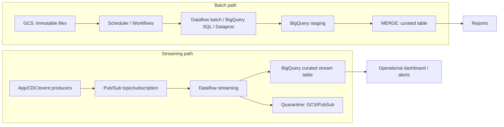
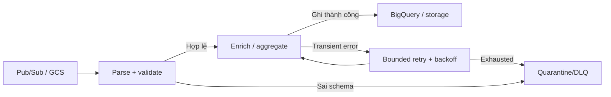

# Thiết kế batch pipelines và streaming pipelines trên GCP

Một sàn thương mại điện tử phát sinh sự kiện `order_created` và `payment_completed`. Bộ phận tài chính muốn **báo cáo ngày hôm qua** chính xác trước 07:00; bộ phận vận hành muốn **phát hiện lỗi thanh toán trong 30 giây**. Hai yêu cầu cùng dùng dữ liệu sự kiện, nhưng khác **độ trễ, cách xử lý dữ liệu đến muộn, cơ chế chạy lại, tài nguyên và chi phí**. Đó là lý do phải chọn đúng giữa **batch pipeline** và **streaming pipeline**, hoặc kết hợp cả hai.

Bài thuộc chương **Pipeline và xử lý dữ liệu** của module `CLOUD_PROVIDERS_GCP`. Người học kết hợp Cloud Storage, Pub/Sub, Dataflow/Apache Beam, BigQuery, IAM, Cloud Run/GKE, Workflows và Cloud Monitoring để thiết kế luồng dữ liệu **đúng nghiệp vụ, bảo mật, có khả năng mở rộng và vận hành được**.

> **Phạm vi:** Ví dụ dùng project/tài nguyên giả định. Phần thực hành chính chạy **local bằng Apache Beam DirectRunner** để tránh tạo tài nguyên trả phí; phần chạy Dataflow trên cloud được trình bày như quy trình triển khai có kiểm soát, **không mặc định chạy thử trên production**. Giá và các tính năng có thể khác theo region, SDK version và chế độ thanh toán.

## 1. Mục tiêu học tập

Sau bài này, bạn có thể:

1. Phân biệt **bounded/unbounded data**, batch/microbatch/streaming theo freshness SLO và tính hoàn chỉnh.
2. Chọn **Cloud Storage, Pub/Sub, Dataflow, BigQuery, Dataproc Serverless, Workflows, Scheduler** theo vai trò thay vì lắp dịch vụ dư thừa.
3. Thiết kế **ingestion → validation → transformation → enrichment → aggregation → serving** cùng nhánh dữ liệu lỗi.
4. Viết một **Apache Beam batch job** chạy local, phân biệt với pipeline phát sự kiện liên tục.
5. Giải thích **event time, processing time, watermark, windows, triggers, allowed lateness** và hậu quả khi có late events.
6. Phân biệt **at-least-once**, Dataflow **exactly-once processing** và **exactly-once business side effects**.
7. Thiết kế replay/backfill, idempotency, data-quality gates, IAM, monitoring, autoscaling và tối ưu chi phí.
8. Ra quyết định kiến trúc trong các tình huống sản xuất và giải bài tập có đáp án.

## 2. Batch và streaming khác nhau ở đâu?

| Tiêu chí | **Batch pipeline** | **Streaming pipeline** |
| --- | --- | --- |
| Dữ liệu nguồn | **Bounded**: tập file/partition/snapshot có điểm kết thúc. | **Unbounded**: sự kiện liên tục từ Pub/Sub/Kafka/CDC. |
| Khi chạy | Theo lịch, yêu cầu người dùng hoặc khi batch sẵn sàng. | Chạy lâu dài hoặc liên tục nhận sự kiện. |
| Freshness điển hình | Phút, giờ, ngày theo lịch chạy. | Giây hoặc gần thời gian thực, tùy window/trigger. |
| Hoàn chỉnh kết quả | Dễ biết “đã xử lý xong tập đầu vào nào”. | Phải định nghĩa window/late-data policy; không có “hết stream”. |
| Chạy lại | Rerun một file/partition/batch đã đánh dấu. | Replay theo retention/offset, phải chống duplicates. |
| Tài nguyên | Worker có thể dừng sau job; phù hợp tải theo đợt. | Worker/backend có thể hoạt động lâu dài; cần autoscale/backpressure. |
| Vấn đề cốt lõi | File completeness, schema, idempotent load, partitions. | Ordering, event time, watermark, state, retry, backlog. |
| Phù hợp | Báo cáo ngày, ELT, backfill, đồng bộ hồ sơ định kỳ. | Alert thời gian thực, dashboard live, enrichment, fraud detection. |

**Microbatch** gom events thành các lô nhỏ (ví dụ vài phút). Về mặt triển khai, nó có thể là job batch chạy định kỳ hoặc một sink/transform xuất định kỳ trong pipeline streaming. Đừng gọi một job Scheduler chạy mỗi 5 phút là “streaming” nếu nó chỉ quét file đã đóng, và đừng dùng thời gian thực khi SLO cho phép batch đơn giản.

### 2.1. Một hợp đồng dữ liệu mẫu

Một event hợp lệ có các trường:

```json
{
  "event_id": "evt-001",
  "order_id": "ord-1001",
  "tenant_id": "t1",
  "event_type": "payment_completed",
  "amount_cents": 2500,
  "event_time": "2026-11-19T08:01:20Z",
  "schema_version": 1
}
```

`event_id` giúp deduplicate; `order_id` dùng để gom nghiệp vụ; `event_time` do nguồn phát sinh, **khác** lúc Pub/Sub nhận hoặc Dataflow xử lý; `schema_version` giúp xử lý thay đổi hợp đồng. Tiền lưu theo **integer cents** để tránh sai số số thực. Với các events không mang tiền, schema có thể cho phép trường `amount_cents` vắng mặt nhưng phải có quy tắc rõ.

### 2.2. Chọn theo SLO, không chỉ theo khối lượng dữ liệu

| Yêu cầu | Lựa chọn khởi điểm | Lý do |
| --- | --- | --- |
| Báo cáo ngày trước 07:00, dữ liệu chốt lúc 03:00 | **Batch**: GCS → Dataflow/BigQuery SQL → BigQuery. | Có thời gian kiểm tra đủ file, chạy lại và đối soát. |
| Phát hiện giao dịch lỗi trong 30 giây | **Streaming**: Pub/Sub → Dataflow → alert/sink. | Cần phản ứng liên tục và quản lý event-time lag. |
| Lưu raw Pub/Sub events vào BigQuery, không transform | **Pub/Sub BigQuery subscription** hoặc direct ingestion. | Không cần Dataflow nếu chỉ xuất dữ liệu tương thích schema. |
| Hợp nhất nhiều nguồn Spark/Hadoop theo lô | **Dataproc Serverless for Apache Spark** hoặc Dataflow batch. | Tái sử dụng Spark jobs và hệ sinh thái khi phù hợp. |
| Gọi API, chờ job hoàn tất, nhánh thành công/thất bại | **Workflows** điều phối các bước. | Workflows **không phải distributed transform engine**. |

## 3. Các dịch vụ GCP trong pipeline



| Dịch vụ | Trách nhiệm chính | Tránh sử dụng sai |
| --- | --- | --- |
| **Cloud Storage** | Raw/landing files, immutable snapshots, archives và replay input. | Đọc file đang upload dở như một batch đã hoàn chỉnh. |
| **Pub/Sub** | Buffer và phân phối messages, retention/replay, at-least-once delivery theo subscription. | Coi publish thành công là đã commit vào BigQuery/DB. |
| **Dataflow (Apache Beam)** | ETL/ELT phân tán, batch và streaming, windows, stateful transforms, autoscaling. | Dùng cho pipeline chỉ chuyển raw messages mà Pub/Sub export làm được. |
| **BigQuery** | SQL analytics, staging/curated tables, partitions, clustering, aggregation, CDC serving theo tính năng. | Thay database OLTP chứa giao dịch thanh toán. |
| **Workflows / Cloud Scheduler** | Điều phối jobs có thứ tự, retry, lịch chạy và cảnh báo thất bại. | Xử lý từng record lưu lượng lớn bên trong Workflows. |
| **Dataproc Serverless** | Chạy Spark batch/streaming jobs khi có mã Spark/thư viện phù hợp. | Giả định Spark sẽ có event-time semantics giống Beam mà không cấu hình. |
| **Cloud Run jobs** | Chạy một tác vụ đóng gói container có điểm kết thúc. | Vận hành streaming engine lâu dài mà không có state/checkpointing/backpressure. |
| **Cloud Monitoring/Logging** | Quan sát health, data freshness, error budgets, costs. | Chỉ nhìn số job RUNNING rồi kết luận dữ liệu đúng. |

### 3.1. Điểm phân tách giữa control plane và data plane

**Control plane** gồm Scheduler/Workflows/CI/CD: quyết định *khi nào chạy, chạy cấu hình nào, retry job ra sao*. **Data plane** gồm Dataflow/Dataproc/BigQuery: biến đổi hàng triệu records. Workflows có thể khởi động Dataflow job rồi theo dõi kết quả, **không** nên đưa từng message/row qua một workflow execution.

## 4. Thiết kế batch pipeline có thể chạy lại

### 4.1. Kiến trúc mẫu: Orders daily report

1. **Landing:** nguồn ghi các file immutable trong `gs://<bucket>/raw/orders/date=YYYY-MM-DD/`. Không đổi nội dung cùng object key sau khi publish.
2. **Manifest/ready signal:** publisher công bố danh sách object names, generations/checksums, schema version và `batch_id` **sau khi tất cả files đã sẵn sàng**.
3. **Orchestration:** Scheduler/Workflows hoặc một event handler chạy job **cho batch ID chưa hoàn tất**; gắn job labels và số attempt.
4. **Transform:** Beam batch đọc nguồn, parse, validate, chuẩn hóa timezone/amounts, bỏ duplicates đúng contract; records lỗi vào **quarantine**.
5. **Load staging:** Dataflow ghi BigQuery staging table/partition có cột `batch_id` và metadata nguồn.
6. **Quality gate:** so expected/actual count, sums, nulls, duplicate event IDs, required fields.
7. **Publish:** dùng `MERGE` hoặc replace partition theo quy tắc rõ ràng; cập nhật manifest state khi thành công.
8. **Observe/cleanup:** emit freshness metrics, alerts, retain raw đủ thời gian replay; dọn staging theo policy.

**Đừng chỉ dựa vào “file đã xuất hiện” để suy ra cả batch hoàn chỉnh.** Object finalize event báo một object đã sẵn sàng, không chứng minh tất cả file của ngày đó đã tới. Để tránh race, producer cần **manifest + ready marker** hoặc một điều kiện chốt batch nhất quán.

### 4.2. Idempotency ở ba cấp

| Cấp | Định danh | Cách tránh ghi trùng |
| --- | --- | --- |
| **Source batch** | `batch_id + object generation/checksum` | Không xử lý hai lần cùng tập immutable input nếu đã ghi nhận hoàn tất. |
| **Processing job** | Workflows execution/job ID/attempt. | Retry có kiểm tra state; không tạo đồng thời hai jobs cập nhật cùng đích thiếu điều phối. |
| **Sink row** | `event_id` hoặc khóa nghiệp vụ + version. | Dedupe/`MERGE`; không tin BigQuery tự enforce unique constraint. |

Một Dataflow job thất bại sau khi đã ghi một phần vào sink ngoài có thể được chạy lại. **Chạy lại đúng input không đồng nghĩa idempotent output** nếu đích dùng append không kiểm soát. Chọn staging tách biệt và promotion chỉ sau quality gate là cách dễ kiểm chứng.

### 4.3. Partitioning, clustering và định dạng files

Với BigQuery managed table, **partition theo `event_date`** và cluster theo `tenant_id`/`order_id` khi query patterns phù hợp. Với GCS raw, ưu tiên Parquet/Avro hoặc ndJSON theo contract; nén và kích thước files cần cân bằng **parallelism, listing overhead, network và schema evolution**. Rất nhiều files 1 KB có thể gây overhead cao hơn một số files lớn đủ để đọc song song.

BigQuery **load jobs** là lựa chọn đơn giản khi chỉ cần đưa file raw/schema-compatible vào warehouse. Nếu phải parse/enrich dữ liệu phức tạp, join nguồn hoặc kiểm tra quality logic đặc biệt, cân nhắc Dataflow batch/Dataproc. Nếu transforms là SQL, xem **BigQuery ELT** trước khi thêm một engine ngoài.

## 5. Streaming pipeline: thời gian sự kiện và cửa sổ

### 5.1. Event time khác processing time

Một thiết bị offline ghi sự kiện lúc **10:03:20** nhưng chỉ gửi lên Pub/Sub lúc **10:05:10**:

- **Event time:** 10:03:20 — khi nghiệp vụ thực sự xảy ra.
- **Processing time:** 10:05:10 hoặc trễ hơn — khi Dataflow xử lý.
- **Ingestion time:** thời điểm Pub/Sub nhận — khác cả hai thời điểm trên.

Nếu nhóm số tiền theo processing time, bản ghi có thể bị đếm vào **khung 10:05–10:10** thay vì **10:00–10:05**. Các báo cáo nghiệp vụ thường cần event time; alerts theo “hệ thống vừa nhận lỗi” có thể dùng processing time tùy SLO.

### 5.2. Fixed, sliding và session windows

| Window | Ví dụ | Phù hợp |
| --- | --- | --- |
| **Fixed/tumbling** | `[10:00,10:05)`, `[10:05,10:10)` | Tổng doanh thu mỗi 5 phút, không chồng lấn. |
| **Sliding/hopping** | 5 phút, trượt mỗi 1 phút. | Rolling average, mỗi event có thể nằm trong nhiều windows. |
| **Session** | Gom theo user/key với gap 10 phút không hoạt động. | Phiên truy cập, hành vi không có chu kỳ cố định. |

Một unbounded stream không thể `GroupByKey` cả đời cho cùng một key nếu không giới hạn trạng thái. **Windowing** phân chia dữ liệu thành tập hữu hạn theo event time; với stateful aggregation cần thêm **trigger/allowed lateness/retention** phù hợp.

### 5.3. Watermark, triggers và late data

**Watermark** là tiến độ ước lượng thời điểm event time mà hệ thống cho rằng phần lớn dữ liệu cũ hơn đã đến, **không phải lời cam kết mọi event cũ đã tới**. Với window `[10:00,10:05)`:

```text
Event time:                 10:03:20
Processing/arrival time:    10:05:10
Watermark khi đến:          10:05:00
Window của event:           [10:00, 10:05)
Kết luận:                  Event đã đến MUỘN so với watermark
```

| Khái niệm | Tác dụng |
| --- | --- |
| **On-time trigger** | Phát kết quả khi watermark vượt cuối window. |
| **Early trigger** | Phát kết quả tạm thời trước watermark để UI cập nhật sớm. |
| **Late trigger** | Phát lại/cập nhật khi có event đến muộn còn trong giới hạn được giữ. |
| **Allowed lateness** | Thời gian cho phép window tiếp nhận late events sau thời điểm watermark đi qua; sau ngưỡng, event có thể bị bỏ. |
| **Accumulating panes** | Pane sau có thể phát lại kết quả tích lũy của panes trước. |
| **Discarding panes** | Pane sau chỉ chứa phần dữ liệu mới kể từ lần phát trước. |

**Cạm bẫy:** nếu dùng accumulating panes rồi **append tất cả panes** vào BigQuery và downstream chạy `SUM` trên mọi dòng, số tiền có thể bị **đếm trùng**. Muốn hiển thị con số cập nhật, thêm `window_start, window_end, key, pane_index` và dùng **upsert/đọc phiên bản mới nhất**, hoặc chọn discarding/delta semantics được thiết kế rõ.

### 5.4. Một ví dụ kết quả late event

| Thời điểm | Sự kiện | Kết quả window 10:00–10:05 |
| --- | --- | --- |
| 10:04 | Hai payments 100 và 200 tới đúng giờ. | Early pane có thể phát **300**. |
| 10:05 | Watermark qua 10:05. | On-time pane phát **300**. |
| 10:06 | Payment 50 với event time 10:03 tới muộn. | Nếu allowed lateness còn hiệu lực, late pane tích lũy phát **350**. |
| 10:20 | Event cực muộn tới khi window đã bị GC. | Có thể bị bỏ; cần backfill/reconciliation nếu nghiệp vụ yêu cầu đầy đủ. |

**Exactly-once processing không bảo đảm kết quả window đầy đủ** nếu business yêu cầu đếm mọi event đến cực muộn. Chính sách late-data/reconciliation là quyết định sản phẩm và vận hành, không chỉ một flag Dataflow.

## 6. Độ tin cậy: ACK, exactly-once và side effects

### 6.1. Ba loại bảo đảm thường bị nhầm

| Phạm vi | Bảo đảm / khả năng | Điều không tự bảo đảm |
| --- | --- | --- |
| **Pub/Sub delivery** | Thông thường **at-least-once**; message có thể đến lại khi ACK/lease thất bại. Tính năng exactly-once Pub/Sub có điều kiện và áp dụng cho **pull subscriptions**. | Người tiêu thụ không tạo duplicate writes vào database. |
| **Dataflow streaming mode** | **Exactly-once processing** mặc định; có thể chọn **at-least-once** để giảm chi phí/latency nếu chịu được duplicates. | Một `DoFn` có side effect bên ngoài chỉ được gọi đúng một lần. |
| **Destination business state** | Phụ thuộc sink, khóa nghiệp vụ, transactions, dedup và commit protocol. | Tự đúng nhờ bật một chế độ Dataflow ở upstream. |

Dataflow có thể **thực thi lại DoFn** trong quá trình retry/recovery ngay cả khi chạy chế độ exactly-once. Nếu DoFn gọi API thu tiền hoặc gửi email, **request đó có thể được gọi nhiều lần**. Đừng đặt side effects không idempotent trực tiếp trong `ParDo` rồi suy ra chỉ xảy ra một lần vì Dataflow dedup kết quả nội bộ.

### 6.2. Chế độ của Dataflow streaming

- **Exactly-once mode (mặc định):** giảm duplicate/lost records **trong pipeline** và phù hợp aggregate khi cần độ chính xác. Có thêm chi phí state/dedup.
- **At-least-once mode:** cho phép duplicates, thường có thể giảm latency/chi phí ở pipeline map-only hoặc sink đã có dedup. Không dùng cho phép cộng doanh thu khi downstream không biết dedup.
- **Sink semantics:** khi ghi BigQuery qua **Storage Write API**, lựa chọn `STORAGE_WRITE_API` và `STORAGE_API_AT_LEAST_ONCE` của Beam có trade-off. Khi ghi Pub/Sub, **Pub/Sub output connector không bảo đảm exactly-once delivery** dù pipeline xử lý exactly-once.

Ví dụ một event `evt-001` được gửi hai lần từ producer với hai Pub/Sub message IDs khác nhau. Dataflow không thể tự biết hai messages là **cùng business event** nếu nguồn không cung cấp ID/định nghĩa duplicate phù hợp. Giải pháp là stable `event_id` và dedup theo hợp đồng dữ liệu, đồng thời bảo vệ sink với `MERGE`/conditional writes.

### 6.3. Poison records và DLQ

Một record lỗi schema **vĩnh viễn** không nên làm cả pipeline retry mãi:



Quarantine record nên có **source/event ID, reason code, schema version, timestamp, pipeline version và đường replay**, nhưng phải **redact PII/secrets** trước khi log. DLQ không phải nơi dữ liệu được chữa tự động: cần owner/alert, retention, thao tác sửa/replay và biện pháp tránh xử lý lại vô hạn.

## 7. Lab local: Apache Beam batch pipeline

Lab dùng **Python 3 và Apache Beam Python SDK** với **DirectRunner**; **không gọi GCP API**, không phát sinh Dataflow/BigQuery billing. Người học tạo các tệp lab **ở thư mục riêng**, không phải tệp của repository bài học. Pin phiên bản Beam hỗ trợ Python/runtime của môi trường để có kết quả tái lập.

### 7.1. Chuẩn bị môi trường và mẫu dữ liệu

Trong Bash (Linux/macOS/Cloud Shell), tạo một Python virtual environment rồi cài Beam:

```bash
mkdir -p beam-pipeline-lab
cd beam-pipeline-lab
python3 -m venv .venv
source .venv/bin/activate
python -m pip install --upgrade pip
python -m pip install "apache-beam[gcp]"
```

Tạo file `orders.jsonl` — **một JSON object trên mỗi dòng**:

```jsonl
{"event_id":"evt-001","order_id":"ord-1001","tenant_id":"t1","event_type":"payment_completed","amount_cents":2500,"event_time":"2026-11-19T08:01:20Z","schema_version":1}
{"event_id":"evt-002","order_id":"ord-1002","tenant_id":"t1","event_type":"payment_completed","amount_cents":1300,"event_time":"2026-11-19T08:01:35Z","schema_version":1}
{"event_id":"evt-003","order_id":"ord-1003","tenant_id":"t2","event_type":"payment_completed","amount_cents":8100,"event_time":"2026-11-19T08:01:50Z","schema_version":1}
{"event_id":"evt-004","order_id":"ord-1004","tenant_id":"t1","event_type":"order_created","amount_cents":0,"event_time":"2026-11-19T08:02:10Z","schema_version":1}
{"event_id":"evt-005","order_id":"ord-1005","tenant_id":"t1","event_type":"payment_completed","amount_cents":"oops","event_time":"2026-11-19T08:02:15Z","schema_version":1}
```

Đây là **ndJSON**, khác JSON array. Record `evt-005` cố ý sai kiểu tiền để thử nhánh quarantine. Dữ liệu demo **không có event IDs trùng**; trong production phải có bước dedup kiểm soát source/sink.

### 7.2. Code pipeline hoàn chỉnh

Tạo `batch_orders.py`:

```python
import argparse
import json
from pathlib import Path

import apache_beam as beam
from apache_beam import pvalue
from apache_beam.options.pipeline_options import PipelineOptions


class ParsePayments(beam.DoFn):
    def process(self, line):
        try:
            event = json.loads(line)
            if not event["event_id"] or not event["tenant_id"]:
                raise ValueError("missing required identifier")
            if event["event_type"] != "payment_completed":
                return  # Đây là event hợp lệ nhưng không tính doanh thu.
            cents = int(event["amount_cents"])
            if cents < 0:
                raise ValueError("negative amount")
            yield (event["tenant_id"], cents)
        except (ValueError, TypeError, KeyError, json.JSONDecodeError) as exc:
            yield pvalue.TaggedOutput(
                "invalid",
                json.dumps({
                    "error_type": type(exc).__name__,
                    "raw": line
                }, ensure_ascii=False)
            )


def to_json(record):
    tenant_id, total = record
    return json.dumps({
        "tenant_id": tenant_id,
        "total_cents": total
    }, ensure_ascii=False)


def main():
    parser = argparse.ArgumentParser()
    parser.add_argument("--input", required=True)
    parser.add_argument("--output_dir", required=True)
    args, beam_args = parser.parse_known_args()
    Path(args.output_dir).mkdir(parents=True, exist_ok=True)

    options = PipelineOptions(beam_args)
    with beam.Pipeline(options=options) as pipeline:
        parsed = (
            pipeline
            | "Read ndJSON" >> beam.io.ReadFromText(args.input)
            | "Parse payment" >> beam.ParDo(ParsePayments()).with_outputs(
                "invalid", main="valid"
              )
        )

        (
            parsed.valid
            | "Sum per tenant" >> beam.CombinePerKey(sum)
            | "Format summary" >> beam.Map(to_json)
            | "Write totals" >> beam.io.WriteToText(
                f"{args.output_dir}/totals", num_shards=1
            )
        )

        (
            parsed.invalid
            | "Write quarantine" >> beam.io.WriteToText(
                f"{args.output_dir}/invalid", num_shards=1
            )
        )


if __name__ == "__main__":
    main()
```

Chạy:

```bash
python batch_orders.py \
  --input orders.jsonl \
  --output_dir out \
  --runner DirectRunner

cat out/totals-*
cat out/invalid-*
```

**Kết quả kỳ vọng** (thứ tự dòng tổng hợp không được Beam cam kết):

```jsonl
{"tenant_id": "t1", "total_cents": 3800}
{"tenant_id": "t2", "total_cents": 8100}
```

File `invalid-*` có một record `evt-005` với `error_type` phản ánh lỗi parse số; không tính `order_created` vì đây là sự kiện hợp lệ nhưng không thuộc doanh thu thanh toán. Nếu chạy lại vào cùng `out`, cần kiểm tra/tránh để kết quả các lần chạy trộn lẫn. Với pipeline production, quarantine không nên chứa raw dữ liệu nhạy cảm dưới dạng rõ.

### 7.3. Giới hạn của lab

- `CombinePerKey(sum)` ở đây áp dụng cho **bounded input**, không cần window. Cùng transform trên **unbounded stream** cần window/trigger và state policy.
- Sample **chưa dedup event IDs** và chưa có staging/`MERGE`; DirectRunner chỉ kiểm thử semantics cơ bản, **không** chứng minh Dataflow production sẽ có cùng latency/cost.
- Khi chuyển sang Cloud Storage, dùng `gs://...` paths và DataflowRunner với đúng permissions/region/temp bucket; khi chuyển sang BigQuery, cần sink contract và schema riêng.

## 8. Mẫu streaming: Pub/Sub → Beam window → BigQuery

Ví dụ sau mô tả phần **data plane cốt lõi** của pipeline liên tục. Điều kiện: đã có Pub/Sub **subscription**, BigQuery table, IAM, staging/temp bucket, Dataflow worker service account và quota; cấu hình DataflowRunner được truyền khi submit. Không chạy với project/URLs giả định.

### 8.1. Khung Apache Beam Python

```python
import argparse
import json
from datetime import datetime

import apache_beam as beam
from apache_beam.io.gcp.pubsub import ReadFromPubSub
from apache_beam.options.pipeline_options import PipelineOptions
from apache_beam.transforms.window import FixedWindows


def parse_payment(raw):
    event = json.loads(raw.decode("utf-8"))
    # Mẫu tối giản: production phải validate, DLQ và dedup.
    return event


def attach_event_time(event):
    timestamp = datetime.fromisoformat(
        event["event_time"].replace("Z", "+00:00")
    ).timestamp()
    return beam.window.TimestampedValue(
        (event["tenant_id"], int(event["amount_cents"])),
        timestamp
    )


def to_row(item, window=beam.DoFn.WindowParam):
    tenant_id, total = item
    return {
        "tenant_id": tenant_id,
        "window_start": window.start.to_utc_datetime().isoformat(),
        "window_end": window.end.to_utc_datetime().isoformat(),
        "total_cents": total,
    }


parser = argparse.ArgumentParser()
parser.add_argument("--subscription", required=True)
parser.add_argument("--table", required=True)
known, pipeline_args = parser.parse_known_args()

options = PipelineOptions(pipeline_args, streaming=True)
with beam.Pipeline(options=options) as pipeline:
    (
        pipeline
        | "Read PubSub" >> ReadFromPubSub(subscription=known.subscription)
        | "Decode" >> beam.Map(parse_payment)
        | "Only payment" >> beam.Filter(
            lambda x: x["event_type"] == "payment_completed"
        )
        | "Assign event time" >> beam.Map(attach_event_time)
        | "Fixed 1-minute windows" >> beam.WindowInto(FixedWindows(60))
        | "Sum tenant amount" >> beam.CombinePerKey(sum)
        | "Build BigQuery row" >> beam.Map(to_row)
        | "Write BigQuery" >> beam.io.WriteToBigQuery(
            known.table,
            schema=(
                "tenant_id:STRING,window_start:STRING,"
                "window_end:STRING,total_cents:INTEGER"
            ),
            create_disposition=(
                beam.io.BigQueryDisposition.CREATE_NEVER
            ),
            write_disposition=(
                beam.io.BigQueryDisposition.WRITE_APPEND
            ),
            method=beam.io.WriteToBigQuery.Method.STORAGE_WRITE_API,
        )
    )
```

**Giới hạn có chủ đích của skeleton:**

1. Chưa có **bad-record output**, schema validation, event ID dedup và enforcement theo tenant. `json.loads` hoặc field thiếu có thể làm pipeline retry liên tục; production phải tách lỗi vĩnh viễn sang DLQ.
2. `WindowInto(FixedWindows(60))` dùng **trigger mặc định** (on-time), chưa cấu hình late trigger/allowed lateness. Late events ngoài chính sách có thể bị bỏ, **không thích hợp làm sổ cái tài chính chính thức**.
3. Output ở dạng **một snapshot tổng mỗi tenant/window**; không tạo early/late panes để tránh nhiều bản tổng tích lũy bị append trùng. Nếu thêm triggers, phải thiết kế `pane_index` và upsert/version handling riêng.
4. Chưa cấu hình throughput/worker autoscaling, subnet/VPC, KMS, rollback và error budget. Đây là **mẫu cấu trúc học tập**, không phải pipeline production hoàn chỉnh.
5. Khi dùng Storage Write API, cần bảng đích có schema tương thích, role BigQuery phù hợp và quota write streams. Chọn chế độ exactly-once/at-least-once theo workload và sinks, không coi mọi replay đều tự an toàn.

### 8.2. Mẫu lệnh triển khai Dataflow (không chạy mặc định)

```bash
PROJECT_ID="orders-lab"
REGION="asia-southeast1"
SUBSCRIPTION="projects/$PROJECT_ID/subscriptions/orders-stream-sub"
TABLE="$PROJECT_ID:analytics_lab.payment_minute"
TEMP_BUCKET="gs://orders-dataflow-temp-lab"
WORKER_SA="dataflow-worker@$PROJECT_ID.iam.gserviceaccount.com"

# CHỈ ĐỌC: kiểm tra tài nguyên tồn tại trước.
gcloud pubsub subscriptions describe "orders-stream-sub" \
  --project="$PROJECT_ID"
bq show "$TABLE"
gcloud storage buckets describe "$TEMP_BUCKET" \
  --project="$PROJECT_ID"

# THAY ĐỔI HẠ TẦNG, TẠO STREAMING JOB CHẠY LIÊN TỤC CÓ PHÍ.
# Chỉ chạy sau khi được duyệt, thiết lập IAM/VPC và sửa file thực.
# python stream_orders.py \
#   --subscription "$SUBSCRIPTION" \
#   --table "$TABLE" \
#   --runner DataflowRunner \
#   --project "$PROJECT_ID" \
#   --region "$REGION" \
#   --temp_location "$TEMP_BUCKET/tmp" \
#   --staging_location "$TEMP_BUCKET/staging" \
#   --service_account_email "$WORKER_SA" \
#   --max_num_workers 5 \
#   --streaming
```

**Quan trọng:** Dataflow streaming job không tự dừng như batch. Thiết lập ownership, alerts, max workers và một **kế hoạch drain/cancel** trước khi deploy; drain có thể cần thời gian để hoàn tất windows/state theo cấu hình và không đồng nghĩa tự backfill toàn bộ late events.

### 8.3. Templates và CI/CD

Không phải dự án nào cũng cần viết Beam từ đầu. Với bài toán đã có mẫu chuẩn (Pub/Sub → BigQuery, GCS → BigQuery...), cân nhắc **Dataflow templates**. **Flex Templates** đóng gói pipeline và runtime dependencies trong container image, thuận tiện versioning, CI/CD và cấu hình launch parameters.

Quy trình triển khai nên bao gồm kiểm thử transforms local → staging Dataflow (dữ liệu giả) → kiểm tra schema, IAM, region, image digest → rollout có checkpoint/rollback → monitor. Với long-running streaming job, **cập nhật pipeline/version state** cần kiểm tra khả năng compatibility, state/transform names và phương án replacement/drain; không coi deploy lại code là không có tác động.

## 9. Replay, backfill và xử lý dữ liệu đến muộn

**Replay** đọc lại dữ liệu nguồn đã được lưu giữ; **backfill** tính lại dữ liệu lịch sử hoặc lấp khoảng thiếu. Hai việc này cần kế hoạch vì **sự kiện cũ có thể đến khi pipeline mới vẫn đang ghi**.

### 9.1. Chọn nguồn dữ liệu để chạy lại

| Nguồn | Có thể replay thế nào? | Giới hạn |
| --- | --- | --- |
| **GCS raw immutable files** | Chạy batch cho partitions/manifest cũ, dùng version/checksum. | Cần chính sách retention, schema version và chống append trùng. |
| **Pub/Sub** | Seek/snapshot hoặc replay theo retention nếu được cấu hình và còn dữ liệu. | Không phải kho lưu lịch sử vô hạn; seek ảnh hưởng subscription consumers. |
| **BigQuery staging/raw event table** | Query partition lịch sử rồi xử lý lại/publish curated. | Cần tránh update cùng bảng serving khi streaming job cũng ghi. |
| **CDC log / nguồn nghiệp vụ** | Resume theo offset/checkpoint/LSN tùy connector. | Kiểm soát retention, transaction boundaries và schema evolution. |

### 9.2. Quy trình backfill an toàn

1. **Xác định phạm vi:** ngày/tenant/order IDs bị ảnh hưởng, nguồn đúng, nguyên nhân gốc.
2. **Đóng băng contract:** version transformation và schema đã sửa, kiểm thử dữ liệu đại diện.
3. **Tạo output tách biệt:** bảng/partition `_backfill` hoặc bảng versioned; không ghi đè dashboard ngay.
4. **Chạy bounded job** đọc đúng các files/partitions, gắn `backfill_id` và đo row count/sums.
5. **Đối soát:** so `event_id`, tổng tiền, tỷ lệ late events, lỗi schema và timestamp.
6. **Promote idempotent:** `MERGE`/partition swap có kế hoạch; kiểm soát race với streaming updates.
7. **Lưu audit/rollback:** manifest, job ID, số records và cách quay lại phiên bản dữ liệu trước.

Khi **batch sửa lịch sử** còn **streaming cập nhật hiện tại**, cần thiết kế ownership theo time range/partition và merge condition dựa trên **source event version/time**; nếu không, bản backfill cũ có thể ghi đè trạng thái mới từ stream. Thay toàn bảng rồi hy vọng luồng mới “tự sửa” không phải chiến lược rollback.

### 9.3. Data quality khác pipeline liveness

Một job `JOB_STATE_RUNNING` hoặc `JOB_STATE_DONE` không chứng minh **dữ liệu đúng**. Cần tách:

- **Pipeline availability:** job còn chạy, workers healthy, không có fatal errors.
- **Data freshness:** giờ mới nhất của một event đã cập nhật tại sink so với hiện tại; đo theo tenant/source.
- **Completeness:** % records đã có mặt, độ trễ nguồn, late-data drops, so với manifest/ledger.
- **Correctness:** số tiền, unique events, phân loại record lỗi, version của schema.

Với báo cáo tài chính, **batch reconciliation cuối ngày** thường vẫn cần, kể cả đã có dashboard streaming. Stream giúp phát hiện nhanh, batch giúp tính lại có kiểm soát và đối soát dữ liệu đến muộn.

## 10. IAM, mạng và bảo mật dữ liệu

| Principal | Quyền tiêu biểu cần kiểm tra | Không nên |
| --- | --- | --- |
| **CI/CD/deployer** | Quyền submit/update Dataflow jobs, sử dụng worker SA và build/staging artifacts. | Dùng Project Owner cho toàn pipeline. |
| **Dataflow worker service account** | `roles/dataflow.worker`, đọc GCS raw/temp, pull Pub/Sub subscription, ghi BigQuery sink theo quyền hẹp. | Dùng default compute SA có quyền Editor rộng. |
| **Dataflow service agent** | Service-level permissions được Google Cloud quản lý để cấp phát worker resources. | Nhầm service agent với worker service account khi điều tra `403`. |
| **Pub/Sub publisher** | `roles/pubsub.publisher` ở topic nguồn. | Cấp quyền admin/delete subscriptions không cần thiết. |
| **Analytics consumer** | `bigquery.jobUser` ở project chạy query và `dataViewer` cho bảng/dataset được phép. | Cấp quyền đọc raw PII chỉ vì muốn xem tổng hợp. |

Trong triển khai thật, các roles cụ thể tùy khả năng tạo jobs/temp buckets, BigQuery dataset permissions, network subnets và KMS policy. **`roles/dataflow.worker` một mình không cho phép đọc Pub/Sub hay ghi BigQuery.** Identity triển khai và worker identity có thể khác nhau; xác minh principal thực trong logs khi gặp lỗi.

### 10.1. VPC, location và data governance

- Chọn Dataflow job region, Pub/Sub topic/subscription, Cloud Storage bucket và BigQuery dataset theo **location compatibility, data residency và egress**. Cross-region có thể tăng phí và độ trễ.
- Nếu worker cần private Cloud SQL/Redis/on-prem, cấu hình **subnetwork/VPC**, routes/firewall và private access phù hợp; không tự mở public IP/firewall chỉ để test.
- Với dữ liệu cá nhân, có **field allowlist, pseudonymization, retention, Cloud KMS/CMEK khi cần**, audit logging, policy tags và IAM dataset.
- Không in raw payload chứa **token, email, thẻ thanh toán, địa chỉ** ra log/quarantine. DLQ có cùng yêu cầu bảo mật và retention như nguồn.
- Với nhiều tenants, pipeline phải giữ `tenant_id` và kiểm tra authorization tại **serving/query layer**; filter trong pipeline không thay thế Row Access Policy hoặc API-level tenant checks.

## 11. Monitoring, SLO và xử lý sự cố

### 11.1. Dashboard tối thiểu

| Chỉ số | Batch pipeline | Streaming pipeline |
| --- | --- | --- |
| **Freshness** | Batch mới nhất đã hoàn tất lúc nào? | Sink cập nhật từ event time gần đây đến mức nào? |
| **Completeness** | Số file/rows so manifest; jobs thành công? | Backlog, unacked age, watermark lag, late/drop count? |
| **Latency** | Job duration, queue wait, time-to-publish. | System latency, data freshness, end-to-end p95/p99. |
| **Failures** | Bad records, source parse, failed load/quality gate. | Retry storms, poison messages, DLQ, sink write failures. |
| **Capacity** | Worker vCPU, memory, shuffle, skewed keys. | Worker autoscaling, backpressure, hot key/state, Streaming Engine. |
| **Cost** | Cost per batch/GB/partition. | Cost per million events and continuous idle/run cost. |

**Watermark lag không đồng nghĩa system lag**: watermark bị chậm có thể do dữ liệu event time cũ, nguồn chưa đủ tiến độ hoặc late events; system latency phản ánh sự chờ đợi/xử lý nội bộ. Một pipeline có worker CPU thấp vẫn có thể có **watermark stuck** do input/source hoặc một phép xử lý stateful chưa phát output.

### 11.2. Một số lỗi thường gặp

| Triệu chứng | Nguyên nhân khả dĩ | Điều tra/khắc phục |
| --- | --- | --- |
| Batch báo thiếu một ngày | File chưa hoàn chỉnh, manifest không đóng, sai path/date. | So manifest và source objects, không chốt batch quá sớm. |
| Batch rerun tăng gấp đôi tổng tiền | Append lại cùng batch, thiếu event ID dedup. | Staging + `MERGE`, batch manifest/checkpoint. |
| Streaming backlog tăng | Worker thiếu capacity, downstream BigQuery chậm, hot key, schema error. | Dataflow stages/backpressure, Pub/Sub unacked, sink metrics. |
| Watermark không tiến | Sự kiện cũ bị tồn đọng, source chậm, timer/state hoặc transform nặng. | Event timestamps, oldest unacked age, processing bottleneck. |
| Late events không vào dashboard | Allowed lateness/trigger thiếu, window đã hết hạn. | Kiểm tra windowing, replay/backfill policy. |
| Doanh thu window bị cộng nhiều lần | Accumulating panes append nhiều snapshots. | Pane metadata và upsert/latest-version hoặc delta semantics. |
| `PERMISSION_DENIED` | Worker SA thiếu Pub/Sub/GCS/BigQuery role hoặc KMS. | Đọc IAM của principal thực, resource scope và service agent. |
| Worker autoscale mà throughput không tăng | Key skew, destination quota hoặc shuffle/state bottleneck. | Hot keys, sink capacity, pipeline graph/worker logs. |
| Streaming job quá đắt | Workers chạy 24/7, stateful shuffle, logs nhiều, idle capacity. | Đo freshness SLO, tune worker bounds, Streaming Engine, chế độ processing. |
| Dataflow job `DONE` nhưng bảng trống | Bad records, sink errors hoặc đích/table khác. | Dataflow counters, sink job errors, dataset/location và output validation. |

### 11.3. Runbook khi pipeline streaming trễ SLA

1. **Xác minh phạm vi:** input event rate, tenant/key nào trễ, freshness ở BigQuery và backlog Pub/Sub.
2. **Tìm chỗ tắc:** Dataflow graph, worker CPU/heap, step throughput, watermarks, hot key và sink write errors.
3. **Phân loại:** nguồn chậm, compute quá tải, data skew, sink quota, auth lỗi hay poison record.
4. **Giảm tác động:** mở rộng worker **trong quota**, tách hot keys hoặc giới hạn producer/traffic; tránh retry ồ ạt sang sink.
5. **Khôi phục dữ liệu:** replay/backfill từ nguồn giữ lại, đối soát event IDs và dữ liệu sau khi giảm lag.
6. **Đóng incident:** xác nhận freshness/p95, lỗi, duplicates và tổng chi phí; ghi bài học vào runbook.

Không mặc định tăng `--max_num_workers` sẽ chữa mọi lỗi: một key nóng hoặc BigQuery sink bị quota limit có thể vẫn là bottleneck dù thêm worker.

## 12. Tối ưu tài nguyên và chi phí

### 12.1. Dataflow tính phí theo những gì?

Dataflow có các mô hình tính phí như **worker vCPU/memory, persistent disk, Dataflow Shuffle cho batch, Streaming Engine cho streaming**, hoặc **Dataflow Prime Data Compute Units (DCUs)** theo lựa chọn/cấu hình. Các dịch vụ ngoài như Pub/Sub, BigQuery, Cloud Storage, Logging và egress **có hóa đơn riêng**.

- **Batch:** xử lý xong có thể dừng, giảm chi phí idle; **Dataflow Shuffle** giúp đưa phần shuffle sang backend, có phí dữ liệu xử lý. Nếu có cửa sổ chờ, **FlexRS** có thể giảm chi phí batch compute bằng lập lịch linh hoạt, đổi lại độ trễ khởi chạy.
- **Streaming:** job thường tồn tại lâu dài; **Streaming Engine** đưa shuffle/state processing ra khỏi worker VM và có chi phí riêng. Cân bằng latency, freshness và số worker tối thiểu/tối đa.
- **At-least-once vs exactly-once:** nếu workload chịu được duplicates và sink dedup, at-least-once có thể giảm chi phí/latency. Với aggregate quan trọng, đừng đổi chế độ chỉ vì chi phí thấp.
- **Window state:** allowed lateness rất lớn, session windows rộng hoặc keys có cardinality cao làm tăng trạng thái/shuffle và tăng latency/chi phí.
- **Source/sink:** files quá nhỏ, BigQuery partitions không phù hợp, log payload quá nhiều và cross-region traffic có thể đắt hơn phần transform.

### 12.2. Sizing đơn giản bằng số liệu

Ví dụ: nguồn có peak **2.000 events/s**, một worker benchmark xử lý an toàn **400 events/s** với cùng schema/sink. Lower bound thô là:

\[
\frac{2.000\ \text{events/s}}{400\ \text{events/s/worker}} = 5\ \text{workers}
\]

**5 không phải số worker production bảo đảm SLO**: cần dự phòng skew/bursts, state/window overhead, sink throughput, hiệu quả autoscaling và failover. Đo p95 end-to-end latency, watermark lag, error rate và cost ở tải đại diện trước khi đặt worker min/max.

## 13. Bài tập vận dụng (có đáp án)

**Bài 1 — Chọn batch hay stream.** Dataset 100 GB/ngày, báo cáo chốt trước 07:00, không cần thấy dữ liệu trong giờ. Có bắt buộc Dataflow streaming không?

*Đáp án:* **Không.** Batch load/ELT hoặc Dataflow batch theo lịch thường đơn giản và tiết kiệm hơn; thêm quality gate và retry/backfill.

**Bài 2 — Bản ghi đến muộn.** Payment event time 10:03 nhưng tới pipeline lúc 10:06, watermark đã vượt cuối window 10:00–10:05. Có tự được cộng vào on-time result không?

*Đáp án:* **Không mặc định.** Cần allowed lateness/late trigger phù hợp; nếu quá hạn, dùng replay/backfill và reconciliation.

**Bài 3 — Early panes.** Window tổng tiền phát 300 lúc 10:04, 300 lúc watermark qua 10:05 và 350 sau late event. Bảng BigQuery có cả ba rows; `SUM(total)` cho kết quả bao nhiêu và có đúng không?

*Đáp án:* `300 + 300 + 350 = 950`, **đếm trùng** nếu đây là accumulating snapshots. Cần latest-pane/upsert hoặc delta semantics; tổng đúng của window là **350**.

**Bài 4 — Side effect.** Dataflow exactly-once mode có bảo đảm `DoFn` gọi API thanh toán đúng một lần không?

*Đáp án:* **Không.** Worker có thể retry/re-execute `DoFn`; dùng API idempotency key, transactional outbox hoặc service giao dịch thích hợp.

**Bài 5 — Batch rerun.** Một file nạp vào BigQuery rồi Scheduler retry, khiến rows tăng gấp đôi. Chọn cách khắc phục.

*Đáp án:* Dùng **immutable manifest/batch ID**, staging, dedup theo `event_id` và `MERGE`/partition replace có kiểm soát; không append lại vô điều kiện.

**Bài 6 — Pub/Sub source.** Stream có Pub/Sub messages gửi hai lần với **cùng business `event_id`** nhưng hai message IDs khác nhau. Dataflow có tự hiểu đây là một event không?

*Đáp án:* **Không nên giả định**. Thiết kế key để dedup theo business event ID và bảo vệ sink; phân biệt duplicate do producer và retry do transport.

**Bài 7 — DLQ.** Một event có `amount_cents="oops"` làm parse error; để Dataflow retry vô hạn có đúng không?

*Đáp án:* **Không.** Chuyển lỗi schema vĩnh viễn vào quarantine/DLQ có reason, schema/source metadata, alert và kế hoạch sửa/replay. Lỗi mạng tạm thời mới dùng bounded retry/backoff.

**Bài 8 — Hot key.** Autoscaling tăng từ 5 lên 20 workers mà một bước `GroupByKey` theo `tenant_id` vẫn nghẽn khi tenant lớn có 90% traffic.

*Đáp án:* **Key skew**. Xem hot-key metrics, thiết kế fan-out/sharded aggregation nếu phép tính cho phép; không chỉ thêm workers.

**Bài 9 — Data freshness.** Dataflow báo RUNNING, Pub/Sub backlog bằng 0 nhưng BigQuery mới nhất là sự kiện hai giờ trước. Kết luận?

*Đáp án:* Pipeline liveness/backlog **chưa đủ**: cần kiểm tra producer event rate/event-time, sink errors, output watermark, bảng đích và freshness watermark. Có thể nguồn ngừng phát hoặc pipeline đã lọc/bỏ dữ liệu.

**Bài 10 — Quyền.** Worker có `roles/dataflow.worker` nhưng không đọc được Pub/Sub subscription. Có nên cấp Owner?

*Đáp án:* Không. Cấp **`roles/pubsub.subscriber`** cho đúng worker SA và subscription, kiểm tra service agent/deployer chỉ khi liên quan, không cấp Owner rộng.

**Bài 11 — Backfill.** Cần chạy lại dữ liệu ngày 1/11 trong khi streaming vẫn cập nhật đơn hiện tại. Có an toàn nếu overwrite toàn bộ curated table?

*Đáp án:* **Không.** Tách staging/partition/version, đối soát rồi `MERGE` theo event version/time, tránh ghi đè rows mới, có audit/rollback.

**Bài 12 — Chi phí.** Streaming xử lý không có events vào ban đêm nhưng vẫn có phí. Có thể giảm thế nào?

*Đáp án:* Xem SLO có cho phép chuyển sang batch/microbatch không; nếu streaming bắt buộc, tune worker bounds/autoscaling, Streaming Engine, state/window retention và chi phí sink/logs. Không tự ý hủy job nếu dữ liệu vẫn cần realtime.

## 14. Checklist trước production

- [ ] Có freshness SLO, completeness/correctness contract và dữ liệu mẫu đại diện.
- [ ] Chọn batch/streaming/microbatch theo business need và chi phí, không chỉ theo kích thước dữ liệu.
- [ ] Source có schema version, event ID, event time, retention và cơ chế replay.
- [ ] Batch có manifest/ready marker, staged outputs, quality gates và idempotent promotion.
- [ ] Streaming định nghĩa window/trigger/allowed lateness, pane semantics và data freshness.
- [ ] Phân biệt processing exactly-once với business side effects; mọi external write quan trọng có idempotency.
- [ ] Poison records đi quarantine/DLQ với owner, retention, alerts và runbook replay.
- [ ] Worker SA, service agent/deployer, GCS, Pub/Sub, BigQuery và KMS IAM được tách quyền.
- [ ] Location, VPC/subnet/egress và data residency được phê duyệt.
- [ ] Đã thử duplicates, out-of-order, late events, source outage, sink quota, worker restart và replay.
- [ ] Dataflow autoscaling/hot-key metrics, watermark lag, freshness và BigQuery data quality có dashboard.
- [ ] Có giới hạn chi phí worker/shuffle/Streaming Engine, Pub/Sub, BigQuery, GCS và Logging.
- [ ] Có CI/CD, versioned templates, staging canary, drain/cancel plan và backfill/rollback.

## 15. Tổng kết

**Batch pipeline** phù hợp dữ liệu có điểm kết thúc, lịch chạy và kiểm chứng completeness; **streaming pipeline** phù hợp xử lý liên tục với freshness SLO ngắn nhưng cần quản lý event-time, windows, late data, state và backlog. Trên GCP, **Apache Beam/Dataflow** là lựa chọn linh hoạt cho cả hai; **Cloud Storage** lưu nguồn replay, **Pub/Sub** đệm sự kiện, **BigQuery** phục vụ phân tích, **Scheduler/Workflows** điều phối và **Monitoring** giám sát.

Một kiến trúc pipeline đáng tin cậy luôn trả lời được: **Dữ liệu nào đã đến? Dữ liệu nào có thể đến muộn? Kết quả này là tạm thời hay cuối cùng? Nếu job retry thì có bị ghi trùng? Khi dữ liệu sai, ai chịu trách nhiệm sửa và replay?** Đáp án cho các câu hỏi này quan trọng hơn việc có bao nhiêu dịch vụ trong sơ đồ.

### Tài liệu Google Cloud và Apache Beam tham khảo

- [Plan your Dataflow pipeline](https://cloud.google.com/dataflow/docs/guides/plan-pipelines)
- [Dataflow streaming pipelines, watermarks và triggers](https://cloud.google.com/dataflow/docs/concepts/streaming-pipelines)
- [Dataflow streaming modes: exactly-once và at-least-once](https://cloud.google.com/dataflow/docs/guides/streaming-modes)
- [Exactly-once processing in Dataflow](https://cloud.google.com/dataflow/docs/concepts/exactly-once)
- [Dataflow pipeline best practices](https://cloud.google.com/dataflow/docs/guides/pipeline-best-practices)
- [Read Pub/Sub in Dataflow](https://cloud.google.com/dataflow/docs/concepts/streaming-with-cloud-pubsub)
- [Write from Dataflow to BigQuery](https://cloud.google.com/dataflow/docs/guides/write-to-bigquery)
- [Dataflow Streaming Engine](https://cloud.google.com/dataflow/docs/streaming-engine)
- [Dataflow Flex Templates](https://cloud.google.com/dataflow/docs/guides/templates/using-flex-templates)
- [Dataflow monitoring](https://cloud.google.com/dataflow/docs/guides/using-monitoring-intf)
- [Dataflow pricing](https://cloud.google.com/dataflow/pricing)
- [Apache Beam programming guide — windowing](https://beam.apache.org/documentation/programming-guide/#windowing)
