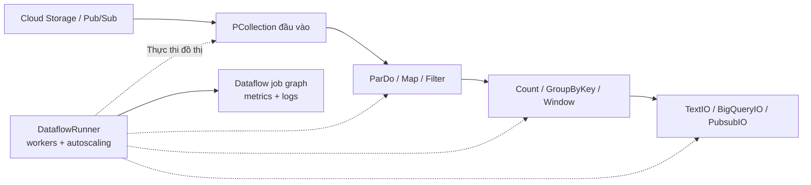
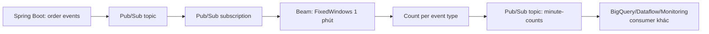
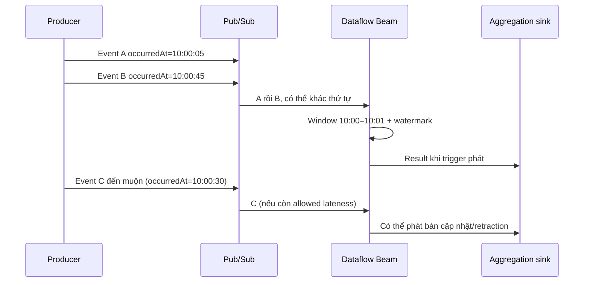
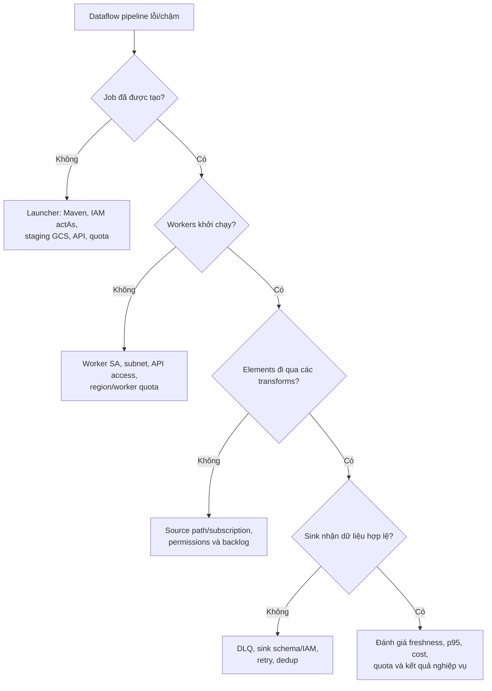

# Triển khai Dataflow pipeline bằng Java

## 1. Bối cảnh: biến dữ liệu thô thành dữ liệu có thể sử dụng

Một hệ thống **Java/Spring Boot** trên Cloud Run nhận đơn hàng, phát sự kiện lên **Pub/Sub** và lưu log vào **Cloud Storage**. Nhóm dữ liệu cần chuẩn hóa sự kiện, loại bản ghi không hợp lệ, tổng hợp theo cửa sổ thời gian rồi cung cấp kết quả cho **BigQuery**. Nếu tự viết vòng lặp Java với nhiều worker, nhóm phải xử lý phân phối công việc, retry, checkpoint, scale, dữ liệu đến trễ và cập nhật chương trình khi đang chạy.

**Apache Beam** cung cấp mô hình lập trình **pipeline** bằng Java; **Google Cloud Dataflow** là dịch vụ runner được quản lý thực thi pipeline trên workers tự mở rộng. Beam mô tả *xử lý gì*; Dataflow quyết định phần lớn *chạy ở đâu, scale và điều phối thế nào*. Một pipeline có thể chạy **batch (bounded)** hoặc **streaming (unbounded)**, nhưng thiết kế nguồn, windowing, sink và cách dừng job khác nhau.

Bài thuộc chương **Pipeline và xử lý dữ liệu** của mô-đun **CLOUD_PROVIDERS_GCP**. Trọng tâm là **tự xây dựng, kiểm thử và triển khai một pipeline Java lên Dataflow**, sau đó hiểu cách chuyển sang xử lý sự kiện, bảo mật, theo dõi độ tin cậy và chi phí.

**Sau bài học, bạn có thể:**

1. Đọc đồ thị **PCollection → PTransform → runner** và phân biệt batch/streaming.
2. Xây dựng **Java 21 + Maven** pipeline đếm từ, chạy bằng `DirectRunner` rồi triển khai bằng `DataflowRunner`.
3. Cấu hình `project`, `region`, `gcpTempLocation`, `stagingLocation`, worker service account và giới hạn workers.
4. Mô tả luồng streaming **Pub/Sub → window/aggregate → sink**, phân biệt event time và processing time.
5. Quan sát **job graph, logs, counters, watermark, backlog, autoscaling**; biết cách **cancel, drain, update**.
6. Áp dụng IAM/network, idempotency, CI/CD, Flex Templates và kiểm soát chi phí.

> **Lưu ý lab:** Tạo Dataflow job, worker VMs, Cloud Storage bucket và dữ liệu đích đều có thể **phát sinh phí**. Chỉ làm trên **project thử nghiệm được phép**, không chạy pipeline ví dụ trên topic/dataset production. Trong quá trình biên soạn bài **không thực thi lệnh**, không tạo tài nguyên đám mây.

## 2. Beam và Dataflow vận hành như thế nào?



| Khái niệm | Vai trò | Ví dụ |
| --- | --- | --- |
| **Pipeline** | Đồ thị xử lý dữ liệu | Đọc log → tách từ → đếm → ghi file |
| **PCollection** | Tập dữ liệu phân tán, có thể bounded/unbounded | Các lines, các events, `KV<String, Long>` |
| **PTransform** | Biến đổi dữ liệu, có thể parallel | `ParDo`, `MapElements`, `Filter`, `Count` |
| **DoFn** | Hàm xử lý từng phần tử trong transform | Parse JSON, validate sự kiện |
| **Runner** | Engine thực thi pipeline | `DirectRunner` local hoặc `DataflowRunner` cloud |
| **PipelineOptions** | Tham số triển khai/runtime | Input/output URI, region, project, temp path |
| **Window / watermark / trigger** | Quy tắc nhóm và phát kết quả stream | Cửa sổ 1 phút, xử lý late events |

**Batch** đọc một nguồn hữu hạn như file GCS, chạy xong thì về `JOB_STATE_DONE`; **streaming** nhận dữ liệu liên tục từ Pub/Sub/Kafka và thường ở `JOB_STATE_RUNNING` cho đến khi operator dừng hoặc thay thế. **Dataflow không phải Cloud Run**: chương trình Java ở máy phát triển là *launcher*, còn transform code chạy trên workers; không nên kỳ vọng launcher là một web server luôn chạy.

**Dataflow Runner** tự tối ưu đồ thị, có thể **fuse transforms**, điều phối bundle và shuffle để giảm overhead. Vì vậy các bước bạn viết trong Java không nhất thiết tương ứng 1:1 với số worker/VM hay stage được hiển thị.

## 3. Lên kế hoạch trước khi chạy

Trước khi deploy, ghi lại:

| Quyết định | Batch WordCount (lab) | Streaming production |
| --- | --- | --- |
| Source | `gs://.../input/sample.txt` | Pub/Sub subscription hoặc Kafka |
| Sink | `gs://.../output/wordcount-*` | BigQuery, Cloud Storage hoặc Pub/Sub |
| Tính hữu hạn | Bounded | Unbounded |
| Ngôn ngữ | Beam Java 21 | Java Beam + thư viện connector |
| Runner | DirectRunner → DataflowRunner | DataflowRunner/Streaming Engine |
| Scaling | Giới hạn 1–2 workers trong lab | Dựa trên backlog/throughput/SLO |
| Dữ liệu trùng | Input file kiểm soát được | Retry và duplicate event phải idempotent |
| Stop | Chờ `DONE` hoặc cancel | Drain/cancel/update có đánh giá state |
| Thành công | Word counts chính xác | Data freshness, output correctness, ít DLQ |

Chọn **region Dataflow** gần **bucket, Pub/Sub/BigQuery và hệ thống đích** khi phù hợp residency và pricing. Bucket lưu artifacts phải **có sẵn**, runtime service account phải đọc/ghi được. Không chọn region ngẫu nhiên vì data transfer khác region có thể tăng độ trễ và egress.

## 4. Chuẩn bị Java, Maven và Google Cloud project

Ví dụ dùng **JDK 21** và **Apache Beam Java SDK 2.77.0** (một bản hỗ trợ Java 21 theo lịch hỗ trợ hiện hành). Khi triển khai production, xem **Beam releases, Dataflow SDK support policy và release notes** rồi pin bản được hỗ trợ; không dùng một version duy nhất vĩnh viễn.

Điều kiện: JDK 21, Maven 3.x tương thích, Google Cloud CLI, project lab có Billing, quyền tạo job/service account và Cloud Storage bucket. Dùng Bash/Cloud Shell:

```bash
java -version
mvn -version
gcloud config set project LAB_PROJECT_ID

# Chỉ trên project LAB, sau khi kiểm tra quyền và hóa đơn.
gcloud services enable \
  dataflow.googleapis.com compute.googleapis.com storage.googleapis.com \
  cloudresourcemanager.googleapis.com logging.googleapis.com

# Tên bucket phải duy nhất toàn cầu, chọn cùng region Dataflow.
gcloud storage buckets create gs://UNIQUE_LAB_BUCKET \
  --project=LAB_PROJECT_ID \
  --location=us-central1 \
  --uniform-bucket-level-access
```

**Không tạo bucket lại nếu đã có bucket lab được cấp phép.** Bucket staging/temp có thể chứa JAR, metadata và tệp tạm; không đặt secrets/PII vào tên object. Kiểm soát retention, lifecycle và **Cloud Storage soft delete** nếu không muốn phí lưu các đối tượng tạm đã xóa.

### 4.1. Service accounts và quyền tối thiểu

Dataflow có **hai danh tính** quan trọng:

- **Dataflow service agent** (do dịch vụ quản lý): điều phối job và worker resources; không dùng làm runtime identity của Java business code.
- **Worker service account** (nên do người dùng quản lý): được workers sử dụng để đọc input, ghi output, gửi metrics và truy cập Pub/Sub/BigQuery.

Người **submit job** cần quyền Dataflow phù hợp (ví dụ `roles/dataflow.developer`) và `iam.serviceAccounts.actAs` trên worker SA. Worker SA cần `roles/dataflow.worker` trên project và quyền **đúng bucket/nguồn/đích**. Đừng cấp Editor/Owner cho worker chỉ để tránh lỗi 403.

```bash
# Tạo SA RIÊNG trong project lab.
gcloud iam service-accounts create dataflow-worker-lab \
  --project=LAB_PROJECT_ID \
  --display-name="Dataflow Java batch lab worker"

gcloud projects add-iam-policy-binding LAB_PROJECT_ID \
  --member="serviceAccount:dataflow-worker-lab@LAB_PROJECT_ID.iam.gserviceaccount.com" \
  --role="roles/dataflow.worker"

# Chỉ trên bucket LAB, workers cần đọc staging/input và ghi temp/output.
gcloud storage buckets add-iam-policy-binding gs://UNIQUE_LAB_BUCKET \
  --member="serviceAccount:dataflow-worker-lab@LAB_PROJECT_ID.iam.gserviceaccount.com" \
  --role="roles/storage.objectAdmin"
```

Lệnh IAM minh họa **chưa cấp quyền submitter**. Cấp `roles/iam.serviceAccountUser` cho **đúng user/CI identity trên đúng service account** qua quy trình IAM của tổ chức. Với production nên tách **read-only input** và **write-only output** nếu các buckets khác nhau; dùng Object Admin chỉ trong bucket lab do chính mình sở hữu.

## 5. Dự án Maven và pipeline Java hoàn chỉnh

Lab này **đọc file văn bản hữu hạn**, tách words Unicode, đếm số lần xuất hiện và ghi các file kết quả. Không cần Spring Boot hay database; Beam `PTransform` có thể đóng gói thành library để các ứng dụng Java khác sử dụng.

```text
dataflow-wordcount-lab/
├── pom.xml
├── sample.txt
└── src/main/java/dev/example/dataflow/WordCountJob.java
```

### 5.1. `pom.xml`

```xml
<?xml version="1.0" encoding="UTF-8"?>
<project xmlns="http://maven.apache.org/POM/4.0.0"
         xmlns:xsi="http://www.w3.org/2001/XMLSchema-instance"
         xsi:schemaLocation="http://maven.apache.org/POM/4.0.0 https://maven.apache.org/xsd/maven-4.0.0.xsd">
  <modelVersion>4.0.0</modelVersion>
  <groupId>dev.example</groupId>
  <artifactId>dataflow-wordcount-lab</artifactId>
  <version>1.0.0</version>

  <properties>
    <maven.compiler.release>21</maven.compiler.release>
    <project.build.sourceEncoding>UTF-8</project.build.sourceEncoding>
    <beam.version>2.77.0</beam.version>
  </properties>

  <dependencies>
    <dependency>
      <groupId>org.apache.beam</groupId>
      <artifactId>beam-sdks-java-core</artifactId>
      <version>${beam.version}</version>
    </dependency>
    <dependency>
      <groupId>org.apache.beam</groupId>
      <artifactId>beam-sdks-java-io-google-cloud-platform</artifactId>
      <version>${beam.version}</version>
    </dependency>
    <dependency>
      <groupId>org.apache.beam</groupId>
      <artifactId>beam-runners-direct-java</artifactId>
      <version>${beam.version}</version>
      <scope>runtime</scope>
    </dependency>
    <dependency>
      <groupId>org.apache.beam</groupId>
      <artifactId>beam-runners-google-cloud-dataflow-java</artifactId>
      <version>${beam.version}</version>
      <scope>runtime</scope>
    </dependency>
  </dependencies>

  <build>
    <plugins>
      <plugin>
        <groupId>org.apache.maven.plugins</groupId>
        <artifactId>maven-compiler-plugin</artifactId>
        <version>3.14.1</version>
      </plugin>
      <plugin>
        <groupId>org.codehaus.mojo</groupId>
        <artifactId>exec-maven-plugin</artifactId>
        <version>3.5.1</version>
      </plugin>
    </plugins>
  </build>
</project>
```

Dependency `beam-sdks-java-io-google-cloud-platform` cung cấp IO connectors; runner `DirectRunner` dùng local và `DataflowRunner` dùng trên Google Cloud. Nếu đóng gói artifact cho CI/CD, phải đồng bộ **SDK, runner, Java runtime, container**; `mvn exec:java` ở lab sử dụng Maven classpath, không có nghĩa JAR thường tự chứa đầy đủ dependencies.

### 5.2. `WordCountJob.java`

```java
package dev.example.dataflow;

import java.util.Arrays;
import java.util.Locale;
import org.apache.beam.sdk.Pipeline;
import org.apache.beam.sdk.options.Description;
import org.apache.beam.sdk.options.PipelineOptions;
import org.apache.beam.sdk.options.PipelineOptionsFactory;
import org.apache.beam.sdk.options.Validation;
import org.apache.beam.sdk.transforms.Count;
import org.apache.beam.sdk.transforms.Filter;
import org.apache.beam.sdk.transforms.FlatMapElements;
import org.apache.beam.sdk.transforms.MapElements;
import org.apache.beam.sdk.values.TypeDescriptors;
import org.apache.beam.sdk.io.TextIO;

public final class WordCountJob {
    public interface Options extends PipelineOptions {
        @Description("Local file or gs:// path of UTF-8 text input")
        @Validation.Required
        String getInput();
        void setInput(String value);

        @Description("Output file prefix (local or gs://), not a directory")
        @Validation.Required
        String getOutput();
        void setOutput(String value);
    }

    public static void main(String[] args) {
        Options options = PipelineOptionsFactory.fromArgs(args)
            .withValidation()
            .as(Options.class);
        Pipeline pipeline = Pipeline.create(options);

        pipeline
            .apply("ReadLines", TextIO.read().from(options.getInput()))
            .apply("SplitWords", FlatMapElements
                .into(TypeDescriptors.strings())
                .via((String line) -> Arrays.asList(
                    line.toLowerCase(Locale.ROOT)
                        .split("[^\\p{L}\\p{N}]+"))))
            .apply("RemoveBlank", Filter.by(word -> !word.isBlank()))
            .apply("CountWords", Count.perElement())
            .apply("FormatCounts", MapElements
                .into(TypeDescriptors.strings())
                .via(count -> count.getKey() + "\t" + count.getValue()))
            .apply("WriteResults", TextIO.write()
                .to(options.getOutput())
                .withSuffix(".txt"));

        // Với batch, đợi job kết thúc để thấy trạng thái success/failure.
        pipeline.run().waitUntilFinish();
    }
}
```

**Lý giải ngắn:** `TextIO.read` tạo bounded `PCollection<String>`, `FlatMapElements` tách nhiều từ từ một dòng, `Filter` bỏ token rỗng, `Count.perElement` nhóm và đếm, `TextIO.write` ghi các **shards**. Dataflow có thể thực thi count/shuffle song song; **thứ tự các dòng output không được bảo đảm**. Các tên transform (`ReadLines`, `CountWords`...) giúp đọc job graph, không tạo một worker riêng cho mỗi bước.

### 5.3. Kiểm thử local bằng DirectRunner

Tạo `sample.txt` (UTF-8) với nội dung:

```text
Java Beam Java
Dataflow Java
Beam dataflow
```

Trong thư mục Maven lab:

```bash
mvn -q clean compile
mvn -q exec:java \
  -Dexec.mainClass=dev.example.dataflow.WordCountJob \
  -Dexec.args="--runner=DirectRunner --input=sample.txt --output=wordcounts"
```

Kỳ vọng kết quả (thứ tự tùy runner):

```text
java	3
beam	2
dataflow	2
```

Đọc file `wordcounts-00000-of-00001.txt` hoặc tên shard khác do Beam tạo. **Không hard-code một shard duy nhất**: số shards là chi tiết thực thi. Local test không dùng VM/cloud, nhưng có thể vẫn cần tải Maven dependencies và đủ RAM.

## 6. Triển khai batch lên DataflowRunner

### 6.1. Chuẩn bị input và đường dẫn staging/output

Khi `DirectRunner` chạy đúng, upload **cùng file** lên GCS; đừng tự đổi nội dung giữa hai lần test nếu muốn so kết quả:

```bash
gcloud storage cp sample.txt \
  gs://UNIQUE_LAB_BUCKET/input/sample.txt

gcloud storage ls gs://UNIQUE_LAB_BUCKET/input/

# Kiểm tra gcloud project + SA trước khi submit:
gcloud config get-value project
gcloud iam service-accounts describe \
  dataflow-worker-lab@LAB_PROJECT_ID.iam.gserviceaccount.com \
  --project=LAB_PROJECT_ID
```

**Bảo đảm người submit có quyền `iam.serviceAccounts.actAs`** trên SA và `roles/dataflow.developer` hoặc quyền tương đương. Với VPC riêng, hãy kiểm tra subnet/Private Google Access trước khi dùng `--usePublicIps=false`; **không tự bật public IP cho một private network production** để khắc phục deploy lỗi.

### 6.2. Chạy Dataflow job bằng Maven launcher

Từ thư mục Maven của lab:

```bash
mvn -q compile exec:java \
  -Dexec.mainClass=dev.example.dataflow.WordCountJob \
  -Dexec.args="--runner=DataflowRunner \
  --project=LAB_PROJECT_ID \
  --region=us-central1 \
  --jobName=wordcount-lab-20261119-01 \
  --gcpTempLocation=gs://UNIQUE_LAB_BUCKET/temp/ \
  --stagingLocation=gs://UNIQUE_LAB_BUCKET/staging/ \
  --serviceAccount=dataflow-worker-lab@LAB_PROJECT_ID.iam.gserviceaccount.com \
  --numWorkers=1 --maxNumWorkers=2 \
  --input=gs://UNIQUE_LAB_BUCKET/input/sample.txt \
  --output=gs://UNIQUE_LAB_BUCKET/output/wordcount"
```

Thay các placeholders bằng **project/bucket đã có thật**. Nếu tên job trùng hoặc không hợp lệ, dùng một tên khác theo chính sách đặt tên; **không thay ID của job production**. Mỗi lần chạy tạo **job mới và các output shards mới**, nên ghi riêng output prefix theo run ID trong CI/CD.

`gcpTempLocation` chứa temp artifacts; `stagingLocation` chứa tài nguyên được upload khi submit. Google Cloud docs cho phép runner suy staging từ temp, nhưng khai báo **cả hai** trong lab để biết rõ quyền/billing. Đường dẫn GCS cần bucket đã tồn tại, cùng region nơi có thể đọc/ghi.

**Không đặt `--streaming=true` cho pipeline bounded**; nó dùng nguồn file và phải kết thúc. Job launcher `waitUntilFinish()` sẽ chờ batch đến `DONE`. Nếu máy bị ngắt kết nối sau khi job đã submit, **Dataflow job có thể vẫn tiếp tục chạy**; không xem việc đóng terminal là thao tác cancel trên GCP.

### 6.3. Xác minh job và kết quả

```bash
gcloud dataflow jobs list \
  --project=LAB_PROJECT_ID --region=us-central1

# Khi biết JOB_ID từ list/UI:
gcloud dataflow jobs describe JOB_ID \
  --project=LAB_PROJECT_ID --region=us-central1

gcloud storage ls gs://UNIQUE_LAB_BUCKET/output/
gcloud storage cat 'gs://UNIQUE_LAB_BUCKET/output/wordcount*'
```

Kỳ vọng job **`JOB_STATE_DONE`**, output có `java=3`, `beam=2`, `dataflow=2` theo định dạng tab của Java, không có duplicates. Một job báo `DONE` chỉ nghĩa Dataflow đã hoàn tất transform; **vẫn cần kiểm tra sink thực tế** (quyền ghi, số rows/file, dữ liệu hợp lệ) theo tiêu chí nghiệp vụ.

**Không nên dùng Cloud Run job để chạy `DataflowRunner` như một “worker”**: Cloud Run có thể làm **launcher** của Dataflow, còn việc xử lý dữ liệu phân tán vẫn do Dataflow điều phối.

## 7. Quan sát job graph, worker logs và counters

Trong Console → **Dataflow → Jobs**, chọn job và mở **Job graph**, **Job metrics**, **Job logs**. Đối chiếu transform names như `ReadLines`, `CountWords`, `WriteResults` và các metrics:

| Chỉ số | Câu hỏi cần trả lời |
| --- | --- |
| **Job state** | Running, Done, Failed, Cancelled hay Drained? |
| **Elements/bytes processed** | Input có được đọc đủ, transform nào giảm/tăng mạnh dữ liệu? |
| **Worker count & autoscaling history** | Workers tăng/giảm có phù hợp backlog và quotas? |
| **CPU/memory, system lag** | Thiếu capacity hay DoFn/IO xử lý chậm? |
| **Stage/transform latency** | Thời gian ở reading, transformation, shuffle hay sink? |
| **User counters/distributions** | Bao nhiêu events không hợp lệ hoặc chuyển DLQ? |
| **Watermark/data freshness** (streaming) | Event time có bị tụt lại so processing time? |

### 7.1. Thêm Beam Metrics vào DoFn

Ví dụ **một DoFn fragment**, không phải file Java hoàn chỉnh:

```java
private static final Counter INVALID_EVENTS =
    Metrics.counter("orders", "invalid_events");

@ProcessElement
public void process(@Element String json, OutputReceiver<String> out) {
    if (json == null || json.isBlank()) {
        INVALID_EVENTS.inc();
        return;  // Production: gửi event xấu qua DLQ/quarantine.
    }
    out.output(json);
}
```

DoFn fragment cần imports `org.apache.beam.sdk.metrics.Metrics`, `Counter` và annotation `@ProcessElement` trong class kế thừa `DoFn<String,String>`. Metrics có thể được **gộp/báo theo thời gian**, không được dùng như **counter tài chính chính xác**. Nếu kết quả cần thanh toán, ghi sự kiện có ID vào sink có dedup/transaction thích hợp.

### 7.2. Cloud Logging và correlation

Trong `DoFn`, sử dụng logger (SLF4J) và ghi **job ID, transform, eventId (không chứa PII), error category**. Worker logs không tự có toàn bộ thông tin nghiệp vụ; cần Cloud Monitoring alerts và tracing tương quan end-to-end với Java services nếu use case yêu cầu. **Không log payload thô có thông tin khách hàng, service account tokens hoặc SQL secrets**.

## 8. Mở rộng: Java streaming từ Pub/Sub

Khi input là **unbounded**, một ví dụ thực tế là đếm sự kiện theo **loại sự kiện trong cửa sổ 1 phút**, rồi phát kết quả sang một Pub/Sub topic riêng. Đây là pipeline mẫu để hiểu triển khai streaming, **không phải hệ thống tính tiền chính xác**.



### 8.1. Java class `MinuteCounts.java`

Ví dụ dùng **payload là một string mã sự kiện** (`CREATED`, `PAID`, `CANCELLED`). Input subscription và output topic phải được tạo trước; nếu không có `Pub/Sub API/IAM`, job sẽ thất bại. Có thể đặt class sau cạnh `WordCountJob.java` trong Maven project ở mục 5:

```java
package dev.example.dataflow;

import org.apache.beam.sdk.Pipeline;
import org.apache.beam.sdk.io.gcp.pubsub.PubsubIO;
import org.apache.beam.sdk.options.Description;
import org.apache.beam.sdk.options.PipelineOptions;
import org.apache.beam.sdk.options.PipelineOptionsFactory;
import org.apache.beam.sdk.options.Validation;
import org.apache.beam.sdk.transforms.Count;
import org.apache.beam.sdk.transforms.Filter;
import org.apache.beam.sdk.transforms.MapElements;
import org.apache.beam.sdk.transforms.windowing.FixedWindows;
import org.apache.beam.sdk.transforms.windowing.Window;
import org.apache.beam.sdk.values.TypeDescriptors;
import org.joda.time.Duration;

public final class MinuteCounts {
    public interface Options extends PipelineOptions {
        @Description("projects/PROJECT/subscriptions/SUBSCRIPTION")
        @Validation.Required
        String getInputSubscription();
        void setInputSubscription(String value);

        @Description("projects/PROJECT/topics/OUTPUT_TOPIC")
        @Validation.Required
        String getOutputTopic();
        void setOutputTopic(String value);
    }

    public static void main(String[] args) {
        Options options = PipelineOptionsFactory.fromArgs(args)
            .withValidation().as(Options.class);
        Pipeline p = Pipeline.create(options);

        p.apply("ReadPubSub", PubsubIO.readStrings()
                .fromSubscription(options.getInputSubscription()))
            .apply("DropBlank", Filter.by(e -> !e.isBlank()))
            .apply("OneMinuteWindows",
                Window.<String>into(FixedWindows.of(Duration.standardMinutes(1))))
            .apply("CountByType", Count.perElement())
            .apply("ToString", MapElements
                .into(TypeDescriptors.strings())
                .via(kv -> kv.getKey() + "," + kv.getValue()))
            .apply("WritePubSub", PubsubIO.writeStrings()
                .to(options.getOutputTopic()));

        // Streaming: lệnh này BLOCK đến khi job được dừng hoặc thất bại.
        p.run().waitUntilFinish();
    }
}
```

Đây là **pipeline tính tổng theo windows**, không phải mỗi message đi thẳng ra sink. Khi watermark vượt cuối cửa sổ, Beam phát kết quả. Có thể cần **early/late triggers, allowed lateness, accumulation mode** khi event đến muộn; code mẫu chỉ dùng mặc định, vì vậy **late events có thể bị bỏ qua**. Pub/Sub timestamp được lấy theo metadata mặc định của source/connector, **không tự bằng `occurredAt` bên trong JSON nghiệp vụ**.

**Một giới hạn khác:** sink `PubsubIO.writeStrings` không tạo transaction chung với source/Cloud SQL/BigQuery. Nếu pipeline được replay/restarted hoặc publisher tạo duplicate messages, consumer có thể gặp duplicate/repeated window results. Đưa **window start, event type, deterministic aggregation key** vào output (mẫu demo chưa làm) nếu cần dedup/upsert chuẩn.

### 8.2. Triển khai streaming chỉ trên lab

Chuẩn bị topic `events-lab`, subscription `events-stream-lab` và output topic `counts-lab` trong project test; worker SA phải có **`roles/pubsub.subscriber`** trên subscription và **`roles/pubsub.publisher`** trên output topic. Ví dụ cấu hình:

```bash
# CHỈ LAB, không dùng production topic:
gcloud services enable pubsub.googleapis.com --project=LAB_PROJECT_ID
gcloud pubsub topics create events-lab --project=LAB_PROJECT_ID
gcloud pubsub topics create counts-lab --project=LAB_PROJECT_ID
gcloud pubsub subscriptions create events-stream-lab \
  --project=LAB_PROJECT_ID --topic=events-lab

# IAM runtime phải cấp riêng trên đúng subscription/topic trước khi chạy.
mvn -q compile exec:java \
  -Dexec.mainClass=dev.example.dataflow.MinuteCounts \
  -Dexec.args="--runner=DataflowRunner \
  --streaming=true --enableStreamingEngine \
  --project=LAB_PROJECT_ID --region=us-central1 \
  --jobName=minute-counts-lab-01 \
  --gcpTempLocation=gs://UNIQUE_LAB_BUCKET/temp/ \
  --stagingLocation=gs://UNIQUE_LAB_BUCKET/staging/ \
  --serviceAccount=dataflow-worker-lab@LAB_PROJECT_ID.iam.gserviceaccount.com \
  --numWorkers=1 --maxNumWorkers=2 \
  --inputSubscription=projects/LAB_PROJECT_ID/subscriptions/events-stream-lab \
  --outputTopic=projects/LAB_PROJECT_ID/topics/counts-lab"
```

**Không chạy streaming job lâu vô tình**: job tiếp tục tiêu thụ worker/Streaming Engine resources dù không có message. `Ctrl+C` trên máy submit **không có nghĩa job đã cancel**. Theo dõi trạng thái và **drain** sau lab theo mục 10.

## 9. Event time, windowing, dữ liệu đến trễ và xử lý trùng

Một sự kiện `ORDER_PAID` thường có **thời gian nghiệp vụ** `occurredAt`, **thời gian Pub/Sub nhận/phát** và **thời gian Dataflow xử lý** khác nhau. Đối với tổng hợp theo phút, chọn nguồn timestamp đúng là yêu cầu nghiệp vụ, không chỉ kỹ thuật.

| Khái niệm | Ý nghĩa | Ví dụ |
| --- | --- | --- |
| **Event time** | Thời điểm sự kiện thực sự xảy ra, khi timestamp được cung cấp đúng | 10:00:05 UTC |
| **Processing time** | Thời điểm worker xử lý element | 10:02:00 UTC |
| **Watermark** | Ước đoán tiến độ event-time của pipeline | Đã xử lý phần lớn events trước 10:01 |
| **Fixed window** | Chia dòng thành các khoảng thời gian cố định | 10:00:00–10:00:59.999 |
| **Trigger** | Khi nào phát kết quả của window | Sau watermark, sớm mỗi 30 giây, hoặc late firing |
| **Allowed lateness** | Giữ window state để chấp nhận dữ liệu trễ hơn watermark | 5 phút, tùy SLO và memory/state |



**Đoạn Java mục 8 không parse `occurredAt` từ payload**, vì nó dùng `PubsubIO.readStrings()`: dữ liệu được gán timestamp theo semantics mặc định của IO (thường là publish time) trừ khi nguồn và ứng dụng cấu hình event-time attribute/assign timestamps thích hợp. Nếu KPI cần đúng giờ sự kiện, phải parse/validate timestamp, chọn window và **late trigger** phù hợp.

**Delivery không có nghĩa side effects exactly once:** Pub/Sub có thể bị producer publish lại, Dataflow có cơ chế checkpoint/retry, sink cũng có bảo đảm khác nhau. Khi ghi BigQuery, hãy chọn **write method** (Storage Write API/default/at-least-once) theo yêu cầu và chi phí, dùng **business event ID** ổn định cùng dedup/merge logic khi cần. Đừng gửi hai lần thông báo thanh toán chỉ vì replay.

**Dead-letter/quarantine:** một JSON lỗi schema không nên làm job streaming mắc kẹt mãi. Dùng `ParDo` với **multi-output `TupleTag`** (valid/invalid) hoặc xử lý lỗi tương đương; invalid events nên có event ID, error reason và reference đến payload được che PII. Theo dõi DLQ size và quy trình sửa/replay có kiểm soát.

## 10. Quản lý vòng đời: cancel, drain và update

**Đừng dùng một thao tác dừng cho mọi job.**

| Thao tác | Dùng cho | Hành vi quan trọng |
| --- | --- | --- |
| **`cancel`** | Batch và streaming | Dừng ngay; có thể mất **in-flight** data chưa commit sink |
| **`drain`** | **Streaming** | Ngừng đọc mới, cố xử lý backlog hiện có rồi dừng; có thể mất thời gian và tính phí tiếp |
| **Force cancel** | Job stuck sau khi đã thử cancel thường | Phương án cuối cùng, có nguy cơ resource cleanup không trọn vẹn |
| **In-flight option update** | Streaming dùng Streaming Engine, chỉ các options được hỗ trợ | Đổi worker bounds/worker utilization mà không thay code/job ID |
| **Replacement update** | Streaming đổi code/đồ thị/nguồn hoặc options khác | Job mới **thay thế** job cũ sau compatibility check |

### 10.1. Lệnh thao tác có kiểm tra ID

```bash
# CHỈ ĐỌC TRƯỚC:
gcloud dataflow jobs list \
  --project=LAB_PROJECT_ID --region=us-central1

gcloud dataflow jobs describe JOB_ID \
  --project=LAB_PROJECT_ID --region=us-central1

# CHỈ SAU KHI XÁC NHẬN JOB_ID thuộc LAB:
# Streaming: cố xử lý dữ liệu còn lại trước khi dừng.
# gcloud dataflow jobs drain JOB_ID \
#   --project=LAB_PROJECT_ID --region=us-central1

# Batch hoặc streaming: dừng ngay nếu được phê duyệt.
# gcloud dataflow jobs cancel JOB_ID \
#   --project=LAB_PROJECT_ID --region=us-central1
```

**Drain có thể phát kết quả từ window chưa đủ dữ liệu**: lúc drain, watermark có thể tiến tới vô cực, khiến window đóng sớm và kết quả chỉ là partial count. Nếu khởi động job mới cùng window, sink có thể ghi **bản kết quả khác**, cần upsert/dedup dựa trên window key. Drain cũng có thể **stuck** khi nguồn/DoFn luôn retry lỗi; **không tự hiểu drain = 100% không mất mát nghiệp vụ**.

**Cancel không phải xóa job lịch sử**: metadata job có retention theo sản phẩm. Nếu streaming job còn `RUNNING`, phí vẫn có thể phát sinh dù terminal/CI đã đóng.

### 10.2. Nâng phiên bản streaming đúng cách

Dataflow **không hỗ trợ in-place update cho batch đang chạy**. Với streaming:

1. Giữ bản artifact/Beam SDK version và topology hiện tại, ghi job ID/name/region.
2. Test code mới bằng **DirectRunner/unit test và staging stream**, đặc biệt khi đổi state, windows, triggers hay nguồn dữ liệu.
3. Nếu chỉ đổi worker bounds trên job dùng Streaming Engine, đánh giá `gcloud dataflow jobs update-options`.
4. Nếu đổi code, submit **replacement job** với `--update`, **cùng `jobName` và region**; có thể cần `transformNameMapping` nếu đổi tên transform, và `updateCompatibilityVersion` khi nâng Beam SDK.
5. Theo dõi compatibility check, lag, DLQ, sink consistency; rollback bằng artifact trước hoặc snapshot/strategy đã thử nghiệm, không giả định undo luôn an toàn.

**Không chạy “job mới” và “job cũ” cùng đọc một subscription** mà chưa có kế hoạch: các workers có thể cạnh tranh message hoặc tạo duplicate outputs. Với hệ thống có state, dùng **Dataflow snapshot** theo khả năng và quy trình được hỗ trợ khi cần ngắt/thay thế.

## 11. Đóng gói Java pipeline thành Flex Template

Chạy trực tiếp Maven launcher thuận tiện cho lab; production có thể dùng **Dataflow Flex Template** để đóng gói code thành **container launcher trên Artifact Registry** và file **template spec JSON trên Cloud Storage**. CI/CD chỉ cần build artifact có version; operator có thể tạo nhiều jobs từ template với tham số khác nhau mà không cần máy có Maven.

### 11.1. Phân biệt launcher JAR và Flex Template

| Cách triển khai | Dùng khi | Điểm quan trọng |
| --- | --- | --- |
| `mvn exec:java --runner=DataflowRunner` | Dev/test hoặc job chạy ít | Máy submit có Java/Maven; code chạy workers |
| **Flex Template** | CI/CD, lịch chạy, đa môi trường, artifact có version | Image + metadata JSON + quyền Artifact Registry/GCS |
| **Classic Template** | Mẫu tĩnh có tham số runtime hạn chế hơn | Không hỗ trợ mọi pipeline option/runtime flexibility |

**Quan trọng về Java:** code `WordCountJob` ở mục 5 gọi `pipeline.run().waitUntilFinish()`, phù hợp **batch trực tiếp** nhưng **không phù hợp Flex Template launcher**. Khi build **một phiên bản dành cho Flex Template**, thay dòng cuối thành:

```java
// Flex Template launcher phải thoát sau khi gửi pipeline graph.
pipeline.run();
// KHÔNG gọi waitUntilFinish() ở launcher, nếu không template có thể timeout.
```

Tương tự với `MinuteCounts`: template variant chỉ gọi `p.run()`, không block. Không đổi `runner`, `project`, `region` hoặc `jobName` cố định trong code/template metadata; launcher quản lý các options này.

### 11.2. Package dependencies và chọn base image

Build **uber/fat JAR** có đầy đủ code và dependencies, ví dụ thêm `maven-shade-plugin` dưới `build.plugins` trong `pom.xml` của **dự án lab riêng**:

```xml
<plugin>
  <groupId>org.apache.maven.plugins</groupId>
  <artifactId>maven-shade-plugin</artifactId>
  <version>3.6.1</version>
  <executions>
    <execution>
      <phase>package</phase>
      <goals><goal>shade</goal></goals>
      <configuration>
        <createDependencyReducedPom>false</createDependencyReducedPom>
        <transformers>
          <transformer implementation=
            "org.apache.maven.plugins.shade.resource.ServicesResourceTransformer"/>
        </transformers>
      </configuration>
    </execution>
  </executions>
</plugin>
```

Đây là **plugin fragment** để chèn vào phần `plugins` hiện có, không phải `pom.xml` hoàn chỉnh thứ hai. Run `mvn clean package` trong **repo lab**, kiểm tra JAR đã có dependencies; với Java 21, chọn **Flex Template base image JAVA21** hoặc container riêng có runtime đúng. Không dùng `JAVA17` để chạy bytecode được biên dịch với `--release 21`.

### 11.3. Build và chạy template (mẫu có kiểm soát)

Tạo Artifact Registry repository lab, rồi file `metadata.json` ở thư mục Maven:

```json
{
  "name": "WordCount Java",
  "description": "Batch WordCount over GCS input files",
  "parameters": [
    {"name": "input", "label": "Input GCS path",
     "helpText": "Example gs://BUCKET/input/sample.txt", "isOptional": false},
    {"name": "output", "label": "Output file prefix",
     "helpText": "Example gs://BUCKET/output/counts", "isOptional": false}
  ]
}
```

```bash
# CHỈ project LAB, cần quyền Cloud Build + Artifact Registry + GCS.
gcloud services enable artifactregistry.googleapis.com \
  cloudbuild.googleapis.com --project=LAB_PROJECT_ID

gcloud artifacts repositories create dataflow-templates-lab \
  --project=LAB_PROJECT_ID \
  --repository-format=docker \
  --location=us-central1

mvn -q clean package

# Chỉ sau khi JAR đã được shade, template variant đã BỎ waitUntilFinish:
gcloud dataflow flex-template build \
  gs://UNIQUE_LAB_BUCKET/templates/wordcount-java.json \
  --project=LAB_PROJECT_ID \
  --image-gcr-path=us-central1-docker.pkg.dev/LAB_PROJECT_ID/dataflow-templates-lab/wordcount-java:v1 \
  --sdk-language=JAVA \
  --flex-template-base-image=JAVA21 \
  --metadata-file=metadata.json \
  --jar=target/dataflow-wordcount-lab-1.0.0.jar \
  --env=FLEX_TEMPLATE_JAVA_MAIN_CLASS=dev.example.dataflow.WordCountJob

gcloud dataflow flex-template run wordcount-flex-lab-01 \
  --project=LAB_PROJECT_ID \
  --region=us-central1 \
  --template-file-gcs-location=gs://UNIQUE_LAB_BUCKET/templates/wordcount-java.json \
  --parameters=input=gs://UNIQUE_LAB_BUCKET/input/sample.txt,output=gs://UNIQUE_LAB_BUCKET/output/flex-wordcount \
  --service-account-email=dataflow-worker-lab@LAB_PROJECT_ID.iam.gserviceaccount.com \
  --staging-location=gs://UNIQUE_LAB_BUCKET/staging/ \
  --temp-location=gs://UNIQUE_LAB_BUCKET/temp/ \
  --num-workers=1 --max-workers=2
```

**Điều kiện chạy:** image build service có quyền push Artifact Registry; launcher/worker có quyền đọc template spec, container image và stage GCS; submitter được quyền chạy template/impersonate worker SA. **Đây là bước mở rộng tự chọn**, không cần chạy để hoàn thành batch Maven lab mục 6. Với production, pin **image digest thay vì tag `latest`**, chạy security scanning và lưu metadata/template URI trong release inventory.

**Flex Template launch timeout** có thể xảy ra nếu JAR quá lớn, mạng private không đọc image, quyền sai hoặc Java launcher chặn ở `waitUntilFinish()`. Kiểm tra launcher logs trước khi tăng timeout; đừng sửa SDK/worker code mù quáng.

## 12. Bảo mật, networking và tính đúng đắn của dữ liệu

### 12.1. Phân tách danh tính theo chức năng

| Danh tính | Quyền tối thiểu điển hình | Không nên có |
| --- | --- | --- |
| **Submitter/CI** | Tạo job Dataflow, `iam.serviceAccounts.actAs` trên worker SA | Owner/Editor trên mọi tài nguyên |
| **Dataflow service agent** | Service Agent role do Google quản lý | Dùng làm runtime identity cho nghiệp vụ |
| **Worker SA** | `roles/dataflow.worker`, Object Viewer/Writer cho đúng GCS, Pub/Sub subscriber/publisher hoặc BigQuery permissions | Quyền Admin toàn project khi chỉ cần đọc/ghi dữ liệu |
| **Auditor** | Xem Dataflow jobs, logs/metrics và Billing theo nhiệm vụ | Quyền cancel job, đổi IAM hay đọc PII không cần thiết |

**Workers không cần service account key JSON** trong JAR; dùng service account gắn vào worker và ADC. Nếu source/sink ở **project khác**, cấp quyền đúng ở **project của nguồn/đích**. Dataflow job gắn với project khởi chạy, không “di chuyển job” sang project khác bằng cách sửa một option.

### 12.2. Worker private IP và VPC

Nếu tổ chức yêu cầu workers **không có public IP**, khai báo `--usePublicIps=false` cùng `--network`/`--subnetwork` hợp lệ; **Private Google Access** trên subnet cần bật để workers vẫn gọi GCS, Pub/Sub, BigQuery và Google APIs. Nếu phải truy cập dịch vụ public bên ngoài, cấu hình **Cloud NAT/egress được duyệt**. Không thể suy “cùng project” là đủ để đi vào private Cloud SQL/Kafka.

```bash
# Chỉ minh họa các FLAGS THÊM vào lệnh DataflowRunner:
--usePublicIps=false
--subnetwork=regions/us-central1/subnetworks/APPROVED_SUBNET

# Đây không phải lệnh shell độc lập; phải kiểm tra Shared VPC,
# firewall, DNS, Private Google Access và permissions trước deploy.
```

**Dữ liệu và mã hóa:** GCS output/staging có thể chứa dữ liệu trung gian. Không đặt PII trong group keys/metrics labels/logs nếu không cần; xem **VPC Service Controls, CMEK/Cloud KMS** và data residency theo yêu cầu tổ chức. Lưu secrets trong **Secret Manager**, không viết password vào `PipelineOptions`, template JSON, SQL literals hoặc Artifact Registry image.

### 12.3. Idempotency và kiểm thử dữ liệu đầu ra

Beam/Dataflow bảo vệ việc xử lý khi retry, nhưng điều đó **không tạo distributed transaction** giữa Pub/Sub, Cloud SQL, email API và BigQuery. Với `DoFn` gọi external REST:

1. Sinh **business event ID** ổn định tại nguồn.
2. Đặt timeout và retry có backoff; phân biệt lỗi tạm thời với lỗi schema/authorization.
3. Dùng **upsert/dedup** hoặc unique constraint tại sink; tránh side effect không thể hoàn tác trong `DoFn`.
4. Gửi poison messages đến **DLQ** và theo dõi tốc độ lỗi.
5. Khi replay/reprocess, đánh giá **at-least-once sink semantics** và kết quả window đã phát.

Với tài chính/đơn hàng, kiểm tra **row count, unique IDs, tổng tiền theo currency, watermark/data freshness** sau mỗi thay đổi—không xem một job xanh là bằng chứng business correctness.

## 13. Chi phí và tối ưu vận hành

Dataflow tính phí theo tài nguyên của job và chế độ sử dụng: **worker vCPU/memory**, **Persistent Disk**, **batch Dataflow Shuffle**, **Streaming Engine Compute Units hoặc data processed** tùy pricing mode, và **Dataflow Prime Data Compute Units (DCUs)** khi sử dụng. Ngoài ra còn **Cloud Storage, Pub/Sub, BigQuery, logging, egress, Artifact Registry**. Worker tiếp tục chạy trong streaming dù input tạm thời ít.

**Ước lượng minh họa, không phải biểu giá Google Cloud:**

```text
Giả sử batch sử dụng trung bình 2 workers trong 15 phút:
  2 workers × 0,25 giờ = 0,5 worker-hours.

Nếu mỗi worker có 2 vCPU:
  khoảng 1,0 vCPU-hours + RAM-hours + disk/shuffle/IO.

Nếu một streaming job chạy 24/7:
  24 × 30 = 720 giờ/tháng hoạt động,
  ngay cả khi có những giờ số message rất thấp.
```

**Không suy hóa đơn chính xác từ worker-hours**: cấu hình VM, autoscaling theo thời gian, runner modes, Streaming Engine/Prime, lưu dữ liệu, hiệu suất và region khác nhau. Hãy xem [Dataflow pricing](https://cloud.google.com/dataflow/pricing), Cloud Billing Reports và metrics **CPU/worker/bytes shuffled** của chính job đó.

Các cách tối ưu nên thử theo thứ tự:

- **Giảm bytes đọc/ghi**: lọc dữ liệu không cần, tránh parse JSON lớn nhiều lần, dùng schema có version.
- **Hạn chế shuffle**: phân nhóm theo business key phù hợp, tránh hot key làm một stage chậm; cân nhắc `Combine.perKey` trước bước gom lớn.
- **Batching** ở sink/IO khi connector hỗ trợ; đừng tạo từng request DB/API cho từng record nếu chi phí round trip quá cao.
- **Autoscaling có giới hạn** `maxNumWorkers` theo quota/downstream; tăng worker không giải quyết một hot key/DB connection limit.
- **Batch FlexRS** khi deadline cho phép và tính năng phù hợp; không dùng cho yêu cầu latency streaming.
- **Streaming Engine** để tách phần state/shuffle khỏi VM workers khi phù hợp; theo dõi riêng đơn vị tính phí.
- **Labels và budget alerts** theo team/service/environment; budget alert **không tự dừng job**.

Đừng tối ưu phí bằng cách bỏ DLQ, logging cần thiết hoặc data validation. Một job xử lý rẻ nhưng tạo sai hóa đơn có chi phí vận hành cao hơn nhiều.

## 14. Runbook xử lý lỗi triển khai và pipeline

| Triệu chứng | Nguyên nhân thường gặp | Bước kiểm tra |
| --- | --- | --- |
| `PipelineOptions` báo unknown/missing option | Sai `--input`/`--output`, sai runner hoặc cấu hình Maven | Options interface, arg names, Beam version |
| DirectRunner chạy nhưng DataflowRunner lỗi | Worker IAM, staging GCS, unsupported dependency | Worker logs, bucket roles, runner dependency |
| `PERMISSION_DENIED` khi submit | Submitter thiếu Dataflow/`actAs` | Identity CLI/CI và worker SA binding |
| `PERMISSION_DENIED` khi đọc input | Worker SA thiếu Storage Object Viewer | Bucket IAM, cross-project context |
| Worker không gọi được Google APIs | Tắt public IP nhưng thiếu Private Google Access/NAT | Subnet, firewall, DNS và routes |
| Job `RUNNING` nhưng output không xuất hiện | Transform/sink chưa nhận input, output prefix hoặc window chưa đóng | Job graph, element count, watermark |
| Streaming data freshness tăng | Backlog, hot key, sink throttling, autoscaling chậm | Per-step lag, Pub/Sub backlog, worker CPU |
| Số kết quả tăng gấp đôi | Producer duplicate, replay, at-least-once sink, window late firing | Event IDs, sink upsert/unique, trigger config |
| BigQuery sink báo schema error | Schema version hoặc field types không khớp | DLQ, table schema, write method, bad rows |
| Streaming `drain` không kết thúc | Retry vô hạn, timer/window/DoFn bị kẹt | Worker errors, stuck stage, plan update |
| Flex Template launch timeout | `waitUntilFinish`, JAR/image lớn, thiếu quyền hoặc network | Launcher logs, Artifact Registry, template metadata |
| Job dừng nhưng hóa đơn vẫn tăng | GCS temp/soft delete, Artifact Registry images, BigQuery/PubSub hoặc job khác | Billing SKUs, active jobs, cleanup |



**Quy trình khi có incident:**

1. Ghi **job ID, region, SDK version, artifact image/digest, worker SA, input/output resource IDs**.
2. Chụp **job graph + logs + metrics** trong cùng cửa sổ UTC; phân biệt lỗi **launcher**, **worker startup**, **DoFn** và **sink**.
3. Nếu là batch có thể tái chạy, kiểm tra **tính idempotent của output prefix** trước khi submit lại.
4. Với streaming, đánh giá **update/drain/cancel** và state compatibility; không xóa subscription/backlog chỉ để job “khỏe”.
5. Sau sửa, chạy **canary trên lab**, đối soát số bản ghi, p95, watermark và Billing rồi mới mở rộng.

## 15. Dọn lab đúng phạm vi

### Batch

Đợi `JOB_STATE_DONE`. Kiểm tra artifact và output:

```bash
gcloud dataflow jobs list --project=LAB_PROJECT_ID --region=us-central1
gcloud storage ls gs://UNIQUE_LAB_BUCKET/output/
gcloud storage ls gs://UNIQUE_LAB_BUCKET/staging/
gcloud storage ls gs://UNIQUE_LAB_BUCKET/temp/
```

### Streaming

Nếu đã chạy `MinuteCounts` và xác định được **đúng job ID lab**, nên **drain** khi cần giữ dữ liệu đang xử lý, kiểm tra kết quả và trạng thái `DRAINED`. Khi không cần giữ in-flight data, **cancel** chỉ khi được phép. Không dùng force cancel làm mặc định.

### Tài nguyên còn sót

Kiểm tra Pub/Sub topics/subscription, Cloud Storage staging/temp/output, Artifact Registry image/template spec và service account riêng của lab. **Không xóa bucket/repository/SA dùng chung hoặc một topic có consumer khác.** Các lệnh phá hủy sau cố ý để dưới dạng comment:

```bash
# CHỈ LAB, phải xác minh quyền sở hữu và nội dung trước:
# gcloud pubsub subscriptions delete events-stream-lab --project=LAB_PROJECT_ID
# gcloud pubsub topics delete events-lab --project=LAB_PROJECT_ID
# gcloud pubsub topics delete counts-lab --project=LAB_PROJECT_ID
# gcloud storage rm --recursive gs://UNIQUE_LAB_BUCKET/output/

# Không xóa bucket khi còn artifacts của pipeline hay người khác.
```

**Dọn GCS trước khi xóa toàn bộ lab** cần cân nhắc soft-delete/retention. Kiểm tra Cloud Billing sau cleanup vì chi phí có thể xuất hiện trễ. Worker SA và IAM bindings phải được tháo đúng phạm vi, không làm hỏng pipeline của team khác.

## 16. Bài tập và checklist tự đánh giá

### Bài A — Phân biệt runner và dữ liệu

Giải thích pipeline ở mục 5 chạy bằng `DirectRunner` và `DataflowRunner` khác nhau thế nào. Vì sao số output shards và thứ tự dòng có thể khác, dù số từ `java=3, beam=2, dataflow=2` phải giống?

### Bài B — Tự tạo Dataflow batch lab

Tạo project Maven riêng với Java 21/Beam, chạy WordCount local từ `sample.txt`, upload input lên bucket lab, submit job Dataflow với `--runner=DataflowRunner`, `--serviceAccount` và `--maxNumWorkers=2`. Ghi job ID, trạng thái, paths staging/temp/output và so kết quả local/cloud.

### Bài C — IAM và private networking

Một người có `roles/dataflow.developer` nhưng submit job báo 403 khi dùng worker SA. Xác định quyền thiếu. Sau đó giả sử worker tắt public IP nhưng không đọc được GCS: cần kiểm tra **Private Google Access, subnet, DNS, firewall** thế nào?

### Bài D — Streaming windowing và late event

Pub/Sub nhận `PAID` lúc 10:02 nhưng payload ghi `occurredAt=10:00:45`. Với cửa sổ cố định 1 phút, phân biệt **publish time** và **event time**; mô tả lựa chọn timestamp attribute, watermark, allowed lateness và trigger. Vì sao output cần chứa **window key** để dedup?

### Bài E — Idempotency và DLQ

Một `DoFn` đã gọi ERP thành công nhưng worker crash trước khi ghi checkpoint, rồi retry cùng event. Thiết kế `eventId`/upsert/unique key, lỗi tạm thời vs lỗi vĩnh viễn và DLQ. Trình bày vì sao pipeline đang chạy vẫn có thể tạo side effect trùng.

### Bài F — Update, drain và cancel

Team muốn thay đổi window 1 phút thành 5 phút trên streaming job đang chạy. Bạn chọn **in-flight update hay replacement update**? Nếu drain lúc 10:03, cửa sổ 10:00–10:05 có thể phát kết quả thế nào? Nêu phương án tránh ghi đè hoặc đếm trùng ở sink.

### Bài G — Flex Template và chi phí

Thiết kế pipeline đóng gói thành Flex Template dùng **JAVA21**, uber JAR, versioned Artifact Registry image và metadata JSON; nêu điều cần thay ở `main()` so với lab. Cho một batch sử dụng trung bình 2 workers × 15 phút, tính **0,5 worker-hours**, rồi liệt kê **những khoản chưa được tính**.

### Checklist trước production

- [ ] Tôi hiểu Beam **Pipeline, PCollection, PTransform, DoFn, Runner** và bounded/unbounded.
- [ ] Tôi có test `DirectRunner`, dữ liệu mẫu và assertion cho đầu ra trước Cloud deploy.
- [ ] Tôi chọn đúng **region**, GCS `gcpTempLocation`/`stagingLocation` và worker SA.
- [ ] Tôi tách quyền **submitter**, **service agent** và **worker service account**.
- [ ] Tôi có giới hạn workers, IAM, private networking và Billing monitoring.
- [ ] Tôi giám sát job graph, counters, workers, lag/watermark, errors và DLQ.
- [ ] Tôi xử lý **event time, late events, windowing, retry và idempotency** theo nghiệp vụ.
- [ ] Tôi biết **batch không update in-place**, streaming drain khác cancel và replacement update có compatibility check.
- [ ] Tôi không dùng `waitUntilFinish()` trong **Flex Template launcher**.
- [ ] Tôi có artifact version, canary/rollback, tính đúng đắn đầu ra và runbook cleanup.

**Kết luận:** triển khai Dataflow bằng Java hiệu quả là quy trình **mô hình hóa Beam → test local → chuẩn bị IAM/storage/network → chạy DataflowRunner → quan sát/đối soát kết quả → tối ưu và vận hành**. Batch và streaming dùng chung ngôn ngữ lập trình nhưng khác cách tính thời gian, độ trễ, trạng thái và dừng/cập nhật. Chỉ xem pipeline “hoàn thành” khi **đầu ra chính xác, workload được bảo vệ và chi phí/SLO đã được kiểm chứng**.

## 17. Tài liệu chính thức tham khảo

- [Create a Dataflow pipeline using Java](https://cloud.google.com/dataflow/docs/guides/create-pipeline-java)
- [Deploy Dataflow pipelines](https://cloud.google.com/dataflow/docs/guides/deploying-a-pipeline)
- [Set pipeline options and gcpTempLocation](https://cloud.google.com/dataflow/docs/guides/setting-pipeline-options)
- [Dataflow pipeline options reference](https://cloud.google.com/dataflow/docs/reference/pipeline-options)
- [Apache Beam — Java quickstart](https://beam.apache.org/get-started/quickstart-java/)
- [Apache Beam downloads and releases](https://beam.apache.org/get-started/downloads/)
- [Beam programming guide: PCollections, DoFn, windows, triggers](https://beam.apache.org/documentation/programming-guide/)
- [Beam/Dataflow Java runtime support](https://cloud.google.com/dataflow/docs/support/beam-runtime-support)
- [Dataflow security and service account roles](https://cloud.google.com/dataflow/docs/concepts/security-and-permissions)
- [Dataflow job metrics](https://cloud.google.com/dataflow/docs/guides/using-monitoring-intf)
- [Use Streaming Engine](https://cloud.google.com/dataflow/docs/streaming-engine)
- [Stop a Dataflow job: cancel, drain, force cancel](https://cloud.google.com/dataflow/docs/guides/stopping-a-pipeline)
- [Update an existing streaming pipeline](https://cloud.google.com/dataflow/docs/guides/updating-a-pipeline)
- [Configure Dataflow Flex Templates](https://cloud.google.com/dataflow/docs/guides/templates/configuring-flex-templates)
- [Build and run Flex Templates](https://cloud.google.com/dataflow/docs/guides/templates/using-flex-templates)
- [Flex Template Java 21 base images](https://cloud.google.com/dataflow/docs/reference/flex-templates-base-images)
- [Troubleshoot Flex Templates](https://cloud.google.com/dataflow/docs/guides/troubleshoot-templates)
- [Dataflow pricing](https://cloud.google.com/dataflow/pricing)
