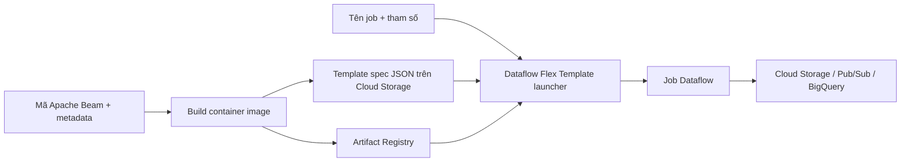

# Dataflow templates, Flex Templates và tham số hóa jobs

## Mục tiêu

Sau bài này, bạn có thể chọn loại Dataflow template phù hợp; đóng gói một pipeline Apache Beam thành Flex Template; khai báo, truyền và kiểm tra tham số khi tạo job; đồng thời vận hành job an toàn về quyền truy cập, dữ liệu và chi phí.

## 1. Template giải quyết vấn đề gì?

Google Cloud Dataflow chạy pipeline xử lý dữ liệu xây dựng bằng Apache Beam, chẳng hạn đọc sự kiện từ Cloud Storage, chuẩn hóa rồi ghi BigQuery. Nếu phải sửa mã nguồn và triển khai thủ công cho mỗi tập tin đầu vào hoặc môi trường, việc vận hành sẽ khó lặp lại.

**Template** đóng gói định nghĩa pipeline để người vận hành hoặc hệ thống tự động có thể tạo **Dataflow job** bằng những tham số đầu vào khác nhau. Template là bản định nghĩa có thể tái sử dụng; **mỗi lần khởi chạy tạo một job** với cấu hình và vòng đời riêng. Google cung cấp các template có sẵn cho nhiều tình huống; nhóm phát triển cũng có thể tạo template tùy chỉnh.

Ví dụ, cùng một template xử lý đơn hàng có thể nhận `input_path=gs://data-dev/orders/*.jsonl` khi thử nghiệm và `input_path=gs://data-prod/orders/2026-11-19/*.jsonl` khi chạy chính thức, miễn cấu trúc dữ liệu và quyền truy cập phù hợp.

## 2. So sánh Classic Templates và Flex Templates

| Tiêu chí | Classic Template | Flex Template |
|---|---|---|
| Đóng gói | Đồ thị job được tạo sẵn và lưu trong Cloud Storage | Container image chứa mã pipeline trong Artifact Registry và tệp đặc tả JSON trong Cloud Storage |
| Thời điểm tạo đồ thị | Khi xây dựng template | Khi khởi chạy, từ mã trong container |
| Tham số chạy | Thường cần `ValueProvider` cho giá trị dùng ở thời điểm chạy; connector phải hỗ trợ | Nhận tham số trong launcher, có thể quyết định cách dựng đồ thị lúc chạy |
| Thay đổi logic/nhánh xử lý | Bị giới hạn bởi đồ thị đã lưu | Linh hoạt hơn, ví dụ chọn nguồn dữ liệu theo tham số |
| Lựa chọn | Phù hợp khi duy trì pipeline Classic có sẵn | **Ưu tiên cho template tùy chỉnh mới** |

Không nhầm **Flex Template** với **FlexRS** (Flexible Resource Scheduling): một bên là cách đóng gói/khởi chạy pipeline, bên kia là chế độ lập lịch tài nguyên cho một số batch job.

Luồng triển khai Flex Template:



**Quy tắc lựa chọn:** chỉ đổi đường dẫn nguồn, bảng đích hoặc cấu hình đã thiết kế sẵn thì truyền tham số khi chạy; thay đổi mã xử lý hoặc dependencies thì build và phát hành phiên bản template mới.

## 3. Thiết kế tham số cho job

Một bộ tham số tốt phân biệt rõ **giá trị nghiệp vụ** với **cấu hình hạ tầng**:

| Nhóm | Ví dụ | Cách quản lý |
|---|---|---|
| Tham số pipeline | `input_path`, `output_table`, `error_path` | Khai báo trong metadata và đọc từ mã Apache Beam |
| Tham số môi trường | Region, staging/temp bucket, worker service account | Cấu hình khi gọi lệnh tạo job |
| Cấu hình vận hành | Labels, số worker, chế độ batch/streaming | Cấp qua tùy chọn Dataflow được hỗ trợ |
| Dữ liệu nhạy cảm | Token, mật khẩu, khóa API | Dùng Secret Manager/IAM; không đưa giá trị bí mật vào tham số hiển thị của job |

Đặt tên thống nhất giữa `metadata.json`, mã pipeline và `--parameters`; quy định tham số nào bắt buộc, định dạng hợp lệ, giá trị mặc định (nếu có) và cách xử lý dữ liệu lỗi. Không đặt lại các tùy chọn do Flex launcher kiểm soát như `runner`, `project`, `region` hoặc `job_name` trong mã.

## 4. Thực hành: tạo Flex Template Cloud Storage → BigQuery

**Tình huống:** mỗi ngày nhận tệp JSON Lines (mỗi dòng là một JSON) chứa sự kiện và nạp vào bảng BigQuery. Giữ nguyên logic ETL, chỉ thay `input_path` và `output_table` theo từng lần chạy.

Chuẩn bị Google Cloud project đã bật các API cần thiết (Dataflow, Cloud Build, Artifact Registry, Cloud Storage, BigQuery), một bucket để lưu artifact/dữ liệu và một BigQuery dataset, ví dụ `analytics`. Máy phát hành cần Google Cloud CLI và quyền build/push; tài khoản dịch vụ chạy job phải đọc nguồn, ghi bảng BigQuery, dùng bucket staging/temp và khởi tạo worker Dataflow. Chọn bucket, dataset và region tương thích để tránh vấn đề vị trí dữ liệu.

**Dữ liệu ví dụ** trong `gs://my-pipeline-bucket/input/events.jsonl`:

```json
{"event_id":"e-101","event_type":"view"}
{"event_id":"e-102","event_type":"purchase"}
```

Tạo ba file trong một thư mục phát hành.

**`main.py`** — mã pipeline minh họa, giả định mỗi dòng là JSON hợp lệ với đủ hai trường:

```python
import argparse
import json

import apache_beam as beam
from apache_beam.options.pipeline_options import PipelineOptions


def parse_event(line):
    item = json.loads(line)
    return {
        "event_id": str(item["event_id"]),
        "event_type": str(item["event_type"]),
    }


def main():
    parser = argparse.ArgumentParser()
    parser.add_argument("--input_path", required=True)
    parser.add_argument("--output_table", required=True)
    args, beam_args = parser.parse_known_args()

    pipeline = beam.Pipeline(options=PipelineOptions(beam_args))
    (
        pipeline
        | "Read JSONL" >> beam.io.ReadFromText(args.input_path)
        | "Parse events" >> beam.Map(parse_event)
        | "Write BigQuery" >> beam.io.WriteToBigQuery(
            table=args.output_table,
            schema="event_id:STRING,event_type:STRING",
            create_disposition=beam.io.BigQueryDisposition.CREATE_IF_NEEDED,
            write_disposition=beam.io.BigQueryDisposition.WRITE_APPEND,
        )
    )
    pipeline.run()


if __name__ == "__main__":
    main()
```

Lệnh `pipeline.run()` nộp pipeline cho runner rồi để launcher kết thúc; **không gọi** `wait_until_finish()` trong chương trình tạo Flex Template, vì chờ job hoàn tất có thể cản trở quá trình khởi chạy. Ví dụ cố ý đơn giản: dòng JSON sai sẽ làm bước parse lỗi; phần bài tập sẽ bổ sung nhánh dữ liệu lỗi.

**`requirements.txt`**:

```text
apache-beam[gcp]
```

Trong bản phát hành thực tế, cần cố định và kiểm thử phiên bản Apache Beam cùng toàn bộ dependencies để build có thể tái lập.

**`metadata.json`** — tên tham số phải khớp tham số trong `main.py`:

```json
{
  "name": "Events JSONL to BigQuery",
  "description": "Nạp sự kiện JSONL từ Cloud Storage vào BigQuery.",
  "parameters": [
    {
      "name": "input_path",
      "label": "Cloud Storage input",
      "helpText": "Đường dẫn gs://... đến tệp JSONL.",
      "isOptional": false,
      "regexes": ["^gs://.+"]
    },
    {
      "name": "output_table",
      "label": "BigQuery target",
      "helpText": "Tên bảng dạng project:dataset.table.",
      "isOptional": false,
      "regexes": ["^[^:]+:[^.]+\\..+$"]
    }
  ]
}
```

Metadata giúp giao diện/launcher hiển thị mô tả, kiểm tra tham số trước khi chạy; mã vẫn phải tự kiểm tra ràng buộc nghiệp vụ quan trọng. Dấu `\\` trong JSON trên biểu diễn ký tự `\` trong biểu thức chính quy.

### Build và khởi chạy

Các lệnh dưới đây minh họa trên **Cloud Shell/Bash**; thay project, bucket và repo bằng tài nguyên của bạn. Giả định bucket và Artifact Registry Docker repository đã tồn tại, dữ liệu mẫu đã được upload và BigQuery dataset `analytics` đã tạo.

```bash
PROJECT_ID="my-project"
REGION="asia-southeast1"
BUCKET="my-pipeline-bucket"
REPO="dataflow-images"

gcloud dataflow flex-template build \
  "gs://$BUCKET/templates/events-v1.json" \
  --project="$PROJECT_ID" \
  --image-gcr-path="$REGION-docker.pkg.dev/$PROJECT_ID/$REPO/events:1.0.0" \
  --sdk-language="PYTHON" \
  --flex-template-base-image="PYTHON3" \
  --metadata-file="metadata.json" \
  --py-path="." \
  --env="FLEX_TEMPLATE_PYTHON_PY_FILE=main.py" \
  --env="FLEX_TEMPLATE_PYTHON_REQUIREMENTS_FILE=requirements.txt"
```

Lệnh build tạo image trong Artifact Registry và template spec JSON trong Cloud Storage; đường dẫn `events-v1.json` dùng ở bước chạy.

```bash
gcloud dataflow flex-template run "events-batch-20261119-01" \
  --project="$PROJECT_ID" \
  --region="$REGION" \
  --template-file-gcs-location="gs://$BUCKET/templates/events-v1.json" \
  --staging-location="gs://$BUCKET/staging" \
  --temp-location="gs://$BUCKET/temp" \
  --parameters="input_path=gs://$BUCKET/input/events.jsonl,output_table=$PROJECT_ID:analytics.events" \
  --additional-user-labels="team=data,environment=dev"
```

Sau khi job thành công, bảng `my-project:analytics.events` có hai dòng ví dụ nếu bảng ban đầu trống. Chạy cùng template với `input_path` khác tạo **job khác**; cần dùng tên job mới và dữ liệu đầu vào phù hợp. Không cần build lại khi chỉ đổi hai tham số trên.

Để kiểm tra job và lỗi thực thi:

```bash
gcloud dataflow jobs list --project="$PROJECT_ID" --region="$REGION"
gcloud dataflow jobs describe JOB_ID --full \
  --project="$PROJECT_ID" --region="$REGION"
```

Xem thêm Dataflow Job details, biểu đồ throughput, worker logs trong Cloud Logging và số dòng/bảng đích BigQuery. Tên lệnh và các quyền cụ thể có thể thay đổi theo môi trường; kiểm tra quyền của cả người khởi chạy, Dataflow service agent và worker service account.

## 5. Vận hành ổn định và tránh lỗi thường gặp

| Dấu hiệu | Nguyên nhân cần kiểm tra | Cách xử lý |
|---|---|---|
| Thiếu tham số hoặc khởi chạy thất bại | Tên `--parameters` khác `metadata.json`/`argparse`; giá trị không đúng regex | Đồng nhất tên, thử giá trị mẫu và kiểm tra thông báo validation |
| Launcher không tải image | Sai Artifact Registry path hoặc thiếu quyền đọc image | Xác minh image/tag và IAM của launcher/worker |
| Job không đọc được tệp hoặc ghi BigQuery | Sai `gs://`, thiếu bảng/dataset, quyền hoặc vị trí tài nguyên không phù hợp | Xác minh đường dẫn, quyền đọc/ghi và region |
| Job lỗi khi gặp bản ghi xấu | `json.loads` hoặc trường bắt buộc ném exception | Tách bản ghi hợp lệ và lỗi, đưa lỗi vào dead-letter output và theo dõi |
| Tăng chi phí hoặc dữ liệu trùng sau chạy lại | Job chạy quá nhiều worker, dữ liệu đã nạp được append lần nữa | Gắn nhãn/giám sát tài nguyên; dùng staging + `MERGE` hoặc chiến lược nạp idempotent |

Với pipeline production, nên quản lý phiên bản image bằng tag cố định hoặc digest, dùng service account riêng với quyền tối thiểu, đặt giới hạn tài nguyên và cảnh báo lỗi. Khi chạy lại batch có `WRITE_APPEND`, kết quả có thể bị lặp; **template không tự bảo đảm tính idempotent**. Cần thiết kế deduplication hoặc ghi vào staging rồi `MERGE` theo khóa nghiệp vụ (ví dụ `event_id`). Với streaming, cập nhật job đang chạy cần quy trình update/compatibility riêng; tạo job mới không mặc nhiên thay thế job cũ.

## 6. Bài tập vận dụng

**Bài 1 — Chọn cách triển khai.** Một đội có pipeline đọc Cloud Storage rồi ghi BigQuery; mỗi ngày thay đường dẫn tệp. Họ cũng muốn tùy chọn chuyển sang đọc Pub/Sub dựa trên cấu hình lúc chạy. Nên chọn loại template nào và khi nào phải build lại?

**Bài 2 — Tham số hóa.** Từ ví dụ, bổ sung tham số `environment` chỉ nhận `dev` hoặc `prod`. Từ chối giá trị khác trước khi chạy; đặt label `environment` tương ứng khi tạo job. Thử chạy với hai đường dẫn đầu vào khác nhau nhưng cùng template.

**Bài 3 — Độ tin cậy.** Tệp nguồn có một dòng không phải JSON và một `event_id` lặp. Thiết kế nhánh ghi bản ghi lỗi sang Cloud Storage và cơ chế tránh ghi trùng BigQuery khi chạy lại batch. Nêu cách đo số bản ghi đọc, hợp lệ và lỗi.

**Gợi ý đáp án:** (1) Chọn Flex Template vì có thể dựng đồ thị theo tham số; chỉ thay tệp đầu vào không cần build lại, thay logic/chọn connector trong mã phải phát hành image mới. (2) Thêm `choices=["dev", "prod"]` vào `argparse`, khai báo metadata và truyền `--additional-user-labels`; không dùng tham số để chứa credential. (3) Phân loại lỗi bằng `ParDo` với tagged outputs hoặc bước validation, lưu lỗi kèm nguyên nhân; ghi staging rồi `MERGE` theo `event_id`, đo bằng Beam metrics và kiểm tra số bản ghi tại đích.

## Tài liệu chính thức

- [Dataflow templates — so sánh Flex và Classic](https://cloud.google.com/dataflow/docs/concepts/dataflow-templates)
- [Build and run an example Flex Template](https://cloud.google.com/dataflow/docs/guides/templates/using-flex-templates)
- [Configure Flex Templates](https://cloud.google.com/dataflow/docs/guides/templates/configuring-flex-templates)
- [Run Flex Templates](https://cloud.google.com/dataflow/docs/guides/templates/run-flex-templates)

