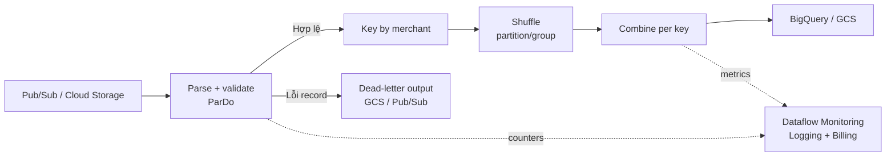
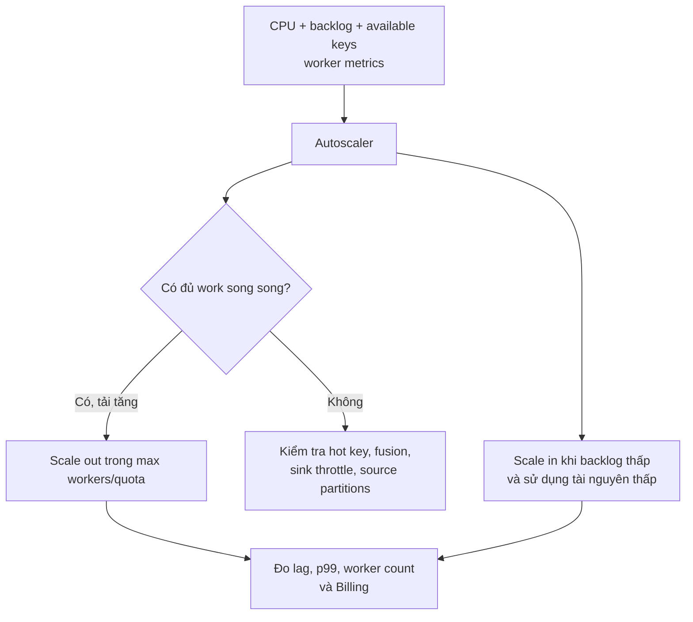
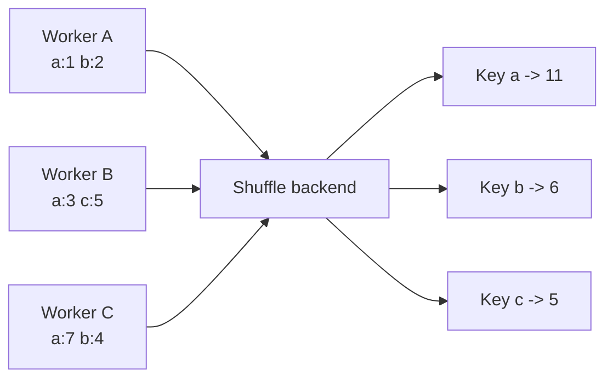
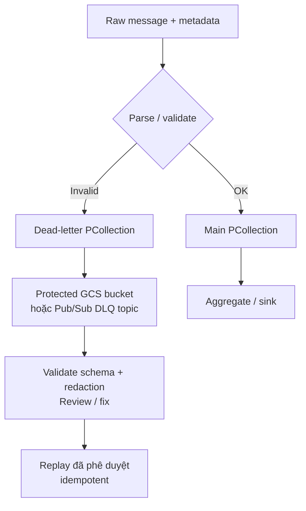

# Dataflow autoscaling, shuffle và xử lý lỗi dữ liệu

Một pipeline nhận đơn hàng từ Pub/Sub, làm sạch bản ghi rồi tổng hợp doanh thu lên BigQuery. Khi flash sale diễn ra, lượng message tăng gấp 10 lần: **backlog** kéo dài, số workers của Dataflow tăng nhưng p99 vẫn xấu. Một số messages chứa giá trị không hợp lệ khiến stage xử lý lặp đi lặp lại; một `merchantId` quá phổ biến làm bước `GroupByKey` bị nghẽn. Bài toán này không thể giải bằng cách chỉ tăng `maxNumWorkers`.

Bài thuộc chương **Pipeline và xử lý dữ liệu** của mô-đun `CLOUD_PROVIDERS_GCP`. Nội dung nối kiến thức về project/IAM/VPC, Pub/Sub, Cloud Storage, BigQuery, Compute Engine và vận hành dịch vụ: hiểu cách **Dataflow autoscaling**, cách **shuffle** ảnh hưởng mức song song hóa, và cách **tách dữ liệu lỗi vào dead-letter output** để pipeline vẫn tiến triển và có thể replay an toàn. Ví dụ dùng **Apache Beam Python SDK**, chạy local trước; phần Dataflow cloud chỉ thực hiện khi có project, bucket và ngân sách lab được cấp.

## 1. Kết quả học tập

Sau bài học, bạn có thể:

1. Giải thích `PCollection`, `PTransform`, `ParDo`, `GroupByKey`, `CombinePerKey` và stage trong Beam/Dataflow.
2. Phân biệt **Horizontal Autoscaling** (đổi số workers) với **Vertical Autoscaling** (đổi bộ nhớ workers qua Dataflow Prime).
3. Nhận biết sự khác nhau giữa **Dataflow Shuffle cho batch** và **Streaming Engine cho streaming**.
4. Giải thích vì sao **hot key, thiếu parallelism hoặc sink bị throttle** có thể khiến backlog tăng dù đã thêm workers.
5. Thiết kế **per-record validation**, tách output hợp lệ với **dead-letter records**, không che lỗi hạ tầng.
6. Cân nhắc idempotency, replay, duplicates, windowing, watermark và late data.
7. Chạy pipeline batch Python local để nhìn thấy **3 dữ liệu lỗi** và tổng hợp thành công từ dữ liệu đúng.
8. Đọc job status, autoscaling decisions, backlog, data freshness, counters và Cloud Logging.
9. Lập capacity/cost guardrails, runbook và chính sách bảo mật đối với bản ghi lỗi.

**Giới hạn:** bài ưu tiên **Apache Beam + Dataflow**. Không tự tạo project, Pub/Sub subscriptions, BigQuery datasets, GCS buckets hay chạy streaming job production. Những lệnh dùng `DataflowRunner` đều tạo tài nguyên tính phí và chỉ là **lab tùy chọn sau khi được phê duyệt**.

## 2. Kiến trúc pipeline và các điểm có thể tắc



**Beam** mô tả luồng dữ liệu logic; **Dataflow runner** thực thi thành các stages và có thể **fuse** nhiều transforms để giảm serialization/network overhead. Khi dữ liệu phải phân nhóm theo key, shuffle tạo **ranh giới phân phối** để các workers nhận đúng phần việc. Không phải mỗi dòng code hoặc mỗi `ParDo` đều tương ứng một VM.

| Khái niệm | Ý nghĩa | Rủi ro |
| --- | --- | --- |
| `PCollection` | Tập phần tử bounded hoặc unbounded | Không có thứ tự toàn cục mặc định |
| `ParDo` | Xử lý độc lập từng phần tử | User code lỗi làm retry bundle |
| `GroupByKey` | Gom toàn bộ giá trị cùng key trong một window | Có thể tạo hot key/bộ nhớ lớn |
| `CombinePerKey` | Tổng hợp từng key, thường có precombine | Hữu ích khi phép toán kết hợp được |
| **Fusion** | Ghép transforms giảm overhead | Có thể kéo dài critical path |
| **Shuffle** | Phân vùng/tái phân phối theo key | Network/storage và skew |
| **Sink** | Ghi đầu ra BigQuery/GCS/database | Quota/throttle có thể kéo tụt toàn job |

**Ba câu hỏi chẩn đoán:** backlog nằm trước stage nào, stage đó còn công việc song song không, và lỗi có phải do **dữ liệu** hay do **môi trường/đích ghi**?

## 3. Batch và streaming: khác nhau ở mục tiêu autoscaling

| Khía cạnh | Batch | Streaming |
| --- | --- | --- |
| Đầu vào | Bounded, kết thúc được | Unbounded, chạy liên tục |
| Mục tiêu | Hoàn thành nhanh với chi phí hợp lý | Giữ backlog/data freshness/SLO |
| Horizontal Autoscaling | Mặc định bật, ước tính work mỗi stage | Mặc định bật với Streaming Engine; xét backlog/CPU/available keys |
| Shuffle/state | **Dataflow Shuffle** thường bật mặc định trên machine được hỗ trợ | **Streaming Engine** nếu bật, xử lý shuffle/state/timers ở backend |
| Lỗi một phần tử | Bundle bị retry; hết lượt có thể fail job | Có thể retry lâu không giới hạn và làm pipeline kẹt |
| Điều kiện hoàn tất | Job `DONE` sau khi xử lý hết dữ liệu | Job cần chạy liên tục, update/drain có kế hoạch |

Ở streaming, **source backlog** và **data watermark lag** không phải một metric: backlog đo việc chưa xử lý, còn watermark thể hiện mức tiến triển theo **event time**. Một bản ghi quá cũ hoặc timer/window có thể giữ watermark lại dù throughput vẫn cao.

### 3.1. Scaling không thay thế đúng-ngữ-nghĩa

Dataflow có cơ chế xử lý exactly-once nội bộ trong streaming mode mặc định, nhưng **không tự đảm bảo exactly-once business side effects** cho mọi sink ngoài hệ thống. Nếu một HTTP call trả timeout sau khi đã ghi, retry có thể tạo bản ghi trùng. Dùng **event ID, idempotent sink/merge, transaction hoặc dedupe** ở đích theo hợp đồng nghiệp vụ.

## 4. Horizontal Autoscaling vận hành ra sao?

Horizontal Autoscaling thay đổi **số worker VMs** theo lượng việc có thể phân phối, throughput, CPU và backlog.



**Batch:** Dataflow định kỳ ước lượng khối lượng công việc còn lại của các stages và điều chỉnh workers. Dataflow Shuffle giúp tách shuffle state khỏi VMs, thuận lợi khi scale down.

**Streaming:** Dataflow xét backlog time, worker CPU, **available processing keys** và một số tín hiệu riêng của Streaming Engine như timer backlog. Nếu chỉ có **một key nóng** phải được xử lý tuần tự, thêm mười workers thường không làm key đó chạy nhanh gấp mười.

### 4.1. Các tùy chọn cơ bản

| Apache Beam | Python option | Ý nghĩa |
| --- | --- | --- |
| Số workers khởi đầu | `--num_workers=2` | Capacity lúc job bắt đầu |
| Giới hạn trên | `--max_num_workers=8` | Mức worker tối đa autoscaler được chọn, không phải bảo đảm sẽ dùng 8 |
| Chế độ | `--autoscaling_algorithm=THROUGHPUT_BASED` | Bật autoscaling |
| Tắt tự động | `--autoscaling_algorithm=NONE` | Chỉ dùng khi sizing cố định đã được chấp thuận |
| CPU target streaming | `--dataflow_service_options=worker_utilization_hint=0.7` | Gợi ý target, có thể bị backlog/key parallelism ghi đè |

**Mặc định CPU target streaming là 0,8**; hint có thể đặt trong khoảng `0.1–0.9` theo tài liệu hiện hành. Không coi `0.7` là một cam kết autoscaler giữ CPU luôn đúng 70%.

**Nếu Streaming Engine không bật**, việc dùng autoscaling streaming có thêm điều kiện/tùy chọn; xác minh SDK, runner và `max_num_workers` trước deploy.

## 5. Worker range, backlog và trade-off độ trễ/chi phí

Giả sử pipeline nhận **10.000 events/s**, mỗi worker xử lý ổn định **2.000 events/s** với query và sink giống production:

```text
Nhu cầu lý thuyết = 10.000 / 2.000 = 5 workers
+ 30% headroom     = 6,5 ≈ 7 workers (đề xuất để benchmark)
Nếu max workers = 4:
  capacity lý thuyết ≈ 8.000 events/s -> backlog tăng
```

**Đây là phép tính xấp xỉ:** worker throughput phụ thuộc key skew, machine type, network, source/sink throttling, schema và hot shards. Không lấy 7 làm khuyến nghị production trước khi có thử tải.

Trong streaming có Streaming Engine, Dataflow hỗ trợ **latency tiers** để điều chỉnh mục tiêu backlog:

| Latency tier | Estimated backlog time hướng tới | Đánh đổi |
| --- | --- | --- |
| `low_latency` | Dưới **15 giây** | Ưu tiên latency, có thể tăng phí |
| `medium_latency` | Dưới **2 phút** | Cân bằng |
| `high_latency` | Dưới **10 phút** | Chấp nhận lag lớn hơn để giảm compute |

Đây là **heuristics** chứ không phải SLO cam kết. Quyết định scale cần backlog vượt ngưỡng trong một khoảng thời gian; không phản ứng tức thì với mọi spike 1 giây.

### 5.1. Cập nhật khi job đang chạy

Với **streaming job sử dụng Streaming Engine**, có thể thay worker range hoặc utilization hint **in-flight**, nếu quyền và trạng thái job cho phép:

```bash
# GHI: chỉ cho streaming JOB_ID được nhóm sở hữu và đã duyệt.
gcloud dataflow jobs update-options "$JOB_ID" \
  --project="$PROJECT_ID" \
  --region="$REGION" \
  --min-num-workers=2 \
  --max-num-workers=8 \
  --worker-utilization-hint=0.7
```

**Không** giả định lệnh này áp dụng tương tự cho mọi **batch job** hoặc streaming job không có Streaming Engine. Không thay range nhiều lần liên tiếp khi chưa đợi autoscaler ổn định và đo ảnh hưởng của đợt trước.

### 5.2. Các lý do scale-up không xảy ra

- Đã chạm `max_num_workers` hoặc **Compute Engine quota/IP capacity**.
- **Ít keys/partitions**, một hot key giới hạn tính song song.
- Source hoặc sink bị **throttle**, chờ RPC/network, CPU thấp dù backlog tăng.
- Mới xuất hiện spike trong thời gian ngắn, autoscaler chưa đủ tín hiệu.
- Workers lỗi/OOM, startup chậm, SDK harness liên tục restart.
- Với streaming không dùng Streaming Engine, **Persistent Disk allocation** có thể là giới hạn bổ sung.

Chẩn đoán bằng **Autoscaling tab, backlog, available keys, CPU, worker logs và sink metrics**, không tăng max vô điều kiện.

## 6. Horizontal khác Vertical Autoscaling và right fitting

| Cơ chế | Thay đổi | Áp dụng |
| --- | --- | --- |
| **Horizontal Autoscaling** | Số workers/VMs | Batch và streaming trên Dataflow |
| **Vertical Autoscaling** | Bộ nhớ của từng worker | **Dataflow Prime**, điều kiện theo batch/streaming |
| **Right fitting** | Gán resource hints/chia worker pools cho stages khác nhu cầu | Theo runner và capability hỗ trợ |
| **Streaming Engine** | Chuyển một số việc state/shuffle/timer ra backend | **Không** phải scale RAM từng worker |
| **Dataflow Shuffle** | Chuyển batch shuffle ra backend | **Không** phải tạo thêm workers |

**Vertical Autoscaling** trên Dataflow Prime phát hiện nhu cầu bộ nhớ và thay workers bằng cấu hình RAM phù hợp. Với streaming Prime, tính năng này bật mặc định theo điều kiện được hỗ trợ; batch có cờ bật riêng và xử lý khác (thường chỉ scale up khi lặp OOM). Nó **không tăng CPU song song cho một hot key** và không được coi là thay thế tối ưu memory trong user code.

Khi vertical resize, horizontal scaling có thể tạm dừng, latency/backlog tăng trong một khoảng ngắn. Trong production theo dõi worker replacement, OOM events, warm-up và SLO. Các tính năng hiện có giới hạn theo machine, GPU, VPC Service Controls và runner; không tự bật nhiều experiments không hiểu rõ.

## 7. Shuffle là gì và khi nào xuất hiện?

Shuffle là bước **tái phân phối phần tử theo key**, có thể gây network/serialization/storage overhead và thay đổi execution graph.



Các phép toán thường kích hoạt shuffle:

- `GroupByKey`: gom values theo key.
- `CoGroupByKey`: join hai luồng cùng key, có thể tạo khối lượng dữ liệu lớn.
- `CombinePerKey`: group + aggregate, có thể **precombine** trước khi network shuffle.
- `Reshuffle`: tạo ranh giới phân phối/tách fusion khi thật sự cần; không dùng tùy tiện.

**Quan trọng:** `Map`/`ParDo` phần tử độc lập thường có thể chạy song song và **không cần shuffle**. Shuffle không đồng nghĩa “tất cả dữ liệu gom về một worker”: nó phân phối **theo key**; chính **một key chiếm đa số dữ liệu** mới có thể tạo nghẽn.

## 8. Dataflow Shuffle cho batch và Streaming Engine cho streaming

| Tiêu chí | Dataflow Shuffle (batch) | Streaming Engine (streaming) |
| --- | --- | --- |
| Dữ liệu | Bounded stages | Unbounded streams/windows/state |
| Vai trò | Tách shuffle `GroupByKey`/`Combine` khỏi VM worker | Dời state/timer/shuffle logic phù hợp ra backend |
| Mặc định | **Bật mặc định** cho batch jobs được hỗ trợ | Phụ thuộc SDK/ngôn ngữ và pipeline options; nên xác nhận job thực |
| Lợi ích | Giảm tài nguyên worker VM/Persistent Disk, scale down linh hoạt | Giảm phụ thuộc đĩa VM, cải thiện stateful execution |
| Chi phí | Có đơn vị/cấu phần phí shuffle tương ứng | Streaming Engine data processed hoặc compute units theo billing model |
| Hạn chế | Vẫn có shuffle skew/hot keys | Vẫn có hot keys, state/window limits |

**Dataflow Shuffle** thường được bật mặc định cho batch jobs. **Streaming Engine** là cơ chế khác với streaming; Java SDK có `--enableStreamingEngine`, Python SDK hiện đại thường bật mặc định theo điều kiện/version. **Đừng dùng cờ batch shuffle để cấu hình streaming**. Khi pipeline chạy, xem **Job info/environment và metrics** để xác nhận thực sự dùng backend nào.

Nếu job không dùng managed shuffle/state, dữ liệu shuffle/state phụ thuộc disk/memory của workers hơn, hạn chế scale-in và cần sizing Persistent Disk. Dùng **regional worker placement** (không pin zone) theo điều kiện Dataflow Shuffle/Streaming Engine để tăng khả năng dùng tài nguyên.

## 9. Vì sao GroupByKey dễ gây vấn đề?

`GroupByKey` có thể tạo một iterable rất lớn cho một key:

```python
# Ví dụ thường không tốt khi key 'merchant-hot' có hàng triệu records:
grouped = events | beam.GroupByKey()
# Sau đó: list(values) sẽ tải toàn bộ vào bộ nhớ một worker.
```

Một job có 1 triệu records phân bố 1000 keys **khác** job có 999.000 records cùng một key. Workers nhiều hơn **không chia xử lý của một key thành nhiều nhóm độc lập** nếu logic yêu cầu gom cả key.

Nếu phép tổng hợp có tính **kết hợp** và **giao hoán** (sum/count/min/max):

```python
# (merchant_id, amount_cents) -> (merchant_id, sum_amount_cents)
totals = keyed_events | beam.CombinePerKey(sum)
```

Beam/Dataflow có thể **partial combine** trước shuffle, giảm số bytes phải truyền và tránh materialize toàn bộ iterable trong user code.

**Không** dùng `CombinePerKey(sum)` cho bài toán cần **sắp thứ tự tất cả events** hoặc non-associative logic không được chứng minh an toàn. Khi cần join nhiều nguồn, xem cardinality, skew, side input nhỏ và chiến lược partitioning.

### 9.1. Hot key, skew và fanout

Nếu 80% records có key `merchant-hot`:

- Đo key frequency, CPU/lag theo stage và bottleneck status.
- Cân nhắc **fanout/salt key** trong hai bước khi phép aggregate phù hợp.
- Với Python Beam `CombinePerKey`, có tùy chọn `with_hot_key_fanout` cho các key nóng; **kiểm tra SDK/runner support** và benchmark.
- Tránh log trực tiếp **giá trị key nhạy cảm**: key có thể là userId, email, tài khoản.

```python
# Minh họa cơ chế salting, chỉ cho tổng associative:
# Bước 1: key (merchant, shard) -> partial sum
# Bước 2: key merchant -> sum các partial sums
#
# Không dùng shard ngẫu nhiên không ổn định cho thao tác cần ordering.
```

## 10. Fusion, reshuffle và số lượng keys quá lớn

**Fusion** giảm overhead nhưng có thể khiến transform chậm và transform nhanh cùng stage, gây khó phân phối. `Reshuffle` có thể tách fusion boundary hoặc chia phần việc nhưng **thêm network/shuffle overhead**; không phải thao tác tối ưu mặc định.

Ngược lại, tạo hàng triệu keys rất nhỏ có thể gây quá nhiều bundles/tasks và overhead. Với streaming/Streaming Engine, Dataflow có hướng dẫn điều chỉnh `Reshuffle.withNumBuckets` để cân bằng số lượng work units và số threads. **Không** tùy ý gán mỗi event một key ngẫu nhiên rồi nghĩ pipeline chắc chắn scale tốt.

Thứ tự kiểm tra khi có shuffle bottleneck:

1. Xem execution graph, step nào có shuffle/GroupByKey và records per key.
2. Kiểm tra `CombinePerKey` có thể thay `GroupByKey + list + sum` không.
3. Nếu hot key, cân nhắc fanout có kiểm chứng tính đúng.
4. Nếu ít keys, xem có thể repartition/split nguồn theo đơn vị đúng nghiệp vụ không.
5. Đo bytes shuffled, stage wall time, worker CPU, backlog và chi phí trước/sau.

## 11. Streaming: windowing, watermark và late data

Một unbounded `PCollection` **không thể group vô hạn theo key** mà mong kết quả “cuối cùng”. Cần thiết kế **windows/triggers/allowed lateness** trước aggregation.

```python
import apache_beam as beam
from apache_beam import window

# Minh họa: keyed_events là unbounded KV(merchant, amount)
# và đã được gán event-time timestamps phù hợp.
totals_per_minute = (
    keyed_events
    | "Windows1Min" >> beam.WindowInto(
        window.FixedWindows(60),
        allowed_lateness=120
    )
    | "TotalPerMerchant" >> beam.CombinePerKey(sum)
)
```

- **Window** giới hạn tập record để group; `FixedWindows(60)` là 60 giây theo event time.
- **Watermark** ước lượng mức tiến triển event time, ảnh hưởng lúc window đóng và downstream data freshness.
- **Allowed lateness** xác định thời gian xử lý late events cho window đã vượt watermark; kết hợp triggers và accumulation mode để biết có phát nhiều bản cập nhật hay không.
- **Timer/state** ở streaming có thể giữ dữ liệu và chi phí; một key/window quá lớn vẫn có thể gây bottleneck.

**Không** mặc định `allowed_lateness=120` sẽ chờ đúng 120 giây rồi mới xuất kết quả. Với trigger mặc định và event-time input, thời điểm phát output còn phụ thuộc **watermark/trigger**; muốn cập nhật sớm/định kỳ phải thiết kế trigger tường minh.

## 12. Phân loại lỗi trước khi quyết định retry

| Nhóm lỗi | Ví dụ | Hành động đúng |
| --- | --- | --- |
| **Dữ liệu không hợp lệ** | JSON lỗi, thiếu field bắt buộc, amount âm | **Dead-letter output** có reason code |
| **Schema evolution** | Event v2 thêm field hoặc đổi kiểu | Compatibility policy, quarantine/migrate |
| **Lỗi quyền** | `403` trên GCS/BigQuery/Pub/Sub | Dừng/sửa IAM, không cho tất cả records vào DLQ |
| **Tạm thời hạ tầng** | `429`, `503`, network timeout, quota pressure | Bounded retry + exponential backoff/jitter |
| **Lỗi logic/code** | Null pointer, bug serializer/coder, infinite loop | Sửa code, test, redeploy |
| **Lỗi đích ghi** | BigQuery schema mismatch, partition full, constraint | Phân biệt row-level reject và systemic failure |
| **Rủi ro trùng** | Retry đã ghi side effect nhưng timeout | Idempotent write/merge/dedupe |

**Mặc định**, lỗi user-code không được bắt ở một phần tử có thể làm **cả bundle** bị retry. Batch Dataflow thường retry bundle lỗi **4 lần**, sau đó job thất bại; streaming có thể **retry vô hạn**, khiến stage/job không tiến triển. Do đó không viết `except Exception: pass` để “cứ cho job xanh”: nó khiến dữ liệu biến mất và ẩn lỗi phần mềm.

**Nguyên tắc:** chỉ bắt các lỗi **có thể nhận diện là lỗi bản ghi**, trả record vào nhánh lỗi. Các lỗi hệ thống/transient cần cảnh báo và runbook khác; không gửi hàng triệu records hợp lệ vào DLQ vì dịch vụ BigQuery đang 503.

## 13. Dead-letter output và hợp đồng bản ghi lỗi



Một dead-letter record đủ dùng nên có:

| Trường | Mục đích |
| --- | --- |
| `source`/`subscription` | Nguồn và pipeline/stage tạo lỗi |
| `event_id` | Idempotency/dedupe, đối chiếu với source |
| `reason_code` | `MISSING_FIELD`, `INVALID_AMOUNT`, `SCHEMA_UNSUPPORTED` |
| `event_time`, `failed_at` | Phân biệt thời gian nghiệp vụ và thời gian phát hiện |
| `schema_version` | Biết parser phù hợp |
| `payload_ref` hoặc redacted payload | Điều tra mà không lộ PII |
| `attempt_count` / `pipeline_version` | Phân biệt poison record và retry |
| `owner`/`retention` | Quản trị/tuân thủ dữ liệu |

**Bảo mật:** raw messages có thể chứa PII/secrets. Không ghi nguyên payload vào Cloud Logging hoặc gửi vào topic DLQ public. Với production, ưu tiên **pointer đến object được mã hóa và phân quyền**, hash/metadata đủ chẩn đoán, TTL/retention và truy cập audit.

**Phân biệt hai DLQ:** Pub/Sub subscription dead-letter topic xử lý delivery attempts ở **Pub/Sub**, còn nhánh `PCollection` lỗi ở **Apache Beam/Dataflow** xử lý lỗi **do code và schema**. Chúng có thể bổ sung nhau nhưng không tự thay thế.

## 14. Quản lý replay mà không tạo lỗi thứ hai

Một DLQ có ích khi có quy trình xử lý:

1. **Triage** theo reason code, source/stage, tỷ lệ lỗi và ảnh hưởng nghiệp vụ.
2. Chọn hành động: sửa source, sửa parser, cập nhật schema, reprocess theo backfill.
3. Validate **phiên bản schema** và quyền truy cập; không replay thẳng toàn bộ DLQ.
4. Dùng event ID và **idempotent sink** để replay không nhân đôi side effect.
5. Áp **rate limit/batch nhỏ**, đo backlog, errors, duplicates và chi phí.
6. Ghi ticket, operator, số bản ghi trước/sau, retention và thời điểm xóa DLQ đã giải quyết.

Nếu source tự retry và bạn đồng thời replay DLQ, cùng event có thể được xử lý hai lần. Tránh quy trình “xóa Pub/Sub message sau khi ghi DLQ” nếu **DLQ sink chưa durable**; thiết kế acknowledgement, transaction/outbox và reliability contract theo connector thực tế.

**Không coi mọi event trong DLQ đều an toàn để đưa lại vào queue gốc**. Lỗi dữ liệu bị từ chối có thể chứa nội dung độc hại hoặc schema không hợp lệ; phải kiểm tra trước.

## 15. Lab cục bộ: Apache Beam Python, không cần GCP

Dùng **Python tương thích với phiên bản Beam hiện hành**, `pip` và Bash trên máy học viên. Chọn SDK Beam mới còn hỗ trợ phiên bản Python của bạn theo **Beam release compatibility matrix**. Không cần service account/GCS/BigQuery để chạy bằng `DirectRunner`.

Thư mục lab mẫu (trên máy học viên, **không tạo thêm file trong repository bài học**):

```text
dataflow-quality-lab/
├── pipeline.py
└── out/                   # tạo sau khi chạy
```

Cài môi trường:

```bash
mkdir -p dataflow-quality-lab/out
cd dataflow-quality-lab

python3 -m venv .venv
source .venv/bin/activate

python -m pip install --upgrade pip
python -m pip install "apache-beam[gcp]"

python -c "import apache_beam as beam; print(beam.__version__)"
```

Dùng `apache-beam[gcp]` để chuẩn bị khả năng chạy DataflowRunner sau này; nếu chỉ chạy local có thể dùng `apache-beam` cơ bản. Ghim phiên bản SDK và kiểm tra dependencies/security trong **lockfile dự án thật**; ở đây không ghim một version tùy tiện có thể đã hết hỗ trợ khi người học chạy bài.

## 16. pipeline.py: tách dữ liệu tốt và dữ liệu lỗi

Ví dụ **tự chứa**, nguồn là `beam.Create` gồm 7 dòng CSV giả lập; 4 dòng hợp lệ, 3 dòng sai. Pipeline ghi **hai nhánh output** ra file local và sử dụng `CombinePerKey` để tránh gom toàn bộ records một key vào list.

```python
import argparse
import json

import apache_beam as beam
from apache_beam.metrics import Metrics
from apache_beam.options.pipeline_options import PipelineOptions


class ParsePayment(beam.DoFn):
    def __init__(self):
        self.valid = Metrics.counter("quality", "valid_records")
        self.invalid = Metrics.counter("quality", "invalid_records")

    def process(self, line):
        try:
            fields = [part.strip() for part in line.split(",")]
            if len(fields) != 3:
                raise ValueError("FIELD_COUNT")

            event_id, merchant_id, amount_text = fields
            if not event_id or not merchant_id:
                raise ValueError("MISSING_ID")

            amount_cents = int(amount_text)
            if amount_cents <= 0:
                raise ValueError("NON_POSITIVE_AMOUNT")

            self.valid.inc()
            yield (merchant_id, amount_cents)
        except ValueError as exc:
            self.invalid.inc()
            # Chỉ trong LAB có dữ liệu giả. Không log raw PII production!
            yield beam.pvalue.TaggedOutput(
                "bad",
                json.dumps(
                    {"reason_code": "INVALID_RECORD",
                     "details": str(exc), "raw_line": line},
                    ensure_ascii=False
                )
            )


def as_csv(item):
    merchant_id, total = item
    return f"{merchant_id},{total}"


def run():
    parser = argparse.ArgumentParser()
    parser.add_argument("--output_prefix", required=True)
    args, beam_args = parser.parse_known_args()

    options = PipelineOptions(beam_args)
    sample = [
        "evt-1,merchant-a,100",
        "evt-2,merchant-a,250",
        "evt-3,merchant-b,40",
        "evt-4,merchant-a,-5",  # invalid
        "evt-5,merchant-c,abc",  # invalid
        "evt-6,,20",            # invalid
        "evt-7,merchant-b,60",
    ]

    with beam.Pipeline(options=options) as pipeline:
        parsed = (
            pipeline
            | "FakeInput" >> beam.Create(sample)
            | "Validate" >> beam.ParDo(ParsePayment())
                .with_outputs("bad", main="valid")
        )

        totals = (
            parsed.valid
            | "SumPerMerchant" >> beam.CombinePerKey(sum)
            | "AsCsv" >> beam.Map(as_csv)
        )

        totals | "WriteTotals" >> beam.io.WriteToText(
            args.output_prefix + "/totals", file_name_suffix=".txt"
        )

        parsed.bad | "WriteDeadLetter" >> beam.io.WriteToText(
            args.output_prefix + "/dead_letter", file_name_suffix=".jsonl"
        )


if __name__ == "__main__":
    run()
```

**Điểm kỹ thuật chính:**

- `try/except ValueError` chỉ xử lý **schema/giá trị sai**; không nuốt lỗi runtime ngoài phạm vi validation.
- `TaggedOutput("bad", ...)` tách lỗi ra một `PCollection` khác. Nếu bỏ nhánh này, hệ thống không còn cách audit 3 records lỗi.
- `CombinePerKey(sum)` tạo keyed aggregation và shuffle thích hợp; có thể dùng local precombine.
- `Metrics.counter` ghi số valid/invalid; Cloud Monitoring/Dataflow job metrics có thể dùng user counters khi chạy Dataflow.
- Output trong lab chứa **raw_line** vì tất cả records đều là dữ liệu giả. Với production phải thay bằng redaction/payload pointer và log policy.
- Demo không dedupe event ID; khi replay hoặc nối với sink nghiệp vụ phải thêm **idempotency**.

## 17. Chạy local và xác minh kết quả

Trong thư mục `dataflow-quality-lab` sau khi tạo `pipeline.py`:

```bash
python pipeline.py \
  --runner=DirectRunner \
  --output_prefix=out

# Tên shard file thực tế có thể khác:
ls -lh out/
cat out/totals-*.txt
cat out/dead_letter-*.jsonl
```

Kỳ vọng nhánh tổng hợp (thứ tự không cố định):

```text
merchant-a,350
merchant-b,100
```

Kỳ vọng nhánh lỗi có **3 JSON lines** tương ứng:

| Event | Lý do |
| --- | --- |
| `evt-4` | Số tiền không dương |
| `evt-5` | Không parse được số tiền |
| `evt-6` | Thiếu merchant ID |

**Không giả định thứ tự output:** Beam và shuffle xử lý song song, các shards có thể được ghi theo thứ tự bất kỳ. Kiểm tra tổng **350, 100**, nhánh lỗi **3 records**, không kiểm tra “dòng đầu tiên chắc chắn là merchant-a”.

### 17.1. Kiểm thử thay đổi dữ liệu

- Thêm một dòng hợp lệ `evt-8,merchant-b,30` → tổng merchant-b thành **130**.
- Thêm dòng có số âm → số dead-letter records tăng thêm 1.
- Thêm nhiều records `merchant-hot` để minh họa **key skew**. Với data ít, DirectRunner không thể chứng minh Dataflow autoscaler có hot-key behavior, chỉ chứng minh logic.
- Đổi parser để chấp nhận schema v2 **sau khi** viết test và cập nhật reason codes/version.

Đây là **logic lab**, không phải load test throughput/latency/chi phí cloud.

## 18. Tùy chọn: chạy batch lab bằng DataflowRunner

Chỉ thực hiện khi có **project lab, billing, Dataflow API, vùng triển khai, GCS bucket riêng, quyền IAM và quota** đã được admin chuẩn bị. Nếu chưa có quyền, **dừng ở DirectRunner**. Lệnh sau **ghi files lên Cloud Storage và tạo Dataflow job tính phí**.

### 18.1. Preflight chỉ đọc

```bash
PROJECT_ID="YOUR_AUTHORIZED_PROJECT"
REGION="YOUR_APPROVED_DATAFLOW_REGION"
BUCKET="YOUR_EXISTING_APPROVED_STAGING_BUCKET"

gcloud auth list
gcloud projects describe "$PROJECT_ID" \
  --format="yaml(projectId,lifecycleState)"

gcloud storage buckets describe "gs://$BUCKET"
gcloud dataflow jobs list \
  --project="$PROJECT_ID" \
  --region="$REGION" \
  --status=active
```

Xác nhận bucket/data location phù hợp với Dataflow region, quyền quản lý objects trong bucket, Dataflow Worker service account, quyền chạy jobs và mạng VPC nếu dùng private workers. **Không tắt VPC Service Controls, IAM hoặc org policy** chỉ để lab chạy được.

### 18.2. Launch batch job có giới hạn

```bash
JOB_NAME="quality-lab-$(date +%Y%m%d-%H%M%S)"
OUTPUT_PREFIX="gs://$BUCKET/quality-lab/$JOB_NAME"

# CÓ CHI PHÍ/GHI GCS: chỉ khi đã phê duyệt lab.
python pipeline.py \
  --runner=DataflowRunner \
  --project="$PROJECT_ID" \
  --region="$REGION" \
  --job_name="$JOB_NAME" \
  --temp_location="gs://$BUCKET/temp/$JOB_NAME" \
  --staging_location="gs://$BUCKET/staging/$JOB_NAME" \
  --output_prefix="$OUTPUT_PREFIX" \
  --num_workers=1 \
  --max_num_workers=3 \
  --autoscaling_algorithm=THROUGHPUT_BASED
```

**Dataflow batch autoscaling** có thể chọn 1 worker với 7 records rồi hoàn tất nhanh; ví dụ không đủ tải để quan sát nhiều lần scale. Dùng Dataflow job **từ trước** trong tổ chức hoặc staging workload có phép mới đo autoscaling thật.

**Không đặt `--streaming` cho lab bounded `beam.Create`**. Với pipeline streaming thật dùng Pub/Sub source/unbounded input, cần window trước `GroupByKey`/`CombinePerKey`, và xác minh Streaming Engine/security/late events.

### 18.3. Kiểm tra job và kết quả

```bash
gcloud dataflow jobs list \
  --project="$PROJECT_ID" \
  --region="$REGION" \
  --filter="name=$JOB_NAME"

# JOB_ID lấy từ output jobs list; lệnh sau CHỈ ĐỌC.
gcloud dataflow jobs describe "$JOB_ID" \
  --project="$PROJECT_ID" \
  --region="$REGION"

gcloud storage ls "$OUTPUT_PREFIX/"
gcloud storage cat "$OUTPUT_PREFIX/totals-*.txt"
gcloud storage cat "$OUTPUT_PREFIX/dead_letter-*.jsonl"
```

Nếu `gcloud storage cat` không mở wildcard theo môi trường CLI, dùng `gcloud storage ls` để lấy **tên object cụ thể** rồi cat object đó. **Không** dùng `rm -r gs://bucket` để dọn lab.

## 19. Theo dõi autoscaling và bottleneck trên Dataflow

Trong Console: **Dataflow → Jobs → job → Job graph / Execution details / Job metrics / Autoscaling / Logs / Cost**.

| Metric/tín hiệu | Diễn giải | Khi cần xử lý |
| --- | --- | --- |
| `current workers`/`max workers` | Scale thực, mức trần | Stuck ở max trong khi backlog tăng |
| `job/aggregated_worker_utilization` | CPU worker tổng hợp | Có capacity nhưng CPU rất cao |
| `job/horizontal_worker_scaling` | Hướng scale và lý do | Hiểu vì sao autoscaler không scale |
| `job/processing_parallelism_keys` | Số keys song song | Ít keys khiến thêm workers vô ích |
| `job/backlog_bytes` / `backlog_elements` | Lượng việc đang chờ | Tăng kéo dài |
| **System lag** | Data chờ/đang xử lý trong hệ thống | Latency tăng, consumer chậm |
| **Data freshness / watermark lag** | Tác động event time/late data | Báo cáo ra muộn, watermark kẹt |
| **Stage wall time** | Nơi tốn thời gian CPU/wait/shuffle | Bottleneck một stage |
| **Source/sink errors** | RPC 403/429/503, retries | Phân biệt IAM/throttle/dữ liệu |
| **User counters valid/invalid** | Chất lượng dữ liệu | DLQ ratio tăng vượt SLO |

**Không đánh giá chỉ từ CPU:** CPU có thể thấp vì workers đang chờ BigQuery quota hoặc RPC. Một hot key có thể khiến một worker 100% CPU còn các workers khác thấp.

### 19.1. Cảnh báo theo mục tiêu người dùng

- **Streaming backlog processing time**, system lag và data freshness vượt SLO.
- DLQ fraction > ngưỡng cho phép trong 5–15 phút (ví dụ >1%).
- Worker errors/OOM, retries và `JOB_STATE_FAILED`.
- Max workers đạt trần và backlog tiếp tục tăng.
- BigQuery/Pub/Sub/storage quota hoặc rate-limit errors.
- Chi phí worker hours/shuffle/Streaming Engine và sink tăng đột ngột.

Dùng **Dataflow Turnkey Alerts** và Cloud Monitoring, tránh spam mỗi bản ghi invalid vào Cloud Logging; ghi reason code, sample được redacted và counters tổng hợp.

## 20. Runbook: backlog tăng nhưng workers không scale

**Tình huống:** streaming traffic 12.000 records/s; `max_num_workers=20`, hiện chỉ 4 workers, CPU trung bình 25%, backlog tăng 30 phút.

**Không vội nâng max lên 100.** Chẩn đoán:

1. **Autoscaling rationale:** có báo “insufficient key parallelism” không?
2. **Per-worker CPU/stage wall time:** một worker nóng, ba workers nhàn → hot key.
3. **Source backlog và keys:** số partitions/keys đủ để xử lý song song chưa?
4. **Sink:** BigQuery/Cloud SQL 429/503 và retries có làm tắc batch output?
5. **Worker errors:** OOM, SDK harness restart, code stuck trên RPC?
6. **Quota/IPs:** nếu muốn scale, project có đủ Compute Engine quota và địa chỉ VPC không?
7. **Nhịp đánh giá:** backlog mới vài giây hay đã kéo dài hơn ngưỡng?

| Phát hiện | Cách xử lý |
| --- | --- |
| CPU cao đều, keys đủ | Tăng max/hạ utilization hint có kiểm soát, benchmark |
| Một hot key | Precombine/fanout/split key, tối ưu thuật toán |
| Sink bị 429 | Backoff/batching/quota review, không chỉ thêm workers |
| Worker OOM | Giảm state/list memory, xem right fitting/vertical memory autoscaling nếu đủ điều kiện |
| Backlog do poison record | DLQ xử lý data lỗi, không retry vô hạn |
| Không đủ VPC IP/quota | Sửa capacity/network theo admin trước |
| Shuffle bytes bất thường | Dùng `CombinePerKey`, giảm cardinality dữ liệu truyền, tránh joins quá rộng |

**Sau thay đổi:** đợi jobs ổn định, so p95/p99, backlog age, worker count, CPU per worker, DLQ volume và Billing với cùng traffic mix. Nếu không cải thiện, quay lại nguyên nhân gốc chứ không tăng worker tiếp.

## 21. Bảo mật và quản trị dữ liệu

- **IAM tách vai:** người deploy, Dataflow service agent, worker service account, chủ bucket staging, Pub/Sub/BigQuery sink.
- Worker service account chỉ có quyền **đọc nguồn, ghi đúng sink và temp/staging bucket** cần thiết; không cấp Editor toàn project.
- **Mã hóa và network:** Dataflow workers qua VPC/private Google access khi cần, kiểm tra region/data residency và CMEK nếu tổ chức yêu cầu.
- **Không log raw PII** trong parser errors. DLQ cần ACL/IAM, retention, encryption, audit và quy trình xóa.
- Cẩn trọng với **data sampling** trong UI, có thể hiển thị payload nhạy cảm; tuân thủ data governance.
- **Schema contract** và pipeline version cần lưu trong metadata/release record để replay đúng.
- **Idempotency:** sự cố retry và job update có thể ghi trùng vào sink nếu không có khóa nghiệp vụ/merge.
- **Data retention:** Pub/Sub subscription, GCS DLQ, BigQuery staging và Dataflow temp có thời gian lưu khác nhau; không cho raw DLQ tồn tại vô hạn.

**Dataflow autoscaling không cấp thêm quyền tự động.** Nếu source/sink 403 thì phải sửa principal/role đúng scope; không tắt auth để “chạy cho nhanh”.

## 22. Chi phí: càng nhiều workers không luôn càng nhanh

Các yếu tố phí:

| Hạng mục | Biến chi phí |
| --- | --- |
| Worker VMs | vCPU, RAM, thời gian chạy và loại máy |
| Persistent Disk | Disk size và thời gian cho jobs không offload hết state |
| **Batch Dataflow Shuffle** | Shuffle data processed theo biểu giá |
| **Streaming Engine** | Data processed hoặc resource compute units theo billing model |
| Pub/Sub/GCS/BigQuery | Messages, storage, reads/writes/queries |
| Network/egress | Khác region/VPC/Internet |
| DLQ và replay | Storage, reprocessing, sink writes và logs |

Ví dụ định lượng **để lập kế hoạch, không phải giá niêm yết**:

```text
4 workers × 2 vCPU × 2 giờ   = 16 vCPU-hours
8 workers × 2 vCPU × 1 giờ   = 16 vCPU-hours

Hai phương án có compute vCPU-hours giống nhau,
nhưng khác RAM/disk/shuffle/sink/network/latency/cost thực.
```

Tăng workers có thể rút ngắn batch runtime nếu **công việc song song được**; nếu hot key/sink chậm, thêm workers chỉ tăng chi phí mà không cải thiện throughput.

**Kiểm soát:** budget alerts, max worker range, source/sink quota và data volume caps; với batch không cần gấp, xem **FlexRS** nếu phù hợp với SLA. Budget alert **không tự dừng job** khi vượt hạn.

## 23. Case study: 0,5% events lỗi làm pipeline streaming kẹt

Một job xử lý **100.000 events/phút**, khoảng **500 events lỗi/phút** do trường `amount` mang chuỗi không parse được. Parser cũ gọi thẳng `int(amount)`, để exception thoát khỏi `DoFn`. Dataflow streaming retry bundle liên tục; backlog tăng dù CPU chưa bão hòa.

**Thiết kế lại:**

1. Đặt validation ngay sau source, gắn reason code và pipeline version.
2. Tách `PCollection` hợp lệ/lỗi; dữ liệu hợp lệ tới `CombinePerKey`, dữ liệu lỗi tới protected DLQ sink.
3. Nếu sink DLQ lỗi, **không âm thầm drop**; cần retry/alert vì có nguy cơ mất dữ liệu.
4. Tính `invalid_rate = invalid / (valid+invalid)` theo window, báo động >1% kéo dài.
5. Dùng idempotent `event_id` khi replay, test schema migration.
6. Kiểm tra hot key sau khi pipeline thông suốt, không đánh đồng backlog do lỗi record với backlog do shuffle.
7. Giữ runbook và audit trước khi chuyển từ parser v1 sang v2.

**Kết quả mong muốn:** pipeline không bị kẹt bởi poison records, dữ liệu đúng vẫn hoàn thành, dữ liệu sai có thể sửa/replay, và SLO có thể đo riêng cho **valid path** và **DLQ path**. Chỉ “thấy job RUNNING” chưa đủ để công bố pipeline khỏe.

## 24. Bài tập tự luyện

### Bài 1 — throughput và worker count

Nguồn 15.000 events/s, benchmark mỗi worker xử lý được 3.000 events/s. Số workers tối thiểu theo mô hình lý tưởng?

**Đáp án:** `15000/3000=5` workers. Cần buffer peak/quota, benchmark key skew và sink; không bảo đảm 5 luôn đủ.

### Bài 2 — backlog nhưng không scale

Streaming job backlog tăng nhưng chỉ có 2 processing keys và hiện 2 workers, CPU thấp. Nâng `max_num_workers` 2→20 có giải quyết ngay?

**Đáp án:** Không. Song song hóa chỉ khoảng 2 keys ở stage then chốt; phải thay key distribution/transform nếu hợp lệ.

### Bài 3 — Dataflow Shuffle

Một batch pipeline dùng `GroupByKey` rất nhiều. Dataflow Shuffle mặc định có ý nghĩa gì?

**Đáp án:** Shuffle state/operations được offload khỏi worker VMs sang managed backend, có thể giúp giảm disk/memory/scale down. Nó **không loại bỏ hot key**, và vẫn có chi phí shuffle.

### Bài 4 — GroupByKey hay CombinePerKey

Cần tổng doanh thu theo merchant; người viết đang gọi `GroupByKey` rồi chuyển toàn bộ iterable thành list để `sum`.

**Đáp án:** Dùng `CombinePerKey(sum)` để có thể precombine và giảm bytes shuffle/memory; kết quả đúng nếu số liệu và phép toán hỗ trợ.

### Bài 5 — lỗi một record

Pipeline streaming lỗi `ValueError` với một payload sai và retry nhiều lần. Nên tăng workers hay dùng DLQ?

**Đáp án:** Dùng validation + dead-letter branch cho **lỗi dữ liệu**, không tăng worker để lặp lỗi mãi. Lỗi hạ tầng phải xử lý riêng.

### Bài 6 — IAM

Dataflow worker không ghi được GCS staging vì 403. Có nên đưa toàn bộ input records vào DLQ?

**Đáp án:** Không. Đây là **lỗi hệ thống/quyền**; sửa service account/IAM bucket và xác minh network/cấu hình.

### Bài 7 — tính DLQ rate

Một phút có 9.900 valid và 100 invalid. Invalid rate bao nhiêu?

**Đáp án:** `100/(9900+100)=1%`. Cần alert khi ngưỡng SLO bị vượt trong cửa sổ đo phù hợp.

### Bài 8 — streaming window

Một nguồn Pub/Sub unbounded chạy `CombinePerKey(sum)` mà không chọn window/trigger.

**Đáp án:** Cần windowing (và triggers/allowed lateness theo nhu cầu); không thể chờ “kết thúc toàn bộ stream” để aggregate.

### Bài 9 — replay

DLQ đã sửa có 1.000 messages; sink BigQuery có thể đã ghi thành công một số records trước timeout. Replay hết 1.000 có an toàn?

**Đáp án:** Chỉ khi sink có idempotent key/MERGE/dedupe hoặc cơ chế kiểm soát trùng; cần kiểm tra, rate-limit và audit.

### Bài 10 — tối ưu chi phí

Batch job dùng 4 workers trong 2 giờ, đổi 8 workers trong 1 giờ. Có chắc hóa đơn giảm?

**Đáp án:** Không. vCPU-hours lý thuyết bằng nhau, còn RAM/disk/shuffle/GCS/network/quota/sink tính riêng; benchmark thời gian và bill thực.

## 25. Checklist vận hành và dọn lab

**Trước deploy:**

- [ ] Pipeline đã phân biệt batch/streaming và nguồn bounded/unbounded.
- [ ] Có SLO backlog/data freshness/throughput/error rate và budget.
- [ ] Stage nào dùng `GroupByKey`/`CombinePerKey`, ước lượng bytes shuffle.
- [ ] Đã kiểm tra skew/hot keys, fusion, sink quota và khả năng song song hóa.
- [ ] Có worker min/max và utilization hint/latency tier phù hợp (nếu streaming).
- [ ] Đã xác minh Dataflow Shuffle hoặc Streaming Engine theo loại job/SDK.
- [ ] Có schema validation, DLQ branch, counters và reason codes.
- [ ] Source/sink retries, idempotency, duplicate handling, replay policy rõ ràng.
- [ ] IAM/VPC/CMEK/PII, retention và monitoring được quản trị.
- [ ] Đã kiểm thử DirectRunner và staging với dữ liệu giả.

**Sau deploy:**

- [ ] Job ID/region/version lưu lại, pipeline không có poison retry.
- [ ] Valid count + invalid count đối chiếu số events đầu vào (xét duplicates/filters).
- [ ] Source backlog, system lag/watermark và autoscaling không vượt SLO.
- [ ] DLQ sink hoạt động, không chứa dữ liệu nhạy cảm ngoài chính sách.
- [ ] Cost dashboard không có worker/shuffle/egress tăng ngoài dự báo.
- [ ] Có runbook xử lý job stuck, backfill/replay, drain/update và rollback.

**Dọn lab:**

- **DirectRunner local:** xóa `out/` và thư mục `dataflow-quality-lab` do bạn tạo khi không cần kết quả; **không** có job GCP.
- **DataflowRunner batch lab:** xác nhận job `DONE` và không có output/metadata cần giữ; chỉ xóa **prefix** `quality-lab/$JOB_NAME`, `temp/$JOB_NAME`, `staging/$JOB_NAME` trong bucket riêng được ủy quyền.
- **Không xóa** bucket dùng chung, Pub/Sub subscriptions, BigQuery datasets, service accounts hay streaming jobs production. Với job streaming thật, chọn **drain**/update thay vì cancel nếu cần hoàn tất dữ liệu đang bay; hành vi drain tùy pipeline, phải theo runbook có approval.

**Không** dọn bằng `gcloud storage rm -r gs://BUCKET` hoặc `gcloud dataflow jobs cancel` không có JOB_ID được xác minh.

## 26. Tài liệu chính thức

- [Dataflow Horizontal Autoscaling](https://cloud.google.com/dataflow/docs/horizontal-autoscaling): batch vs streaming, throughput/CPU/parallelism và runner options.
- [Tune streaming horizontal autoscaling](https://cloud.google.com/dataflow/docs/guides/tune-horizontal-autoscaling): worker range, utilization hint, latency tiers, update options.
- [Troubleshoot autoscaling](https://cloud.google.com/dataflow/docs/guides/troubleshoot-autoscaling): vì sao job không scale.
- [Dataflow Vertical Autoscaling](https://cloud.google.com/dataflow/docs/vertical-autoscaling): Dataflow Prime, memory resize và giới hạn.
- [Dataflow shuffle for batch](https://cloud.google.com/dataflow/docs/shuffle-for-batch): `GroupByKey`/`Combine` và managed shuffle backend.
- [Streaming Engine](https://cloud.google.com/dataflow/docs/streaming-engine): streaming state/shuffle/timers, SDK và billing.
- [Pipeline best practices](https://cloud.google.com/dataflow/docs/guides/pipeline-best-practices): DLQ, schema changes, side outputs và join.
- [Best practices for large batch jobs](https://cloud.google.com/dataflow/docs/guides/large-pipeline-best-practices): retries, resilience và DLQ.
- [Troubleshoot Dataflow bottlenecks](https://cloud.google.com/dataflow/docs/guides/troubleshoot-bottlenecks): hot keys, CPU và quota.
- [Dataflow monitoring interface](https://cloud.google.com/dataflow/docs/guides/monitoring-overview): Job graph, metrics, logs và Cost.
- [Cloud Monitoring for Dataflow](https://cloud.google.com/dataflow/docs/guides/using-cloud-monitoring): alert backlog/lag/user counters.
- [Beam Programming Guide](https://beam.apache.org/documentation/programming-guide/): `ParDo`, side outputs, `CombinePerKey` và windowing.
- [Beam Pipeline Options](https://cloud.google.com/dataflow/docs/reference/pipeline-options): SDK flags batch/streaming.
- [Dataflow pricing](https://cloud.google.com/dataflow/pricing): worker, shuffle, Streaming Engine billing.
- [gcloud dataflow jobs update-options](https://cloud.google.com/sdk/gcloud/reference/dataflow/jobs/update-options): in-flight tuning cho jobs phù hợp.

**Kết luận:** Dataflow autoscaling có thể thêm workers khi **còn công việc đủ song song**, nhưng không chữa được **hot keys, shuffle skew, sink bị throttle hoặc poison records**. Thiết kế pipeline bền vững cần **CombinePerKey thay GroupByKey không cần thiết**, chọn managed shuffle/Streaming Engine đúng batch-streaming, tách **dead-letter output** với metadata có thể replay và đo **backlog, data freshness, DLQ rate cùng chi phí**. Chạy local để chứng minh đúng dữ liệu trước khi thử autoscaling trên staging.
