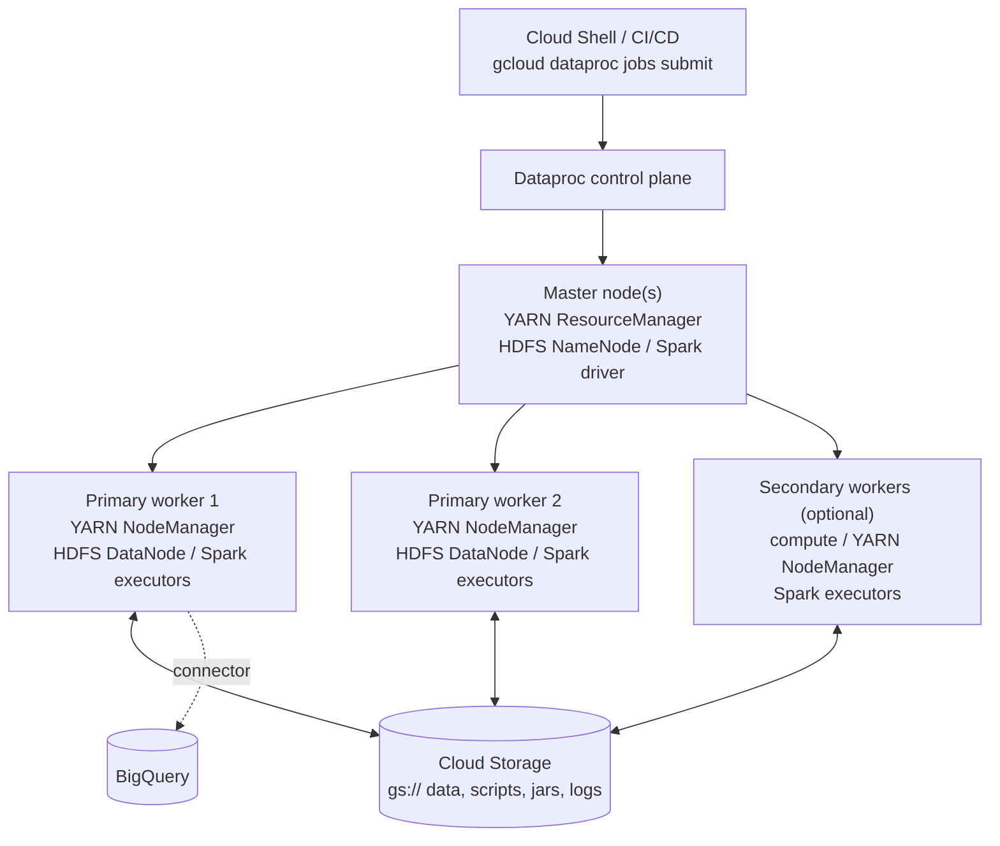
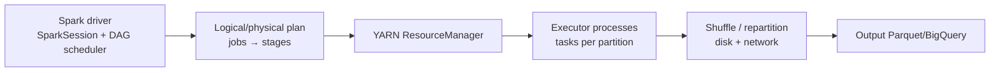
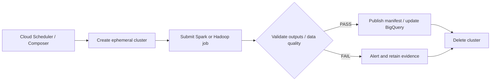

# Dataproc clusters và vận hành Spark, Hadoop

## 1. Bài toán và mục tiêu

Một doanh nghiệp có nhiều terabyte log và dữ liệu đơn hàng ở **Cloud Storage**. Đội dữ liệu đang dùng **Apache Spark** để làm sạch, nối bảng và tạo file Parquet cho **BigQuery**; một nhóm khác còn chạy job **Hadoop MapReduce** cũ. Việc tự dựng nhiều VM, cài Spark/Hadoop, điều phối tài nguyên, xử lý lỗi worker, giám sát và xóa cluster sau job gây tốn thời gian và chi phí.

**Dataproc clusters trên Compute Engine**, hiện thuộc sản phẩm **Managed Service for Apache Spark (formerly Dataproc)**, cung cấp môi trường quản lý cluster để chạy **Spark, Hadoop và các thành phần hệ sinh thái**. Google Cloud quản lý việc tạo cluster, cài image và tích hợp dịch vụ; nhóm phát triển vẫn chịu trách nhiệm **mã xử lý, mô hình dữ liệu, IAM, mạng, hiệu năng, độ tin cậy và chi phí**.

Bài nằm trong chương **Pipeline và xử lý dữ liệu** của module **CLOUD_PROVIDERS_GCP**. Các ví dụ kết nối Cloud Storage, BigQuery, VPC/IAM, Compute Engine và các pipeline từ Cloud Run/GKE/Pub/Sub.

**Kết quả học tập:** Sau bài này bạn có thể:

1. Phân biệt **master, primary/secondary workers, Spark driver/executors, YARN và HDFS**.
2. Chọn **cluster thường trực, cluster tạm thời hoặc Serverless Spark** tùy workload.
3. Cấu hình region, machine types, image, disk, VPC, service account và lifecycle.
4. Tạo cluster lab, chạy **Spark/PySpark** và **Hadoop MapReduce**, đọc kết quả trên Cloud Storage.
5. Hiểu Spark jobs/stages/tasks, shuffle, skew, cache, partitioning và cách đặt tài nguyên.
6. Áp dụng autoscaling, Spot/secondary workers, logging, monitoring, bảo mật và dọn tài nguyên.

> **Phạm vi lab:** Project `acme-data-lab`, bucket `acme-data-lab-unique`, cluster `spark-hadoop-lab` là **giả định**. Thay bằng tài nguyên lab được phê duyệt. Cluster có VM, persistent disks và dịch vụ tính phí **ngay cả khi không chạy job**. Không tạo cluster production hay xóa tài nguyên chia sẻ chỉ để thử bài học.

## 2. Chọn Dataproc cluster hay dịch vụ khác?

| Dịch vụ | Phù hợp | Điểm đánh đổi |
| --- | --- | --- |
| **Dataproc/Managed Spark clusters trên Compute Engine** | Cần kiểm soát VM, Spark/Hadoop/YARN, thư viện legacy, cluster config, interactive tooling | Quản lý vòng đời cluster, IAM/network/patching/cost |
| **Serverless for Apache Spark** | Spark batch/interactive không muốn vận hành VM cluster cố định | Ít kiểm soát VM/Hadoop components; giới hạn runtime/integration riêng |
| **Dataflow** | Streaming và batch theo Apache Beam, Pub/Sub/event-time/windowing | Không phải môi trường chạy nguyên Spark/Hadoop app truyền thống |
| **BigQuery SQL** | Transform/aggregate dữ liệu bảng với SQL, BI/analytics | Không phù hợp thay mọi workload Spark ML/custom distributed code |
| **Cloud Run Jobs** | Batch container hữu hạn, parallel tasks, xử lý ứng dụng tùy biến | Không cấp sẵn YARN/Spark distributed runtime |
| **GKE tự quản Spark** | Hệ sinh thái Kubernetes có operator/platform riêng | Đội ngũ phải quản lý Spark on Kubernetes và các phiên bản |

**Chọn clusters** khi cần đặc tính Hadoop/YARN, cấu hình image/OS, bộ thư viện đặc thù hoặc workload chạy liên tục đủ để tận dụng VM. **Chọn Serverless Spark** cho batch không thường xuyên để giảm gánh nặng quản lý cluster; hai mô hình có API, chi phí và lifecycle khác nhau. Các lệnh `gcloud dataproc jobs submit` dưới đây nhắm tới **cluster**, không phải `gcloud dataproc batches submit` của serverless.

## 3. Các thành phần của Dataproc cluster



### Master, primary và secondary workers

| Vai trò | Chạy gì? | Lưu ý vận hành |
| --- | --- | --- |
| **Master** | Điều phối YARN/HDFS, cluster services; Spark driver thường chạy trên master với Dataproc job submit ở chế độ được quản lý | Nếu single master lỗi, jobs/cluster bị ảnh hưởng; cân nhắc HA 3 masters |
| **Primary workers** | YARN NodeManagers, **HDFS DataNodes**, Spark executors | Đóng góp compute **và** HDFS storage; cần thận trọng scale-down |
| **Secondary workers** | Compute-only, YARN NodeManagers/Spark executors | Thích hợp autoscaling/Spot; **không** nên giữ dữ liệu gốc độc nhất |

Hadoop **YARN** quản lý CPU/memory containers, lập lịch resource cho jobs; **HDFS** quản lý blocks trên node disks; **Spark** thực thi tính toán song song. Một Dataproc cluster có thể chạy Spark và Hadoop trên cùng YARN resources, vì vậy các jobs tranh chấp CPU, RAM, HDFS disk và network dù người dùng khác nhau.

**Standard cluster** thường có master và **ít nhất hai primary workers**; **single-node cluster** dành cho lab/khối lượng nhỏ, **không** đại diện production HA. Một số cluster types như **zero-scale** hoặc cấu hình linh hoạt có giới hạn phiên bản/region riêng; không xem chúng như mặc định của mọi cụm.

## 4. Cloud Storage, HDFS và nơi đặt trạng thái

| Vùng lưu trữ | Ý nghĩa | Có sống sau khi xóa cluster không? |
| --- | --- | --- |
| `gs://...` (Cloud Storage) | Data lake, input/output, scripts, Spark jars, checkpoint lịch sử, staging | **Có**, trừ khi xóa bucket/object riêng |
| `hdfs:///...` | HDFS trên cluster, dùng cho shuffle/workflow Hadoop hoặc legacy datasets | Thường **không** còn khi cluster bị xóa |
| Local disk / Spark shuffle | Scratch, shuffle spill và cache executor | **Không**, mất khi node/cluster bị thay |
| BigQuery table | Analytics tables và downstream marts | **Có**, theo BigQuery dataset retention/IAM |
| Metastore ngoài (nếu cấu hình) | Metadata Hive/Spark SQL phục vụ nhiều clusters | Theo lifecycle service/metastore, không nên gắn duy nhất vào ephemeral master |

**Nguyên tắc:** dữ liệu nguồn và output cần bền vững nên đặt trong **Cloud Storage hoặc database phù hợp**, không chỉ trong HDFS/local disks của một cluster dùng xong xóa. Cloud Storage connector giúp Spark/Hadoop đọc `gs://` như Hadoop filesystem, nhưng GCS là **object storage**, không phải POSIX/HDFS với mọi thao tác rename/atomicity giống nhau. Thiết kế output commit, tên thư mục chạy riêng và cleanup sau job theo quy tắc connector/format.

### Staging bucket và temp bucket

Dataproc dùng **cluster staging/temp buckets** cho artifacts, drivers và intermediate data tùy job. VM service account cần quyền phù hợp trên các buckets ấy. **Bucket staging không nhất thiết là bucket dữ liệu nguồn/đích**; tách quyền và lifecycle theo mức độ nhạy cảm.

Nếu chọn bucket `acme-data-lab-unique` để chứa cả data/staging trong lab, tránh đặt credentials hoặc dataset thực tế vào đó. Với production, thường tách `raw`, `processed`, `temp`, `job-artifacts` và dùng lifecycle để xóa intermediates.

## 5. Spark thực thi job như thế nào?



| Khái niệm | Nghĩa | Ví dụ |
| --- | --- | --- |
| **Driver** | Chạy mã ứng dụng và điều phối Spark execution | Tạo `SparkSession`, submit tasks |
| **Executor** | Process trên worker thực thi tasks, giữ cache/shuffle data | Đọc file partitions, aggregate |
| **Job / Stage / Task** | Action tạo job, shuffle boundaries tạo stages, tasks xử lý partitions | `groupBy().count()` khi `collect()/write` |
| **Lazy transformation** | Tạo execution plan chưa chạy ngay | `filter`, `select`, `join` |
| **Action** | Kích hoạt tính toán | `count`, `show`, `write` |
| **Shuffle** | Dữ liệu được trao đổi qua nodes theo key | `groupBy`, `join`, `repartition` |
| **Cache / persist** | Giữ dữ liệu dùng lại sau lần tính | DataFrame cache khi dùng nhiều nhánh |

**Spark executors không đồng nghĩa Dataproc worker VMs**: một worker có thể chứa nhiều executors hoặc nhiều task slots, phụ thuộc YARN containers, CPU/RAM và Spark configuration. Tăng `spark.executor.instances` không tự tạo thêm Dataproc VMs.

### Ba lỗi hiệu năng phổ biến

- **Data skew:** một customer có 50% số đơn, một partition bị dồn khiến stage kéo dài dù đa số executors rảnh.
- **Excessive shuffle:** join/groupBy trước khi lọc và chọn cột cần thiết, gây network/disk spill.
- **Too many small files:** nhiều file vài KB khiến task scheduling/metadata overhead lớn; dùng partitioning/compaction và file sizing phù hợp.

Đo trong **Spark UI → Jobs/Stages/SQL/Executors**, YARN UI và Cloud Monitoring; không kết luận từ CPU trung bình toàn cluster.

## 6. Hadoop MapReduce và Spark có điểm gì khác?

**Hadoop** là hệ sinh thái: HDFS để lưu trữ phân tán, YARN để quản lý tài nguyên, MapReduce để thực thi jobs map → shuffle/sort → reduce. **Spark** xây DAG, tối ưu các transformations và có thể cache dữ liệu trong memory, hỗ trợ SQL/DataFrames, MLlib và streaming, nhưng vẫn phụ thuộc disk/network/compute và scheduler.

| Công việc | Hadoop MapReduce | Spark |
| --- | --- | --- |
| Word count đơn giản | Map token→1, shuffle, reduce sum | `explode` + `groupBy().count()` |
| ETL nhiều bước, joins, window analytics | Cần nhiều jobs/phases | DataFrames/SQL optimizer và DAG |
| Legacy Java JAR jobs | Thường chạy nguyên ứng dụng | Cần port hoặc giữ Hadoop jobs |
| Data storage | HDFS hoặc GCS connector | HDFS/GCS/BigQuery/Parquet |
| Xử lý lặp nhiều vòng | Có thể tốn IO giữa jobs | Có thể cache, nhưng cần RAM và spill strategy |

**Không mặc định Spark luôn nhanh hơn MapReduce**: workload, data layout, tuning và skew quyết định. Nếu có một Hadoop JAR ổn định, Dataproc cluster cho phép vận hành nó mà chưa phải port toàn bộ sang Spark.

## 7. Thiết kế cluster: image, máy, vùng và tính sẵn sàng

### Chọn image và phiên bản

- Dataproc clusters chạy **image version** gắn với OS và các phiên bản Spark/Hadoop/Python/Java/connector cụ thể.
- **Pin một subminor image version đã kiểm thử** cho production để tránh bản alias `2.3-debian12` đổi đột ngột; rà [release notes](https://cloud.google.com/dataproc/docs/release-notes).
- Tính đến **security patches**, thời hạn hỗ trợ image, thay đổi Python/Conda/packages và Spark BigQuery connector trước khi upgrade.
- **Ngày 2/11/2026**, release notes đã liệt kê các image families 2.1/2.2/2.3/3.0. Không suy rằng image **3.0** tương thích mọi JAR, initialization action hoặc thư viện build cho 2.x; test và làm blue/green bằng cluster mới.

### Machine, disk, region, HDFS

| Quyết định | Câu hỏi | Lựa chọn thường gặp |
| --- | --- | --- |
| Master/worker machine | Driver memory, số executors, CPU/RAM cho shuffle? | E2/N2/N2D/C-series theo khả năng region, benchmark |
| Boot disk/local SSD | Shuffle spill, HDFS dữ liệu tạm? | SSD/local SSD khi IO-bound, không coi là durable storage |
| Cluster region/zone | GCS bucket, BigQuery dataset và quota ở đâu? | Đặt gần nguồn/đích, xem egress và data residency |
| High availability | Master mất có được gián đoạn không? | Cấu hình 3 masters theo điều kiện sản phẩm khi cần HA |
| Optional components | Cần Jupyter, Hive/HBase/Zookeeper, component gateway? | Chỉ bật những gì thật sự sử dụng |
| Initialization actions | Cần package/connector cụ thể? | Script từ bucket tin cậy, version pin, idempotent |

**Lựa chọn vùng** không chỉ là gần người dùng: Dataproc là nơi **compute dữ liệu**, nên vùng data lake/warehouse, private networking và slot/VM quota ảnh hưởng trực tiếp latency và phí network.

## 8. Preflight quyền và mạng trước khi tạo cluster

**Kiểm tra trong Google Cloud Console/Cloud Shell**:

1. Có project lab/Billing và đã bật **Dataproc API**, Compute Engine API, Cloud Storage API theo yêu cầu; có quota VM vCPU/PD/IP trong region.
2. IAM của người deploy cho phép tạo cluster/submit job và `iam.serviceAccounts.actAs` với cluster VM service account.
3. **VM service account** có `roles/dataproc.worker` và quyền data theo bucket/BigQuery; riêng **Dataproc Service Agent** làm control-plane, không dùng thay làm workload identity.
4. Subnet có IP range đủ, firewall cho intra-cluster communication, route tới Google APIs, DNS và quyền Shared VPC host-project khi cần.
5. Staging/temp bucket và data bucket có IAM tương ứng; tránh lưu secrets trong init scripts hoặc Spark command lines.

**Kết nối mạng hiện hành:** với cluster images **2.2+**, cluster VMs mặc định **chỉ có internal IP**. Dataproc tự bật **Private Google Access** trên subnet tương ứng để gọi Google APIs, nhưng workload truy cập **internet ngoài Google** vẫn có thể cần **Cloud NAT, proxy hoặc private connectivity**. Không xóa default route tới internet gateway chỉ vì muốn “private”: đường này có vai trò trong truy cập Google APIs qua Private Google Access.

**Không mở SSH/YARN UI trực tiếp ra internet.** Dùng **Dataproc Component Gateway** (qua IAM) và identity-aware access; kết hợp OS Login, audit và firewall nếu cần truy cập VM có kiểm soát.

## 9. Lab A — tạo cluster với vòng đời giới hạn

Ví dụ sử dụng **Cloud Shell Bash** trên project lab đã được duyệt. Giá trị project/bucket/service account chỉ mang tính minh họa; không tự mở rộng quyền nếu lệnh kiểm tra trả 403.

### 9.1. Chuẩn bị bucket và quyền

```bash
PROJECT="acme-data-lab"
REGION="asia-southeast1"
CLUSTER="spark-hadoop-lab"
BUCKET="acme-data-lab-unique"   # Cần tên bucket duy nhất toàn cầu
VM_SA="dataproc-lab-sa@${PROJECT}.iam.gserviceaccount.com"

# CHỈ ĐỌC: xác minh project và tài nguyên
gcloud auth list
gcloud config get-value project
gcloud dataproc clusters list --project="$PROJECT" --region="$REGION"
gcloud storage buckets describe "gs://$BUCKET" --project="$PROJECT"
```

Nếu chưa có bucket, người quản trị lab có thể tạo bucket riêng ở vị trí phù hợp:

```bash
# THAY ĐỔI: tạo bucket tính phí, không chạy nếu bucket đã tồn tại
gcloud storage buckets create "gs://$BUCKET" \
  --project="$PROJECT" --location="$REGION" \
  --uniform-bucket-level-access

# THAY ĐỔI IAM: chỉ khi đã được phê duyệt cho project LAB
gcloud iam service-accounts create dataproc-lab-sa \
  --project="$PROJECT" --display-name="Dataproc lab VM identity"

gcloud projects add-iam-policy-binding "$PROJECT" \
  --member="serviceAccount:$VM_SA" \
  --role="roles/dataproc.worker"

gcloud storage buckets add-iam-policy-binding "gs://$BUCKET" \
  --member="serviceAccount:$VM_SA" \
  --role="roles/storage.objectAdmin" \
  --project="$PROJECT"
```

**VM SA** cần `roles/dataproc.worker` và quyền với **staging/temp buckets, source/target data**. Grant `storage.objectAdmin` trên toàn bucket chỉ để đơn giản hóa **lab**; production nên phân tách bucket và chỉ cấp read cho input, write cho output, quyền runtime tối thiểu theo nhu cầu. Người deploy cần `iam.serviceAccounts.actAs` trên VM SA. **Dataproc Service Agent** là danh tính control plane, **không** phải VM SA chạy Spark jobs.

### 9.2. Tạo cluster Standard

```bash
# THAY ĐỔI: tạo VM/disks có phí, chỉ chạy trong LAB có quota và IAM
gcloud dataproc clusters create "$CLUSTER" \
  --project="$PROJECT" \
  --region="$REGION" \
  --image-version=2.3-debian12 \
  --num-workers=2 \
  --master-machine-type=e2-standard-4 \
  --worker-machine-type=e2-standard-4 \
  --service-account="$VM_SA" \
  --scopes=cloud-platform \
  --bucket="$BUCKET" \
  --enable-component-gateway \
  --delete-max-idle=30m \
  --delete-max-age=3h \
  --labels=env=lab,workload=spark,owner=training
```

**Giải thích:** hai primary workers là cụm Standard nhỏ, Component Gateway hỗ trợ giao diện Spark/YARN có IAM; auto-delete sau **30 phút không hoạt động** hoặc **3 giờ tuổi cluster** giảm nguy cơ quên xóa. Image `2.3-debian12` là **minor alias**, production nên **pin subminor** đã test. Không chọn image 3.x chỉ vì mới nhất khi ứng dụng/JARs còn phụ thuộc 2.x.

**Mạng:** image 2.3 mặc định internal-IP-only. Nếu project không có default VPC hoặc dùng Shared VPC, cần chỉ định `--subnet=SUBNET_URI`, cấu hình Private Google Access/firewall/routes/quyền Service Agent **trước khi tạo**. Không mở firewall production hoặc bật external IP chỉ để lab chạy.

### 9.3. Xác minh cluster RUNNING

```bash
# CHỈ ĐỌC, không thay đổi cluster
gcloud dataproc clusters describe "$CLUSTER" \
  --project="$PROJECT" --region="$REGION" \
  --format="yaml(clusterName,status,config.softwareConfig,config.masterConfig,config.workerConfig,config.gceClusterConfig,config.lifecycleConfig)"
```

Đợi trạng thái cluster **RUNNING** trước khi submit. Nếu `ERROR/CREATING` lâu, điều tra IAM, quota, VPC, image và init actions; không tạo thêm cluster giống hệt để thử ngẫu nhiên.

## 10. Lab B — SparkPi xác minh runtime

```bash
# THAY ĐỔI: submit Spark job, không ghi dữ liệu nghiệp vụ
gcloud dataproc jobs submit pyspark \
  file:///usr/lib/spark/examples/src/main/python/pi.py \
  --cluster="$CLUSTER" \
  --project="$PROJECT" \
  --region="$REGION" \
  -- 100
```

`file:///.../pi.py` là path **trên Dataproc cluster image** theo tài liệu gcloud; không phải file trên Cloud Shell. `100` là tham số của SparkPi sau dấu `--`. Driver output trả giá trị gần `3.14`; kiểm tra trạng thái job trong Dataproc và executor activity trong Spark UI, không dùng một phép ước lượng Monte Carlo như test correctness hoàn chỉnh.

## 11. Lab C — ETL PySpark từ JSONL trên GCS sang Parquet

### 11.1. Tạo dữ liệu giả

```bash
# Cloud Shell Bash, file input giả định
cat > orders.jsonl <<'EOF'
{"order_id":"O-1","customer_id":"C017","event_ts":"2026-11-16T08:00:00Z","status":"PAID","amount":100.50}
{"order_id":"O-2","customer_id":"C018","event_ts":"2026-11-16T09:00:00Z","status":"NEW","amount":40.00}
{"order_id":"O-3","customer_id":"C017","event_ts":"2026-11-17T11:30:00Z","status":"PAID","amount":250.00}
{"order_id":"O-4","customer_id":"C017","event_ts":"2026-11-17T12:00:00Z","status":"PAID","amount":120.00}
{"order_id":"O-5","customer_id":"C019","event_ts":"2026-11-17T13:00:00Z","status":"CANCELLED","amount":30.00}
EOF

# THAY ĐỔI: ghi dữ liệu LAB lên Cloud Storage
gcloud storage cp orders.jsonl \
  "gs://$BUCKET/input/orders.jsonl" --project="$PROJECT"
```

JSONL chứa một JSON object mỗi dòng. Dữ liệu ví dụ không có duplicate events, late arrival hoặc partial payments; một pipeline production phải quản lý những trường hợp này.

### 11.2. Chương trình `orders_etl.py`

```python
import sys
from pyspark.sql import SparkSession, functions as F, types as T

if len(sys.argv) != 3:
    raise ValueError("Usage: orders_etl.py gs://input gs://output")

input_path, output_path = sys.argv[1], sys.argv[2]
spark = SparkSession.builder.appName("orders-etl-lab").getOrCreate()

schema = T.StructType([
    T.StructField("order_id", T.StringType(), False),
    T.StructField("customer_id", T.StringType(), False),
    T.StructField("event_ts", T.StringType(), True),
    T.StructField("status", T.StringType(), True),
    T.StructField("amount", T.DecimalType(12, 2), True),
])

orders = (
    spark.read.schema(schema).json(input_path)
    .withColumn("event_date", F.to_date(F.to_timestamp("event_ts")))
)

paid = (
    orders.filter(
        (F.col("status") == "PAID")
        & F.col("customer_id").isNotNull()
        & F.col("event_date").isNotNull()
    )
    .select("customer_id", "event_date", "amount")
)
daily = (
    paid.groupBy("event_date", "customer_id")
    .agg(F.count(F.lit(1)).alias("paid_orders"),
         F.sum("amount").alias("revenue"))
)

daily.write.mode("overwrite").partitionBy("event_date").parquet(output_path)
spark.stop()
```

**Vì sao:** khai báo schema rõ ràng tránh inference trên lượng dữ liệu lớn, filter trước `groupBy` giảm shuffle, Parquet là định dạng cột phù hợp data lake, `partitionBy(event_date)` thuận tiện đọc từng ngày. **Không nhầm partitionBy của file Parquet với BigQuery table partitioning**; BigQuery cần cấu hình riêng khi load/external table.

**Hạn chế:** `overwrite` có thể xóa output cũ của **đúng path**. Trên production, dùng **run-specific output prefix**, lưu data quality metrics, xử lý duplicate `order_id`, late events và publish output thông qua manifest/commit marker để tránh consumer đọc kết quả dở.

### 11.3. Submit PySpark job

```bash
gcloud storage cp orders_etl.py \
  "gs://$BUCKET/scripts/orders_etl.py" --project="$PROJECT"

# THAY ĐỔI: input và output đều ở bucket LAB
gcloud dataproc jobs submit pyspark \
  "gs://$BUCKET/scripts/orders_etl.py" \
  --cluster="$CLUSTER" \
  --project="$PROJECT" \
  --region="$REGION" \
  --properties="spark.sql.shuffle.partitions=4" \
  -- \
  "gs://$BUCKET/input/orders.jsonl" \
  "gs://$BUCKET/output/orders-revenue-run1"

# CHỈ ĐỌC: xác nhận Parquet outputs
gcloud storage ls --recursive \
  "gs://$BUCKET/output/orders-revenue-run1/" --project="$PROJECT"
```

**Kỳ vọng:** có `event_date=2026-11-16` và `event_date=2026-11-17`; doanh thu `PAID` của `C017` tổng **470.50**. `spark.sql.shuffle.partitions=4` chỉ hợp lab nhỏ; benchmark thực tế cần chọn partitions theo volume/worker cores, kiểm tra **Adaptive Query Execution** và data skew. `gcloud storage cat` không hiển thị nội dung Parquet vì đây là **binary format**; dùng Spark/BigQuery/Parquet reader.

## 12. Lab D — Hadoop MapReduce WordCount

```bash
cat > words.txt <<'EOF'
spark hadoop spark
dataproc spark google cloud
hadoop cloud
EOF
gcloud storage cp words.txt \
  "gs://$BUCKET/input/words.txt" --project="$PROJECT"

# THAY ĐỔI: Hadoop WordCount job trên cluster LAB
gcloud dataproc jobs submit hadoop \
  --cluster="$CLUSTER" \
  --project="$PROJECT" \
  --region="$REGION" \
  --jar=file:///usr/lib/hadoop-op/hadoop-op-examples.jar \
  -- wordcount \
  "gs://$BUCKET/input/words.txt" \
  "gs://$BUCKET/output/hadoop-wordcount-run1"

# CHỈ ĐỌC: xem output files
gcloud storage ls --recursive \
  "gs://$BUCKET/output/hadoop-wordcount-run1/" --project="$PROJECT"
```

`--jar` trỏ đến Hadoop examples JAR được tài liệu gcloud sử dụng, **cần xác minh path trên cluster image** khi đổi phiên bản. `wordcount` là đối số chạy ứng dụng; input và output được truyền sau `--`. Hadoop output directory **phải chưa tồn tại**, nên lần chạy lại cần prefix khác hoặc cleanup đúng tài nguyên lab được phê duyệt. Đây là phép thử MapReduce/YARN/GCS connector, không yêu cầu lưu dữ liệu nguồn vào HDFS tạm.

## 13. Kiểm tra jobs và giao diện Spark/YARN

```bash
# CHỈ ĐỌC, lấy JOB_ID thật từ danh sách
gcloud dataproc jobs list --project="$PROJECT" --region="$REGION"
gcloud dataproc jobs describe JOB_ID \
  --project="$PROJECT" --region="$REGION"
```

Trong **Cloud Console → Dataproc/Managed Spark → Clusters → cluster → Web Interfaces** (khi bật Component Gateway), mở Spark History Server và YARN ResourceManager theo các components khả dụng:

- **Spark Jobs/Stages:** tasks lỗi, shuffle read/write, spill, stage kéo dài, skew.
- **Spark Executors:** số executors, memory, garbage collection, task distribution.
- **YARN UI:** resource pending/allocated và jobs tranh chấp containers.
- **Driver output và Cloud Logging:** Python exceptions, GCS 403, missing dependencies, OOM, ClassNotFound, worker loss.

**Persistent History Server** là thành phần riêng giúp lưu/tra Spark history sau khi xóa ephemeral cluster; không mặc định UIs trên VM đã xóa còn truy cập được. Nếu cần audit lâu dài, cấu hình event logs/Cloud Logging retention có kiểm soát và tránh log PII.

### Dọn cluster lab sau khi đã xác minh kết quả

```bash
# CHỈ ĐỌC: xác nhận tên và region trước khi xóa
gcloud dataproc clusters describe "$CLUSTER" \
  --project="$PROJECT" --region="$REGION"

# THAY ĐỔI: chỉ xóa cluster do lab này tạo, sau khi mọi job hoàn tất
gcloud dataproc clusters delete "$CLUSTER" \
  --project="$PROJECT" --region="$REGION"
```

Xóa cluster sẽ làm mất **local disks/HDFS**, nhưng **không tự xóa** output/inputs trên GCS hoặc tài nguyên IAM. Chỉ dọn các prefixes, buckets, SA và autoscaling policies do mình tạo **sau khi đã kiểm tra không được chia sẻ**. Guardrail `--delete-max-age` có thể **xóa cluster khi job còn chạy**, vì thế production phải đặt TTL dài hơn worst-case runtime và chủ động cleanup qua pipeline.

## 14. Autoscaling: scale compute mà không làm hỏng HDFS

Dataproc **autoscaling policy** điều chỉnh **số worker VMs** dựa trên tài nguyên **YARN pending/available**, **không** tự nâng RAM/vCPU của master hoặc đổi machine type. Nên giữ một nhóm **primary workers ổn định** vì chúng chứa HDFS DataNodes, sau đó mở rộng **secondary workers** để tăng executor capacity.

### Ví dụ policy cho một cluster khác trong lab

```yaml
# policy-spark.yaml — chỉ là ví dụ autoscaling policy YAML
workerConfig:
  minInstances: 2
  maxInstances: 2
secondaryWorkerConfig:
  minInstances: 0
  maxInstances: 8
basicAlgorithm:
  cooldownPeriod: 4m
  yarnConfig:
    scaleUpFactor: 0.05
    scaleDownFactor: 1.0
    gracefulDecommissionTimeout: 1h
```

```bash
# THAY ĐỔI: tạo/cập nhật POLICY trong project lab, không tự gắn vào cluster production
gcloud dataproc autoscaling-policies import spark-lab-policy \
  --source=policy-spark.yaml \
  --project="$PROJECT" \
  --region="$REGION"

# CHỈ ĐỌC
gcloud dataproc autoscaling-policies describe spark-lab-policy \
  --project="$PROJECT" --region="$REGION"
```

**Để dùng**: tạo một **cluster mới** có `--autoscaling-policy=spark-lab-policy`, primary workers = 2 và secondary workers có cấu hình phù hợp, hoặc gắn policy với `gcloud dataproc clusters update ... --autoscaling-policy=...` sau khi review tác động. **Không tự cập nhật cluster đang có jobs nhạy cảm chỉ để thử**.

| Tham số | Ý nghĩa vận hành |
| --- | --- |
| `workerConfig min=max=2` | Giữ primary HDFS DataNodes không bị thay đổi do autoscaling |
| `secondaryWorkerConfig 0..8` | Nới compute theo pending YARN memory với giới hạn chi phí |
| `scaleUpFactor=0.05` | Scale-up từng mức theo YARN pending resources, hữu ích cho Spark dynamic allocation |
| `scaleDownFactor=1.0` | Giảm workers khá quyết liệt khi có tài nguyên dư, chịu giới hạn cooldown |
| `gracefulDecommissionTimeout=1h` | Chờ YARN jobs đang chạy hoàn tất trước khi cưỡng chế xóa worker |

**Giới hạn của graceful decommission:** hết timeout có thể buộc giảm worker, khiến executors/tasks/shuffle mất và phải retry. Trong lúc decommission chưa hoàn tất, autoscaler không scale up mới theo cơ chế mô tả trong docs. Nếu dùng **Enhanced Flexibility Mode (EFM)**, policy phải **chỉ autoscale secondary workers** và đặt **graceful timeout = 0s** theo docs EFM; đừng ghép ví dụ `1h` ở trên với EFM mà chưa chỉnh.

### Autoscaling và Spark dynamic allocation là hai lớp

```text
Spark dynamic allocation:
  Thêm/bớt executors trong lượng YARN resource hiện có

Dataproc autoscaling:
  Thêm/bớt Compute Engine worker VMs khi YARN cần thêm/bớt capacity
```

Nếu Spark cố định `spark.executor.instances=4` còn cluster có 30 workers, autoscaler **không** tự biến ứng dụng thành 100 executors. Ngược lại, Spark xin thêm executors nhưng chưa có VM sẽ thấy **pending YARN resources**, giúp autoscaler quyết định tăng nodes.

## 15. Secondary Spot VMs, lifecycle và job resiliency

**Spot VMs** (hoặc preemptible VMs) có giá thấp hơn VM thường nhưng có thể bị thu hồi; **chỉ nên dùng cho công việc có thể retry và không giữ dữ liệu gốc duy nhất**. Secondary workers thích hợp vì chủ yếu là compute, không phải nơi giữ HDFS DataNodes.

Ví dụ cấu hình thêm secondary Spot workers **khi tạo một cluster mới**, không phải chạy lại trên cluster đã có:

```bash
# CÚ PHÁP THAM KHẢO: tạo một cluster khác, phát sinh phí
gcloud dataproc clusters create spark-spot-lab \
  --project="$PROJECT" \
  --region="$REGION" \
  --image-version=2.3-debian12 \
  --num-workers=2 \
  --num-secondary-workers=2 \
  --secondary-worker-type=spot \
  --master-machine-type=e2-standard-4 \
  --worker-machine-type=e2-standard-4 \
  --service-account="$VM_SA" \
  --scopes=cloud-platform \
  --bucket="$BUCKET" \
  --delete-max-age=2h
```

**Không cần chạy thêm cluster này để hoàn tất lab.** Nếu quota Spot thiếu, node provisioning có thể thất bại; điều đó không có nghĩa `gcloud dataproc jobs submit` hoặc chương trình Spark lỗi.

### Bảo đảm khi worker bị thu hồi

- Tasks phải có **retry** và side effects idempotent; không ghi append vào BigQuery hoặc gửi event hai lần khi job bị retry.
- Dữ liệu input/output bền vững đặt trong GCS/BigQuery; scratch/shuffle trên secondary worker có thể mất.
- Spark stage sau shuffle có thể bị tính lại; nếu thuật toán dùng local cache không checkpoint, có thể mất tiến độ.
- Đặt giới hạn Spot fraction, graceful policy/EFM, capacity fallback theo SLO; không dự báo độ sẵn có của Spot như VM thông thường.

### Auto-delete, auto-stop và ephemeral clusters

| Cơ chế | Hành vi | Khi dùng |
| --- | --- | --- |
| **`--delete-max-idle`** | Xóa cluster sau thời gian idle theo cách Dataproc xác định | Lab hoặc batch có thể kết thúc sớm |
| **`--delete-max-age`** | Xóa cluster sau tuổi tối đa | Chặn chi phí khi quên teardown |
| **`--stop-max-idle`** | Dừng VM sau idle theo điều kiện hỗ trợ | Tái dùng cluster nhưng tránh compute chạy lúc rảnh |
| **Job-scoped ephemeral cluster** | Tạo → submit → validate → delete qua Workflows/Composer | Tách tài nguyên, tránh idle cost |
| **Persistent cluster** | Dùng chung lâu dài, nhiều workloads | Có đủ utilization, governance, HA và autoscaling |

**Dừng cluster không giống xóa cluster**: stopped cluster có thể tiếp tục chịu chi phí disk/bucket và vẫn cần cleanup. Xóa cluster không xóa dữ liệu GCS hoặc BigQuery; nhưng **HDFS/local disks và lịch sử chạy trên VM** thường không còn. Nếu cần lịch sử sau teardown, xuất logs/metadata trước.

## 16. Thiết kế job orchestration, idempotency và dữ liệu đích

Trong production, đừng phụ thuộc vào người vận hành SSH lên master rồi gõ `spark-submit`. Có thể dùng **Dataproc Workflow Templates**, **Cloud Composer (Airflow)**, **Workflows**, Cloud Scheduler và CI/CD để tạo cluster/submit jobs/đối soát/cleanup theo nhu cầu.



### Pipeline có thể retry mà không nhân đôi dữ liệu

1. Chọn **run ID** hoặc **partition date** ổn định; tránh đổi business ID mỗi lần retry.
2. Đọc nguồn từ immutable/versioned GCS prefixes hoặc query snapshot có timestamp rõ.
3. Ghi output vào **prefix riêng theo run**, không overwrite các partition production đang phục vụ.
4. Kiểm tra schema/row counts/checksums, business invariants, dữ liệu lỗi và quality thresholds.
5. Chỉ khi thành công mới **publish manifest** hoặc atomic/controlled table swap/cutover phù hợp từng sink.
6. Nếu job retry, xử lý output cũ có điều kiện; với BigQuery append/Storage Write API cần dedup/merge keys.
7. Kết thúc/failed đều có **cleanup path** cho cluster, nhưng giữ driver output, lỗi và bằng chứng cần điều tra.

**Không coi trạng thái Spark job DONE đồng nghĩa business output đúng**: Spark không xác minh rằng đơn hàng bị hủy không được tính doanh thu, rằng currency conversion hợp lệ, hay rằng dữ liệu late-arriving đã được đối soát.

### Tích hợp BigQuery connector

Các image Dataproc 2.1+ thường có **Spark BigQuery connector** được cài sẵn. Ví dụ minh họa đọc bảng:

```python
# Chỉ ví dụ; cần IAM BigQuery, dataset hợp lệ và connector trên image
df = (
    spark.read.format("bigquery")
    .option("table", "acme-data-lab.analytics_lab.orders")
    .load()
)
df.select("customer_id", "amount").show(5)
```

Connector có chế độ ghi:

- **DIRECT**: dùng BigQuery **Storage Write API**; cần tính đến retry/idempotency và phiên bản connector.
- **INDIRECT**: ghi qua **Cloud Storage temporary bucket** rồi chạy BigQuery Load job; cần quyền GCS/BigQuery và cleanup.

**Đừng chọn DIRECT/INDIRECT chỉ theo tên**: workload append/upsert, schema, scale, yêu cầu latency và quyền IAM sẽ quyết định. Spark connector không tự biến pipeline thành một transaction xuyên GCS/BigQuery/Pub/Sub.

## 17. IAM, VPC và hardening cluster

### Ba lớp danh tính

| Principal | Vai trò | Không nên cấp |
| --- | --- | --- |
| **Deployer/CI** | Tạo/sửa/xóa Dataproc clusters, submit/cancel jobs; `iam.serviceAccounts.actAs` | `roles/owner` cho toàn dự án |
| **Dataproc Service Agent** | Tạo/cập nhật VM, network control-plane | Dùng làm credential của Spark applications |
| **Dataproc VM service account** | Đăng ký node agent, truy cập staging/temp GCS và nguồn/đích | GCS/BigQuery Admin toàn tổ chức nếu chỉ đọc/ghi một tập dữ liệu |
| **Job user** | Đọc logs, submit jobs theo policies | Truy cập mọi dataset qua shared VM SA không kiểm soát |

**Một cluster VM SA dùng chung** có nghĩa nhiều Spark jobs trên cluster thường chạy dưới cùng quyền backend. **Không xem cluster shared multi-user là ranh giới tenant isolation** nếu chưa có cơ chế phân tách credentials/FGAC/personal cluster auth phù hợp. Với dữ liệu nhạy cảm, có thể tách clusters theo team/data classification hoặc dùng tùy chọn workload identity đúng sản phẩm.

### Network và secrets

1. **Internal-IP-only** với subnet đủ IP, Private Google Access; Cloud NAT khi cần Internet cho pip/apt/packages ngoài Google APIs.
2. Firewall cho intra-cluster ports/YARN/HDFS, hạn chế SSH public; nếu Shared VPC, service agents cần role đúng tại **host project**.
3. **Component Gateway** thay cho mở trực tiếp Spark/YARN UI ra internet; IAM/audit controls.
4. **CMEK** cho disks/buckets nếu compliance yêu cầu; xác minh Cloud KMS IAM/region trước khi cluster init.
5. Secrets qua **Secret Manager** và identity; không đưa password vào `--properties`, init scripts, command args hoặc driver logs có thể được xem trong UI.
6. Pin packages/JARs và kiểm tra signature/CVE, tránh initialization action chạy file lạ từ public GCS bucket.

**Cập nhật image** nên theo mô hình **create new cluster + canary jobs + compare outputs + cutover**, đặc biệt khi thay Spark/Hadoop/Java/Python/BigQuery connector. Không giả định có thể nâng version của toàn cluster đang chạy **in-place** không gián đoạn.

## 18. Monitoring: theo dõi cluster, job và business output

| Chỉ số/log | Nguồn | Tín hiệu xấu |
| --- | --- | --- |
| **Cluster state / operations** | Dataproc API/Cloud Monitoring | Cluster kẹt `CREATING`, `ERROR`, job không vào scheduler |
| **YARN pending memory/vcores** | YARN/UI/Dataproc metrics | Hàng đợi tăng; autoscaling không theo kịp |
| **Worker CPU/RAM/disk IO** | Compute Engine/Cloud Monitoring | CPU nghẽn, disk spill, disk gần đầy |
| **Spark stages/task skew** | Spark UI/Event logs | Một vài tasks dài bất thường, skew/shuffle blow-up |
| **Spark executor OOM/GC** | Driver/executor logs, Spark UI | Retry vô hạn hoặc kill bởi YARN memory limit |
| **HDFS capacity** | NameNode UI/metrics | DataNodes thiếu disk hoặc nguy cơ mất replication |
| **GCS/BigQuery errors** | Connector logs/Cloud Logging | `403`, timeouts, quota/API limit hoặc schema mismatch |
| **Job duration/success rate** | Dataproc Jobs API và scheduling tool | Quá batch SLA hoặc tăng failure |
| **Data quality/lineage** | BigQuery, GCS manifests, checksums | Job DONE nhưng rows thiếu/trùng/sai |
| **Billing** | Cloud Billing export/monitoring | Cluster idle lâu, Spot retries và log phí tăng |

### SLO minh họa

```text
99,5% batch ETL hoàn thành và được validate trong 30 phút
Output partition được công bố trong vòng 45 phút sau scheduler trigger
Không có job retry làm nhân đôi business rows trên BigQuery
Cluster tạm phải được xóa sau job hoặc tối đa 3 giờ
```

Đây là **mục tiêu ứng dụng giả định**, không phải SLA Dataproc. Đặt alert theo job queue depth, runtime p95, worker OOM, GCS I/O errors, thiếu output manifest và chi phí VM; kiểm tra thật sau khi thay image/Spot ratio/autoscaling policy.

## 19. Tính chi phí theo vòng đời cluster và workload

Chi phí Dataproc cluster thường gồm:

- **Phí dịch vụ Managed Spark/Dataproc cluster** dựa trên vCPU và thời gian hoạt động theo mức giá hiện hành.
- **Compute Engine VMs**: master, primary/secondary workers, loại máy và hiệu lực Spot/CUD.
- **Persistent disks/SSD**, network egress, Cloud Storage staging/temp/data và BigQuery load/read/write.
- **Cloud Logging/Monitoring**, Cloud KMS, Metastore, Component Gateway dependencies và optional components nếu có.
- **Retries, OOM/shuffle spill hoặc failed jobs**: tiêu hao compute ngay cả khi không tạo output hữu ích.

Theo tài liệu giá hiện hành, cluster tính phí **theo thời gian tồn tại**, có **mức tối thiểu một phút** cho một lần dùng, bên cạnh phí VM/disk. **Không tính cluster chỉ theo số phút có Spark tasks chạy**. Job Serverless có mô hình DCU/compute seconds khác và có thể tốt hơn với workload rời rạc.

### Ví dụ so sánh (không phải hóa đơn)

```text
Cluster giả định có:
  Master: 4 vCPU
  Primary workers: 2 × 4 vCPU = 8
  Tổng: 12 vCPU (chưa kể secondary workers)

Một job 15 phút, cluster chờ 105 phút trước khi bị xóa:
  Uptime = 120 phút = 2 giờ
  vCPU-hours cơ sở: 12 × 2 = 24 vCPU-giờ

Nếu tạo cluster riêng, chạy job và xóa sau ~25 phút:
  12 × (25/60) = 5 vCPU-giờ
```

**Đây chỉ là phép tính công suất cơ sở**, không phải Dataproc bill hay cam kết giảm phí 79%: giá master/worker VM, hình thái instance, disk, min billing, network, API/storage, cluster startup và Spot/discounts đều ảnh hưởng. Phân tích chi phí qua **Cloud Billing export, labels và pricing calculator**.

**Các câu hỏi trước khi tạo cluster 24/7:**

1. Cluster có chạy đủ liên tục để giảm overhead so với tạo/xóa theo job?
2. Có thể dùng autoscaling secondary và giữ primary tối thiểu không?
3. Jobs có an toàn với Spot/executor loss không?
4. Có dữ liệu local/HDFS hoặc interactive sessions bắt buộc giữ cluster không?
5. Nếu cluster chờ tới ngày hôm sau, liệu **Serverless Spark** rẻ và dễ vận hành hơn?

## 20. Runbook xử lý lỗi thường gặp

| Triệu chứng | Nguyên nhân có thể | Cách xác minh/xử lý |
| --- | --- | --- |
| Tạo cluster báo thiếu quota | VCPU/PD/IP quota hoặc thiếu VM capacity zone | Compute Engine quotas/region, loại VM/zone khác đã phê duyệt |
| Cluster kẹt `CREATING` | VM SA thiếu `dataproc.worker`, staging bucket 403, image/init action lỗi | Cluster operations/serial logs/IAM, gỡ init action không cần |
| Không có default VPC/subnet | Org policy/VPC custom/Shared VPC chưa cấp quyền | Cấu hình `--subnet`, IAM networkUser và routes |
| VMs private không truy cập package registry | Không có NAT/proxy hoặc đường private tương ứng | PGA hỗ trợ Google APIs, còn internet ngoài Google cần đường khác |
| Spark job `PENDING` lâu | YARN hết resources/quotas, cluster bị stop hoặc autoscaling chưa scale | YARN pending memory/containers, worker count và capacity |
| `OutOfMemoryError` / executor lost | Executor memory thiếu, shuffle skew, data collect về driver | Spark Stages/Executors, memory overhead, phân vùng lại |
| SparkPi `ClassNotFound`/file missing | Image đổi path/package hoặc JAR không tương thích | Kiểm tra installed Spark examples, pinned image, logs |
| GCS `403 Permission denied` | VM SA thiếu GCS rights hoặc sai bucket | VM identity, staging/data bucket IAM, audit logs |
| Hadoop WordCount báo output exists | Output directory đã có từ job trước | Chọn prefix mới hoặc xóa đúng lab prefix có phê duyệt |
| Spark ETL `overwrite` làm mất dữ liệu | Trỏ nhầm output path vào production | Dùng run-scoped prefix, data quality checks, manifest |
| Job success nhưng BigQuery thiếu rows | Connector/output logic lỗi, data quality không đạt hoặc duplicate | So source/sink counts, commit status, dedup IDs |
| Job chậm dù CPU trung bình thấp | Skew, spill, disk/network bottleneck | Spark Stage tasks duration và shuffle metrics |
| Autoscaling không tăng nodes | Spark xin ít executors, YARN chưa pending, Spot quota/capacity | Dynamic allocation, policy bounds, YARN pending resources |
| Scale-down kéo dài | Graceful decommission chờ jobs, HDFS/DataNodes thay đổi | Job duration, autoscaling timeout, tránh giảm primary |
| Cluster bị xóa khi job chưa xong | `delete-max-age`/policy thiết lập quá ngắn | Cluster lifecycle logs, tăng guardrail có review |
| Hóa đơn cao khi không có jobs | Cluster thường trực, disk/staging/temp buckets, history logs | Cloud Billing + labels, auto-delete, cleanup |

### Runbook 7 bước khi ETL production trễ SLA

1. Ghi **project, region, cluster name, image version, job ID, owner** và thời điểm sự cố.
2. Xác định **cluster health** (RUNNING/ERROR), VM capacity, GCS network/IAM và scheduler trạng thái.
3. Xem **driver output**, Spark stage/task metrics và YARN resources; phân biệt lỗi app, quota/network và resource contention.
4. Kiểm tra **input snapshot**, schema, số bản ghi, phân bố key, output prefix và data quality tests.
5. Chọn biện pháp nhỏ nhất: sửa IAM/path, retry idempotent, tăng shuffle partitions, xử lý skew, tăng worker capacity có kiểm soát.
6. Chạy lại trên **run-scoped prefix** hoặc theo checkpoint; kiểm tra totals và business invariants trước khi publish.
7. Dọn cluster, lưu logs/metrics, ghi postmortem, SLA thực đo và cost impact.

**Không** hủy/xóa cluster đang phục vụ nhiều jobs rồi tạo lại nếu chưa kiểm tra việc mất HDFS data, running applications và chi phí phục hồi.

## 21. Ba tình huống thiết kế

### 21.1. ETL định kỳ từ Cloud Storage vào BigQuery

**Dữ liệu:** hằng ngày ingest hàng trăm GiB JSON/CSV từ Cloud Storage. **Luồng:** Cloud Scheduler/Composer tạo ephemeral Dataproc cluster → Spark validate schema/normalize/dedup → ghi Parquet hoặc BigQuery qua connector → data quality assertions → publish partition.

**Quyết định:** cluster tạm vì job chỉ chạy một lần/ngày, Spot secondary khi có khả năng retry; tách temp/output prefixes, pin image và auto-delete. Nếu chỉ SQL transformation, so **chi phí BigQuery native SQL** trước khi duy trì Spark.

### 21.2. Hadoop JAR legacy cần đưa lên GCP

**Dữ liệu:** hệ thống cũ dùng Java Hadoop MapReduce/Hive scripts, cần chuyển từ on-premises HDFS sang GCS. **Luồng:** giữ JAR trên bucket versioned, tạo Dataproc cluster dùng image tương thích, submit Hadoop jobs, đối chiếu output và dần thay những phần đơn giản bằng Spark SQL.

**Quyết định:** kiểm tra hành vi Hadoop filesystem khi dùng GCS connector (rename, consistency, output committer), quyền VM SA và Hive metastore persistence; không chuyển dữ liệu nguồn duy nhất vào HDFS tạm.

### 21.3. Nền tảng xử lý đa nhóm dùng chung cluster

**Dữ liệu:** BI, data science và ingestion jobs chạy cùng một cụm nhiều giờ. **Luồng:** YARN queues/resource pools, autoscaling secondary workers, Component Gateway, Persistent History Server và dashboard cost per team.

**Quyết định:** job contention, data access isolation và billing attribution là vấn đề lớn hơn việc tạo VM nhanh. Nếu teams có dữ liệu nhạy cảm và cần quyền khác nhau, cân nhắc clusters riêng hoặc cơ chế personal cluster authentication phù hợp, thay vì chia một VM SA quá quyền.

## 22. Bài tập và câu hỏi kiểm chứng

1. **Chọn dịch vụ:** Một job Spark chạy 20 phút mỗi ngày, không cần YARN tùy chỉnh. Vì sao nên so với Serverless Spark? **Gợi ý:** cluster uptime và công quản trị có thể vượt phần compute của job.
2. **Kiến trúc:** Primary worker khác secondary worker ở điểm nào? **Đáp án:** primary có HDFS DataNode, secondary chủ yếu compute.
3. **Nguồn dữ liệu:** Nếu toàn bộ dữ liệu đơn hàng nằm ở `hdfs:///tmp/orders` và xóa ephemeral cluster sau job, rủi ro gì? **Đáp án:** mất dữ liệu không được lưu ở hệ bền vững.
4. **YARN/Spark:** Tăng Spark executors từ 4 lên 16 có tự tạo thêm VM workers không? **Không**, cần Dataproc autoscaling/resize nếu chưa đủ YARN capacity.
5. **Shuffle:** `groupBy(customer_id)` chậm dù nhiều worker rảnh. Nêu hai giả thuyết. **Gợi ý:** skew theo customer, shuffle spill/memory pressure.
6. **Cloud Storage:** Vì sao code demo xuất Parquet vào prefix riêng của một run? **Gợi ý:** tránh overwrite kết quả job khác và hỗ trợ retry/reconciliation.
7. **IAM:** Người deploy có `roles/dataproc.editor`, nhưng cluster VM SA thiếu `roles/dataproc.worker`. Có thể tạo/chạy cluster bình thường không? **Không đảm bảo**; cần role đúng cho VM identity và bucket permissions.
8. **Mạng:** Cluster image 2.3 có internal IP, GCS đọc được nhưng pip install từ PyPI thất bại. Nguyên nhân? **Gợi ý:** Private Google Access không tự cấp đường tới internet ngoài Google, cần NAT/proxy/package mirror.
9. **Hadoop:** Output directory WordCount đã tồn tại từ lần chạy trước. Cách chạy lại an toàn? **Đáp án:** dùng prefix mới, không xóa dữ liệu production.
10. **Spot:** Secondary Spot VM bị thu hồi khi Spark đang shuffle. Điều gì có thể xảy ra và cần chuẩn bị gì? **Gợi ý:** task/stage retry, shuffle recomputation, idempotent sink.
11. **Autoscaling:** Policy cố định primary `min=max=2`, secondary `0–8`. Khi YARN pending tăng, node group nào nên scale? **Đáp án:** secondary workers.
12. **Cost:** Cluster giả định 12 vCPU chạy 2 giờ, tính tổng vCPU-giờ cơ sở. **Đáp án:** 24 vCPU-giờ, chưa tính pricing thực tế.
13. **Observability:** Job DONE nhưng số rows trong BigQuery thấp hơn nguồn 10%. Nêu ba bước xác minh. **Gợi ý:** input/data quality, filter logic, sink/commit/retries.
14. **Thiết kế tổng hợp:** Xây pipeline Spark từ GCS tới BigQuery có SLA 30 phút: vẽ luồng create → submit → validate → publish → delete, chọn IAM, cluster image, lifecycle, Spark metrics, rollback và tính phí.

## 23. Checklist triển khai production

- [ ] Chọn **Dataproc cluster** thay vì Serverless/Dataflow/BigQuery dựa trên yêu cầu thực tế.
- [ ] Dùng image version, Spark/Hadoop/Java/Python/connector **đã kiểm thử và pin**.
- [ ] Có region, zone, machine, disk, HA, networking, quota và data residency phù hợp.
- [ ] Tách master/primary/secondary, không lưu dữ liệu gốc duy nhất trên HDFS/local disks.
- [ ] Cloud Storage source/output/staging/temp có IAM và lifecycle policy rõ ràng.
- [ ] Người deploy, Dataproc Service Agent và VM SA được phân quyền riêng.
- [ ] Có `roles/dataproc.worker` cùng quyền data/BigQuery tối thiểu cho VM SA.
- [ ] Cluster private-only có PGA/Cloud NAT/firewall/Shared VPC được kiểm tra.
- [ ] Component Gateway/UI, secrets, image/init actions và audit đều được harden.
- [ ] Spark jobs dùng schema, filter projection, partitioning, skew handling và data quality tests.
- [ ] Output theo run ID; retry/jobs replay không gây duplicate hoặc overwrite sai.
- [ ] Hadoop jobs/JARs chạy tương thích; metastore và dữ liệu bền vững được tách khỏi VM.
- [ ] Autoscaling có bounds/cooldown và graceful policy, ưu tiên scale secondary.
- [ ] Spot chỉ áp dụng workload có retry/idempotency, có quota/capacity fallback.
- [ ] Có auto-delete/stop guardrails, cleanup cả khi job lỗi, không mất lịch sử cần audit.
- [ ] Có dashboard Spark/YARN/job/GCS/BigQuery, alert theo SLA/business correctness.
- [ ] Đã benchmark chi phí VM + Dataproc + disk + network + storage/BigQuery.
- [ ] Có canary khi nâng image, incident runbook và phương án rollback.

## 24. Tài liệu Google Cloud chính thức

1. [Managed Service for Apache Spark overview](https://cloud.google.com/products/managed-service-for-apache-spark).
2. [Dataproc cluster overview](https://cloud.google.com/dataproc/docs/concepts/overview).
3. [gcloud dataproc clusters create](https://cloud.google.com/sdk/gcloud/reference/dataproc/clusters/create).
4. [gcloud dataproc jobs submit](https://cloud.google.com/sdk/gcloud/reference/dataproc/jobs/submit).
5. [PySpark job submit reference](https://cloud.google.com/sdk/gcloud/reference/dataproc/jobs/submit/pyspark).
6. [Hadoop job submit reference](https://cloud.google.com/sdk/gcloud/reference/dataproc/jobs/submit/hadoop).
7. [Dataproc cluster image versions](https://cloud.google.com/dataproc/docs/concepts/versioning/dataproc-version-clusters).
8. [Dataproc release notes](https://cloud.google.com/dataproc/docs/release-notes).
9. [Dataproc worker service accounts](https://cloud.google.com/dataproc/docs/concepts/configuring-clusters/service-accounts).
10. [Dataproc cluster networking](https://cloud.google.com/dataproc/docs/concepts/configuring-clusters/network).
11. [Dataproc autoscaling](https://cloud.google.com/dataproc/docs/concepts/configuring-clusters/autoscaling).
12. [Dataproc secondary workers](https://cloud.google.com/dataproc/docs/concepts/configuring-clusters/secondary-vms).
13. [Dataproc Spot VMs](https://cloud.google.com/dataproc/docs/concepts/compute/secondary-vms).
14. [Dataproc scheduled deletion](https://cloud.google.com/dataproc/docs/concepts/configuring-clusters/scheduled-deletion).
15. [Dataproc Component Gateway](https://cloud.google.com/dataproc/docs/concepts/accessing/dataproc-gateways).
16. [Dataproc Spark BigQuery connector](https://cloud.google.com/dataproc/docs/tutorials/bigquery-connector-spark-example).
17. [Dataproc Workflows Templates](https://cloud.google.com/dataproc/docs/concepts/workflows/using-workflows).
18. [Dataproc monitoring](https://cloud.google.com/dataproc/docs/concepts/stackdriver-monitoring/monitoring-dataproc-clusters).
19. [Managed Spark pricing](https://cloud.google.com/products/managed-service-for-apache-spark/pricing).
20. [Cloud Storage connector for Hadoop](https://cloud.google.com/dataproc/docs/concepts/connectors/cloud-storage).

**Ghi nhớ:** Dataproc/Managed Spark clusters giúp chạy **Spark và Hadoop/YARN** trên VM được quản lý; tuy nhiên nhóm kỹ thuật vẫn phải thiết kế **đường dữ liệu bền vững, Spark jobs có thể retry, IAM/VPC tối thiểu, autoscaling secondary workers, quan sát correctness và vòng đời cluster**. Tối ưu chi phí không chỉ là chọn VM rẻ, mà là **hoàn tất job đúng, không mất dữ liệu và xóa tài nguyên khi hết việc**.
