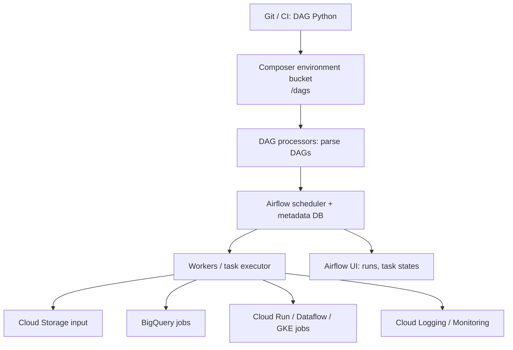
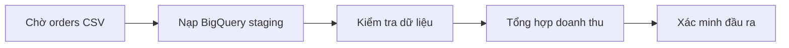

# Cloud Composer và điều phối DAG bằng Airflow

Mỗi ngày hệ thống Orders xuất file giao dịch vào Cloud Storage. Nhóm dữ liệu cần **chờ file xuất hiện → nạp vào BigQuery → kiểm tra chất lượng → tính doanh thu → xác minh kết quả**, tự chạy theo lịch và khởi động lại được khi một bước thất bại. Nếu ghép nhiều cron scripts rời rạc, việc xử lý ngày bị thiếu file, retry hay chạy lại dữ liệu cũ rất dễ sai. **Cloud Composer** (hiện được Google Cloud gọi là *Managed Service for Apache Airflow*) cung cấp môi trường **Apache Airflow được quản lý** để lập lịch, thực thi và quan sát quy trình dưới dạng **DAG**.

Bài thuộc chương **Pipeline và xử lý dữ liệu**, module `CLOUD_PROVIDERS_GCP`. Nội dung kết nối Cloud Storage, BigQuery, Pub/Sub, Cloud Run, GKE, IAM/VPC, kiểm soát chi phí và vận hành độ tin cậy. Trọng tâm là **điều phối bước và trạng thái dữ liệu**, không dùng worker Composer để tự xử lý khối dữ liệu lớn.

> Các tên project, bucket, dataset và CSV chỉ là ví dụ. Tạo môi trường Composer **phát sinh phí nền liên tục**; lệnh tải DAG, trigger DAG hay thao tác BigQuery có thể thay đổi dữ liệu. Chỉ chạy trên sandbox đã được phép. Các ví dụ Python trong bài nhắm tới **Composer Gen 3 + Airflow 2.11.1**; khi dùng **Airflow 3** phải kiểm tra lại imports/API và tính tương thích của các providers.

## 1. Mục tiêu

Sau bài học, bạn có thể:

1. Phân biệt **Composer environment**, **DAG**, **task**, **DAG run**, **task instance**, **operator**, **sensor** và **XCom**.
2. Giải thích dependency, `logical_date`, `data_interval`, `schedule`, `catchup`, retry và backfill.
3. Tạo môi trường Composer với image và service account thích hợp, tải DAG và theo dõi DAG runs.
4. Viết DAG Airflow điều phối Cloud Storage → BigQuery bằng Google Cloud providers và kiểm tra dữ liệu.
5. Thiết kế idempotency, concurrency, timeout và cảnh báo khi nguồn thiếu hoặc task thất bại.
6. Phân tách IAM, secrets, networking, SLO và chi phí Composer với chi phí các dịch vụ downstream.

## 2. Composer làm gì và không làm gì?

**Apache Airflow** là bộ điều phối các **workflows dạng đồ thị có hướng không chu trình (DAG)**: mỗi node là một task, mũi tên xác định thứ tự phụ thuộc. Composer vận hành cơ sở hạ tầng Airflow giúp nhóm tập trung vào DAG definitions, operators, security và chất lượng pipeline.



**Scheduler** quyết định khi nào một DAG run/task sẵn sàng; **worker** thực thi task hoặc gọi dịch vụ Google Cloud; **metadata database** lưu lịch sử trạng thái; **DAG processor** đọc định nghĩa Python; **triggerer** hỗ trợ các operators/sensors ở chế độ *deferrable*. Cấu trúc thành phần cụ thể thay đổi theo Gen 2/Gen 3, phiên bản Airflow và resilience mode; người học cần nắm trách nhiệm logic, không giả định tự quản trị toàn bộ GKE/metadata DB trong Composer Gen 3.

| Thành phần | Vai trò | Lưu ý |
| --- | --- | --- |
| Environment | Tài nguyên Composer theo region, chứa Airflow và cấu hình | Có phí nền, IAM/network riêng |
| DAG | Quy trình được định nghĩa bằng Python, **không phải tập dữ liệu** | Không tạo vòng phụ thuộc |
| Task/Operator | Công việc cụ thể: gọi BigQuery, Cloud Run, Python… | Công việc nặng nên chuyển cho dịch vụ tính toán phù hợp |
| Sensor | Chờ điều kiện: object GCS, job kết thúc… | Chọn `reschedule`/deferrable để không giữ worker |
| DAG run | Một lần thực hiện DAG cho **logical date/data interval** cụ thể | Trạng thái run không đồng nghĩa dữ liệu đã đúng nếu thiếu checks |
| Task instance | Task trong một DAG run; có thể retry nhiều lần | Logs/retries/tiến độ được theo dõi riêng |
| XCom | Truyền giá trị nhỏ giữa tasks | Không chuyển file CSV/JSON hàng GB qua XCom |
| Pool/Concurrency | Giới hạn task song song theo tài nguyên | Không thay quota của BigQuery/Cloud Run |

### 2.1. Composer so với Workflows, Dataflow và Pub/Sub

| Nhu cầu | Dịch vụ ưu tiên |
| --- | --- |
| DAG dữ liệu nhiều bước, lịch, backfill, dependencies, Airflow operators | **Cloud Composer** |
| Điều phối API theo request/event, chuỗi bước serverless ít quản trị scheduler | **Google Cloud Workflows** |
| Xử lý dữ liệu streaming/batch phân tán ở quy mô lớn | **Dataflow (Apache Beam)** |
| Phân phối sự kiện đến nhiều consumers độc lập | **Pub/Sub** |
| Chạy một job container theo lịch/điều kiện | **Cloud Run Jobs**, có thể do Scheduler/Workflows/Composer gọi |
| Một truy vấn SQL chuyển dữ liệu đơn giản | BigQuery Scheduled Query/Dataform có thể đủ |

Composer **không thay Dataflow/BigQuery**: task nên **gửi job tới dịch vụ xử lý** rồi chờ/giám sát kết quả. Cài Pandas lớn trong worker và đọc toàn bộ bảng nhiều GB vào RAM có thể làm nghẽn môi trường Airflow, ảnh hưởng mọi DAGs.

## 3. DAG, lịch và mô hình thời gian Airflow

Một DAG được định nghĩa trong Python và Airflow **parse lặp lại** để phát hiện thay đổi. Khi scheduler kích hoạt DAG, nó tạo **DAG run**; từng task instance có trạng thái như `scheduled → queued → running → success/failed/up_for_retry/skipped`.

### 3.1. Ví dụ dependency



Các tasks không liên quan có thể chạy đồng thời. Mũi tên biểu diễn thứ tự **phụ thuộc**, không đồng nghĩa truyền tất cả dữ liệu trực tiếp qua Airflow. Trong ví dụ, dữ liệu nằm tại **Cloud Storage và BigQuery**, còn DAG truyền tham số/tên đối tượng.

### 3.2. Logical date, data interval và catchup

Giả sử lịch `0 3 * * *` ở múi giờ `Asia/Ho_Chi_Minh`:

- **Data interval** là khoảng dữ liệu logic của kỳ cần xử lý. Theo lịch chuẩn, task chạy *sau khi kỳ đã kết thúc*, không phải luôn ngay tại `start_date`.
- **Logical date** thường biểu thị **đầu data interval**, không phải thời điểm worker bắt đầu xử lý thực tế.
- `{{ ds }}` thể hiện ngày logic `YYYY-MM-DD` của DAG run. File nguồn cần tuân theo cùng quy ước; không dùng `datetime.now()` trong task để đoán ngày dữ liệu.
- `catchup=False` tránh tự tạo toàn bộ các DAG runs chưa chạy từ `start_date` khi deploy/activate DAG, **không cấm người vận hành backfill thủ công**.
- **Backfill** có thể chạy lại kỳ lịch sử, phải có dữ liệu nguồn, retention và thao tác ghi **idempotent**.

| Thuộc tính DAG | Ví dụ | Hiệu quả |
| --- | --- | --- |
| `start_date` | `2026-11-01 00:00 Asia/Ho_Chi_Minh` | Mốc bắt đầu timetable |
| `schedule` | `0 3 * * *` | Lịch chạy theo timezone của DAG |
| `catchup` | `False` | Không tự chạy hàng loạt các kỳ cũ |
| `max_active_runs` | `1` | Giảm trùng ghi giữa các kỳ/trigger |
| `retries` | `2` | Thử lại một task thất bại, không chạy lại DAG từ đầu |
| `retry_delay` | 5 phút | Tránh retry quá nhanh khi downstream đang lỗi |

**Một lần task retry vẫn thuộc cùng task instance/DAG run và logical date.** Nếu task ghi dữ liệu rồi timeout trước khi Airflow nhận success, retry có thể lặp side effect; vì thế cần thiết kế ghi dữ liệu lặp được (idempotency), không chỉ bật `retries=2`.

### 3.3. Trigger rule, SLA và timeout

Mặc định task chỉ chạy khi các upstream tasks **thành công** (quy tắc `all_success`). Có thể dùng trigger rules khác cho bước cleanup/alert, nhưng đừng đặt `all_done` cho bước “xác nhận hoàn thành” rồi vô tình báo thành công khi upstream failed. Phân biệt `execution_timeout` của task, `dagrun_timeout` của DAG, thời gian sensor chờ nguồn và giới hạn riêng của BigQuery/Dataflow.

## 4. Phiên bản Airflow và Composer Gen 3

Google Cloud có các thế hệ Composer/Managed Airflow; **Gen 3** là hướng triển khai mới, hỗ trợ các builds **Airflow 2** và **Airflow 3**. Tại ngày biên soạn (19/11/2026), danh sách image công bố có ví dụ `composer-3-airflow-2.11.1-build.25` và `composer-3-airflow-3.3.1-build.8`. **Hỗ trợ image và khả dụng từng region thay đổi**: phải xác nhận trong Console/[image version list](https://cloud.google.com/composer/docs/composer-versions) và tránh pin một build đã hết support.

| Lựa chọn | Phù hợp | Cần kiểm tra |
| --- | --- | --- |
| **Composer Gen 3 + Airflow 2.11.1** | Lab Python ở mục 6 và tổ chức còn dùng DAG syntax/providers của Airflow 2 | Support window, security patches, migration plan |
| **Composer Gen 3 + Airflow 3.x** | Project mới có chủ đích dùng Airflow 3 | API imports như `airflow.sdk`, providers/operators, CLI và plugin compatibility |
| **Composer Gen 2 hiện hữu** | Hệ thống đang vận hành và cần lộ trình nâng cấp | Image lifecycle, network, migrations và cost |

**Đừng chép Airflow 2 imports sang Airflow 3 rồi tuyên bố mã chạy được.** Khi đổi major version, kiểm tra tài liệu migration, gói `apache-airflow-providers-google` có trong image và kiểm thử lại parser, scheduler và task behavior. Một số thành phần/CLI subcommands đã thay đổi.

## 5. Chuẩn bị môi trường Composer Gen 3

Giả định một sandbox có project `orders-lab`, region `asia-southeast1`, bucket nguồn `gs://orders-lab-ingest` và BigQuery dataset `analytics` cùng location. Bucket nguồn và dataset phải **được tạo trước** theo policy của team; lab bên dưới không tự tạo chúng.

### 5.1. API, service account và quyền nền

```bash
PROJECT_ID="orders-lab"
REGION="asia-southeast1"
ENV="orders-composer"
COMPOSER_SA="composer-orders@$PROJECT_ID.iam.gserviceaccount.com"

# THAY ĐỔI / CÓ THỂ PHÁT SINH PHÍ: chỉ làm ở project sandbox.
gcloud services enable \
  composer.googleapis.com \
  bigquery.googleapis.com \
  storage.googleapis.com \
  --project="$PROJECT_ID"

# THAY ĐỔI: user-managed service account cho môi trường Composer.
gcloud iam service-accounts create composer-orders \
  --project="$PROJECT_ID" \
  --display-name="Orders Composer environment"

# Composer environment SA cần vai trò Composer Worker.
gcloud projects add-iam-policy-binding "$PROJECT_ID" \
  --member="serviceAccount:$COMPOSER_SA" \
  --role="roles/composer.worker"
```

Ngoài `roles/composer.worker`, service account cần quyền tối thiểu với downstream:

| Hoạt động của DAG | Quyền điển hình | Phạm vi nên cấp |
| --- | --- | --- |
| Đọc CSV từ GCS nguồn | `roles/storage.objectViewer` | Bucket nguồn |
| Tạo/chạy BigQuery jobs | `roles/bigquery.jobUser` | Job project |
| Đọc/ghi bảng BigQuery | `roles/bigquery.dataEditor` hoặc role hẹp hơn | Dataset `analytics` |
| Gọi Cloud Run private nếu có | `roles/run.invoker` | Service đích |
| Đọc secret theo nhu cầu | `roles/secretmanager.secretAccessor` | Secret cụ thể |

**Quyền viết DAG vào bucket Composer có rủi ro đặc biệt:** người sửa file Python DAG có thể chạy mã với danh tính của **environment service account**, nên quyền ghi thư mục `/dags` phải do CI/operator tin cậy kiểm soát. Phân quyền **Composer API/UI**, quyền sửa DAG bucket, quyền chạy tasks và quyền tới BigQuery/GCS là các lớp khác nhau. Không gán Project Owner cho environment SA vì thiếu permission ở một dịch vụ.

### 5.2. Tạo environment

```bash
# THAY ĐỔI VÀ BẮT ĐẦU TÍNH PHÍ NỀN:
# Chọn build Airflow 2 còn được hỗ trợ trong REGION thực tế.
gcloud composer environments create "$ENV" \
  --project="$PROJECT_ID" \
  --location="$REGION" \
  --image-version=composer-3-airflow-2.11.1-build.25 \
  --service-account="$COMPOSER_SA"

# CHỈ ĐỌC: trạng thái, image, environment bucket và đường dẫn /dags.
gcloud composer environments describe "$ENV" \
  --project="$PROJECT_ID" \
  --location="$REGION" \
  --format="yaml(name,state,config.softwareConfig.imageVersion,config.dagGcsPrefix,config.nodeConfig.serviceAccount)"
```

Environment có **phí nền** ngay cả khi không có DAG nào chạy; creation có thể kéo dài và phụ thuộc quota, region, API service agents, service account, network permissions. Với yêu cầu private IP/VPC, xem Gen 3 network attachment và routing (NAT/Private Google Access/PSC) theo thiết kế; **không mở public Internet hoặc đặt credentials trong DAG để chữa lỗi kết nối**. Với thí nghiệm ngắn, xem **Gen 3 development mode** nếu phù hợp; không dùng development mode cho production.

### 5.3. Chú ý ranh giới chi phí

Composer quản lý **scheduler/workers/metadata database/storage/logging** và phát sinh phí môi trường; task BigQuery còn có phí analysis/slots, Cloud Storage có phí lưu/đọc, Cloud Run/Dataflow có phí riêng. Xóa DAG không tự xóa môi trường hoặc những jobs/bảng đã tạo ở dịch vụ khác.

## 6. Ví dụ hoàn chỉnh: DAG Orders từ GCS đến BigQuery

**Nguồn dữ liệu:** tại đầu ngày 19/11/2026, một producer đã tạo object `gs://orders-lab-ingest/orders/dt=2026-11-18/orders.csv`, header và dữ liệu:

```csv
order_id,order_date,amount
ord-001,2026-11-18,120000
ord-002,2026-11-18,90000
```

Mẫu Airflow chạy lúc **03:00 Asia/Ho_Chi_Minh** để xử lý ngày logic trước đó theo `{{ ds }}`. Khi trigger/backfill thủ công, **ngày logic phải khớp object path**; một DAG run cho ngày khác sẽ chờ sai file. Producer cần bảo đảm file được upload **hoàn chỉnh/atomic**, hoặc tạo một marker `_SUCCESS` sau khi ghi xong để sensor kiểm tra marker thay vì đọc file đang được ghi dở.

### 6.1. File `orders_daily_pipeline.py`

Đây là ví dụ Airflow 2.11.1, dùng `apache-airflow-providers-google` được cài trong Composer image phù hợp. Không cần chạy Python xử lý rows trong Composer worker: task gửi BigQuery jobs. Trước khi chạy, tạo GCS bucket và BigQuery dataset trong sandbox, cấp quyền ở mục 5.

```python
from datetime import timedelta

import pendulum
from airflow import DAG
from airflow.providers.google.cloud.operators.bigquery import (
    BigQueryCheckOperator,
    BigQueryInsertJobOperator,
)
from airflow.providers.google.cloud.sensors.gcs import GCSObjectExistenceSensor

PROJECT = "orders-lab"
LOCATION = "asia-southeast1"
BUCKET = "orders-lab-ingest"
DATASET = "analytics"

with DAG(
    dag_id="orders_daily_pipeline",
    start_date=pendulum.datetime(2026, 11, 1, tz="Asia/Ho_Chi_Minh"),
    schedule="0 3 * * *",
    catchup=False,
    max_active_runs=1,
    dagrun_timeout=timedelta(hours=2),
    default_args={
        "retries": 2,
        "retry_delay": timedelta(minutes=5),
    },
    tags=["orders", "training"],
) as dag:
    wait_for_file = GCSObjectExistenceSensor(
        task_id="wait_for_file",
        bucket=BUCKET,
        object="orders/dt={{ ds }}/orders.csv",
        poke_interval=120,
        timeout=1800,
        mode="reschedule",
    )

    create_target = BigQueryInsertJobOperator(
        task_id="create_target",
        location=LOCATION,
        configuration={
            "query": {
                "query": """
                  CREATE TABLE IF NOT EXISTS
                    `orders-lab.analytics.daily_revenue` (
                      order_date DATE NOT NULL,
                      order_count INT64,
                      total_revenue NUMERIC
                    )
                  PARTITION BY order_date
                """,
                "useLegacySql": False,
            }
        },
    )

    load_staging = BigQueryInsertJobOperator(
        task_id="load_staging",
        location=LOCATION,
        configuration={
            "load": {
                "sourceUris": [
                    "gs://orders-lab-ingest/orders/dt={{ ds }}/orders.csv"
                ],
                "destinationTable": {
                    "projectId": PROJECT,
                    "datasetId": DATASET,
                    "tableId": "stg_orders_{{ ds_nodash }}",
                },
                "sourceFormat": "CSV",
                "skipLeadingRows": 1,
                "schema": {
                    "fields": [
                        {"name": "order_id", "type": "STRING"},
                        {"name": "order_date", "type": "DATE"},
                        {"name": "amount", "type": "NUMERIC"},
                    ]
                },
                "createDisposition": "CREATE_IF_NEEDED",
                "writeDisposition": "WRITE_TRUNCATE",
            }
        },
    )

    validate_staging = BigQueryCheckOperator(
        task_id="validate_staging",
        location=LOCATION,
        use_legacy_sql=False,
        sql="""
          SELECT
            COUNT(*) > 0
            AND COUNT(DISTINCT order_id) = COUNT(*)
            AND COUNTIF(
              order_id IS NULL OR amount IS NULL OR amount < 0
              OR order_date IS NULL
              OR order_date != DATE('{{ ds }}')
            ) = 0
          FROM `orders-lab.analytics.stg_orders_{{ ds_nodash }}`
        """,
    )

    aggregate_revenue = BigQueryInsertJobOperator(
        task_id="aggregate_revenue",
        location=LOCATION,
        configuration={
            "query": {
                "query": """
                  MERGE `orders-lab.analytics.daily_revenue` T
                  USING (
                    SELECT order_date, COUNT(*) AS order_count,
                           SUM(amount) AS total_revenue
                    FROM `orders-lab.analytics.stg_orders_{{ ds_nodash }}`
                    WHERE order_date = DATE('{{ ds }}')
                    GROUP BY order_date
                  ) S
                  ON T.order_date = S.order_date
                  WHEN MATCHED THEN UPDATE SET
                    order_count = S.order_count,
                    total_revenue = S.total_revenue
                  WHEN NOT MATCHED THEN INSERT
                    (order_date, order_count, total_revenue)
                    VALUES
                    (S.order_date, S.order_count, S.total_revenue)
                """,
                "useLegacySql": False,
            }
        },
    )

    verify_target = BigQueryCheckOperator(
        task_id="verify_target",
        location=LOCATION,
        use_legacy_sql=False,
        sql="""
          SELECT COUNT(*) = 1
          FROM `orders-lab.analytics.daily_revenue`
          WHERE order_date = DATE('{{ ds }}')
        """,
    )

    (
        wait_for_file
        >> create_target
        >> load_staging
        >> validate_staging
        >> aggregate_revenue
        >> verify_target
    )
```

### 6.2. Vì sao các bước chạy lại tương đối an toàn?

| Task | Xử lý khi retry/backfill | Phần cần kiểm soát |
| --- | --- | --- |
| `wait_for_file` | Chờ object cho **ngày logic** | Tránh đọc file chưa upload xong; cân nhắc marker `_SUCCESS` |
| `create_target` | `CREATE TABLE IF NOT EXISTS` không xóa bảng cũ | Đúng schema, location, quyền tạo bảng |
| `load_staging` | `WRITE_TRUNCATE` **bảng staging riêng theo ngày** | Không truncate một bảng staging chứa mọi ngày |
| `validate_staging` | Fail nếu rỗng, trùng ID, amount âm/null hoặc sai ngày | Bổ sung schema/quality rules theo dữ liệu thật |
| `aggregate_revenue` | `MERGE` cập nhật chính ngày đó, không cộng dồn mỗi retry | Không cho hai job ngoài DAG viết cùng partition không kiểm soát |
| `verify_target` | Kiểm tra đúng một bản ghi cho ngày | Đối soát thêm tổng tiền và nguồn ngoài thực tế |

Trong ứng dụng thực, số lượng đơn có thể nhiều triệu; load CSV lớn nên được chia files/manifest theo quy trình, xử lý null/currency/decimal và dedup dựa trên hợp đồng dữ liệu. Mã mẫu dùng **một bảng staging theo ngày** nên cần **TTL/cleanup** để không tạo bảng vô hạn. DAG này không thực hiện email, thanh toán hoặc ghi dữ liệu nghiệp vụ trực tiếp vào nguồn OLTP.

### 6.3. Airflow là orchestrator, không phải nơi chứa payload

Ở ví dụ:

- **XCom** không chứa toàn bộ CSV; đường dẫn Cloud Storage và table ID đóng vai trò tham chiếu.
- **BigQueryInsertJobOperator** gửi job cho BigQuery; compute nặng và chi phí analysis ở BigQuery, không ở worker Airflow.
- **GCSObjectExistenceSensor** chạy `mode="reschedule"`: giữa các lần kiểm tra nó nhả worker slot, khác sensor `poke` có thể chiếm worker liên tục. Với image/provider hỗ trợ, cân nhắc **deferrable sensors/operators** dùng triggerer.
- DAG parse phải nhẹ: **không chạy query BigQuery, đọc GCS hoặc gọi REST API ở top-level module**. Scheduler/DAG processor parse lặp lại; I/O ở import time có thể làm toàn môi trường chậm.

Với BigQuery operators ở **deferrable mode**, tài liệu Google Cloud có ghi nhận lỗi ở location **khác US** trong một số phiên bản dependency. Mẫu dùng `asia-southeast1` và **không bật deferrable** cho BigQuery operators; trước khi tối ưu theo hướng này, kiểm thử riêng image/provider và region thực tế trên staging.

## 7. Import DAG, chạy thử và theo dõi Airflow UI

Lưu mã mục 6 thành `orders_daily_pipeline.py` trên máy phát triển hoặc trong pipeline CI đã được cấp quyền. **Không tạo file trong thư mục nguồn của bài học này**; đây là hướng dẫn thực hành cho môi trường độc lập.

### 7.1. Tải DAG lên environment bucket

```bash
PROJECT_ID="orders-lab"
REGION="asia-southeast1"
ENV="orders-composer"
DAG_ID="orders_daily_pipeline"

# CHỈ ĐỌC: xem đường dẫn GCS của thư mục DAG.
gcloud composer environments describe "$ENV" \
  --project="$PROJECT_ID" --location="$REGION" \
  --format="value(config.dagGcsPrefix)"

# THAY ĐỔI: upload DAG vào bucket của Composer.
gcloud composer environments storage dags import \
  --project="$PROJECT_ID" \
  --environment="$ENV" \
  --location="$REGION" \
  --source="orders_daily_pipeline.py"
```

Composer tự đồng bộ code trong `/dags` đến scheduler/workers và parse định nghĩa; độ trễ thường **1–2 phút hoặc hơn** khi môi trường tải cao. **Upload file thành công không có nghĩa scheduler đã parse xong và mọi workers đã dùng version mới.** Kiểm tra danh sách DAGs, import errors, task logs và thời điểm sync trước khi unpause/retry.

### 7.2. Kiểm tra parser và trigger

```bash
# CHỈ ĐỌC: các DAG và lỗi parse trong Airflow 2.
gcloud composer environments run "$ENV" \
  --project="$PROJECT_ID" --location="$REGION" \
  dags list

gcloud composer environments run "$ENV" \
  --project="$PROJECT_ID" --location="$REGION" \
  dags list-import-errors

# CÓ TÁC ĐỘNG: Airflow 2 dùng --exec-date để chọn logical date
# khớp file ví dụ orders/dt=2026-11-18/orders.csv.
gcloud composer environments run "$ENV" \
  --project="$PROJECT_ID" --location="$REGION" \
  dags trigger -- --exec-date="2026-11-18T03:00:00+07:00" "$DAG_ID"

# CHỈ ĐỌC: xem lịch sử runs Airflow 2.
gcloud composer environments run "$ENV" \
  --project="$PROJECT_ID" --location="$REGION" \
  dags list-runs -- -d "$DAG_ID"
```

Airflow UI: **DAGs → `orders_daily_pipeline` → Grid/Graph → task instance → Logs**, xem task nào failed, retry attempts, DAG run logical date, data interval và BigQuery job ID. Trong **Airflow 2**, `--exec-date` chọn logical date cho run thủ công (Airflow 3 dùng CLI khác). Data interval của manual run còn phụ thuộc timetable/trigger path; nếu `{{ ds }}` không trùng ngày CSV, **không sửa bừa tên file**, hãy kiểm tra run context hoặc tạo DAG run/backfill cho ngày mong muốn theo quy trình.

Khi có lỗi parse, đừng xóa environment để sửa: đối chiếu Python traceback, imports/providers hiện có, task IDs và Jinja templating. Khi DAG đã triển khai ổn, xem xét unpause để chạy lịch; không unpause ngay nếu production bucket chứa dữ liệu chưa đủ.

### 7.3. Cập nhật DAG không gây đứt quãng

1. Tạo pull request, lint/import test DAG trong môi trường Airflow **cùng major/provider version**.
2. Kiểm thử DAG trên staging với ngày logic và bucket/test dataset riêng.
3. Pause DAG khi thay đổi lớn về tasks/schema hoặc idempotency; không sửa code giữa một run quan trọng nếu không có runbook.
4. Import file mới, đợi scheduler parse và workers đồng bộ, xác minh import errors.
5. Trigger một ngày test, kiểm tra BigQuery target và logs rồi unpause có kiểm soát.

**Đừng phụ thuộc vào việc xóa một task khỏi DAG để bỏ lỗi một run cũ:** Airflow metadata chứa lịch sử task instances; thay đổi DAG graph có thể khiến retries/clear/backfill có semantics bất ngờ. Với breaking changes, cân nhắc DAG ID mới và giai đoạn chạy song song.

## 8. Vận hành: retry, backfill, dependency và concurrency

### 8.1. Retry không phải cam kết exactly-once

Task có thể hoàn tất side effect rồi process chết trước khi Airflow ghi success. Với `retries=2`, Airflow sẽ chạy lại task; vì vậy:

- Dùng **business key + logical date** để tạo output ổn định.
- Ghi theo kiểu upsert/overwrite đúng phân vùng, không `INSERT` cộng dồn vô điều kiện.
- Với tác vụ bên ngoài như thanh toán/gửi email, dùng **idempotency key** hoặc outbox, không thực hiện trực tiếp trong PythonOperator có thể retry.
- Bật retry cho lỗi tạm thời, giới hạn thời gian/attempts; phân loại lỗi vĩnh viễn (schema mismatch, permission denied) cần sửa dữ liệu hoặc IAM.

### 8.2. Backfill đúng khoảng thời gian

Backfill là chạy những DAG runs tương ứng các **logical dates/data intervals lịch sử**, không phải lấy `datetime.now()` rồi xử lý lại mọi kỳ thành hôm nay. Trước khi backfill:

1. Xác minh file nguồn mỗi ngày vẫn còn, schema/index tương thích và quyền trên đối tượng.
2. Xác định các partition output cần viết lại; nếu sử dụng streaming và CDC, đánh giá dữ liệu đến muộn.
3. Giới hạn `max_active_runs`, Airflow pools và BigQuery job concurrency để không quá tải.
4. Thử một ngày, đối soát đích, rồi mới mở rộng khoảng.
5. Ghi lại người duyệt, DAG version, logical dates và kết quả đối soát.

**Không bật `catchup=True` trên DAG cũ nhiều năm trong production một cách đột ngột**: hàng nghìn runs có thể đổ vào scheduler và tạo job BigQuery lớn. Có thể backfill thủ công bằng Airflow CLI/UI phù hợp phiên bản, nhưng các thao tác đó có thể **ghi đè dữ liệu**.

### 8.3. Concurrency và backpressure

| Điều khiển | Cấp độ | Dùng khi |
| --- | --- | --- |
| `max_active_runs` | DAG | Không cho nhiều kỳ ghi đè cùng dataset |
| `max_active_tasks` | DAG | Giảm tổng task instances đồng thời |
| Airflow **pool** | Nhóm tasks dùng chung một resource | Giới hạn job đổ vào BigQuery/Cloud SQL |
| Task `pool_slots` | Từng task | Task nặng dùng nhiều slot trong Airflow pool |
| Celery/Kubernetes worker scaling | Environment | Có đủ năng lực chạy operators |
| BigQuery quotas/reservations | Downstream BigQuery | Bảo vệ query slots, concurrent jobs, billing |

**Airflow pool slots khác BigQuery compute slots.** Pool 5 chỉ giới hạn bao nhiêu tasks Airflow được chạy đồng thời, không cấp cho mỗi query 5 BigQuery slots. Vì vậy để bảo vệ Cloud SQL hoặc BigQuery, phải cấu hình **cả Airflow concurrency lẫn downstream quotas/capacity**, kèm timeout và circuit breaker khi thích hợp.

## 9. Bảo mật: IAM, Secrets, VPC và code DAG

### 9.1. Ranh giới quyền

| Principal | Quyền tối thiểu gợi ý | Phạm vi |
| --- | --- | --- |
| Platform admin | Quản lý Composer environments, cấu hình và IAM | Project sandbox/production được phân quyền |
| CI/CD DAG deployer | Quyền ghi `/dags` vào environment bucket và xem môi trường nếu cần | **Chỉ bucket/path cần deploy**, có code review |
| Composer environment service account | `roles/composer.worker`; thêm BigQuery Job User, dataset Data Editor, GCS Object Viewer đúng scope | Không dùng Owner/Editor toàn project |
| Analyst xem logs/DAG runs | Composer Viewer/Airflow roles và Logging Viewer khi cần | Không có quyền tự upload code chạy với SA đặc quyền |
| BigQuery/Storage data owner | Quản lý datasets/buckets, IAM, retention và policy tags | Độc lập với quyền sửa DAG |

**Điều cốt lõi:** một file DAG Python là **mã có thể chạy**, không phải cấu hình thuần túy. Bất kỳ ai ghi được DAG độc hại vào bucket có thể tác động tới tài nguyên mà environment SA được cấp quyền. Giới hạn write access, dùng CI code scanning/code review, phân môi trường dev/prod và xem Audit Logs cho mọi thay đổi.

### 9.2. Secrets và kết nối

- Dùng **Application Default Credentials/Workload Identity** và Airflow Google Cloud connection phù hợp, không đặt service-account JSON trong DAG source.
- Credentials của API bên ngoài nên đặt trong **Secret Manager**, cấu hình Airflow secrets backend khi phù hợp; không lưu password/refresh token trong Airflow Variables hay XCom.
- Airflow Connections có thể dùng cho endpoint/connection properties; bật mask sensitive values trong logs, tránh dùng `print(conn.password)` hoặc log request headers.
- Bảo vệ Airflow webserver bằng IAM/Airflow role-based access; **UI access không đồng nghĩa quyền đọc dữ liệu doanh thu**.
- Với private Composer networking, bảo đảm workers tới được GCS/BigQuery APIs và Cloud Run/private endpoints theo VPC/PSC/NAT/DNS/firewall; không mở ingress public rộng để chữa lỗi.

### 9.3. Tin cậy và kiểm soát input

Thông tin CSV có thể chứa PII; không ghi full rows vào Airflow logs/XCom hoặc object names công khai. Xác minh bucket owner, object generation, checksum/manifest và schema trước khi load. GCS/BigQuery data residency và dataset location phải được đánh giá cùng môi trường Composer và downstream transfers.

Một DAG nhận `dag_run.conf` do người dùng truyền vào không được dùng URL/bucket/table tùy ý để gọi với quyền environment SA; validate allowlist project/dataset và business date trước khi chạy. Đối với pipeline nhiều tenant, ưu tiên tách service account và môi trường theo quyền dữ liệu, không cho mọi DAG dùng chung identity có quyền toàn tổ chức.

## 10. Giám sát, SLO, chi phí và vận hành môi trường

Cloud Composer tích hợp **Cloud Logging** và **Cloud Monitoring**; Airflow UI cung cấp DAG runs/task histories và logs. Một SLO hữu dụng là **tỷ lệ kỳ dữ liệu được hoàn tất trước thời điểm yêu cầu**, không chỉ tỷ lệ scheduler còn hoạt động.

| Chỉ số | Diễn giải | Hành động khi xấu |
| --- | --- | --- |
| `composer.googleapis.com/workflow/run_count` | Số DAG runs đã kết thúc theo trạng thái | Alert nếu kỳ phải chạy nhưng failed/missing |
| `composer.googleapis.com/workflow/run_duration` | Thời gian DAG run hoàn tất | So với deadline 05:00 |
| `composer.googleapis.com/workflow/task/run_count` | Lỗi, retry hoặc thành công của tasks | Lọc theo DAG/task |
| `composer.googleapis.com/workflow/task/run_duration` | Task chậm nhất trong pipeline | Xem BigQuery job ID/sensor waits |
| `composer.googleapis.com/environment/task_queue_length` | Tasks chờ worker (với Celery Executor) | Xem resource/concurrency/executor |
| DAG parse/import errors | Scheduler chưa nhận code mới | Xem DAG processor logs, imports, providers |
| Data freshness / row counts / revenue control totals | Dữ liệu business có thực sự đầy đủ? | Reconcile nguồn–đích và late arrivals |
| Environment worker/scheduler CPU, memory, DB health | Bottleneck của Airflow control plane | Scale môi trường hoặc tối ưu DAG parse |

**Các metrics hoàn tất DAG/task chỉ xuất hiện sau khi run/task kết thúc**: không thấy điểm dữ liệu khi đang chạy chưa chắc job bị mất. Kết hợp heartbeats, task queue, run duration, scheduler health và **business data freshness alerts**. Với ví dụ Orders, SLO có thể là **99% dữ liệu ngày D sẵn sàng trong BigQuery trước 05:00 ngày D+1**, và tổng doanh thu lệch nguồn không quá ngưỡng đã thống nhất.

### 10.1. Chi phí Composer không chỉ là tiền worker chạy task

| Nguồn chi phí | Điều phải tính |
| --- | --- |
| Composer/Managed Airflow environment | Phí môi trường/control plane/compute resources theo Gen, scale và region |
| Environment bucket + logs | GCS objects, sync, Cloud Logging ingestion/retention |
| BigQuery | Load/query jobs, storage, on-demand bytes hoặc capacity slots |
| Dataflow/Cloud Run/GKE tasks | Compute theo service, network/egress |
| Private network | NAT/PSC/VPC và data transfer theo cấu hình |
| Idle/test environments | Môi trường còn chạy dù DAGs paused hoặc không có jobs |

Tách **phí điều phối** (Composer) khỏi **phí xử lý dữ liệu** (BigQuery/Dataflow). Nếu chỉ có một query chạy hằng ngày, BigQuery Scheduled Query hoặc Cloud Scheduler + Cloud Run Job có thể đơn giản và tiết kiệm hơn vận hành cả Composer. Với nhóm DAGs phức tạp và yêu cầu backfill/observability, phí môi trường có thể hợp lý.

### 10.2. Runbook bảo trì và nâng cấp

1. Có owner cho environment, phiên bản Composer/Airflow/providers và lịch nâng cấp bảo mật.
2. Kiểm thử imports/tasks trên staging cùng major Airflow trước khi nâng.
3. Đối với thay đổi lớn, **pause DAGs và đợi các tasks đang chạy hoàn tất** theo hướng dẫn nâng cấp.
4. Backup/export các cấu hình cần thiết (DAGs, Connections/Variables qua cơ chế an toàn, snapshots nếu hỗ trợ) và kế hoạch phục hồi.
5. Nâng image trong support window, kiểm tra scheduler/UI/triggerer/worker logs.
6. Chạy canary DAG, kiểm tra BigQuery outputs, rồi unpause các DAG production.

Không giả định nâng Composer **tự nâng code Airflow** trong repository. DAG Python phải được kiểm thử khi thay đổi Airflow 2 → 3, package versions, providers, CLI và Python runtime.

## 11. Case study: pipeline doanh thu Orders

**Bối cảnh:** 03:00 hằng ngày, Composer kiểm tra file CSV của ngày trước; nếu nguồn xuất muộn quá 30 phút, không được báo thành công giả. Mục tiêu là bảng `daily_revenue` có **một hàng/ngày** và báo cáo tài chính không nhân đôi số tiền khi một task retry.

### 11.1. Luồng bình thường

1. Producer ghi `orders/dt=D/orders.csv` rồi xác minh upload hoàn chỉnh.
2. GCS sensor chờ file, không giữ worker suốt thời gian chờ nhờ `reschedule`.
3. BigQuery load tạo `stg_orders_YYYYMMDD` từ file ngày D với `WRITE_TRUNCATE`.
4. Quality check yêu cầu dữ liệu không rỗng, `order_id` duy nhất, `amount` hợp lệ và `order_date=D`.
5. `MERGE` upsert duy nhất bản tổng hợp ngày D vào partition của `daily_revenue`.
6. Quality check đầu ra xác nhận đúng một hàng; dashboard/alert đọc kết quả đã đối soát.

### 11.2. Sự cố A: file nguồn đến muộn

Mỗi lần sensor thử có `timeout=1800` (30 phút) nhưng DAG cấu hình `retries=2`, nên **run chưa thất bại ngay ở phút 30**: task có thể thử thêm và toàn DAG bị giới hạn `dagrun_timeout=2 giờ`. On-call kiểm tra producer/GCS object path và ngày logic; quy trình không được tự tạo báo cáo 0 đồng. Khi file đến, **clear/retry chỉ task phù hợp hoặc chạy lại kỳ D**, kiểm tra staging và target; không bật catchup toàn bộ các kỳ không liên quan.

### 11.3. Sự cố B: nạp xong nhưng transform timeout

BigQuery `MERGE` có thể đã commit, nhưng worker mất connection trước khi nhận success. Airflow retry task: vì `MERGE` **ghi đè giá trị ngày D**, kết quả không bị cộng doanh thu lần hai. Vẫn kiểm tra BigQuery job ID/logs và nguồn dữ liệu thực để tránh hai DAG versions ghi cùng một partition.

### 11.4. Sự cố C: một CSV chứa duplicate order IDs

Quality task thất bại. Người vận hành không sửa dữ liệu trực tiếp trong XCom hoặc tắt check cho “job xanh”. Cần điều tra duplicate từ producer, phân loại vấn đề schema hoặc idempotency, sửa file nguồn **có version/manifest**, rồi chạy lại với cùng logical date. Nếu pipeline cho phép late corrections, dùng business record version hoặc watermark thay vì overwrite vô điều kiện.

**Kết luận tình huống:** Composer cung cấp DAG lineage, retry và backfill; **đúng đắn dữ liệu** vẫn phụ thuộc contract của CSV, logic idempotent, kiểm tra chất lượng và reconciliation ở BigQuery.

## 12. Troubleshooting nhanh

| Triệu chứng | Nguyên nhân thường gặp | Kiểm tra hoặc sửa |
| --- | --- | --- |
| Không thấy DAG sau import | Đang sync, Python import error, sai bucket/path | `dagGcsPrefix`, DAG processor logs, `dags list-import-errors` |
| Import `ModuleNotFoundError` | Provider/PyPI package không có hoặc sai Airflow major | Image version, installed packages, imports |
| DAG không chạy theo lịch | Paused, `start_date`/timezone/data interval sai, `catchup=False` | DAG schedule, next run và logical date |
| Manual trigger chờ sai file ngày | `{{ ds }}` không như ngày dữ liệu người dùng nghĩ | Xem run logical date/data interval, GCS object path |
| GCS sensor timeout | Source chậm, bucket/object sai, thiếu Storage Viewer | Producer logs, object tồn tại, permissions, `poke_interval` |
| Sensor dùng nhiều workers | `mode="poke"` hoặc không có triggerer cho deferrable | Đổi `reschedule`/deferrable khi được hỗ trợ |
| BigQuery load trả 403 | Environment SA thiếu Job User/data permissions | Principal của task và quyền dataset/job project |
| BigQuery load lỗi location | Bucket, dataset, job location không tương thích | Đối chiếu region/transfer policy |
| Staging có dữ liệu trùng | Producer xuất duplicate/retry | Quality task, business key, source object generation |
| Revenue tăng gấp đôi khi retry | Task dùng INSERT cộng dồn, không idempotent | Upsert/MERGE hoặc overwrite đúng partition |
| Worker thiếu RAM | Task tải CSV lớn vào Pandas hoặc XCom | Đẩy compute sang BigQuery/Dataflow, XCom chỉ metadata |
| Tasks nằm lâu ở `queued` | Worker/DB pressure, pool/concurrency limits | Queue length, Airflow pools, scheduler/worker health |
| Tasks chạy nhưng không có kết quả | Async external job không được wait/check | Operator trạng thái job, logs, BigQuery job history |
| Không thấy Cloud Monitoring data | Run/task chưa hoàn tất, filter sai resource | Airflow UI, metrics semantics và Monitoring labels |
| Phí tăng dù DAGs paused | Environment vẫn tính phí, logging/storage duy trì | Billing SKUs, scale/hibernate dev hoặc xóa env theo quy trình |
| Upgrade xong import errors | Airflow 2/3 APIs, Python/providers thay đổi | Staging compatibility, dependency pins, rollback plan |

**Quy trình điều tra:** xác nhận DAG version và logical date → import errors → trạng thái task/scheduler → task logs → quyền/environment identity → BigQuery/GCS job/object evidence → kiểm tra business totals trước khi retry. Không chữa lỗi bằng cách cấp Project Owner, xóa metadata database hoặc clear toàn bộ DAG runs chưa đánh giá tác động.

## 13. Bài tập thực hành

### Bài A — Chọn dịch vụ điều phối

Đối với ba nhu cầu: (1) báo cáo doanh thu hằng ngày qua nhiều bước có backfill, (2) xử lý streaming 50.000 events/s, (3) gọi ba APIs tuần tự khi có đơn hàng mới, hãy chọn Composer, Dataflow, Workflows hoặc Pub/Sub phù hợp. Giải thích vì sao **DAG không thay compute engine**.

### Bài B — Lịch và logical date

DAG có `start_date=2026-11-01`, `schedule="0 3 * * *"`, timezone `Asia/Ho_Chi_Minh`, `catchup=False`. Với run theo lịch bắt đầu sau 03:00 ngày 19/11/2026, ngày `{{ ds }}` nào dự kiến dùng cho dữ liệu? Vì sao không nên dùng `datetime.now()` để đặt tên file và làm sao backfill đúng một ngày quá khứ?

### Bài C — Tạo và triển khai DAG

Trong sandbox đã được phép, chọn Composer Gen 3 image Airflow 2.11.1 được hỗ trợ, tạo user-managed service account với `roles/composer.worker`, cấp quyền GCS/BigQuery tối thiểu. Import mã DAG mục 6 qua `gcloud composer environments storage dags import`; kiểm tra parser và Airflow UI trước khi unpause.

### Bài D — Fault injection: GCS chưa có file

Giữ thiếu CSV của một ngày và chạy DAG, quan sát sensor `reschedule`, `poke_interval=120`, `timeout=1800`. Khi sensor fail, downstream có được chạy không? Sau khi producer upload file hợp lệ, chỉ ra cách retry/clear task mà không nạp nhầm ngày khác.

### Bài E — BigQuery quality và idempotency

Tạo hai CSV sandbox: một hợp lệ và một có `order_id` trùng/`amount` âm. Chạy DAG, xác minh quality task chặn MERGE đối với dữ liệu sai. Với dữ liệu đúng, chạy lại cùng logical date hai lần: kiểm tra bảng `daily_revenue` vẫn chỉ có **một hàng cho ngày đó** và tổng tiền đúng.

### Bài F — Backfill có kiểm soát

Một pipeline bị gián đoạn trong năm ngày; dữ liệu nguồn các ngày vẫn còn. Thiết kế backfill 5 kỳ với `max_active_runs=1`, Airflow pool bảo vệ BigQuery và quy trình đối soát, không làm quá tải job quotas. Nếu có một kỳ thiếu CSV, làm sao để không ghi tổng doanh thu bằng 0?

### Bài G — Bảo mật Composer

Giả sử một developer có quyền upload Python DAG lên bucket Composer nhưng không có quyền truy cập trực tiếp bảng doanh thu. Vì sao họ vẫn có thể gây rủi ro qua environment service account? Thiết kế CI review, quyền bucket, IAM runtime, Secret Manager và Audit Logs để giảm rủi ro.

### Bài H — Monitoring và chi phí

Xây dashboard tối đa tám chỉ số: DAG success rate, duration, queue length, import errors, task retries, worker resource pressure, business freshness và doanh thu đối soát. Tách phí **Composer environment**, **BigQuery compute/storage** và **GCS/logging**. Khi pipeline chỉ còn một SQL query/ngày, vì sao nên cân nhắc Scheduled Query thay vì giữ nguyên Composer?

### Câu hỏi tự kiểm tra

1. DAG khác DAG run và task instance ở điểm nào?
2. Tại sao một job ETL lớn không nên chạy trực tiếp trong PythonOperator trên Composer worker?
3. `logical_date` có phải thời điểm worker bắt đầu thực thi không?
4. `catchup=False` có ngăn backfill thủ công không?
5. Airflow retry có bảo đảm một BigQuery DML chỉ thực thi đúng một lần không?
6. Vì sao `reschedule` sensor thường tốt hơn `poke` khi đợi GCS lâu?
7. Airflow pool slots và BigQuery reservation slots có cùng nghĩa không?
8. Ai có thể thực thi mã với quyền environment service account?
9. File DAG đã upload thành công có nghĩa mọi workers đã dùng mã mới chưa?
10. Airflow DAG thành công có đồng nghĩa dữ liệu báo cáo chính xác không?

## 14. Checklist và tài liệu chính thức

- [ ] Đã chọn Composer khi thực sự cần DAG scheduling/backfill/dependencies, không lạm dụng thay Dataflow/Workflows.
- [ ] Image Composer Gen 3 + Airflow major/providers được kiểm tra theo region và ngày support.
- [ ] Environment SA riêng, quyền Composer Worker và downstream IAM tối thiểu; CI kiểm soát quyền ghi DAG bucket.
- [ ] DAG dùng `logical_date/data_interval`, timezone, `catchup`, `max_active_runs` và retries có chủ đích.
- [ ] Sensor không giữ worker vô ích; task nặng giao cho BigQuery/Dataflow/Cloud Run Jobs.
- [ ] Dữ liệu đầu vào có schema/manifest, bước kiểm tra chất lượng và thao tác ghi idempotent.
- [ ] Test parser và một kỳ dữ liệu trên staging; có backfill/rollback và đối soát.
- [ ] Logs/metrics/SLO, budget alerts, quotas và retention bao phủ cả Composer và downstream services.

Tài liệu Google Cloud/Apache Airflow để kiểm tra khi triển khai:

- [Managed Airflow/Cloud Composer overview](https://cloud.google.com/composer/docs/composer-3/composer-overview)
- [Create Composer Gen 3 environments](https://cloud.google.com/composer/docs/composer-3/create-environments)
- [Managed Airflow image versions](https://cloud.google.com/composer/docs/composer-versions)
- [Write Airflow DAGs](https://cloud.google.com/composer/docs/composer-3/write-dags)
- [Add and update DAGs](https://cloud.google.com/composer/docs/composer-3/manage-dags)
- [Schedule and trigger DAGs](https://cloud.google.com/composer/docs/composer-3/schedule-and-trigger-dags)
- [Test DAGs](https://cloud.google.com/composer/docs/composer-3/test-dags)
- [Troubleshoot DAGs](https://cloud.google.com/composer/docs/composer-3/troubleshooting-dags)
- [Access control with IAM](https://cloud.google.com/composer/docs/composer-3/access-control)
- [Monitor Composer environments](https://cloud.google.com/composer/docs/composer-3/monitor-environments)
- [Composer pricing](https://cloud.google.com/composer/pricing)
- [Airflow DAGs, scheduling and timetables](https://airflow.apache.org/docs/apache-airflow/2.11.0/core-concepts/dag-run.html)
- [Airflow Google Cloud BigQuery operators](https://airflow.apache.org/docs/apache-airflow-providers-google/stable/operators/cloud/bigquery.html)
- [Airflow GCS sensors](https://airflow.apache.org/docs/apache-airflow-providers-google/stable/operators/cloud/gcs.html)

**Ghi nhớ:** Composer quản lý **điều phối DAG**, không trực tiếp thay thế BigQuery/Dataflow xử lý dữ liệu. Một pipeline đáng tin cậy cần **logical date đúng, dependencies rõ, source readiness, validation, idempotency khi retry/backfill, IAM hẹp và giám sát business freshness**. Thành công của Airflow tasks chỉ là điều kiện cần; kết quả dữ liệu vẫn phải được đối soát.
