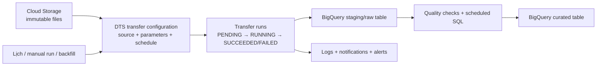
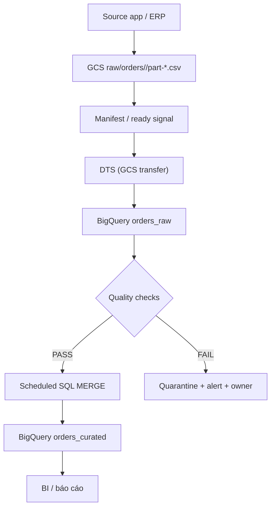

# BigQuery Data Transfer Service và nạp dữ liệu theo lịch

Giả sử bộ phận bán hàng tải các file `orders-YYYYMMDD.csv` lên Cloud Storage mỗi đêm. Hệ thống cần tự đưa dữ liệu vào BigQuery trước 07:00, thông báo khi lỗi và cho phép nạp lại một ngày bị thiếu. Một lựa chọn là tự viết Cloud Run job rồi hẹn giờ bằng Cloud Scheduler; lựa chọn ít phải vận hành hơn là **BigQuery Data Transfer Service (DTS)**, dịch vụ quản lý **transfer configuration**, **lịch chạy** và **transfer runs** để nạp dữ liệu theo nguồn được hỗ trợ.

Bài thuộc chương **Pipeline và xử lý dữ liệu** trong module `CLOUD_PROVIDERS_GCP`. Trọng tâm là chọn đúng cách nạp dữ liệu, cấu hình DTS với Cloud Storage, phân biệt transfer và scheduled query, sử dụng IAM, theo dõi freshness/chất lượng, chủ động backfill và kiểm soát tổng chi phí. Ví dụ sử dụng project/bucket giả định; những lệnh tạo transfer, ghi bảng hoặc gọi chạy lại **có thể tác động dữ liệu và phát sinh phí**.

## 1. Mục tiêu học tập

Sau bài học, bạn có thể:

1. Giải thích **data source**, **transfer configuration**, **scheduled run**, **manual run** và **backfill**.
2. Chọn DTS thay vì **`bq load`**, Dataflow, Pub/Sub streaming hoặc một workflow tùy biến.
3. Cấu hình **Cloud Storage → BigQuery** với schema, write preference, file pattern và lịch chạy.
4. Hiểu đúng **`APPEND`/`MIRROR`**, thời điểm sửa đối tượng, dữ liệu trùng và điều kiện source-file completeness.
5. Dùng `bq` CLI để tạo, liệt kê và kiểm tra transfer configuration/runs; nhận diện các thao tác thay đổi thực.
6. Tạo **scheduled query** dùng `@run_date`, hiểu định danh lịch chạy khác thời gian job chạy thực tế.
7. Thiết kế **staging → quality gate → `MERGE`/publish** và quy trình replay an toàn.
8. Giám sát lỗi, lịch chạy trễ, IAM, chi phí và giải các tình huống production.

## 2. DTS là gì và không phải là gì?

BigQuery DTS tự động hóa việc **nhận dữ liệu từ nguồn được hỗ trợ vào BigQuery**, **copy datasets** theo tính năng nguồn và vận hành **scheduled queries**. Bạn định nghĩa cấu hình một lần, hệ thống quản lý lịch và tạo các runs. Các nguồn thay đổi theo tính năng/region, chẳng hạn Cloud Storage, Amazon S3, Azure Blob Storage, Google Ads, Google Ad Manager, Google Play, một số nguồn SaaS và các loại connector khác.

DTS **không phải** công cụ ETL lập trình tổng quát: không có graph tùy biến từng record với Beam windows, arbitrary joins giữa luồng Pub/Sub, hoặc business transactions. Nó cũng **không dùng để xuất dữ liệu từ BigQuery ra ngoài**; xuất dữ liệu cần `EXPORT DATA`, extract job hoặc pipeline chuyên dụng.



| Khái niệm | Vai trò | Phân biệt |
| --- | --- | --- |
| **Data source** | Kiểu connector: `google_cloud_storage`, `google_ads`, `scheduled_query`… | Mỗi source có parameters, quota, lịch tối thiểu và quyền khác nhau. |
| **Transfer configuration** | Định nghĩa lâu dài gồm source, destination, identity, parameters và schedule. | **Không phải** một lần nạp dữ liệu. |
| **Transfer run** | Một lần thực thi config tại một scheduled/triggered run time. | Một config có thể có hàng trăm runs. |
| **Scheduled time / run time** | Thời điểm logic của kỳ nạp dữ liệu. | Không nhất thiết trùng lúc job thực sự khởi chạy. |
| **Manual run** | Chủ động yêu cầu một run ngoài lịch. | Không tự có nghĩa phải load tất cả files cũ. |
| **Backfill** | Gọi các runs cho ngày/khoảng thời gian lịch sử mà source hỗ trợ. | Dữ liệu có thể không còn sẵn trong source retention. |
| **Scheduled query** | Một GoogleSQL query được quản lý lịch bằng hạ tầng DTS. | Query job, không phải connector lấy file từ GCS. |

## 3. Chọn công cụ nạp dữ liệu theo yêu cầu

| Bài toán | Khởi điểm phù hợp | Vì sao |
| --- | --- | --- |
| Nạp files đã xuất theo giờ/ngày vào BigQuery | **DTS Cloud Storage** | Managed schedule, transfer runs và giám sát, ít viết code. |
| Một lần nạp file có sẵn | **`bq load`/BigQuery load job** | Đơn giản, không cần config định kỳ. |
| Nguồn Google Ads/SaaS có connector được hỗ trợ | **DTS connector tương ứng** | Quản lý extraction/lịch/authentication theo source. |
| Dữ liệu cần lọc/chuẩn hóa bằng SQL hằng ngày | **Scheduled query** | GoogleSQL DML/DDL có lịch, không cần Beam job. |
| Parse/enrich/join phức tạp, schema lỗi cần DLQ riêng | **Dataflow/Dataproc** | Biến đổi dữ liệu có logic tùy chỉnh và kiểm soát lỗi từng record. |
| Sự kiện Pub/Sub cần truy vấn trong vài giây | **Pub/Sub → BigQuery subscription / Storage Write API / Dataflow streaming** | DTS định kỳ thường không đáp ứng freshness mức giây. |
| Nhiều bước gọi API phụ thuộc nhau, approvals, nhánh rollback | **Workflows/Cloud Scheduler** điều phối jobs | DTS không phải trình điều phối business workflow tổng quát. |

**Quy tắc chọn:** nguồn đã được DTS hỗ trợ và chỉ cần nạp định kỳ → ưu tiên DTS; cần phép biến đổi SQL sau khi nạp → thêm scheduled query; cần ETL/stream processing phức tạp → chọn engine phù hợp. Không ghép Dataflow/Workflows chỉ để thay một transfer config đơn giản.

## 4. Kiến trúc nạp file theo lịch

### 4.1. Đường dữ liệu đề xuất



**DTS không tự hiểu “toàn bộ batch ngày hôm qua đã đủ” chỉ từ một wildcard**. File mới có thể xuất hiện ngay trước/sau lúc scan, hoặc nguồn thay đổi file trong khi transfer đang chạy. Producer nên ghi **immutable filenames**, chốt batch/manifest và sắp lịch khi có đủ dữ liệu; nếu cần ràng buộc hoàn chỉnh nghiêm ngặt theo manifest, phải bổ sung bước kiểm tra/điều phối ngoài DTS.

### 4.2. Bảng nguồn và đích mẫu

File `orders-20261119.csv` có dữ liệu CSV:

```csv
order_id,tenant_id,event_date,amount_cents,status
O-1001,t1,2026-11-19,2500,PAID
O-1002,t1,2026-11-19,1300,PENDING
O-1003,t2,2026-11-19,8100,PAID
```

Để nạp CSV theo lịch, **BigQuery dataset và destination table phải tồn tại trước khi tạo GCS transfer config**, schema được khai báo trước. Đây là khác biệt với một số load jobs có thể tự tạo table.

| Cột | BigQuery type | Ghi chú |
| --- | --- | --- |
| `order_id` | STRING | Business key, không tự được BigQuery enforce unique. |
| `tenant_id` | STRING | Phân tách logical tenant; phải authorize khi truy vấn. |
| `event_date` | DATE | Dùng partition/filter theo ngày. |
| `amount_cents` | INT64 | Tiền theo số nguyên, tránh float rounding. |
| `status` | STRING | Trạng thái snapshot; chưa phải event version. |

**Một file CSV không có unique constraint**: nếu cùng order được gửi nhiều lần, DTS vẫn có thể nạp nhiều rows; dedup thuộc pipeline downstream.

## 5. Cloud Storage transfer: APPEND, MIRROR và thay đổi file

### 5.1. APPEND có tính incremental theo file metadata

Với `write_disposition=APPEND` (mặc định cho GCS), DTS tìm các file có `updated`/last modified time **mới hơn lần transfer thành công gần nhất**, rồi nạp các file mới/thay đổi vào destination. Lần chạy đầu thường xử lý tất cả files khớp URI pattern.

| Thời điểm | File trong bucket | Tác động với APPEND |
| --- | --- | --- |
| Ngày 1 | `day1.csv` xuất hiện. | Run đầu nạp `day1.csv`. |
| Ngày 2 | Không có file mới/sửa. | Run mới không thêm rows. |
| Ngày 3 | `day2.csv` xuất hiện. | Run kế tiếp nạp `day2.csv`. |
| Ngày 4 | Sửa/ghi đè `day1.csv` (updated đổi). | **Có thể nạp lại toàn bộ day1**, dễ trùng các rows cũ. |

**Không suy ra exactly-once business delivery từ chế độ APPEND.** Một file sửa metadata, nhiều transfer configs cùng nạp vào một bảng, hoặc nguồn bị thay đổi lúc transfer chạy có thể làm kết quả thiếu/trùng. Với production, dùng object names bất biến, manifest và `event_id`/business key có kiểm tra.

### 5.2. MIRROR nạp lại toàn bộ tập file đang khớp

`write_disposition=MIRROR` thay nội dung bảng đích bằng **bản mới từ tất cả files hiện đang khớp URI** trong mỗi run. Nếu đích dùng partition decorator được hỗ trợ, thao tác chỉ thay partition được chỉ định; phải kiểm tra cẩn thận phạm vi.

| Phương án | Dùng khi | Rủi ro |
| --- | --- | --- |
| **APPEND** | File dữ liệu mới bổ sung, có lịch sử cần giữ. | File sửa bị nạp lại/duplicate. |
| **MIRROR** | Nguồn là snapshot đầy đủ, muốn đích khớp snapshot. | Nếu thiếu file đầu vào, dữ liệu có thể bị thay bằng bản **không đầy đủ**. |
| **Staging + `MERGE`** | Cần cập nhật theo business key/version. | Cần thêm bước SQL/quality gate và orchestration. |

**Trước khi chọn MIRROR** cho bảng lớn: xác minh file completeness, downstream dependencies và backup/snapshot plan. Nó không phải lệnh “tự động cập nhật chỉ những dòng thay đổi”. Với path không match file, cách xử lý có thể khác tình huống thiếu một phần file; không dùng hành vi này làm bảo đảm dữ liệu.

### 5.3. File pattern, runtime parameters và lịch

- `data_path_template` trỏ đến `gs://bucket/prefix/*.csv` hoặc có **runtime parameters** theo ngày.
- Wildcards khớp object names, không phải phép duyệt thư mục tùy ý; kiểm tra semantics subdirectories.
- `{run_date}` có định dạng `YYYYMMDD` theo **logical run time UTC**; `{run_time|"%Y-%m-%d"}` cho phép chọn định dạng theo thời gian chạy dự kiến.
- Nếu batch dữ liệu mang **ngày D-1** nhưng lịch chạy lúc D+1, phải thiết kế offset/date mapping đúng; không để `run_date` mặc định tự gán vào ngày dữ liệu mà không kiểm chứng.
- Cloud Storage recurring transfers có **minimum schedule interval 15 phút** (theo điều kiện hiện hành), mặc định 24 giờ. Nếu cần trigger khi có event, DTS có **event-driven transfers** cho nguồn phù hợp, được cấu hình khác lịch thông thường.
- BigQuery **dataset location** và GCS bucket location phải tương thích; cross-location có thể bị giới hạn hoặc tính phí transfer theo quy tắc hiện hành.

Với ví dụ đầu tiên, nên dùng wildcard **không có runtime token** trên một prefix chỉ chứa files lab mới và chọn schedule 24 giờ; khi đã hiểu hành vi, mới chuyển sang path parameterized theo `run_date` để giảm phạm vi quét.

## 6. Lab 1 — Chuẩn bị dữ liệu, bảng và quyền

Lab dưới đây chỉ dành cho **project/bucket sandbox**. Không chạy lệnh tạo/ghi trên production; transfer định kỳ sẽ tiếp tục hoạt động và có thể phát sinh phí cho đến khi được tắt hoặc xóa.

### 6.1. Tiền điều kiện

| Thành phần | Cần xác nhận |
| --- | --- |
| **Project** | BigQuery API, BigQuery Data Transfer API và billing đã bật. |
| **Dataset** | Region/location được hỗ trợ, có quyền tạo bảng/truy vấn. |
| **Bucket** | Tồn tại, vị trí tương thích BigQuery, owner cho phép ghi/đọc. |
| **Transfer principal** | Có quyền BigQuery DTS configuration và BigQuery jobs/table, `storage.objects.get`; wildcard cần `storage.objects.list`. |
| **Service account** | Tài khoản riêng, được cấp IAM theo nguồn/đích; principal tạo có quyền sử dụng service account theo chính sách. |
| **Kiểm soát** | Budget, lịch chạy, thông báo lỗi, trách nhiệm cleanup. |

Các biến minh họa:

```bash
PROJECT_ID="orders-dts-lab"
LOCATION="asia-southeast1"
DATASET="pipeline_lab"
BUCKET="orders-dts-bucket-lab"
TABLE="orders_raw"
TRANSFER_SA="bq-dts-loader@$PROJECT_ID.iam.gserviceaccount.com"

# CHỈ ĐỌC: xác minh account và resources.
gcloud auth list
gcloud config get-value project
bq ls --project_id="$PROJECT_ID"
gcloud storage buckets describe "gs://$BUCKET" \
  --project="$PROJECT_ID"
```

Không tự mặc định rằng bucket hay service account với tên mẫu đã tồn tại. Nếu chưa có, người được ủy quyền chuẩn bị theo quy trình platform; **không tự cấp Storage Admin/BigQuery Admin toàn project** chỉ để chạy lab.

### 6.2. Tạo dataset và bảng đích

```bash
# TẠO DATASET THẬT: chỉ khi chưa tồn tại và được phê duyệt.
bq --location="$LOCATION" mk --dataset "$PROJECT_ID:$DATASET"
```

Tạo bảng raw với **schema cố định** bằng BigQuery SQL editor hoặc `bq query`. Thay project ID ví dụ bằng ID thực của sandbox:

```sql
-- THAY ĐỔI BIGQUERY: bảng phải tồn tại TRƯỚC khi tạo transfer.
CREATE TABLE IF NOT EXISTS `orders-dts-lab.pipeline_lab.orders_raw` (
  order_id STRING,
  tenant_id STRING,
  event_date DATE,
  amount_cents INT64,
  status STRING
)
PARTITION BY event_date
CLUSTER BY tenant_id
OPTIONS (
  description = 'Raw orders loaded by DTS Cloud Storage transfer'
);
```

**Quan trọng:** BigQuery DTS cho Cloud Storage **không tạo bảng mới tự động** trong quá trình transfer định kỳ. Thay đổi schema giữa các runs hoặc dùng nhiều files không cùng schema có thể khiến run thất bại.

### 6.3. Upload nguồn CSV

Người học tạo file `orders-20261119.csv` trong thư mục lab riêng với nội dung ở mục 4.2 rồi chạy:

```bash
# CHỈ ĐỌC trước khi upload.
gcloud storage ls "gs://$BUCKET/landing/"

# GHI THẬT VÀO CLOUD STORAGE: một file trong prefix lab.
gcloud storage cp ./orders-20261119.csv \
  "gs://$BUCKET/landing/orders-20261119.csv"
```

Không upload lại cùng tên nếu transfer đã nạp: cập nhật object `updated` có thể khiến `APPEND` nạp lại dữ liệu. Đặt tên **immutable cho mỗi batch** và giữ checksum/manifest riêng khi vận hành thật.

## 7. Lab 2 — Tạo Cloud Storage transfer bằng Console

Quy trình đề xuất cho người mới:

1. Vào **BigQuery → Data transfers → Create transfer** trong Google Cloud Console.
2. Chọn source **Google Cloud Storage**; đặt display name, ví dụ `orders-csv-daily-lab`.
3. Chọn **destination dataset** `pipeline_lab` ở location phù hợp.
4. Chọn destination table `orders_raw` **đã có schema**.
5. Nhập source URI `gs://orders-dts-bucket-lab/landing/orders-*.csv`; format **CSV**, bỏ qua **1 header row**, `max_bad_records=0`.
6. Chọn write preference **APPEND**. Với dữ liệu snapshot muốn thay cả đích, cân nhắc MIRROR **sau khi đã xác nhận tác động**.
7. Chọn **repeat frequency** theo SLO (ví dụ mỗi ngày sau giờ producer hoàn thành file); múi giờ và giờ chạy logic cần được kiểm tra.
8. Chọn **service account** được ủy quyền đọc GCS và ghi BigQuery; tùy môi trường có thể phải xác minh token/consent.
9. Bật **email notification hoặc Pub/Sub run notifications** cho thất bại; chọn đúng topic và người nhận.
10. **Review** source/destination/identity/schedule rồi tạo; kiểm tra transfer config ID, run history và kết quả dữ liệu.

**Điểm cần phân biệt:** lịch ở đây tạo **transfer run**, không bảo đảm producer đã ghi đủ files. Nếu files được tải lên gần giờ chạy, cần đặt giờ đủ trễ hoặc dùng event-driven + readiness/manifest gating được thiết kế riêng.

### 7.1. Hai biến thể lịch

| Lịch | Ví dụ | Rủi ro/chú ý |
| --- | --- | --- |
| **Hằng ngày** | Sau khi nguồn chốt file cuối ngày. | Kiểm tra timezone, giờ chốt dữ liệu và SLA bảng đích. |
| **Mỗi giờ** | Nguồn phát file giờ, dashboard chấp nhận delay. | Số runs, load-job quotas, không nên overwrite object cũ. |
| **On-demand** | Chạy khi người vận hành quyết định. | Không tự chạy hằng ngày; cần automation riêng nếu muốn. |
| **Event-driven** | Theo Pub/Sub subscription chứa thông báo file. | Cần cấu hình đúng thông báo/event readiness; không phải transform streaming từng record. |

Minimum interval của recurring Cloud Storage transfer là **15 phút** theo giới hạn hiện hành. Nếu yêu cầu độ mới ở mức vài giây, cân nhắc **Storage Write API hoặc Dataflow streaming** chứ không ép lịch tải file liên tục.

## 8. Lab 3 — Tạo và quan sát bằng `bq` CLI

### 8.1. Tạo transfer config

Trong Bash, sau khi xác minh toàn bộ biến, tạo một Cloud Storage transfer config:

```bash
# TẠO TRANSFER CONFIG THẬT: mỗi lần chạy tạo lịch có thể phát sinh phí.
# TRANSFER_SA phải tồn tại, có quyền đọc source và ghi destination.
bq mk \
  --transfer_config \
  --project_id="$PROJECT_ID" \
  --data_source=google_cloud_storage \
  --display_name="orders-csv-daily-lab" \
  --target_dataset="$DATASET" \
  --service_account_name="$TRANSFER_SA" \
  --params='{
    "data_path_template": "gs://orders-dts-bucket-lab/landing/orders-*.csv",
    "destination_table_name_template": "orders_raw",
    "write_disposition": "APPEND",
    "file_format": "CSV",
    "skip_leading_rows": "1",
    "max_bad_records": "0"
  }'
```

Đây là JSON literal để minh họa các tham số của connector. Nếu đã đổi `BUCKET`/`TABLE` ở trên, **cũng phải đổi values trong `--params`**, vì ví dụ không tự nội suy biến shell nằm trong single quotes. Không tạo thêm một config khác khi config cũ đã tồn tại.

**Giới hạn CLI:** khi **tạo** Cloud Storage transfer bằng `bq mk --transfer_config`, lịch sử dụng mặc định **mỗi 24 giờ**; phần lựa chọn schedule tùy chỉnh và notification tiện hơn qua **Console hoặc DTS API**, theo tài liệu của source. Không giả định `--schedule` trong một lệnh tạo GCS transfer sẽ cấu hình lịch như scheduled query.

### 8.2. Liệt kê transfer configs và xem cấu hình

```bash
# CHỈ ĐỌC: lấy tên resource thật của config vừa tạo.
bq ls \
  --transfer_config \
  --transfer_location="$LOCATION" \
  --project_id="$PROJECT_ID"

# Điền RESOURCE_NAME từ kết quả, dạng:
# projects/PROJECT_ID/locations/LOCATION/transferConfigs/CONFIG_ID
TRANSFER_CONFIG="projects/$PROJECT_ID/locations/$LOCATION/transferConfigs/CONFIG_ID"

# CHỈ ĐỌC: xem cấu hình (thay CONFIG_ID hợp lệ).
bq show \
  --format=prettyjson \
  --transfer_config "$TRANSFER_CONFIG"
```

Đọc `dataSourceId`, `destinationDatasetId`, `params`, `schedule`, `disabled`, `serviceAccountName` và `nextRunTime` nếu có. **Resource name là định danh thực**, khác display name có thể trùng.

### 8.3. Kiểm tra các transfer runs và lỗi

```bash
# CHỈ ĐỌC: những lần chạy gần đây.
bq ls \
  --transfer_run \
  --transfer_location="$LOCATION" \
  --project_id="$PROJECT_ID" \
  --max_results=20 \
  "$TRANSFER_CONFIG"

# Chọn RUN_NAME thật từ danh sách trên.
RUN_NAME="projects/$PROJECT_ID/locations/$LOCATION/transferConfigs/CONFIG_ID/runs/RUN_ID"

# CHỈ ĐỌC.
bq show --format=prettyjson --transfer_run "$RUN_NAME"

# CHỈ ĐỌC: log message của run.
bq ls --transfer_log --max_results=20 "$RUN_NAME"
```

Các trạng thái thường gặp của run gồm **`PENDING`, `RUNNING`, `SUCCEEDED`, `FAILED`, `CANCELLED`**. Chỉ có `SUCCEEDED` chưa đủ chứng minh số hàng đúng: vẫn cần source manifest, row count, null/duplicate checks và watermark freshness.

### 8.4. Chạy thủ công hoặc backfill

Trong Console chọn transfer → **Run transfer now** hoặc **Schedule backfill** (phụ thuộc việc config có runtime parameters). Nếu dùng CLI:

```bash
# THAY ĐỔI DỮ LIỆU THẬT: yêu cầu một manual run ở lịch logic.
# Không chạy nếu chưa chắc APPEND/MIRROR và nguồn ngày đó.
bq mk \
  --transfer_run \
  --run_time="2026-11-19T02:00:00Z" \
  "$TRANSFER_CONFIG"

# Backfill nhiều ngày: minh họa cú pháp; không thực thi mặc định.
# bq mk --transfer_run \
#   --start_time="2026-11-17T00:00:00Z" \
#   --end_time="2026-11-19T00:00:00Z" \
#   "$TRANSFER_CONFIG"
```

Run time nêu trên là **logical time**, không phải lệnh chờ đến 02:00 rồi mới chạy. Với cấu hình **không parameterized**, run thủ công có thể vẫn chọn các file theo logic `updated`/last successful run; **không tự lọc files của ngày truyền vào**. Khi dùng runtime path parameters, date/range có thể quyết định đường dẫn và partition được xử lý.

DTS giới hạn **tối đa 180 ngày cho một backfill request**, và không hỗ trợ **nhiều backfill requests đồng thời**; chia từng khoảng có kiểm soát và đợi run trước hoàn tất. Kiểm tra source retention: không có file thì không thể backfill chỉ bằng yêu cầu chạy lại.

## 9. Lab 4 — Scheduled query để tạo báo cáo theo ngày

Một **scheduled query** sử dụng cơ chế lịch của DTS nhưng thực thi **GoogleSQL query job**, không phải Cloud Storage transfer connector. Nó hữu ích khi `orders_raw` đã nạp xong và đội tài chính cần bảng tổng hợp `orders_daily`.

### 9.1. Tạo bảng tổng hợp

```sql
-- TẠO BẢNG THẬT: dùng dataset sandbox, chỉnh project ID.
CREATE TABLE IF NOT EXISTS `orders-dts-lab.pipeline_lab.orders_daily` (
  event_date DATE,
  tenant_id STRING,
  order_count INT64,
  total_cents INT64
)
PARTITION BY event_date
CLUSTER BY tenant_id;
```

### 9.2. Một câu MERGE có thể chạy lại

```sql
-- SQL dành cho BigQuery SCHEDULED QUERY (có @run_time).
-- Lịch dự kiến mỗi sáng tính số liệu NGÀY HÔM TRƯỚC ở Việt Nam.
DECLARE target_date DATE DEFAULT DATE_SUB(
  DATE(@run_time, 'Asia/Ho_Chi_Minh'), INTERVAL 1 DAY
);

MERGE `orders-dts-lab.pipeline_lab.orders_daily` AS T
USING (
  SELECT
    event_date,
    tenant_id,
    COUNT(*) AS order_count,
    SUM(amount_cents) AS total_cents
  FROM `orders-dts-lab.pipeline_lab.orders_raw`
  WHERE event_date = target_date
  GROUP BY event_date, tenant_id
) AS S
ON T.event_date = S.event_date AND T.tenant_id = S.tenant_id
WHEN MATCHED THEN UPDATE SET
  order_count = S.order_count,
  total_cents = S.total_cents
WHEN NOT MATCHED THEN INSERT
  (event_date, tenant_id, order_count, total_cents)
  VALUES
  (S.event_date, S.tenant_id, S.order_count, S.total_cents);
```

**Vì sao dùng `@run_time` thay `CURRENT_DATE()`?** `@run_time` là **thời gian logic của scheduled run**. Nếu bạn backfill kỳ cũ hôm nay, query vẫn tính đúng ngày theo lịch gốc. `CURRENT_DATE()` trong backfill sẽ lấy ngày thực thi hôm nay và có nguy cơ ghi sai partition.

**Vì sao chuyển múi giờ?** `@run_time` biểu diễn UTC time, trong khi báo cáo nghiệp vụ có thể chốt theo `Asia/Ho_Chi_Minh`. Khi chọn thời gian theo local timezone trong Console, hãy thử một lần và đối chiếu `target_date` thực tế.

**Giới hạn của ví dụ:** `MERGE` cập nhật đúng các cặp `(event_date, tenant_id)` hiện còn trong source, nhưng **không tự xóa** các nhóm trước đó đã có trong destination mà source nay hoàn toàn biến mất. Nếu snapshot nguồn có thể xóa groups, cần chiến lược **replace partition** có transaction/quality gate hoặc đồng bộ đầy đủ; đừng coi câu MERGE này là mirror tổng quát.

### 9.3. Tạo lịch cho SQL

Trong **BigQuery SQL editor**, nhập GoogleSQL trên → chọn **Schedule**:

1. Đặt tên `orders-daily-report-lab`.
2. Chọn lịch hằng ngày **sau khi Cloud Storage transfer chắc chắn xong**. Nếu nguồn hoàn tất không ổn định, dùng orchestration/dependency trigger thay vì chỉ đặt giờ cứng.
3. Chọn **service account** có `bigquery.jobs.create` và quyền `SELECT` trên `orders_raw`, `MERGE/UPDATE/INSERT` trên `orders_daily`.
4. Với DML script tự ghi đích, **không khai thêm một destination table cho query result**; để SQL tự quản lý bảng.
5. Bật thông báo thất bại, lưu transfer config và chạy thử **Run now** trong sandbox.

Scheduled queries hỗ trợ `@run_time` (TIMESTAMP) và `@run_date` (DATE) theo lịch **UTC**. Có thể dùng `@run_date` cho các bảng được chốt theo ngày UTC; với business timezone, biểu thức `DATE(@run_time, 'Asia/Ho_Chi_Minh')` phù hợp hơn.

Theo tài liệu BigQuery, lịch ở **đúng phút 00** của mỗi giờ có thể gây các lần kích hoạt trùng trong một số tình huống; nên chọn thời điểm **lệch giờ tròn**, chẳng hạn 07:05, và dùng thao tác có thể chạy lại (`MERGE`) thay vì `INSERT` không điều kiện.

**Scheduled query được tính quota/phí như BigQuery query job**, không giống Cloud Storage load transfer; nó không tiêu thụ quota load jobs chỉ vì được quản lý qua DTS. Hãy kiểm tra bảng raw đã đủ dữ liệu trước khi tổng hợp.

## 10. Bảo đảm idempotency, freshness và chất lượng

### 10.1. Transfer SUCCEEDED chưa chắc dữ liệu đúng

`SUCCEEDED` chủ yếu xác nhận connector hoàn tất quá trình theo cấu hình. Nó không chứng minh đủ files của batch, đúng tổng tiền, không có duplicate hoặc đúng tenant authorization.

Thiết kế quality gate tối thiểu:

| Kiểm tra | Phương pháp | Phản ứng khi lỗi |
| --- | --- | --- |
| **Completeness** | So file list/manifest với source, row count và ngày. | Đánh dấu batch thiếu, không publish báo cáo cuối. |
| **Schema** | Required fields, kiểu dữ liệu, range hợp lệ, version. | Quarantine/sửa contract, không âm thầm skip dữ liệu. |
| **Uniqueness** | So business/event ID theo policy. | Staging dedup hoặc source reconciliation. |
| **Freshness** | `MAX(event_date)`/`ingested_at` so với expected date/time. | Alert khi quá SLA, phân biệt file đến muộn và transfer run lỗi. |
| **Reconciliation** | Số bản ghi và tổng `amount_cents` với nguồn. | Không chốt số liệu tài chính cho đến khi đối soát. |

### 10.2. Truy vấn kiểm tra dữ liệu đã nạp

```sql
-- CHỈ ĐỌC; có thể phát sinh BigQuery query cost.
SELECT
  event_date,
  COUNT(*) AS row_count,
  COUNTIF(order_id IS NULL OR order_id = '') AS bad_order_ids,
  COUNT(*) - COUNT(DISTINCT order_id) AS repeated_order_ids,
  SUM(amount_cents) AS total_cents
FROM `orders-dts-lab.pipeline_lab.orders_raw`
WHERE event_date BETWEEN DATE '2026-11-17' AND DATE '2026-11-19'
GROUP BY event_date
ORDER BY event_date;
```

Nếu một order có nhiều sự kiện hợp lệ, `order_id` lặp **không nhất thiết sai**. Khi lưu event stream cần dùng `event_id`, `source_version` hoặc một khóa tổ hợp đúng business contract. Với bảng raw snapshot một hàng/đơn/ngày, duplicate `order_id` trong cùng ngày có thể là lỗi nạp.

### 10.3. Những trường hợp phải chủ động chống trùng

- Producer **upload lại cùng file name** sau khi transfer đã chạy; `updated` tăng nên APPEND có thể nạp lại.
- Có **hai transfer configurations** cùng target dataset/table và source path.
- Backfill một khoảng ngày trong khi pipeline khác đang nạp đúng ngày đó.
- Source SaaS/API trả dữ liệu đã điều chỉnh cho ngày cũ; connector có chính sách refresh window riêng.
- Scheduled query dùng `INSERT` không idempotent rồi được rerun/manual run.

Cách phòng ngừa: nguồn bất biến, một config chịu trách nhiệm cho mỗi đích, khóa nghiệp vụ/event ID, staging/`MERGE`, quyền chặn ghi trùng và reconciliation. Khi business cần một ledger chính xác, không để write preference quyết định mọi quy tắc nghiệp vụ.

## 11. IAM, an toàn và quản trị lịch

### 11.1. Nhận diện đúng principal

| Principal | Quyền cần thiết | Ghi chú |
| --- | --- | --- |
| **Người tạo transfer config** | `bigquery.transfers.update/get`, dataset/job permissions và quyền dùng service account theo policy. | Không nhất thiết phải cấp `roles/bigquery.admin` nếu custom role được thiết kế đúng. |
| **Transfer service account** | Đọc GCS objects; wildcard cần `storage.objects.list`; ghi BigQuery destination và tạo job phù hợp. | Tách với developer user để tránh hỏng lịch khi nhân sự đổi quyền. |
| **DTS service agent** | Quyền service-level theo hướng dẫn Google Cloud. | Không nhầm với service account do bạn chỉ định cho transfer. |
| **Scheduled query service account** | `bigquery.jobs.create`, đọc source và ghi destination table. | Identity thực thi SQL, không dùng tài khoản Owner. |
| **Người xem dashboard** | Quyền query/view đúng table/dataset, row/column policy khi có. | Không mặc định có quyền đọc raw PII. |

Nếu chọn user credentials làm identity thay vì service account, việc người dùng rời tổ chức/thu hồi quyền có thể gây lỗi `INVALID_USER`, `UNAUTHENTICATED` hoặc `PERMISSION_DENIED`. Với scheduled queries/automated transfers dài hạn, dùng **service account** và kiểm tra quyền `iam.serviceAccounts.actAs`/`iam.serviceAccountUser` của người cấu hình khi cần.

### 11.2. Governance và vị trí dữ liệu

- Xác minh **Cloud Storage bucket location, BigQuery dataset location, nguồn SaaS region và cross-region charges** trước khi chọn đích.
- Với nguồn bên ngoài, credentials/tokens phải được bảo vệ; không lưu SAS token/API secret trực tiếp trong Markdown, command history hoặc Git.
- Dữ liệu nhạy cảm có thể yêu cầu **CMEK, VPC Service Controls, policy tags/column-level security, row access policies, audit logs** theo hỗ trợ.
- Phân tách **raw/staging** và **curated**, giới hạn người được quyền chạy backfill/MIRROR hoặc thay tham số config.
- Bật quản trị thay đổi: ai đổi source URI, write preference, dataset và service account; review ảnh hưởng đến báo cáo/BI.

## 12. Monitoring, thông báo và runbook

### 12.1. Dashboard/SLO tối thiểu

| Chỉ số | Nguồn quan sát | Mục tiêu |
| --- | --- | --- |
| **Transfer run state** | Data transfers → Run history, `bq ls --transfer_run`. | Không có `FAILED` chưa xử lý, phát hiện `RUNNING` quá lâu. |
| **Freshness** | `MAX(event_date)`/`ingested_at` ở BigQuery. | Dữ liệu sẵn trước deadline hằng ngày. |
| **Completeness** | Manifest/file count, rows, totals. | Không công bố báo cáo thiếu nguồn. |
| **Bad records/schema drift** | Run logs, BigQuery job errors. | Cảnh báo theo tỷ lệ lỗi/loại schema. |
| **Cost/quota** | Billing, BigQuery jobs, Cloud Storage operations. | Không vượt budget hay job quotas. |
| **Scheduled query health** | Query jobs và run states; DML affected rows. | Không còn data quality failure sau SQL transform. |

Trong Console có thể cấu hình **email/Pub/Sub notifications** tùy loại transfer. Pub/Sub notification cần topic, permissions và subscriber/alert workflow thật sự xử lý; chỉ “bật notification” mà không có người nhận hoặc escalation chưa đủ vận hành.

### 12.2. Bảng lỗi thường gặp

| Triệu chứng | Nguyên nhân có thể | Kiểm tra |
| --- | --- | --- |
| `PERMISSION_DENIED` | Transfer SA thiếu GCS read/list hoặc BigQuery job/table permission. | Identity thực, bucket IAM, dataset IAM, audit logs. |
| `NOT_FOUND` table | Chưa tạo bảng trước khi cấu hình GCS transfer; sai dataset/location. | `bq show` table/schema, transfer params. |
| `invalid schema` hoặc CSV parse error | Header chưa skip, file thay schema, nhầm JSON array và ndJSON. | File sample, `skip_leading_rows`, schema version. |
| Run `SUCCEEDED` nhưng 0 rows | Không có file mới/khớp pattern, ngày runtime khác, already loaded. | URI, object `updated`, last successful run, run time. |
| Rows tăng gấp đôi | Object bị ghi đè, nhiều configs, manual backfill cộng trùng. | File generations/updated, manifest, transfer ownership. |
| MIRROR làm thiếu dữ liệu cũ | Source snapshot không đầy đủ hoặc URI wildcard sai. | Đối chiếu toàn bộ source file set trước khi chạy. |
| Lịch chạy không khớp ngày kinh doanh | UTC vs local timezone, `run_date`, time offset. | Run details, `@run_time` và business date logic. |
| Scheduled query thất bại | SA không có quyền DML, SQL schema drift, query quota. | BigQuery job error, run config, IAM. |
| Phí tăng | Quá nhiều runs/files, BigQuery query scans, copy/cross-region. | Billing SKU, file aggregation, partition pruning. |

### 12.3. Runbook khi báo cáo ngày bị trễ

1. **Xác định kỳ dữ liệu**: báo cáo theo business date nào, run time UTC nào, deadline và nguồn data files.
2. **Xem transfer config/run state**: `FAILED`, `PENDING`, giờ chạy, error messages và service account.
3. **Xem GCS source**: file đã đủ chưa, filenames/prefix/schema/location có đúng? Có file bị upload lại?
4. **Kiểm tra bảng raw**: row count, max business date, duplicate keys, tổng giá trị.
5. **Khắc phục**: sửa IAM/schema/source, manual run/backfill đúng kỳ (nếu có dữ liệu), tránh MIRROR mất dữ liệu.
6. **Chạy lại transform**: scheduled SQL `MERGE`/quality gates trên đúng partition, không append mù quáng.
7. **Xác nhận khôi phục**: freshness/row counts, BI dashboard, job costs và audit; cập nhật alert/runbook.

## 13. Chi phí, quota và lựa chọn thiết kế

### 13.1. DTS không khiến toàn pipeline miễn phí

Chi phí có thể đến từ **BigQuery load jobs/đọc ghi và lưu trữ**, **scheduled queries**, **Cloud Storage storage/operations**, **cross-region transfers**, phí **connector nguồn** nếu áp dụng, Pub/Sub notifications, Logging và tài nguyên xử lý khác. Một số loại Cloud Storage load có thể không bị tính riêng phí DTS connector, nhưng **BigQuery storage/query và network vẫn tính theo bảng giá**. Cần đọc bảng giá theo loại connector và region; không suy ra các nguồn SaaS đều có cùng mức phí.

### 13.2. Quota và giới hạn cần lập kế hoạch

- DTS **Cloud Storage transfers dùng BigQuery load jobs**, nên chịu các hạn mức load job liên quan của BigQuery.
- Theo tài liệu Cloud Storage transfer hiện hành: **tối đa 15 TB dữ liệu và 10.000 files cho mỗi transfer run**. Nếu vượt, chia/ghép files và lên kế hoạch chuyển tải.
- Lịch định kỳ thường tối thiểu **15 phút**, mặc định **24 giờ**; source khác có minimum schedule riêng.
- Backfill tối đa **180 ngày/request** và không gửi các backfill requests đồng thời.
- Với scheduled queries, chi phí và quota đi theo **query jobs**, không phải định mức load jobs.

**Một nghìn file rất nhỏ** có thể tạo overhead listing/transfer/BigQuery job không hợp lý. Gộp file theo batch nếu upstream cho phép, partition đúng, và đo số rows/bytes trước khi mở lịch chạy dày.

## 14. Bài tập vận dụng (có đáp án)

**Bài 1 — Chọn công cụ.** ERP ghi một CSV có sẵn mỗi ngày; báo cáo sáng hôm sau cần query trong BigQuery. Dùng Dataflow streaming hay DTS?

*Đáp án:* **DTS Cloud Storage** là lựa chọn khởi đầu đơn giản. Kèm schema, staging/quality gate, owner và lịch sau khi source hoàn tất.

**Bài 2 — Table missing.** Tạo GCS transfer nhưng run báo không thấy bảng đích.

*Đáp án:* GCS **recurring transfer yêu cầu destination table tồn tại trước**; tạo đúng table/schema/location và kiểm tra IAM.

**Bài 3 — APPEND bị trùng.** `day1.csv` đã nạp, producer ghi đè cùng tên file ngày hôm sau khiến thêm rows trùng.

*Đáp án:* APPEND dựa vào **last-modified metadata**; khi object được sửa, nó có thể nạp lại. Dùng immutable names và stage/dedup theo event/business ID.

**Bài 4 — MIRROR.** Dataset đang giữ 30 ngày; source path mới chỉ có 1 ngày. Chọn MIRROR có an toàn?

*Đáp án:* Không nếu bảng đích phải giữ 30 ngày. MIRROR thay bảng bằng **files đang khớp**, có thể xóa 29 ngày còn lại. Chỉ dùng khi source thực sự là snapshot đầy đủ hoặc partition scope được kiểm soát.

**Bài 5 — Run now.** Manual run chọn run time 2026-11-19, nhưng config không có runtime path parameter. Nó tự chỉ nạp file ngày 19 không?

*Đáp án:* **Không.** Cần xem file matching/`updated`/last-successful-run; run time không phải một filter ngày mặc định nếu path không sử dụng parameter.

**Bài 6 — Ngày theo múi giờ.** Scheduled query chạy sau 07:00 giờ Việt Nam, muốn tổng hợp **ngày trước đó**. Nên dùng biểu thức nào?

*Đáp án:* `DATE_SUB(DATE(@run_time, 'Asia/Ho_Chi_Minh'), INTERVAL 1 DAY)`. Không dùng `CURRENT_DATE()` vì backfill sẽ xử lý sai ngày.

**Bài 7 — Data completeness.** Transfer `SUCCEEDED` nhưng source thiếu file cuối của batch. Có thể công bố “báo cáo đã đủ” không?

*Đáp án:* Không. Cần manifest/source ledger và kiểm tra count/totals; `SUCCEEDED` chỉ cho biết run đã hoàn tất theo files nó thấy.

**Bài 8 — Permission.** Transfer SA đọc được một file GCS nhưng lỗi với wildcard.

*Đáp án:* Kiểm tra `storage.objects.list` trên bucket/prefix liên quan bên cạnh `storage.objects.get`; xác minh đúng SA thực thi, không cấp Storage Admin toàn project.

**Bài 9 — Backfill.** Muốn nạp lại 400 ngày lịch sử trong một yêu cầu.

*Đáp án:* Giới hạn DTS là **180 ngày/backfill request**; chia nhiều khoảng theo thứ tự, đợi xong từng request, xác nhận source retention và chống trùng.

**Bài 10 — Độ trễ.** Cần hiển thị một event trong dashboard dưới 2 giây, GCS transfer mỗi 15 phút có phù hợp?

*Đáp án:* Không. Xem **Storage Write API, Pub/Sub BigQuery subscription hoặc Dataflow streaming** tùy transform/consistency/chi phí.

**Bài 11 — Cấu hình SQL trùng.** Scheduled query `INSERT` bị chạy lặp, bảng tổng hợp bị nhân đôi.

*Đáp án:* Dùng `MERGE` hoặc replace đúng partition có kiểm soát, dựa trên `@run_time` và business key, cùng quality gate; tránh append vô điều kiện.

**Bài 12 — Cost.** Connector Cloud Storage được cho là “miễn phí”, vậy hệ thống không phát sinh hóa đơn?

*Đáp án:* Sai. Vẫn có BigQuery managed storage/query jobs, Cloud Storage/network, notifications/logs và phí source-specific; kiểm tra tổng pipeline cost theo region/SKU.

## 15. Checklist trước production

- [ ] Đã xác định freshness SLO, business timezone và giờ dữ liệu được chốt.
- [ ] Source/connector được DTS hỗ trợ, không thêm stream/ETL engine không cần thiết.
- [ ] GCS destination dataset/table/schema đã tạo trước khi lập transfer định kỳ.
- [ ] URI wildcard/runtime params khớp đúng files; không ghi đè immutable source sau transfer.
- [ ] APPEND/MIRROR được chọn theo snapshot hay incremental, có kế hoạch tránh trùng/mất rows.
- [ ] Service account có IAM tối thiểu trên source, transfer config, destination và job.
- [ ] Có scheduled run alerts, Pub/Sub/email notifications và owner theo dõi.
- [ ] Quality gate kiểm tra schema, row counts, nulls, duplicate keys, totals và watermark.
- [ ] Scheduled queries dùng `@run_time`/business timezone và idempotent SQL.
- [ ] Manual runs/backfill có kiểm soát, đáp ứng retention/quota và không chồng chéo nguồn.
- [ ] BigQuery partition/clustering, quotas, location/egress và tổng phí đã đo.
- [ ] Dữ liệu nhạy cảm có retention, IAM, audit và mã hóa theo yêu cầu.
- [ ] Đã kiểm thử fail run, file missing, changed file, token expiry, schema drift và backfill.
- [ ] Có rollback, backup/checkpoint, runbook và kế hoạch tắt lịch/xóa resources lab.

## 16. Dọn lab và tổng kết

Trước khi xóa bất kỳ tài nguyên nào, xác minh **owner, project, data retention và dependency**:

```bash
# CHỈ ĐỌC: kiểm kê.
bq ls --transfer_config \
  --transfer_location="$LOCATION" \
  --project_id="$PROJECT_ID"
bq ls "$PROJECT_ID:$DATASET"
gcloud storage ls "gs://$BUCKET/landing/"

# THAY ĐỔI/PHÁ HỦY THẬT: không thực thi mặc định.
# Vào BigQuery → Data transfers, chọn config lab → Disable/Delete.
# Chỉ xóa bảng/dataset/bucket khi riêng lab, đã được phê duyệt
# và hoàn tất backup/retention. Xóa config KHÔNG tự xóa
# dữ liệu đã nạp vào BigQuery hoặc file nguồn GCS.
```

**BigQuery DTS** hữu ích khi nguồn có connector phù hợp và muốn quản lý **nạp định kỳ/backfill với ít code**. Với Cloud Storage, đừng nhầm **APPEND theo last-modified** với bảo đảm exactly-once; đừng nhầm **MIRROR** với update từng row; và đừng coi **transfer `SUCCEEDED`** là chứng nhận data quality. Kết hợp **immutable sources, staging, scheduled SQL, IAM tối thiểu, metrics, reconciliation và runbooks** để có một pipeline GCP đủ tin cậy.

### Tài liệu Google Cloud tham khảo

- [Giới thiệu BigQuery Data Transfer Service](https://cloud.google.com/bigquery/docs/dts-introduction)
- [Cloud Storage transfers và ingestion semantics](https://cloud.google.com/bigquery/docs/cloud-storage-transfer-overview)
- [Tạo Cloud Storage transfer](https://cloud.google.com/bigquery/docs/cloud-storage-transfer)
- [Runtime parameters cho GCS/S3/Blob transfers](https://cloud.google.com/bigquery/docs/blob-storage-transfer-parameters)
- [Quản lý transfer configurations, runs và logs](https://cloud.google.com/bigquery/docs/working-with-transfers)
- [Scheduled queries](https://cloud.google.com/bigquery/docs/scheduling-queries)
- [Dùng service accounts với DTS](https://cloud.google.com/bigquery/docs/use-service-accounts)
- [CLI `bq` reference](https://cloud.google.com/bigquery/docs/reference/bq-cli-reference)
- [BigQuery quotas và limits](https://cloud.google.com/bigquery/quotas)
- [BigQuery pricing](https://cloud.google.com/bigquery/pricing)
