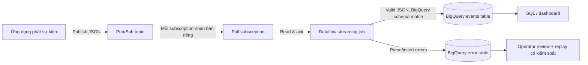

# Thực hành pipeline Pub/Sub, Dataflow và BigQuery

> **Chương:** Pipeline và xử lý dữ liệu  
> **Module:** CLOUD_PROVIDERS_GCP  
> **Phạm vi module:** Khám phá Google Cloud từ tổ chức project, IAM và VPC đến Compute Engine, GKE, Cloud Run, dịch vụ lưu trữ và cơ sở dữ liệu. Qua các tình huống triển khai, người học biết lựa chọn dịch vụ, bảo vệ tài nguyên, tự động hóa phát hành và theo dõi độ tin cậy cùng chi phí.

Một website gửi sự kiện `order_created` ngay khi khách đặt hàng. Nhóm phân tích muốn nhìn thấy lượng đơn và doanh thu gần thời gian thực trên BigQuery mà không bắt HTTP API đợi truy vấn dữ liệu. Pipeline **Pub/Sub → Dataflow → BigQuery** giúp tách producer khỏi downstream, xử lý luồng liên tục và giám sát từng giai đoạn. Tuy nhiên, pipeline chỉ đáng tin khi thiết kế đúng **schema, permissions, retries, lỗi dữ liệu, độ trễ, trùng sự kiện và chi phí chạy 24/7**.

Bài này thực hành bằng template chính thức **Pub/Sub Subscription to BigQuery** (Dataflow classic template): nó đọc **JSON** từ một **Pub/Sub pull subscription**, chuyển thành BigQuery rows và ghi vào bảng đã có schema. Kịch bản sử dụng **project sandbox**, dữ liệu giả không nhạy cảm, Cloud Storage staging bucket riêng và service account tối thiểu. Những lệnh tạo tài nguyên là **tùy chọn chỉ chạy khi được chủ project phê duyệt**; khi biên soạn học liệu không thực thi bất kỳ GCP API tạo/sửa tài nguyên nào.

## Mục tiêu học tập

Sau bài này, bạn có thể:

1. Mô tả luồng dữ liệu, vai trò **topic, subscription, Dataflow job, BigQuery table và error table**.
2. Chuẩn bị **event contract** và schema JSON tương ứng, tránh mismatch kiểu và missing fields.
3. Cấu hình IAM cho operator, Dataflow worker, Pub/Sub subscription, BigQuery dataset và Cloud Storage staging.
4. Chạy **Google-provided Dataflow classic template** bằng `gcloud`, publish test messages rồi kiểm tra rows trong BigQuery.
5. Điều tra **backlog, system lag, watermark, retries, duplicate events, dead-letter table** và replay an toàn.
6. **Drain** streaming job trước khi cleanup, ước tính chi phí và chọn Pub/Sub BigQuery subscription khi không cần Dataflow.

## 1. Kiến trúc end-to-end



| Thành phần | Trách nhiệm | Không nên hiểu nhầm |
|---|---|---|
| **Producer** | Phát sự kiện sau khi nghiệp vụ đã ghi an toàn | `publish` thành công không đồng nghĩa đã có row BigQuery |
| **Pub/Sub topic** | Nhận và fan-out messages | Không tự parse hoặc đảm bảo schema BigQuery |
| **Pull subscription** | Lưu backlog, ack/redelivery theo thời hạn | Dataflow nên có subscription riêng, không chia sẻ consumer cùng subscription |
| **Dataflow job** | Đọc subscription, chuyển JSON thành TableRow, ghi BigQuery, xử lý nhánh lỗi | Streaming job **không tự dừng** khi không có message |
| **BigQuery table** | Lưu events phân tích theo schema | Không thay database giao dịch nguồn |
| **Error table** | Lưu records không parse/không ghi BigQuery được | Là **BigQuery dead-letter table của template**, không phải Pub/Sub dead-letter topic |

### 1.1. Vì sao dùng Dataflow thay vì ghi trực tiếp?

| Nhu cầu | Thường chọn |
|---|---|
| JSON/Avro chuẩn, ánh xạ trường trực tiếp sang bảng | **Pub/Sub BigQuery subscription**: đơn giản hơn, không cần Dataflow job riêng |
| Mapping phức tạp, UDF, kiểm tra dữ liệu, PII masking | **Dataflow** (template UDF hoặc Apache Beam tùy logic) |
| Windowed aggregation, stateful processing, late data, enrich/join nhiều streams | **Custom Apache Beam chạy trên Dataflow** |
| Batch file lớn trong Cloud Storage → warehouse | Load job / batch Dataflow thích hợp hơn streaming 24/7 |

Pub/Sub BigQuery subscription có thể dùng **Single Message Transform** cho thay đổi nhẹ, trong khi Dataflow phù hợp hơn cho transforms phức tạp và windowing. Đừng chạy thêm một streaming VM chỉ để chuyển 5 fields nguyên dạng khi giải pháp không có VM đã đáp ứng SLO.

## 2. Thiết kế hợp đồng sự kiện trước khi triển khai

Lab dùng một message có dạng JSON:

```json
{
  "event_id": "evt-101",
  "event_type": "order_created",
  "amount_cents": 159900,
  "event_time": "2026-11-19T08:30:00Z",
  "source": "checkout"
}
```

**Schema BigQuery** của table `events_lab`:

| Field | BigQuery type | Ý nghĩa |
|---|---|---|
| `event_id` | `STRING` | Business idempotency key, không dùng Pub/Sub message ID làm mã đơn |
| `event_type` | `STRING` | Loại sự kiện |
| `amount_cents` | `INTEGER` / `INT64` | Giá trị giả dạng số nguyên, tránh sai số tiền kiểu float |
| `event_time` | `STRING` | Thời gian RFC 3339 từ producer; lab dùng STRING để giảm lỗi mapping |
| `source` | `STRING` | Nguồn phát sự kiện |

Đây là **schema học tập**, không phải lựa chọn tối ưu cho mọi production. Trong dữ liệu chuẩn nên lưu thời điểm dưới dạng `TIMESTAMP`, nhưng khi đầu vào có định dạng không đồng nhất cần **validate/normalize trước**. Lab giữ `event_time STRING` rồi dùng `SAFE_CAST(event_time AS TIMESTAMP)` trong truy vấn; đổi schema phải sửa contract và pipeline tương ứng.

### 2.1. Các quy tắc schema không thể bỏ qua

- Template đọc **payload trong `PubsubMessage.data`** dưới dạng JSON, **không** tự chép Pub/Sub attributes/message ID thành cột bảng.
- Table đích **phải tồn tại** và có schema tương ứng **trước khi chạy template**.
- Field bổ sung không có trong BigQuery schema, sai kiểu hoặc JSON không hợp lệ có thể vào **error table**.
- Event ID của producer phải ổn định giữa các lần retry publish; nếu không, hai messages khác ID có thể cùng đại diện một giao dịch.
- Đừng gửi thông tin thẻ, token, email hoặc PII thật vào topic lab, BigQuery hoặc Dataflow worker logs.

### 2.2. Event time và processing time

- **Event time:** thời điểm hoạt động xảy ra tại producer (ở đây `event_time`).
- **Publish time:** thời điểm Pub/Sub nhận message.
- **Processing/ingestion time:** thời điểm Dataflow xử lý hoặc BigQuery lưu row.

Khi làm **window aggregation** cho số lượng đơn mỗi 5 phút, cần quyết định dùng event time hay processing time và xử lý **late events/watermark**. Template đang dùng chỉ **chuyển từng row**, không tự triển khai windowing/aggregation theo nghiệp vụ.

## 3. IAM, region và tài nguyên tối thiểu

### 3.1. Năm loại quyền khác nhau

| Principal | Phạm vi và quyền cần thiết |
|---|---|
| **Operator/deployer** | Được tạo/run Dataflow jobs (`roles/dataflow.developer` hoặc tương đương), `iam.serviceAccounts.actAs` trên worker SA; quyền tạo Pub/Sub/BQ resource chỉ trong sandbox |
| **Producer** | `roles/pubsub.publisher` trên **topic** lab |
| **Dataflow worker SA** | `roles/dataflow.worker`; `roles/pubsub.subscriber` trên subscription; BigQuery **Data Editor** trên dataset đích; đọc/ghi object staging bucket |
| **Dataflow service agent** | Role `roles/dataflow.serviceAgent` của Google-managed identity; thường cấp khi bật Dataflow API |
| **BigQuery query identity** | `bigquery.jobs.create` để chạy query và `bigquery.tables.getData` trên bảng cần xem |

Dataflow worker SA **không mặc định dùng IAM của tài khoản đang chạy CLI**. Với **error table tự tạo**, worker cần quyền `bigquery.tables.create` trên dataset đích; quyền chỉ ghi row vào bảng chính là **chưa đủ**. Trong production ưu tiên cấp quyền **dataset/bucket/subscription** cụ thể thay vì Editor/Owner toàn project.

### 3.2. Region và network

Nên đặt **Dataflow region, BigQuery dataset location và Cloud Storage staging bucket** trong cùng vùng được hỗ trợ (lab minh họa `asia-southeast1`). Kiểm tra data residency, quotas, API availability và network egress. Pub/Sub là dịch vụ global về resource naming, nhưng publish/subscribe có endpoint/quy tắc lưu dữ liệu riêng; dữ liệu đi vào Dataflow region phụ thuộc cấu hình job.

**Dataflow workers là VM/Streaming Engine resources.** Project không còn default VPC, chặn external IP hoặc yêu cầu private workers sẽ cần `--network`/`--subnetwork`, Private Google Access, NAT hoặc cấu hình DNS/egress để tới Pub/Sub, BigQuery, GCS, logging. **Không bật public IP tùy tiện** để sửa lỗi firewall trong môi trường production.

### 3.3. Chi phí trước khi bấm Run

Streaming job có thể phát sinh chi phí **Dataflow worker VM/Streaming Engine**, Pub/Sub message storage/throughput, **BigQuery writes, storage, query**, GCS staging và Cloud Logging **ngay cả khi thông lượng thấp**. Đặt budget alert, label, giới hạn workers phù hợp. Vì job streaming **chạy liên tục**, phải định trước người chịu trách nhiệm **drain/cancel và cleanup**.

## 4. Lab A — Preflight chỉ đọc (bắt buộc)

> **Không tạo GCP tài nguyên mới khi chưa có project sandbox, billing/budget owner và quyền cho phép.** Nếu không có môi trường, chỉ làm phần thiết kế, SQL và bài tập; tài liệu không giả định tồn tại một topic/bucket hay Dataflow job thật.

Tại Cloud Shell/Bash, chọn tên resource **riêng** không dùng chung production:

```bash
PROJECT_ID="my-streaming-sandbox"
REGION="asia-southeast1"
TOPIC="orders-topic-lab"
SUBSCRIPTION="orders-sub-lab"
DATASET="streaming_lab"
TABLE="events_lab"
ERROR_TABLE="events_lab_errors"
BUCKET="my-streaming-staging-bucket"  # Bucket ĐÃ tồn tại, riêng sandbox
WORKER_SA="dataflow-worker-lab@$PROJECT_ID.iam.gserviceaccount.com"
JOB_NAME="pubsub-bq-lab-$(date -u +%Y%m%d-%H%M%S)"

gcloud auth list --filter="status:ACTIVE"
gcloud projects describe "$PROJECT_ID" \
  --format="table(projectId,name,lifecycleState)"
gcloud services list --enabled --project="$PROJECT_ID" \
  --format="value(config.name)" \
  | grep -E '^(dataflow|pubsub|bigquery|compute|storage)\.googleapis\.com$'

gcloud pubsub topics list --project="$PROJECT_ID"
gcloud pubsub subscriptions list --project="$PROJECT_ID"
bq ls --project_id="$PROJECT_ID"
gcloud dataflow jobs list --project="$PROJECT_ID" --region="$REGION"
gcloud iam service-accounts list --project="$PROJECT_ID"
gcloud storage buckets describe "gs://$BUCKET"
```

**Dừng** nếu các tên đã tồn tại nhưng không rõ owner; không overwrite topic/subscription/table hoặc bucket của người khác. Kiểm tra bucket/dataset cùng location, worker SA hiện hữu, role ít nhất theo mục 3. Dùng tài khoản có quyền đọc metadata để chạy preflight; **không** xem/tải secrets.

### 4.1. Nếu chưa có quyền hoặc dịch vụ chưa bật

Operator được phê duyệt cần chuẩn bị **Dataflow, Pub/Sub, BigQuery, Compute Engine, Cloud Storage APIs**, service agents, VPC, IAM và một staging bucket. Nếu muốn thấy cú pháp bật API trên project **chỉ thuộc riêng lab**:

```bash
# THAO TÁC GHI PROJECT: chỉ admin sandbox được phép chạy.
# gcloud services enable \
#   dataflow.googleapis.com pubsub.googleapis.com \
#   bigquery.googleapis.com compute.googleapis.com storage.googleapis.com \
#   --project="$PROJECT_ID"
```

Không cấp `roles/editor` toàn project để “cho chạy nhanh”. Phải kiểm tra `iam.serviceAccounts.actAs` của deployer và Cloud Storage object permissions của **worker SA**; Dataflow launcher/service agent cũng phải có quyền theo môi trường.

## 5. Lab B — Chuẩn bị Pub/Sub và BigQuery trong sandbox

### 5.1. Tạo topic và subscription riêng

**Chỉ chạy khi preflight xác nhận chưa có resource trùng tên và owner chấp thuận:**

```bash
gcloud pubsub topics create "$TOPIC" --project="$PROJECT_ID"

gcloud pubsub subscriptions create "$SUBSCRIPTION" \
  --project="$PROJECT_ID" \
  --topic="$TOPIC" \
  --ack-deadline=60

gcloud pubsub subscriptions describe "$SUBSCRIPTION" \
  --project="$PROJECT_ID" \
  --format="yaml(name,topic,ackDeadlineSeconds,messageRetentionDuration,expirationPolicy)"
```

Subscription nên tạo **trước khi publish** để giữ messages thử nghiệm theo retention; Pub/Sub không tự replay messages đã publish trước khi subscription được tạo trừ khi có topic retention/seek được thiết kế riêng. **Một pull subscription có nhiều consumers sẽ chia message**, không fan-out cho từng consumer: Dataflow phải có subscription riêng, tránh chia với ứng dụng khác.

### 5.2. Tạo BigQuery dataset và table

Chỉ khi dataset/table tên này chưa tồn tại; output table **phải có trước khi chạy job**:

```bash
# DDL chỉ trên project sandbox đã được phê duyệt.
bq --project_id="$PROJECT_ID" mk --dataset \
  --location="$REGION" "$PROJECT_ID:$DATASET"

# Ingestion-time partition để dễ kiểm soát scan và vòng đời.
# event_time STRING được parse trong query; amount_cents là INT64.
bq --project_id="$PROJECT_ID" mk --table \
  --time_partitioning_type=DAY \
  "$PROJECT_ID:$DATASET.$TABLE" \
  "event_id:STRING,event_type:STRING,amount_cents:INTEGER,event_time:STRING,source:STRING"

bq show --format=prettyjson "$PROJECT_ID:$DATASET.$TABLE"
```

Với **dataset đã có** (đã được owner cho phép dùng), **bỏ qua** lệnh `bq mk --dataset`; không tạo trùng/đổi location. Trong production, dùng partition expiration/retention được chủ dữ liệu duyệt, tránh giữ events vô hạn.

### 5.3. Phê duyệt quyền cho Dataflow worker

Nếu dùng `WORKER_SA` đã có, owner xác minh:

```text
roles/dataflow.worker             trên project chạy Dataflow
roles/pubsub.subscriber           trên subscription orders-sub-lab
roles/bigquery.dataEditor        trên dataset streaming_lab
roles/storage.objectAdmin        trên staging bucket sandbox (hoặc custom least privilege)

Deployer: quyền run job + iam.serviceAccounts.actAs trên WORKER_SA
Pub/Sub publisher: roles/pubsub.publisher trên orders-topic-lab
Dataflow service agent: roles/dataflow.serviceAgent, do Google cấp và quản lý
```

**Không tự đổi IAM production** chỉ để làm lab. Nếu worker SA chưa tồn tại, người quản trị tạo **SA mới cho lab** rồi gán đúng roles; không dùng SA key JSON dài hạn. Dataset IAM nên được cấp trực tiếp trên dataset, không cần BigQuery Data Editor toàn project.

## 6. Lab C — Chạy Dataflow template từ Pub/Sub subscription

### 6.1. Chọn template và tham số chính xác

Template **classic** chính thức:

```text
gs://dataflow-templates/latest/PubSub_Subscription_to_BigQuery
```

| Parameter | Giá trị ví dụ | Bắt buộc |
|---|---|---|
| `inputSubscription` | `projects/PROJECT_ID/subscriptions/orders-sub-lab` | Có |
| `outputTableSpec` | `PROJECT_ID:streaming_lab.events_lab` | Có |
| `outputDeadletterTable` | `PROJECT_ID:streaming_lab.events_lab_errors` | Tùy chọn, nên đặt rõ |

Đường `latest` phù hợp **sandbox**; phiên bản có thể thay đổi mà không báo trước. Với production, **pin template version theo thư mục ngày**, kiểm thử trước khi upgrade. **Không nhầm classic template** này với `PubSub_to_BigQuery_Flex`: Flex Template dùng lệnh `gcloud dataflow flex-template run` và URI khác.

### 6.2. Launch (tạo streaming job có phí)

```bash
# Chỉ chạy sau khi phê duyệt budget/IAM/VPC.
# JOB_NAME phải là tên chưa tồn tại, hợp lệ và dễ truy vết.
gcloud dataflow jobs run "$JOB_NAME" \
  --project="$PROJECT_ID" \
  --region="$REGION" \
  --gcs-location="gs://dataflow-templates/latest/PubSub_Subscription_to_BigQuery" \
  --staging-location="gs://$BUCKET/dataflow/staging" \
  --service-account-email="$WORKER_SA" \
  --max-workers=2 \
  --parameters="inputSubscription=projects/$PROJECT_ID/subscriptions/$SUBSCRIPTION,outputTableSpec=$PROJECT_ID:$DATASET.$TABLE,outputDeadletterTable=$PROJECT_ID:$DATASET.$ERROR_TABLE"
```

**Chỉ coi job sẵn sàng khi trạng thái `JOB_STATE_RUNNING`** và metrics xác nhận pipeline đã kết nối source/sink. `gcloud` trả thành công lúc launch **không** bảo đảm BigQuery đã có data; thời gian tạo worker, kiểm tra IAM, pull subscription và BigQuery insert còn diễn ra sau đó.

Nếu project **không có default VPC**, operator thêm `--network` và `--subnetwork` đúng network policy; nếu chạy workers **không có public IP**, cần Private Google Access/NAT và Google API access. Không tự sửa cấu hình mạng dùng chung cho mục đích lab.

### 6.3. Quan sát job và lấy Job ID thật

```bash
gcloud dataflow jobs list \
  --project="$PROJECT_ID" --region="$REGION" \
  --format="table(id,name,state,createTime)"

# Lấy JOB_ID từ output thật (KHÔNG đoán từ JOB_NAME).
JOB_ID="JOB_ID_FROM_LIST"
gcloud dataflow jobs describe "$JOB_ID" \
  --project="$PROJECT_ID" --region="$REGION" \
  --format="yaml(id,name,currentState,createTime)"
```

Trong Console **Dataflow → Jobs**, xem topology, job logs và **data freshness/system lag**. Nếu job gặp `JOB_STATE_FAILED`, xem logs trước khi publish; không khởi động thêm nhiều jobs cùng đọc một subscription để “thử vận may”.

## 7. Lab D — Publish JSON và truy vấn BigQuery

### 7.1. Publish sự kiện hợp lệ

```bash
EVENT_ID="evt-$(date -u +%Y%m%d%H%M%S)"
EVENT_TIME="$(date -u +%Y-%m-%dT%H:%M:%SZ)"

# JSON số nguyên không có dấu quote; event_time UTC dùng RFC 3339.
MESSAGE="$(printf '{"event_id":"%s","event_type":"order_created","amount_cents":159900,"event_time":"%s","source":"checkout"}' "$EVENT_ID" "$EVENT_TIME")"

gcloud pubsub topics publish "$TOPIC" \
  --project="$PROJECT_ID" \
  --message="$MESSAGE"
```

Đây là dữ liệu **giả**, không có PII. Khi publish thành công, Pub/Sub trả **message ID của lần publish**; ID đó có thể khác `event_id` nghiệp vụ. Nếu publish lại cùng JSON để kiểm tra retry, có thể nhận hai Pub/Sub message IDs nhưng cùng `event_id`.

### 7.2. Query BigQuery với hạn mức quét

```bash
bq query --project_id="$PROJECT_ID" \
  --use_legacy_sql=false --location="$REGION" \
  --maximum_bytes_billed=1000000000 \
  "SELECT event_id, event_type, amount_cents,
          SAFE_CAST(event_time AS TIMESTAMP) AS event_timestamp,
          source
   FROM \`${PROJECT_ID}.${DATASET}.${TABLE}\`
   WHERE (_PARTITIONTIME >= TIMESTAMP_SUB(CURRENT_TIMESTAMP(), INTERVAL 1 DAY)
          OR _PARTITIONTIME IS NULL)
   ORDER BY event_id DESC
   LIMIT 20"
```

**Kỳ vọng:** sau thời gian khởi động/ingest phù hợp, thấy sự kiện mới. BigQuery có thể tạm giữ rows streaming trong `__UNPARTITIONED__` với **`_PARTITIONTIME IS NULL`**; nếu bỏ điều kiện `OR _PARTITIONTIME IS NULL`, query có thể **không thấy các rows vừa vào**, dù job đã ghi thành công. Không cam kết latency từng giây. `LIMIT 20` không tự làm query rẻ, nên dùng **partition filter và maximum bytes billed**.

### 7.3. Aggregate nghiệp vụ từ bảng events

```sql
-- Ví dụ cho bảng lab với amount_cents INT64 và event_time STRING.
SELECT
  event_type,
  COUNT(*) AS received_rows,
  SUM(amount_cents) AS amount_cents_sum,
  COUNTIF(SAFE_CAST(event_time AS TIMESTAMP) IS NULL)
    AS invalid_timestamp_rows
FROM `my-streaming-sandbox.streaming_lab.events_lab`
WHERE (_PARTITIONTIME >= TIMESTAMP_SUB(CURRENT_TIMESTAMP(), INTERVAL 1 DAY)
       OR _PARTITIONTIME IS NULL)
GROUP BY event_type
ORDER BY received_rows DESC;
```

**Không xem tổng tiền này là sổ cái tài chính**: sự kiện có thể được publish trùng ở phía producer, đến muộn hoặc bị lỗi. Các bước chống duplicate và kiểm soát chất lượng ở mục 10–11 mới xác định cách sử dụng dữ liệu cho quyết định nghiệp vụ.

## 8. Lab E — Thử error table có kiểm soát

Template có parameter `outputDeadletterTable` để ghi những events bị lỗi parse JSON, transform hoặc BigQuery insert. Theo mặc định, nếu không chỉ định, template dùng tên `OUTPUT_TABLE_SPEC_error_records`. **Bảng lỗi được template tự tạo** khi cần, nên worker phải có quyền tạo table trên dataset.

### 8.1. Publish một message sai định dạng

Thực hiện **chỉ trên topic sandbox**, sau khi một job đang RUNNING và bảng chính nhận được dữ liệu tốt:

```bash
# Dữ liệu cố tình không phải JSON. Không publish vào topic production.
gcloud pubsub topics publish "$TOPIC" \
  --project="$PROJECT_ID" \
  --message='not-a-json-document'
```

Với template đang sử dụng, message không parse được được chuyển tới error table. Nếu không thấy error table tức thì, chờ metrics/logs cập nhật rồi kiểm tra worker permissions và job state; **không kết luận message bị mất chỉ vì BigQuery SELECT chưa thấy row**.

### 8.2. Xem error table bằng quyền đọc

```bash
# Error table có thể CHƯA tồn tại nếu pipeline chưa ghi lỗi nào.
bq show --format=prettyjson \
  "$PROJECT_ID:$DATASET.$ERROR_TABLE"

# Chạy CHỈ khi bq show xác nhận bảng lỗi đã được tạo.
bq query --project_id="$PROJECT_ID" \
  --use_legacy_sql=false --location="$REGION" \
  --maximum_bytes_billed=1000000000 \
  "SELECT *
   FROM \`${PROJECT_ID}.${DATASET}.${ERROR_TABLE}\`
   LIMIT 10"
```

**Không tự đoán error-table schema**: xem `bq show` rồi kiểm tra payload lỗi, error message, thời gian và loại lỗi theo cấu trúc mà phiên bản template tạo. Error table là **bằng chứng và hàng đợi điều tra nghiệp vụ**, không tự sửa JSON và không tự replay Pub/Sub.

### 8.3. Quy trình khôi phục event lỗi

1. Phân loại **lỗi tạm thời** (BigQuery quota/availability) và **poison message** (sai JSON/schema).
2. Sửa nguyên nhân; không tăng retries vô hạn cho poison message.
3. Lưu log/audit về `event_id` nếu có và vị trí row lỗi.
4. Nếu owner phê duyệt, publish **message đã sửa** qua một topic/đường replay riêng, giữ **business event_id gốc** để chống tạo hai giao dịch.
5. Kiểm tra cả bảng chính **lẫn error table** sau replay; đánh dấu lỗi đã xử lý trong hệ thống vận hành riêng.

**Đừng áp dụng `gcloud pubsub subscriptions pull --auto-ack` trên subscription Dataflow đang đọc** để kiểm tra: thao tác này có thể lấy mất messages khỏi pipeline và ack chúng trước khi BigQuery nhận được.

## 9. Monitoring: từ Pub/Sub backlog đến BigQuery records

Sử dụng **Dataflow → Jobs → job → Execution details / Metrics / Logs**, **Pub/Sub → Subscriptions → Metrics**, **BigQuery → Job history/Table** và Cloud Monitoring:

| Nguồn | Metric/tín hiệu | Câu hỏi vận hành |
|---|---|---|
| **Pub/Sub** | `subscription/num_undelivered_messages` | Backlog đang tăng liên tục? |
| **Pub/Sub** | `subscription/oldest_unacked_message_age` | Sự kiện cũ nhất còn chờ bao lâu? |
| **Dataflow** | `JOB_STATE_RUNNING`, workers, CPU/memory | Job đang chạy và có tài nguyên phục vụ không? |
| **Dataflow** | System lag, data freshness, watermark | Độ trễ tại stage nào, có bị mắc kẹt không? |
| **Dataflow** | Element count, failed transforms, worker exceptions | Messages có qua đủ read/parse/write stages không? |
| **BigQuery** | Rows mới, schema/type errors, insert latency | Dữ liệu đã đến đích hợp lệ chưa? |
| **BigQuery error table** | Số lỗi theo loại, backlog replay | Poison records có được phát hiện và xử lý không? |
| **Billing** | Dataflow worker hours/Streaming Engine, BQ writes, GCS | Job có tiếp tục tính phí khi rảnh không? |

### 9.1. Độ trễ không chỉ là một con số

```text
Producer event time
      → publish latency
      → Pub/Sub subscription backlog
      → Dataflow pull + parse/transform
      → BigQuery write/visibility
      → SQL/report refresh
```

Một dashboard chậm có thể vì job Dataflow không đọc kịp, **hoặc** vì báo cáo chỉ refresh mỗi 15 phút. Kiểm tra từng đoạn thay vì chỉ tăng `--max-workers`. Watermark thường phản ánh tiến độ **event time** của pipeline, không phải đồng hồ thực hay timestamp của bản ghi mới nhất đã vào BigQuery.

### 9.2. Tín hiệu cảnh báo đề xuất

- `oldest_unacked_message_age` tăng liên tục vượt ngưỡng SLO thử nghiệm.
- Dataflow system lag tăng, job từ RUNNING sang FAILED/CANCELLED ngoài dự kiến.
- **Không có input/output element** trong thời gian đáng lẽ phải có traffic.
- Error table phát sinh nhiều records sau deploy/schema change.
- BigQuery write errors/quota failures tăng, row count không theo tốc độ publish.
- Dataflow costs tiếp tục cao khi traffic giảm; worker resource hoặc Streaming Engine được duy trì không cần thiết.

Ngưỡng phải lấy từ throughput/baseline thực tế. Metrics và BigQuery rows có thể có **độ trễ cập nhật**, không nên đặt alert chỉ dựa vào một lần query thất bại.

## 10. Delivery semantics, retries và duplicate data

### 10.1. Pub/Sub at-least-once khác “đúng một event nghiệp vụ”

- Pub/Sub có thể **redeliver** message khi ack deadline hết hoặc network lỗi; điều này có thể xảy ra ở nguồn.
- Dataflow **exactly-once streaming mode mặc định** khử trùng lặp trong phạm vi pipeline theo **Pub/Sub message ID** và quản lý ghi sink, giảm duplicate do redelivery.
- Producer có thể publish **cùng một đơn hai lần** nhưng Pub/Sub cấp **hai message IDs khác nhau**; Dataflow không tự hiểu đó là cùng `event_id` nghiệp vụ.
- Nếu chọn **at-least-once Dataflow mode** để giảm chi phí/latency, downstream cần chịu được duplicate processing/rows; không hứa business exactly-once.
- Không nên bật **Pub/Sub exactly-once subscription delivery** chỉ để “giúp” Dataflow; Dataflow có cơ chế dedup/ack riêng, và tài liệu Google khuyến nghị không kết hợp tính năng này một cách mặc định.

**Chốt:** muốn số liệu đơn hàng không đếm đôi, producer tạo `event_id` ổn định và downstream phải có chính sách **deduplication/upsert**, không chỉ tin vào loại subscription.

### 10.2. Query dedup theo business key

Ví dụ cho bảng append-only `events_lab` của bài (dùng `SAFE_CAST` để phân loại timestamp không hợp lệ):

```sql
-- Chỉ SELECT, không làm thay đổi bảng. Business rule phải quyết định
-- thứ tự ưu tiên khi cùng event_id có nhiều payload khác nhau.
WITH ranked AS (
  SELECT
    event_id, event_type, amount_cents, source,
    SAFE_CAST(event_time AS TIMESTAMP) AS event_ts,
    ROW_NUMBER() OVER (
      PARTITION BY event_id
      ORDER BY SAFE_CAST(event_time AS TIMESTAMP) DESC, amount_cents DESC
    ) AS rn
  FROM `my-streaming-sandbox.streaming_lab.events_lab`
  WHERE (_PARTITIONTIME >= TIMESTAMP_SUB(CURRENT_TIMESTAMP(), INTERVAL 7 DAY)
         OR _PARTITIONTIME IS NULL)
)
SELECT event_id, event_type, amount_cents, event_ts, source
FROM ranked
WHERE rn = 1;
```

**Quan trọng:** câu query này **chỉ là ví dụ phân tích**. Nếu producer tạo hai messages cùng `event_id` nhưng payload mâu thuẫn, `ORDER BY` là lựa chọn quy tắc nghiệp vụ cần kiểm tra (không mặc định giá trị mới nhất là đúng). Với hệ thống tài chính, cần đối chiếu **database giao dịch/sổ cái**, lineage và reconciliation.

### 10.3. Replay và change control

Khi restart/update Dataflow:

- Không chạy **hai jobs song song cùng đọc một pull subscription** và giả định cả hai có đầy đủ messages; chúng là **competing consumers**.
- Muốn fan-out cho một pipeline khác, tạo **subscription khác** từ topic, đáp ứng retention/quota.
- Nếu cần replay quá khứ, sử dụng Pub/Sub topic/subscription retention, snapshot/seek **được thiết kế và phê duyệt trước**; không mặc định mọi message còn lưu vô hạn.
- Replay thường tạo duplicates ở BigQuery; sử dụng event_id và kiểm soát jobs/billing để phát hiện.

## 11. Mở rộng: UDF hoặc custom Apache Beam

### 11.1. JavaScript UDF trên template

Nếu producer không gửi schema đúng, template hỗ trợ `javascriptTextTransformGcsPath` và `javascriptTextTransformFunctionName`. Ví dụ normalize `event_type` và kiểm tra số tiền; đây là **mã mẫu trong thư mục riêng của người học**, không tự tạo file vào repository bài học:

**`normalize.js`**

```javascript
function normalizeEvent(inJson) {
  const event = JSON.parse(inJson);
  if (typeof event.event_id !== "string" || !event.event_id) {
    throw new Error("Missing event_id");
  }
  if (!Number.isSafeInteger(event.amount_cents) || event.amount_cents < 0) {
    throw new Error("amount_cents must be a non-negative integer");
  }
  return JSON.stringify({
    event_id: event.event_id,
    event_type: String(event.event_type || "").toLowerCase(),
    amount_cents: event.amount_cents,
    event_time: String(event.event_time || ""),
    source: String(event.source || "")
  });
}
```

Khi owner cho phép dùng staging bucket sandbox:

```bash
# Chỉ chạy nếu người học có normalize.js ở thư mục cá nhân.
# gcloud storage cp normalize.js "gs://$BUCKET/dataflow/udf/normalize.js"

# Khi tạo JOB MỚI, thêm hai parameters (không chạy song song
# trên cùng subscription với job cũ):
# javascriptTextTransformGcsPath=gs://$BUCKET/dataflow/udf/normalize.js
# javascriptTextTransformFunctionName=normalizeEvent
```

UDF **phải trả JSON string** khớp BigQuery schema. Một exception do validation có thể được template gửi vào error table. **Không đặt API keys, network calls, PII hoặc trạng thái transaction quan trọng** trong UDF; đây là transform theo từng message, không phải nơi xử lý giao dịch nhiều bước.

### 11.2. Khi cần Beam tùy chỉnh

Template thích hợp cho từng message độc lập. Nếu yêu cầu **join stream với dữ liệu lookup, window 5 phút, allowed lateness, event-time triggers, aggregation, state/timers**, viết Apache Beam code và đóng gói Flex Template; cần kiểm thử bằng DirectRunner/staging và CI/CD riêng.

```text
ReadFromPubSub(subscription)
  → Decode + validate + bad-record side output
  → Assign event timestamps / choose watermark policy
  → WindowInto(FixedWindows(5m), allowed lateness, triggers)
  → GroupByKey / CombinePerKey
  → Format BigQuery rows
  → BigQueryIO write

bad-record output → error sink + alert + replay workflow
```

Đây là **sơ đồ Beam logic**, không phải đoạn Python runnable. Với windowed aggregation, **late events, triggers và duplicate panes** ảnh hưởng kết quả; output cần có khóa định danh window và write semantics phù hợp. Không thay template bằng custom Beam chỉ để chuyển nguyên JSON nếu không có lợi ích rõ.

## 12. Hiệu năng, scaling và capacity

### 12.1. Bài toán throughput

Giả sử producer phát **2.000 messages/s**, mỗi message **1 KiB**:

- Input **2.000 KiB/s ≈ 1,95 MiB/s**, tương đương khoảng **6,87 GiB/giờ** trước khi tính overhead, retries và compression.
- BigQuery chỉ lưu 5 fields nhỏ có thể ít hơn kích thước JSON trên dây; chi phí phụ thuộc cách ghi và volume thực tế.
- Nếu Dataflow xử lý **1.500 messages/s**, backlog có xu hướng tăng khoảng **500 messages/s** nếu tải ổn định và không có ràng buộc khác.

Hướng xử lý đúng: **quan sát backlog + system lag**, kiểm tra network/BigQuery quota/schema/slow transform, rồi mới điều chỉnh worker/autoscaling. Không tăng workers vô hạn vì BigQuery API quota hoặc poison message không được sửa bằng thêm VM.

### 12.2. Workers, Streaming Engine và network

- Giới hạn `--max-workers=2` trong lab **không là cam kết tổng chi phí tối đa**; job còn dùng các thành phần khác.
- Với data stream lớn, kiểm tra Dataflow autoscaling, Streaming Engine và worker machine type; chạy load test và xem worker CPU/memory.
- Dataflow workers ở private subnet cần route tới **Pub/Sub, BigQuery, GCS, Monitoring/Logging**; `--disable-public-ips` chỉ phù hợp khi đã thiết kế egress.
- Chọn regional resources, hóa đơn network egress và dữ liệu nhạy cảm theo policy. Không đưa staging GCS bucket vào region tùy tiện khác.
- Dataflow retries và BigQuery backpressure có thể làm latency tăng; monitor sink-specific errors thay vì giả định source chậm.

## 13. Security và kiểm soát chi phí

| Lớp | Kiểm soát cần thiết |
|---|---|
| **Pub/Sub publisher** | Producer SA chỉ có Publisher trên topic cần dùng |
| **Dataflow worker** | Dedicated SA, Pub/Sub Subscriber, BQ dataset-level write, GCS staging permissions |
| **Dữ liệu** | Schema contract, PII redaction/validation, retention và dataset access policy |
| **Encryption** | Google-managed encryption mặc định hoặc CMEK với key/project IAM đúng; TLS cho APIs |
| **VPC** | Network/subnet được phê duyệt, firewall/egress/API endpoints nếu private |
| **Logs** | Tránh in raw messages, authorization tokens, PII; giữ Cloud Audit Logs |
| **BigQuery** | Dataset location, column policy tags/row-level controls khi có thông tin nhạy cảm |
| **Staging bucket** | Private IAM, lifecycle/expiration, không public objects, chọn đúng residency |
| **Cost** | BQ storage/writes/queries, Pub/Sub throughput, worker & Streaming Engine, GCS/logging |
| **Lifecycle** | Owner, job labels, budget alerts, on-call và **drain trước cleanup** |

Đây là **pipeline dữ liệu**, không phải một transaction phân tán. Nếu producer cần bảo đảm không mất business events giữa commit DB và publish Pub/Sub, xem mô hình **transactional outbox/CDC**; đừng coi `Publish` với HTTP 200 là bảo đảm atomic cùng Cloud SQL.

## 14. Troubleshooting theo từng tầng

| Triệu chứng | Kiểm tra đầu tiên | Hướng xử lý |
|---|---|---|
| `PERMISSION_DENIED` khi launch Dataflow | Deployer job create, `iam.serviceAccounts.actAs`, service agent | Cấp đúng IAM theo project/SA, không dùng Owner |
| Worker thất bại ngay khi startup | Staging bucket, VPC/Subnet, service account, image/template | Đọc job/worker logs, API access, quota |
| Job RUNNING nhưng BigQuery chưa có rows | InputSubscription, backlog, parse failures, BigQuery sink | Xem source elements, DLQ, table schema |
| Pub/Sub backlog tăng | Worker throughput thấp, quota, sink slow | Dataflow system lag, autoscaling, BQ errors |
| BigQuery `Not found: Table` | Chưa tạo đúng `PROJECT:DATASET.TABLE` hoặc sai location | Tạo đúng table/schema trước job, kiểm tra permissions |
| BigQuery insert `invalid value` | JSON field sai kiểu, extra field, null không hợp lệ | Sửa contract/UDF, xem error table |
| Error table không có | Chưa phát sinh lỗi hoặc thiếu quyền tạo table | `bq show`, worker dataset IAM và job logs |
| BigQuery kết quả trùng | Publisher retries hoặc at-least-once mode | Business event_id + dedup/reconciliation |
| Hai jobs cùng subscription không đủ events | Competing pull consumers | Tạo subscription riêng nếu cần fan-out |
| Rows xuất hiện muộn | Pub/Sub oldest unacked age, Dataflow lag, sink/quota | Đo từng stage, giảm bottleneck trước scale |
| Query sai giờ | Event time khác ingestion time/UTC | Dùng TIMESTAMP chuẩn, kiểm tra timezone và partition |
| `billing increased while idle` | Streaming job vẫn RUNNING, GCS/logs retained | Drain đúng job, kiểm kê costs & resources |
| Job DRAINING mãi | In-flight work/sink errors, watermark/timers | Đọc logs, xử lý hoặc cancel theo runbook được duyệt |

### 14.1. Decision tree

```text
Publish thành công nhưng không thấy row?
  ├─ Pub/Sub subscription có backlog?
  │    ├─ Có → Dataflow job RUNNING? → IAM, worker, quota, lag
  │    └─ Không → Có pipeline đọc? Có error table row không?
  ├─ Dataflow source elements có tăng?
  │    ├─ Không → Kiểm tra inputSubscription và competing consumers
  │    └─ Có → BigQuery sink errors + DLQ + schema
  └─ BigQuery có row nhưng dashboard không thấy?
       → ingestion/partition/event_time filter, quyền, report refresh
```

**Không chạy `gcloud pubsub subscriptions pull --auto-ack` hoặc xóa subscription để “xem backlog có hết không”** trên pipeline đang vận hành; điều đó có thể làm mất event hoặc khả năng xử lý lại.

## 15. Dừng job, kiểm kê và cleanup

### 15.1. Ngừng producer trước khi drain

Với lab riêng, **dừng mọi publisher** (và đảm bảo job không còn yêu cầu nhận messages mới) rồi kiểm tra Dataflow job ID thật:

```bash
gcloud dataflow jobs list \
  --project="$PROJECT_ID" --region="$REGION" \
  --format="table(id,name,state)"

# JOB_ID phải được copy chính xác từ job có tên JOB_NAME của lab.
JOB_ID="JOB_ID_FROM_LIST"
gcloud dataflow jobs describe "$JOB_ID" \
  --project="$PROJECT_ID" --region="$REGION" \
  --format="yaml(id,name,currentState)"
```

### 15.2. Drain streaming job (ưu tiên)

```bash
# Chỉ drain job DO LAB TẠO, không làm với pipeline dùng chung.
gcloud dataflow jobs drain "$JOB_ID" \
  --project="$PROJECT_ID" --region="$REGION"

# Xem lại trạng thái và logs:
gcloud dataflow jobs describe "$JOB_ID" \
  --project="$PROJECT_ID" --region="$REGION" \
  --format="yaml(id,name,currentState)"
```

**Drain** ngừng nhận input mới và cố xử lý các elements đã nhận. Chỉ coi cleanup sẵn sàng khi job ở trạng thái **DRAINED** (hoặc trạng thái terminal đã được owner xử lý) và đã kiểm tra bảng chính, bảng lỗi cùng backlog. Nếu job `DRAINING` lâu, điều tra trước khi `cancel`: **cancel có thể bỏ mất công việc đang xử lý**. Sau drain, subscription có thể vẫn còn messages chưa pull; phải quyết định giữ/replay/hủy trước khi xóa.

### 15.3. Dọn tài nguyên lab sau xác nhận ownership

Những lệnh xóa sau đây **chỉ minh họa**, để comment nhằm tránh chạy nhầm; chỉ được phép bỏ comment nếu chủ tài nguyên xác nhận không còn consumers/data/retention requirements.

```bash
# Không delete nếu topic/subscription còn dùng cho ứng dụng khác.
# gcloud pubsub subscriptions delete "$SUBSCRIPTION" --project="$PROJECT_ID"
# gcloud pubsub topics delete "$TOPIC" --project="$PROJECT_ID"

# Bảng chính và bảng lỗi chứa dữ liệu, chỉ xóa nếu là lab riêng:
# bq rm --table --force "$PROJECT_ID:$DATASET.$TABLE"
# bq rm --table --force "$PROJECT_ID:$DATASET.$ERROR_TABLE"

# Chỉ xóa staging prefix thuộc lab sau khi đối chiếu logs/retention:
# gcloud storage ls "gs://$BUCKET/dataflow/staging/"
# Không xóa bucket, dataset, worker SA hoặc IAM roles dùng chung.
```

**Không xóa dataset/project/bucket chỉ để kết thúc bài**, nhất là khi đã có từ trước. Worker job có thể giữ tài nguyên/logs trong thời gian ngắn sau khi drain; đối chiếu Billing Reports vì chi phí cập nhật trễ. Nếu preflight chỉ đọc thì không có resource mới và không cần cleanup.

## 16. Bài tập và đáp án gợi ý

### Bài 1 — Chọn Dataflow hay BigQuery subscription?

Một topic JSON đã khớp BigQuery schema, không cần enrich/window. Có nhất thiết chạy Dataflow không?

**Đáp án:** không. **Pub/Sub BigQuery subscription** thường đơn giản và ít vận hành hơn; Dataflow phù hợp khi cần transform/aggregate phức tạp hoặc các bảo đảm theo pipeline.

### Bài 2 — Subscription chung

Hai Dataflow jobs đọc chung `orders-sub-lab` và nhóm mong cả hai nhận **100%** events.

**Đáp án:** sai. Một pull subscription có **competing consumers**; cần **hai subscriptions** cùng topic để fan-out độc lập.

### Bài 3 — Schema mismatch

BigQuery cột `amount_cents INT64` nhưng producer publish `"amount_cents":"abc"`. Nên kiểm tra ở đâu?

**Đáp án:** Dataflow transform/BigQuery sink logs và **error table**; sửa contract hoặc UDF validation, sau đó replay có kiểm soát. Không ép BigQuery nhận sai kiểu.

### Bài 4 — Exactly-once có loại trừ hai đơn không?

Producer publish hai messages khác Pub/Sub IDs nhưng cùng `event_id=evt-42`. Dataflow chạy exactly-once mặc định. Có đảm bảo chỉ một row?

**Đáp án:** không. Pipeline khử trùng lặp **redelivery cùng Pub/Sub message ID**, nhưng hai publishes độc lập được coi là hai messages. Dedup theo `event_id` và kiểm chứng ở nguồn nghiệp vụ.

### Bài 5 — Backlog và thông lượng

Publisher 2.000 events/s, pipeline xử lý 1.500 events/s ổn định. Sau 10 phút backlog tăng gần bao nhiêu messages nếu bỏ qua retries?

**Đáp án:** `(2.000 - 1.500) × 600 = 300.000 messages`. Cần kiểm tra bottleneck, lag và quota trước khi tăng workers.

### Bài 6 — Timestamp

Trong schema lab, `event_time` là STRING và `_PARTITIONTIME` là ingestion time (có thể NULL khi mới streaming). Nếu report muốn số đơn theo giờ đặt hàng, nên group theo trường nào?

**Đáp án:** theo `SAFE_CAST(event_time AS TIMESTAMP)` khi đã validate timezone/format; `_PARTITIONTIME` chỉ lọc ingestion partitions, không đồng nghĩa giờ nghiệp vụ. Khi kiểm tra sự kiện vừa vào, nhớ tính cả `_PARTITIONTIME IS NULL`.

### Bài 7 — Dừng job

Đã publish ba messages thử; Dataflow job vẫn RUNNING dù producer dừng. Không còn traffic thì có tự hết phí không?

**Đáp án:** không. Streaming job tiếp tục tồn tại và có thể tính phí. Xác định đúng `JOB_ID`, **drain** và xác minh terminal state trước cleanup.

### Bài 8 — Replay poison message

Một payload lỗi schema đã vào `events_lab_errors`. Sau khi sửa producer, nhóm phát lại nhưng thay `event_id` ngẫu nhiên. Rủi ro?

**Đáp án:** có thể tạo sự kiện nghiệp vụ trùng mà dedup không nhận ra. Giữ **business event_id** gốc, lưu audit, kiểm tra bảng chính/error table và trạng thái xử lý trước replay.

### Bài 9 — Quyền SA

Operator có `roles/dataflow.developer`, job launch được nhưng worker không đọc subscription. Nên cấp thêm role gì, ở đâu?

**Đáp án:** worker runtime SA cần `roles/pubsub.subscriber` trên subscription, cùng `roles/dataflow.worker`, BigQuery write/dataset permission và GCS staging access. IAM của operator **không tự áp** cho worker.

### Bài 10 — Chi phí 24/7

Job đang chạy ít dữ liệu, có cần tối ưu schema và chọn template version cố định không?

**Đáp án:** có. GCS/BigQuery storage, Pub/Sub volume và Dataflow worker/Streaming Engine vẫn có phí; pin **dated template version** production, đo throughput/cost, dùng BigQuery subscription nếu không cần Dataflow.

## 17. Checklist production

| Nhóm | Tiêu chí đạt |
|---|---|
| **Kiến trúc** | Đã so sánh Dataflow với Pub/Sub BigQuery subscription |
| **Contract** | JSON fields, schema, nullability, event_id và event_time được version hóa |
| **Pub/Sub** | Topic/subscription riêng, backlog/ack/retention, producer retry policy |
| **IAM** | Dedicated worker SA, Subscriber/BQ dataset/GCS staging/actAs đúng phạm vi |
| **BigQuery** | Table tồn tại trước launch, partitioning, retention và query costs |
| **Dataflow** | Region/network/version pin, runtime mode, worker limits và logs |
| **Error handling** | Error table, validation, alert, replay và ownership |
| **Correctness** | Dataflow dedup ≠ business dedup; event_id reconciliation |
| **Observability** | Oldest unacked age, lag, rows/sec, write errors và DLQ |
| **Security** | Dữ liệu không nhạy cảm ở lab; VPC/IAM/CMEK/retention theo policy |
| **Cost** | Budget, Streaming Engine/VMs, BQ writes/storage/queries và GCS |
| **Lifecycle** | Drain/cancel runbook, cleanup chỉ resource thuộc lab |

## Ghi nhớ

Một pipeline **Pub/Sub → Dataflow → BigQuery** thành công không chỉ là thấy row trong bảng: phải kiểm soát **schema, IAM, backlog, error table, duplicate messages, event time và chi phí**. Template `PubSub_Subscription_to_BigQuery` phù hợp làm lab streaming có sẵn; với transforms phức tạp hãy dùng UDF/Beam, còn chuyển JSON đơn giản có thể chọn Pub/Sub BigQuery subscription. Job streaming **không tự dừng**; sau kiểm thử hãy **drain đúng job**, kiểm chứng dữ liệu và chỉ dọn tài nguyên của riêng sandbox.

## Tài liệu tham khảo chính thức

- [Dataflow — Stream from Pub/Sub to BigQuery](https://cloud.google.com/dataflow/docs/tutorials/dataflow-stream-to-bigquery)
- [Dataflow — Pub/Sub Subscription to BigQuery template](https://cloud.google.com/dataflow/docs/guides/templates/provided/pubsub-subscription-to-bigquery)
- [Dataflow — Pub/Sub to BigQuery Flex Template](https://cloud.google.com/dataflow/docs/guides/templates/provided/pubsub-to-bigquery)
- [Dataflow — Run classic templates](https://cloud.google.com/dataflow/docs/guides/templates/running-templates)
- [Dataflow — Monitor jobs](https://cloud.google.com/dataflow/docs/guides/monitoring-overview)
- [Dataflow — Read from Pub/Sub](https://cloud.google.com/dataflow/docs/concepts/streaming-with-cloud-pubsub)
- [Dataflow — Streaming modes and exactly-once processing](https://cloud.google.com/dataflow/docs/guides/streaming-modes)
- [Dataflow — IAM and security](https://cloud.google.com/dataflow/docs/concepts/security-and-permissions)
- [Pub/Sub — BigQuery subscriptions](https://cloud.google.com/pubsub/docs/bigquery)
- [Pub/Sub — Subscription message retention and replay](https://cloud.google.com/pubsub/docs/replay-overview)
- [Pub/Sub — Pull subscription troubleshooting](https://cloud.google.com/pubsub/docs/pull-troubleshooting)
- [BigQuery — Streaming data and Storage Write API](https://cloud.google.com/bigquery/docs/write-api)
- [BigQuery — Partitioned tables](https://cloud.google.com/bigquery/docs/partitioned-tables)
- [BigQuery — Query streaming buffer in ingestion-time partitions](https://cloud.google.com/bigquery/docs/querying-partitioned-tables)
- [gcloud — Run Dataflow classic template](https://cloud.google.com/sdk/gcloud/reference/dataflow/jobs/run)
- [gcloud — Drain Dataflow job](https://cloud.google.com/sdk/gcloud/reference/dataflow/jobs/drain)
