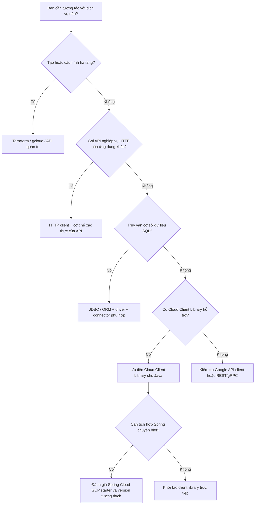
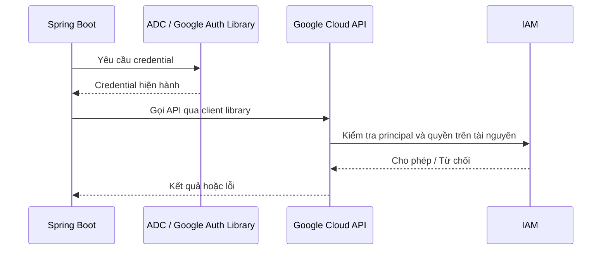
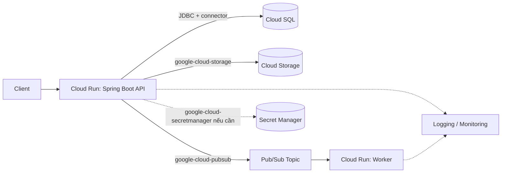

# Cloud Client Libraries và lựa chọn SDK

## 1. Vấn đề: ứng dụng Java giao tiếp với Google Cloud bằng cách nào?

Một ứng dụng Spring Boot chạy trên Cloud Run có thể cần tải tệp lên **Cloud Storage**, lưu đơn hàng vào **Cloud SQL**, công bố sự kiện lên **Pub/Sub**, đọc bí mật từ **Secret Manager** và gửi telemetry đến hệ thống quan sát. Mỗi dịch vụ có API riêng, cơ chế xác thực, hạn mức, phân trang và cách xử lý lỗi. Nếu tự ghép các HTTP request cho tất cả dịch vụ, nhóm phát triển phải duy trì nhiều mã giao tiếp hạ tầng và có thể bỏ sót các chi tiết như retry hay deadline.

**Google Cloud Client Libraries** cung cấp các thư viện dành cho ngôn ngữ lập trình, trong đó có **Java**, giúp gọi API Google Cloud bằng lớp và phương thức phù hợp với ngôn ngữ. Tuy nhiên, “dùng SDK” không phải câu trả lời cho mọi bài toán: truy vấn PostgreSQL vẫn nên dùng JDBC, gọi REST API nghiệp vụ của một Cloud Run service vẫn là HTTP, còn tạo tài nguyên hàng loạt thường phù hợp với Terraform hoặc công cụ triển khai.

Trong chương **Công cụ và môi trường GCP**, bài này tập trung vào cách **chọn đúng thư viện giao tiếp dịch vụ cho ứng dụng Java**, cấu hình dependency và xác thực an toàn, quản lý vòng đời client và xử lý lỗi. Các ví dụ nằm trong bối cảnh phát triển ứng dụng Java trên GCP từ project, IAM và VPC đến Cloud Run/GKE/Compute Engine, lưu trữ, phát hành và vận hành.

### Mục tiêu sau bài học

Sau khi học, bạn có thể:

1. Phân biệt Cloud Client Libraries, thư viện tích hợp Spring, thư viện xác thực, Google API Client Libraries, REST/gRPC trực tiếp và Google Cloud CLI.
2. Chọn Java client phù hợp cho Cloud Storage, Pub/Sub, Firestore, BigQuery, Secret Manager và nhận diện những trường hợp **không** cần Cloud Client Library.
3. Cài dependency nhất quán bằng **Google Cloud Libraries BOM** và cấu hình **Application Default Credentials (ADC)**.
4. Viết một Spring Boot service sử dụng Cloud Storage, giải thích quyền IAM, cấu hình bucket và hành vi khi có lỗi.
5. Thiết kế kết nối có timeout, retry, idempotency, giới hạn tài nguyên, logging và kiểm thử phù hợp.

## 2. “SDK” là từ chung: cần phân biệt các nhóm công cụ

Trong tài liệu và thảo luận kỹ thuật, “Google Cloud SDK” đôi khi được dùng để chỉ bộ công cụ dòng lệnh, còn “SDK Java” thường chỉ tập hợp thư viện nhúng vào ứng dụng. Xác định **ai sử dụng công cụ và khi nào** trước khi lựa chọn.

| Nhóm | Mục đích chính | Ví dụ | Cách dùng |
| --- | --- | --- | --- |
| **Google Cloud Client Libraries for Java** | Ứng dụng Java gọi API Google Cloud | `google-cloud-storage`, `google-cloud-pubsub`, `google-cloud-secretmanager` | Dependency Maven/Gradle trong mã nguồn |
| **Google Auth Library** | Cấp, lấy, làm mới và quản lý thông tin xác thực phù hợp | `google-auth-library-oauth2-http` và ADC | Thường do client library sử dụng, có thể dùng trực tiếp khi cần |
| **Google API Client Libraries** | Gọi nhiều Google API theo mô hình API client truyền thống | Các API có client sinh từ Discovery document | Cân nhắc khi API chưa có Cloud Client Library phù hợp |
| **Spring Framework / Spring Cloud GCP** | Tích hợp dịch vụ GCP với cấu hình và abstraction của Spring | Starter cho Cloud Storage, Pub/Sub, Secret Manager tùy dự án | Hữu ích khi cần bean, auto-configuration, messaging abstraction |
| **Firebase Admin SDK** | Tác vụ quản trị Firebase phía server | Xác minh Firebase ID token, quản lý user | Dùng khi nghiệp vụ thuộc Firebase, không thay cho toàn bộ Cloud Client Libraries |
| **REST/gRPC trực tiếp** | Gọi endpoint qua giao thức mạng | HTTP client, gRPC stub | Khi API yêu cầu tùy biến đặc biệt hoặc thiếu client phù hợp |
| **Google Cloud CLI (`gcloud`)** | Thao tác quản trị từ terminal | Tạo project resource, deploy Cloud Run, xem cấu hình | Công cụ cho người phát triển/CI, không phải thư viện gọi API trong business code |
| **Terraform / Infrastructure as Code (IaC)** | Khai báo, quản lý vòng đời hạ tầng | Project, IAM, bucket, Cloud Run, VPC | Dùng cho cấu hình hạ tầng tái tạo được |

Lưu ý: tên artifact, khả năng và phiên bản **Spring Cloud GCP** phụ thuộc bản Spring Boot/Spring Framework; cần kiểm tra **bảng tương thích** trước khi thêm starter. Không phải mọi dịch vụ GCP đều có trải nghiệm client, transport hoặc hỗ trợ Spring tương đương nhau.

### Data plane và control plane

Hai API cùng nhắc đến một dịch vụ có thể phục vụ mục đích khác nhau:

- **Data plane:** ứng dụng tải object lên Cloud Storage, đọc document Firestore, publish Pub/Sub message. Đây là luồng nghiệp vụ thường xuyên.
- **Control plane:** người quản trị tạo bucket, cấp IAM, cấu hình service Cloud Run, đọc metadata của cluster. Những thao tác này thường thuộc môi trường triển khai/vận hành.

Ví dụ, gọi **API nghiệp vụ** `GET /orders` trên một Cloud Run service là HTTP request tới URL của ứng dụng; một thư viện quản trị Cloud Run không tự động trở thành client gọi endpoint nghiệp vụ đó. Phân biệt này giúp tránh thêm dependency quản trị vào ứng dụng khi chỉ cần giao tiếp HTTP.

## 3. Nguyên tắc lựa chọn cho từng dịch vụ

### 3.1. Bảng định hướng cho lập trình viên Java

| Bài toán | Giải pháp Java nên cân nhắc | Lý do và giới hạn |
| --- | --- | --- |
| Upload/download object, liệt kê object trong bucket | `com.google.cloud:google-cloud-storage` | API Java cho Cloud Storage; IAM trên bucket/object, chú ý bộ nhớ khi xử lý file lớn |
| Publish/consume message Pub/Sub | `com.google.cloud:google-cloud-pubsub` | Hỗ trợ publisher/subscriber và khả năng quản lý luồng nhận; vẫn phải thiết kế retry/idempotency |
| CRUD document trong Firestore | `com.google.cloud:google-cloud-firestore` | Thao tác document, collection, transaction; mô hình dữ liệu khác SQL |
| Truy vấn/phân tích dữ liệu BigQuery | `com.google.cloud:google-cloud-bigquery` | Gửi query job, đọc kết quả; phải kiểm soát dữ liệu quét và chi phí |
| Đọc secret trong Secret Manager | `com.google.cloud:google-cloud-secretmanager` | Quyền chỉ đọc secret theo IAM, tránh để giá trị secret trong log |
| Tương tác Cloud Spanner | `com.google.cloud:google-cloud-spanner` | API đặc thù Spanner; không thay cho JDBC tùy tiện |
| Kết nối Cloud SQL PostgreSQL/MySQL | **JDBC driver + connection pool**, phối hợp **Cloud SQL Java Connector** khi phù hợp | Cloud SQL là dịch vụ quản lý DB, truy vấn nghiệp vụ vẫn theo SQL/JDBC |
| Gọi service REST viết bằng Spring Boot chạy trên Cloud Run | `WebClient`/`RestClient`/HTTP client, thêm **ID token** khi service yêu cầu xác thực IAM | Gọi API của ứng dụng, không dùng client quản trị Cloud Run |
| Gửi log ứng dụng khi chạy Cloud Run | **Structured logging** ra stdout/stderr, hệ thống thu thập log | Không cần gọi Logging API trực tiếp cho mọi dòng log |
| Ghi traces/metrics từ Spring Boot | **Micrometer/OpenTelemetry** với exporter phù hợp | Instrumentation có thể phù hợp hơn API quản trị Monitoring thủ công |
| Tạo bucket, service account, GKE cluster trong môi trường mới | **Terraform** hoặc công cụ quản trị tương ứng | Vòng đời hạ tầng khác vòng đời xử lý request nghiệp vụ |

Ví dụ: “Lưu ảnh hồ sơ lên GCP” phù hợp với Cloud Storage client; “lưu hồ sơ người dùng dạng quan hệ” phù hợp với Spring Data JPA/JDBC kết nối Cloud SQL. Dù đều nằm trên GCP, **không nên ép cả hai dùng một abstraction SDK chung**.

### 3.2. Quy trình ra quyết định



Trước khi chốt lựa chọn, kiểm tra **tính năng API cần dùng**, bản Java, hỗ trợ transport, yêu cầu xác thực, cách client được bảo trì, thử nghiệm trên emulator hoặc môi trường thật và chiến lược cập nhật phiên bản. Một thư viện tiện dụng nhưng không hỗ trợ tính năng quan trọng của bài toán có thể khiến toàn bộ thiết kế phức tạp hơn.

## 4. Quản lý dependency trong Maven và Gradle

Thư viện Google Cloud Java gồm nhiều artifact và dependency chung. Nếu khai báo thủ công nhiều phiên bản riêng lẻ, có thể dẫn đến xung đột gRPC, protobuf, Guava hoặc các thư viện nền tảng khác. **Google Cloud Libraries BOM (Bill of Materials)** giúp chọn bộ phiên bản được quản lý tương thích trong cùng họ client libraries.

### 4.1. Maven

Ví dụ thêm Cloud Storage và Pub/Sub vào `pom.xml`:

```xml
<properties>
    <!-- Chọn một phiên bản BOM hiện hành đã được thử nghiệm với dự án -->
    <google.cloud.bom.version>YOUR_TESTED_BOM_VERSION</google.cloud.bom.version>
</properties>

<dependencyManagement>
    <dependencies>
        <dependency>
            <groupId>com.google.cloud</groupId>
            <artifactId>libraries-bom</artifactId>
            <version>${google.cloud.bom.version}</version>
            <type>pom</type>
            <scope>import</scope>
        </dependency>
    </dependencies>
</dependencyManagement>

<dependencies>
    <dependency>
        <groupId>com.google.cloud</groupId>
        <artifactId>google-cloud-storage</artifactId>
    </dependency>
    <dependency>
        <groupId>com.google.cloud</groupId>
        <artifactId>google-cloud-pubsub</artifactId>
    </dependency>
</dependencies>
```

`YOUR_TESTED_BOM_VERSION` là **giá trị giữ chỗ**, phải thay bằng phiên bản có thật được công bố trong tài liệu chính thức hoặc kho Maven, sau đó chạy dependency resolution/test. Không đoán số phiên bản mới nhất. Với ứng dụng Spring Boot, BOM của Spring Boot và BOM của Google Cloud có thể quản lý một số dependency chung: sau khi thêm, kiểm tra cây dependency và chạy test tích hợp để phát hiện xung đột.

### 4.2. Gradle (Groovy DSL)

Ví dụ tương đương trong `build.gradle`:

```groovy
dependencies {
    implementation platform("com.google.cloud:libraries-bom:YOUR_TESTED_BOM_VERSION")
    implementation "com.google.cloud:google-cloud-storage"
    implementation "com.google.cloud:google-cloud-pubsub"
}
```

Đối với các thư viện nằm ngoài BOM hoặc một starter Spring Cloud GCP, hãy tra tọa độ artifact và quy tắc quản lý phiên bản riêng. Đừng mặc định BOM Google Cloud kiểm soát toàn bộ dependency của ứng dụng.

### 4.3. Những điều nên kiểm tra khi nâng cấp

1. **Java runtime:** thư viện có hỗ trợ phiên bản JDK đang dùng không? Nếu ứng dụng chạy Java 17/21, build và runtime có nhất quán không?
2. **API tương thích:** chữ ký phương thức, cấu hình endpoint, transport, class ngoại lệ và cách đóng client có thay đổi không?
3. **Dependency trùng:** phiên bản protobuf/gRPC/Guava có phù hợp với Spring Boot và các framework hiện tại không?
4. **Tính năng và rủi ro:** có thay đổi mặc định về deadline, retry, authentication, pagination hoặc cách đọc dữ liệu không?
5. **Kiểm thử:** chạy test đơn vị, test tích hợp trên tài nguyên thử nghiệm và kiểm tra các đường lỗi; ghi lại BOM đã dùng để tái tạo bản build.

## 5. Xác thực bằng ADC và phân quyền bằng IAM

Một điểm mạnh của Cloud Client Libraries là tích hợp **Application Default Credentials (ADC)**: thư viện có thể tìm credential qua cơ chế chuẩn của môi trường mà không cần ghi access token tĩnh trong mã nguồn.

### 5.1. ADC hoạt động ở đâu?

| Môi trường | Cách cung cấp danh tính thường dùng | Ghi nhớ |
| --- | --- | --- |
| Máy phát triển | `gcloud auth application-default login` hoặc cấu hình federation/impersonation phù hợp | Tài khoản cho ADC **khác** phiên đăng nhập `gcloud auth login` dùng cho CLI |
| Cloud Run | Gán **runtime service account** cho service/job | Google Auth Library lấy credential qua môi trường chạy |
| GKE | **Workload Identity Federation for GKE** | Ánh xạ danh tính workload tới quyền GCP theo cấu hình của cụm |
| Compute Engine | Gán service account cho VM và cấu hình phạm vi truy cập phù hợp | Tránh dùng key tĩnh |
| CI/CD bên ngoài GCP | **Workload Identity Federation** khi nhà cung cấp hỗ trợ | Tránh lưu private key lâu dài trong secret CI |

Khi chạy cục bộ, thao tác điển hình là:

```shell
gcloud auth application-default login
# Nếu gặp yêu cầu liên quan quota project, kiểm tra cấu hình và quyền:
gcloud auth application-default set-quota-project YOUR_PROJECT_ID
```

Không cần chạy những lệnh này **bên trong** Cloud Run hay nhúng chúng vào Dockerfile. Tránh ghi file JSON key của service account vào Git; nếu một môi trường thực sự phải dùng file thông tin xác thực, hãy ưu tiên cấu hình federation và quy trình quản lý credential của tổ chức.

### 5.2. IAM mới quyết định ứng dụng được phép làm gì

ADC giúp xác định **ứng dụng đang dùng danh tính nào**; **IAM** quyết định danh tính đó có quyền hay không. Ví dụ API chỉ upload tệp lên một bucket cần quyền tạo object trên bucket đó; không cần Owner của project. Một runtime service account đọc secret phải được cấp quyền phù hợp trên đúng secret.

Đường đi của một lệnh gọi:



Trong thực tế, token có thể được thư viện làm mới và cache; sơ đồ minh họa ranh giới trách nhiệm, không biểu diễn toàn bộ trao đổi ở mỗi request.

**Phân biệt lỗi:**

- **Không tìm thấy credential:** lỗi xác thực tại client hoặc phía dịch vụ; kiểm tra ADC/runtime identity.
- **`PERMISSION_DENIED` / HTTP 403:** thường là thiếu quyền IAM, giới hạn policy hoặc điều kiện quyền chưa thỏa; không giải quyết bằng cách đổi password ứng dụng.
- **`NOT_FOUND` / HTTP 404:** kiểm tra project ID, resource name, region, tên bucket/topic/secret và quyền hiển thị.
- **Timeout/unavailable:** xem network egress, endpoint, DNS, firewall/VPC, quota và trạng thái dịch vụ; không đồng nhất với lỗi IAM.

## 6. Ví dụ thực hành: dùng Cloud Storage Client Library trong Spring Boot

Mục tiêu: Spring Boot upload nội dung văn bản lên Cloud Storage bằng **runtime service account**, không chứa token trong source code. Ví dụ dùng `google-cloud-storage` đã khai báo ở phần Maven/Gradle.

### 6.1. Cấu hình ứng dụng

Trong `application.yml`:

```yaml
app:
  storage:
    bucket: ${APP_GCS_BUCKET}
```

Biến môi trường `APP_GCS_BUCKET` phải được cấu hình tại môi trường chạy. Sử dụng tên bucket được tạo sẵn và có quyền phù hợp; không để ứng dụng tự tạo bucket mỗi lần khởi động. Trên môi trường phát triển, sử dụng project/bucket riêng để tránh ghi đè dữ liệu thật.

### 6.2. Tạo bean và service dùng lại client

```java
package dev.example.gcp.storage;

import com.google.cloud.storage.BlobId;
import com.google.cloud.storage.BlobInfo;
import com.google.cloud.storage.Storage;
import com.google.cloud.storage.StorageOptions;
import org.springframework.beans.factory.annotation.Value;
import org.springframework.context.annotation.Bean;
import org.springframework.context.annotation.Configuration;
import org.springframework.stereotype.Service;

@Configuration
class GoogleStorageConfiguration {
    @Bean
    Storage googleCloudStorage() {
        // Dùng ADC của máy phát triển hoặc service account của workload.
        return StorageOptions.getDefaultInstance().getService();
    }
}

@Service
public class ObjectStorageService {
    private final Storage storage;
    private final String bucketName;

    public ObjectStorageService(
            Storage storage,
            @Value("${app.storage.bucket}") String bucketName) {
        this.storage = storage;
        this.bucketName = bucketName;
    }

    public String uploadText(String objectName, String content) {
        BlobInfo metadata = BlobInfo.newBuilder(
                BlobId.of(bucketName, objectName))
                .setContentType("text/plain; charset=UTF-8")
                .build();

        storage.create(
                metadata,
                content.getBytes(java.nio.charset.StandardCharsets.UTF_8),
                Storage.BlobTargetOption.doesNotExist());
        return objectName;
    }
}
```

Phương thức trên là ví dụ phần tích hợp, **chưa** bao gồm endpoint HTTP. Tùy chọn `doesNotExist()` đặt precondition chỉ tạo object khi tên đó chưa tồn tại; nếu trùng tên, thao tác có thể thất bại thay vì ghi đè âm thầm. Nếu thêm endpoint nhận dữ liệu người dùng, phải validate `objectName`, giới hạn kích thước, quyết định chính sách ghi đè object và kiểm soát quyền gọi API. Với tệp lớn, sử dụng cơ chế truyền dữ liệu theo luồng/resumable upload phù hợp thay vì giữ toàn bộ nội dung trong `byte[]` hoặc `String`.

### 6.3. Kiểm tra quyền và kết quả

1. Tạo một bucket thử nghiệm, cấu hình `APP_GCS_BUCKET` và cấp runtime identity quyền tối thiểu cần thiết trên bucket (ví dụ vai trò cho phép **tạo** object nếu bài thực hành chỉ upload).
2. Khi chạy ở máy cá nhân, xác nhận `gcloud auth application-default login` đã thành công và danh tính đang dùng cũng được cấp quyền.
3. Gọi `uploadText("demo/hello.txt", "Hello Google Cloud")` từ một thao tác thử nghiệm; xác minh object được tạo bằng Console/CLI hoặc API.
4. Thử gỡ quyền tạo object và gọi với **tên object mới** để kiểm tra ứng dụng phản hồi lỗi quyền có kiểm soát. Sau đó khôi phục quyền theo nhu cầu.
5. Xóa object và bucket thử nghiệm khi hoàn tất để tránh tài nguyên tồn đọng.

**Đặc điểm cần nhớ:** `Storage` được đưa vào Spring dưới dạng bean dùng lại; tránh tạo một client mới cho từng HTTP request. Ở các thư viện khác, một số client có tài nguyên nền như channel/thread và cung cấp `close()` hoặc `shutdown()`, nên cần quản lý vòng đời theo hướng dẫn riêng của từng API.

## 7. Ví dụ đối chiếu: publisher Pub/Sub và tác vụ bất đồng bộ

Nếu yêu cầu nghiệp vụ là “sau khi tạo đơn hàng, công bố sự kiện để hệ thống khác xử lý”, cách gọi khác hoàn toàn thao tác upload file. Google Cloud Pub/Sub cung cấp `Publisher` và `Subscriber` với cơ chế bất đồng bộ, retry và flow control.

Ví dụ Java **chỉ để minh họa cách publish một message**; khi triển khai production nên dùng một publisher dài hạn và quản lý shutdown theo vòng đời ứng dụng:

```java
import com.google.api.core.ApiFuture;
import com.google.cloud.pubsub.v1.Publisher;
import com.google.protobuf.ByteString;
import com.google.pubsub.v1.PubsubMessage;
import com.google.pubsub.v1.TopicName;
import java.util.concurrent.TimeUnit;

public class EventPublisher {
    public static String publishOnce(
            String projectId, String topicId, String payload) throws Exception {
        TopicName topic = TopicName.of(projectId, topicId);
        Publisher publisher = Publisher.newBuilder(topic).build();
        try {
            PubsubMessage message = PubsubMessage.newBuilder()
                    .setData(ByteString.copyFromUtf8(payload))
                    .putAttributes("eventType", "order.created")
                    .build();

            ApiFuture<String> messageId = publisher.publish(message);
            return messageId.get();  // Chờ server xác nhận publish.
        } finally {
            publisher.shutdown();
            publisher.awaitTermination(1, TimeUnit.MINUTES);
        }
    }
}
```

Thư viện cần dependency `google-cloud-pubsub` và principal phải có quyền publish trên topic. `messageId.get()` chỉ xác nhận Pub/Sub chấp nhận message; **không bảo đảm subscriber đã hoàn tất xử lý nghiệp vụ**. Trong mã production, đặt deadline cho thao tác chờ, xử lý ngoại lệ, theo dõi backlog và cấu hình retry có giới hạn.

Subscriber thường xử lý theo mô hình **ít nhất một lần**, vì vậy sự kiện có thể được nhận lại. Hãy thiết kế consumer **idempotent**, cân nhắc dead-letter topic, thứ tự message khi thật sự cần, cùng kỹ thuật **transactional outbox** nếu phải tránh khoảng trống giữa commit dữ liệu SQL và publish event.

## 8. Retry, timeout, phân trang và hiệu năng

Thư viện client giúp chuẩn hóa cách gọi API, nhưng lựa chọn mặc định không thay cho chính sách vận hành của ứng dụng. Mỗi nhóm thao tác cần xác định có thể retry an toàn hay không, bao lâu là quá lâu và số kết nối tối đa.

### 8.1. Phân loại lỗi trước khi retry

| Trạng thái/tình huống | Cách nghĩ ban đầu |
| --- | --- |
| `UNAVAILABLE`, lỗi mạng tạm thời | Có thể retry với exponential backoff và jitter, trong ngân sách thời gian |
| `DEADLINE_EXCEEDED` | Xác minh request đã được thực hiện hay chưa; retry chỉ khi an toàn với nghiệp vụ |
| `RESOURCE_EXHAUSTED` / quota | Giảm tốc, kiểm tra quota và giới hạn đồng thời; tránh retry dồn dập |
| `PERMISSION_DENIED` | Sửa IAM/policy/danh tính; retry tự động liên tục thường không có ích |
| `INVALID_ARGUMENT` | Sửa dữ liệu đầu vào hoặc tên tài nguyên |
| Ghi mới/ghi đè không có precondition | Retry có thể tạo tác dụng phụ ngoài ý muốn; thêm idempotency key, precondition hoặc thiết kế đối soát |

Một số client tự retry theo từng phương thức với điều kiện riêng; **không được mặc định mọi phương thức đều retry giống nhau**. Khi ứng dụng cũng có Spring Retry hoặc circuit breaker, chú ý retry lồng nhau khiến tổng số lần gọi tăng mạnh.

### 8.2. Deadline và số lần gọi

Giả sử API HTTP có deadline 3 giây nhưng client gọi Cloud Storage được phép chờ 60 giây: ứng dụng có thể tiếp tục chiếm tài nguyên sau khi caller đã hủy request. Cần thiết kế ngân sách thời gian xuyên suốt request và chọn deadline/retry phù hợp từng thao tác, nhất là trong chuỗi Cloud Run → Cloud SQL → Pub/Sub.

Trường hợp đọc hàng nghìn bản ghi từ Firestore, BigQuery hoặc liệt kê object Cloud Storage, client có thể hỗ trợ **phân trang** hoặc iterator. Tránh chuyển cả tập dữ liệu lớn thành danh sách trong bộ nhớ. Với upload/download lớn, tìm API streaming hoặc đọc theo chunk, theo dõi tốc độ và mức tiêu thụ heap.

### 8.3. Vòng đời client

Khởi tạo client thường cần lấy cấu hình, credential, kết nối hoặc channel. Vì vậy:

- Đặt client dùng chung ở phạm vi ứng dụng/service khi thư viện cho phép.
- Với client có `close()`, `shutdown()` hoặc `awaitTermination()`, gắn vào vòng đời ứng dụng Spring phù hợp.
- Không giữ credential hoặc secret trong singleton tự viết nếu cơ chế thư viện đã có chức năng refresh an toàn.
- Đặt giới hạn concurrency, số kết nối DB và kích thước thread pool theo mức tải thực tế.
- Ghi lại latency, số lỗi, tỷ lệ retry và thời gian chờ theo từng dịch vụ mà không log payload nhạy cảm.

## 9. Kiểm thử và phát triển cục bộ

### 9.1. Phân tầng kiểm thử

| Tầng | Mục đích | Cách làm gợi ý |
| --- | --- | --- |
| Unit test | Kiểm tra nghiệp vụ và xử lý ngoại lệ | Bọc Cloud Client Library sau interface nhỏ của ứng dụng, mock adapter |
| Integration test cục bộ | Kiểm tra serializer, publisher/subscriber, transaction hoặc truy vấn | Dùng **Pub/Sub emulator**, **Firestore emulator** khi hỗ trợ; DB có thể dùng container PostgreSQL |
| Integration test trên GCP | Kiểm tra IAM, ADC, VPC, quota, endpoint thật | Dựng project/bucket/topic/DB thử nghiệm, chạy test và dọn sau |
| End-to-end | Kiểm tra toàn bộ luồng nghiệp vụ | Tạo đơn → phát message → xử lý → lưu trạng thái, kèm tình huống retry |

Emulator có thể khác dịch vụ thật về IAM, quota, latency và các tính năng hỗ trợ. Vì vậy, test qua emulator **không thay thế** test quyền và kết nối với một project GCP thử nghiệm. Không mặc định mọi dịch vụ đều có emulator chính thức; Cloud Storage thường cần mock hoặc môi trường thử nghiệm tùy bài toán.

### 9.2. Tách logic nghiệp vụ khỏi SDK

Thay vì để controller trực tiếp gọi `StorageOptions` hoặc `Publisher.newBuilder`, tạo cổng giao tiếp đơn giản:

```java
public interface DocumentObjectStore {
    String save(String objectName, byte[] content, String contentType);
}
```

Adapter GCP triển khai interface đó bằng Cloud Storage library; test của nghiệp vụ chỉ cần một fake implementation. Khi chuyển môi trường hoặc thay cách giao tiếp, phần nghiệp vụ ít bị ảnh hưởng. Tuy nhiên, không nên bọc mọi API thành lớp generic quá mức: vẫn phải thể hiện rõ các khái niệm quan trọng như precondition, transaction và deadline.

### 9.3. Quan sát lỗi trong môi trường thật

Khi dùng Cloud Run/GKE/Compute Engine, nên ghi log theo cấu trúc và gắn **correlation ID** cho luồng request. Theo dõi số request thất bại, 429/quota, latency p95/p99 và thời gian retry. Các client library sử dụng network calls thực: việc bean tạo thành công lúc startup **không chứng minh** rằng runtime service account có quyền truy cập từng resource.

## 10. Tình huống thực tế: ứng dụng Spring Boot quản lý đơn hàng

Giả sử hệ thống có API nhận đơn hàng, lưu giao dịch vào Cloud SQL, tạo tệp xác nhận trong Cloud Storage, phát `order.created` qua Pub/Sub và đọc cấu hình nhạy cảm từ Secret Manager.



**Lựa chọn theo trách nhiệm:**

1. **Cloud SQL:** Spring Data JPA hoặc JDBC với PostgreSQL driver, pool và connector phù hợp. Không thay thế SQL driver bằng một Cloud SQL Admin SDK.
2. **Cloud Storage:** `google-cloud-storage` để tạo/đọc object, quyền ghi cấp ở đúng bucket.
3. **Pub/Sub:** `google-cloud-pubsub` để publish/consume, với idempotency cho event handler.
4. **Secret Manager:** `google-cloud-secretmanager` nếu ứng dụng tự gọi secret API; trong nhiều trường hợp có thể **inject secret qua cấu hình runtime** theo cơ chế nền tảng, không bắt buộc mỗi request phải gọi API đọc secret.
5. **Telemetry:** Spring/Micrometer/OpenTelemetry và structured logs để vận hành; hạn chế phụ thuộc vào Admin API chỉ để ghi log ứng dụng.
6. **Phát hành:** Cloud Build/Artifact Registry/Cloud Run hoặc pipeline đang dùng cùng Terraform, cấp quyền tách biệt cho build identity, deploy identity và runtime service account.

**Phân quyền mẫu:** API runtime identity được phép kết nối DB, tạo object ở bucket, publish vào topic và đọc đúng secret cần thiết. Worker có identity riêng với quyền đọc subscription, truy cập tài nguyên xử lý và ghi kết quả; tránh cấp quyền của toàn project khi chỉ cần một tài nguyên.

**Tình huống lỗi cần thử:** bucket không tồn tại, quyền IAM bị thiếu, Pub/Sub quota bị giới hạn, database quá số kết nối, token chưa hợp lệ, event được phát lặp và Cloud Run bị thay instance. Quan sát hành vi của từng lỗi trước khi tuyên bố hệ thống đã sẵn sàng production.

## 11. Các nhầm lẫn hay gặp

**“Dùng `gcloud auth login` thì Java chắc chắn truy cập được GCP.”** Không chắc. Google Cloud CLI và ADC là hai đường cấu hình thông tin xác thực liên quan nhưng khác nhau. Kiểm tra credential nguồn mà thư viện Java sử dụng và IAM tương ứng.

**“Mọi thứ trên Google Cloud đều phải gọi bằng Cloud Client Library.”** Không đúng. SQL dùng JDBC/ORM, ứng dụng HTTP dùng HTTP client, còn IaC thường có công cụ riêng. Client quản trị dịch vụ không nhất thiết là client cho API nghiệp vụ.

**“SDK đã tự retry, nên lệnh ghi nào cũng an toàn.”** Không đúng. Retry chỉ an toàn khi thao tác idempotent hoặc có precondition/thiết kế chống ghi lặp. Đồng thời cần giới hạn tổng thời gian và số lần thử.

**“Thêm dependency là đủ để chạy trên Cloud Run.”** Chưa đủ. Phải có runtime identity, quyền IAM, API cần được bật, tên tài nguyên chính xác, cấu hình network và hạn mức phù hợp.

**“Mỗi HTTP request khởi tạo một client mới để tránh lỗi.”** Thường gây chi phí kết nối, mất tài nguyên và làm khó quản lý shutdown. Hãy hiểu quy tắc reuse và lifecycle của client cụ thể.

**“Emulator chạy được nghĩa là môi trường thật sẽ chạy được.”** Không chắc: emulator thường không mô phỏng đầy đủ IAM, network và quota. Cần thêm kiểm thử tích hợp trên GCP theo ngân sách và phạm vi được kiểm soát.

## 12. Bài thực hành và tiêu chí hoàn thành

**Bài tập A — Cloud Storage (cơ bản).** Cài BOM và `google-cloud-storage`, cấu hình ADC, tạo Spring bean và phương thức upload text. Ghi lại project/bucket được dùng, xác minh tệp đã xuất hiện; thử trường hợp mất quyền, sau đó dọn dữ liệu.

**Bài tập B — So sánh API (trung bình).** Vẽ bảng chọn công cụ cho: tạo VM, gọi `GET /orders` từ một Cloud Run khác, truy vấn PostgreSQL trong Cloud SQL, đọc object từ Cloud Storage và phát message Pub/Sub. Giải thích vì sao các lựa chọn không cùng một loại “SDK”.

**Bài tập C — Pub/Sub (nâng cao).** Tạo publisher Java và một consumer nhỏ, gửi cùng event hai lần, chứng minh consumer xử lý idempotent; thử timeout và lỗi tạm thời, theo dõi dead-letter/backlog nếu đã cấu hình.

**Bài tập D — Tích hợp và bảo mật.** Triển khai ứng dụng thử nghiệm lên Cloud Run với runtime service account riêng, cấp quyền tối thiểu và kiểm tra truy cập tài nguyên. Sử dụng logging để phân biệt lỗi 403, thiếu tài nguyên và lỗi timeout; xây một bảng chi phí dự kiến cho các dịch vụ được dùng.

### Checklist

- [ ] Tôi phân biệt Cloud Client Libraries, Google Auth Library, Google API client, Spring Cloud GCP, CLI và IaC.
- [ ] Tôi biết khi nào dùng Java Cloud Client Library, JDBC hoặc HTTP client.
- [ ] Tôi cài dependency qua BOM và kiểm tra tương thích với JDK/Spring Boot.
- [ ] Tôi cấu hình ADC đúng môi trường và hiểu vì sao cần IAM theo tài nguyên.
- [ ] Tôi viết được một service Java gọi Cloud Storage mà không nhúng key.
- [ ] Tôi hiểu khác biệt giữa publish thành công và xử lý sự kiện thành công.
- [ ] Tôi có timeout/retry phù hợp, xử lý idempotency, quản lý vòng đời client.
- [ ] Tôi có unit test, kiểm thử tích hợp và cách quan sát lỗi/chi phí.

Đầu ra mong muốn là một ứng dụng Java có **mã gọi dịch vụ ngắn gọn, xác thực an toàn, dependency quản lý nhất quán và các tình huống lỗi được kiểm chứng**. Chọn Cloud Client Library theo API và nghiệp vụ cụ thể sẽ giúp ứng dụng dễ bảo trì khi mở rộng sang Compute Engine, GKE hoặc Cloud Run và khi các dịch vụ GCP tiếp tục phát triển.

### Nguồn tài liệu chính thức để đối chiếu phiên bản và API

- [Google Cloud Client Libraries](https://cloud.google.com/apis/docs/cloud-client-libraries)
- [Google Cloud Java](https://cloud.google.com/java/docs)
- [Application Default Credentials](https://cloud.google.com/docs/authentication/application-default-credentials)
- [Google Cloud Libraries BOM](https://github.com/googleapis/java-cloud-bom)
- [Google Cloud CLI](https://cloud.google.com/sdk/gcloud)
