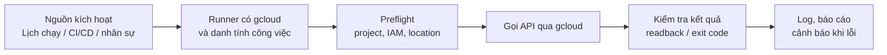

# Thực hành tự động hóa thao tác quản trị bằng gcloud

Quản trị Google Cloud không chỉ là vào Console và thao tác từng tài nguyên. Khi có nhiều project, nhiều môi trường hoặc các tác vụ lặp lại hằng ngày, cách làm thủ công dễ chậm, khó kiểm tra và thiếu nhất quán. **`gcloud`**, giao diện dòng lệnh thuộc Google Cloud CLI, giúp chuyển các thao tác quản trị thành câu lệnh có thể lưu, kiểm tra, chạy lại và tích hợp vào quy trình tự động hóa.

Bài học thuộc chương **Công cụ và môi trường GCP** của mô-đun `CLOUD_PROVIDERS_GCP`. Từ nền tảng tổ chức project, IAM và VPC, người học sẽ thực hành kiểm kê tài nguyên Compute Engine, thao tác cấu hình có kiểm soát và chuẩn bị tư duy tự động hóa cho các dịch vụ như GKE, Cloud Run, lưu trữ và cơ sở dữ liệu. Mục tiêu cuối là vận hành tài nguyên có thể lặp lại, an toàn, dễ giám sát và quản lý chi phí.

## 1. Mục tiêu của bài thực hành

Hoàn thành bài này, bạn có thể:

1. Xác định cấu trúc lệnh `gcloud` và giới hạn của cấu hình mặc định.
2. Kiểm tra project, danh tính sử dụng CLI, region và zone trước khi chạy tác vụ.
3. Sử dụng `--project`, `--region`, `--zone`, `--filter` và `--format` để có kết quả phù hợp cho script.
4. Viết script Bash đọc thông tin tài nguyên và lưu dữ liệu kiểm kê mà không cần nhấp chuột trong Console.
5. Viết script cập nhật nhãn của một VM theo cách **có kiểm tra trước, tránh ghi thừa và mặc định xem trước (dry run)**.
6. Xử lý lỗi, quyền IAM, thông tin nhạy cảm và vấn đề chạy lại khi đưa script vào CI/CD hoặc lịch chạy tự động.

**Phạm vi:** ví dụ sử dụng **Bash** trong Cloud Shell hoặc máy đã cài Google Cloud CLI; môi trường Windows dùng PowerShell cần điều chỉnh cú pháp biến, nối dòng và vòng lặp. Các đoạn lệnh có khả năng thay đổi tài nguyên đều được chỉ rõ. Không cần tạo VM mới để làm bài cập nhật nhãn; hãy chọn một VM thử nghiệm đã được phép quản trị.

## 2. gcloud tự động hóa được những gì?

Một lệnh thông dụng có cấu trúc:

```text
gcloud <nhóm-dịch-vụ> <nhóm-tài-nguyên> <thao-tác> [đối-số] [cờ]
```

Ví dụ:

```bash
# Đọc danh sách VM
gcloud compute instances list --project="my-lab-project"

# Đọc chi tiết một VM ở đúng zone
gcloud compute instances describe "demo-vm" \
  --project="my-lab-project" \
  --zone="asia-southeast1-a"

# Liệt kê dịch vụ Cloud Run ở một region
gcloud run services list \
  --project="my-lab-project" \
  --region="asia-southeast1"
```

Một script có thể gọi nhiều lệnh `gcloud`, kiểm tra kết quả từng bước và chỉ tiếp tục khi điều kiện cho phép. Những trường hợp thường gặp gồm:

| Nhu cầu quản trị | Cách tiếp cận qua CLI | Lưu ý |
| --- | --- | --- |
| Kiểm kê tài nguyên và xuất báo cáo | `list`, `describe`, `--format=json` hoặc `csv` | Cần quyền đọc; bảo vệ file đầu ra nếu có dữ liệu nội bộ |
| Gắn nhãn để theo dõi môi trường, chủ sở hữu hoặc chi phí | `add-labels`/`update` theo loại tài nguyên | Kiểm tra nhãn hiện tại trước khi sửa |
| Kiểm tra tình trạng dịch vụ trước/sau triển khai | `describe` và `list` | Diễn giải trường trạng thái theo từng sản phẩm |
| Quản trị nhiều project | Vòng lặp với `--project` tường minh | Quyền IAM có thể khác giữa các project |
| Tích hợp vào CI/CD | Cài hoặc chuẩn bị CLI, dùng danh tính công việc có quyền tối thiểu | Tránh khóa dịch vụ dài hạn |
| Triển khai hạ tầng có cấu hình chuẩn | Script gcloud hoặc công cụ Infrastructure as Code như Terraform | Công cụ khai báo thường phù hợp hơn khi cần quản lý vòng đời nhiều tài nguyên |

`gcloud` là công cụ gọi các API quản trị, **không tự cung cấp cơ chế duy trì trạng thái mong muốn** như một hệ thống Infrastructure as Code. Nếu script chạy mỗi ngày, bạn cần tự quyết định việc nào phải bỏ qua, sửa lại hay báo lỗi.

## 3. Chuẩn bị môi trường và quyền truy cập

### 3.1. Chọn nơi chạy

Bạn có thể dùng **Google Cloud Shell** để thực hành vì môi trường đã có Google Cloud CLI và kết nối với Google Cloud. Nếu chạy trên máy cá nhân hoặc runner CI, hãy cài Google Cloud CLI theo tài liệu chính thức và kiểm tra phiên bản:

```bash
gcloud --version
gcloud help
gcloud compute instances --help
```

Một số nhóm lệnh yêu cầu thành phần CLI, API tương ứng của project hoặc quyền IAM phù hợp. Các tính năng và bộ cờ có thể thay đổi theo phiên bản; khi không chắc cú pháp của một nhóm lệnh, sử dụng `--help` của đúng nhóm.

### 3.2. Kiểm tra tài khoản và project mặc định

Trên môi trường thực hành tương tác:

```bash
# Danh tính người dùng đã đăng nhập vào Google Cloud CLI
gcloud auth list

# Project mặc định trong cấu hình CLI hiện tại
gcloud config get-value project

# Region và zone mặc định, nếu đã cấu hình
gcloud config get-value compute/region
gcloud config get-value compute/zone
```

Nếu làm việc trên máy cá nhân chưa đăng nhập, người dùng có thể chạy `gcloud auth login` để đăng nhập tương tác. Trong Cloud Shell, phiên làm việc thông thường đã có cơ chế xác thực của môi trường.

Có thể đặt giá trị mặc định:

```bash
gcloud config set project "my-lab-project"
gcloud config set compute/region "asia-southeast1"
gcloud config set compute/zone "asia-southeast1-a"
```

**Những lệnh `config set` thay đổi cấu hình CLI trong môi trường đang dùng.** Cấu hình mặc định tiện khi học nhưng có thể khiến script chạy nhầm project khi người vận hành đổi môi trường. Trong các script bên dưới, `--project` và `--zone` được truyền tường minh cho từng lệnh quan trọng.

### 3.3. Hiểu hai loại xác thực

| Cách xác thực | Phù hợp với | Điều cần nhớ |
| --- | --- | --- |
| `gcloud auth login` | Người dùng chạy CLI tương tác | Xác thực cho Google Cloud CLI |
| `gcloud auth application-default login` | Phát triển ứng dụng dùng **Application Default Credentials (ADC)** tại máy cá nhân | Thông tin ADC cho thư viện ứng dụng; không thể coi là cách thay thế hoàn toàn cho `gcloud auth login` |
| Service account gắn với runtime GCP | Cloud Build, VM, Cloud Run hoặc runtime hỗ trợ | Dùng danh tính công việc, cấp IAM vừa đủ |
| Service account impersonation | Người dùng/runner đã được cấp quyền mạo danh service account | Có thể truyền `--impersonate-service-account`; tránh phải xuất khóa JSON |
| Workload Identity Federation | CI/CD nằm ngoài Google Cloud | Trao đổi danh tính bên ngoài để lấy thông tin xác thực ngắn hạn, không lưu khóa dài hạn |

Một service account chỉ có thể thực hiện thao tác khi được cấp quyền lên **tài nguyên đích**; quyền cho phép người dùng mạo danh service account là một điều kiện khác. Với môi trường sản xuất, hãy ưu tiên xác thực ngắn hạn, danh tính công việc và quyền tối thiểu. Tránh đưa password, access token, khóa JSON hoặc nội dung bí mật vào script và log.

### 3.4. Quyền IAM cho bài học

Đối với kiểm kê Compute Engine, danh tính thường cần quyền xem project và các quyền đọc như `compute.instances.list`, `compute.subnetworks.list`. Với thao tác gắn nhãn VM, cần thêm các quyền đọc/ghi liên quan đến instance, ví dụ `compute.instances.get` và `compute.instances.setLabels`. Hãy chọn vai trò IAM đáp ứng công việc theo chính sách của tổ chức; **không mặc định yêu cầu Owner/Editor** cho một script đọc tài nguyên.

Project thực hành cần đã bật Compute Engine API để gọi các lệnh Compute Engine. Việc bật API, cấp quyền IAM và tạo VM nằm ngoài bước đọc kiểm kê này và có thể đòi hỏi quyền bổ sung.

## 4. Các cờ quan trọng khi viết script

Khi điều khiển `gcloud` bằng chương trình, cần dữ liệu đầu ra dễ xử lý và phạm vi tác động không mơ hồ.

| Cờ hoặc cú pháp | Vai trò | Ví dụ |
| --- | --- | --- |
| `--project=ID` | Chỉ rõ project tác động | `--project=my-lab-project` |
| `--region=REGION` | Chỉ rõ region cho lệnh/dịch vụ hỗ trợ | `--region=asia-southeast1` |
| `--zone=ZONE` | Chỉ rõ zone cho tài nguyên zonal | `--zone=asia-southeast1-a` |
| `--filter=EXPRESSION` | Lọc kết quả của lệnh hỗ trợ | `--filter="status=RUNNING"` |
| `--format=FORMAT` | Kiểm soát định dạng đầu ra | `--format="json"` hoặc `--format="value(name)"` |
| `--quiet` | Tắt các lời nhắc tương tác khi lệnh có hỗ trợ | **Không** phải chế độ mô phỏng, xác nhận hay kiểm tra an toàn |
| `--impersonate-service-account=EMAIL` | Chạy lệnh bằng danh tính service account được cho phép | Dùng ở môi trường cần quyền tách biệt |
| `--verbosity=LEVEL` | Điều chỉnh mức thông tin ghi ra khi xử lý sự cố | Tránh đưa thông tin nhạy cảm vào log |

Với output:

- `--format="table(name,zone,status)"`: trình bày nhanh cho người đọc.
- `--format="value(name)"`: lấy giá trị trường `name`, thuận tiện cho vòng lặp đơn giản.
- `--format="csv(name,zone,status)"`: xuất bảng để nhập vào công cụ khác.
- `--format=json`: dùng khi cần cấu trúc dữ liệu đầy đủ; thích hợp kết hợp với `jq` nếu môi trường có cài đặt.

Ví dụ chỉ liệt kê VM đang chạy:

```bash
gcloud compute instances list \
  --project="my-lab-project" \
  --filter="status=RUNNING" \
  --format="table(name,zone.basename(),status)"
```

**Không nên phân tích đầu ra dạng `table` bằng cách cắt theo khoảng trắng:** tên cột và bố cục dành cho con người có thể không ổn định. Với dữ liệu có dấu phẩy, xuống dòng hoặc cấu trúc lồng nhau, hãy ưu tiên JSON và bộ phân tích có hiểu định dạng. Cú pháp trường và filter tùy lệnh; dùng `gcloud ... --help` để xác nhận trường được hỗ trợ.

## 5. Thực hành 1: kiểm kê tài nguyên bằng gcloud

**Bài toán:** đội quản trị muốn lấy danh sách VM và subnet thuộc một project vào tệp JSON, phục vụ kiểm tra cấu hình hoặc phân tích chi phí sau này. Công việc này **chỉ đọc** tài nguyên GCP, nhưng có tạo hai file kết quả trong máy chạy script.

### 5.1. Chạy từng lệnh trước

Đặt project thực hành của bạn vào biến môi trường trong phiên Bash:

```bash
PROJECT_ID="my-lab-project"

# Xác định project có tồn tại và tài khoản có quyền xem hay không
gcloud projects describe "$PROJECT_ID" \
  --format="value(projectId)"

# Danh sách máy ảo trên toàn bộ zone của project
gcloud compute instances list \
  --project="$PROJECT_ID" \
  --format="table(name,zone.basename(),status)"

# Danh sách subnet thuộc các region của project
gcloud compute networks subnets list \
  --project="$PROJECT_ID" \
  --format="table(name,region.basename(),ipCidrRange)"
```

Nếu project không có VM, kết quả có thể là danh sách rỗng và điều đó không đồng nghĩa lệnh lỗi. Ngược lại, lỗi `PERMISSION_DENIED`, API chưa bật hoặc sai project phải được xử lý trước khi lấy dữ liệu làm báo cáo.

### 5.2. Viết script kiểm kê đầy đủ

Lưu nội dung sau thành `inventory.sh` **trong môi trường học tập của bạn** (đây là ví dụ về file thực hành, không phải file cần tạo trong repository bài học):

```bash
#!/usr/bin/env bash
set -euo pipefail

if [[ "$#" -ne 2 ]]; then
  echo "Cach dung: ./inventory.sh PROJECT_ID OUTPUT_DIR" >&2
  exit 2
fi

project_id="$1"
output_dir="$2"

if ! command -v gcloud >/dev/null 2>&1; then
  echo "Khong tim thay gcloud trong PATH." >&2
  exit 1
fi

mkdir -p -- "$output_dir"

# Dùng một tên tạm để hạn chế để lại file JSON dở dang.
vm_tmp="$output_dir/vm-instances.json.tmp.$$"
subnet_tmp="$output_dir/vpc-subnets.json.tmp.$$"
trap 'rm -f -- "$vm_tmp" "$subnet_tmp"' EXIT

echo "Kiem tra project: $project_id"
gcloud projects describe "$project_id" \
  --format="value(projectId)" >/dev/null

echo "Dang lay danh sach VM..."
gcloud compute instances list \
  --project="$project_id" \
  --format=json > "$vm_tmp"

echo "Dang lay danh sach subnet..."
gcloud compute networks subnets list \
  --project="$project_id" \
  --format=json > "$subnet_tmp"

# Chỉ xuất kết quả cuối sau khi cả hai lệnh đọc đều thành công.
mv -- "$vm_tmp" "$output_dir/vm-instances.json"
mv -- "$subnet_tmp" "$output_dir/vpc-subnets.json"

echo "Da luu kiem ke tai: $output_dir"
```

Chạy:

```bash
chmod +x inventory.sh
./inventory.sh "my-lab-project" "./output-gcp"

# Kiểm tra các file đã tạo
ls -lh "./output-gcp"
```

Kết quả mong đợi gồm:

```text
output-gcp/
  vm-instances.json
  vpc-subnets.json
```

**Giải thích những điểm quan trọng trong script:**

1. `set -euo pipefail` giúp script dừng khi lệnh lỗi trong các ngữ cảnh Bash áp dụng, biến chưa gán được sử dụng hoặc một phần trong pipeline thất bại. Đây là công cụ hỗ trợ xử lý lỗi, không thay thế kiểm tra kết quả.
2. Script yêu cầu **project ID** và đường dẫn đầu ra, tránh ngầm dùng project mặc định của máy.
3. `command -v gcloud` phát hiện sớm CLI chưa được cài hoặc không có trong `PATH`.
4. Kết quả được ghi vào file tạm; nếu đọc API không thành công, `trap` sẽ xóa các file tạm khi script kết thúc.
5. `--format=json` giữ cấu trúc dữ liệu cho việc tổng hợp sau này.
6. File cuối được tạo khi cả hai lệnh `gcloud` hoàn tất; tuy vậy hai thao tác `mv` không tạo một giao dịch nguyên tử trên **cả cặp** file. Nếu cần báo cáo có tính nhất quán cao, hãy lưu vào thư mục phiên bản riêng rồi công bố thư mục đó sau khi kiểm tra.

Thay tên project giả định bằng project được phép sử dụng. Đầu ra có thể chứa tên tài nguyên, địa chỉ IP và metadata nội bộ; chỉ lưu ở nơi có quyền truy cập phù hợp. Bài tập này không kiểm tra tính nhất quán cùng thời điểm của hai loại tài nguyên: tài nguyên có thể thay đổi trong khi script đang chạy.

### 5.3. Đọc và tổng hợp JSON

Nếu máy đã cài `jq`, có thể lọc và thống kê:

```bash
# Số VM xuất hiện trong bản kiểm kê
jq 'length' "./output-gcp/vm-instances.json"

# Xuất tên VM, zone và trạng thái thành TSV
jq -r '.[] | [.name, .zone, .status] | @tsv' \
  "./output-gcp/vm-instances.json"

# Chỉ đếm VM đang RUNNING trong bản snapshot
jq '[.[] | select(.status == "RUNNING")] | length' \
  "./output-gcp/vm-instances.json"
```

Một VM chạy không đảm bảo ứng dụng trên đó khỏe mạnh. Muốn đánh giá độ tin cậy cần bổ sung monitoring, health check, log ứng dụng và số liệu lỗi/độ trễ. Tương tự, không thể tính chi phí chính xác chỉ bằng số lượng VM; còn loại máy, số giờ sử dụng, disk, mạng và cấu hình khác.

## 6. Thực hành 2: cập nhật nhãn VM có kiểm soát

**Bài toán:** đội quản trị muốn thống nhất nhãn `training=enabled` trên một VM lab đã tồn tại để dễ phân loại tài nguyên. Script phải tránh lệnh cập nhật thừa và mặc định chỉ hiển thị điều gì **sẽ** được làm.

### 6.1. Đọc trạng thái hiện tại

Giả sử có VM `demo-vm` tại `asia-southeast1-a`:

```bash
PROJECT_ID="my-lab-project"
ZONE="asia-southeast1-a"
VM_NAME="demo-vm"

gcloud compute instances describe "$VM_NAME" \
  --project="$PROJECT_ID" \
  --zone="$ZONE" \
  --format="yaml(name,zone,labels,status)"
```

Nếu VM không tồn tại, sai project/zone hoặc thiếu IAM, lệnh trả lỗi. Phải xem đây là lỗi cần giải quyết, thay vì mặc nhiên tạo mới tài nguyên không nằm trong yêu cầu.

### 6.2. Script có chế độ dry run

Tạo nội dung `label-vm.sh`:

```bash
#!/usr/bin/env bash
set -euo pipefail

if [[ "$#" -ne 3 ]]; then
  echo "Cach dung: ./label-vm.sh PROJECT_ID ZONE VM_NAME" >&2
  exit 2
fi

project_id="$1"
zone="$2"
vm_name="$3"

# Mac dinh CHI XEM TRUOC. Chi sua khi DRY_RUN=false.
dry_run="${DRY_RUN:-true}"

case "$dry_run" in
  true|false) ;;
  *)
    echo "DRY_RUN phai la true hoac false." >&2
    exit 2
    ;;
esac

echo "Kiem tra VM=$vm_name, project=$project_id, zone=$zone"

# Neu VM khong ton tai hoac khong du quyen, dung voi loi.
current_label="$(gcloud compute instances describe "$vm_name" \
  --project="$project_id" \
  --zone="$zone" \
  --format='value(labels.training)')"

if [[ "$current_label" == "enabled" ]]; then
  echo "Nhãn training=enabled da co. Khong can cap nhat."
  exit 0
fi

if [[ "$dry_run" == "true" ]]; then
  echo "[DRY RUN] Se them/cap nhat label: training=enabled"
  echo "[DRY RUN] Khong goi API thay doi tai nguyen."
  exit 0
fi

gcloud compute instances add-labels "$vm_name" \
  --project="$project_id" \
  --zone="$zone" \
  --labels="training=enabled"

# Xac minh trang thai SAU lenh thay doi.
new_label="$(gcloud compute instances describe "$vm_name" \
  --project="$project_id" \
  --zone="$zone" \
  --format='value(labels.training)')"

if [[ "$new_label" != "enabled" ]]; then
  echo "Cap nhat chua duoc xac nhan; can kiem tra VM." >&2
  exit 1
fi

echo "Da xac minh label training=enabled."
```

Lệnh chạy:

```bash
chmod +x label-vm.sh

# Bước 1: xem trước, không đổi tài nguyên
./label-vm.sh "my-lab-project" "asia-southeast1-a" "demo-vm"

# Bước 2: chỉ thực thi khi đã kiểm tra đúng VM và được phép sửa
DRY_RUN=false ./label-vm.sh \
  "my-lab-project" "asia-southeast1-a" "demo-vm"

# Bước 3: chạy lại để xác nhận script bỏ qua công việc đã hoàn tất
DRY_RUN=false ./label-vm.sh \
  "my-lab-project" "asia-southeast1-a" "demo-vm"
```

**Những nguyên tắc đã áp dụng:**

- **Phạm vi rõ ràng:** mọi thao tác nhận `project_id`, `zone` và `vm_name` qua tham số, không đoán từ cấu hình cá nhân.
- **Preflight:** `describe` xác nhận tài nguyên có thể đọc và kiểm tra nhãn trước khi đổi.
- **Idempotency ở mức mục tiêu:** chạy lại khi nhãn đã đúng sẽ bỏ qua cập nhật.
- **Dry run tự xây dựng:** chính nhánh `dry_run` ngăn thực hiện lệnh ghi; đây không phải cờ `--quiet` hay tính năng dry run phổ quát của `gcloud`.
- **Readback:** sau thao tác ghi, lấy lại nhãn từ API trước khi thông báo thành công.

**Giới hạn cần hiểu:** việc kiểm tra rồi cập nhật không khóa VM. Nếu nhiều tác nhân cùng thay đổi nhãn, có thể phát sinh cập nhật đồng thời hoặc conflict; quản lý thay đổi song song cần cơ chế phối hợp/retry có điều kiện. Bài thực hành cũng không thực hiện rollback tự động nếu bước cập nhật đã thành công nhưng bước xác minh gặp lỗi. Khi chạy trên production, cần kế hoạch rollback và lưu lại các thay đổi dự định.

### 6.3. Ghi chú về thay đổi thật

Thao tác `add-labels` cập nhật metadata của VM. Nhãn có thể được sử dụng để lọc, quản trị và hỗ trợ báo cáo chi phí tùy dịch vụ; chúng **không phải là hệ thống phân quyền IAM** và không đảm bảo mọi công cụ lập hóa đơn gộp dữ liệu theo cách giống nhau. Trong bài lab, hãy dùng VM và project riêng đã được cấp phép, kiểm tra tác động trước khi chạy `DRY_RUN=false`.

Không tự thêm `--quiet` vào mọi lệnh ghi để “cho script chạy được”. Cờ này tắt câu hỏi tương tác ở nơi hỗ trợ nhưng không xác nhận thay bạn rằng thao tác là an toàn hoặc đúng project.

## 7. Mở rộng: kiểm kê nhiều project

Một tổ chức thường có project tách theo môi trường `dev`, `staging` và `prod`. Với quyền được cấp sẵn, bạn có thể tạo một file `projects.txt` gồm một project ID trên mỗi dòng và chạy vòng lặp:

```text
my-dev-project
my-staging-project
my-prod-project
```

Script tham khảo:

```bash
#!/usr/bin/env bash
set -euo pipefail

input_file="projects.txt"
output_dir="./project-reports"
mkdir -p -- "$output_dir"

while IFS= read -r project_id || [[ -n "$project_id" ]]; do
  # Bo qua dong trong va comment
  if [[ -z "$project_id" || "$project_id" == \#* ]]; then
    continue
  fi

  echo "Dang kiem ke project: $project_id"
  if gcloud compute instances list \
      --project="$project_id" \
      --format=json > "$output_dir/$project_id.json"; then
    echo "PASS: $project_id"
  else
    echo "FAIL: $project_id" >&2
    rm -f -- "$output_dir/$project_id.json"
    # Tuy muc dich, co the dung ngay thay vi tiep tuc.
  fi
done < "$input_file"
```

Ví dụ này tiếp tục kiểm kê các project khác khi một project bị lỗi; vì vậy **thông báo PASS/FAIL từng project là bắt buộc khi tổng hợp báo cáo**. Khi dùng thực tế, hãy bổ sung tệp tổng hợp kết quả và mã thoát cuối cùng khác 0 nếu có project thất bại, để hệ thống giám sát phát hiện báo cáo thiếu.

Đầu vào `projects.txt` phải lấy từ nguồn **đáng tin cậy** và kiểm tra là project ID hợp lệ trước khi dùng làm tên file đầu ra. Với hệ thống nhiều tenant hoặc đầu vào không tin cậy, tuyệt đối không dùng chuỗi chưa kiểm tra trong đường dẫn file hoặc tên tài nguyên. Nếu project có số lượng tài nguyên lớn, hãy tính đến quota API, timeout và cơ chế retry cho lỗi tạm thời.

## 8. Xử lý lỗi và quan sát script

### 8.1. Mã thoát của lệnh

Theo quy ước CLI, lệnh thành công thường trả mã thoát `0`, còn thất bại trả mã khác `0`. Bash có thể dùng `if` để quyết định xử lý:

```bash
if gcloud projects describe "my-lab-project" \
    --format="value(projectId)" >/dev/null; then
  echo "Co the doc thong tin project."
else
  echo "Khong doc duoc project; kiem tra ID, IAM hoac API." >&2
  exit 1
fi
```

Đừng chỉ dựa vào việc đầu ra rỗng để kết luận lỗi: tài nguyên không có bản ghi và lỗi gọi API là hai tình huống khác nhau. Giữ thông báo lỗi trên `stderr` và chỉ dùng `stdout` cho dữ liệu máy cần đọc khi thiết kế script.

### 8.2. Lỗi thường gặp

| Triệu chứng | Nguyên nhân có thể | Cách kiểm tra |
| --- | --- | --- |
| `gcloud: command not found` | CLI chưa cài hoặc chưa thêm vào `PATH` | `gcloud --version`, kiểm tra cài đặt môi trường |
| `PERMISSION_DENIED` | Danh tính không đủ IAM; có thể thiếu quyền impersonation | Xem account đang dùng, project đích, vai trò/permission tương ứng |
| `NOT_FOUND` | Sai project, zone, region hoặc resource name; đôi lúc tài nguyên không tồn tại | Đối chiếu tên đầy đủ và scope |
| API không được bật | Project chưa kích hoạt API của dịch vụ | Kiểm tra API và quy trình bật API đã được phê duyệt |
| `RESOURCE_EXHAUSTED`/quota | Gọi API quá nhiều hoặc quá nhanh | Kiểm tra hạn mức, phân trang, giảm tần suất, retry với backoff |
| Lệnh chạy được lúc thử nhưng lỗi trong CI | Danh tính hoặc cấu hình mặc định khác | Truyền project/location tường minh, kiểm tra IAM của runner |
| File kiểm kê rỗng/thiếu | Lệnh bị lỗi giữa chừng hoặc quyền chỉ cho thấy một phần tài nguyên | Kiểm tra mã thoát, stderr và log của từng project |

### 8.3. Retry có giới hạn

Không phải mọi lỗi nên retry. Các lỗi sai quyền, sai tên và sai cấu hình cần xử lý nguyên nhân. Chỉ retry những lỗi tạm thời được xác định là có thể thử lại (ví dụ lỗi mạng hoặc một số phản hồi dịch vụ bị giới hạn), với **exponential backoff**, số lần tối đa và có thể thêm jitter để tránh nhiều runner gọi đồng thời.

Với lệnh **thay đổi tài nguyên**, cần biết thao tác có idempotent hay không trước khi retry. Một lệnh đã tác động thành công nhưng bị đứt kết nối trước lúc nhận phản hồi có thể gây tác dụng phụ nếu chạy lần nữa. Cách bảo vệ thường gặp: kiểm tra lại trạng thái của tài nguyên sau lỗi mơ hồ, sử dụng cơ chế request ID nếu API hỗ trợ và chỉ tiếp tục sau khi xác định kết quả thực tế.

### 8.4. Ghi log có ích, nhưng không lộ bí mật

Nên ghi lại:

- Thời điểm, phiên bản script và phiên bản CLI khi cần tái hiện lỗi.
- Project, region/zone, loại thao tác và tên tài nguyên không nhạy cảm.
- Kết quả từng bước, thời gian chạy, mã thoát và thông báo lỗi đã lọc.
- Tham chiếu thay đổi hoặc công việc CI/CD để phục vụ đối soát.

Không ghi access token, private key, secret, biến chứa mật khẩu hoặc phản hồi API có thông tin nhạy cảm ra log công khai. Tránh bật chế độ trace shell `set -x` khi script xử lý thông tin xác thực. Một số chế độ debug HTTP có thể đưa thêm dữ liệu nhạy cảm vào đầu ra; chỉ dùng trong môi trường được bảo vệ.

## 9. Từ Cloud Shell đến tự động hóa theo lịch hoặc CI/CD

Cloud Shell thích hợp để phát triển và chạy thử tương tác, nhưng **không phải môi trường nền luôn chạy** để làm scheduler sản xuất. Khi muốn triển khai tự động, cần chọn hệ thống thực thi ổn định như Cloud Build, Cloud Run Jobs hoặc runner CI của tổ chức (tùy cách chạy script và hạ tầng cho phép).



Đối với pipeline chạy thường xuyên, nên có:

1. **Danh tính công việc riêng:** dùng service account gắn với runtime, hoặc Workload Identity Federation / impersonation khi phù hợp. Cấp quyền tối thiểu ở đúng project/tài nguyên.
2. **Phiên bản CLI có kiểm soát:** giảm chênh lệch giữa máy phát triển và runner. Xác nhận cú pháp và hành vi lệnh trước khi cập nhật phiên bản.
3. **Tham số đầu vào và phê duyệt thay đổi:** phân biệt `dev` và `prod`, tách các công đoạn chỉ đọc khỏi công đoạn ghi, áp dụng phê duyệt ở quy trình quản trị nếu tổ chức yêu cầu.
4. **An toàn khi chạy đồng thời:** tránh nhiều job chỉnh cùng tài nguyên tại một thời điểm; dùng kiểm tra trạng thái và cách xử lý conflict.
5. **Giám sát:** lưu log, chỉ số kết quả, phát cảnh báo và lưu báo cáo ở nơi có kiểm soát truy cập.

Có thể dùng gcloud để thực thi từng thao tác trong quá trình deploy Cloud Run/GKE hoặc quản lý bucket, nhưng với hạ tầng lâu dài gồm VPC, subnet, firewall, IAM và nhiều môi trường, nên đánh giá công cụ **khai báo** như Terraform vì chúng hỗ trợ kiểm tra chênh lệch cấu hình, review thay đổi và quản lý trạng thái rõ ràng.

## 10. Tình huống tổng hợp: báo cáo tài nguyên và chuẩn hóa nhãn

Một nhóm có ba môi trường:

| Môi trường | Mục tiêu | Tự động hóa phù hợp |
| --- | --- | --- |
| `dev` | Thử nghiệm thay đổi | Kiểm kê hằng ngày; chạy script label ở chế độ dry run trước |
| `staging` | Kiểm thử gần sản xuất | Kiểm kê và so sánh với `dev`; xác minh kết quả sau thay đổi |
| `prod` | Ổn định và có thể truy vết | Chỉ đọc theo lịch; thay đổi có quy trình duyệt, quyền giới hạn và khả năng khôi phục |

Quy trình đề xuất:

1. Đội chạy `inventory.sh` cho project lab và kiểm tra số liệu trong JSON.
2. Đội kiểm tra VM thử nghiệm và chạy `label-vm.sh` ở chế độ dry run.
3. Sau khi xác nhận đúng project, zone, VM và mục tiêu label, đội thực thi với `DRY_RUN=false`.
4. Đội chạy lại `describe` để xác nhận nhãn, sau đó chạy lại script để chứng minh việc cập nhật thừa được bỏ qua.
5. Đội lưu bản kiểm kê và log của phiên thao tác, đối soát với báo cáo quản trị hoặc chi phí tương ứng.
6. Khi chuyển lên môi trường nhiều project, đội bổ sung kiểm tra đầu vào, báo cáo thành công/thất bại từng project, xử lý retry và xác thực của runner.

Đây là ví dụ về **tự động hóa một thao tác có kiểm chứng**. Nó chưa tạo ra một hệ thống quản trị đầy đủ. Với tài nguyên quan trọng, cần bổ sung backup, phương án rollback, hạn chế phạm vi IAM và kiểm thử lỗi thật trước khi tự động chạy theo lịch.

## 11. Bài tập tự luyện

### Bài 1 – giải thích phạm vi

Cho lệnh sau:

```bash
gcloud compute instances list \
  --project="project-a" \
  --filter="status=RUNNING" \
  --format="value(name)"
```

**Yêu cầu:** Lệnh có thay đổi VM không? Nó đọc tất cả VM đang chạy của mọi project trong tài khoản không? Đầu ra phù hợp cho người đọc hay script?

*Đáp án định hướng:* Đây là lệnh chỉ đọc, chỉ lấy kết quả trong `project-a` theo bộ lọc `RUNNING`. `value(name)` hướng đến script khi chỉ cần tên; muốn định danh duy nhất VM trong nhiều zone có thể cần lấy thêm thông tin zone.

### Bài 2 – nhận diện rủi ro

Một script có đoạn:

```bash
gcloud compute instances delete "demo-vm" --quiet
```

**Yêu cầu:** Nêu ít nhất ba rủi ro và đề xuất thay đổi cần thiết trước khi xem xét thực thi.

*Đáp án định hướng:* Không có `--project` và `--zone` tường minh; câu lệnh xóa tài nguyên; `--quiet` có thể bỏ qua câu hỏi xác nhận. Cần kiểm tra project/zone/VM, quyền và phạm vi công việc; lập kế hoạch phục hồi; thêm bước xem trước và phê duyệt phù hợp. Không chạy lệnh trên khi đang giải bài.

### Bài 3 – sửa báo cáo thiếu chính xác

Script kiểm kê chạy ba project; project thứ hai trả `PERMISSION_DENIED`, hai project còn lại thành công. Báo cáo tổng hợp vẫn ghi “100% complete”.

*Đáp án định hướng:* Phải giữ trạng thái lỗi theo từng project, phân biệt không có tài nguyên với không đủ quyền, cho job mã thoát thất bại hoặc trạng thái hoàn tất một phần, và tránh công bố báo cáo là đầy đủ cho đến khi sửa quyền hoặc điều chỉnh phạm vi được phê duyệt.

### Bài 4 – quyết định cách xác thực

Một runner ở bên ngoài GCP cần đọc danh sách VM mỗi đêm, nhưng đội không muốn lưu JSON service account key.

*Đáp án định hướng:* Đánh giá Workload Identity Federation cho runner bên ngoài hoặc cơ chế impersonation phù hợp, cấp quyền đọc tối thiểu cho service account, kiểm soát trust của runner và giám sát nhật ký truy cập. Không dùng tài khoản cá nhân lâu dài làm nguồn xác thực production.

### Bài 5 – vì sao cần idempotency?

Một job “gắn nhãn `training=enabled`” chạy lặp lại mỗi giờ. Hãy chỉ ra khác biệt giữa script luôn gửi lệnh ghi và script kiểm tra giá trị hiện có trước.

*Đáp án định hướng:* Cách kiểm tra trước có thể bỏ qua thao tác đã đạt trạng thái mục tiêu, giảm yêu cầu API và giảm thay đổi không cần thiết. Tuy nhiên nó vẫn cần xử lý concurrent updates và trường hợp API ghi thành công nhưng phản hồi bị mất.

## 12. Checklist trước khi tự động hóa gcloud

- [ ] Đã biết lệnh là **chỉ đọc** hay **có ghi/xóa** tài nguyên.
- [ ] Project, region và zone được truyền tường minh khi lệnh cần.
- [ ] Danh tính người dùng/runner đã xác định; IAM đáp ứng **quyền tối thiểu**.
- [ ] Các API liên quan đã được bật và tài nguyên tồn tại ở đúng phạm vi.
- [ ] Script kiểm tra đầu vào và dùng `--format` phù hợp với cách phân tích kết quả.
- [ ] Có xử lý mã thoát, stderr và phân biệt dữ liệu rỗng với lỗi.
- [ ] Lệnh ghi có xem trước, kiểm tra trạng thái hiện tại và readback sau thay đổi.
- [ ] Tránh retry mù quáng lệnh không idempotent; xử lý race condition và chạy trùng.
- [ ] Không ghi credential, token hoặc thông tin nhạy cảm ra log/báo cáo.
- [ ] Kết quả kiểm kê, quyền lưu file và thông báo lỗi được kiểm tra.
- [ ] Trước khi chạy theo lịch/CI, đã xác định chủ sở hữu, lịch chạy, cảnh báo và cách dừng job.

## 13. Tài liệu chính thức để tra cứu

- [Google Cloud CLI overview](https://cloud.google.com/sdk/gcloud): giới thiệu công cụ `gcloud` và danh mục lệnh.
- [gcloud scripting](https://cloud.google.com/sdk/docs/scripting-gcloud): cách sử dụng `gcloud` trong script.
- [gcloud topic formats](https://cloud.google.com/sdk/gcloud/reference/topic/formats): các định dạng output, projection và transformation.
- [gcloud topic filters](https://cloud.google.com/sdk/gcloud/reference/topic/filters): cú pháp lọc.
- [Authorizing Google Cloud CLI](https://cloud.google.com/sdk/docs/authorizing): xác thực người dùng và các kiểu đăng nhập.
- [Service account impersonation](https://cloud.google.com/iam/docs/impersonating-service-accounts): dùng danh tính service account theo quyền được cấp.
- [Google Cloud IAM](https://cloud.google.com/iam/docs/overview): hiểu quyền và vai trò khi tự động hóa.

Khi tạo script cho một dịch vụ khác như GKE, Cloud Run, Cloud Storage hoặc Cloud SQL, hãy giữ nguyên quy trình tư duy: **chọn danh tính → xác định project/location → đọc trạng thái → quyết định thao tác → thực thi có điều kiện → đọc lại để xác nhận → ghi kết quả**. Đây là cách biến các thao tác quản trị lặp lại thành quy trình có thể vận hành và kiểm chứng.
