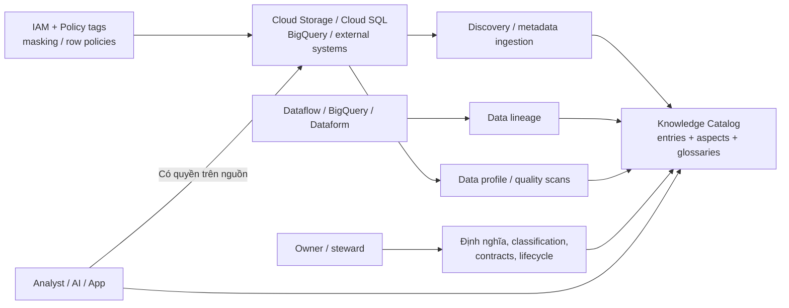
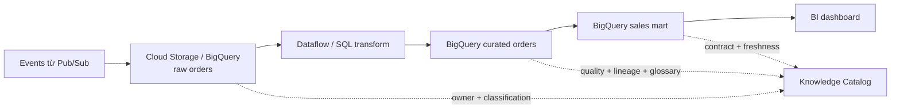
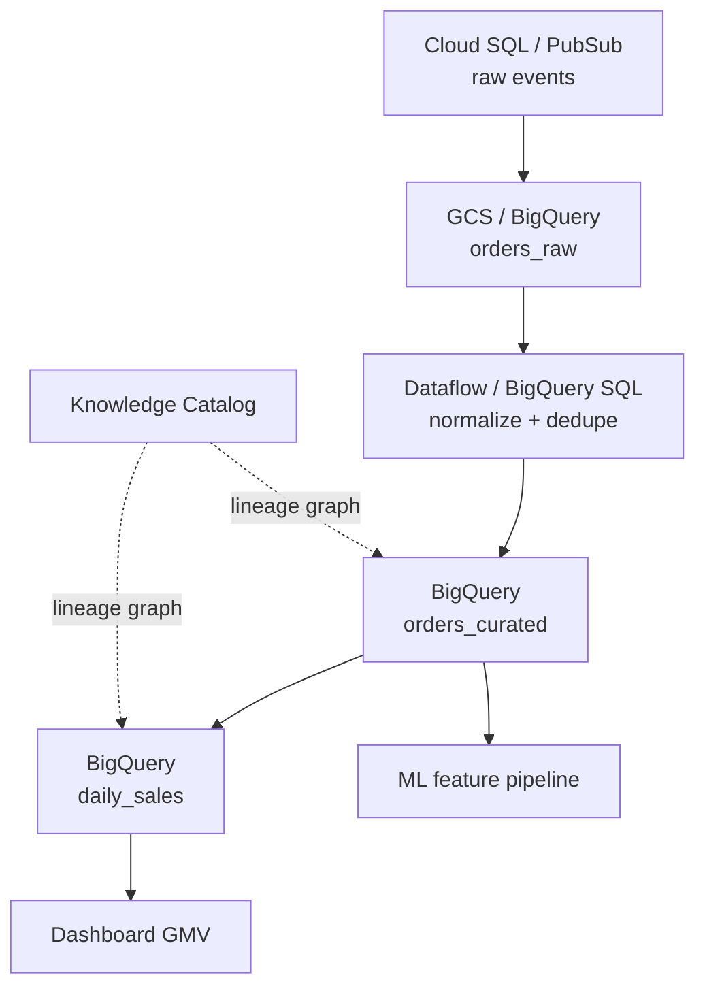

# Dataplex và quản trị tài sản dữ liệu

Một doanh nghiệp có dữ liệu trong **Cloud Storage, BigQuery, Cloud SQL và các pipeline Dataflow**. Nhóm phân tích tìm được nhiều bảng cùng tên `orders` nhưng không biết bảng nào đã kiểm tra chất lượng, ai chịu trách nhiệm, trường `customer_email` có chứa dữ liệu cá nhân hay bảng nào đang cấp dữ liệu cho dashboard doanh thu. Nếu chỉ tập trung vào lưu trữ và truy vấn, dữ liệu có thể tồn tại nhưng **khó tìm, khó hiểu và khó tin cậy**.

Bài thuộc chương **Quản trị và khai thác dữ liệu** của mô-đun `CLOUD_PROVIDERS_GCP`. Nội dung kết nối tổ chức project/IAM, VPC, Cloud Storage, BigQuery, Dataflow và vận hành độ tin cậy/chi phí để giải thích cách tổ chức **metadata, quyền sở hữu, phân loại, quality, lineage và truy cập** trong Dataplex. Ví dụ tập trung vào **quản trị tài sản dữ liệu**, không nhằm thay thế bài hướng dẫn tạo data warehouse hay lakehouse.

> **Tên sản phẩm cần biết (2026):** **Dataplex Universal Catalog đã chuyển thành Knowledge Catalog**. Trong một số tài liệu/giao diện trước đó, bạn cũng có thể gặp tên *BigQuery universal catalog*. Các catalog entries, aspects, glossaries, data quality scans và lineage tiếp tục hoạt động; nhiều lệnh `gcloud dataplex ...`, endpoint `dataplex.googleapis.com` và IAM roles `roles/dataplex.*` **vẫn giữ tên kỹ thuật cũ**. Khi đọc tài liệu, dùng tên **Knowledge Catalog (trước đây là Dataplex Universal Catalog)** để tránh nhầm là hai hệ thống tách biệt.

## 1. Mục tiêu học tập

Sau bài này, bạn có thể:

1. Giải thích **data asset, catalog entry, entry group, entry type, aspect type, aspect, glossary và lineage**.
2. Phân biệt mô hình tổ chức **lake → zone → asset** với mô hình **catalog entries** dùng để tìm kiếm metadata.
3. Thiết kế luồng **raw → curated → consumption** cùng data owner/steward, phân loại độ nhạy cảm và data contract.
4. Tìm bảng/bucket trong Knowledge Catalog và nhận biết metadata nào tự động phát hiện, metadata nào cần người quản trị bổ sung.
5. Hiểu vì sao **xem catalog metadata không tự cấp quyền đọc dữ liệu gốc**.
6. Dùng **data profiling/data quality scan** để đo completeness, validity, uniqueness và đặt cảnh báo.
7. Đọc **data lineage** từ pipeline/truy vấn và đánh giá tác động trước khi đổi schema.
8. Thực hiện một **lab chủ yếu chỉ đọc** qua `gcloud dataplex` và `bq`; tạo một data quality scan trên BigQuery lab chỉ khi có phê duyệt.
9. Thiết kế vận hành, IAM, chi phí, retention và bài tập quản trị tài sản dữ liệu.

**Giới hạn:** bài không tự tạo lake, zone, dataset, bucket, DataScan hoặc thay đổi IAM trên môi trường thật nếu không có dự án lab được duyệt. Những thao tác đọc metadata cũng có thể tiết lộ tên tài sản/owner; không đăng raw outputs của tổ chức lên nơi công khai.

## 2. Vì sao data catalog không chỉ là danh sách bảng?

Một data catalog tốt trả lời cả **dữ liệu ở đâu** lẫn **có an toàn và đáng tin để dùng không**.

| Câu hỏi | Metadata/kiểm soát cần có |
| --- | --- |
| Bảng nào chứa đơn hàng chuẩn? | Tên, định nghĩa, source, dataset, business term |
| Ai chịu trách nhiệm? | Data owner, steward, contact/on-call |
| Có thể truy cập không? | IAM nguồn, policy tags/data policies, approval workflow |
| Có chứa PII không? | Phân loại nhạy cảm, masking, retention, Sensitive Data Protection |
| Dữ liệu mới tới đâu? | Freshness SLA, last update, pipeline health |
| Có sạch không? | Data quality rules/results, profile, score và exceptions |
| Tạo ra từ đâu? | Lineage source → transform → output |
| Sẽ ảnh hưởng gì nếu xóa cột? | Downstream dependencies và consumer contract |
| Bao nhiêu phí để quản trị? | Catalog metadata, scans, lineage processing/storage, BigQuery reads |

**Metadata là thông tin mô tả**, không phải bản sao đầy đủ của bảng. Tạo entry hoặc gắn aspect **không di chuyển dữ liệu**; nguồn vẫn nằm trong Cloud Storage/BigQuery/Cloud SQL và tiếp tục có ACL/IAM, encryption, lifecycle và chi phí riêng.

## 3. Mô hình tổng thể: hệ thống nguồn và lớp quản trị



**Phân biệt ba đường:**

- **Data plane:** ứng dụng/analyst đọc các rows/objects trong nguồn bằng quyền thật.
- **Metadata plane:** catalog cho phép khám phá và mô tả các tài sản, glossary, quan hệ và chất lượng.
- **Governance plane:** chính sách, approvals, classification, owners và audit hướng dẫn **cách** cấp quyền, giữ dữ liệu và xử lý thay đổi.

Catalog metadata hữu ích cho discovery và self-service, nhưng **không phải một tường lửa dữ liệu tự động**. Muốn chặn `SELECT customer_email`, phải thực thi bằng **BigQuery column-level access / data masking, IAM hoặc chính sách thích hợp ở nguồn**.

## 4. Tài sản dữ liệu và vòng đời

Ví dụ một `orders_raw` table nhận dữ liệu từ Pub/Sub qua Dataflow, được làm sạch thành `orders_curated` rồi phục vụ dashboard doanh thu.



Một **asset lifecycle** nên có:

1. **Đăng ký/khám phá**: asset ID, source system, location, schema.
2. **Phân loại**: public/internal/confidential/restricted; dữ liệu cá nhân, hợp đồng, residency.
3. **Gán owner/steward**: một người/nhóm chịu trách nhiệm business correctness và metadata.
4. **Chuẩn hóa**: glossary terms, description, schema version, data contract.
5. **Kiểm tra**: profiling và quality scans, ngưỡng lỗi rõ.
6. **Công bố**: dataset/table/view hoặc data product đủ điều kiện để consumer tìm và yêu cầu truy cập.
7. **Giám sát**: freshness, quality score, lineage break, usage/cost.
8. **Deprecate/xóa**: đánh giá downstream consumers, retention/legal hold, backup và approval.

**Không tự xóa asset khi không còn người truy vấn trong 7 ngày**: usage có thể có mùa vụ, downstream scheduler hoặc yêu cầu retention. Kết hợp usage metadata với owner review và lineage.

## 5. Dataplex lake, zone và asset

Kiến trúc Dataplex lake quen thuộc có **lake → zone → asset → discovered entities**. Các resource này vẫn có thể xuất hiện qua `gcloud dataplex lakes/zones/assets` và trong tổ chức đang dùng lake organization.

| Resource | Vai trò | Ví dụ |
| --- | --- | --- |
| **Lake** | Nhóm tài sản dữ liệu theo domain/region quản trị | `retail-lake` |
| **Zone** | Phân chia dữ liệu theo giai đoạn/chất lượng | `raw`, `curated` |
| **Asset** | Tham chiếu tới nguồn đã gắn trong zone | Cloud Storage bucket hoặc BigQuery dataset |
| **Entity** | Thực thể được discovery trong asset | Table/file-backed entity |
| **Catalog entry** | Metadata mô tả asset được search/index | Entry của BigQuery table |
| **Aspect** | Metadata có cấu trúc bổ sung cho entry | Data steward, sensitivity, SLA |

**Không đồng nhất lake asset với catalog entry.** Một bảng BigQuery có thể xuất hiện trong catalog **không cần tạo lake/zone thủ công** nhờ hệ thống catalog ingestion tương ứng. Còn gắn BigQuery dataset hoặc Cloud Storage bucket vào lake giúp quản trị tập hợp dữ liệu theo zone và sử dụng khả năng discovery/scans trong mô hình đó.

### 5.1. Raw và curated zone

- **Raw zone:** dữ liệu gần nguồn, chưa chuẩn hóa hết, dễ chứa dữ liệu thiếu/sai schema. Không tự cấp quyền cho analyst rộng rãi.
- **Curated zone:** dữ liệu được làm sạch/chuẩn hóa theo contract, phù hợp downstream consumption.
- **Consumption/mart:** view/table/data product dành cho người dùng cuối, thường nằm ở BigQuery hoặc lớp chia sẻ khác, **không phải một loại Dataplex zone bắt buộc**.

Mô hình zone là **governance grouping**, không tự tạo một pipeline làm sạch hoặc tự di chuyển dữ liệu từ raw sang curated. Bạn phải cấu hình Dataflow, BigQuery SQL, Dataform hay công cụ xử lý khác.

## 6. Knowledge Catalog: entries, entry types và entry groups

Hệ metadata hiện hành dùng **entry** làm đại diện cho một tài sản, trong **entry group** tương ứng, với **entry type** mô tả cách phân loại/định dạng metadata.

| Thuật ngữ | Vai trò |
| --- | --- |
| **Entry** | Metadata object đại diện table, view, bucket, external dataset hoặc custom asset |
| **Entry group** | Nhóm entries theo hệ thống nguồn hoặc phạm vi quản lý |
| **Entry type** | Loại entry; có required aspects/schema tương ứng |
| **System entry** | Entry được Google Cloud quản lý cho nguồn hỗ trợ, ví dụ BigQuery |
| **Custom entry** | Tài sản do bạn tạo metadata cho hệ thống khác, theo API/schema hỗ trợ |
| **Aspect type** | Mẫu định nghĩa trường metadata dùng lại được |
| **Aspect** | Giá trị metadata gắn vào entry hoặc column/entry link |
| **Entry link** | Quan hệ giữa entries hoặc terms, phục vụ graph/context |
| **Business glossary** | Hệ thuật ngữ business với categories, synonyms và links |

Với **BigQuery table**, catalog thường có system entry group `@bigquery`. Metadata kỹ thuật như schema có thể do Google Cloud quản lý; không nên ghi đè system-managed aspects bị giới hạn. Với custom systems, owner cần định nghĩa entry type/aspect type và lifecycle cập nhật.

**Scope và data residency:** aspect types, entries và glossaries có region/project/organization constraints. Không sao chép aspect schema/metadata PII sang một location khác khi chưa xem policy và khả năng sử dụng aspect ở region đó.

## 7. Aspects: đưa ngữ cảnh vào một bảng

Một catalog entry `sales.orders_curated` có metadata kỹ thuật mặc định như tên field và loại dữ liệu, nhưng thiếu ngữ cảnh kinh doanh. Ta có thể thiết kế một **custom aspect type** gồm các fields:

```yaml
# Mô hình metadata minh họa, KHÔNG phải payload API dùng để deploy.
asset_context:
  domain: "sales"
  data_owner: "data-platform-team"
  data_steward: "finance-analytics"
  sensitivity: "confidential"
  source_of_truth: true
  freshness_slo_minutes: 60
  retention_days: 365
  business_term: "Gross Merchandise Value"
  review_date: "2026-11-19"
```

Các nội dung cần phân biệt:

- **Aspect type** định nghĩa schema trường và kiểu dữ liệu.
- **Aspect** là giá trị cụ thể gắn trên entry/table hoặc column (nếu type hỗ trợ).
- **Contacts/overview** có các **system aspects dùng lại được**; không phải metadata nào cũng bắt buộc tạo type riêng.
- **Column-level classification** giúp biết `customer_email` cần kiểm soát, nhưng phải kết hợp enforcement ở BigQuery để thực sự hạn chế đọc.
- **Owner metadata** khác **IAM owner role**: thêm tên đội `finance-analytics` vào aspect không cấp quyền quản trị cho đội đó.

**Quy tắc duy trì:** tự động điền thông tin có thể suy ra từ nguồn (schema, timestamps), còn các trường nghiệp vụ cần owner xác nhận. Nếu owner không được cập nhật sau khi team đổi tổ chức, metadata trở thành dữ liệu sai.

## 8. Business glossary và một nguồn định nghĩa chung

Một dashboard báo **GMV = doanh thu thuần**, dashboard khác báo **GMV = giá trị đơn trước hoàn trả**. Cả hai nhìn cùng bảng nhưng tính khác nhau. Business glossary giúp thống nhất định nghĩa trước khi thay schema.

Ví dụ glossary **Retail Metrics**:

| Term | Định nghĩa đề xuất | Liên kết |
| --- | --- | --- |
| **GMV** | Tổng giá trị đơn hàng hợp lệ trước hoàn/trừ chiết khấu, theo policy được duyệt | `sales.orders_curated.gmv_amount` |
| **Net Revenue** | Doanh thu sau hoàn tiền/điều chỉnh, theo kế toán | `finance.daily_revenue.net_revenue` |
| **Active Customer** | Có ít nhất một giao dịch hợp lệ trong khoảng đo | `mart.customer_activity.customer_id` |
| **Order Created At** | Timestamp ghi nhận event tại nguồn, UTC | `orders_raw.order_created_at` |

Định nghĩa mẫu phải được **business owner phê duyệt**; không áp công thức GMV tùy ý làm chuẩn công ty. Một term có thể liên kết với **table hoặc column**, có synonyms/related terms và steward rõ. Người dùng có thể search theo ngữ nghĩa nghiệp vụ thay vì nhớ tên field.

**Glossary không tự đổi SQL**. Sau khi chốt thuật ngữ, cập nhật documentation, data contracts, semantic layer, BI metrics và validation tests để mọi hệ thống cùng dùng.

## 9. Data profiling và data quality là hai mục tiêu khác nhau

| Công cụ | Trả lời | Ví dụ |
| --- | --- | --- |
| **Data profiling** | Dữ liệu có hình thái gì? | Tỷ lệ null, distinct values, distribution, outliers |
| **Data quality scan** | Dữ liệu có đạt quy tắc nghiệp vụ không? | `order_id` không null, amount ≥0, status trong tập hợp |
| **Lineage** | Dữ liệu từ đâu, đi đâu? | Raw orders → curated → sales mart |
| **Sensitive Data Protection** | Có PII/sensitive info và rủi ro gì? | Email, số điện thoại, định danh nhạy cảm |
| **IAM/data policy** | Ai được phép truy cập? | Analysts đọc view, finance đọc cột hạn chế |

**Profiling chỉ tạo quan sát**, không tự xác định business correctness. Ví dụ 0% null cho `order_id` tốt nhưng không đảm bảo bảng có đúng một bản ghi cho mỗi order; phải thêm uniqueness/logic rule theo contract.

### 9.1. Các chiều quality cần đo

| Dimension | Quy tắc | Ngưỡng ví dụ |
| --- | --- | --- |
| **Completeness** | `order_id IS NOT NULL` | 100% |
| **Validity** | `amount >= 0` | ≥99,9% hoặc 100% tùy nghiệp vụ |
| **Uniqueness** | Mỗi `order_id` không trùng trong grain bảng | 100% |
| **Consistency** | `currency` khớp bảng tham chiếu | ≥99,9% |
| **Freshness** | Dữ liệu trễ so với `event_time` | ≤60 phút |
| **Integrity** | `customer_id` có thể mapping tới customer hợp lệ | ≥99,9% |

**Quality score** tổng hợp không thay từng quy tắc P0. Nếu 99% records tốt nhưng 1% records chứa giao dịch duplicate nghiêm trọng, vẫn cần **fail gate** trước khi công bố data product.

## 10. Data lineage và phân tích tác động



**Lineage** cho biết source/target và quá trình biến đổi. Khi muốn xóa `discount_code` trong `orders_curated`, dữ liệu downstream nào cần kiểm thử?

1. Tìm entry `orders_curated`.
2. Xem **Lineage** và các downstream tables/views/pipelines.
3. Xem SQL/transform liên quan và owners; đừng chỉ dựa vào graph nếu còn connector chưa hỗ trợ lineage.
4. Đánh dấu consumers bị ảnh hưởng, lên lịch migration/schema contract.
5. Dùng canary, đối chiếu data quality, so metrics trước/sau release.
6. Cập nhật glossary, aspects, lineage/usage metadata sau deploy.

**Không phải mọi pipeline tự sinh lineage đầy đủ**. Data Lineage API có auto ingestion từ nguồn Google Cloud được hỗ trợ; các integration khác có thể cần custom lineage (ví dụ OpenLineage). Bật Data Lineage API cho một project có thể kích hoạt thu thập trên **nhiều dịch vụ được hỗ trợ**, không chỉ một table. Kiểm tra IAM, billing và data residency trước khi bật.

## 11. Phân loại dữ liệu và quyền truy cập

Ví dụ bảng có `order_id`, `amount`, `customer_email`, `customer_phone`.

| Dữ liệu | Classification | Enforcement gợi ý |
| --- | --- | --- |
| `order_id` | Internal | Dataset/table IAM |
| `amount` | Confidential | BigQuery dataset/view access, row policies nếu cần |
| `customer_email` | Restricted / PII | Policy tags/column-level security, masking hoặc tokenization |
| `customer_phone` | Restricted / PII | Data policies, retention, audit |
| Aggregated anonymous statistics | Internal/Public tùy xác minh | Kiểm tra re-identification risk trước khi chia sẻ |

**Quan trọng:** đánh dấu `sensitivity=restricted` trong catalog **không tự khóa cột**. Policy tags, BigQuery data policies/masking, row-level access policies, IAM nguồn và dữ liệu trong Cloud Storage phải được cấu hình riêng. Nếu có quyền BigQuery Data Viewer trên bảng nhưng không được phép đọc một protected column, query có thể bị từ chối hoặc chỉ thấy masked data tùy policy.

Không đặt **PII thực** trong aspects, glossaries, DLQ metadata hoặc logs: catalog dùng để mô tả **loại dữ liệu** và policy, không lưu nguyên records.

## 12. Các vai trò tham gia data governance

| Vai trò nghiệp vụ | Trách nhiệm | Không đồng nghĩa quyền IAM |
| --- | --- | --- |
| **Data owner** | Chịu trách nhiệm quyết định chia sẻ, retention, chất lượng | Không nhất thiết là `roles/owner` của project |
| **Data steward** | Quản lý mô tả, glossary, quality rules, metadata | Không tự có `bigquery.dataOwner` |
| **Data producer** | Phát dữ liệu đúng contract/version | Không tự duyệt quyền đọc |
| **Data consumer** | Sử dụng theo mục đích, tuân thủ license/SLA | Không tự chỉnh classifications |
| **Platform/IAM admin** | Cấp roles trên project/source/catalog | Không xác định thuật ngữ business thay owner |
| **Security/privacy** | Phân loại PII, masking, retention và audit | Không nhất thiết vận hành pipeline |

**Phân quyền thực tế** cần phân biệt scope của catalog metadata và source data. Các ví dụ IAM roles:

- `roles/dataplex.catalogViewer` để xem catalog metadata theo scope được cấp.
- `roles/dataplex.catalogEditor` và `roles/dataplex.entryOwner` để quản trị catalog entries/aspects theo quyền.
- `roles/dataplex.dataScanViewer` / `roles/dataplex.dataScanEditor` cho cấu hình và kết quả scans theo scope.
- `roles/datalineage.viewer` để xem lineage theo project ghi nhận.
- `roles/bigquery.metadataViewer` để xem schema metadata, `roles/bigquery.dataViewer` hoặc quyền chính xác hơn để đọc dữ liệu.
- `roles/bigquery.jobUser` để có quyền chạy các query/jobs ở project phù hợp.

Không cấp `roles/dataplex.catalogAdmin` hay `roles/bigquery.dataOwner` chỉ để người học xem danh sách assets. Với catalog search, role/permission cụ thể còn phụ thuộc **search scope, entry group và nguồn**; chỉ cấp quyền đủ dùng theo tài liệu hiện hành.

## 13. Lab A — kiểm kê metadata trên project đã có

Giả định bạn có **project lab được duyệt** với BigQuery dataset/table đã tồn tại và có quyền **đọc metadata**. Bài không yêu cầu tạo mới tài nguyên.

### 13.1. Biến và kiểm tra quyền

```bash
PROJECT_ID="YOUR_AUTHORIZED_PROJECT"
LOCATION="YOUR_RESOURCE_REGION"
DATASET_ID="YOUR_EXISTING_DATASET"
TABLE_ID="YOUR_EXISTING_TABLE"

gcloud --version
gcloud auth list

# Chỉ đọc project info:
gcloud projects describe "$PROJECT_ID" \
  --format="yaml(projectId,lifecycleState)"

# Liệt kê datasets hiện có (chỉ metadata).
bq --project_id="$PROJECT_ID" ls

# Đọc schema/metadata của một bảng được phép xem.
bq --project_id="$PROJECT_ID" show \
  --format=prettyjson "$PROJECT_ID:$DATASET_ID.$TABLE_ID"
```

**Không in metadata nhạy cảm vào public CI logs**. Nếu bị `403`, yêu cầu role viewer đúng scope; đừng mở toàn bộ dataset để học viên tự tìm.

### 13.2. Tìm catalog entries

```bash
# Search metadata, không query data rows.
gcloud dataplex entries search "$TABLE_ID" \
  --project="$PROJECT_ID" \
  --scope="projects/$PROJECT_ID" \
  --limit=20

# Nếu cần semantic search và feature đã bật cho scope:
gcloud dataplex entries search "orders" \
  --project="$PROJECT_ID" \
  --scope="projects/$PROJECT_ID" \
  --semantic-search \
  --limit=20
```

**Kỳ vọng:** tìm được một hoặc nhiều entries tương ứng bảng/asset được index; kiểm tra system, resource path, description, owner/contact, schema, aspects và liên kết glossary. Search index có thể mất thời gian phản ánh thay đổi; không suy rằng bảng không tồn tại chỉ vì chưa có kết quả.

**Nếu search rỗng:** xác nhận API được bật, quyền search/scope, loại nguồn có hỗ trợ ingestion, region và trạng thái indexing. Không tạo entry BigQuery thủ công trùng system entry.

## 14. Lab B — đọc lakes, zones, assets nếu tổ chức sử dụng

Nếu project thực sự dùng mô hình Dataplex lake:

```bash
# Chỉ đọc: lake resources trong region.
gcloud dataplex lakes list \
  --project="$PROJECT_ID" \
  --location="$LOCATION"

LAKE="YOUR_EXISTING_LAKE"
ZONE="YOUR_EXISTING_ZONE"

# Chỉ đọc các zones thuộc lake.
gcloud dataplex zones list \
  --project="$PROJECT_ID" \
  --location="$LOCATION" \
  --lake="$LAKE"

# Chỉ đọc assets thuộc zone.
gcloud dataplex assets list \
  --project="$PROJECT_ID" \
  --location="$LOCATION" \
  --lake="$LAKE" \
  --zone="$ZONE"
```

Ghi lại cấu trúc:

```text
retail-lake
  raw-zone
    asset: cloud-storage-ingest-bucket
  curated-zone
    asset: bigquery-retail-dataset
```

Không mặc định mọi project phải có lake; **catalog entries không yêu cầu lake cho từng BigQuery table**. Nếu lake/zone không có, chỉ thực hành phần Catalog và BigQuery metadata. Không tạo zone chỉ để “thấy lệnh list có dữ liệu”.

### 14.1. Mapping giữa tài sản vật lý và metadata

| Vật lý | Catalog/Governance |
| --- | --- |
| `gs://retail-raw` | Storage bucket metadata/asset, classification, owner |
| `project:retail_curated.orders` | BigQuery entry, columns, aspects, glossary |
| `orders_raw → orders_curated` | Data lineage, pipeline owner |
| `orders_curated` được quản lý bởi DQ scan | Quality scorecard/aspect, SLA |
| `sales_mart.daily_revenue` | Consumer-facing data product/entry |

Bài học quan trọng: **tên lake/zone không tự mô tả đầy đủ ngữ nghĩa bảng**. Cần thêm metadata nghiệp vụ và operational contract.

## 15. Lab C — truy vấn dữ liệu mẫu bằng SQL chỉ đọc

Nếu có **bảng lab** thật với schema tương ứng `order_id STRING, amount NUMERIC, status STRING`, có thể dùng BigQuery SQL để kiểm tra **một số quality rules trước khi dùng DataScan**. Nếu chưa có bảng, chạy CTE với dữ liệu giả dưới đây; **không tạo/ghi bảng**.

```sql
WITH sample AS (
  SELECT 'o-001' AS order_id, 120 AS amount, 'PAID' AS status
  UNION ALL SELECT 'o-002', 0, 'PENDING'
  UNION ALL SELECT 'o-003', -5, 'PAID'
  UNION ALL SELECT NULL, 50, 'PAID'
  UNION ALL SELECT 'o-001', 30, 'OTHER'
)
SELECT
  COUNT(*) AS total_rows,
  COUNTIF(order_id IS NULL) AS missing_order_ids,
  COUNTIF(amount < 0) AS negative_amounts,
  COUNTIF(status NOT IN ('PAID','PENDING','CANCELLED'))
    AS invalid_status,
  COUNT(*) - COUNT(DISTINCT order_id) AS non_unique_or_null_ids
FROM sample;
```

Kỳ vọng:

```text
total_rows:             5
missing_order_ids:      1
negative_amounts:       1
invalid_status:         1
non_unique_or_null_ids: 2
```

**Giải thích:** `COUNT(DISTINCT order_id)` bỏ qua NULL, nên tổng `COUNT(*) - COUNT(DISTINCT)` gồm cả duplicated IDs **và** NULL. Với 5 bản ghi này có 1 NULL + một `o-001` trùng → giá trị 2. Muốn đếm riêng duplicates, dùng `GROUP BY order_id HAVING COUNT(*) > 1` và lọc NULL riêng.

Chạy CTE trong BigQuery Studio trên project lab. Vì query có thể tạo **query job**, cần `bigquery.jobs.create`; dữ liệu literal nhỏ nhưng vẫn thuộc chính sách query/billing của tổ chức. Dùng `dry run` trước nếu chuyển sang bảng lớn.

## 16. Lab D — mô tả data quality bằng YAML

**Chỉ thực hành ghi file trong thư mục lab cá nhân**. Ví dụ file `dq_rules.yaml` sau dùng schema BigQuery lab `order_id STRING, amount NUMERIC, status STRING`:

```yaml
rules:
  - name: order-id-required
    column: order_id
    dimension: COMPLETENESS
    nonNullExpectation: {}
    threshold: 1.0
  - name: order-id-unique
    column: order_id
    dimension: UNIQUENESS
    uniquenessExpectation: {}
  - name: nonnegative-amount
    column: amount
    dimension: VALIDITY
    rowConditionExpectation:
      sqlExpression: "amount >= 0"
    threshold: 1.0
  - name: supported-status
    column: status
    dimension: VALIDITY
    setExpectation:
      values: ["PAID", "PENDING", "CANCELLED"]
    threshold: 1.0

samplingPercent: 100
catalogPublishingEnabled: false
```

**Điều kiện đọc đúng:**

- `nonNullExpectation`/`rowConditionExpectation` kiểm từng row; `threshold=1.0` là 100% rows đạt yêu cầu.
- `uniquenessExpectation` là **aggregate rule**; không áp ratio threshold kiểu row-level.
- `samplingPercent: 100` tương đương quét toàn bộ phạm vi khi run, có thể tốn tiền trên bảng lớn.
- `catalogPublishingEnabled: false` để lab không vô tình xuất scorecard metadata vào catalog chung.
- Dữ liệu nullable phải có rule rõ: `amount >= 0` khi amount NULL có thể xử lý theo semantics riêng; nếu amount bắt buộc, thêm `nonNullExpectation` cho `amount`.
- Với bảng có **partition filter bắt buộc**, phải cấu hình `rowFilter` hoặc timestamp/incremental scope phù hợp khi tạo scan.

**Không coi DQ scan là cơ chế làm sạch/viết lại dữ liệu.** Nó **đo và báo vi phạm**, còn sửa dữ liệu cần pipeline/owner quy trình riêng.

## 17. Lab E — tùy chọn tạo và chạy DataScan có chi phí

**Chỉ áp dụng** nếu có project và BigQuery table **dành riêng cho lab**, được cấp quyền DataScan và nguồn, có budget/approval. Nếu không, **dừng ở YAML mẫu và SQL CTE**.

```bash
SCAN_ID="orders-quality-lab"
RESOURCE="//bigquery.googleapis.com/projects/$PROJECT_ID/datasets/$DATASET_ID/tables/$TABLE_ID"

# GHI: tạo DataScan, thao tác quản trị và chi phí khi chạy.
gcloud dataplex datascans create data-quality "$SCAN_ID" \
  --project="$PROJECT_ID" \
  --location="$LOCATION" \
  --data-quality-spec-file=dq_rules.yaml \
  --data-source-resource="$RESOURCE"

# Chỉ đọc: kiểm tra resource đã tạo.
gcloud dataplex datascans describe "$SCAN_ID" \
  --project="$PROJECT_ID" \
  --location="$LOCATION"

# GHI: chạy scan và đọc dữ liệu từ BigQuery.
# Chỉ gọi khi cấu hình scan hỗ trợ run on-demand và đã duyệt ngân sách.
gcloud dataplex datascans run "$SCAN_ID" \
  --project="$PROJECT_ID" \
  --location="$LOCATION"
```

**Trước khi chạy:** người tạo scan cần quyền như `roles/dataplex.dataScanEditor`, còn identity thực thi (service agent/custom SA) cần đủ quyền **đọc bảng/columns**, tạo dry-run validation job và quyền bổ sung nếu export/publish results. Nếu dùng **custom execution identity**, chi phí compute/storage scan có thể chuyển sang BigQuery project thay vì Dataplex Premium SKU.

Nếu bảng có PII, không bật debug query/sampling output có thể xuất dữ liệu cá nhân sang logs/results mà chưa có chính sách. Không dùng bảng production chỉ vì tên mẫu tương tự.

### 17.1. Đọc kết quả scan

```bash
# Chỉ đọc: liệt kê DataScans trong region.
gcloud dataplex datascans list \
  --project="$PROJECT_ID" \
  --location="$LOCATION"

# Liệt kê jobs của scan.
gcloud dataplex datascans jobs list \
  --project="$PROJECT_ID" \
  --location="$LOCATION" \
  --datascan="$SCAN_ID"

# JOB_ID là ID có thật lấy từ lệnh phía trên.
gcloud dataplex datascans jobs describe "$JOB_ID" \
  --project="$PROJECT_ID" \
  --location="$LOCATION" \
  --datascan="$SCAN_ID" \
  --view=FULL
```

Đối chiếu **rule-level result, pass/fail, rows evaluated, score và thời gian chạy**. Một scan job `SUCCEEDED` chỉ chứng minh việc **scan đã chạy xong**, **không có nghĩa các quality rules đều PASS**.

Khi được phép publish results, Catalog/BigQuery Data quality tab có thể hiển thị **scorecard**; đây là metadata đánh giá, không phải cơ chế tự chặn người dùng truy vấn bảng sai.

## 18. Lab F — glossary, aspects và lineage qua Console

Để tránh thay đổi tổ chức chung, bước này ưu tiên **xem** hoặc mô phỏng trên giấy; chỉ tạo metadata nếu steward/owner cho phép.

### 18.1. Xem catalog entry

1. Mở **Knowledge Catalog → Search**.
2. Tìm theo `orders` hoặc tên bảng được ủy quyền; lọc **project, location, type**.
3. Mở entry và kiểm tra **overview, technical schema, aspects, owner/contact**.
4. Nếu có glossary term gắn cột, đọc định nghĩa và xác minh với business owner.
5. Kiểm tra classification và ghi những trường còn thiếu.

### 18.2. Kiểm tra business glossary

Vào **Knowledge Catalog → Glossaries**, tìm term `Net Revenue` hoặc một term nội bộ đã có. Ghi **term definition, synonyms, steward, linked entries/columns**.

Nếu không có term, viết **bản đề xuất** gồm tên/definition/owner/mapping vào tài liệu review, không tự định nghĩa thuật ngữ tài chính production.

### 18.3. Xem lineage

Mở BigQuery table/Knowledge Catalog entry có lineage và xem **Lineage tab**, xác định:

- Nguồn (GCS/BigQuery/SQL) và pipeline/proc tạo bảng.
- Các bảng/views/downstream consumers liên quan.
- Thời gian run và mức chi tiết lineage hiện có.
- Các vùng không có lineage vì integration chưa hỗ trợ hoặc quyền chưa đủ.

**Không kết luận “bảng không có consumer” chỉ vì lineage graph rỗng**. Một BI tool bên ngoài có thể không phát lineage vào API; cần bổ sung usage audit/data contracts và hỏi owner.

## 19. Tổ chức data products và hợp đồng truy cập

Một **data product** nhóm các assets đáng tin cho một use case, có metadata và **contract** giúp consumer biết nên dùng thế nào.

Ví dụ `Sales Daily Metrics`:

```yaml
# Data contract MẪU cho review, không phải Knowledge Catalog API payload.
product: sales-daily-metrics
owner: finance-analytics
assets:
  - bigquery://example-project/sales_mart/daily_sales
description: "Sales KPIs by UTC business day"
grain: "one row per business_date + merchant_id"
freshness_slo_minutes: 90
quality:
  order_id_completeness: "100% at curated stage"
  currency_validity: "100%"
access:
  classification: confidential
  request_process: owner-approval
retention_days: 365
version: 1
```

**Không tự xem YAML này là quyền truy cập đã được cấp.** Data product/portal giúp khám phá, mô tả và quản lý request access; quyền đọc BigQuery/Cloud Storage vẫn phải cấp theo IAM/data policies tương ứng.

Để giảm thay đổi gây vỡ contract, định nghĩa **version, SLA, schema compatibility, deprecation date và owner**. Catalog là nơi gắn ngữ cảnh, còn CI/CD/Dataform/BigQuery tests thực thi contract trong pipeline.

## 20. Giám sát chất lượng và thay đổi schema

Quản trị dữ liệu cần alerts gắn với quyết định vận hành, không chỉ xem một quality score:

| Tín hiệu | Ý nghĩa | Owner/action |
| --- | --- | --- |
| % bảng có owner và description | Coverage catalog | Steward bổ sung metadata |
| % cột nhạy cảm đã phân loại | Risk reduction | Security review |
| Quality score theo dimension | DQ trend | Producer sửa quy tắc/data |
| Scan job errors vs rule failures | Lỗi chạy scan khác dữ liệu không đạt | Platform vs data owner |
| Freshness lag | Pipeline chậm/mất dữ liệu mới | Pipeline owner |
| Lineage coverage | Mức biết dependency | Tích hợp thêm nguồn/bổ sung lineage |
| Data access requests/approval time | Consumer experience | IAM/steward |
| Unused/stale assets | Cơ hội deprecate | Owner kiểm tra retention/consumers |
| DCU / metadata GiB-month | Chi phí governance | FinOps điều chỉnh scan frequency |

**Phân biệt:** một data scan chạy thành công nhưng có `Completeness=95%` là vấn đề data quality; một scan fail vì `403` là vấn đề IAM/system, **không chấm dữ liệu như 0% chất lượng**.

### 20.1. Quy trình change an toàn

1. Schema owner đề xuất thêm/xóa/đổi type field.
2. Tra catalog entry, glossary links, lineage và usage để tìm consumer.
3. Đánh giá sensitivity, row/column policies và retention.
4. Chạy profiling/quality rules trên staging/backfill.
5. Dùng versioned schema, dual-read hoặc compatibility window cho breaking changes.
6. Cập nhật metadata/aspects/docs, publish data product theo approval.
7. Theo dõi DQ, freshness, access errors và query cost sau rollout.

## 21. Chi phí Dataplex/Knowledge Catalog và tối ưu

**Không có một công thức “mỗi tài sản = X USD”.** Chi phí phụ thuộc **metadata storage và các tính năng premium**, và còn có phí của BigQuery/Cloud Storage/processing nguồn.

| Hạng mục | Yếu tố tính phí / tối ưu |
| --- | --- |
| Catalog metadata | Metadata GiB-month, entries/aspects/lineage retention |
| Auto data quality | DCU processing, số rows/columns, sample/filter, scan frequency |
| Data profiling | Tương tự DQ; tránh profile toàn bảng lớn mỗi giờ |
| Automatic lineage | Processing extraction DCU và lineage metadata storage |
| Custom lineage | Có thể không có premium processing, nhưng lưu metadata vẫn có phí |
| BigQuery | Query jobs, storage, data policies, exported scan results |
| Cloud Storage | Storage/operations/egress, dữ liệu nguồn |
| Sensitive Data Protection | Discovery/inspection/masking chi phí theo sản phẩm |
| Data transfer/network | Đặc biệt nếu pipelines/consumers khác region |

### 21.1. Ví dụ kiểm soát tần suất

Bảng 3 TB được scan **toàn bộ mỗi giờ** → 24 lần/ngày; chuyển sang **incremental daily scan** và sample hợp lý có thể giảm xử lý đáng kể, nhưng phải đánh giá khả năng phát hiện anomalies/quality drift. Không bỏ scan P0 chỉ để giảm phí.

**Kiểm soát:** budget alerts; nhãn project/scan; phân tách lab/prod; giới hạn scan concurrency/frequency; xuất Billing sang BigQuery để phân tích `goog-dataplex-workload-type`. Budget alerts **không tự khóa phí**, do đó quy trình change vẫn cần owner và quota thực tế.

## 22. Những nhầm lẫn nguy hiểm

| Nhầm lẫn | Thực tế |
| --- | --- |
| “Đã gắn tag PII, bảng tự bị khóa.” | **Aspects/classification chỉ là metadata**; cần IAM/data policies ở nguồn |
| “Có quyền Catalog Viewer là đọc hết BigQuery.” | **Không**; metadata permissions ≠ data permissions |
| “Raw zone tự chuyển dữ liệu sang curated.” | **Không**; cần ETL/Dataflow/BigQuery/Dataform |
| “Tạo lake mới là điều kiện để search BigQuery.” | **Không nhất thiết**; system entries có ingestion tự động theo nguồn hỗ trợ |
| “Tìm thấy bảng nghĩa là dữ liệu đúng.” | Không; cần owner, glossary, quality scan và freshness |
| “Quality score 99% đủ cho mọi use case.” | Không nếu P0 rule như uniqueness/PII fail |
| “Scan job SUCCEEDED nghĩa là rules đều pass.” | Không; phải xem rule-level results |
| “Lineage graph rỗng = không có downstream.” | Không; có thể thiếu quyền hoặc integration |
| “Bật lineage cho một bảng thôi.” | Data Lineage API bật theo project, có thể thu thập từ nhiều nguồn hỗ trợ |
| “Dữ liệu catalog miễn phí vì không lưu raw.” | Metadata storage, scans và lineage có thể tính phí |
| “Tài liệu nói Dataplex nên console phải ghi Dataplex.” | Trải nghiệm catalog hiện mang tên **Knowledge Catalog**, CLI/IAM còn `dataplex` |

## 23. Case study: chuẩn hóa báo cáo doanh thu

**Tình huống:** Ba phòng ban đang dùng ba bảng doanh thu:

| Bảng | Vấn đề |
| --- | --- |
| `raw.orders` | Có orders test, refunds chưa được đối trừ |
| `curated.orders` | Đã bỏ test, chưa thống nhất timezone và refunds |
| `sales.daily_gmv` | Dashboard tin dùng, nhưng owner và lineage chưa rõ |

**Kế hoạch governance:**

1. **Inventory**: catalog entries và metadata cho cả ba bảng, xác nhận locations/permissions.
2. **Glossary**: thống nhất `GMV`, `Net Revenue`, `Refund` với finance owner.
3. **Ownership**: chỉ định data owner và steward, gắn contacts/aspects.
4. **Classification**: cột email/phone ở raw restricted; curated dùng masking/authorized views khi cần.
5. **Quality**: `order_id` non-null/unique, currency valid, amount policy và freshness.
6. **Lineage**: raw → curated → daily_gmv → dashboard; kiểm tra integration thiếu.
7. **Publish**: công bố data product `Sales Metrics` cùng data contract và process request access.
8. **Operate**: alert DQ score, scan failures, pipeline freshness, schema drift và cost.
9. **Deprecate**: lên lịch loại bỏ báo cáo cũ sau owner signoff và impact assessment.

**Tiêu chí thành công:** người dùng tìm được bảng đúng trong vài bước; biết owner, business definition, độ mới và quality status; chỉ truy vấn phần dữ liệu được phép; thay schema không làm vỡ báo cáo mà không được cảnh báo.

## 24. Bài tập tự luyện

### Bài 1 — catalog hay nguồn dữ liệu?

Một analyst thấy entry `orders_curated` trong Knowledge Catalog nhưng BigQuery `SELECT` trả 403. Có phải catalog lỗi?

**Đáp án:** Không nhất thiết. Catalog search/view metadata và quyền đọc rows là hai lớp. Kiểm tra BigQuery IAM/data policies, row/column-level permission.

### Bài 2 — lake/zone/asset

Dữ liệu Parquet raw trong GCS, bảng cleaned trong BigQuery. Nên mô hình hóa ra sao?

**Đáp án:** Có thể gắn bucket vào **raw zone** và BigQuery dataset vào **curated zone** của lake, đồng thời catalog entries cho assets; ETL giữa hai tầng là quy trình riêng.

### Bài 3 — metadata không tự enforce

Steward gắn `sensitivity=restricted` cho `customer_email`. Mọi analyst vẫn đọc được.

**Đáp án:** Aspect không phải access policy; áp BigQuery policy tags/data masking/column-level permissions và kiểm tra IAM nguồn.

### Bài 4 — profiling khác quality

Profiling thấy 8% `order_id` null. Có đủ để kết luận bảng không đạt business contract?

**Đáp án:** Cần contract ngưỡng; nếu yêu cầu completeness 100% thì fail. Profiling khám phá hiện trạng, quality scan đánh giá theo rule.

### Bài 5 — SQL CTE

Ở mẫu 5 rows, có 1 NULL `order_id` và hai rows cùng `o-001`. `COUNT(*) - COUNT(DISTINCT order_id)` bằng bao nhiêu?

**Đáp án:** `5 - 3 = 2`, gồm 1 NULL và 1 duplicate occurrence. Không gọi cả 2 đều là duplicates.

### Bài 6 — scan thành công nhưng quality fail

DataScan job `SUCCEEDED` nhưng rule `nonNullExpectation(order_id)` không đạt.

**Đáp án:** Job chạy thành công về mặt hạ tầng, nhưng dữ liệu vi phạm; owner cần triage/correction, không sửa IAM.

### Bài 7 — impact analysis

Muốn bỏ cột `discount_code` khỏi bảng curated; lineage có downstream `daily_sales`.

**Đáp án:** Review code/queries của downstream, business glossary, contract và owners; version schema, staging tests, migration/deprecation trước xóa.

### Bài 8 — vai trò

Data steward đã được ghi tên ở aspect owner, vậy tự động có quyền quản trị dataset?

**Đáp án:** Không. Metadata owner/contact không cấp IAM; admin cấp roles tối thiểu phù hợp sau approval.

### Bài 9 — bật lineage

Platform bật Data Lineage API trong project để theo dõi riêng một table. Có thể xuất hiện lineage từ dịch vụ khác?

**Đáp án:** Có; tự động capture có thể hoạt động trên nhiều nguồn Google Cloud hỗ trợ trong project. Cần review IAM, ingestion controls và billing.

### Bài 10 — chi phí scan

DQ scan toàn bộ bảng lớn mỗi giờ làm chi phí tăng. Giải pháp là tắt toàn bộ scan?

**Đáp án:** Không mặc định. Thử incremental/sampling, row filters và lịch phù hợp với freshness/quality SLO; giữ P0 rules cần thiết, theo dõi score và chi phí.

## 25. Checklist triển khai và dọn lab

- [ ] Danh sách assets có owner, source, location và classification.
- [ ] Phân biệt lake/zone/asset với catalog entries/aspects.
- [ ] Đã xác nhận tên **Knowledge Catalog** và CLI/API `dataplex`.
- [ ] Có định nghĩa business terms thống nhất và liên kết tới columns.
- [ ] Metadata không chứa raw PII/secrets; quyền catalog và nguồn tách bạch.
- [ ] Data quality rules theo domain và owner, threshold/SLO rõ.
- [ ] Scan scheduling, sampling/incremental và phí đã được review.
- [ ] Kết quả scan được đọc **rule-level**; không đánh đồng job success với quality success.
- [ ] Có lineage/usage impact analysis trước breaking schema changes.
- [ ] IAM roles ít quyền nhất, audit access, policy tags/masking/retention phù hợp.
- [ ] Có dashboards owner coverage, quality trend, freshness, lineage coverage và cost.
- [ ] Data product/data contract có schema version, owner, approval và deprecation plan.

**Dọn lab an toàn:**

- Nếu chỉ chạy `describe/list/search` và SQL literal CTE, **không có tài nguyên cloud nào được tạo**.
- Nếu đã tạo `orders-quality-lab` với phê duyệt, trước khi xóa phải xác nhận **scan ID/project/region** và ownership. Có thể dừng lịch scan và xóa **duy nhất scan lab** theo quy trình; không xóa data source table hoặc metadata của nhóm khác.
- Nếu đã export quality results/metadata riêng, xem retention/chi phí và xóa theo policy, **không xóa bảng BigQuery thật** chỉ vì scan đã hoàn tất.
- Không xóa lake, zone, bucket, dataset, data policy, catalog entries hoặc Data Lineage API của production làm bước “cleanup”.

## 26. Tài liệu Google Cloud chính thức

- [Knowledge Catalog overview / metadata model](https://docs.cloud.google.com/knowledge-catalog/docs/metadata-overview): entries, aspects, glossary và metadata ingestion.
- [Transition from Dataplex Universal Catalog](https://docs.cloud.google.com/knowledge-catalog/docs/transition-dataplex-universal-catalog): thay tên sản phẩm, giữ API/gcloud/IAM.
- [Search data assets](https://docs.cloud.google.com/knowledge-catalog/docs/search-assets): Console và `gcloud dataplex entries search`.
- [Manage aspects](https://docs.cloud.google.com/knowledge-catalog/docs/enrich-entries-metadata): system/custom aspects và access.
- [About aspect types](https://docs.cloud.google.com/knowledge-catalog/docs/about-aspects): templates, schema và scope.
- [Create/use business glossary](https://docs.cloud.google.com/knowledge-catalog/docs/quickstart-business-glossary): term/column links.
- [Manage business glossaries](https://docs.cloud.google.com/knowledge-catalog/docs/manage-glossaries): owners và metadata workflow.
- [Auto data quality overview](https://docs.cloud.google.com/knowledge-catalog/docs/auto-data-quality-overview): rules, dimensions và scan lifecycle.
- [Data quality rules via YAML](https://docs.cloud.google.com/knowledge-catalog/docs/use-auto-data-quality): spec, scans, publishing.
- [BigQuery data quality scan](https://docs.cloud.google.com/bigquery/docs/data-quality-scan): permissions, CLI và kết quả.
- [Data lineage overview](https://docs.cloud.google.com/knowledge-catalog/docs/use-lineage): thu thập và xem lineage.
- [Knowledge Catalog pricing](https://cloud.google.com/products/knowledge-catalog/pricing): metadata, premium scans/lineage.
- [gcloud dataplex lakes list](https://docs.cloud.google.com/sdk/gcloud/reference/dataplex/lakes/list).
- [gcloud dataplex zones list](https://docs.cloud.google.com/sdk/gcloud/reference/dataplex/zones/list).
- [gcloud dataplex assets list](https://docs.cloud.google.com/sdk/gcloud/reference/dataplex/assets/list).
- [gcloud dataplex datascans list](https://docs.cloud.google.com/sdk/gcloud/reference/dataplex/datascans/list).
- [BigQuery data security](https://docs.cloud.google.com/bigquery/docs/column-level-security-intro): policy tags/column access.

**Kết luận:** Dataplex/Knowledge Catalog giúp tổ chức **tìm tài sản dữ liệu, gắn ngữ cảnh business, đo chất lượng và theo dõi nguồn gốc**. Giá trị thật đến từ việc duy trì **owner, glossary, classification, quality thresholds, lineage và vòng đời truy cập**; metadata hữu ích nhưng **không thay thế** IAM/data policies hay xử lý dữ liệu ở nguồn. Bắt đầu bằng **kiểm kê chỉ đọc**, xác nhận business contract và quality, rồi mở rộng governance có kiểm soát theo SLO, bảo mật và chi phí.
