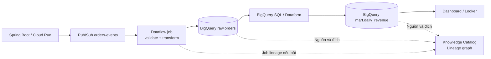
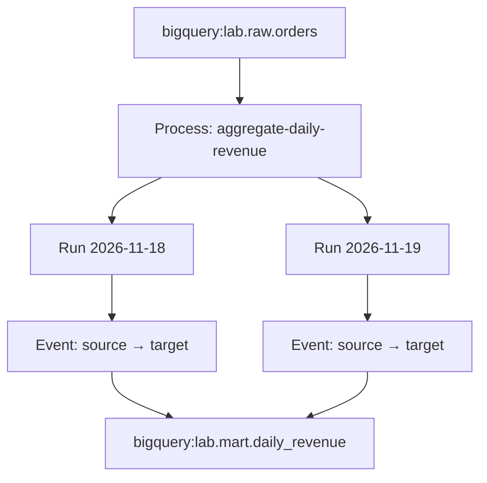
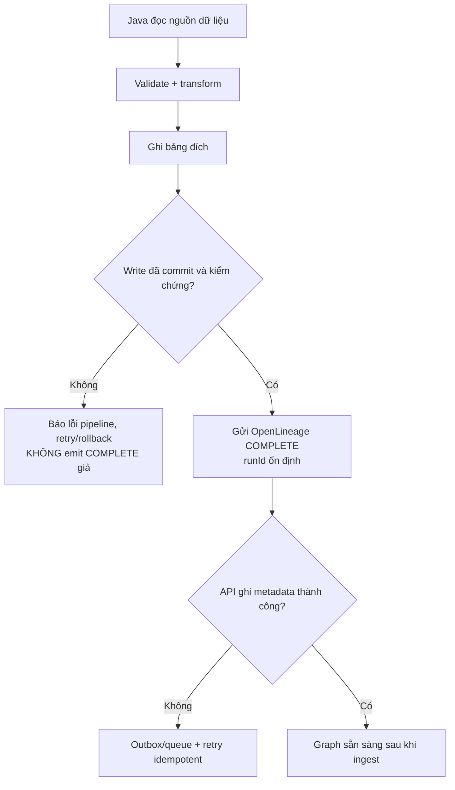
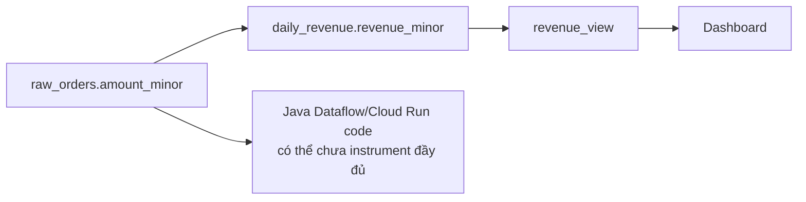
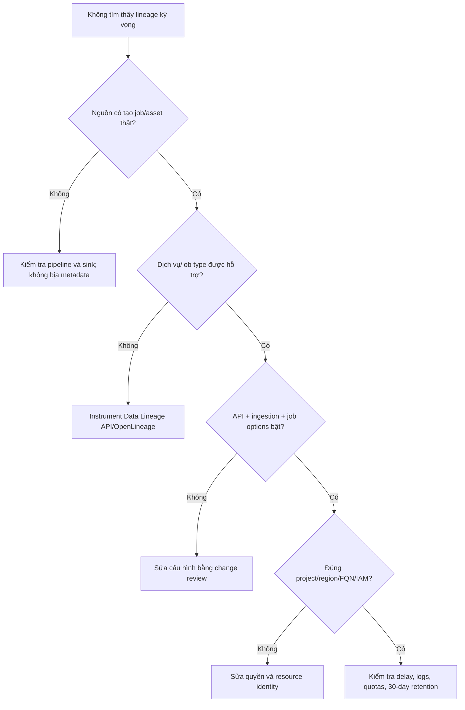

# Data lineage và truy vết nguồn gốc dữ liệu

## 1. Tại sao một con số trên dashboard cần có “lịch sử”?

Ứng dụng **Java/Spring Boot** trên **Cloud Run** nhận đơn hàng; sự kiện được phát qua **Pub/Sub**, xử lý bởi **Dataflow**, lưu vào **BigQuery**, rồi biến thành bảng tổng hợp doanh thu cho báo cáo. Một ngày, dashboard hiển thị doanh thu tăng bất thường. Không chỉ cần biết bảng nào chứa giá trị sai, đội dữ liệu phải trả lời: dữ liệu đến từ đâu, được biến đổi bằng job nào, chạy lúc nào và những báo cáo khác có bị ảnh hưởng không?

**Data lineage** (dòng dõi dữ liệu) mô tả quan hệ **nguồn → phép biến đổi → đích**. Nó giúp **truy nguyên (upstream)** khi phát hiện dữ liệu sai và **phân tích tác động (downstream)** trước khi đổi schema, xóa bảng hoặc sửa một pipeline. Trên Google Cloud, khả năng này được cung cấp qua **Knowledge Catalog (trước đây là Dataplex Universal Catalog)** và **Data Lineage API**.

Đây là bài trong chương **Quản trị và khai thác dữ liệu**, thuộc mô-đun **CLOUD_PROVIDERS_GCP**: người học kết nối quản trị dữ liệu với BigQuery, Pub/Sub, Dataflow, IAM, vận hành tin cậy và kiểm soát chi phí. Lineage là **metadata về luồng dữ liệu**, không sao chép payload đơn hàng vào catalog và **không tự chứng minh dữ liệu chính xác hay tuân thủ pháp luật**.

**Mục tiêu học tập:**

1. Giải thích **upstream/downstream, table-level/column-level, process/run/event**.
2. Biết nguồn nào hỗ trợ **lineage tự động**, khi nào cần **Data Lineage API hoặc OpenLineage**.
3. Tạo một luồng **BigQuery SQL** với dữ liệu giả để xem lineage; bật lineage cho **Dataflow Java** khi cần.
4. Truy vết qua **Knowledge Catalog, BigQuery, API**; sử dụng FQN chuẩn và quyền IAM đúng dự án.
5. Hiểu các giới hạn về **column lineage, độ trễ, vùng lưu trữ, retention, bảo mật và chi phí**.
6. Xây runbook cho thay đổi schema, sự cố pipeline và bài thực hành kiểm chứng.

> **An toàn:** Tài liệu chỉ cung cấp lệnh và code **để học**, không tạo tài nguyên thật khi biên soạn. Việc bật `datalineage.googleapis.com` trong một project có thể thu thập lineage từ **nhiều dịch vụ đã tích hợp**, phát sinh **Knowledge Catalog processing/metadata storage charges**. Chỉ bật trong **project lab đã được duyệt**, không thay ingestion policy của tổ chức hay chạy SQL có tác dụng sửa production.

## 2. Lineage khác catalog, log và audit như thế nào?



| Thông tin | Trả lời câu hỏi | Công cụ điển hình |
| --- | --- | --- |
| **Catalog metadata** | Bảng này tên gì, ai sở hữu, schema/nhãn ra sao? | Knowledge Catalog |
| **Data lineage** | Bảng/cột này sinh ra từ đâu, những đối tượng nào phụ thuộc? | Data Lineage API, Knowledge Catalog graph |
| **Job execution log** | Job cụ thể thành công, lỗi hay chạy bao lâu? | BigQuery Job History, Dataflow logs |
| **Cloud Audit Logs** | Ai gọi API/quản trị tài nguyên và khi nào? | Cloud Logging/Audit Logs |
| **Data quality results** | Dữ liệu có đúng quy tắc, đầy đủ và hợp lệ? | Data quality checks, SQL assertions |
| **Business provenance** | Sự kiện thanh toán nào dẫn đến một giá trị? | Event ID, outbox, nghiệp vụ và kho sự kiện |

Lineage cung cấp **bản đồ phụ thuộc**, không thay thế **backup, audit trails, row-level change history hay chất lượng dữ liệu**. Graph có thể cho thấy bảng `daily_revenue` lấy từ `orders`, nhưng không tự xác nhận `SUM` đúng tiền tệ, không thiếu sự kiện và không có giao dịch trùng lặp.

## 3. Mô hình: assets, process, run, event và links

Knowledge Catalog dùng một mô hình phân cấp trong **Data Lineage API**:

| Đối tượng | Ý nghĩa | Ví dụ |
| --- | --- | --- |
| **Asset / EntityReference** | Tài sản dữ liệu được nhận diện bằng **FQN** | `bigquery:lab-project.raw.orders` |
| **Process** | Định nghĩa một phép biến đổi | “Tổng hợp doanh thu theo ngày” |
| **Run** | Một lần thực thi của process | Job lúc 10:00 UTC, run UUID |
| **Lineage event** | Bằng chứng luồng dữ liệu được ghi cho một run | Đọc `raw.orders` rồi tạo `mart.daily_revenue` |
| **Link** | Cạnh nguồn → đích sinh từ event | `raw.orders → mart.daily_revenue` |



**Một process có nhiều runs**; metadata của từng execution có thể tạo lineage events. Graph thường gom các links để dễ xem, không có nghĩa mọi record có một lineage event riêng. Với BigQuery, một SQL job thuộc loại hỗ trợ có thể tạo lineage cho các bảng nguồn/đích. Không suy từ một cạnh `A → B` rằng mọi dòng ở B đều có nguồn ở A hoặc tồn tại **row-by-row lineage**.

**Upstream** của `mart.daily_revenue` là các nguồn dữ liệu và jobs tạo ra nó; **downstream** của `raw.orders` là những bảng, pipeline/báo cáo tiêu thụ nó. Hướng này rất quan trọng: điều tra số liệu sai thường đi **ngược**, còn thay đổi schema đi **xuôi**.

## 4. Table-level và column-level lineage

### 4.1. Cấp bảng

```text
raw.orders ─┐
            ├──[SQL JOIN / AGGREGATE]──> mart.daily_revenue
raw.refunds ┘
```

Cho biết **bảng nào phụ thuộc bảng nào**. Đây là mức thường có từ **Dataflow, Dataform, Cloud Data Fusion, các công cụ ETL tùy chỉnh** và sự kiện OpenLineage do bạn gửi.

### 4.2. Cấp cột

```text
raw.orders.paid_at      ── DATE(...) ──────> mart.daily_revenue.order_day
raw.orders.amount_minor ── SUM(...) ───────> mart.daily_revenue.revenue_minor
raw.orders.status       ── WHERE PAID ─────> điều kiện lọc dữ liệu
```

Column lineage giúp đánh giá ảnh hưởng của việc **đổi kiểu `amount_minor`**, nhưng **không phải mọi thuộc tính trong WHERE, JOIN hoặc UDF đều được ánh xạ đầy đủ như mong muốn**. Với BigQuery, graph có các kiểu dependency như **exact copy** và **other**; kiểm tra liên kết thực tế thay vì suy luận từ SQL.

**Phạm vi hiện hành:** column-level lineage được hỗ trợ cho **các phép biến đổi BigQuery SQL** và **Managed Service for Apache Spark** theo phiên bản/tính năng hỗ trợ. **Custom OpenLineage events qua `ProcessOpenLineageRunEvent` chỉ hiển thị table-level**, dù payload có column facets. Column lineage BigQuery có những giới hạn đáng nhớ: không thu cho **load jobs, routines, một số multi-statement scripts**, không hỗ trợ **nested STRUCT/JSON fields**, không truy ngược đầy đủ từ external tables, và bỏ qua chi tiết cột khi quá **1.500 links**. **Một lineage graph trống không có nghĩa dữ liệu không bị sử dụng.**

## 5. Hệ sinh thái hỗ trợ tự động và điều kiện bật

| Nguồn | Thu thập lineage | Giới hạn quan trọng |
| --- | --- | --- |
| **BigQuery** | Tự động sau khi bật Data Lineage API/ingestion, cho **query/copy/load** và các lệnh được hỗ trợ | Chỉ ghi theo job type được hỗ trợ; BigQuery load từ GCS và CTAS có quy tắc riêng; kết quả không tức thời |
| **Dataform / BigQuery pipelines** | Thường thu table-level lineage theo workflow actions | Một số declarations, unit tests, operations không tạo links |
| **Dataflow** | Phải bật **`enable_lineage` ở từng job** ngoài việc bật API | Nguồn/sink có hỗ trợ; lineage ở mức job/asset, không ghi mọi `ParDo` |
| **Cloud Data Fusion** | Tích hợp lineage theo cấu hình sản phẩm | Không phải mọi transformation/plug-in đều tạo thông tin giống nhau |
| **Managed Service for Apache Airflow/Spark** | Tích hợp/producer OpenLineage theo tính năng, phiên bản | Cần kiểm tra cấu hình environment/job, connector hỗ trợ |
| **Looker (Google Cloud core) / Vertex AI** | Một số tài sản/quan hệ được hỗ trợ | Phụ thuộc loại resource và cấu hình sản phẩm |
| **Java ETL tự viết / hệ thống on-prem** | **Không tự động chỉ vì dùng GCP** | Gửi **Data Lineage API/OpenLineage** hoặc công cụ tích hợp được hỗ trợ |

Ví dụ trong BigQuery: `CREATE TABLE AS SELECT`, `CREATE VIEW`, `INSERT ... SELECT`, `MERGE` và một số DML/DDL khác có thể tạo lineage; **query `SELECT` trả dữ liệu trực tiếp cho trình duyệt không phải lúc nào cũng tạo một đích bảng**. BigQuery lineage tự động xuất hiện **trong tối đa khoảng 24 giờ**; với nhiều jobs thường thấy sớm hơn. Không bật Data Lineage API rồi kỳ vọng hệ thống **backfill toàn bộ các jobs cũ**.

**Quan trọng:** bật API có hiệu lực ở **cấp project**, có thể làm **nhiều dịch vụ tích hợp** bắt đầu ghi lineage. Các dịch vụ hỗ trợ **ingestion control** ở cấp project/folder/organization, nhưng không phải mọi connector đều có một toggle giống nhau. Cần review phạm vi ghi nhận và phí trước khi enable.

## 6. FQN: cách đặt tên đúng để nối graph

**Fully Qualified Name (FQN)** là định danh duy nhất và **phân biệt chữ hoa/thường** của asset; nó khác đường dẫn API như `projects/.../datasets/...`. Ví dụ:

| Tài sản | FQN |
| --- | --- |
| BigQuery table | `bigquery:LAB_PROJECT_ID.lineage_lab.raw_orders` |
| BigQuery view | `bigquery:LAB_PROJECT_ID.lineage_lab.revenue_view` |
| Bigtable table | `bigtable:LAB_PROJECT_ID.INSTANCE_ID.TABLE_ID` |
| Pub/Sub topic | `pubsub:topic:LAB_PROJECT_ID.events-lab` |
| Cloud Storage object | `gcs:bucket-name.path.to.object` |
| Custom catalog entry | `custom:team.pipeline.asset` (sau khi đăng ký entry phù hợp) |

**Nếu hai producers dùng tên khác nhau cho cùng bảng, graph bị tách**, ví dụ một bên dùng `project.dataset.table` và một bên dùng `bigquery:project.dataset.table` nhưng không chuyển thành FQN đúng. Với **OpenLineage**, cấu hình `namespace="bigquery"` và `name="PROJECT.DATASET.TABLE"` sẽ được ánh xạ tới `bigquery:PROJECT.DATASET.TABLE`. Với Pub/Sub, chuẩn tên và namespace khác BigQuery; đối chiếu bảng **OpenLineage mapping** thay vì tự nối chuỗi tùy ý.

Nếu tài sản on-prem chưa có trong Knowledge Catalog, cần **đăng ký custom entry/FQN đúng cách** để graph liên kết với catalog asset; gửi một string bất kỳ qua API có thể tạo metadata link nhưng không tự tạo chi tiết asset trong Catalog.

### Nhiều project và vùng

Một pipeline có thể đọc bảng ở **storage project**, chạy job ở **compute project** rồi ghi kết quả ở **analytics project**. **Lineage process/run/event** thường được ghi trong **project chạy job** (ví dụ compute project), không nhất thiết là project chứa bảng. API và IAM phải được bật ở các project ghi/xem liên quan; quyền xem tên bảng không tự cấp quyền xem **SQL text/job details**.

Lineage metadata lưu **theo region nơi transformation diễn ra**. Giao diện có thể khám phá liên vùng, nhưng khi dùng API để duyệt graph thủ công cần quan tâm `parent=projects/.../locations/...`; với phân tích qua nhiều regions, dùng cơ chế **SearchLineageStreaming** (Preview) khi phù hợp.

## 7. Lab BigQuery: tạo luồng lineage từ dữ liệu giả

**Mục tiêu:** dùng SQL tạo bảng `raw_orders`, một bảng tổng hợp và một view, sau đó quan sát cạnh **raw → aggregate → view** trong Knowledge Catalog. Không có PII, không đọc bảng của khách hàng. Đây là **lab tùy chọn có chi phí** tạo jobs/datasets, nên chỉ thực thi trên project được phép.

### 7.1. Chuẩn bị APIs, region và quyền

Trong **Cloud Shell/Bash**, thay `LAB_PROJECT_ID` là project thử nghiệm đã có Billing:

```bash
gcloud config set project LAB_PROJECT_ID

# Hành động thay đổi cấu hình, chỉ project lab được phép:
gcloud services enable \
  datalineage.googleapis.com dataplex.googleapis.com \
  bigquery.googleapis.com --project=LAB_PROJECT_ID

# Dataset US multi-region dành riêng cho lab.
bq --location=US mk --dataset LAB_PROJECT_ID:lineage_lab
```

Người chạy SQL cần `bigquery.jobs.create` trên compute project và `bigquery.tables.create/updateData` trên dataset lab. Để xem graph, cần `roles/datalineage.viewer`; quyền xem metadata bảng và job details có thể đòi hỏi thêm `roles/bigquery.metadataViewer`, `roles/bigquery.resourceViewer` đúng dự án. Không cấp `Owner` cho tất cả sinh viên chỉ để bỏ qua IAM.

### 7.2. SQL tạo bảng nguồn bằng literals

Trong BigQuery SQL Editor, chọn **location US**, thay placeholder dự án:

```sql
-- Chỉ dữ liệu tổng hợp giả, không chứa thông tin cá nhân:
CREATE TABLE `LAB_PROJECT_ID.lineage_lab.raw_orders` AS
SELECT 1001 AS order_id, DATE '2026-11-17' AS order_day,
       120000 AS amount_minor, 'VND' AS currency, 'PAID' AS status
UNION ALL
SELECT 1002, DATE '2026-11-17', 250000, 'VND', 'PAID'
UNION ALL
SELECT 1003, DATE '2026-11-18', 98000, 'VND', 'CREATED';
```

**Lưu ý:** bước này tạo dữ liệu từ **literals**, nên không có một “source table” BigQuery upstream. Đó là hành vi đúng; lineage không tự tạo bảng nguồn hư cấu.

### 7.3. SQL tạo bảng đích từ bảng nguồn

```sql
CREATE TABLE `LAB_PROJECT_ID.lineage_lab.daily_revenue` AS
SELECT order_day, currency,
       SUM(amount_minor) AS revenue_minor,
       COUNT(*) AS paid_orders
FROM `LAB_PROJECT_ID.lineage_lab.raw_orders`
WHERE status = 'PAID'
GROUP BY order_day, currency;

-- Kết quả mong đợi cho 2026-11-17/VND:
-- revenue_minor = 370000, paid_orders = 2.
```

Lineage cấp bảng: **`raw_orders → daily_revenue`**. Với tính năng column lineage được hỗ trợ, cột `amount_minor` là một nguồn cho `revenue_minor`; `order_day` và `currency` góp phần xác định nhóm. Việc kiểm tra số tiền đúng cần **SQL assertions hoặc đối soát**, không được suy chỉ từ graph.

### 7.4. Tạo view phục vụ dashboard

```sql
CREATE VIEW `LAB_PROJECT_ID.lineage_lab.revenue_view` AS
SELECT order_day, revenue_minor
FROM `LAB_PROJECT_ID.lineage_lab.daily_revenue`
WHERE currency = 'VND';
```

**Kỳ vọng:** có quan hệ giữa bảng `daily_revenue` và `revenue_view` theo khả năng được hỗ trợ của BigQuery. Kết quả hiển thị có thể chậm; không lặp SQL `CREATE TABLE` liên tục khi chưa thấy graph (lần thứ hai sẽ lỗi “already exists”).

### 7.5. Xem graph và kiểm chứng

1. Vào **Google Cloud Console → BigQuery → lineage_lab → daily_revenue** và chọn tab **Lineage**; hoặc tìm asset trong **Knowledge Catalog → Search**, mở **Lineage**.
2. Chọn **Graph** để xem upstream/downstream. Chọn cạnh hoặc process icon để xem thông tin phép biến đổi; mở **List** để lọc bảng/cột và các links.
3. Chọn cấp **column** nếu asset/job hỗ trợ. Tìm nguồn cột `revenue_minor`. Đừng nhầm trường hiển thị thiếu với “cột không phụ thuộc”.
4. Liên hệ với **BigQuery Job history**: ghi job ID, user/SA, SQL/DDL, thời điểm UTC, và truy vấn đối chứng trên `daily_revenue`.
5. Nếu graph trống, kiểm tra **API, IAM, project chạy job, region, loại SQL và ingestion control**, rồi để hệ thống có thời gian xử lý (có thể **tới 24 giờ**).

**Không dùng lineage để xác định dữ liệu mới nhất:** graph có thể tồn tại sau khi bảng nguồn bị xóa; job lỗi hoặc pipeline chưa được instrument đầy đủ có thể không ghi link. Muốn biết bản ghi đã được nạp đúng, phải truy vấn **table metrics và dữ liệu thực** theo quyền được cấp.

## 8. Bật lineage trong Dataflow Java đúng phạm vi

Trong pipeline **Apache Beam Java → DataflowRunner** đã dùng ở chương xử lý dữ liệu, lineage của **Dataflow** không chỉ phụ thuộc vào `datalineage.googleapis.com`: cần **bật cho từng job** và dùng Beam SDK/IO nằm trong danh sách hỗ trợ. Theo tài liệu, Dataflow hỗ trợ lineage từ **Beam SDK 2.63.0 trở lên** và nguồn/đích như **Pub/Sub, BigQuery, Bigtable, Cloud Storage, JDBC, Kafka, Spanner** với các giới hạn nhất định (ví dụ **Spanner Change Streams không được hỗ trợ**).

### 8.1. Tùy chọn khi nộp Java pipeline

Đây là **các tham số bổ sung**, chỉ áp dụng khi bạn đã có project/bucket/job được cấu hình hợp lệ:

```bash
# Thêm vào command Beam DataflowRunner của pipeline Java:
--runner=DataflowRunner
--project=LAB_PROJECT_ID
--region=us-central1
--dataflowServiceOptions=enable_lineage=true

# Với lệnh gcloud dataflow flex-template run:
# --additional-experiments=enable_lineage=true
```

Các dòng `--...` phía trên là **options của lệnh chạy pipeline**, không phải những lệnh Bash độc lập. Người dùng Flex Template cần thêm `--additional-experiments=enable_lineage=true` vào lệnh `gcloud dataflow flex-template run ...` đã được kiểm tra. Nếu chưa có pipeline, **không tạo Dataflow job chỉ để có ảnh chụp graph**; lab BigQuery đủ để học bản chất lineage.

**Khi bật API trong project Dataflow**, các dịch vụ khác được tích hợp trong project đó cũng có thể gửi lineage. Dataflow cung cấp thông tin **quan hệ giữa assets của các nguồn/sink đã được hỗ trợ**, không phải trace đầy đủ mọi phép biến đổi nội bộ của `ParDo` hay từng record.

### 8.2. Tránh hiểu nhầm “lineage đã bật”

| Điều kiện | Hệ quả |
| --- | --- |
| `datalineage.googleapis.com` chưa bật | Không có đích nhận events từ Dataflow |
| API đã bật nhưng Dataflow job **không** có `enable_lineage` | Không tự có lineage Dataflow theo cơ chế job-level |
| Có option nhưng source/sink chưa được hỗ trợ | Các liên kết mong muốn có thể thiếu |
| Job chạy trong project A, bảng ở project B | Kiểm tra quyền **project chạy job** và **project chứa bảng** |
| Pub/Sub job có output nhưng graph chưa thấy | Cho thời gian ingest, kiểm tra logs, FQN, permissions và lineage API |
| Nhiều jobs cùng tên | Dùng **process ID/name** có chủ đích để nhận diện runs |

Để tắt cho một streaming job đã bật, theo hướng dẫn Dataflow phải **dừng/replace job bằng bản không có option**; không thể giả định thay project setting sẽ xóa metadata đã ghi trước đó.

## 9. Pipeline tự viết: báo lineage qua OpenLineage

Nếu một **Java service tự viết** chuyển bảng từ hệ thống ngoài GCP vào BigQuery, Data Lineage API không tự biết nguồn gốc chỉ vì Java có quyền truy cập database. Ta có thể phát sự kiện **OpenLineage RunEvent** khi một lần chuyển dữ liệu đã thực sự hoàn tất.

**OpenLineage** là chuẩn sự kiện gồm `job`, `run`, `inputs`, `outputs`, `eventType`, `eventTime` và một số facets. Knowledge Catalog đóng vai trò **consumer** qua `processOpenLineageRunEvent`. API hiện hỗ trợ OpenLineage **major versions 1 và 2**; **DatasetEvent/JobEvent** không được hỗ trợ bởi endpoint này và **custom column facets không hiển thị column lineage**.

### 9.1. JSON minh họa

Một transformation `java-orders-etl` giả định **đã tạo** bảng `java_curated_orders` từ `raw_orders`:

```json
{
  "eventTime": "2026-11-19T08:30:00Z",
  "eventType": "COMPLETE",
  "producer": "https://example.org/orders-etl/1.0",
  "schemaURL": "https://openlineage.io/spec/1-0-5/OpenLineage.json#/$defs/RunEvent",
  "job": {
    "namespace": "java-orders-lab",
    "name": "copy-orders-into-curated"
  },
  "run": {
    "runId": "e9c1cebe-5ca6-40c0-b180-cfb9726d47bd"
  },
  "inputs": [
    {"namespace": "bigquery", "name": "LAB_PROJECT_ID.lineage_lab.raw_orders"}
  ],
  "outputs": [
    {"namespace": "bigquery", "name": "LAB_PROJECT_ID.lineage_lab.java_curated_orders"}
  ]
}
```

**Đây là event giả định, không phải bằng chứng bảng `java_curated_orders` đã được tạo ở lab `7`.** Chỉ gửi một event `COMPLETE` **sau khi pipeline đã ghi đích thành công và xác minh kết quả**. Nếu emit metadata về một thao tác chưa xảy ra, lineage sẽ **sai dù API trả HTTP 200**.

**Mapping chuẩn:** OpenLineage `namespace="bigquery"` + `name="PROJECT.DATASET.TABLE"` tương ứng Knowledge Catalog FQN `bigquery:PROJECT.DATASET.TABLE`. `job.namespace` thuộc **hệ thống chạy job**, không đồng nhất với dataset BigQuery.

### 9.2. REST API để nhập sự kiện (lab tùy chọn)

Chỉ khi đã có một transformation thật **trong môi trường test**, lưu JSON vào file `openlineage-event.json` **ở dự án lab riêng**, rồi gọi:

```bash
curl --fail-with-body -X POST \
  -H "Authorization: Bearer $(gcloud auth print-access-token)" \
  -H "Content-Type: application/json; charset=utf-8" \
  --data-binary @openlineage-event.json \
  "https://datalineage.googleapis.com/v1/projects/LAB_PROJECT_ID/locations/us-central1:processOpenLineageRunEvent?requestId=e9c1cebe-5ca6-40c0-b180-cfb9726d47bd"
```

`requestId` là **idempotency key của API request** (tối đa 36 ký tự ASCII); giữ **cùng requestId** khi retry đúng event. `runId` nhận diện **lần chạy nghiệp vụ**, không thay requestId trong cơ chế API. Danh tính gửi cần `datalineage.locations.processOpenLineageMessage`, ví dụ `roles/datalineage.producer` ở project ghi lineage.

**Điểm khác nhau:**

- `eventType: COMPLETE` có nghĩa hệ thống nguồn **báo** đã hoàn tất, không phải Data Lineage API tự xác minh dữ liệu.
- `producer` là URL nhận diện thành phần phát metadata, **không** là endpoint Google Cloud hay vị trí gọi API.
- API có thể ghi process/run/event **dưới project/location được chỉ định**; chọn location theo chính sách tổ chức, không tự mặc định mọi source nằm ở `us-central1`.
- Mỗi message tối đa khoảng **5 MB**, có giới hạn độ dài FQN và số links/event. Thiết kế producer không gửi hàng nghìn facets nhạy cảm hoặc tạo một event/record không cần thiết.

### 9.3. Cần ghi metadata ở đâu trong Java workflow?



Lineage reporting **không được chặn pipeline nghiệp vụ vô thời hạn** khi API metadata chậm/hỏng. Nên ghi **outbox record** hoặc đưa sự kiện vào queue đáng tin cậy, retry có backoff và requestId ổn định; theo dõi số events chưa gửi. Cũng không được **báo COMPLETE trước khi commit dữ liệu** chỉ để giảm latency.

## 10. Java 21: phát một OpenLineage event bằng client library

Đoạn dưới là **CLI class độc lập** để tích hợp vào bước *sau khi write succeeded*. Nó không kết nối hay sao chép dữ liệu BigQuery; **chỉ xuất bản lineage metadata**, cần **Application Default Credentials (ADC)** và quyền Producer trên project đích. Để tránh JSON injection từ input, ví dụ xây protobuf `Struct` theo từng trường.

### 10.1. Maven dependency

Trong `pom.xml` của **dự án Java lab riêng** (có Java 21, Maven Compiler Plugin), thêm:

```xml
<dependency>
  <groupId>com.google.cloud</groupId>
  <artifactId>google-cloud-datalineage</artifactId>
  <version>0.91.0</version>
</dependency>
```

`0.91.0` là phiên bản minh họa theo Java client reference; trước production cần quản lý dependency bằng BOM/version phù hợp và kiểm tra API compatibility, bảo mật thư viện. Tên các Java classes vẫn dùng package lịch sử `com.google.cloud.datacatalog.lineage.v1` dù sản phẩm hiện thuộc Knowledge Catalog.

### 10.2. `LineageEventPublisher.java`

```java
package dev.example.lineage;

import com.google.cloud.datacatalog.lineage.v1.LineageClient;
import com.google.cloud.datacatalog.lineage.v1.ProcessOpenLineageRunEventRequest;
import com.google.protobuf.ListValue;
import com.google.protobuf.Struct;
import com.google.protobuf.Value;
import java.time.Instant;
import java.util.UUID;

public final class LineageEventPublisher {
    private static Value string(String s) {
        return Value.newBuilder().setStringValue(s).build();
    }

    private static Value object(Struct s) {
        return Value.newBuilder().setStructValue(s).build();
    }

    private static Value list(Struct item) {
        return Value.newBuilder().setListValue(
            ListValue.newBuilder().addValues(object(item)).build()
        ).build();
    }

    private static Struct dataset(String tableFqnWithoutPrefix) {
        return Struct.newBuilder()
            .putFields("namespace", string("bigquery"))
            .putFields("name", string(tableFqnWithoutPrefix))
            .build();
    }

    public static void main(String[] args) throws Exception {
        if (args.length != 5) {
            throw new IllegalArgumentException(
                "Usage: PROJECT_ID LOCATION INPUT_TABLE OUTPUT_TABLE RUN_UUID");
        }
        String project = args[0];
        String location = args[1];
        String source = args[2]; // PROJECT.DATASET.TABLE
        String target = args[3]; // PROJECT.DATASET.TABLE
        String runId = UUID.fromString(args[4]).toString();

        // Chỉ gọi SAU khi transformation đã hoàn thành và được kiểm chứng.
        Struct event = Struct.newBuilder()
            .putFields("eventTime", string(Instant.now().toString()))
            .putFields("eventType", string("COMPLETE"))
            .putFields("producer",
                string("https://example.org/orders-etl/1.0"))
            .putFields("schemaURL", string(
                "https://openlineage.io/spec/1-0-5/OpenLineage.json"
                + "#/$defs/RunEvent"))
            .putFields("job", object(Struct.newBuilder()
                .putFields("namespace", string("java-orders-lab"))
                .putFields("name", string("copy-orders-into-curated"))
                .build()))
            .putFields("run", object(Struct.newBuilder()
                .putFields("runId", string(runId)).build()))
            .putFields("inputs", list(dataset(source)))
            .putFields("outputs", list(dataset(target)))
            .build();

        var request = ProcessOpenLineageRunEventRequest.newBuilder()
            .setParent("projects/" + project + "/locations/" + location)
            .setOpenLineage(event)
            .setRequestId(runId) // Giữ nguyên khi retry cùng event.
            .build();

        try (LineageClient client = LineageClient.create()) {
            var response = client.processOpenLineageRunEvent(request);
            System.out.println("process=" + response.getProcess());
            System.out.println("run=" + response.getRun());
            System.out.println("events=" + response.getLineageEventsCount());
        }
    }
}
```

**Chỉ chạy trên job đã thực sự tạo output**: ví dụ code có thể xuất bản thông tin **không đúng thực tế** nếu nhập tên bảng chưa tồn tại. Producer của ứng dụng thật nên nhận **run ID** từ orchestrator/outbox, không tự tạo UUID mới mỗi lần retry; metadata có thể làm graph trùng hoặc khó đối soát nếu runId thay đổi. Không log payload hoặc tên cột nhạy cảm; code chỉ in resource IDs được API trả về.

### 10.3. Cách đóng vai trò Java trên Cloud Run/GKE

Trong Spring Boot, đưa logic phát lineage vào một **component sau-commit/async outbox consumer**: chỉ phát sự kiện khi job ETL đã kết thúc, lưu `runId` và business version để retry. Trên Cloud Run sử dụng runtime service account; trên GKE dùng **Workload Identity Federation for GKE**. **Không tạo service account JSON key** và không cấp `roles/datalineage.admin` cho Java producer chỉ cần gửi events.

## 11. Truy vấn lineage bằng API: trực tiếp và nhiều bước

### 11.1. `SearchLinks`: tìm một cấp upstream/downstream

`SearchLinks` truy vấn các **links trực tiếp** liền kề một asset, theo FQN. Nếu dùng `target`, kết quả là **upstream**; dùng `source` là **downstream**.

Ví dụ **chỉ đọc**, sau khi đã có một event **trong location `us-central1`** của **project lab**:

```bash
# Tìm upstream links ngay sát bảng đích.
curl --fail-with-body -X POST \
  -H "Authorization: Bearer $(gcloud auth print-access-token)" \
  -H "Content-Type: application/json" \
  --data '{
    "target": {
      "fullyQualifiedName": "bigquery:LAB_PROJECT_ID.lineage_lab.java_curated_orders"
    },
    "pageSize": 50
  }' \
  "https://datalineage.googleapis.com/v1/projects/LAB_PROJECT_ID/locations/us-central1:searchLinks"
```

**Địa điểm phải khớp nơi lineage event được lưu.** Ví dụ này phù hợp với **event OpenLineage tùy chỉnh** được ghi vào `us-central1` ở mục 9, **không** mặc định trả toàn bộ lineage của mọi BigQuery jobs ở US multi-region; BigQuery có thể ghi metadata tại **region vật lý** nơi job chạy. Khi không biết vị trí, tìm trong Console hoặc dùng phương pháp tra cứu nhiều regions.

Kết quả có `links[]` và có thể có `nextPageToken`; phải phân trang để không bỏ sót các upstream/downstream assets. Quyền cần thiết gồm `datalineage.locations.searchLinks`, thường có trong `roles/datalineage.viewer`.

### 11.2. `SearchLineageStreaming`: đồ thị nhiều cấp

Khi muốn biết **những báo cáo nào sẽ bị ảnh hưởng** nếu thay `raw.orders.amount_minor`, cần tìm **nhiều bước**, kể cả qua các transformations/projects/regions.

| API | Mục tiêu | Giới hạn/khuyến nghị |
| --- | --- | --- |
| `SearchLinks` | Một cấp quan hệ trực tiếp, điểm bắt đầu rõ ràng | Phải tự traverse nhiều lần nếu cần full graph |
| `SearchLineageStreaming` | Trả các links theo **breadth-first search**, hướng `UPSTREAM` hoặc `DOWNSTREAM` | Được khuyến nghị cho nhiều cấp/multi-region, **Preview**; xác minh giới hạn/quotas |
| `BatchSearchLinkProcesses` | Truy ra processes liên quan một nhóm links | Dùng để xem transformations nào tạo các cạnh |
| `GetProcess/ListRuns/ListLineageEvents` | Điều tra lịch sử process/run/event cụ thể | Không thay query job logs/retention riêng |

**Không trộn cấp bảng và cột một cách mù quáng:** tìm kiếm `field` chỉ duyệt links đã có quan hệ **column-to-column**, không tự suy từ table-level link ra tất cả columns. Với BigQuery pipeline có nhiều nguồn và phép tính, lineage cấp cột có thể là **phụ thuộc không đầy đủ**, không phải chứng chỉ tuân thủ tuyệt đối.

### 11.3. Khi cần báo cáo lineage lưu lâu dài

Knowledge Catalog hiện **giữ thông tin lineage 30 ngày**. Nếu compliance yêu cầu audit **1–7 năm**, không thể chỉ dựa vào giao diện hiển thị: thiết kế **job trích xuất định kỳ** bằng APIs được hỗ trợ, lưu snapshot metadata (FQN, links, process/run IDs, event time, source system, extraction time) trong **Cloud Storage/BigQuery** theo chính sách retention riêng. Cần mã hóa, IAM và giới hạn truy cập metadata như với dữ liệu nhạy cảm.

## 12. Áp dụng lineage vào governance và thay đổi schema

### 12.1. Truy ngược lỗi dữ liệu

Giả sử `mart.daily_revenue.revenue_minor` bị tăng gấp đôi:

1. Xác nhận bằng **SQL/data quality** rằng con số thực sự sai, xác định **ngày/currency/schema version**.
2. Xem **upstream column lineage** của `revenue_minor` để tìm `raw_orders.amount_minor`, filters, transforms liên quan.
3. Mở process/job details và **BigQuery Job History** để đọc SQL version, user/SA, thời điểm chạy.
4. Đối chiếu nguồn thực tế từ Dataflow/Pub/Sub, event IDs, replay/dedup và logs ứng dụng Java.
5. Sửa **source transformation hoặc dedup** rồi backfill có kiểm soát; chạy data quality assertions, so kết quả sau sửa.

Lineage giúp **thu hẹp phạm vi điều tra**; không thay `COUNT DISTINCT eventId`, điều kiện JOIN hoặc kiểm tra transaction khi xác định nguyên nhân.

### 12.2. Phân tích tác động trước khi đổi schema

Giả sử team muốn đổi `raw_orders.amount_minor INT64` thành `NUMERIC`:



Quy trình review:

1. Duyệt **downstream graph** cấp bảng/cột, tìm tất cả affected datasets, queries, reports, owners.
2. Bổ sung **code search, Dataform manifests, API contracts và runbooks** vì lineage có thể thiếu jobs/consumers.
3. Kiểm thử contract: **scale/precision, serialization/JSON, rounding, currency** trong Java và BigQuery.
4. Dùng migration **expand → backfill → switch → contract**, tránh phá consumers đang dùng.
5. Kiểm chứng SLO, query cost, data quality và lineage sau phát hành; ghi **change approval**.

### 12.3. Phân loại dữ liệu nhạy cảm

Lineage giúp xác định cột chứa dữ liệu được gắn nhãn nhạy cảm **có thể** chảy tới đâu; nhưng **không tự áp dụng masking/DLP hoặc kiểm soát truy cập**. Kết hợp **policy tags/column-level security, BigQuery row access policies, Knowledge Catalog aspects, DLP/Sensitive Data Protection và IAM**. Nếu lineage báo một đường đi ngoài vùng được phép, coi đó là **tín hiệu cần điều tra**, không mặc định rằng dữ liệu đã thực sự rò rỉ.

## 13. IAM, quản trị project và bảo vệ metadata

| Persona | Role/quyền gợi ý | Phạm vi |
| --- | --- | --- |
| **Người xem lineage** | `roles/datalineage.viewer` | Project **ghi** và project **xem** lineage |
| **Xem BigQuery table** | `roles/bigquery.metadataViewer` | Project/dataset chứa bảng |
| **Xem BigQuery job/SQL** | `roles/bigquery.resourceViewer` | **Compute project** chạy job |
| **Xem Catalog entry** | `roles/dataplex.catalogViewer` | Project chứa Knowledge Catalog entries |
| **Java/OpenLineage producer** | `roles/datalineage.producer` | Chỉ project/location ghi metadata |
| **Lineage platform admin** | `roles/datalineage.admin` | Quản trị cấu hình, deletion/ingestion controls có review |

**Danh tính tự động:** BigQuery/Dataflow/Managed Airflow/Managed Spark báo lineage theo cơ chế service integration của chúng, không phải lúc nào cũng cần người dùng cấp **Producer** cho service account ứng dụng. Custom Java producer cần role gửi lineage. Để bật API cần `serviceusage.services.enable` (thường qua Service Usage Admin) và quy trình thay đổi Billing/IAM.

**Tách compute project và data project:** role Data Lineage Viewer tại project A không tự cấp quyền `bigquery.jobs.get` tại project B hoặc `bigquery.tables.get` tại project C. “Graph có node nhưng panel details trống” thường do thiếu **metadata/job viewer** ở đúng project, không do pipeline chưa chạy.

**An toàn metadata:**

- Dù lineage **không chứa bảng dữ liệu thực**, metadata có thể chứa **tên bảng, cột, đường dẫn Cloud Storage, SQL text, danh tính người vận hành, job/run IDs**.
- Không đặt **email, access token, PII hay khóa bí mật** trong FQN, SQL comments, OpenLineage facets hoặc process attributes. Các trường tự ghi `sql` có thể được hiển thị nguyên văn.
- Cân nhắc **VPC Service Controls** và quyền API theo ranh giới tổ chức; tính năng lineage hiện **không hỗ trợ CMEK riêng cho metadata đã thu thập**, nên kiểm tra yêu cầu compliance trước khi bật.
- Nếu dùng service account từ Cloud Run/GKE, ưu tiên **ADC/Workload Identity Federation**; tránh JSON key gắn trong image.
- Chỉ xóa process/run/event metadata khi đã qua **change approval**; xóa metadata không xóa hoặc khôi phục bảng dữ liệu.

## 14. Lưu giữ, độ trễ và chi phí

### 14.1. Data lineage có chi phí riêng

Knowledge Catalog tính phí lineage qua **Premium Processing SKU** (đo bằng **Data Compute Units — DCU-hours**) và **metadata storage SKU** (lượng metadata đã lưu trong cửa sổ retention). Đây là **phí riêng** so với BigQuery query/storage, Dataflow workers và Cloud Logging.

| Thành phần | Vì sao tăng | Cách kiểm soát |
| --- | --- | --- |
| **Lineage premium processing** | Nhiều jobs tạo asset-to-asset links, nhiều entity references | Chỉ thu thập workload có giá trị, điều chỉnh ingestion policy |
| **Lineage metadata storage** | Processes, runs, events, links tồn tại trong **30 ngày** | Giữ theo chính sách, tránh phát events không cần thiết |
| **BigQuery/Dataflow processing** | Chạy SQL/jobs thật để tạo hoặc kiểm chứng pipeline | Sử dụng lab nhỏ, dry run và budgets |
| **API requests** | Nhiều custom events/search calls | Batching theo giới hạn, retry với requestId, tuân thủ quota |
| **Báo cáo audit dài hạn** | Xuất graph định kỳ sang GCS/BigQuery | Lifecycle, storage class/partition, quyền đọc |

**Ví dụ tải giả định, không phải hóa đơn:**

```text
500 ETL runs/ngày × 30 ngày = 15.000 runs/tháng.
Nếu mỗi run phát 1 event với 3 asset references,
hệ thống ghi nhận nhiều liên kết và metadata để tính phí.

Không suy số USD từ 15.000 runs:
metering phụ thuộc entity references, data lineage processing,
vùng, thời gian retention và giá hiện hành.
```

Tra **Knowledge Catalog pricing** và Billing Reports theo SKU, đừng áp dụng giá BigQuery query/TiB vào lineage. **Cloud Billing budget alert không tự tắt Data Lineage API hoặc chặn ETL**.

### 14.2. Tính đầy đủ theo thời gian

- Metadata được giữ **30 ngày**, không phải kho audit vĩnh viễn. Dữ liệu lineage có thể **vẫn hiển thị sau khi bảng bị xóa**, cho đến khi hết retention.
- Lineage **không real-time**: BigQuery có thể cần tới **24 giờ**; Dataflow thường xuất hiện sau vài phút, nhưng có delay theo tải/ingestion.
- Bật API hôm nay **không tự thu lịch sử của mọi job năm trước**. Nếu trước đó service chưa instrument, thường không có lineage quá khứ.
- Disable ingestion **dừng các phí processing mới trong phạm vi policy**, nhưng metadata cũ vẫn có thể phát sinh phí lưu trữ đến khi hết hạn hoặc bị xóa hợp lệ.
- **Multi-region BigQuery** có thể tạo DCU SKU ở **region vật lý thực thi**, không chỉ chuỗi `US/EU` xuất hiện ở dataset. Khi đối soát Billing, kiểm tra vị trí processing thật.

### 14.3. Metrics và tiêu chí chất lượng graph

Theo dõi không chỉ số lượng links mà cả:

- **Coverage**: tỷ lệ pipelines quan trọng có upstream/downstream đã được xác minh.
- **Completeness**: tỷ lệ asset FQNs match đúng catalog entries; số links có đầu thiếu/unknown.
- **Freshness**: độ trễ từ khi job thành công đến khi lineage xuất hiện.
- **Producer reliability**: số events thất bại, retry/DLQ, API 403/429, duplicate events.
- **Governance impact**: thời gian tìm root cause hoặc kiểm tra dependency trước schema change.

Không gắn `runId/eventId` độ cardinality cực cao thành mỗi time-series metric label. Ghi IDs trong logs có retention/access phù hợp.

## 15. Runbook khi graph trống, thiếu cột hoặc sai nguồn

| Hiện tượng | Nguyên nhân có thể | Kiểm tra đầu tiên |
| --- | --- | --- |
| Không có Lineage tab/graph | API chưa bật, quyền viewer thiếu hoặc đang ở sai project | `datalineage.googleapis.com`, Catalog/BigQuery IAM |
| BigQuery job thành công nhưng không có link | Job type không hỗ trợ, policy tắt hoặc ingest delay | BigQuery Job History/DDL, ingestion control, chờ tới 24h |
| Dataflow job có output nhưng graph rỗng | Thiếu `enable_lineage` hoặc IO/Beam SDK không hỗ trợ | Job options, SDK version, sources/sinks |
| Node có tên nhưng không xem SQL/chi tiết | Thiếu BigQuery resource/metadata viewer ở compute/storage project | IAM `bigquery.jobs.get` và `bigquery.tables.get` |
| Table-level có nhưng column-level rỗng | Custom OpenLineage, load job, nested fields, >1.500 links | Nguồn/cấp hỗ trợ và giới hạn column lineage |
| Graph không nối hai assets cùng tên | FQN sai/chênh case/project/namespace | FQN chuẩn `bigquery:PROJECT.DATASET.TABLE` |
| API `403` khi Java publish | Service account thiếu Producer/quyền hoặc API disabled | `datalineage.locations.processOpenLineageMessage`, ADC |
| API `429`/`RESOURCE_EXHAUSTED` | Vượt quota, gửi events quá dày | Retry exponential backoff, giảm events/record |
| API `searchLinks` không thấy cạnh | Location hoặc hướng `source/target` sai | Event storage region, filter FQN, page token |
| Graph có cạnh đến bảng đã xóa | Metadata retention 30 ngày | Kiểm tra trạng thái bảng/job thực tế |
| Chi phí Catalog tăng sau bật API | Các hệ thống tích hợp khác tự báo lineage | Billing SKU, phạm vi ingestion/project |
| Graph báo transformation đã xảy ra nhưng bảng không đúng | Custom producer ghi COMPLETE sai | Pipeline logs, commit status, business assertions |

**Quy trình điều tra ngắn:**



**Không retry bằng cách tạo trùng bảng hay gửi sự kiện `COMPLETE` giả.** Hãy xác định pipeline thật, timestamp và nguồn metadata; chỉ replay event đã xảy ra với **cùng business run ID và requestId**.

## 16. Bài tập và checklist

### Bài A — Vẽ upstream/downstream

Cho luồng `Cloud Run Java → Pub/Sub → Dataflow → BigQuery raw.orders → Dataform → BigQuery daily_revenue → dashboard`. Vẽ đồ thị lineage cấp **tài sản**, nêu upstream của `daily_revenue` và downstream của `raw.orders`. Phân biệt những điểm nào **không được tự thu** nếu chưa instrument.

### Bài B — BigQuery lab

Trong **project test**, chạy lần lượt ba SQL ở mục 7. Xác nhận **370.000 đơn vị tiền nhỏ** cho VND, sau đó xem graph/list và ghi job ID tạo `daily_revenue`. Vì sao nguồn `raw_orders` được tạo từ literals không có upstream table? Nếu 5 phút chưa thấy lineage, bạn sẽ kiểm tra những gì?

### Bài C — Ảnh hưởng của thay đổi cột

Muốn đổi `raw_orders.amount_minor` sang `NUMERIC`. Duyệt downstream table/column lineage, kiểm tra Dataflow Java/BI code chưa instrument đầy đủ và đề xuất **expand–backfill–switch–contract**. Vì sao graph không thể thay regression test?

### Bài D — Dataflow Java

Với một pipeline Beam Java 2.77 đọc Pub/Sub và ghi BigQuery, mô tả cần bật `datalineage.googleapis.com` và thêm `--dataflowServiceOptions=enable_lineage=true`. Vì sao có Data Lineage API nhưng **không có job-level option** vẫn không bảo đảm xuất hiện Dataflow lineage?

### Bài E — Custom OpenLineage và Java

Giả sử Java ETL đã thực sự copy `raw_orders` sang `java_curated_orders`. Tạo JSON OpenLineage với cùng `runId` qua retry, và viết cách gọi `processOpenLineageRunEvent` bằng REST hoặc `LineageClient`. Chọn FQN/namespace đúng. Vì sao **event `COMPLETE` trước khi ghi sink** là dữ liệu lineage sai?

### Bài F — IAM và các project

BigQuery job chạy ở **compute-A**, đọc bảng tại **storage-B**, dashboard ở **analytics-C**. Người quản trị mở graph nhưng không xem được SQL. Liệt kê các roles **Data Lineage Viewer, BigQuery Metadata Viewer và BigQuery Resource Viewer** cần kiểm tra theo đúng project; không dùng Owner để né lỗi.

### Bài G — Lineage cost và retention

Một doanh nghiệp có 500 jobs/ngày, muốn giữ bằng chứng lineage 12 tháng. Tại sao **retention 30 ngày** không đủ? Thiết kế export định kỳ với quyền hạn và mã hóa phù hợp, dự toán **premium processing, metadata storage, BigQuery/Dataflow processing và kho audit**. Giải thích vì sao budget alert không tự ngừng phí.

### Checklist trước production

- [ ] Tôi phân biệt **lineage, catalog metadata, execution logs, audit, data quality**.
- [ ] Tôi hiểu **process → run → event → link**, asset FQN và upstream/downstream.
- [ ] Tôi biết BigQuery/Managed Spark có thể có **column lineage**, custom OpenLineage **chỉ có table-level**.
- [ ] Tôi đã kiểm tra dịch vụ/job type được hỗ trợ và phạm vi **ingestion controls**.
- [ ] Tôi đã kiểm tra **API, job-level option của Dataflow** và IAM xuyên project.
- [ ] Tôi dùng FQN chuẩn, `runId` ổn định và `requestId` khi retry metadata.
- [ ] Tôi không ghi `COMPLETE` nếu job dữ liệu chưa commit/thành công.
- [ ] Tôi xử lý việc graph hiển thị trễ và **metadata retention 30 ngày**.
- [ ] Tôi bảo vệ SQL text, names, PII và các process attributes khỏi truy cập quá mức.
- [ ] Tôi có **impact review**, lineage coverage metrics, runbook và ngân sách Knowledge Catalog.

**Kết luận:** Data lineage giúp truy ra nguồn gốc và hiểu phụ thuộc trước khi sửa pipelines, schema và báo cáo. Trên Google Cloud, cách làm thực tế là **kết hợp tự động BigQuery/Dataform, bật Dataflow theo từng job, bổ sung OpenLineage cho Java ETL tùy chỉnh**, dùng FQN chuẩn và kiểm soát **độ phủ, IAM, độ trễ, lưu giữ và chi phí**. Lineage là một phần của quản trị dữ liệu đáng tin cậy, không thay thế kiểm thử chất lượng hay lịch sử nghiệp vụ.

## 17. Tài liệu Google Cloud tham khảo

- [Knowledge Catalog: About data lineage](https://cloud.google.com/knowledge-catalog/docs/about-data-lineage)
- [Knowledge Catalog: View data lineage](https://cloud.google.com/knowledge-catalog/docs/use-lineage)
- [Knowledge Catalog: Graph/list và column lineage](https://cloud.google.com/knowledge-catalog/docs/lineage-views)
- [Knowledge Catalog: BigQuery lineage quickstart](https://cloud.google.com/knowledge-catalog/docs/track-lineage-quickstart)
- [Knowledge Catalog: Fully qualified names](https://cloud.google.com/knowledge-catalog/docs/fully-qualified-names)
- [Dataflow: Enable data lineage](https://cloud.google.com/dataflow/docs/guides/lineage)
- [Knowledge Catalog: Integrate with OpenLineage](https://cloud.google.com/knowledge-catalog/docs/open-lineage)
- [Knowledge Catalog: OpenLineage FQN mapping](https://cloud.google.com/knowledge-catalog/docs/openlineage-mapping)
- [Data Lineage API: processOpenLineageRunEvent](https://cloud.google.com/knowledge-catalog/docs/reference/data-lineage/rest/v1/projects.locations/processOpenLineageRunEvent)
- [Data Lineage API: searchLinks](https://cloud.google.com/knowledge-catalog/docs/reference/data-lineage/rest/v1/projects.locations/searchLinks)
- [Data Lineage API: SearchLineageStreaming và các phương thức](https://cloud.google.com/knowledge-catalog/docs/reference/data-lineage/rest)
- [Java client: google-cloud-datalineage](https://cloud.google.com/knowledge-catalog/docs/reference/libraries)
- [Data Lineage IAM roles](https://cloud.google.com/iam/docs/roles-permissions/datalineage)
- [Configure data lineage ingestion](https://cloud.google.com/knowledge-catalog/docs/configure-lineage-ingestion)
- [Troubleshoot data lineage](https://cloud.google.com/knowledge-catalog/docs/troubleshooting-lineage)
- [Knowledge Catalog pricing](https://cloud.google.com/products/knowledge-catalog/pricing)
