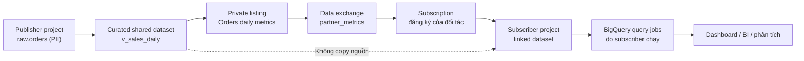
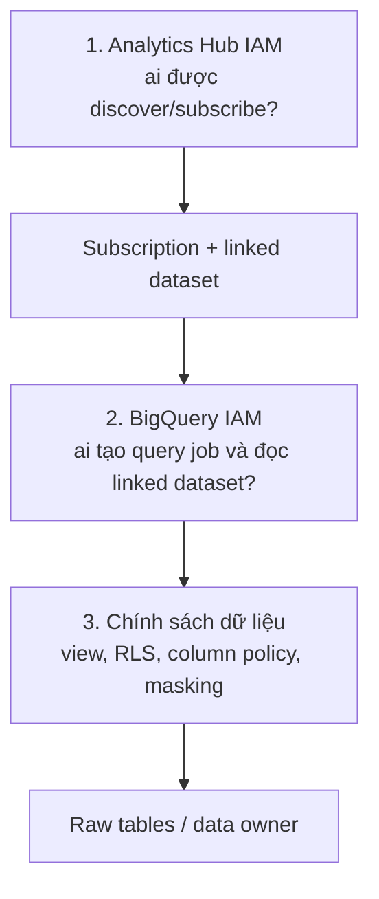

# BigQuery sharing và chia sẻ dữ liệu có quản trị

Nhóm Data Platform quản lý dữ liệu đơn hàng trong BigQuery. Bộ phận Marketing và một đối tác phân tích thị trường muốn đọc **doanh thu tổng hợp theo ngày và khu vực**, nhưng không được thấy email, mã khách hàng hay từng giao dịch. Sao chép một bảng sang project của đối tác không chỉ tăng chi phí lưu trữ mà còn khiến việc cập nhật, thu hồi quyền và kiểm toán khó kiểm soát.

**BigQuery sharing** (tên trước đây là **Analytics Hub**) cho phép publisher xuất bản dữ liệu qua **data exchange** và **listing**. Subscriber đăng ký listing để có **linked dataset chỉ đọc** trong project của mình, truy vấn dữ liệu dùng chung mà không cần tạo bản sao. Bài thuộc chương **Quản trị và khai thác dữ liệu** của module `CLOUD_PROVIDERS_GCP`, kết hợp IAM, BigQuery, VPC Service Controls, Cloud Storage, kiểm soát độ tin cậy và chi phí.

> Tên project, email, bảng và quy mô trong bài đều là ví dụ sandbox. Các thao tác tạo dataset/listing, thay IAM, subscribe, thu hồi quyền hoặc xóa listing là **thay đổi quyền truy cập và tài nguyên có thật**. Chỉ thực hiện trong môi trường được phê duyệt. Các minh họa dùng BigQuery GoogleSQL; nơi dùng location `asia-southeast1` phải kiểm tra BigQuery sharing hỗ trợ location đó và dataset thực tế ở vùng tương thích.

## 1. Mục tiêu học tập

Sau bài học, bạn có thể:

1. Phân biệt **data exchange**, **listing**, **shared dataset**, **subscription** và **linked dataset**.
2. Thiết kế hợp đồng chia sẻ dữ liệu gồm schema, owner, SLA, phân loại nhạy cảm, phạm vi sử dụng và quy trình thu hồi.
3. Xuất bản **private listing** chỉ chứa dữ liệu đã được tổng hợp hoặc lọc qua **authorized view**.
4. Phân quyền publisher/subscriber bằng Analytics Hub IAM roles và quyền BigQuery phía job/dataset.
5. Subscribe, truy vấn linked dataset và hiểu giới hạn của cách chia sẻ **không sao chép dữ liệu**.
6. Lựa chọn **data egress controls**, row/column security, data masking và các cơ chế giám sát phù hợp.
7. Phân tích logs/`SHARED_DATASET_USAGE`, xử lý lỗi, chi phí và vòng đời cấp/thu hồi quyền.

## 2. Kiến trúc BigQuery sharing: publisher và subscriber



| Thành phần | Do ai quản lý? | Vai trò |
| --- | --- | --- |
| **Shared dataset** | Publisher | Dataset nguồn được listing tham chiếu; chứa tables/views/routines được phép chia sẻ |
| **Data exchange** | BigQuery sharing administrator | Không gian tập hợp listings, private hoặc public |
| **Listing** | Publisher | Mô tả sản phẩm dữ liệu, dataset nguồn, thông tin sử dụng và chính sách truy cập |
| **Subscription** | Subscriber, publisher có thể revoke | Quan hệ đăng ký listing; tài nguyên thuộc project của subscriber |
| **Linked dataset** | Subscriber tạo/đặt tên | Dataset chỉ đọc trỏ đến tài nguyên được chia sẻ, không chép rows |
| **Query job** | Caller trong subscriber project | Thực hiện SQL bằng quyền BigQuery của caller, chịu compute billing theo cấu hình |

**Phân biệt với IAM cấp trực tiếp trên dataset:** BigQuery sharing tạo quy trình **khám phá → cấp quyền đăng ký → linked dataset → quản lý subscriptions và usage**. Nó không làm nguồn dữ liệu tự động sạch hơn: nếu listing trỏ trực tiếp vào dataset có PII, subscriber được quyền thấy dữ liệu đó theo chính sách hiện có. Hãy chuẩn bị **dataset xuất bản riêng**, không dùng dataset OLTP/raw làm shared dataset khi chỉ cần thông tin tổng hợp.

Tên project và dataset nguồn có thể xuất hiện trong metadata của linked dataset cho subscriber; tránh đặt bí mật hoặc thông tin nhạy cảm vào tên tài nguyên, mô tả và listing documentation.

### 2.1. Không sao chép dữ liệu không có nghĩa không thể tạo bản sao

Subscription tạo **tham chiếu logic** đến shared dataset và cập nhật theo dữ liệu nguồn; publisher giữ quyền điều hành nguồn. Nhưng nếu policy cho phép **kết quả query được lưu/copy/export**, subscriber có thể tạo dữ liệu dẫn xuất nằm ngoài linked dataset. Thu hồi subscription **không tự xóa các bản sao đã được tạo hợp lệ trước đó**. Với dữ liệu nhạy cảm, kiểm soát hợp đồng sử dụng, IAM, egress options, quan sát và các hạn chế của nền tảng phải đi cùng nhau.

## 3. Chọn cơ chế chia sẻ đúng mục tiêu

| Bài toán | Giải pháp thường phù hợp | Hạn chế/điều kiện |
| --- | --- | --- |
| Chia sẻ bảng hoặc view cho nhiều teams/đối tác, quản trị subscriptions | **BigQuery sharing** private exchange/listing | Quản lý publisher/subscriber và resource location |
| Chỉ cấp quyền một dataset cho một nhóm nội bộ | BigQuery dataset IAM | Đơn giản nhưng ít tính năng catalog/subscription lifecycle |
| Không cho xem PII, chỉ xem kết quả SELECT được duyệt | **Authorized view** trong dataset công bố | Phải authorize đúng view; rà soát SQL view và nguồn |
| Cùng bảng nhưng từng nhóm chỉ thấy một số dòng | Row-level access policy (RLS) | Quy tắc có thể phức tạp khi chia sẻ xuyên org |
| Dữ liệu chứa cột nhạy cảm, cần phân quyền/che giá trị | Column-level access control / data masking | Cần policy tags/data policies và kiểm thử danh tính truy vấn |
| Phân tích kết hợp hai bên mà không mở toàn bộ dữ liệu | **Data clean rooms** khi yêu cầu phù hợp | Cấu hình/privacy limits và mô hình sử dụng riêng |
| Tạo bản snapshot cố định theo tháng | Copy/export có kiểm soát | Đây là bản sao, cần retention/erasure riêng |
| Phân phối sự kiện thời gian thực | Pub/Sub topic listing qua BigQuery sharing | Tạo linked Pub/Sub subscription, khác linked BigQuery dataset |

Một **private exchange** không được công khai trong catalog; kể cả khi cấp quyền `allAuthenticatedUsers` cho listing thuộc private exchange, nó không tự trở thành một listing công khai có thể tìm kiếm. Với public exchange, các listings chịu tác động của inherited permissions; không nên dùng public exchange để phát dữ liệu chỉ dành cho đối tác.

## 4. Vai trò IAM và nguyên tắc least privilege

BigQuery sharing sử dụng các roles tiền tố **`roles/analyticshub.*`** dù sản phẩm đã đổi tên. Quyền **discover**, **subscribe**, **query** và **quản trị dataset nguồn** là các quyền riêng biệt.

| Principal | IAM role điển hình | Nơi cấp | Không được giả định |
| --- | --- | --- | --- |
| Exchange admin | `roles/analyticshub.admin` | Project/exchange publisher | Không cần toàn quyền BigQuery data của mọi nguồn |
| Listing publisher | `roles/analyticshub.publisher` | Exchange hoặc publisher project | Còn cần quyền phù hợp trên **shared dataset** |
| Listing metadata viewer | `roles/analyticshub.viewer` | Theo phạm vi exchange/listing/project phù hợp | Xem listing **không đồng nghĩa subscribe/query** |
| Subscriber operator | `roles/analyticshub.subscriber` | **Publisher listing/exchange** | Không tự có quyền tạo linked dataset trong project đích |
| Subscriber project principal | `roles/bigquery.user` | Subscriber project | Phải có `bigquery.datasets.create`/`bigquery.jobs.create` |
| Người truy vấn linked dataset | `roles/bigquery.dataViewer` + quyền tạo jobs | Subscriber project/dataset và job project theo phạm vi | Không được ghi vào linked dataset |
| Người quản trị subscriptions | `roles/analyticshub.subscriptionOwner` khi cần | Subscriber project theo cơ chế hiện hành | Không là Data Owner của nguồn |
| Publisher data steward | `roles/bigquery.dataOwner` hoặc quyền hẹp hơn `bigquery.datasets.get/update` | Shared dataset nguồn | Không cần cấp Owner toàn project |

**Quan trọng:** publisher cấp `roles/analyticshub.subscriber` cho danh tính người đăng ký tại listing/exchange, còn subscriber có quyền tạo linked dataset và query jobs trong **project của mình**. Một role không thay thế các role còn lại. Nếu thao tác chạy bằng service account/Workload Identity thay vì người dùng, cấp đúng principal thực thi và kiểm tra policy kế thừa.

Các bước **thu hồi** phải xác định rõ đang thu hồi quyền xem listing, quyền subscribe, một subscription cụ thể hay quyền đọc linked dataset. Chỉ xóa IAM role Subscribe **không chắc tự hủy các subscription đang tồn tại**; dùng cơ chế quản lý/revoke subscriptions để dừng quyền truy cập thực tế.

## 5. Thiết kế sản phẩm dữ liệu trước khi xuất bản

Ví dụ mô hình tách dữ liệu:

```text
orders-publisher-lab/
  raw/
    orders              # order_id, customer_email, order_date, region, net_amount
  partner_metrics/
    v_sales_daily       # chỉ order_date, region, order_count, net_revenue
  sharing exchange:
    partner_metrics_ex
      listing: sales_daily_listing -> partner_metrics dataset

orders-subscriber-lab/
  orders_partner_link   # linked dataset read-only do subscription tạo
```

Với một sản phẩm dữ liệu, cần có:

| Metadata/hợp đồng | Ví dụ |
| --- | --- |
| Tên và mục đích | `sales_daily_v1` – đối soát doanh thu theo ngày/khu vực |
| Owner/đầu mối | Data Platform / Analytics owner, kênh hỗ trợ |
| Cấp độ nhạy cảm | Chỉ tổng hợp; không xuất email, mã khách hoặc order-level rows |
| Schema và version | `order_date DATE, region STRING, order_count INT64, net_revenue NUMERIC` |
| Cập nhật/freshness | D+1 trước 06:00 theo múi giờ quy định |
| Quy tắc dữ liệu | Đã hủy/hoàn tiền tính như thế nào; số lượng đơn trùng được xử lý ra sao |
| Quyền sử dụng/retention | Nhóm được phép, mục đích, cấm redistributing khi cần |
| Thay đổi/thu hồi | Thông báo thay schema, khoảng chuyển tiếp, thời gian revoke |
| Quan sát và chi phí | Jobs/usage view, budgets, owner chịu storage và query billing |

**Dữ liệu tổng hợp vẫn có thể lộ thông tin** nếu một nhóm chỉ có một khách hàng hoặc subscriber kết hợp nhiều nguồn để suy luận cá nhân. Với nhóm nhỏ, áp dụng ngưỡng cell count, hạn chế dimension và review rủi ro **differencing attacks**; `HAVING COUNT(*) >= 10` chỉ là một lớp giảm rủi ro, **không phải bảo đảm ẩn danh tuyệt đối**.

## 6. Lab publisher: tạo dataset chia sẻ chỉ chứa view

Giả định hai Google Cloud projects thử nghiệm đã có Billing và BigQuery APIs:

```text
PUBLISHER_PROJECT = orders-publisher-lab
SUBSCRIBER_PROJECT = orders-subscriber-lab
LOCATION          = asia-southeast1
EXCHANGE_ID       = partner_metrics_ex
LISTING_ID        = sales_daily_listing
SOURCE_DATASET    = raw
SHARED_DATASET    = partner_metrics
LINKED_DATASET    = orders_partner_link
```

Các bước dưới đây dùng **BigQuery GoogleSQL**. Chạy DDL và INSERT chỉ trên sandbox; với dữ liệu production phải có quy trình masking, data classification, data contract và phê duyệt trước khi publish.

### 6.1. Tạo hai datasets đúng location

```sql
-- THAY ĐỔI TÀI NGUYÊN: chỉ trên sandbox publisher.
CREATE SCHEMA IF NOT EXISTS `orders-publisher-lab.raw`
OPTIONS (location = 'asia-southeast1');

CREATE SCHEMA IF NOT EXISTS `orders-publisher-lab.partner_metrics`
OPTIONS (location = 'asia-southeast1');
```

**Không tạo listing ngay trên `raw`**. Một listing xuất bản cả shared dataset; nếu sau này raw dataset có thêm bảng nhạy cảm, việc dùng raw làm nguồn chia sẻ tạo rủi ro khó dự báo. Để kiểm soát bề mặt công bố, chỉ đặt **curated views/tables** mà đối tác được phép thấy trong `partner_metrics`.

### 6.2. Tạo bảng dữ liệu giả ở raw

```sql
-- THAY ĐỔI SCHEMA/DỮ LIỆU: giá trị giả, không dùng PII thật.
CREATE TABLE IF NOT EXISTS `orders-publisher-lab.raw.orders` (
  order_id STRING NOT NULL,
  customer_email STRING,
  order_date DATE NOT NULL,
  region STRING NOT NULL,
  net_amount NUMERIC NOT NULL
)
PARTITION BY order_date;

-- Bảng demo phải đang rỗng để không tạo trùng ID khi chạy lại.
INSERT INTO `orders-publisher-lab.raw.orders`
  (order_id, customer_email, order_date, region, net_amount)
SELECT
  FORMAT('demo-ord-%03d', n),
  FORMAT('synthetic%03d@example.test', n),
  DATE '2026-11-18',
  'VN',
  CAST(100000 + n * 1000 AS NUMERIC)
FROM UNNEST(GENERATE_ARRAY(1, 12)) AS n;
```

Trong môi trường thật, nguồn có thể là pipeline Dataflow/BigQuery từ Cloud Storage/Pub/Sub; publisher quản lý quality checks, phân quyền và retention ở raw dataset. **Đừng tạo lại INSERT khi đã có dữ liệu demo**; câu `CREATE TABLE IF NOT EXISTS` không làm `INSERT` tự idempotent.

### 6.3. Tạo view chỉ xuất bản tổng hợp

```sql
-- THAY ĐỔI VIEW: chỉ có các thuộc tính đã được duyệt.
CREATE OR REPLACE VIEW
  `orders-publisher-lab.partner_metrics.v_sales_daily`
OPTIONS (
  description = 'Doanh thu tổng hợp theo ngày/vùng, phiên bản v1; không PII'
) AS
SELECT
  order_date,
  region,
  COUNT(*) AS order_count,
  SUM(net_amount) AS net_revenue
FROM `orders-publisher-lab.raw.orders`
GROUP BY order_date, region
HAVING COUNT(DISTINCT order_id) >= 10;
```

View không trả `customer_email` hay `order_id` và chỉ công bố nhóm có ít nhất 10 đơn khác nhau. Trong dữ liệu giả, ngày `2026-11-18` có 12 đơn VN nên view trả một hàng. **Rà soát phép nhóm và dimensions:** nếu dữ liệu thật có trùng ID hoặc nhóm quá nhỏ, HAVING hiện tại **không tự loại trùng giao dịch** và có thể không đủ bảo vệ riêng tư. Nên có các bước dedup/aggregation upstream và privacy review.

### 6.4. Authorize view đọc dữ liệu nguồn

View nằm trong `partner_metrics` nhưng tham chiếu bảng ở dataset `raw`. Để người đăng ký **chỉ có quyền với view** có thể chạy view mà không cần được grant đọc trực tiếp raw table:

1. Vào BigQuery Data Explorer → dataset `orders-publisher-lab.raw` → **Sharing → Authorize views**.
2. Chọn **view chính xác** `orders-publisher-lab.partner_metrics.v_sales_daily`, thêm vào **authorized views** của `raw`.
3. Xác minh `raw` không được cấp `roles/bigquery.dataViewer` trực tiếp cho subscriber.
4. Chạy thử query view với một danh tính có quyền **trên view/shared dataset** nhưng không có quyền trực tiếp trên raw dataset.

**Authorized view** cho phép thực hiện query thông qua view theo phạm vi được cấp phép, không chuyển quyền đọc toàn bộ raw sang người dùng. Nếu sau này sửa view thành `SELECT * FROM raw.orders`, authorized view trở thành một đường lộ dữ liệu; vì vậy **mọi thay đổi SQL view phải được review**, versioned và kiểm thử. Row/column policy tags, data masking và authorized views cần kiểm tra tương tác theo cấu hình thực tế, không tự cho rằng lớp này thay thế lớp kia.

## 7. Lab publisher: private exchange và listing

### 7.1. Bật Analytics Hub API và kiểm tra IAM

```bash
PUBLISHER_PROJECT="orders-publisher-lab"
LOCATION="asia-southeast1"
EXCHANGE_ID="partner_metrics_ex"
LISTING_ID="sales_daily_listing"

# THAY ĐỔI cấu hình API, chỉ chạy ở sandbox được phép.
gcloud services enable analyticshub.googleapis.com \
  --project="$PUBLISHER_PROJECT"

# CHỈ ĐỌC: kiểm tra account và project hiện hành.
gcloud auth list
gcloud config get-value project
```

Người tạo exchange cần quyền quản trị BigQuery sharing; người tạo listing cần publisher role trên exchange cùng các quyền phù hợp trên shared dataset (thường `bigquery.datasets.get/update`). **Không sử dụng Project Owner để vượt lỗi 403**.

### 7.2. Tạo private exchange

Trong Google Cloud console → **BigQuery → Sharing (Analytics Hub)**:

1. Chọn **Create exchange**, project `orders-publisher-lab` và location `asia-southeast1`.
2. Đặt exchange ID `partner_metrics_ex`, tên hiển thị “Partner metrics — sandbox”.
3. Để **private**; không bật public discoverability.
4. Gán publisher/admin/viewer/subscriber roles theo danh sách principal/nhóm được duyệt.
5. Kiểm tra exchange có thể xem bởi publisher nhưng không xuất hiện cho user chưa được cấp quyền.

Có thể dùng REST API tạo exchange thay vì Console (đây là lệnh **thay đổi**):

```bash
# Chỉ thực hiện nếu exchange chưa tồn tại và principal được phép tạo.
ACCESS_TOKEN="$(gcloud auth print-access-token)"
curl -sS -X POST \
  "https://analyticshub.googleapis.com/v1/projects/$PUBLISHER_PROJECT/locations/$LOCATION/dataExchanges?dataExchangeId=$EXCHANGE_ID" \
  -H "Authorization: Bearer $ACCESS_TOKEN" \
  -H "Content-Type: application/json" \
  -d '{"displayName":"Partner metrics sandbox","description":"Private governed metrics exchange"}'
```

### 7.3. Xuất bản listing của dataset đã chuẩn bị

Vào exchange `partner_metrics_ex` → **Create listing**:

1. Resource type: **BigQuery dataset**.
2. Shared dataset: `orders-publisher-lab.partner_metrics`, phải cùng region với exchange.
3. Listing ID: `sales_daily_listing`; display name “Orders daily sales v1”.
4. Mô tả các cột, định nghĩa metric, ngày cập nhật, owner và hướng dẫn query. Đánh dấu nhạy cảm/không có PII theo kết quả kiểm duyệt.
5. Chọn **private listing**, không cấp `allAuthenticatedUsers`, không bật public discoverability.
6. Chọn **data egress options** theo chính sách sử dụng ở mục 10; cân nhắc bật **Subscriber Email Logging** nếu được phép và cần truy nguyên user.
7. **Grant `roles/analyticshub.subscriber`** trên listing cho principal/nhóm đối tác đã phê duyệt.

Publisher **không thể tùy ý đổi shared dataset của listing hiện hữu**. Nếu cấu trúc sản phẩm thay đổi đáng kể, tạo dataset/listing phiên bản mới và cho subscribers thời gian chuyển đổi. **Subscriber Email Logging sau khi bật và lưu không chỉnh tắt trực tiếp được**; thiết kế quyền riêng tư và chính sách log trước khi bật.

### 7.4. Kiểm tra listing không bị công khai ngoài ý muốn

Kiểm tra người dùng ngoài nhóm **không discover/subscribe** được private exchange/listing. Nhưng đừng dùng việc “không tìm thấy trên trang tìm kiếm” làm bằng chứng an toàn duy nhất: phải xem **IAM policy trên exchange/listing** và các grants thừa kế. Cẩn thận với `allUsers` và `allAuthenticatedUsers`, đặc biệt nếu tổ chức từng sử dụng listing công khai để thử nghiệm.

## 8. Lab subscriber: tạo linked dataset và truy vấn

**Subscriber project** là nơi người dùng/ứng dụng chạy BigQuery jobs và đặt linked dataset. Subscriber phải có:

- Quyền `roles/analyticshub.subscriber` trên publisher listing/exchange để **subscribe**.
- Quyền tạo dataset và query jobs tại project `orders-subscriber-lab` (ví dụ `roles/bigquery.user`).
- Quyền đọc linked dataset/metadata khi thực hiện truy vấn (ví dụ `roles/bigquery.dataViewer` ở phạm vi thích hợp).

**Không cần cấp quyền đọc trực tiếp bảng `raw.orders` cho subscriber** khi đã cấu hình authorized view đúng. Việc có `roles/analyticshub.subscriber` không tự tạo BigQuery query job hay cấp quyền truy cập mọi bảng trong publisher project.

### 8.1. Subscribe bằng Console

1. Đăng nhập bằng danh tính đã được grant Subscribe; vào BigQuery → **Sharing (Analytics Hub)**.
2. Mở link private listing `sales_daily_listing` từ publisher hoặc tìm listing trong exchange được phép xem.
3. Xem metadata: publisher, bảng/view được chia sẻ, điều khoản sử dụng, vùng dữ liệu, restrictions và quyền truy cập; bấm **Subscribe**.
4. Destination project: `orders-subscriber-lab`; linked dataset ID: `orders_partner_link`; primary region: `asia-southeast1`.
5. Xác nhận. Linked dataset xuất hiện trong BigQuery Data Explorer với biểu tượng dataset được liên kết.

Đối với dataset được chia sẻ ở **một region**, chọn region tương thích đã được listing công bố. **Primary region của linked dataset có thể khác provider primary region** trong trường hợp listing đã bật các vùng replica phù hợp; phải có cross-region dataset replication/replica sẵn sàng theo quy định, không phải bất kỳ region nào cũng có thể chọn.

### 8.2. Hoặc subscribe bằng REST API

Đây là mẫu thực thi từ terminal của subscriber đã đăng nhập và có đủ IAM; **thay đổi tài nguyên**, chỉ chạy khi listing đã tồn tại và được phép đăng ký:

```bash
PUBLISHER_PROJECT="orders-publisher-lab"
SUBSCRIBER_PROJECT="orders-subscriber-lab"
LOCATION="asia-southeast1"
EXCHANGE_ID="partner_metrics_ex"
LISTING_ID="sales_daily_listing"
LINKED_DATASET_ID="orders_partner_link"
ACCESS_TOKEN="$(gcloud auth print-access-token)"

curl -sS -X POST \
  "https://analyticshub.googleapis.com/v1/projects/$PUBLISHER_PROJECT/locations/$LOCATION/dataExchanges/$EXCHANGE_ID/listings/$LISTING_ID:subscribe" \
  -H "Authorization: Bearer $ACCESS_TOKEN" \
  -H "Content-Type: application/json" \
  -d "{\"destinationDataset\":{\"datasetReference\":{\"projectId\":\"$SUBSCRIBER_PROJECT\",\"datasetId\":\"$LINKED_DATASET_ID\"},\"location\":\"$LOCATION\"}}"
```

Không chạy lại nếu linked dataset đã có mà chưa kiểm tra response: có thể gặp xung đột tên. **Không tạo linked dataset bằng `CREATE SCHEMA` rồi mong nó tự liên kết**; phải subscribe để BigQuery sharing tạo loại dataset liên kết.

### 8.3. Đọc bảng/view qua linked dataset

Trong subscriber project, dùng Console SQL workspace hoặc `bq query`:

```bash
# CHỈ ĐỌC nhưng có thể tính phí BigQuery analysis.
bq query \
  --project_id="orders-subscriber-lab" \
  --location="asia-southeast1" \
  --use_legacy_sql=false \
  --maximum_bytes_billed=1073741824 \
  'SELECT order_date, region, order_count, net_revenue
   FROM `orders-subscriber-lab.orders_partner_link.v_sales_daily`
   WHERE order_date = DATE("2026-11-18")'
```

Nếu authorized view và data permissions được cấu hình đúng, query trên dữ liệu giả sẽ trả **một hàng VN với 12 đơn**, không có email hay order ID. `maximum_bytes_billed` đặt giới hạn khoảng **1 GiB** cho on-demand job; với capacity reservation, cost model theo slots có quy tắc riêng. **Query thành công không tự chứng minh dữ liệu đủ ẩn danh**: phải kiểm tra nhiều nhóm/filters, lịch sử và khả năng kết hợp với dữ liệu khác.

### 8.4. Linked dataset có thể và không thể làm gì?

| Thao tác | Kết quả thường gặp |
| --- | --- |
| `SELECT` bảng/view được share | Có, nếu caller có IAM và mọi constraints được đáp ứng |
| JOIN linked view với bảng nội bộ cùng location | Có, nếu được BigQuery hỗ trợ và có quyền đọc cả hai |
| `INSERT/UPDATE/DELETE` vào linked dataset | **Không**: dataset được liên kết chỉ đọc |
| Tạo/sửa table/view ngay **trong** linked dataset | **Không** |
| Cấp riêng IAM cho một table nằm trong linked dataset | Không sửa permissions của tài nguyên nguồn qua linked dataset |
| Chỉnh description/labels của linked dataset | Có các cập nhật metadata được hỗ trợ, không ảnh hưởng source |
| Copy/export/query results sang tài nguyên khác | **Phụ thuộc egress controls, IAM và policy** của listing |
| Unsubscribe/delete linked dataset | Ngừng liên kết; **không xóa shared dataset của publisher** |

**Quyền “read-only” không có nghĩa dữ liệu không thể rời dự án.** Nếu quy tắc xuất kết quả cho phép, một người có quyền chạy SQL có thể đọc và lưu kết quả bên ngoài. Cần đánh giá controls ở cả listing, subscriber project, policies và hợp đồng sử dụng.

## 9. IAM của dữ liệu nguồn và cơ chế ủy quyền xem view

Để chia sẻ có quản trị, cần tối thiểu ba lớp:



### 9.1. Authorized view bảo vệ raw dataset

Authorized view là lớp **SQL whitelist** của sản phẩm dữ liệu: publisher quyết định các cột, phép nhóm, lọc và công thức có thể chạy. Subscriber chỉ cần quyền phù hợp trên view xuất bản, không nhận quyền tự mở rộng SQL để đọc raw. **Không dùng view chứa SELECT *** hay đưa bảng raw vào shared dataset như một “đường tắt”.

Nếu thay SQL view, dữ liệu subscriber nhìn thấy có thể thay đổi ngay. Nên version naming như `v_sales_daily_v1`/`v_sales_daily_v2`, có review data owner, schema compatibility tests và thông báo deprecation. Không drop v1 trước khi các downstream jobs của subscriber đã chuyển.

### 9.2. Row-level và column-level security không phải chỉ là ẩn cột

| Cơ chế | Điều kiểm soát | Ví dụ |
| --- | --- | --- |
| Authorized view | Kết quả SQL mà người dùng có thể xem | Chỉ doanh thu theo ngày/vùng |
| Row-level access policy | Những hàng caller được truy cập | Chỉ vùng/kênh kinh doanh phù hợp |
| Column-level access control | Ai được đọc cột gắn policy tag | Không ai ngoài Finance được đọc trường doanh thu chi tiết |
| Dynamic data masking | Trả dữ liệu đã được che theo data policy | Email được mask theo quyền |
| Data egress restrictions của listing | Các thao tác BigQuery copy/export và query results theo chế độ | Hạn chế tạo bản sao ngoài linked dataset |
| VPC Service Controls | Perimeter và các luồng dịch vụ/project | Không thay thế IAM hoặc phân loại nội dung |

Các controls có **thứ tự áp dụng và giới hạn kết hợp** theo BigQuery; phải kiểm thử bằng **principal thực tế của subscriber**, không chỉ bằng tài khoản publisher admin. Nếu một view có thể suy luận giá trị nhạy cảm qua nhóm rất nhỏ hoặc nhiều truy vấn khác nhau, policy tags và masking không tự giải quyết rủi ro đó. Khi cần riêng tư mạnh hơn, cân nhắc **data clean rooms** và cơ chế tổng hợp/ngưỡng được thiết kế phù hợp.

### 9.3. Dữ liệu ngoài biên giới

Data exchange và shared dataset phải ở location tương thích. Muốn chia sẻ listing tại nhiều regions, publisher cần cấu hình **cross-region dataset replication** và chỉ chọn các replicas đã ở trạng thái **Ready to use**. Subscriber chọn region được listing cung cấp. Điều này có thể phát sinh storage/replication/network costs, ảnh hưởng độ trễ đồng bộ và yêu cầu residency. **Một linked dataset không tự tạo bản sao toàn cầu hoặc phá giới hạn BigQuery location**.

## 10. Data egress controls: hạn chế sao chép có chủ đích

Khi tạo listing BigQuery dataset, publisher có thể chọn các cấp độ kiểm soát xuất dữ liệu, chẳng hạn:

| Lựa chọn trong BigQuery sharing | Tác dụng chính | Rủi ro còn lại |
| --- | --- | --- |
| Không hạn chế egress | Subscriber có thể dùng các thao tác copy/export được IAM cho phép | Dữ liệu dễ được tạo bản sao |
| **Disable copy and export of shared data** | Chặn copy/export trực tiếp shared dataset | Có thể vẫn xuất **query results** nếu chưa chặn riêng |
| **Disable copy and export of query results** | Chặn cả shared data copy/export và các đường lưu/xuất kết quả query theo hỗ trợ | Vẫn có kết quả hiển thị cho người được phép SELECT |
| **Disable copy and export of tables through APIs** | Hạn chế thêm các đường BigQuery API tương ứng | Cần kiểm tra tương tác với các hạn chế khác |

Tùy option, các thao tác **copy, clone, export, snapshot, CTAS, ghi destination table/view** và các API liên quan có thể bị chặn. **Không suy ra “không thể làm lộ bất kỳ bit dữ liệu nào”:** người có quyền đọc vẫn có thể xem kết quả, ghi nhớ, chụp màn hình hoặc dùng kênh bên ngoài tùy thiết kế. Dùng egress control như lớp **giảm khả năng di chuyển dữ liệu trong BigQuery**, kết hợp policy sử dụng, phát hiện bất thường và kiểm tra rò rỉ.

**Quy trình thử nghiệm:** từ subscriber identity trên sandbox, chạy `SELECT` được phép, sau đó thử `CREATE TABLE AS SELECT` hoặc export kết quả vào destination được kiểm soát. Kết quả phải phù hợp policy đã chọn; **không dùng dữ liệu thật để kiểm thử ngăn xuất**. Nếu cần lưu dữ liệu để xây dashboard, phải thống nhất chế độ egress phù hợp trước khi cấp subscription.

## 11. Quan sát truy vấn, subscriber usage và audit

BigQuery sharing giúp publisher theo dõi ai đang tiêu thụ tài nguyên được chia sẻ. Các nguồn quan sát gồm **Sharing usage dashboard**, `INFORMATION_SCHEMA.SHARED_DATASET_USAGE`, Cloud Audit Logs (service `analyticshub.googleapis.com`) và BigQuery jobs/Cloud Billing. Nên liên kết các tín hiệu theo listing, subscriber project, dataset, thời gian và business owner.

### 11.1. Dùng SHARED_DATASET_USAGE của publisher

Publisher cần quyền `bigquery.datasets.listSharedDatasetUsage` trên source project (ví dụ Data Owner hoặc custom role phù hợp). View metadata **regional** và chứa lịch sử jobs khoảng **180 ngày**; job location phải khớp region truy vấn metadata.

```sql
-- CHỈ ĐỌC: chạy trong location asia-southeast1,
-- bằng principal có quyền usage metadata trên source project.
SELECT
  job_start_time,
  listing_id,
  linked_project_number,
  linked_dataset_id,
  job_id,
  shared_resource_id,
  shared_resource_type,
  total_bytes_processed
FROM
  `orders-publisher-lab.region-asia-southeast1.INFORMATION_SCHEMA.SHARED_DATASET_USAGE`
WHERE dataset_id = 'partner_metrics'
  AND job_start_time >= TIMESTAMP_SUB(CURRENT_TIMESTAMP(), INTERVAL 7 DAY)
ORDER BY job_start_time DESC
LIMIT 100;
```

Kết quả giúp tìm các subscriber projects đang query tài nguyên nào và mức tiêu thụ. `total_bytes_processed` ở đây **không tự là hóa đơn của publisher**; subscriber chi trả compute query theo on-demand/reservation của mình. Nếu job truy cập nhiều tài nguyên được chia sẻ, kết quả có thể gồm nhiều usage rows; đừng cộng mọi rows rồi coi là chính xác tổng phí của từng job.

### 11.2. Tổng hợp nhu cầu theo subscriber

```sql
-- CHỈ ĐỌC: ước lượng hoạt động 7 ngày của các linked datasets.
SELECT
  linked_project_number,
  linked_dataset_id,
  COUNT(DISTINCT job_id) AS query_jobs,
  SUM(total_bytes_processed) AS referenced_bytes_processed
FROM
  `orders-publisher-lab.region-asia-southeast1.INFORMATION_SCHEMA.SHARED_DATASET_USAGE`
WHERE dataset_id = 'partner_metrics'
  AND job_start_time >= TIMESTAMP_SUB(CURRENT_TIMESTAMP(), INTERVAL 7 DAY)
GROUP BY linked_project_number, linked_dataset_id
ORDER BY query_jobs DESC;
```

`query_jobs` đếm distinct job IDs trong tập kết quả, còn `referenced_bytes_processed` là số liệu **theo tài nguyên nguồn được truy vấn**; có thể trùng phần bytes giữa nhiều resources/queries. Để đối chiếu chi phí subscriber, dùng **Cloud Billing export của subscriber** và `INFORMATION_SCHEMA.JOBS_BY_PROJECT` bên job project (nếu có quyền), không quy tất cả phí vào publisher.

### 11.3. Subscriber Email Logging và quyền riêng tư

Khi bật **Subscriber Email Logging** trên listing, truy vấn của các subscriptions **được tạo sau khi bật** có thể ghi `job_principal_subject` trong usage metadata. Đây là dữ liệu định danh người truy vấn; phải xác định mục đích giám sát, quyền truy cập log và thời gian giữ trước khi bật. **Không tự suy rằng tất cả subscriptions cũ đều có danh tính caller trong usage view**.

Lưu ý các hành động thay IAM, tạo/xóa listing, subscribe/revoke có thể được ghi trong **Cloud Audit Logs**; kiểm tra Data Access logging và retention theo cấu hình tổ chức. Dashboard có thể cập nhật trễ hoặc thiếu dữ liệu nếu quyền/region sai; kết hợp job statistics và audit để điều tra thay vì kết luận từ một biểu đồ trống.

### 11.4. SLO cho sản phẩm dữ liệu

| SLI/SLO minh họa | Định nghĩa | Theo dõi |
| --- | --- | --- |
| Data freshness | Dữ liệu ngày D sẵn sàng trước 06:00 D+1 | Publisher pipeline timestamp + query health |
| Schema compatibility | Không xóa/đổi tên cột trong v1 không báo trước | Contract tests và CI review |
| Availability | Tỷ lệ các sample queries qua linked dataset thành công | Synthetic monitoring bằng subscriber identity thử nghiệm |
| Privacy | Không xuất dữ liệu người dùng/nhóm nhỏ ngoài phạm vi duyệt | Automated SQL checks và định kỳ kiểm tra data access |
| Adoption | Bao nhiêu subscriber/job dùng listing | `SHARED_DATASET_USAGE` và Sharing metrics |
| Revocation | Sau revoke, danh tính bị thu hồi không còn query được | Runbook + negative access test |

Một view query thành công với 0 rows không chứng minh dữ liệu đã được cập nhật; cần kiểm tra **watermark/freshness** của publisher pipeline và giá trị kiểm soát theo kỳ.

## 12. Vòng đời subscription, thay đổi schema và thu hồi quyền

### 12.1. Phân biệt các hành động

| Hành động | Tác động | Cần kiểm tra sau đó |
| --- | --- | --- |
| Gỡ `roles/analyticshub.subscriber` | Chặn quyền đăng ký mới theo phạm vi IAM | **Không thay thế revoke subscription đã có** |
| Publisher **revoke** subscription cụ thể | Chấm dứt quyền chia sẻ của subscriber tương ứng | Linked dataset có thể ở trạng thái **unlinked**; kiểm thử `SELECT` bị từ chối |
| Subscriber delete linked dataset | Unsubscribe từ phía subscriber | Không xóa shared dataset/publisher tables |
| Publisher delete listing | Ngừng công bố, tác động mọi subscribers của listing | Rủi ro gián đoạn lớn; xem active subscriptions và nguồn/sandbox |
| Publisher đổi SQL/schema view | Có thể thay đổi query results của tất cả subscribers ngay | Versioning, contract tests, thông báo migration |
| Publisher xóa source dataset | Có thể phá nhiều listings/views/jobs | Không thực hiện khi còn consumer phụ thuộc |

**Revoke trên Console:** BigQuery → Sharing → data exchange → listing → Manage subscriptions, xác định subscription/project cần thu hồi, thực hiện revoke sau khi có ticket/phê duyệt. Theo tài liệu, **publisher-initiated revoke có thể để lại linked dataset ở trạng thái unlinked trong subscriber project**, và subscriber nên xóa dataset không còn sử dụng. **Không xóa toàn bộ listing hoặc source dataset để thu hồi một đối tác**.

**Xác minh:** thử cùng query từ subscriber identity từng được phép; kết quả phải báo không còn truy cập được. Kiểm tra BigQuery audit/usage, dashboard/data pipelines bị phụ thuộc; nếu có dữ liệu đã export/copy trước đó, phối hợp nghĩa vụ xóa hoặc ngừng sử dụng theo hợp đồng — revoke không có khả năng xóa ngược bản sao ở mọi hệ thống.

### 12.2. Thay sản phẩm dữ liệu an toàn

Đề xuất lộ trình v1 → v2:

1. Tạo view `v_sales_daily_v2` với các cột/định nghĩa mới trong dataset được duyệt; kiểm thử quy tắc privacy.
2. Công bố metadata và hợp đồng schema rõ ràng; nếu cần tách quyền/nhóm khác nhau, tạo listing v2 thay vì thay đổi nguồn bất ngờ.
3. Thông báo ngày bắt đầu nhận dữ liệu mới, vùng dữ liệu, chi phí, thời điểm deprecate v1.
4. Cho subscriber thử bằng identity đúng quyền; theo dõi query failures và usage trên các views.
5. Sau thời gian chuyển đổi, thu hồi hoặc xóa v1 theo quy trình, không drop đột ngột.

Linked dataset là tham chiếu tới dữ liệu nguồn **đang thay đổi**, nên không mặc định có lịch sử phiên bản hoặc snapshot cố định cho từng đối tác. Khi yêu cầu đối soát một bộ dữ liệu **bất biến** theo kỳ, thiết kế snapshot/versioned tables có retention được quản trị riêng (nếu phù hợp policies).

## 13. Chi phí, quota, region và ranh giới trách nhiệm

Theo mô hình BigQuery sharing, việc quản lý **data exchange/listing** bản thân nó **không có phí cộng thêm**. Tuy nhiên chi phí dữ liệu/compute không biến mất:

| Phía chịu trách nhiệm | Chi phí thường gặp | Gợi ý kiểm soát |
| --- | --- | --- |
| Publisher | BigQuery source/curated tables storage, pipeline tạo dữ liệu, snapshots, backups theo dịch vụ | Storage lifecycle, scheduled query cost, quality checks |
| Subscriber | BigQuery query compute (on-demand bytes billed hoặc capacity slots), job logs | Dry run, `maximum_bytes_billed` khi on-demand, budgets |
| Publisher/Subscriber tùy cấu hình | Cross-region replication, network/egress, Dataflow/BigQuery processing phụ | Chọn region phù hợp, đo data transfer |
| Các bên có sử dụng | Cloud Logging, Monitoring, audit retention và các công cụ bảo mật | Retention/visibility và budget owner |

**Không chép data** qua linked dataset giúp tránh một bản sao lưu trữ thường trực ở subscriber, nhưng không miễn phí các truy vấn hay các bản sao chủ động được tạo nơi khác. Một subscriber thực hiện `SELECT *` quét TB dữ liệu có thể tự phát sinh phí lớn; publisher không kiểm soát toàn bộ budget subscriber chỉ bằng listing IAM.

### 13.1. Trách nhiệm về availability và policy

Publisher chịu trách nhiệm freshness, schema contract và chất lượng source; subscriber chịu trách nhiệm query patterns, destination workload và phân quyền các dashboard downstream. Nếu source table/view bị xóa, đổi schema hoặc không đạt data quality, linked dataset **không tự sao lưu một bản có thể sử dụng khi publisher lỗi**. Cần có owner và quy trình incident notification/rollback giữa hai tổ chức.

### 13.2. VPC Service Controls và compliance

Khi source/subscriber projects nằm trong VPC Service Controls perimeters, BigQuery sharing có thể cần **ingress/egress rules** để các background operations và queries xuyên perimeter hoạt động. **Không mở toàn bộ perimeter chỉ để subscribe thành công**. Với dữ liệu chịu ràng buộc vị trí lưu trữ, xác định provider primary location, các replica regions được publish, vị trí thực thi query và xử lý dữ liệu được phép ở đâu.

## 14. Case study: chia sẻ doanh thu cho đối tác phân tích

**Bối cảnh:** một nền tảng thương mại muốn cung cấp dữ liệu doanh thu tổng hợp cho đối tác Marketing hàng ngày, nhưng không để đối tác truy cập email hay chi tiết khách hàng. Dữ liệu nguồn do pipeline BigQuery/Cloud Composer cập nhật; đối tác có project BigQuery riêng để kết hợp với dữ liệu thị trường.

### 14.1. Lựa chọn thiết kế

| Mối quan tâm | Quyết định | Giải thích |
| --- | --- | --- |
| Dữ liệu được phép | `partner_metrics.v_sales_daily` | Chỉ ngày, region, count, revenue; không chia sẻ raw |
| Privacy | Authorized view + ngưỡng nhóm + kiểm thử suy luận | Giảm khả năng lộ PII, không tuyên bố ẩn danh tuyệt đối |
| Publish/discover | Private exchange `partner_metrics_ex` | Chỉ danh tính/nhóm được duyệt có quyền |
| Consumption | Linked dataset ở subscriber project | Không nhân bản bảng nguồn chỉ để truy vấn |
| Data location | Một region đã được hỗ trợ/chấp thuận | Đơn giản hóa compliance và kiểm soát latency |
| Export rights | Egress option phù hợp mục đích và quy định | Không cho copy toàn bảng nếu không cần |
| Schema | Versioned view và contract D+1 | Tránh breaking changes đối với dashboard |
| Audit | Usage view, audit logs, owner và tickets | Có bằng chứng truy cập, thay đổi quyền, revoke |
| Cost | Publisher trả storage/pipeline; subscriber trả queries | Có budgets, job location và dry run |

### 14.2. Luồng cấp quyền và nghiệm thu

1. Data Steward duyệt tập trường và phân loại dữ liệu; Security duyệt chính sách export.
2. Data Engineer tạo view, authorized view grant và negative tests không đọc được raw.
3. Publisher tạo private exchange/listing, mô tả contract và cấp Subscriber role cho nhóm đối tác.
4. Đối tác subscribe vào project riêng, xác minh linked dataset hiện trong BigQuery và query đúng ngày dữ liệu.
5. Kiểm thử **không có cột nhạy cảm**, không tạo được tables trong linked dataset, và copy/export bị chặn đúng theo lựa chọn egress.
6. Platform đặt alerts freshness/failures và xem usage theo subscriber; hai bên thống nhất runbook incident và revoke.

**Không dùng tài khoản publisher admin để chạy nghiệm thu thay subscriber**: quyền admin có thể che giấu lỗi IAM hoặc không phản ánh những hạn chế người dùng thật phải chịu.

### 14.3. Sự cố A — view bị sửa để lộ email

Một pull request vô tình đổi SQL view thành `SELECT *` từ bảng raw. Vì authorized view đã được cho phép, thay đổi SQL có thể khiến dữ liệu nhạy cảm xuất hiện trong shared view. Ứng phó:

1. Ngăn triển khai view mới, hoặc khôi phục SQL view đã duyệt.
2. Nếu đã publish: xác minh khả năng lộ bằng **mẫu truy vấn kiểm soát** và audit/usage, khoanh vùng subscriber/khung thời gian.
3. Xác định có dữ liệu đã bị export/copy hay không theo khả năng quan sát, kích hoạt quy trình sự cố dữ liệu.
4. Bổ sung CI kiểm tra schema view, cấm trường PII, review theo data owner và negative access tests.
5. Chỉ mở lại subscription sau khi Security xác nhận phạm vi rủi ro được xử lý.

Egress restrictions có thể hạn chế một số đường xuất dữ liệu nhưng **không thay kiểm thử cột dữ liệu**. Không log/email lại bản ghi PII trong ticket sự cố.

### 14.4. Sự cố B — đối tác báo linked dataset “mất dữ liệu”

Trước khi tạo lại subscription hoặc cấp quyền cao hơn, đối chiếu: source pipeline cập nhật chưa, view còn tồn tại, authorized view grant có bị gỡ không, query location đúng không, subscriber project/identity và subscription còn active không. Dữ liệu nguồn không tự “được copy giữ lại” để xử lý lỗi; nếu source không còn, linked dataset cũng không cung cấp bản snapshot dự phòng.

### 14.5. Sự cố C — kết thúc hợp tác

Sau khi hợp đồng hết hạn, publisher dùng **Manage subscriptions → revoke** đúng subscriber, kiểm thử truy vấn thất bại và ghi lại ticket/thời gian. Subscriber xóa linked dataset unlinked, gỡ dashboard. Các bên xử lý dữ liệu dẫn xuất đã lưu theo chính sách retention và nghĩa vụ pháp lý riêng. **Không xóa shared dataset nguồn** vì những subscriber khác vẫn đang sử dụng.

## 15. Troubleshooting theo dấu hiệu

| Triệu chứng | Nguyên nhân khả dĩ | Kiểm tra và khắc phục |
| --- | --- | --- |
| Không thấy exchange/listing | Private, thiếu Viewer role, sai project/location | Link trực tiếp, exchange/listing IAM, catalog filters |
| Có thể xem listing nhưng không Subscribe | Có Viewer nhưng thiếu Subscriber role trên listing/exchange | Grant đúng principal và scope |
| Subscribe trả 403 | Thiếu `bigquery.datasets.create`/`bigquery.jobs.create` phía subscriber | `roles/bigquery.user` hoặc custom permissions |
| Subscribe lỗi dataset đã tồn tại | Trùng `orders_partner_link` | Chọn ID khác hoặc kiểm tra subscription đã tạo |
| Query linked view trả 403 | Thiếu Data Viewer/Job User hoặc view chưa authorized đọc raw | Phân biệt IAM ở linked, raw authorized view, BigQuery job |
| Query báo không tìm thấy bảng | Sai dataset ID, publisher đổi view, listing bị revoke | BigQuery Explorer, metadata và schema contract |
| Linked dataset không thể INSERT | **Read-only theo thiết kế** | Ghi vào dataset riêng của subscriber nếu policy cho phép |
| CTAS/export bị chặn | Egress restrictions của listing | Kiểm tra đúng tùy chọn; không mở rộng policy vô điều kiện |
| Query không chạy ở location mong đợi | Shared dataset/replica/location không tương thích | Listing regions, job location, dataset replication |
| RLS/masking kết quả khác mong muốn | Tương tác principal với policy tags/roles | Test bằng subscriber identity và policies ở nguồn |
| `SHARED_DATASET_USAGE` không có rows | Sai project/region, quyền thiếu, thời điểm không khớp | `region-...` qualifier, data owner permissions, timestamps |
| Không thấy `job_principal_subject` | Subscriber email logging chưa bật hoặc subscription cũ | Xem listing setting và thời điểm tạo subscription |
| Gỡ Subscriber role nhưng vẫn query được | Subscription hiện hữu chưa revoke | Revoke subscription, test negative access |
| Publisher revoke, dataset vẫn còn | Linked dataset thành **unlinked** trong subscriber project | Subscriber xóa dataset unlinked |
| Chi phí BigQuery tăng | Subscriber query nhiều/scan lớn hoặc replication | Dry run, billed bytes/slots, Cloud Billing |
| Listing bị public ngoài ý muốn | IAM `allAuthenticatedUsers`/exchange public inheritance | Rà policy, disable discoverability, incident review |
| VPC-SC ngăn subscribe/query | Thiếu ingress/egress rules cho luồng được phép | Điều chỉnh perimeter có kiểm soát, không mở toàn bộ |

## 16. Bài tập thực hành

### Bài A — Vẽ ranh giới chia sẻ

Vẽ hai projects Publisher/Subscriber với `raw.orders`, `partner_metrics.v_sales_daily`, private exchange, listing, subscription, linked dataset và query job. Xác định **nơi dữ liệu được lưu**, **nơi job chạy** và **ai trả chi phí compute**.

### Bài B — Authorized view không có PII

Trên sandbox, tạo raw table giả gồm email và doanh thu, sau đó tạo view chỉ có `order_date`, `region`, `order_count`, `net_revenue`. Authorize view trên raw dataset; kiểm thử bằng danh tính chỉ có quyền đọc shared view rằng SELECT chạy được nhưng query raw table bị từ chối.

### Bài C — Quyền xem khác quyền subscribe

Một user được cấp `roles/analyticshub.viewer` nhưng không được subscribe; user khác có `roles/analyticshub.subscriber` trên listing nhưng thiếu quyền tạo dataset trong project đích. Nêu lỗi/triệu chứng dự kiến và nơi phải grant quyền, không cấp Editor toàn project.

### Bài D — Subscription thực hành

Dùng private listing trong sandbox để tạo `orders_partner_link` bằng Console hoặc REST API; chạy SELECT doanh thu. Thử `INSERT` vào linked dataset và giải thích vì sao bị từ chối. Bảng view có cập nhật khi publisher cập nhật nguồn không? Khi nào cần snapshot riêng?

### Bài E — Data egress

Thiết kế ba mức policy cho (1) dữ liệu marketing công khai, (2) chỉ tổng hợp nội bộ, (3) chỉ được phân tích không tạo bản copy. Test `SELECT` và `CREATE TABLE AS SELECT` từ subscriber phù hợp policy. Vì sao không được khẳng định restrictions ngăn mọi hình thức rò rỉ?

### Bài F — Quyền riêng tư và nhóm nhỏ

View gộp doanh thu theo ngày, khu vực và mã bưu chính. Một số nhóm chỉ có 1–2 đơn. Nêu rủi ro suy luận cá nhân, đề xuất giảm dimensions/ngưỡng nhóm/data clean room phù hợp, và giải thích vì sao `HAVING COUNT(DISTINCT order_id) >= 10` chưa đủ để đảm bảo ẩn danh.

### Bài G — Quan sát usage và chi phí

Viết câu SQL đọc `SHARED_DATASET_USAGE` theo `listing_id` và `linked_project_number` trong bảy ngày. Tính jobs và bytes processed; giải thích vì sao đó không phải hóa đơn hoàn chỉnh của publisher. Chỉ ra publisher/subscriber mỗi bên trả những loại phí nào.

### Bài H — Thu hồi và thay schema

Đối tác A hết hợp đồng nhưng B vẫn còn. Viết runbook revoke riêng subscription A, kiểm thử access, xử lý linked dataset unlinked và bản sao đã export. Sau đó thiết kế v2 của view mà không làm đứt dashboard của B.

### Câu hỏi tự kiểm tra

1. BigQuery sharing khác cấp `roles/bigquery.dataViewer` trực tiếp trên dataset ở điểm nào?
2. Linked dataset có copy source rows vào subscriber project không?
3. Vì sao **Subscriber role** chưa đủ để chạy query BigQuery?
4. Shared dataset nên chứa raw PII hay các curated views đã kiểm duyệt?
5. Authorized view cho phép người dùng đọc gì, và vì sao SQL view cần code review?
6. Có thể INSERT trực tiếp vào linked dataset không?
7. Gỡ `roles/analyticshub.subscriber` có tự thu hồi mọi subscription đã có không?
8. Restrict copy/export shared data có nhất thiết ngăn export query results không?
9. Khi publisher revoke, những dữ liệu subscriber đã lưu hợp lệ trước đó có tự biến mất không?
10. Publisher và subscriber thông thường trả phí gì khi dùng BigQuery sharing?

## 17. Checklist và tài liệu chính thức

- [ ] Data contract có owner, schema/version, freshness, classification và điều khoản sử dụng.
- [ ] Dataset chia sẻ riêng biệt; chỉ publish curated views/tables đã kiểm thử không lộ dữ liệu cấm.
- [ ] Authorized views được grant đúng và có CI/schema review/negative access tests.
- [ ] Private exchange/listing có IAM hẹp; kiểm tra `allUsers` và `allAuthenticatedUsers`.
- [ ] Subscriber có đủ quyền subscribe, tạo linked dataset, chạy jobs và đọc tài nguyên được phép.
- [ ] Data egress, row/column policies, masking, VPC-SC và regions được kiểm chứng bằng principal thực.
- [ ] Usage/audit/Cloud Billing được theo dõi theo listing, linked project, job và thời điểm.
- [ ] Có quy trình notification, schema v2/migration, revoke và xử lý dữ liệu dẫn xuất.
- [ ] Đã kiểm thử bằng dữ liệu sandbox, không chạy câu DDL/IAM/revoke nhạy cảm trên production.

Tài liệu chính thức:

- [Introduction to BigQuery sharing](https://cloud.google.com/bigquery/docs/analytics-hub-introduction)
- [Manage data exchanges](https://cloud.google.com/bigquery/docs/analytics-hub-manage-exchanges)
- [Manage listings](https://cloud.google.com/bigquery/docs/analytics-hub-manage-listings)
- [View and subscribe to listings](https://cloud.google.com/bigquery/docs/analytics-hub-view-subscribe-listings)
- [Manage subscriptions](https://cloud.google.com/bigquery/docs/analytics-hub-manage-subscriptions)
- [Configure BigQuery sharing roles](https://cloud.google.com/bigquery/docs/analytics-hub-grant-roles)
- [Shared dataset usage INFORMATION_SCHEMA](https://cloud.google.com/bigquery/docs/information-schema-shared-dataset-usage)
- [BigQuery sharing audit logs](https://cloud.google.com/bigquery/docs/analytics-hub-audit-logging)
- [Authorized views](https://cloud.google.com/bigquery/docs/authorized-views)
- [Row-level security](https://cloud.google.com/bigquery/docs/row-level-security-intro)
- [Column-level access control](https://cloud.google.com/bigquery/docs/column-level-security-intro)
- [BigQuery data masking](https://cloud.google.com/bigquery/docs/column-data-masking-intro)
- [Data clean rooms](https://cloud.google.com/bigquery/docs/data-clean-rooms)
- [Cross-region dataset replication](https://cloud.google.com/bigquery/docs/data-replication)
- [BigQuery pricing](https://cloud.google.com/bigquery/pricing)

**Ghi nhớ:** BigQuery sharing cung cấp **catalog → listing → subscription → linked dataset** để nhiều bên phân tích dữ liệu mà không mặc định nhân bản nguồn. Governance bắt đầu từ **dữ liệu được phép công bố**, tiếp đến là authorized views, IAM, data egress/region policies, monitoring và quy trình revoke. Quyền đọc hợp lệ không đồng nghĩa dữ liệu an toàn để chia sẻ mọi mục đích; phải kiểm thử bằng danh tính subscriber thật và kiểm soát vòng đời sản phẩm dữ liệu.
