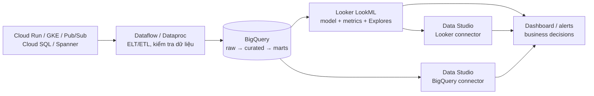
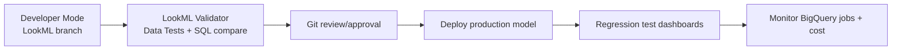

# Looker, Looker Studio và lớp khai thác dữ liệu

## 1. Bài toán: một chỉ số nhưng ba báo cáo khác nhau

Đội kinh doanh báo cáo **doanh thu thanh toán** 1,2 tỷ đồng, tài chính báo 1,1 tỷ và marketing báo 1,3 tỷ, dù đều đọc dữ liệu từ **BigQuery**. Nguyên nhân có thể là mỗi dashboard lọc trạng thái đơn hàng, múi giờ, refund, thuế và phép JOIN khác nhau. Mở quyền tự tạo biểu đồ không đủ để giải quyết bất nhất nếu thiếu **định nghĩa metric, nguồn dữ liệu tin cậy và quản trị truy cập**.

Một kiến trúc BI trên Google Cloud thường có ba lớp:

1. **Dữ liệu được chuẩn hóa:** Cloud Storage, Pub/Sub, Dataflow hoặc Dataproc nạp/biến đổi thành các bảng dữ liệu đã kiểm chứng trong BigQuery.
2. **Lớp ngữ nghĩa (*semantic layer*):** định nghĩa khái niệm đơn hàng, doanh thu, thời gian, quan hệ JOIN, quyền truy cập và cách tổng hợp. **Looker với LookML** là lựa chọn chuyên dụng cho lớp này; cũng có thể quản trị KPI tại BigQuery marts/views khi không dùng Looker.
3. **Lớp khai thác:** Looker **Explores/Looks/dashboards**, hoặc **Looker Studio (tên mới: Data Studio)** để tạo và chia sẻ biểu đồ tương tác.

Bài thuộc chương **Quản trị và khai thác dữ liệu** của module **CLOUD_PROVIDERS_GCP**, gắn với quản trị project, IAM, VPC, Cloud Run/GKE, cơ sở dữ liệu, phát hành tự động, theo dõi độ tin cậy và chi phí.

**Mục tiêu:** phân biệt đúng hai sản phẩm; xây metric contract có thể kiểm chứng; đọc/viết LookML cơ bản; kết nối BigQuery tới dashboard; nhận diện lỗi JOIN, credential và chi phí; triển khai self-service BI có phân quyền, kiểm thử và runbook.

> **Phạm vi lab:** Mọi project, dataset, tên kết nối và user attribute đều là giả định. Chỉ tạo BigQuery objects trong project thử nghiệm được phép; không triển khai LookML sang Looker production hoặc chia sẻ report chứa dữ liệu thật khi chưa có phê duyệt. Looker instance có thể cần license/quyền riêng; bài vẫn tự chứa nếu bạn chỉ thực hành phần BigQuery và Data Studio.

## 2. Phân biệt Looker, Looker Studio và tên Data Studio năm 2026

**Cập nhật tên sản phẩm:** Google đổi tên **Looker Studio thành Data Studio vào tháng 4/2026**; `datastudio.google.com` là địa chỉ mới và `lookerstudio.google.com` chuyển hướng. Tên bài học giữ nguyên theo chương trình, nhưng các bước giao diện sau đây dùng **Data Studio** khi nói tới sản phẩm báo cáo trước đây tên Looker Studio. **Looker** (bao gồm Looker Google Cloud core) là sản phẩm khác, không phải tên gọi mới của Data Studio.

| Tiêu chí | **Looker** | **Data Studio (trước đây Looker Studio)** |
| --- | --- | --- |
| Trọng tâm | Enterprise BI, mô hình ngữ nghĩa **LookML**, Explores và governed metrics | Trình tạo **reports/charts** và chia sẻ thông tin, nhiều connectors |
| Mô hình dữ liệu | Model, View, Dimension, Measure, Explore, Access Filter | Data source fields, calculated fields, blends, report filters |
| Ai định nghĩa metric | Data team quản trị LookML theo Git và quyền phát hành | Report/data source editors; có thể **tái sử dụng Looker Explore** qua connector |
| Nguồn phổ biến | BigQuery, Cloud SQL, các SQL databases được hỗ trợ | BigQuery, Google Sheets, Looker Explore và nhiều connectors khác |
| Phân quyền | Looker roles/model sets, user attributes và quyền tại database | Report/data source sharing + **data credentials**; underlying IAM tùy loại credential |
| Phát hành | Git, Development/Production Mode, validation, deploy | Report/data source sharing, reusable sources, quản trị workspace theo edition |
| Chi phí | License/instance và phí backend queries | Các tính năng miễn phí/trả phí theo edition; **backend BigQuery jobs vẫn tính phí** |

**Không nên nói:** “Data Studio tự thực thi LookML semantic layer”. Khi kết nối **BigQuery trực tiếp**, metric tính trong Data Studio không mặc nhiên theo LookML. Muốn sử dụng metric LookML đã định nghĩa, chọn **Looker connector → Explore** đủ điều kiện; connector có giới hạn tính năng, quyền và thời gian query.

## 3. Kiến trúc dữ liệu → semantic layer → dashboard



| Lớp | Hợp đồng/đầu ra | Kiểm soát quan trọng |
| --- | --- | --- |
| **Ingestion/raw** | Events, file, thay đổi giao dịch | Idempotency, schema evolution, data residency, PII |
| **Curated/mart** | `fact_orders`, `dim_customers`, bảng được chuẩn hóa | Keys, grain, dữ liệu trùng, timezone, chất lượng |
| **Semantic** | `paid_revenue`, `paid_orders`, customer/tenant dimension | Định nghĩa chỉ số, join cardinality, điều kiện truy cập |
| **Consumption** | Looker Explore và Data Studio reports | Sharing, filters, credentials, refresh cadence, cost |

**Lớp ngữ nghĩa không nhất thiết tạo bản sao dữ liệu:** LookML thường **mô tả SQL và sinh query** chạy trên database; không phải nơi mặc định lưu tất cả rows. Các cơ chế như Looker cache, **persistent derived tables (PDTs)** hoặc aggregate tables có thể tạo dữ liệu phụ, cần quản lý riêng.

### Semantic layer giải quyết gì?

Nếu marketing lọc `status IN ('PAID','SHIPPED')` còn tài chính chỉ lấy `status = 'PAID'`, hai biểu đồ đều “đúng SQL” nhưng sai chuẩn KPI. Semantic layer quy định **tên, mô tả, công thức, grain, filters, đơn vị, timezone, owner, quy tắc bảo mật và lịch cập nhật** của metric. Sau đó người dùng tự chọn chiều phân tích thay vì tự viết lại phép tính.

## 4. Thiết kế metric contract trước khi làm dashboard

Giả sử **một row tương ứng một order** trong `fact_orders`, `amount_vnd` là giá trị tại thời điểm thanh toán, không phải số tiền sau refund. Định nghĩa minh họa:

| Metric | Công thức/định nghĩa | Ràng buộc cần thống nhất |
| --- | --- | --- |
| **Paid orders** | `COUNT(DISTINCT order_id)` với `payment_status='PAID'` | Key duy nhất; event duplicates được loại bỏ |
| **Gross paid amount** | `SUM(amount_vnd)` của orders thanh toán | Chưa trừ refunds, không gồm `NEW/CANCELLED` |
| **Net revenue** | Gross paid − refunds − điều chỉnh theo chính sách tài chính | Phải có refund data và định nghĩa taxes/fees |
| **Average paid order value** | Gross paid / paid orders | Định nghĩa cách xử lý mẫu số 0 |
| **Daily revenue** | Theo `DATE(paid_at, 'Asia/Ho_Chi_Minh')` hoặc timezone chuẩn đã chọn | Không dùng lẫn ngày UTC và ngày nghiệp vụ |
| **Data freshness** | Tuổi mốc dữ liệu thành công gần nhất | Phân biệt ingestion lag với BI cache |

**Không đổi tên Gross thành Net** nếu chưa trừ refund. Không cộng `order amount` sau JOIN 1-n với order items mà không kiểm soát **fanout**, vì cùng đơn hàng có thể bị nhân nhiều lần.

### Metric contract tối thiểu

```yaml
# Bản mô tả nghiệp vụ tham khảo, KHÔNG phải LookML
metric: gross_paid_amount_vnd
owner: finance_analytics
source: acme-bi-lab.sales_mart.fact_orders
grain: order_id
aggregation: SUM(amount_vnd)
filter: payment_status = 'PAID'
timezone: Asia/Ho_Chi_Minh
currency: VND
refund_policy: excluded
freshness_slo: 2h
validation: compare to settlement ledger
```

Giá trị này là **tài liệu hợp đồng nghiệp vụ**, không phải cấu hình chạy tự động. Khi chuyển thành LookML hoặc BigQuery view, phải có kiểm thử tính đúng đắn và người phê duyệt nghiệp vụ.

## 5. Lab A — tạo BigQuery mart giả để làm nguồn chung

Thực hành này **không yêu cầu có Looker license**. Dùng BigQuery Console hoặc `bq` trên **project lab** với Billing đã được phê duyệt; dataset tại `asia-southeast1`.

### 5.1. Tạo dataset (chỉ thực hiện một lần)

```bash
# THAY ĐỔI: tạo dataset tính phí storage/jobs nếu chưa có
bq --project_id=acme-bi-lab mk \
  --dataset --location=asia-southeast1 \
  acme-bi-lab:sales_mart

# CHỈ ĐỌC: xác minh dataset/location
bq show --format=prettyjson acme-bi-lab:sales_mart
```

### 5.2. Tạo bảng đơn hàng có dữ liệu thử

```sql
-- GoogleSQL. THAY ĐỔI: chỉ chạy khi chưa có bảng cùng tên trong LAB.
CREATE TABLE `acme-bi-lab.sales_mart.fact_orders` (
  order_id STRING NOT NULL,
  tenant_id STRING NOT NULL,
  customer_id STRING NOT NULL,
  paid_at TIMESTAMP,
  payment_status STRING NOT NULL,
  amount_vnd NUMERIC NOT NULL
)
PARTITION BY DATE(paid_at)
CLUSTER BY tenant_id, customer_id;

INSERT INTO `acme-bi-lab.sales_mart.fact_orders`
  (order_id, tenant_id, customer_id, paid_at, payment_status, amount_vnd)
VALUES
  ('O1','TENANT_A','C01',TIMESTAMP '2026-11-17 01:00:00+00','PAID',100000),
  ('O2','TENANT_A','C01',TIMESTAMP '2026-11-17 04:00:00+00','PAID',200000),
  ('O3','TENANT_A','C02',NULL,'NEW',50000),
  ('O4','TENANT_B','C03',TIMESTAMP '2026-11-18 10:00:00+00','PAID',300000),
  ('O5','TENANT_B','C04',NULL,'CANCELLED',80000);
```

Lab có ba đơn đã thanh toán, tổng **600.000 VND** (tenant A 300.000; tenant B 300.000). Có thể truy vấn lại để xác minh:

```sql
-- CHỈ ĐỌC, không dùng SQL mẫu này để suy luận Net revenue
SELECT tenant_id,
       COUNTIF(payment_status = 'PAID') AS paid_orders,
       SUM(IF(payment_status = 'PAID', amount_vnd, 0)) AS gross_paid_amount_vnd
FROM `acme-bi-lab.sales_mart.fact_orders`
GROUP BY tenant_id
ORDER BY tenant_id;
```

Khi bảng nguồn thật có **nhiều payment events cho một order**, `COUNTIF` không đủ; cần tạo bảng **một row/order** hoặc dùng đúng `COUNT(DISTINCT ...)` và dedup. **Không đưa giả định một row/order của lab áp dụng mù quáng cho transactional/event tables.**

### 5.3. Tạo curated view dùng lại cho nhiều công cụ

```sql
-- THAY ĐỔI: tạo view, chưa chuyển tiền hoặc sửa dữ liệu nguồn
CREATE VIEW `acme-bi-lab.sales_mart.v_paid_orders` AS
SELECT
  order_id, tenant_id, customer_id, paid_at, amount_vnd,
  DATE(paid_at, 'Asia/Ho_Chi_Minh') AS paid_date_vn
FROM `acme-bi-lab.sales_mart.fact_orders`
WHERE payment_status = 'PAID';

-- CHỈ ĐỌC: kỳ vọng 3 rows, tổng 600.000
SELECT tenant_id, COUNT(*) AS orders, SUM(amount_vnd) AS gross_paid_amount_vnd
FROM `acme-bi-lab.sales_mart.v_paid_orders`
GROUP BY tenant_id;
```

**Ưu điểm:** một BigQuery view có thể được cả Looker lẫn Data Studio sử dụng để thống nhất filter cơ bản. **Giới hạn:** view không tự bảo đảm mọi metric khác cùng công thức, không giải quyết join fanout và **không thay Looker LookML** với access filters/model tests. Nếu dùng views cho security, phải cấu hình **authorized views hoặc IAM đúng**, không mặc định cấp quyền xem view là quyền xem dữ liệu nguồn.

## 6. Data quality trước BI: keys, grain và tính nhất quán

**Grain** là một row đại diện cho điều gì. Với `fact_orders` là **order**, `order_id` phải **unique/non-null**; với `order_items` là **line item**, cùng `order_id` có thể xuất hiện nhiều dòng.

```sql
-- CHỈ ĐỌC: phát hiện duplicate orders; phải trả 0 dòng
SELECT order_id, COUNT(*) AS n
FROM `acme-bi-lab.sales_mart.fact_orders`
GROUP BY order_id
HAVING COUNT(*) > 1;

-- CHỈ ĐỌC: phát hiện dữ liệu sai business rule
SELECT *
FROM `acme-bi-lab.sales_mart.fact_orders`
WHERE order_id IS NULL
   OR amount_vnd < 0
   OR payment_status NOT IN ('NEW','PAID','CANCELLED');
```

BigQuery có thể khai báo **PRIMARY KEY/FOREIGN KEY** trong một số mô hình nhưng các ràng buộc này **không được cưỡng chế như OLTP database**; pipeline phải tự kiểm tra và đảm bảo dữ liệu đúng. LookML `primary_key: yes` cũng là **lời khai báo để Looker tính toán**, không làm dữ liệu bị duplicate tự biến mất.

### Kiểm thử acceptance trước khi mở dashboard

1. Đối chiếu rows và gross amount với source-of-truth/payment ledger.
2. Thử ngày UTC khác ngày `Asia/Ho_Chi_Minh` (ví dụ 20:00 UTC là ngày hôm sau ở Việt Nam).
3. Kiểm tra `NEW/CANCELLED` không được tính vào paid revenue.
4. Thử dữ liệu trả về sau refund: metric Gross giữ nguyên, metric Net mới phải trừ theo policy.
5. So metrics bằng **SQL, Looker Explore và Data Studio** trên **cùng time range/tenant/filter**.

## 7. LookML: View, Model, Explore, Dimension và Measure

Looker **LookML** định nghĩa model để xây SQL theo các fields người dùng chọn, giúp business analysts khám phá dữ liệu mà không cần viết SQL cho từng biểu đồ.

| Thành phần | Tương ứng | Tác dụng |
| --- | --- | --- |
| **Project** | Repository LookML (Git) | Quản lý phiên bản và phát hành |
| **Model** `*.model.lkml` | Kết nối, tập Explores, caching/permissions | Entry point của semantic layer |
| **View** `*.view.lkml` | Bảng hoặc derived table | Định nghĩa fields |
| **Dimension** | Nhóm/filter theo thuộc tính row | Tenant, order ID, ngày |
| **Measure** | Tổng hợp trên tập rows | Count, sum, average |
| **Dimension group** | Một cột time thành day/week/month | Phân tích theo thời gian |
| **Explore** | Business dataset để người dùng query | Chọn dimensions/measures/filters, JOIN |
| **Access filter / grant** | Hạn chế theo user attributes/quyền | Kiểm soát hiển thị/query dữ liệu |
| **Datagroup / PDT** | Cache trigger / derived table bền vững | Hiệu năng và đồng bộ ETL |

**Looker generates SQL**, người dùng chọn `paid_date` và `gross_paid_amount`, rồi Looker đưa điều kiện và tổng hợp xuống BigQuery. Cần **Looker instance và database connection đã được quản trị**. LookML không chạy bằng `bq query`; code mẫu bên dưới được đặt trong Looker IDE/project có Git.

## 8. Lab B — định nghĩa LookML có thể tái sử dụng

### 8.1. View file: `views/orders.view.lkml`

```lookml
view: orders {
  sql_table_name: `acme-bi-lab.sales_mart.fact_orders` ;;

  dimension: order_id {
    primary_key: yes
    type: string
    sql: ${TABLE}.order_id ;;
  }

  dimension: tenant_id {
    type: string
    sql: ${TABLE}.tenant_id ;;
  }

  dimension: customer_id {
    type: string
    sql: ${TABLE}.customer_id ;;
  }

  dimension: payment_status {
    type: string
    sql: ${TABLE}.payment_status ;;
  }

  dimension_group: paid {
    type: time
    timeframes: [raw, date, week, month]
    sql: ${TABLE}.paid_at ;;
  }

  dimension: amount_vnd {
    type: number
    sql: ${TABLE}.amount_vnd ;;
    hidden: yes
  }

  measure: order_count {
    type: count
    drill_fields: [order_id, tenant_id]
  }

  measure: paid_orders {
    type: count
    filters: [payment_status: "PAID"]
    description: "Số đơn đã thanh toán, mỗi order_id duy nhất"
  }

  measure: gross_paid_amount_vnd {
    type: sum
    sql: ${amount_vnd} ;;
    filters: [payment_status: "PAID"]
    description: "Gross VND; chưa trừ refund hoặc phí"
  }
}
```

**Điều kiện để kết quả đúng:** `order_id` thực sự unique/non-null; mỗi row là một order; `amount_vnd` không chứa chuỗi cần cast; không có refund logic bị lẫn vào định nghĩa. LookML là **mô hình code**, chưa tự làm sạch dữ liệu gốc.

### 8.2. Model file: `commerce.model.lkml`

```lookml
connection: "bq_commerce_lab"
include: "/views/*.view.lkml"

datagroup: orders_refresh {
  max_cache_age: "2 hours"
}

explore: orders {
  label: "Đơn hàng"
  description: "Dữ liệu một row/order; gross paid chưa trừ refund"
  persist_with: orders_refresh
}
```

Tên `bq_commerce_lab` phải là **database connection đã tạo bởi Looker admin** (kết nối BigQuery, billing project, region/permissions phù hợp); không phải tên dataset hay service account. `persist_with` đặt cache policy cho Explore; `max_cache_age` không biến dữ liệu đầu nguồn thành real-time và không đảm bảo mọi dashboard refresh đúng một thời điểm. Có thể đồng bộ với ETL bằng **datagroup SQL trigger** khi cần, nhưng phải tính quyền/cost và chính sách PDT của connection.

### 8.3. Khám phá trên Looker

1. Vào **Development Mode** của Looker instance được cấp quyền, mở LookML project đúng repository/branch.
2. Tạo `views/orders.view.lkml` và `commerce.model.lkml`, chọn connection đã kiểm tra; **Validate LookML**.
3. Mở **Explore → Đơn hàng**: chọn `orders.paid_date`, `orders.paid_orders`, `orders.gross_paid_amount_vnd`; thêm date range và tenant filter.
4. Mở tab **SQL** xem BigQuery SQL sinh ra, xác nhận `payment_status='PAID'` nằm trong phép tổng hợp và date filter đúng.
5. Kiểm tra tổng toàn bộ bảng **600.000 VND**, rồi thử từng tenant; cân nhắc lưu Look/dashboard **trong môi trường test**.
6. Dùng Git commit/review/tests trước production deployment; không sửa metric đang được dùng trong dashboard thật mà không thông báo người sở hữu.

**Thận trọng với timezones:** trường `paid_at` trong SQL là `TIMESTAMP` (UTC), còn timeframes Looker có thể chịu **query timezone / user timezone**. Để so đúng với `paid_date_vn` của SQL lab, cấu hình timezone/business calendar nhất quán hoặc thêm dimension tính ngày Việt Nam, rồi test ranh giới ngày.

## 9. JOIN cardinality và fanout: nơi metric thường sai

Giả sử `fact_orders` có một hàng cho `O1`, còn `order_items` có **ba dòng** của `O1`. Khi:

```sql
-- CHỈ ĐỌC: ví dụ khái niệm (bảng order_items không có trong lab)
SELECT SUM(o.amount_vnd) AS revenue
FROM `acme-bi-lab.sales_mart.fact_orders` AS o
JOIN `acme-bi-lab.sales_mart.order_items` AS i USING (order_id)
WHERE o.payment_status = 'PAID';
```

Giá trị `amount_vnd` của `O1` bị nhân **ba lần**, khiến `SUM` sai. Looker dùng **join relationships** và, với dialect hỗ trợ, **symmetric aggregates** để giảm một số lỗi fanout. Nhưng nếu khai báo relationship hoặc primary key sai, kết quả vẫn có thể sai hoặc Looker báo lỗi key không unique.

| Quan hệ | Ví dụ | Khai báo LookML nhìn từ base Explore |
| --- | --- | --- |
| **Many-to-one** | Nhiều orders thuộc một customer | `relationship: many_to_one` |
| **One-to-many** | Một order có nhiều order items | `relationship: one_to_many` |
| **One-to-one** | Một order có đúng một payment summary | `relationship: one_to_one`, phải kiểm chứng uniqueness |
| **Many-to-many** | Người dùng và nhiều nhóm | Thận trọng bridge tables, grain và aggregation |

**Ví dụ `dim_customers` có `customer_id` duy nhất:**

```lookml
# Đoạn bổ sung bên trong commerce.model.lkml
explore: orders {
  join: customers {
    type: left_outer
    sql_on: ${orders.customer_id} = ${customers.customer_id} ;;
    relationship: many_to_one
  }
}
```

Đoạn trên **minh họa khai báo JOIN**; khi tích hợp vào model thật, **ghép `join` vào block `explore: orders` hiện có**, không tạo hai blocks trùng tên trong cùng model. Cần tạo `view: customers` với `customer_id primary_key: yes` và kiểm tra uniqueness trên BigQuery.

### Kiểm tra tránh fanout

1. Định nghĩa **grain** mỗi bảng trước khi JOIN, chẳng hạn một row/order so với một row/item.
2. Kiểm tra `COUNT(*)`, `COUNT(DISTINCT order_id)` trước và sau JOIN.
3. Nếu có `order_amount` ở bảng order-level, không cộng trực tiếp sau JOIN 1-n mà không tính lại ở đúng grain.
4. Đặt `primary_key: yes` trên key **thực sự unique và non-null** ở tất cả views tham gia tổng hợp.
5. So kết quả Looker Measure với một SQL chuẩn độc lập, thử khi một order có **0, 1 và nhiều items**.

**Khi chưa chắc**, tạo BigQuery mart ở **đúng grain** trước rồi mới cho business self-service. Semantic layer quản lý định nghĩa nhưng không thay thế kiểm tra chất lượng nguồn.

## 10. Quản trị Looker: roles, user attributes và access filters

Looker có **quyền ứng dụng** (roles, permissions, model sets) và **quyền database** của connection. Người dùng có quyền vào Explore **không mặc nhiên có IAM BigQuery trực tiếp**, nhất là nếu connection dùng một service account chung.

### Row-level filtering theo tenant

Giả sử mỗi Looker user được gán user attribute `tenant_id` bởi admin từ hệ thống identity; thêm vào Explore:

```lookml
# Bổ sung bên trong explore: orders đã khai báo
access_filter: {
  field: orders.tenant_id
  user_attribute: tenant_id
}
```

Tác dụng: Looker sinh điều kiện WHERE giới hạn `orders.tenant_id` theo user attribute. Admin nên cấu hình attribute **không cho người dùng tự sửa**. Nếu người dùng có quyền edit được `tenant_id`, quy tắc không còn đáng tin. Kiểm tra SQL sau khi đăng nhập với **user test TENANT_A và TENANT_B**, dùng đúng dữ liệu test để xác minh không lẫn tenant.

**Ranh giới rất quan trọng:** `access_filter` bảo vệ **truy vấn đi qua Explore đã cấu hình**, không tự ngăn người dùng **gọi BigQuery trực tiếp**, sử dụng Explore khác thiếu filter, truy cập view/connection khác hoặc tải report đã xuất trước đó. Với dữ liệu nhạy cảm, nên áp dụng thêm **BigQuery row-level security/authorized views/column policy tags**, IAM và quy trình kiểm thử tất cả đường truy cập. Không coi LookML là IAM cho toàn GCP.

### OAuth và service account: ai thực sự được BigQuery thấy?

| Looker BigQuery connection | BigQuery nhận danh tính | Hệ quả |
| --- | --- | --- |
| **Service account/ADC chung** | Looker connection SA | BigQuery row policies/column masking theo **SA**, không phân biệt từng Looker user; LookML user attributes phải được quản trị chặt |
| **OAuth theo từng người** | Từng BigQuery-authorized user | BigQuery có thể dùng **IAM/row/column policies theo user**; mỗi viewer cần quyền phù hợp |

Với **Looker (Google Cloud core)**, service agent của Looker hiện được quản lý bằng quyền ngày càng giới hạn; cấp explicit BigQuery roles theo connection type, không giả định một role Service Agent cũ đã bao trùm tất cả. **PDT** có thể cần account/dataset quyền ghi riêng, nhất là khi connection dùng OAuth.

**Nguyên tắc:** ai có thể đọc một metric qua dashboard, ai có thể tạo Explore, ai có thể tải dữ liệu thô, ai có thể sửa LookML và ai có thể thay credentials là **những quyền khác nhau**. Dùng least privilege, tách dev/test/prod, kiểm tra audit/query logs.

## 11. Looker self-service: Explore, Look, dashboard và lịch gửi

### Vai trò các thành phần

| Thành phần | Chức năng | Quy tắc thực hành |
| --- | --- | --- |
| **Explore** | Chọn dimensions/measures/filters/pivots; sinh SQL từ LookML | Dùng cho ad hoc analysis có giới hạn dữ liệu |
| **Look** | Lưu một truy vấn/trực quan hóa có thể tái sử dụng | Gắn owner, mô tả và quyền thư mục |
| **Dashboard** | Nhiều tiles/KPI được chia sẻ | Cùng date range/timezone/tenant, không mix KPI sai định nghĩa |
| **Schedule/alert** | Gửi kết quả theo thời điểm/điều kiện | Xem quyền người nhận, data freshness và cache |
| **Explore SQL tab** | Thấy SQL sinh từ LookML | Debug filter/join/pruning/cost |

### Bài tập tạo dashboard trong Looker (nếu có instance)

1. Mở `Explore: orders`, chọn `paid_date`, `paid_orders`, `gross_paid_amount_vnd`.
2. Chọn **time range** trên `paid_at`, ghi nhận timezone của user/connection.
3. Lưu **Look** với tên “Gross Paid VND by Day”; thêm vào dashboard “Commerce Overview – LAB”.
4. Tạo hai tiles: tổng doanh thu đã thanh toán và biểu đồ theo ngày; tránh phép tính trùng lặp ở chart level.
5. Đổi tenant test, xác nhận `access_filter` hoạt động và chart không hiển thị dữ liệu sai quyền.
6. Xem **SQL/History** khi cần điều tra vì sao tile hiển thị chậm hoặc khác giá trị BigQuery.

**Dashboard đúng hình thức chưa chứng minh metric đúng.** Cần acceptance test ở mục 6 và biết tile có đang dùng **cached result** hay chạy query mới.

## 12. Lab C — Data Studio kết nối BigQuery trực tiếp

Thực hành giao diện web tại **[Data Studio](https://datastudio.google.com/)**, không cần Looker instance. Điều kiện: user được phép dùng Data Studio; có access phù hợp tới `acme-bi-lab.sales_mart.v_paid_orders` hoặc data source được cấp quyền; nơi chạy query BigQuery có Billing và quota.

### 12.1. Tạo report

1. Mở Data Studio → **Create → Report** → **Add data → BigQuery**.
2. Chọn **Project → Dataset `sales_mart` → View `v_paid_orders`**, xác minh region, source/connection và loại credentials.
3. Tạo **scorecard** metric `SUM(amount_vnd)`, đặt tên **Gross Paid (VND)**.
4. Tạo **time series** với dimension `paid_date_vn` và metric `SUM(amount_vnd)`.
5. Tạo bảng dimension `tenant_id`, metrics `COUNT_DISTINCT(order_id)` và `SUM(amount_vnd)`.
6. Thêm **date range control** theo `paid_date_vn`; hiển thị trên report **timezone: Asia/Ho_Chi_Minh**, currency và “Gross, refunds excluded”.
7. Lọc toàn bộ dữ liệu test: scorecard tổng **600.000**, mỗi tenant **300.000**.

**Điểm cần kiểm tra trong editor:** khi kết nối BigQuery view, Data Studio có thể suy kiểu field khác dự kiến; sửa `paid_date_vn` thành date đúng nếu cần. Khi dùng calculated field, xem aggregation và chart scope để không cộng hai lần một aggregate field đã được tổng hợp.

### 12.2. Không tự phát minh metric trong mỗi chart

Nếu người tạo chart tự viết `SUM(amount_vnd)` trên bảng `fact_orders` **không có filter PAID**, số sẽ khác view `v_paid_orders`. Để tránh KPI drift, ưu tiên **reusable data source trỏ curated view** hoặc **Looker Explore connector**. Nếu Data Studio report vẫn cần calculated field riêng, phải đặt description, owner và test định nghĩa bằng SQL.

### 12.3. Kiểm chứng query phát sinh

Với một truy vấn BigQuery được Data Studio thực thi, quản trị viên/owner có thể xem BigQuery **Job history**, Query plan, `total_bytes_processed`, `total_bytes_billed` và principal tương ứng. Data Studio charts có thể tạo **nhiều queries** khi refresh/filter, do đó việc report mở được không có nghĩa truy vấn không tính phí.

## 13. Data Studio data credentials: chia sẻ khác với cấp quyền dữ liệu

**Đây là phần bảo mật quan trọng nhất của Data Studio.** Một report có thể được chia sẻ với người **không có quyền vào BigQuery**, tùy credentials của data source:

| Chế độ credentials | Ai thực thi truy vấn | Người xem có cần quyền BigQuery? | Rủi ro/đánh đổi |
| --- | --- | --- | --- |
| **Owner's Credentials** | Chủ thể được chọn làm credential owner | Thường **không** | Người được chia sẻ report có thể xem dữ liệu bằng quyền của owner, cần giới hạn sharing |
| **Viewer's Credentials** | Từng viewer | **Có** `bigquery.jobUser` tại billing project và quyền đọc dữ liệu | Dễ quản trị theo IAM từng người, nhưng viewer thiếu quyền sẽ lỗi |
| **Service Account Credentials** | Service account cấu hình cho data source | Thường **không** | Được giới hạn cho BigQuery data sources và tổ chức/quản trị đủ điều kiện; quản lý SA/IAM riêng |

**Owner's Credentials là tính năng chia sẻ, không phải security bypass hợp lệ.** Nếu owner có quyền đọc PII hoặc tất cả tenants, report có thể làm lộ các trường/rows ấy cho những người được xem hoặc edit report, ngay cả khi họ **không** có BigQuery IAM. Với report multi-tenant, chỉ share nguồn đã được **server-side hạn chế đúng phạm vi**, kiểm tra các filter có thể thay đổi và khả năng export.

**Minimum IAM BigQuery** khi dùng Viewer/Owner/SA credentials: cần `roles/bigquery.jobUser` trên **billing project** để chạy jobs và `roles/bigquery.dataViewer` (hoặc quyền tương đương) trên dataset/table/view liên quan. Nếu view là **authorized view**, admin phải thiết lập authorized access tới nguồn tương ứng. Không cấp `roles/bigquery.admin` hay project Owner để sửa lỗi 403.

### Tình huống xác thực quyền

```text
Data source = BigQuery v_paid_orders
Credential mode = Owner's Credentials
Owner được đọc TENANT_A + TENANT_B
Report share cho nhân viên TENANT_A
                         ↓
Nếu report cho phép xem toàn bộ tenant và không có
row-level security bên dưới, TENANT_A có thể thấy TENANT_B.
```

**Giải pháp:** dùng BigQuery row policies/authorized views theo người nhận (phù hợp cách xác thực), hoặc tạo nguồn/dataset/report phân tách rõ. Data Studio có tính năng **filter by viewer email** trong một số loại data source, nhưng cần kiểm tra quyền truy cập, định danh email và cấu hình kỹ; không dùng như cơ chế duy nhất nếu dữ liệu có yêu cầu pháp lý nghiêm ngặt.

## 14. Lab D — Data Studio dùng Looker Explore làm nguồn quản trị

Nếu tổ chức có **Looker instance đủ điều kiện**, chỉ **Looker admin** có thể bật **Looker connector** cho Data Studio. Quy trình:

1. Admin bật connector trong Looker và kiểm tra instance, edition, OAuth/permissions hỗ trợ.
2. Vào Data Studio → **Add data → Looker**, đăng nhập/ủy quyền với Looker instance được phép.
3. Chọn **model `commerce` → Explore `orders`** đã được review và có metric `gross_paid_amount_vnd`.
4. Tạo scorecard/time series từ **Looker measures/dimensions**, không viết lại `SUM` hoặc PAID filter riêng trong Data Studio.
5. Kiểm tra tenant access filter với hai tài khoản test, timezone, field compatibility, data freshness và query count.

**Giới hạn connector cần biết:** không hỗ trợ mọi Looker instance/loại triển khai, có giới hạn query timeout khoảng **5 phút**, chart row limit **5.000** và export giới hạn theo quyền. Data Studio không thừa hưởng mọi feature của Looker Explore; xem **requirements/limits/feature support** trước khi chọn làm chuẩn kiến trúc. Với tập dữ liệu lớn hoặc truy vấn chậm, tối ưu LookML/BigQuery trước, không tăng số biểu đồ một cách tùy ý.

**Lợi ích:** thay đổi `gross_paid_amount_vnd` tại LookML qua quy trình quản trị có thể giúp nhiều dashboards dùng chung định nghĩa. **Điều không tự xảy ra:** các report Data Studio đã kết nối BigQuery trực tiếp hoặc copy calculated fields sẽ **không tự cập nhật** theo LookML mới.

## 15. Cache, data freshness và tăng tốc truy vấn

Một dashboard phản hồi nhanh đôi khi đang hiển thị **dữ liệu cũ từ cache**. Hãy phân biệt:

| Tầng | Cơ chế | Rủi ro cần giám sát |
| --- | --- | --- |
| **Ingestion/ELT** | BigQuery marts cập nhật sau batch/streaming | Source cập nhật chậm dù dashboard refresh mới |
| **Looker query cache** | Trả kết quả SQL đã tính trước; điều khiển bằng `persist_with`/datagroups | Cache chưa hết hạn hoặc invalidation sai sau ETL |
| **Looker PDT/aggregate table** | Dữ liệu trung gian/tổng hợp được persist trong database | Materialization chậm, thiếu quyền ghi, query dùng bảng cũ |
| **Data Studio data freshness** | Lưu kết quả truy vấn tạm theo datasource/config | Người xem không thấy cập nhật ngay; filter mới có thể tạo query mới |
| **BigQuery BI Engine** | In-memory acceleration cho những query được hỗ trợ | Reservation/coverage/BI Engine query compatibility, phí |
| **BigQuery partitioning/clustering** | Giảm partitions/blocks phải quét | Dashboard không truyền filter ngày hoặc dùng `SELECT *` |

### Looker datagroup gắn với ETL

Mẫu `orders_refresh` ở mục 8 dùng `max_cache_age: "2 hours"` để giới hạn tuổi cache Looker. Trong production, có thể bổ sung `sql_trigger` trả về giá trị thay đổi khi pipeline xử lý xong, chẳng hạn `MAX(batch_id)` từ bảng ETL watermark. Looker sẽ refresh caches/rebuild PDTs theo cấu hình trigger/connection schedule.

**Không chạy query liên tục không cần thiết để “kiểm tra data mới”.** Trigger query và PDT materialization cũng tiêu thụ tài nguyên BigQuery; với connection OAuth cần quyền riêng để PDT build. Khi data cập nhật 1 lần/ngày, cache 10 giây hiếm khi cải thiện freshness thực tế mà chỉ tăng tải.

### Data Studio freshness không giống BigQuery table freshness

Với BigQuery data source, Data Studio cho phép đặt data freshness theo các mức hỗ trợ (ví dụ mỗi phút/giờ) và thường mặc định **12 giờ**. Khi filter/query mới chưa có trong cache, Data Studio **vẫn có thể gọi BigQuery** trước lúc freshness hết hạn. Chế độ **Owner's Credentials** dùng cache chung theo credential owner; **Viewer's Credentials** có state cache tách theo viewer.

**Cách đọc đúng SLO:** “dashboard update mỗi giờ” chỉ có nghĩa khi **nguồn đã được cập nhật**, cache/connector không trì hoãn vượt mục tiêu và người dùng đang xem đúng date range. Nên đưa **`last_successful_etl_at`** lên dashboard để người xem nhận biết độ tươi.

### Khi nào dùng BI Engine, PDT hoặc aggregate table?

- **BI Engine**: phù hợp workload BigQuery nhiều truy vấn lặp, có reservation và query shapes được hỗ trợ. Không phải tất cả SQL được gia tốc; cần đo từ job statistics.
- **Looker PDT**: hữu ích cho phép JOIN/biến đổi phức tạp cần materialize; cần quyền dataset ghi và lifecycle riêng.
- **Looker aggregate awareness**: chọn aggregate tables đã persist cho truy vấn tổng hợp phù hợp; cần thiết kế đúng grain và filter để tránh sai số.
- **BigQuery materialized view / curated mart**: cân nhắc nếu không muốn gắn tối ưu hiệu năng với riêng công cụ Looker.

Không cài đồng thời mọi kiểu cache chỉ để tăng tốc: mỗi lớp làm việc kiểm chứng **freshness, data correctness và phân bổ chi phí** khó hơn.

## 16. Quản lý BigQuery cost khi BI self-service

Mỗi lần mở dashboard có thể kích hoạt **nhiều SQL queries**; thay date range, filter, refresh hoặc drill-down lại có thể chạy các jobs mới. Nếu Data Studio dùng **Owner's Credentials**, các jobs có thể tính phí vào billing project của owner/SA theo cấu hình source.

### Ví dụ sizing truy vấn

```text
10 reports × 8 charts/report × 30 lượt refresh/ngày
    = tối đa khoảng 2.400 chart evaluations/ngày
```

Đây **không phải 2.400 BigQuery jobs chính xác**: Data Studio/Looker caches, chart query sharing, controls và connector hành vi khác nhau; một chart cũng có thể tạo nhiều jobs. Hãy đo query history và Cloud Billing thay vì giả định từ số charts.

**Biện pháp chính:**

1. Tạo **curated marts** đúng grain, loại fields không cần và chọn đơn vị tiền/currency thống nhất.
2. **Partition** `fact_orders` theo ngày nghiệp vụ phù hợp, **cluster** `tenant_id/customer_id` nếu truy vấn thật lọc theo cột ấy.
3. Đặt **default date range** hợp lý (30 hoặc 90 ngày thay vì mọi lịch sử), dùng required filters trong Looker hoặc controls trong Data Studio có kiểm thử.
4. Dùng BigQuery **dry run** để dự toán bytes cho SQL đại diện; **block pruning** của clustering có thể chỉ thể hiện chính xác khi query chạy.
5. Chọn freshness/caching theo **ETL SLA**; không auto refresh mỗi phút nếu dữ liệu cập nhật hằng ngày.
6. Cân nhắc BI Engine/aggregate awareness/PDT khi **có bằng chứng** query lặp và chi phí có thể cải thiện.
7. Theo dõi **BigQuery Editions/reservations** nếu dùng capacity pricing, tránh suy “bytes thấp hơn = hóa đơn thấp tương ứng” như on-demand.
8. Đặt budgets/alerts, chủ sở hữu dashboards, quyền export/download và hạn mức truy vấn theo policy.

### Query job observability bằng SQL

```sql
-- CHỈ ĐỌC: chạy tại region asia-southeast1, cần quyền jobs metadata
SELECT
  creation_time,
  user_email,
  job_id,
  cache_hit,
  total_bytes_processed,
  total_bytes_billed,
  total_slot_ms,
  state,
  error_result.message AS error_message
FROM `acme-bi-lab.region-asia-southeast1.INFORMATION_SCHEMA.JOBS_BY_PROJECT`
WHERE creation_time >= TIMESTAMP_SUB(CURRENT_TIMESTAMP(), INTERVAL 1 DAY)
  AND job_type = 'QUERY'
ORDER BY creation_time DESC
LIMIT 100;
```

**Lưu ý:** quyền xem job history khác quyền đọc dữ liệu, còn `user_email` trong chế độ service account/owner sẽ phản ánh **principal thực chạy query**, không mặc nhiên là người đang nhìn biểu đồ. Trong môi trường nhiều vùng, `region-asia-southeast1` phải khớp **job processing location**.

## 17. Dashboard controls, blends và nguy cơ sai số

Data Studio có chart-level filters, calculated fields, parameters và **data blending**. Chúng hữu ích cho thử nghiệm, nhưng không thay semantic modeling cho dữ liệu quan trọng.

### Ví dụ fanout do blending

```text
Nguồn A: orders theo order_id (1 row/order)
Nguồn B: campaign touches theo order_id (3 rows/order)
Blending A ↔ B tại order_id
               ↓
SUM(order_amount) có thể bị nhân 3 lần nếu grain không khớp
```

Giải pháp thường là pre-aggregate campaign touches về **một row/order** trước khi JOIN, hoặc định nghĩa metric ở grain chính xác trong BigQuery/Looker. Một blend từ nhiều sources có thể bị ảnh hưởng bởi **date range, filter application order, null joins, data credentials khác nhau và caching**.

### Quy tắc thiết kế dashboard hữu dụng

- Mỗi chart có **tên metric và đơn vị**, diễn giải Gross/Net, currency và timezone.
- Date range rõ, luôn có **Last updated** lấy từ pipeline state nếu dữ liệu cần gần real-time.
- Chỉ hiển thị dimensions cần thiết; loại fields chứa PII bằng curated view/authorized access.
- Dùng **reuse data source** thay vì clone metric công thức vào nhiều reports.
- Có **owner, audience, SLA, dashboard version** và feedback path.
- Với thông tin nhạy cảm, kiểm tra **share, embed, export, schedule email, link access** và test với một user ngoài nhóm dự kiến.

**Biểu đồ trông đúng không phải data quality test.** Tạo test cases có cố ý duplicate, null, out-of-order và refund để xác minh kết quả trong cả Looker và Data Studio.

## 18. Dev → review → production: quản trị LookML và report

### Looker LookML (Git-centric)



1. Đặt **LookML model/view** trong Git repository; dùng **Development Mode** và branch cá nhân.
2. Chạy **LookML Validator**, data tests (nếu cấu hình), kiểm tra generated SQL và so kết quả với SQL chuẩn.
3. Review thay đổi **measure/filter/join/primary key** bằng owner nghiệp vụ lẫn kỹ thuật; không chỉ qua lint syntax.
4. Merge theo quy trình Git/CI; **Deploy to Production** bằng người có quyền `deploy` hoặc automation được phép.
5. Chạy **Content Validator** để tìm Looks/dashboards bị ảnh hưởng do đổi tên field/model, so metric trước/sau.
6. Giám sát data freshness, BigQuery jobs và chênh lệch số liệu sau phát hành; có commit/revision rollback plan.

**LookML Validator kiểm tra cấu trúc, không chứng minh KPI đúng.** Một `measure: gross_paid_amount_vnd` hợp cú pháp nhưng thiếu PAID filter vẫn có thể qua validator. Dùng **data tests và independent SQL reconciliation** để kiểm chứng.

### Data Studio report lifecycle

Data Studio **không tự đồng bộ phiên bản với LookML Git** khi kết nối BigQuery trực tiếp. Quản lý **reusable data sources**, quyền editors/viewers, copy staging report, tên phiên bản, mô tả changes và kiểm tra liên kết nguồn. Trước khi thay nguồn, kiểm tra affected reports/charts, credentials và consent/permissions của người nhận.

Đối với tính năng edition/workspace có tính quản trị nâng cao, xem chính sách **Data Studio Pro** hiện hành; không giả định mọi tài khoản đều có cùng entitlement hoặc các nút triển khai.

### Ma trận regression test tối thiểu

| Thay đổi | Kiểm thử bắt buộc |
| --- | --- |
| Đổi tên LookML field | Dashboards/Looks dùng field cũ, Content Validator |
| Đổi PAID filter | Tổng doanh thu theo tenant và thời gian trước/sau |
| Thêm JOIN `order_items` | Fanout: COUNT distinct, sum và primary key uniqueness |
| Đổi BigQuery view schema | Data Studio calculated fields và chart field mapping |
| Đổi credential mode | Hai user với IAM khác nhau, report sharing/export |
| Đổi refresh/cache | Last updated, ETL completion, cost/concurrency |
| Đổi timezone | Các orders tại ranh giới ngày/tháng |

## 19. Monitoring và runbook xử lý lỗi

| Triệu chứng | Nguyên nhân thường gặp | Chẩn đoán đúng lớp |
| --- | --- | --- |
| Dashboard Looker không có dữ liệu | Connection/auth/Explore permissions, SQL sai | Looker History, SQL, BigQuery job errors |
| Data Studio chart báo **Permission denied** | Viewer credentials thiếu IAM hoặc source owner/SA mất quyền | Data source credential mode, `bigquery.jobUser` và `dataViewer` |
| Một tenant thấy dữ liệu tenant khác | Owner credentials quá rộng, LookML Explore thiếu filter, view chung không hạn chế | Test cross-user, audit, row policies và report sharing |
| KPI Looker khác Data Studio | PAID/Net filter, timezone, cache, joins, calculated fields | Metric contract và SQL so theo cùng grain |
| Metric sau JOIN tăng gấp đôi | One-to-many fanout, primary key không unique | Compare COUNT rows/distinct, `relationship`, symmetric aggregates |
| Dashboard chậm | Query BigQuery scan lớn, nhiều tiles, JOIN, cache miss hoặc Looker resource | SQL plan, bytes/slot ms, Looker System Activity |
| Report sau ETL vẫn cũ | Looker/Data Studio cache hoặc PDT không rebuild | Last ETL watermark, datagroup, freshness setting |
| Cost tăng | Auto refresh, nhiều người filter, full history scan, owner credential shared | BigQuery jobs-by-principal, dashboard/view filters, Billing |
| LookML deploy làm hỏng Looks | Rename fields/Explores, changed filters | Git revision, LookML/Content Validator, revert |
| Looker connector trong Data Studio timeout | Query vượt 5 phút, Explore không được hỗ trợ hoặc thiếu quyền | Connector limits, generated SQL, region/permissions |

### Runbook khi dashboard doanh thu bất nhất

1. **Khoanh vùng KPI:** metric code/version, dashboard/report ID, tenant, date range, timezone, currency và thời điểm quan sát.
2. Xác định **nguồn thực**: BigQuery table/view hay Looker Explore; lưu SQL/LookML và credential mode (không xuất token/PII).
3. Chạy **SQL chuẩn độc lập** trên curated table với cùng filters, đối chiếu owner/payment ledger.
4. Kiểm tra **grain, JOIN fanout, duplicates, refunds và NULLs** trước khi sửa biểu đồ.
5. So caches: ETL watermark, Looker datagroup/PDT, Data Studio data freshness, BigQuery cache_hit.
6. Nếu có rủi ro lộ dữ liệu, **thu hồi quyền report/data source có kiểm soát**, audit truy cập rồi sửa IAM/row policy/user attributes.
7. Sửa **tại một nguồn định nghĩa chung**, chạy regression tests, phát hành, giám sát BigQuery jobs và thông báo thay đổi KPI cho business owners.

**Đừng sửa số liệu bằng cách thêm filter ẩn riêng trong mỗi chart** khi chưa biết nguồn sai. Điều đó che triệu chứng và làm semantic drift nặng thêm.

## 20. Ba tình huống thiết kế thực tế

### 20.1. Dashboard quản trị doanh thu liên phòng ban

**Bối cảnh:** tài chính, marketing và vận hành đều xem doanh thu nhưng dùng các định nghĩa khác nhau.

**Thiết kế:** chuẩn hóa `fact_orders` và refund ledger trên BigQuery; tạo LookML `gross_paid_amount`, `refund_amount`, `net_revenue` kèm mô tả, timezone và data tests; cho nhóm nghiệp vụ tạo báo cáo từ **Looker Explores**. Nếu cần Data Studio, ưu tiên **Looker connector** để dùng lại metric đã review.

**Tiêu chí đạt:** cùng tenant/date range cho cùng kết quả, dashboard chỉ rõ Gross/Net và last ETL time, mọi thay đổi KPI có owner/phê duyệt.

### 20.2. Báo cáo đa tenant cho ứng dụng SaaS

**Bối cảnh:** khách hàng TENANT_A/TENANT_B truy cập portal tự phục vụ, nhưng không được xem đơn hàng nhau.

**Thiết kế:** BigQuery `tenant_id` là thuộc tính bắt buộc trong curated mart; Looker `access_filter` kết hợp user attributes **do admin quản lý**; tùy yêu cầu kết hợp row-level security/authorized views hoặc OAuth để BigQuery thấy từng principal. Với Data Studio, không chia sẻ report chung bằng Owner's Credentials toàn quyền mà chưa có server-side restriction.

**Tiêu chí đạt:** hai tài khoản test không thể xem dữ liệu chéo qua reports, filters, direct connectors, exports hoặc data sources khác. Giám sát audit logs và quyền share.

### 20.3. Dashboard vận hành gần thời gian thực

**Bối cảnh:** dữ liệu đơn hàng đi từ Pub/Sub → Dataflow → BigQuery, dashboard cần cập nhật trong vài phút.

**Thiết kế:** pipeline xuất ETL watermark và data-quality status; Looker datagroup gắn ETL schedule hoặc Data Studio freshness phù hợp; BigQuery mart partition/cluster theo patterns; dùng BI Engine/aggregate tables chỉ sau benchmark.

**Tiêu chí đạt:** end-to-end freshness SLO đo từ **event time đến chart**, không chỉ thời gian query; cảnh báo khi pipeline lag hoặc source/published KPI khác nhau, chặn hiển thị số chưa đủ dữ liệu.

## 21. Bài tập và lời giải gợi ý

1. **Phân biệt sản phẩm:** Năm 2026, Looker Studio có tên gì và Looker khác gì? **Đáp án:** Data Studio (đổi tên tháng 4/2026); Looker có LookML semantic layer/Explores, Data Studio chuyên reports và connectors.
2. **Metric contract:** Vì sao `SUM(amount_vnd)` trên tất cả statuses khác với `gross_paid_amount`? **Gợi ý:** trạng thái `NEW/CANCELLED` không là thanh toán thành công.
3. **Bài tính:** Lab có O1=100.000, O2=200.000, O4=300.000 đều PAID. Gross paid toàn bảng và từng tenant? **Đáp án:** 600.000; TENANT_A=300.000, TENANT_B=300.000 VND.
4. **Net revenue:** Có refund 50.000 VND ở TENANT_A. Gross và Net có còn bằng nhau? **Không**; theo chính sách giả định net = gross − refund, TENANT_A net=250.000.
5. **Grain/JOIN:** Một order có 3 items, amount của order 200.000. Vì sao `SUM(order.amount)` sau JOIN items có thể ra 600.000? Nêu hai cách sửa. **Gợi ý:** fanout; aggregate đúng grain hoặc LookML relationship/primary key và symmetric aggregate phù hợp.
6. **LookML:** Phân biệt `dimension: tenant_id` và `measure: gross_paid_amount_vnd`. **Đáp án:** dimension nhóm/lọc theo row; measure tổng hợp tập rows.
7. **Access filter:** User có quyền edit user attribute `tenant_id` của mình. Có nên dùng giá trị đó bảo vệ tenant? **Không**; attribute phải do admin/identity cung cấp, không cho tự sửa.
8. **Credential mode:** Data Studio report dùng Owner's Credentials có thể hiển thị BigQuery data cho user không có `bigquery.dataViewer`? **Có**, nếu nguồn/owner credentials cho phép; phải kiểm soát sharing và bảo mật dữ liệu.
9. **Viewer's Credentials:** Người xem bị BigQuery 403 khi mở report. Hai quyền cần xét? **Gợi ý:** `bigquery.jobUser` trên billing project và quyền đọc tables/views trong dataset.
10. **BigQuery principal:** Looker connection dùng một service account chung. Row-level policy BigQuery theo từng nhân viên có tự nhận ra hai người qua connection này không? **Không**; BigQuery thấy principal là service account, dùng OAuth khi cần per-user IAM.
11. **Cache:** Dataflow vừa hoàn tất nhưng report Data Studio vẫn hiển thị số cũ. Nêu ba lớp cần kiểm. **Gợi ý:** BigQuery mart đã cập nhật chưa, Data Studio data freshness/cache, date filter/timezone.
12. **Data Studio Looker connector:** Chỉ cần một user có quyền vào Data Studio là nối được mọi Looker Explore? **Không**; admin enable connector, instance/permission/support limits phải thỏa.
13. **Chi phí:** 10 reports × 8 charts × 30 refreshs/ngày ra bao nhiêu chart evaluations lý thuyết? **Đáp án:** 2.400, không đồng nghĩa 2.400 BigQuery jobs.
14. **Mô phỏng incident:** TENANT_A thấy số của TENANT_B trong một report shared bằng Owner's Credentials. Viết 5 bước khoanh vùng, tạm ngăn lộ dữ liệu, kiểm tra permission, sửa policy và xác minh không lặp.
15. **Bài lab tổng hợp:** Tạo `fact_orders` và `v_paid_orders`, đối chiếu doanh thu với SQL. Nếu có Looker, định nghĩa `gross_paid_amount_vnd` và so Explore; nếu chỉ có Data Studio, tạo report từ curated view. Ghi rõ **cách quản lý metric, quyền chia sẻ và data freshness**.

## 22. Checklist trước khi mở BI cho production

- [ ] Đã chọn **Looker**, **Data Studio** hoặc cả hai theo yêu cầu enterprise semantic modeling vs reports.
- [ ] Ghi nhận tên hiện hành **Data Studio (trước đây Looker Studio)** và kiểm tra quyền/trang tài liệu tương ứng.
- [ ] Dữ liệu nguồn đã đi qua raw → curated → mart với owner, data quality checks và lineage.
- [ ] Có metric contract: **grain, formula, filter, currency, timezone, refund/tax policy, owner, SLA**.
- [ ] Đã kiểm thử unique/non-null keys, duplicate transactions, refunds và boundary ngày.
- [ ] LookML `dimension/measure/Explore` có SQL đúng, tên và mô tả dễ hiểu.
- [ ] JOIN cardinality/relationship và primary keys được xác minh; có test fanout.
- [ ] Người dùng tự tạo Explore/chart nhưng **không** tự sửa metric đã được quản trị mà không review.
- [ ] Looker roles/model sets, access filters/user attributes và BigQuery IAM được phân lớp rõ.
- [ ] Không nhầm Owner's, Viewer's và Service Account Credentials khi chia sẻ Data Studio.
- [ ] Multi-tenant/PII security được kiểm thử qua nhiều đường: Looker, Data Studio, BigQuery, export.
- [ ] Khi dùng Looker connector trong Data Studio, đã kiểm tra admin enable, limits, quyền và các tính năng không hỗ trợ.
- [ ] BigQuery partitions, clusters, curated views/marts và SQL được tối ưu theo query patterns thật.
- [ ] Cache/datagroup/PDT/freshness được quản lý theo ETL SLO, có hiển thị last update.
- [ ] BigQuery job history, bytes billed, slot ms, errors và dashboard response time có monitoring.
- [ ] Có giới hạn chia sẻ, download/export/scheduled deliveries, audit và data retention.
- [ ] LookML dùng Git development/review/validation/tests/deploy; có regression và rollback.
- [ ] Dashboard có mô tả KPI, đơn vị, date range, owner và escalation contact.
- [ ] Đã thử tình huống stale data, thiếu IAM, query timeout, duplicated orders và thay model schema.
- [ ] Có quy trình điều tra **metric disagreement** dựa trên SQL chuẩn và business ledger.

## 23. Tài liệu Google Cloud chính thức

1. [Google Cloud: Looker](https://cloud.google.com/looker).
2. [LookML introduction](https://cloud.google.com/looker/docs/what-is-lookml).
3. [LookML terms: model, view, dimension, measure, Explore](https://cloud.google.com/looker/docs/lookml-terms-and-concepts).
4. [Quickstart: model data in LookML](https://cloud.google.com/looker/docs/looker-core-qs-model-data).
5. [Working with joins in LookML](https://cloud.google.com/looker/docs/working-with-joins).
6. [LookML relationship parameter](https://cloud.google.com/looker/docs/reference/param-explore-join-relationship).
7. [Looker user attributes and access filters](https://cloud.google.com/looker/docs/admin-panel-users-user-attributes).
8. [Connecting Looker to BigQuery](https://cloud.google.com/looker/docs/db-config-google-bigquery).
9. [Looker caching and datagroups](https://cloud.google.com/looker/docs/caching-and-datagroups).
10. [Looker aggregate awareness](https://cloud.google.com/looker/docs/aggregate_awareness).
11. [Looker Git/version control and deployment](https://cloud.google.com/looker/docs/version-control-and-deploying-changes).
12. [Looker Data Tests](https://cloud.google.com/looker/docs/reference/param-model-test).
13. [Data Studio: formerly Looker Studio (April 2026)](https://docs.cloud.google.com/data-studio/welcome).
14. [Data Studio: BigQuery connector](https://docs.cloud.google.com/data-studio/connect-to-google-bigquery).
15. [Data Studio: credentials and sharing](https://docs.cloud.google.com/data-studio/data-credentials-article).
16. [Data Studio: manage data freshness](https://docs.cloud.google.com/data-studio/manage-data-freshness).
17. [Data Studio: Looker Explore connector](https://docs.cloud.google.com/data-studio/connect-to-looker).
18. [Looker connector limits](https://docs.cloud.google.com/data-studio/limits-of-the-looker-connector).
19. [BigQuery IAM](https://cloud.google.com/bigquery/docs/access-control).
20. [BigQuery row-level security](https://cloud.google.com/bigquery/docs/row-level-security-intro).
21. [BigQuery INFORMATION_SCHEMA.JOBS](https://cloud.google.com/bigquery/docs/information-schema-jobs).
22. [BigQuery BI Engine](https://cloud.google.com/bigquery/docs/bi-engine-intro).
23. [BigQuery pricing](https://cloud.google.com/bigquery/pricing).

**Ghi nhớ:** **Looker** giải quyết việc dùng chung **mô hình ngữ nghĩa/metrics đáng tin cậy** qua LookML và governance; **Data Studio (Looker Studio trước đây)** giúp xây và chia sẻ báo cáo nhanh, có thể dùng BigQuery trực tiếp hoặc Looker Explore làm nguồn. Một lớp khai thác dữ liệu tốt phải bảo đảm **chỉ số đúng, người xem đúng quyền, dữ liệu đủ mới, truy vấn có thể giải thích và chi phí được kiểm soát** — không chỉ tạo biểu đồ đẹp.
