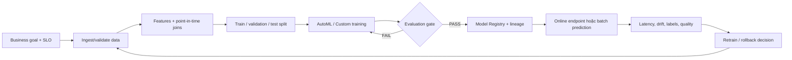
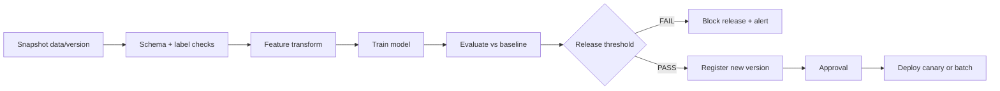
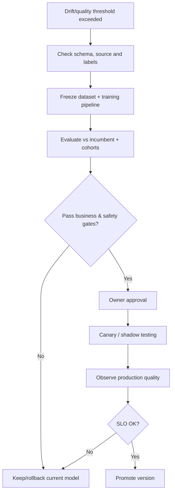

# Vertex AI và vòng đời hệ thống học máy trên GCP

Một ứng dụng đặt hàng muốn dự đoán **nguy cơ đơn hàng bị hủy** ngay khi khách đặt hàng. Nhóm dữ liệu có lịch sử đơn hàng trong BigQuery, nhóm ứng dụng chạy API trên Cloud Run, và nhóm vận hành cần biết khi mô hình suy giảm chất lượng. **Huấn luyện ra một tệp mô hình** mới chỉ giải quyết một phần bài toán: để đưa ML vào sản phẩm, phải quản lý **dữ liệu, đặc trưng, thí nghiệm, đánh giá, phiên bản mô hình, suy luận, giám sát và tái huấn luyện**.

**Vertex AI** là tên quen thuộc của nền tảng MLOps trên Google Cloud. **Từ ngày 22/04/2026, Google Cloud chuyển và đổi tên các năng lực Vertex AI dưới Gemini Enterprise Agent Platform (Agent Platform)**: ví dụ Vertex AI Pipelines thành Agent Platform Pipelines, Vertex AI Model Registry thành Model Registry on Agent Platform. Tên API `aiplatform.googleapis.com`, SDK `google-cloud-aiplatform` và nhiều lệnh `gcloud ai` vẫn xuất hiện trong công cụ/tài liệu. Bài giữ tên **Vertex AI** theo chương học, đồng thời ghi tên hiện hành khi hữu ích; kiểm tra Console/documentation theo phiên bản đang sử dụng.

Bài thuộc module `CLOUD_PROVIDERS_GCP`, kết nối việc tổ chức project và IAM/VPC với Cloud Storage, BigQuery, Cloud Run/GKE, CI/CD, giám sát độ tin cậy và chi phí. Ví dụ chính là **ML dự đoán có giám sát trên dữ liệu bảng**; phần mô hình tạo sinh (Gemini, Model Garden) được phân biệt, không xem mọi lời gọi LLM là một bài toán cần huấn luyện model từ đầu.

> **Giới hạn thực hành:** Dữ liệu và model của bài lab là **giả lập**, không dùng để tự động từ chối đơn hàng thật. Các bước huấn luyện local không cần GCP; tạo training job, registry model, endpoint, pipeline hoặc monitoring trên Google Cloud **có thể phát sinh phí**, đặc biệt các endpoint còn triển khai. Chỉ sử dụng project sandbox được ủy quyền.

## 1. Mục tiêu học tập

Sau bài này, bạn có thể:

1. Kể tên các bước trong **vòng đời ML** từ yêu cầu nghiệp vụ đến giám sát và tái huấn luyện.
2. Ánh xạ **BigQuery, Cloud Storage, Dataflow, Feature Store, Workbench, AutoML/custom training, Experiments, Pipelines, Model Registry, Endpoints, Model Monitoring** vào từng bước.
3. Phân biệt **training/validation/test**, leakage và training-serving skew.
4. Chọn **AutoML**, **custom training**, **BigQuery ML** hoặc **mô hình có sẵn** tùy yêu cầu.
5. Chạy một lab local xây dựng model phân loại với **scikit-learn**, lưu artifact và kiểm tra metrics.
6. Hiểu cách đưa model lên cloud, đánh giá trước khi deploy, chọn **online vs batch inference**, canary/rollback.
7. Thiết kế **data/ML pipeline** tái lập với artifact lineage, IAM least privilege và kiểm soát chi phí.
8. Chẩn đoán drift, chất lượng suy luận giảm và các failure modes thường gặp trong production.

## 2. Bắt đầu từ bài toán nghiệp vụ, không từ thuật toán

Ví dụ nhóm muốn giảm số đơn hủy bỏ nhưng vẫn tránh đánh dấu oan đơn tốt. Họ có thể đặt:

| Thành phần | Ví dụ thực tế |
| --- | --- |
| **Đơn vị dự đoán** | Một đơn hàng tại thời điểm tạo. |
| **Target/label** | `cancelled_within_7_days` = 0 hoặc 1. |
| **Features hợp lệ** | Số đơn lịch sử của khách, giá trị giỏ hàng, tuổi tài khoản **tính đến lúc đặt hàng**. |
| **Không được dùng** | Lý do hủy, ngày giao thực tế hoặc thông tin phát sinh **sau** thời điểm dự đoán. |
| **Baseline** | Quy tắc đơn giản hoặc mô hình tuyến tính; so cả với “không dùng ML”. |
| **Offline metrics** | Precision, recall, PR-AUC, calibration; đo theo từng nhóm có đủ dữ liệu. |
| **Business metrics** | Tỷ lệ đơn hủy, false positive cost, chi phí review, tác động A/B. |
| **Serving SLO** | Ví dụ p95 dự đoán ≤ 150 ms, availability theo SLO của API. |
| **Quy tắc an toàn** | Model chỉ hỗ trợ ưu tiên kiểm tra, có human review/fallback. |

**Accuracy không phải metric mặc định tốt.** Nếu chỉ 1% đơn bị hủy, một model luôn đoán “không hủy” đạt 99% accuracy nhưng không giúp phát hiện rủi ro. Chọn precision/recall và threshold theo chi phí false positive/false negative, đo trên **tập test chưa dùng để chọn model hoặc threshold**.

**ML có thể không cần thiết.** Nếu quy tắc nghiệp vụ đơn giản đáp ứng SLO và rủi ro, đừng tạo pipeline MLOps tốn kém chỉ vì có GPU/Vertex AI.

## 3. Vòng đời ML end-to-end



| Giai đoạn | Đầu vào/đầu ra | Dịch vụ GCP thường dùng |
| --- | --- | --- |
| **Thu thập dữ liệu** | Files/events/rows → dataset được kiểm chứng. | Cloud Storage, BigQuery, Pub/Sub, Dataflow. |
| **Khám phá/feature engineering** | Dataset sạch → feature tables, statistics. | BigQuery SQL, Workbench/Colab Enterprise, Feature Store. |
| **Thử nghiệm** | Features, code/params → metrics, artifact. | Experiments, custom training, AutoML, BigQuery ML. |
| **Huấn luyện quy mô lớn** | Training code + immutable data version → model artifact. | Serverless custom jobs, training clusters/Ray khi cần. |
| **Pipeline MLOps** | DAG có data/model artifacts, điều kiện đánh giá. | Agent Platform Pipelines (Kubeflow Pipelines/TFX), ML Metadata. |
| **Quản lý phiên bản** | Model + metrics + lineage → approved version. | Model Registry. |
| **Phát hành dự đoán** | Model version → online endpoint/batch job. | Agent Platform Endpoints, batch prediction, Cloud Run nếu tự phục vụ. |
| **Giám sát** | Requests/predictions/ground truth → alerts/retrain request. | Model Monitoring, Cloud Monitoring/Logging, BigQuery. |

Các dịch vụ hỗ trợ **khâu kỹ thuật**, không tự quyết định model có phù hợp về đạo đức/nghiệp vụ. Người phụ trách phải đặt chuẩn chất lượng, quyền truy cập, lịch đánh giá và quy trình thay/thu hồi model.

## 4. Dữ liệu, labels và feature engineering

### 4.1. BigQuery/Cloud Storage và managed datasets

- **BigQuery:** phù hợp dữ liệu bảng lớn, SQL joins/aggregations, data quality checks, temporal splits; có thể huấn luyện trực tiếp bằng **BigQuery ML** khi thuật toán hỗ trợ.
- **Cloud Storage:** lưu tệp CSV/Parquet/ảnh, **model artifacts**, manifests và phiên bản tập dữ liệu bất biến.
- **Managed datasets:** metadata và nhập dữ liệu phục vụ các luồng AutoML được hỗ trợ; **không phải bắt buộc cho mọi custom training job**.
- **Dataflow:** chuẩn hóa, làm sạch hoặc chuyển đổi dữ liệu phân tán trước huấn luyện, không phải engine điều phối toàn bộ quy trình ML.
- **Feature Store:** quản lý feature sources/registry và feature serving (tùy phiên bản); feature data có thể bắt nguồn từ BigQuery. Không có nghĩa Feature Store tự sửa leakage hoặc đồng bộ realtime mọi trường hợp.

### 4.2. Tránh data leakage và training-serving skew

**Data leakage** xảy ra khi dữ liệu huấn luyện chứa thông tin không thực sự có tại thời điểm dự đoán, hoặc thông tin từ tập test vô tình đi vào preprocessing/feature selection.

```text
Sai:
  customer_total_orders_today
  → train cho dự đoán lúc 08:00, nhưng total đã tính đến 23:59.

Đúng:
  customer_total_orders_before_order_created_at
  → chỉ đếm dữ liệu tồn tại trước thời điểm đơn phát sinh.
```

Với sự kiện có thứ tự thời gian, dùng **time-based split** và **point-in-time joins** thay vì random split nếu random làm nhìn thấy tương lai. Nếu các dòng của cùng một khách tương quan mạnh, cần cân nhắc **group split** để không để cùng entity xuất hiện trên cả train/test theo cách gây đánh giá lạc quan.

**Training-serving skew** là khác biệt giữa dữ liệu/transform dùng lúc train và lúc infer. Ví dụ train dùng số tiền cents nhưng API đưa đồng; hoặc train tính tuổi tài khoản theo UTC, serving theo giờ địa phương. Cách giảm rủi ro:

1. Dùng **feature definitions và preprocessing code** chung ở train/infer.
2. Đóng gói transformer cùng model (ví dụ `sklearn.pipeline.Pipeline`).
3. Version schema, feature table, source snapshot, model artifact và container digest.
4. Chạy validation cho types, missing values, feature ranges, class distribution và label balance.
5. Không log PII hoặc payment tokens thô chỉ để debug mô hình.

### 4.3. Tách train, validation và test

| Tập | Dùng làm gì? | Điều cần tránh |
| --- | --- | --- |
| **Train** | Fit model, học tham số và preprocessing. | Fit scaler trên dữ liệu gồm cả test. |
| **Validation** | Chọn hyperparameters, threshold, early stopping. | Điều chỉnh theo test sau khi xem test metrics. |
| **Test/holdout** | Báo cáo cuối cùng trước quyết định phát hành. | Tái dùng test nhiều lần để chọn model. |
| **Production outcomes** | Theo dõi hiệu quả thực, tạo nhãn mới sau độ trễ. | Coi predicted label là ground truth. |

Nếu nhãn hủy đơn cần **7 ngày** mới xác định, không đánh giá recall của mô hình hôm nay bằng events mới phát sinh một giờ trước: đó là **label delay**, không phải model quality giảm.

## 5. Chọn phương pháp huấn luyện và dự đoán

### 5.1. AutoML, custom training, BigQuery ML và GenAI

| Cách làm | Khi phù hợp | Đánh đổi |
| --- | --- | --- |
| **AutoML (Agent Platform)** | Tabular/image tasks được hỗ trợ, ít muốn viết thuật toán/training code. | Phạm vi objectives/cấu hình phụ thuộc dịch vụ; không tùy biến hoàn toàn. |
| **Serverless custom training** | TensorFlow, PyTorch, scikit-learn, XGBoost hoặc code/container riêng. | Tự chịu trách nhiệm preprocessing, code, packages, metrics và artifacts. |
| **Training clusters/Ray** | Nhiều node/GPU, cần reservation hoặc framework phân tán. | Tốn công sizing, quota, checkpoint và chi phí accelerators. |
| **BigQuery ML** | Dữ liệu ở BigQuery, bài toán phù hợp SQL `CREATE MODEL`/`ML.PREDICT`. | Phạm vi thuật toán/pipelines khác Vertex custom training. |
| **Model Garden / Gemini API** | NLP/vision/sinh nội dung với foundation model có sẵn. | Prompt/evaluation/safety/token cost, không nhất thiết cần custom model training. |

**Mô hình tạo sinh** có vòng đời riêng: prompt versioning, eval datasets, grounding/RAG, safety filters, hallucination tests và token latency/cost. Không nhầm **fine-tuning foundation model** với huấn luyện một mô hình phân loại bảng scikit-learn từ đầu; chúng dùng công cụ và rủi ro khác.

### 5.2. Các loại job cần phân biệt

- **CustomJob:** chạy ứng dụng huấn luyện, tạo artifacts theo code; không tự đồng nghĩa có một `Model` resource đã đăng ký.
- **CustomTrainingJob / training pipeline:** kết hợp custom training và (tùy cấu hình) đăng ký model, không phải toàn bộ DAG MLOps.
- **HyperparameterTuningJob:** chạy nhiều trials, có mục tiêu metric và giới hạn budget.
- **PipelineJob:** DAG nhiều bước có artifact/parameter lineage, cache và điều kiện triển khai; thường dùng để orchestrate preprocessing → train → evaluate → register.

Training dùng tài nguyên tạm thời có thể được giải phóng sau job, **nhưng artifacts, buckets, metadata, registry versions và endpoints không tự được xóa** cùng training job.

## 6. Lab local — Huấn luyện, đánh giá và lưu artifact

Lab dùng **dữ liệu tổng hợp** bằng scikit-learn, không cần Google Cloud. Mục đích là trải nghiệm đúng chu trình **split → preprocess → fit → chọn threshold trên validation → đánh giá trên test → lưu artifact**, trước khi chuyển sang hạ tầng quản lý.

### 6.1. Chuẩn bị

Trong thư mục lab riêng của người học (không thuộc repository học liệu), chạy:

```bash
mkdir -p vertex-ml-lab
cd vertex-ml-lab
python3 -m venv .venv
source .venv/bin/activate
python -m pip install --upgrade pip
python -m pip install "scikit-learn>=1.5,<2" "joblib>=1.4,<2" "numpy>=1.26,<3"
```

**Production:** khóa chính xác phiên bản bằng lockfile/container digest để tái lập. Không suy ra một file `model.joblib` được train với phiên bản Python/scikit-learn bất kỳ luôn chạy được trên model-serving container khác phiên bản.

### 6.2. Mã Python đầy đủ

Tạo `train.py`:

```python
import json
from pathlib import Path

import joblib
import numpy as np
from sklearn.datasets import make_classification
from sklearn.linear_model import LogisticRegression
from sklearn.metrics import average_precision_score, precision_score, recall_score
from sklearn.model_selection import train_test_split
from sklearn.pipeline import Pipeline
from sklearn.preprocessing import StandardScaler


SEED = 42
FEATURES = [f"feature_{i}" for i in range(6)]

# Dữ liệu tổng hợp, không đại diện cho đơn hàng thật.
X, y = make_classification(
    n_samples=5000,
    n_features=6,
    n_informative=4,
    n_redundant=0,
    weights=[0.9, 0.1],
    random_state=SEED,
)

# 60% train, 20% validation, 20% test. Stratify giữ tỷ lệ nhãn.
X_train, X_rest, y_train, y_rest = train_test_split(
    X, y, test_size=0.4, stratify=y, random_state=SEED
)
X_val, X_test, y_val, y_test = train_test_split(
    X_rest, y_rest, test_size=0.5,
    stratify=y_rest, random_state=SEED
)

# Scaler chỉ fit trên TRAIN nhờ sklearn Pipeline.
model = Pipeline([
    ("scale", StandardScaler()),
    ("classifier", LogisticRegression(max_iter=1000, random_state=SEED)),
])
model.fit(X_train, y_train)

p_val = model.predict_proba(X_val)[:, 1]
p_test = model.predict_proba(X_test)[:, 1]

# Chọn threshold từ validation. Điều kiện precision chỉ minh họa.
threshold = 0.5
best_recall = -1.0
for candidate in np.linspace(0.1, 0.9, 17):
    predictions = p_val >= candidate
    precision = precision_score(y_val, predictions, zero_division=0)
    recall = recall_score(y_val, predictions, zero_division=0)
    if precision >= 0.75 and recall > best_recall:
        threshold = float(candidate)
        best_recall = float(recall)

# TEST chỉ dùng sau khi đã chọn model/threshold.
test_predictions = p_test >= threshold
metrics = {
    "threshold": threshold,
    "test_precision": float(precision_score(
        y_test, test_predictions, zero_division=0
    )),
    "test_recall": float(recall_score(
        y_test, test_predictions, zero_division=0
    )),
    "test_average_precision": float(average_precision_score(y_test, p_test)),
    "train_rows": len(y_train),
    "validation_rows": len(y_val),
    "test_rows": len(y_test),
    "schema_version": 1,
    "feature_names": FEATURES,
}

Path("artifacts").mkdir(exist_ok=True)
joblib.dump(model, "artifacts/model.joblib")
Path("artifacts/evaluation.json").write_text(
    json.dumps(metrics, indent=2), encoding="utf-8"
)
print(json.dumps(metrics, indent=2))
```

Chạy và xem kết quả:

```bash
python train.py
cat artifacts/evaluation.json
```

Kỳ vọng: tệp **`artifacts/model.joblib`** chứa model kèm scaler, **`evaluation.json`** chứa threshold, metrics và schema giả lập. Không ấn định một kết quả metric bằng con số tưởng tượng: phải đọc kết quả thực tế khi chạy. Tỷ lệ nhãn thiểu số khoảng 10% giúp thấy vì sao accuracy một mình có thể gây hiểu lầm.

**Rủi ro bảo mật:** `joblib` dùng cơ chế serialization kiểu pickle; **không tải artifact không tin cậy** vì khi deserialize có thể thực thi mã. Chỉ lấy model đã được phê duyệt từ bucket/registry có provenance và checksum.

### 6.3. Kiểm tra test predict tại máy local

```python
import joblib
import numpy as np

model = joblib.load("artifacts/model.joblib")  # Chỉ tệp do chính lab tạo.
sample = np.array([[0.1, 0.2, -0.3, 0.4, 1.0, -0.1]])
probability = float(model.predict_proba(sample)[0, 1])
print({"risk_score": probability})
```

Score `risk_score` là xác suất mô hình ước lượng, **không mặc định là xác suất đã calibrated**. Với ứng dụng thực, kiểm tra calibration, fairness, threshold, explainability và giới hạn tự động hóa trước khi áp quyết định có ảnh hưởng đến người dùng.

## 7. Từ lab local sang custom training có quản lý

### 7.1. Tiền điều kiện trên Google Cloud

| Thành phần | Việc cần chuẩn bị |
| --- | --- |
| **Project / API** | Billing, `aiplatform.googleapis.com` enabled, region hỗ trợ loại machine/model. |
| **Dataset** | BigQuery/GCS snapshot đã xác minh schema, label quality, locality. |
| **Bucket** | GCS bucket **thuộc project/nhóm**, đúng location, lưu artifacts và pipeline root. |
| **Image** | Training container có Python/dependencies theo lockfile hoặc custom image từ Artifact Registry. |
| **Identity** | Runtime training service account tách deployer, IAM tối thiểu trên GCS/BigQuery/Registry. |
| **Compute/quota** | Machine/GPU/TPU theo ngân sách, concurrency và quyền GPU quota. |
| **Release gate** | Baseline metrics, metrics mục tiêu, approval, cách rollback/cleanup. |

**Đừng chạy cloud training để thử với cùng model synthetic đơn giản nếu mục đích chỉ là học Python.** Lab local đã đủ chứng minh thuật toán; cloud training minh họa quản lý hạ tầng và tái lập pipeline.

### 7.2. Kiểm tra tài nguyên trước khi tạo

Các lệnh dưới đây **chỉ đọc**, với project/region giả định:

```bash
PROJECT_ID="orders-ml-lab"
REGION="asia-southeast1"
ARTIFACT_BUCKET="gs://orders-ml-artifacts-lab"

gcloud auth list
gcloud config get-value project
gcloud services list --enabled \
  --project="$PROJECT_ID" \
  --filter="name:aiplatform.googleapis.com"

gcloud ai custom-jobs list \
  --project="$PROJECT_ID" --region="$REGION"
gcloud ai models list \
  --project="$PROJECT_ID" --region="$REGION"
gcloud ai endpoints list \
  --project="$PROJECT_ID" --region="$REGION"
```

**Lưu ý đổi tên:** Console có thể hiển thị **Agent Platform** thay cho Vertex AI nhưng REST resource paths vẫn thường có dạng `projects/.../locations/.../models` hoặc `endpoints`; `gcloud ai` không biến thành lệnh `gcloud agent-platform` chỉ vì đổi nhãn sản phẩm.

### 7.3. Đóng gói training code và lưu output

Khi chuyển `train.py` thành training container:

1. Dùng **base image/lockfile** tái lập, không cài packages từ Internet không kiểm soát giữa các lần chạy.
2. Đọc dữ liệu từ **GCS/BigQuery** qua service account; không tạo dữ liệu random trong training production.
3. Nhận `data_snapshot_uri`, `schema_version`, `seed`, `model_params` từ parameters; không hardcode sản xuất.
4. Ghi model và metrics theo output directory, với custom training có thể dùng biến môi trường `AIP_MODEL_DIR` nếu workflow/training container áp dụng hợp đồng này.
5. Lưu metadata: Git commit, image digest, data version/checksum, feature definitions, seed, metrics, owner và timestamp.
6. Thực thi **CustomJob/training pipeline** với máy vừa đủ, sau khi training thành công mới kiểm tra artifact và cân nhắc đăng ký Model Registry.

**Mẫu định hướng** cho output path trong training code, không thay thế job config:

```python
import os
from pathlib import Path

# Với custom training/prebuilt container có AIP_MODEL_DIR, đây thường là GCS URI.
artifact_uri = os.environ.get("AIP_MODEL_DIR")
if not artifact_uri:
    raise RuntimeError("Missing AIP_MODEL_DIR from managed training job")
print("Configured model output:", artifact_uri)

# Không dùng Path(artifact_uri).mkdir() khi artifact_uri là gs:// URI.
# Dùng gcsfs / google-cloud-storage hoặc framework uploader phù hợp.
```

File `model.joblib` được huấn luyện local **không tự là một model-serving service**. Để deploy, cần artifact đúng định dạng mà **prebuilt serving container** mong đợi (ví dụ tên `model.joblib` và phiên bản scikit-learn tương thích), hoặc xây dựng **custom inference container** implement request/response/health contracts.

## 8. ML Pipelines và quản lý thí nghiệm

### 8.1. Từ notebook sang pipeline tái lập

Một notebook có thể chạy thành công trên máy người phát triển nhưng vẫn không thể tái lập: dữ liệu đã đổi, cell chạy khác thứ tự, dependencies trôi phiên bản và không có dấu vết model nào đang phục vụ.

**Agent Platform Pipelines** (trước đây là Vertex AI Pipelines) hỗ trợ định nghĩa **DAG** bằng Kubeflow Pipelines (KFP) hoặc TFX, gồm các components có inputs/outputs rõ ràng. Ví dụ:



Các components nên khai báo **artifact inputs/outputs** thay vì chuyền một đường dẫn tùy ý rồi không ghi metadata. **ML Metadata** ghi lineage giữa dataset, job, model, metrics và execution. **Experiments** giúp so sánh runs/hyperparameters/metrics. **Pipeline caching** chỉ an toàn khi inputs/params/code dependencies được version; thay dữ liệu sau lưng cùng URI mà dùng lại cache có thể tạo kết quả sai.

### 8.2. KFP v2: khung DAG đơn giản

Ví dụ này **chỉ minh họa cú pháp compile và thứ tự phụ thuộc**, chưa thực hiện training thật. Tạo `pipeline_demo.py` trong lab riêng, sau khi cài `kfp>=2`:

```python
from kfp import compiler, dsl


@dsl.component(base_image="python:3.11")
def validate_input(row_count: int) -> str:
    if row_count < 100:
        raise ValueError("Not enough training rows")
    return "validated"


@dsl.component(base_image="python:3.11")
def train_placeholder(validation_state: str) -> str:
    if validation_state != "validated":
        raise ValueError("Quality gate failed")
    # Production: submit custom training, publish model artifact + metrics.
    return "replace-with-model-artifact-uri"


@dsl.pipeline(name="order-risk-pipeline-demo")
def pipeline(row_count: int = 500):
    validated = validate_input(row_count=row_count)
    train_placeholder(validation_state=validated.output)


compiler.Compiler().compile(
    pipeline_func=pipeline,
    package_path="pipeline.json",
)
```

Chạy **compile local**:

```bash
python -m pip install "kfp>=2,<3"
python pipeline_demo.py
```

File `pipeline.json` là **pipeline specification**, không phải mô hình đã huấn luyện. Nếu submit tới cloud, các components sẽ tạo compute/resources có phí. Muốn biến thành MLOps pipeline thật, thay component placeholder bằng preprocess/train/evaluate/register, thêm artifact lineage và gate dựa trên metric.

### 8.3. Submit một PipelineJob (chỉ khi được cấp phép)

Ví dụ Python SDK dùng cấu hình pipeline JSON **đã kiểm chứng** cùng bucket riêng (đừng chạy mặc định):

```python
from google.cloud import aiplatform

PROJECT_ID = "orders-ml-lab"
LOCATION = "asia-southeast1"
ROOT = "gs://orders-ml-artifacts-lab/pipeline-root"
WORKER_SA = "ml-pipeline@orders-ml-lab.iam.gserviceaccount.com"

job = aiplatform.PipelineJob(
    display_name="order-risk-pipeline-demo",
    template_path="pipeline.json",
    pipeline_root=ROOT,
    parameter_values={"row_count": 500},
    project=PROJECT_ID,
    location=LOCATION,
    enable_caching=False,  # Lab tránh nhầm kết quả cache với run mới.
)

# THAY ĐỔI CLOUD/TÍNH PHÍ: chỉ gọi sau khi review quyền và chi phí.
# job.submit(service_account=WORKER_SA)
```

**Phân biệt quan trọng:** `PipelineJob` điều phối nhiều bước, **không** là synonym của `CustomJob` huấn luyện một bước. Trong pipeline thật, model chỉ nên được **đăng ký/phát hành khi evaluation gate đạt**; thất bại training phải giữ nguyên model đang phục vụ.

## 9. Experiments, Model Registry và phát hành phiên bản

### 9.1. Cần lưu gì để tái lập?

| Metadata | Ví dụ |
| --- | --- |
| Data snapshot | BigQuery table snapshot, GCS object versions/checksums, label window. |
| Code/environment | Git commit, Docker image digest, Python/sklearn version. |
| Parameters | Seed, training iterations, regularization, feature list. |
| Evaluation | PR-AUC, precision/recall tại threshold, nhóm rủi ro và calibration. |
| Artifacts | `model.joblib`, preprocessing, schema, metrics JSON. |
| Governance | Model owner, approval, risk tier, training time, retention. |

**Experiments** lưu và so sánh kết quả huấn luyện; **Model Registry** quản lý model resources và **versions/aliases**, để có thể chọn model đã được phê duyệt cho inference. **Tên hiển thị/alias** là cách tổ chức, không thay thế resource ID/version và artifact digest trong audit.

### 9.2. Đưa artifact lên Cloud Storage và đăng ký model

Nếu đã được phê duyệt để thử cloud, upload **artifact từ lab** vào bucket đã tồn tại:

```bash
# GHI OBJECT THẬT, có thể phát sinh phí lưu trữ/network.
gcloud storage buckets describe "$ARTIFACT_BUCKET" \
  --project="$PROJECT_ID"
gcloud storage cp ./artifacts/model.joblib \
  "$ARTIFACT_BUCKET/models/order-risk-v1/model.joblib"
gcloud storage cp ./artifacts/evaluation.json \
  "$ARTIFACT_BUCKET/models/order-risk-v1/evaluation.json"
```

**Giới hạn:** Model Registry chỉ có thể deploy artifact nếu **serving container** biết cách nạp và xử lý input/output của artifact đó. Với scikit-learn, cần chọn **prebuilt prediction container phiên bản tương thích** hoặc custom inference container; kiểm tra requirements trong tài liệu Import models. Tệp `evaluation.json` hỗ trợ audit nhưng không làm serving container tự chọn threshold: nếu cần threshold, implement trong serving/business layer nhất quán.

Quy trình bằng Console:

1. Vào **Agent Platform (Vertex AI trước đây) → Model Registry → Import model**.
2. Chọn import artifact ở `gs://.../models/order-risk-v1/`, gắn tên, phiên bản và labels.
3. Chọn serving container phù hợp **framework/artifact version**, kiểm tra region và artifact IAM.
4. Ghi kết quả evaluation, lineage và approval vào ML metadata/registry/process của tổ chức.
5. Trước khi deploy, test inference contract: **thứ tự, kiểu, số lượng features và preprocessing**.

**Không coi model mới nhất là model tốt nhất.** Chỉ chuyển alias `approved` hoặc traffic sau khi vượt baseline/validation gate và được chủ sở hữu cho phép.

## 10. Online prediction và batch prediction

### 10.1. Chọn serving theo độ trễ

| Chế độ | Khi dùng | Đặc điểm chi phí/kỹ thuật |
| --- | --- | --- |
| **Online prediction** | API cần kết quả trong một request (ví dụ ưu tiên review đơn). | Cần **Model deployment trên Endpoint**, provision serving compute, autoscaling, p95/p99 latency, IAM. |
| **Batch prediction** | Chấm điểm danh sách đơn mỗi đêm, không cần trả ngay. | Tạo **batch prediction job** từ Model resource; input/output GCS/BigQuery, **không nhất thiết cần online endpoint**. |
| **Cloud Run tự triển khai** | Model nhỏ, custom application logic và tự kiểm soát inference. | Tự chịu scaling, load model, metrics, auth, rollout và drift monitoring. |

Với online prediction, có thể triển khai nhiều model versions vào một endpoint và phân chia traffic khi loại model/endpoint hỗ trợ. Quy trình canary: **deploy model mới với tỷ lệ traffic nhỏ → theo dõi lỗi/latency/chất lượng → tăng dần → rollback** nếu vi phạm ngưỡng. Không dùng A/B online để thử các model chưa được kiểm định bảo mật/ảnh hưởng người dùng.

### 10.2. Gửi request tới endpoint đã được tạo

Chỉ khi một model **đã đăng ký và deploy** vào endpoint tương thích input, ví dụ test với sáu numeric features theo thứ tự của lab:

```json
{
  "instances": [
    [0.1, 0.2, -0.3, 0.4, 1.0, -0.1]
  ]
}
```

Lưu thành `request.json` tại thư mục lab. Để gọi API bằng principal được cấp `aiplatform.endpoints.predict` trên endpoint:

```bash
ENDPOINT_ID="REPLACE_WITH_ACTUAL_ENDPOINT_ID"

# GỌI ONLINE PREDICTION THẬT: có thể tính phí requests và serving.
curl -sS -X POST \
  -H "Authorization: Bearer $(gcloud auth print-access-token)" \
  -H "Content-Type: application/json" \
  -d @request.json \
  "https://$REGION-aiplatform.googleapis.com/v1/projects/$PROJECT_ID/locations/$REGION/endpoints/$ENDPOINT_ID:predict"
```

Response thường có `predictions`; hình dạng kết quả **phụ thuộc serving container/model schema**. Một sklearn prebuilt container có thể trả xác suất hoặc nhãn theo implementation. Không hardcode “giá trị đầu tiên là risk score” khi chưa xác nhận serving contract và mapping feature list.

**Ứng dụng Java/Cloud Run:** giữ API authentication ở backend service account, validate JSON schema/input types, giới hạn timeout/concurrency và log correlation ID có kiểm soát. Không đưa access token của Google Cloud trực tiếp vào browser/mobile client; không cho client chọn endpoint tùy ý.

### 10.3. Batch inference và kiểm tra đầu ra

Với batch job, đầu vào thường là GCS/BigQuery và đầu ra là GCS/BigQuery có location tương thích model; bài toán không yêu cầu latency dưới 100 ms cho từng request. Sau job, kiểm tra `failedPredictionCount`/errors, output row count, mapping `entity_id` và model version. Có thể chạy lại batch job, nên downstream phải có **idempotent merge/partition policy** để tránh lặp điểm dự đoán.

**Đừng dùng online endpoint chạy 24/7 để chấm điểm một batch mỗi ngày nếu batch job đáp ứng SLO.** Chi phí serving compute và vận hành endpoint có thể đáng kể dù không có request.

## 11. Giám sát mô hình, dữ liệu và tái huấn luyện

### 11.1. Ba loại tín hiệu khác nhau

| Tín hiệu | Ví dụ | Hành động |
| --- | --- | --- |
| **Sức khỏe serving** | p95 latency tăng, 5xx, model container OOM, endpoint unavailable. | Sửa hạ tầng, scale hoặc rollback. |
| **Data/feature drift và skew** | Tỷ lệ khách mới tăng mạnh, feature phân phối khác training. | Kiểm tra upstream/schema, drift baseline, cân nhắc đánh giá lại model. |
| **Model quality/concept drift** | Precision/recall trên **nhãn thực đã đủ độ trễ** giảm. | Đối soát labels, chạy đánh giá offline, retrain/rollback theo gate. |

**Drift không tự chứng minh model sai**, và **không có drift không chứng minh model còn tốt**. Khi mối quan hệ giữa features và label đổi (concept drift), chỉ xem phân phối input là chưa đủ; cần nhãn thực và business outcomes.

Với mô hình tabular, **Model Monitoring v1** (GA theo tài liệu hiện hành) theo dõi skew/drift cho endpoints được hỗ trợ. **Model Monitoring v2** (Preview tại thời điểm tài liệu được đối chiếu) gắn việc giám sát với model version, hỗ trợ chạy jobs định kỳ/on-demand và có thể mở rộng use case phục vụ ngoài platform. **Không coi Preview có cùng SLA/độ ổn định như GA**; kiểm tra tình trạng sản phẩm trước khi dùng production.

### 11.2. Dashboard và alert

| Nhóm | Chỉ số/tiêu chí |
| --- | --- |
| **Online serving** | Requests/s, 4xx/5xx, p50/p95/p99 latency, replicas, CPU/GPU, timeouts. |
| **Prediction quality** | Precision, recall, PR-AUC/calibration trên nhãn đã chốt, theo cohort/tenant. |
| **Data quality** | Missing rate, type/range/schema change, feature drift/skew, data freshness. |
| **Business safety** | False positives, human override, customer complaints và fairness indicators. |
| **MLOps health** | Pipeline/job failures, training duration, model age, data label delay, approval state. |
| **Cost** | Cost per training run, per 1.000 predictions, idle endpoint/accelerator usage. |

**Không log raw PII, payment cards, tokens hoặc toàn bộ feature vectors chứa dữ liệu nhạy cảm** chỉ để có drift metrics. Sampling và ẩn danh hóa phải tuân thủ chính sách. Khi đo model accuracy/recall, cần lưu `model_version` và `inference_id` để nối với ground truth sau khi nó đến; không dùng chính model predictions làm labels.

### 11.3. Retraining loop có phê duyệt



Không bật **tự động retrain → tự động thay toàn bộ endpoint** chỉ dựa trên một ngưỡng drift đơn lẻ. Nên có evaluation gate và, với quyết định ảnh hưởng người dùng, manual approval/canary. Đánh giá cohort không đủ mẫu cần ghi rõ độ bất định, không gán kết luận tuyệt đối.

## 12. IAM, mạng và bảo vệ chuỗi cung ứng ML

### 12.1. Tách principals theo trách nhiệm

| Principal | Quyền cần kiểm tra | Khuyến nghị |
| --- | --- | --- |
| **Deployer/CI** | Quyền tạo training/pipeline/model/endpoint, `iam.serviceAccounts.actAs` khi chỉ định runtime SA. | Không dùng Project Owner vô hạn. |
| **Training runtime SA** | `bigquery.dataViewer`/`jobUser` trên nguồn, Storage Object Viewer/Creator trên artifacts, logging theo nhu cầu. | Tách khỏi quyền deploy endpoint production. |
| **Pipeline runtime SA** | Quyền các components gọi dịch vụ tương ứng, storage pipeline root. | Dùng service account riêng và network/region thích hợp. |
| **Serving runtime SA** | Chỉ tài nguyên model inference cần, không có quyền đọc training labels nếu không cần. | Least privilege, không nhúng service account keys trong image. |
| **Prediction caller** | `aiplatform.endpoints.predict` trên endpoint hoặc role phù hợp. | Cloud Run backend gọi thay client web/mobile. |
| **Service agents** | Quyền hạ tầng do dịch vụ Google Cloud quản lý. | Không nhầm service agent với workload SA khi xử lý lỗi. |

Roles cụ thể có thể thay đổi theo sản phẩm và use case; tra **IAM permissions** đúng resource trước khi gán. `roles/aiplatform.user` có thể hữu ích cho lab, nhưng production nên giảm về tập quyền tối thiểu phù hợp. Để đọc model từ GCS hoặc BigQuery, **Vertex AI/Agent Platform service agent** có thể cần quyền ngoài runtime SA theo workflow; hãy kiểm tra identity xuất hiện trong audit logs thay vì mở quyền rộng.

### 12.2. Dữ liệu và network

- Chọn region của **data, training, model artifacts, endpoint** và BigQuery/GCS tương thích; cross-region có thể gây egress, residency violation hoặc lỗi job.
- Chọn VPC/private endpoint/Private Service Connect, CMEK, VPC Service Controls khi chính sách yêu cầu; các năng lực cụ thể phụ thuộc loại job/region.
- Sử dụng **Artifact Registry image digest, dependency pinning, vulnerability scanning, SBOM khi cần**, không chạy custom inference image từ registry không tin cậy.
- Ẩn danh hoặc tối thiểu hóa PII trong training, log/prediction payload; định nghĩa retention và quyền xóa dữ liệu/model đúng yêu cầu.
- Test chống **model inversion/membership inference, data leakage và prompt injection** khi loại mô hình/ứng dụng có nguy cơ; với GenAI, bổ sung đánh giá safety và output validation.
- Không sử dụng model score làm quyết định cuối cùng ảnh hưởng đáng kể đến khách nếu chưa có kiểm định, giám sát, quy trình giải trình và con người giám sát.

## 13. Chi phí và chọn quy mô

| Thành phần | Có thể phát sinh phí | Tối ưu |
| --- | --- | --- |
| **Data preparation** | BigQuery bytes scanned/slots, Dataflow, GCS storage/operations. | Partition, tránh query quá rộng, cache/snapshot có kế hoạch. |
| **Workbench/Notebook** | VM, disk, GPU kể cả lúc notebook chưa chạy code tùy trạng thái. | Stop/shutdown/delete resources khi không cần. |
| **AutoML / custom training** | CPU/GPU/TPU, distributed workers, tuning trials, training time. | Baseline nhỏ trước, max trials/worker caps, early stopping. |
| **Pipelines** | Compute cho tasks, pipeline/metadata resources và dịch vụ downstream. | Caching **đúng version**, bỏ task thừa, kiểm soát concurrency. |
| **Online inference** | Deployed model serving replicas, machine/accelerator, traffic. | Autoscale và min replicas phù hợp; **undeploy** model khi không còn dùng. |
| **Batch inference** | Compute theo job, GCS/BigQuery input/output và network. | Gom batch hợp lý, region gần data, tránh endpoint idle 24/7. |
| **Monitoring/Logging** | Logging/BigQuery sampling, storage, monitoring jobs theo tier. | Sampling/retention hợp lý, alert actionable. |
| **GenAI/Model Garden** | Tokens, provisioned throughput, tuning, context caching tùy model. | Prompt size, latency/cost budgets, chọn model vừa đủ. |

Đo **cost per correct business outcome**, không chỉ chi phí training job. Một model tăng recall 0,5% nhưng yêu cầu GPU endpoint lớn và tăng số ca review gấp đôi có thể làm tổng chi phí và trải nghiệm khách hàng kém hơn.

**Quy trình kiểm soát:** tạo budget/alert, dùng labels cho training/pipeline resources, theo dõi Billing SKU theo region, giới hạn machine size và tuning trials. **Dừng notebook không nhất thiết xóa disk; xóa training job không tự undeploy endpoint**. Review tất cả tài nguyên còn chạy sau lab.

## 14. Troubleshooting nhanh

| Triệu chứng | Nguyên nhân thường gặp | Kiểm tra |
| --- | --- | --- |
| Training job báo `PERMISSION_DENIED` | Runtime SA không có quyền đọc BQ/GCS; service agent thiếu IAM; KMS lỗi. | Job log, audit principal, bucket/dataset policy. |
| Job không tạo model trong Registry | Chạy `CustomJob` chỉ tạo artifact; chưa có bước register/upload. | Artifact URI, Model Registry workflow, training pipeline config. |
| Model upload lỗi | `model.joblib`/serving image sai format hoặc mismatch version, bucket region khác. | Artifact manifest, framework/container compatibility, location. |
| Endpoint `predict` trả 401/403 | Caller thiếu predict permission/token hoặc project/region/endpoint sai. | Principal, `gcloud ai endpoints list`, endpoint IAM. |
| Endpoint trả 400 | Thứ tự/số chiều/kiểu feature sai, request JSON không đúng serving contract. | Schema version và preprocessing transform. |
| p95 latency cao/5xx | Model load nặng, thiếu memory/CPU/GPU, startup/replicas/network. | Endpoint metrics, container logs, autoscaling limits. |
| Offline test tốt, production precision thấp | Leakage, skew, concept drift, selection bias, delayed labels. | Time-based split, online feature semantics, ground truth join. |
| Pipeline rerun cho metrics khác | Mutable dataset URI, seed, package version, caching sai. | Artifacts/lineage, source snapshot và image digest. |
| Model mới gây vấn đề | Rollout không có canary/monitoring/approval. | Giảm traffic hoặc rollback registry version theo runbook. |
| Hóa đơn tăng dù không ai dự đoán | Endpoint replicas/GPU hoặc notebook VM vẫn chạy. | List endpoints/deployed models, notebook state, Billing. |

## 15. Bài tập vận dụng (có đáp án)

**Bài 1 — Xác định bài toán.** Một đội muốn dự đoán đơn sẽ hủy trong 7 ngày nhưng train dùng cột `cancel_reason` được ghi khi đã hủy. Sai ở đâu?

*Đáp án:* **Target leakage**. Trường không tồn tại ở thời điểm dự đoán; phải bỏ khỏi features và tái đánh giá bằng dữ liệu đúng thời điểm.

**Bài 2 — Chọn metric.** Chỉ 1% đơn hủy, model đoán tất cả không hủy đạt 99% accuracy. Có tốt không?

*Đáp án:* Chưa. Recall lớp hủy bằng 0. Cần precision/recall, PR-AUC, confusion matrix và chi phí FP/FN.

**Bài 3 — Validation vs test.** Đội điều chỉnh threshold 20 lần theo test results. Có vấn đề gì?

*Đáp án:* Test đã bị dùng làm validation, số đo lạc quan. Chọn threshold trên validation, chỉ đo test cuối cùng.

**Bài 4 — Chọn công cụ.** Dữ liệu ở BigQuery, cần mô hình hồi quy đơn giản và đội biết SQL. Có bắt buộc viết PyTorch custom training?

*Đáp án:* Không. Thử **BigQuery ML** hoặc AutoML nếu đáp ứng mục tiêu/SLO trước.

**Bài 5 — Registry.** CustomJob đã thành công nhưng Model Registry rỗng. Vì sao?

*Đáp án:* CustomJob chỉ thực thi training code và tạo artifacts. Cần bước upload/register Model resource hoặc training pipeline có cấu hình đăng ký.

**Bài 6 — Online vs batch.** Chấm điểm 2 triệu khách mỗi đêm, không có API realtime. Cần endpoint chạy cả ngày?

*Đáp án:* Không. **Batch prediction job** thường phù hợp hơn, không cần online endpoint, có đầu vào/ra GCS/BigQuery và kiểm soát chi phí.

**Bài 7 — Skew.** Model train với `amount_cents` nhưng API đưa số tiền theo đồng. Chuyện gì xảy ra?

*Đáp án:* **Training-serving skew**; kết quả có thể lệch nghiêm trọng dù endpoint trả HTTP 200. Thống nhất feature transforms/schema, test hợp đồng request.

**Bài 8 — Drift.** Input drift vượt ngưỡng nhưng chưa có nhãn thực. Có nên tự deploy model mới?

*Đáp án:* Không tự động. Điều tra nguồn/schema, chờ nhãn đủ độ trễ, đánh giá baseline/chất lượng và qua approval gate trước rollout.

**Bài 9 — Pipeline caching.** Nhóm thay nội dung GCS file nhưng giữ cùng URI và dùng cache. Có nguy cơ gì?

*Đáp án:* Cache có thể tái sử dụng output cũ dù input thực đã đổi. Dùng immutable object versions/checksum và version params/dependencies.

**Bài 10 — IAM.** Training SA cần đọc bảng BigQuery. Có nên cấp Editor cả project?

*Đáp án:* Không. Cấp BigQuery Job User/Data Viewer ở phạm vi phù hợp và quyền GCS cần thiết; tách khỏi deployer, serving SA.

**Bài 11 — Production cost.** Không có requests nhưng endpoint vẫn bị tính phí.

*Đáp án:* Model deployed có **serving replicas/accelerators** được cấp. Review min replicas, undeploy model hoặc dùng batch inference cho nhu cầu gián đoạn.

**Bài 12 — CI/CD.** Model mới PR-AUC tốt hơn một chút nhưng nhóm khách mới bị false positives gấp ba. Có nên chuyển 100% traffic?

*Đáp án:* **Không.** Cần đánh giá theo cohort, fairness/business guardrails, human approval, canary và khả năng rollback; metric tổng không đủ.

## 16. Checklist production

- [ ] Business use case, baseline, target label, prediction time và FP/FN costs đã thống nhất.
- [ ] Dữ liệu có schema, provenance, immutable version, label availability và retention.
- [ ] Không leakage; train/validation/test tách đúng theo thời gian/entity khi phù hợp.
- [ ] Features/preprocessing nhất quán giữa training và serving; có schema contract tests.
- [ ] Mã/containers/dependencies được pin, có image digest và security scan.
- [ ] Model metrics được ghi với experiment run, dataset version và code commit.
- [ ] Pipeline có quality/evaluation gate, ML Metadata/lineage, retries an toàn.
- [ ] Model Registry version/alias có approval và rollback procedure.
- [ ] Online/batch inference được chọn theo latency SLO và cost.
- [ ] Endpoint có IAM, p95/p99 latency, error rate, autoscaling và canary.
- [ ] Model Monitoring phù hợp phiên bản GA/Preview và giới hạn loại model.
- [ ] Monitoring dùng nhãn thực, theo cohort và xử lý label delay/drift.
- [ ] Training/serving/pipeline SAs tách quyền; PII và network được kiểm soát.
- [ ] Có budgets, labels và kế hoạch dừng notebook/undeploy endpoint sau thử nghiệm.
- [ ] Đã thử data schema drift, endpoint 400/403, model rollback, stale features và backfill.

## 17. Tổng kết

**Vòng đời ML trên GCP** không kết thúc ở `fit()`. Một hệ thống đáng tin cậy phải đi qua **mục tiêu rõ ràng → dữ liệu/feature đúng thời điểm → huấn luyện/đánh giá có thể tái lập → model registry → online/batch serving → giám sát chất lượng thực → quyết định retrain hoặc rollback**.

**Vertex AI, nay nằm trong Gemini Enterprise Agent Platform**, cung cấp các thành phần managed cho phần lớn vòng đời đó. Tuy nhiên **dữ liệu đúng, định nghĩa label, chiến lược giảm leakage, đánh giá theo nhóm, IAM, ngân sách và quyết định phát hành** vẫn là trách nhiệm của đội sản phẩm và kỹ thuật. Hãy bắt đầu bằng mô hình/baseline đơn giản, chứng minh giá trị rồi mới tăng độ phức tạp của hạ tầng.

### Tài liệu Google Cloud tham khảo

- [Tên gọi Vertex AI → Gemini Enterprise Agent Platform (22/04/2026)](https://docs.cloud.google.com/gemini-enterprise-agent-platform/vertex-ai-name-changes)
- [Giới thiệu ML trên Agent Platform](https://docs.cloud.google.com/gemini-enterprise-agent-platform/machine-learning)
- [Chọn phương pháp huấn luyện](https://docs.cloud.google.com/gemini-enterprise-agent-platform/machine-learning/start/training-methods)
- [Serverless custom training](https://docs.cloud.google.com/gemini-enterprise-agent-platform/machine-learning/training/overview)
- [Agent Platform Pipelines](https://docs.cloud.google.com/gemini-enterprise-agent-platform/machine-learning/pipelines/introduction)
- [Run a PipelineJob](https://docs.cloud.google.com/gemini-enterprise-agent-platform/machine-learning/pipelines/run-pipeline)
- [Model Registry](https://docs.cloud.google.com/gemini-enterprise-agent-platform/machine-learning/model-registry/introduction)
- [Import model artifacts và serving containers](https://docs.cloud.google.com/gemini-enterprise-agent-platform/machine-learning/model-registry/import-model)
- [Feature Store](https://docs.cloud.google.com/gemini-enterprise-agent-platform/machine-learning/featurestore/latest/overview)
- [Online predictions](https://docs.cloud.google.com/gemini-enterprise-agent-platform/machine-learning/predictions/get-online-predictions)
- [Batch predictions](https://docs.cloud.google.com/gemini-enterprise-agent-platform/machine-learning/predictions/get-batch-predictions)
- [Model Monitoring v1 và v2](https://docs.cloud.google.com/gemini-enterprise-agent-platform/machine-learning/model-monitoring/overview)
- [ML Metadata và lineage](https://docs.cloud.google.com/gemini-enterprise-agent-platform/machine-learning/ml-metadata/introduction)
- [Vertex AI / Agent Platform pricing](https://cloud.google.com/vertex-ai/pricing)
