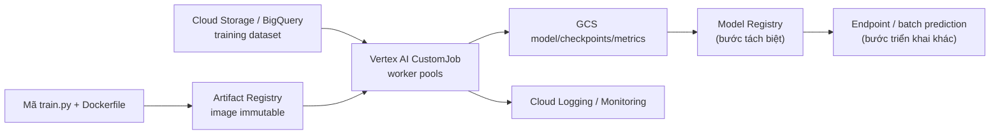
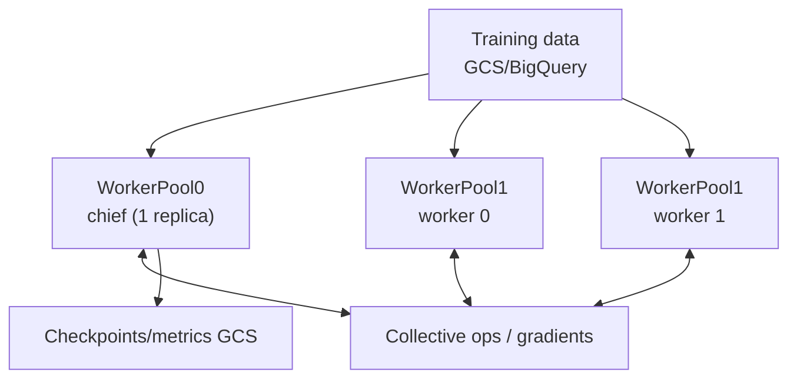

# Training jobs, custom containers và tài nguyên tăng tốc

Một nhóm dữ liệu đã thử nghiệm mô hình dự báo nhu cầu trên laptop. Khi dữ liệu tăng, nhóm muốn chạy huấn luyện định kỳ trên Google Cloud, tự đóng gói thư viện và đôi khi sử dụng **GPU/TPU**. Vấn đề không chỉ là “chọn GPU mạnh nhất”: họ phải tạo **training job có thể tái lập**, cấp đúng quyền đọc dữ liệu/ghi model, chọn vùng có accelerator/quota, theo dõi tiến độ và **dừng tài nguyên khi không còn cần thiết**.

Bài thuộc chương **Vertex AI và học máy** của mô-đun `CLOUD_PROVIDERS_GCP`, nối tiếp kiến thức về project, IAM, VPC, Artifact Registry, Cloud Storage, Cloud Run/GKE, giám sát, độ tin cậy và chi phí. Trọng tâm là **custom training trên Vertex AI**, không phải fine-tuning Gemini API hay inference. Trong tài liệu Google Cloud hiện hành, một số trang custom training được trình bày dưới tên **Gemini Enterprise Agent Platform**; API `aiplatform.googleapis.com`, `CustomJob` và nhóm lệnh `gcloud ai custom-jobs` vẫn là những định danh cần nhận biết.

## 1. Mục tiêu học tập

Sau bài học, bạn có thể:

1. Phân biệt **CustomJob**, **TrainingPipeline**, **HyperparameterTuningJob**, **Vertex AI Pipelines** và **Endpoint**.
2. Đóng gói chương trình ML trong **custom container** có entrypoint và dependencies kiểm soát được.
3. Định nghĩa `WorkerPoolSpec` cho CPU job, hiểu `replicaCount`, `machineSpec`, `containerSpec` và disk.
4. Phân biệt khi nào dùng **CPU, GPU và TPU**; kiểm tra region, tổ hợp phần cứng, quotas và code tương thích.
5. Chạy một ví dụ huấn luyện hồi quy trên máy local, kiểm tra artifacts rồi **tùy chọn** nộp Vertex AI CustomJob trong project lab được phê duyệt.
6. Dùng **service account riêng, Artifact Registry, ADC và Cloud Storage** theo nguyên tắc ít quyền.
7. Hiểu distributed training, `CLUSTER_SPEC`/`TF_CONFIG`, checkpoint và giới hạn của việc chỉ tăng replicas.
8. Đọc job status/logs/metrics, xử lý OOM, quota, permission và chi phí.
9. Hoàn thành các bài tập tính resource-hours, chọn accelerator, lỗi IAM và vận hành.

**Quy tắc an toàn:** phần đầu bài chỉ chạy **local và CPU**, không yêu cầu tạo tài nguyên GCP. Các lệnh `gcloud builds submit` và `gcloud ai custom-jobs create` **phát sinh phí** và chỉ chạy với **project, registry, bucket, quota và ngân sách lab có chủ sở hữu**. Bài không tạo GPU/TPU jobs mặc định.

## 2. Sơ đồ vòng đời huấn luyện



**Training code** xử lý dữ liệu và học tham số. **Custom container** xác định môi trường runtime. **CustomJob** đặt container lên tài nguyên huấn luyện rồi kết thúc. **Model Registry/Endpoint** dùng để quản lý/triển khai model sau huấn luyện; **CustomJob thành công không đồng nghĩa model đã được upload vào Registry hay đã có API inference**.

| Thành phần | Nhiệm vụ | Kết quả |
| --- | --- | --- |
| **Training script** | Đọc dữ liệu, train, evaluate, save artifacts | Model files + metrics |
| **Custom container** | OS/runtime, Python/CUDA/framework, code | Docker/OCI image trong registry |
| **Worker pool** | Machine type, GPU/TPU, replica count, image, disk | Tài nguyên chạy script |
| **CustomJob** | Lập lịch/khởi chạy/giám sát training | Job state, logs, output |
| **TrainingPipeline** | CustomJob + bước tích hợp dataset/model upload | Có thể tạo `Model` nếu artifact phù hợp |
| **HyperparameterTuningJob** | Chạy nhiều trials tối ưu hyperparameters | Best trial + phí nhiều lượt train |
| **Vertex AI Pipelines** | Orchestrate nhiều bước container/ML workflow | Pipeline DAG, caching/metadata tùy cấu hình |

**Phân biệt orchestration:** một `TrainingPipeline` là tài nguyên training tích hợp; **Vertex AI Pipelines** dùng pipeline orchestration đa bước. Hai khái niệm có liên hệ nhưng **không phải cùng API**.

## 3. Chọn custom container hay prebuilt container?

| Lựa chọn | Phù hợp khi | Đổi lại |
| --- | --- | --- |
| **Prebuilt training container + Python package** | Framework/version đã được hỗ trợ, muốn ít quản lý Docker | Bị giới hạn runtime/lib theo image |
| **Custom container** | Cần OS libs, CUDA, phiên bản framework, runtime hoặc code riêng | Tự chịu trách nhiệm image build, CVEs, dependency pinning |
| **Autopackaging** | Muốn CLI đóng gói script/package tự động trên prebuilt base | Kiểm tra output image, quyền build, tính reproducible |
| **GKE/Compute Engine tự vận hành** | Cần scheduling/driver/custom topology đặc thù không hợp serverless | Nhiều trách nhiệm vận hành hơn |

Ở bài này chọn **custom container** để thấy rõ Dockerfile, entrypoint và output artifacts. Bắt đầu bằng CPU tránh phí GPU và giúp tách lỗi code khỏi lỗi phần cứng.

**Không nhầm:** image của training thường **chạy đến khi kết thúc**, không phải web server lắng nghe `PORT` như Cloud Run. Không cần `EXPOSE 8080` hoặc HTTP health endpoint chỉ để Vertex AI chạy training script.

## 4. Kiến trúc WorkerPoolSpec

Ví dụ logical specification:

```yaml
workerPoolSpecs:
  - machineSpec:
      machineType: n1-standard-4
    replicaCount: 1
    containerSpec:
      imageUri: REGISTRY_IMAGE_URI
```

Mỗi phần có nghĩa:

- `machineSpec.machineType`: vCPU/RAM nền; phải được training service hỗ trợ ở region.
- `machineSpec.acceleratorType` / `acceleratorCount`: thêm GPU được hỗ trợ theo tổ hợp máy, hoặc `tpuTopology` trên dòng TPU tương ứng.
- `replicaCount`: số máy chạy **cùng worker-pool specification**, không phải số epochs.
- `containerSpec.imageUri`: image mà workers tải để chạy.
- `containerSpec.command` / `args`: có thể ghi đè Docker `ENTRYPOINT`/`CMD` theo semantics của API.
- `diskSpec`: loại/dung lượng **boot disk** nếu khác mặc định; không đồng nghĩa dung lượng GPU memory.
- `serviceAccount` và `baseOutputDirectory`: thuộc **CustomJobSpec**, không đặt trong từng `machineSpec`.

**Một worker với 4 vCPU ≠ bốn replicas.** Một replica dùng một VM cấu hình đã chọn. Job phân tán nhiều replicas cần **code/framework điều phối và phân vùng dữ liệu**; chỉ tăng replica count trong YAML sẽ khiến script độc lập chạy nhiều lần nếu chưa triển khai distributed training.

## 5. Tài nguyên CPU, GPU và TPU

| Nguồn lực | Công việc phù hợp | Điểm cần kiểm tra |
| --- | --- | --- |
| **CPU** | Tabular ML nhỏ, data preprocessing, sklearn/XGBoost, baseline | Cores, RAM, disk, batch size và throughput |
| **GPU** | Neural nets với tensor operations, training lớn vừa/đủ VRAM | GPU model/VRAM, CUDA framework image, machine pairing, quota |
| **TPU** | Workloads tensor quy mô lớn được XLA/JAX/TF/PyTorch-XLA hỗ trợ | TPU generation, topology, compiler/runtime, region/quota |
| **Distributed GPU/TPU** | Model/dataset không đủ một thiết bị hoặc cần giảm thời gian | Data/model parallelism, network, checkpoints, all-reduce |

**GPU không tự làm script nhanh hơn.** Nếu container chỉ dùng vòng lặp Python hoặc mô hình CPU, cấp một NVIDIA T4/A100/H100 vẫn có thể tạo **0% accelerator utilization nhưng tốn phí accelerator**. Cần framework đã build cho đúng CUDA/runtime và đặt tensors/model lên accelerator.

**TPU không phải NVIDIA GPU khác tên:** cách build image, topology, XLA compile, checkpoint và code có những yêu cầu riêng. Không chuyển `acceleratorType=NVIDIA_TESLA_T4` thành tên TPU rồi kỳ vọng mã PyTorch CUDA chạy được.

### 5.1. Ba lớp điều kiện để cấp GPU

1. **Dịch vụ và vùng:** Vertex AI custom training hỗ trợ GPU type đó ở location muốn dùng.
2. **Machine pairing/topology:** máy chọn được phép gắn GPU count/type đó (máy GPU-integrated có quy tắc khác N1 + T4).
3. **Capacity/quota/budget:** quota training của `aiplatform.googleapis.com` theo project/region/GPU type và khả năng cung cấp thực tế; **không phải** chỉ nhìn Compute Engine VM GPU quota.

GPU có mặt trong một vùng **không có nghĩa project được cấp quota >0** hoặc chắc chắn có capacity khi submit. Với ngân sách sản xuất, kiểm tra khả năng đặt trước tài nguyên/reservation và lịch chạy trước khi hứa deadline.

## 6. Một mô hình mẫu không cần GPU

Lab huấn luyện tuyến tính đơn giản từ dữ liệu tổng hợp:

\[
y \approx 1.8x + 0.5 + \varepsilon
\]

- Phát sinh 200 điểm từ seed cố định, không chứa dữ liệu thật.
- Dùng 160 điểm train, 40 điểm đánh giá.
- Tối ưu **mean squared error (MSE)** bằng gradient descent.
- Lưu `model.json` (weight/intercept) và `metrics.json`.
- Chạy được bằng **Python 3.11** và thư viện chuẩn; thêm Google Cloud Storage client chỉ để ghi output tới `gs://` trong cloud job.

Đây là **mô hình dạy workflow**, không phải benchmark GPU hay mô hình production. Kết quả JSON chỉ để xem training artifacts; không tương thích sẵn với mọi prebuilt serving container của Vertex AI.

## 7. Chuẩn bị lab local

Môi trường: Python 3.11+, Docker Engine (nếu muốn chạy container), Bash, tùy chọn `gcloud`. Tạo thư mục demo riêng, **không ghi file phụ vào repository bài học**:

```text
vertex-training-lab/
├── train.py
├── Dockerfile
└── output/          # sinh sau khi train
```

Khi chạy local, không cần service account, billing hay Artifact Registry. Thứ tự kiểm thử:

1. Chạy `python3 train.py` và mở `output/metrics.json`.
2. Build image, chạy lại script trong Docker để kiểm tra entrypoint.
3. **Tùy chọn** dùng project lab để build/push image, chạy CPU CustomJob và đọc model trong GCS.
4. Chỉ sau khi hoàn thành CPU path mới cân nhắc viết **một** biến thể GPU-aware/TPU-aware khác.

## 8. train.py — huấn luyện và xuất artifacts

Tạo file `train.py` trong thư mục demo:

```python
import argparse
import json
import logging
import os
import posixpath
import random
from pathlib import Path


def make_data(seed):
    rng = random.Random(seed)
    rows = []
    for _ in range(200):
        x = rng.uniform(-1.0, 1.0)
        y = 1.8 * x + 0.5 + rng.gauss(0.0, 0.05)
        rows.append((x, y))
    rng.shuffle(rows)
    return rows[:160], rows[160:]


def mse(rows, weight, bias):
    return sum(
        ((weight * x + bias) - y) ** 2 for x, y in rows
    ) / len(rows)


def train(train_rows, epochs, learning_rate):
    weight, bias = 0.0, 0.0
    n = len(train_rows)
    for epoch in range(epochs):
        grad_w = 2.0 * sum(
            (weight * x + bias - y) * x for x, y in train_rows
        ) / n
        grad_b = 2.0 * sum(
            (weight * x + bias - y) for _, y in train_rows
        ) / n
        weight -= learning_rate * grad_w
        bias -= learning_rate * grad_b
        if epoch % 100 == 0 or epoch == epochs - 1:
            logging.info("epoch=%d train_mse=%.6f",
                         epoch, mse(train_rows, weight, bias))
    return weight, bias


def write_json(directory, filename, payload):
    content = json.dumps(
        payload, ensure_ascii=False, indent=2, sort_keys=True
    )
    if directory.startswith("gs://"):
        # Import chỉ cần khi job có output trên Cloud Storage.
        from google.cloud import storage

        relative = directory[len("gs://"):]
        bucket, separator, prefix = relative.partition("/")
        if not bucket:
            raise ValueError("AIP_MODEL_DIR phải có bucket hợp lệ")
        blob_name = posixpath.join(prefix.strip("/"), filename)
        storage.Client().bucket(bucket).blob(blob_name).upload_from_string(
            content, content_type="application/json"
        )
        logging.info("Saved gs://%s/%s", bucket, blob_name)
    else:
        path = Path(directory)
        path.mkdir(parents=True, exist_ok=True)
        (path / filename).write_text(content + "\n", encoding="utf-8")
        logging.info("Saved %s", path / filename)


def main():
    parser = argparse.ArgumentParser()
    parser.add_argument("--seed", type=int, default=42)
    parser.add_argument("--epochs", type=int, default=300)
    parser.add_argument("--learning-rate", type=float, default=0.1)
    parser.add_argument("--output-dir", default="./output")
    args = parser.parse_args()
    if args.epochs <= 0 or not 0 < args.learning_rate < 1:
        parser.error("epochs > 0 và learning-rate trong (0, 1)")

    logging.basicConfig(level=logging.INFO)
    train_rows, eval_rows = make_data(args.seed)
    weight, bias = train(
        train_rows, args.epochs, args.learning_rate
    )
    evaluation_mse = mse(eval_rows, weight, bias)

    # AIP_MODEL_DIR chỉ có khi job có baseOutputDirectory.
    model_dir = os.environ.get("AIP_MODEL_DIR") or args.output_dir
    write_json(model_dir, "model.json", {
        "model_type": "linear_regression",
        "weight": weight,
        "bias": bias,
        "seed": args.seed,
        "epochs": args.epochs
    })
    write_json(model_dir, "metrics.json", {
        "eval_mse": evaluation_mse,
        "eval_rows": len(eval_rows),
        "train_rows": len(train_rows)
    })
    logging.info("eval_mse=%.6f", evaluation_mse)


if __name__ == "__main__":
    main()
```

**Vì sao tách `write_json`?** `AIP_MODEL_DIR` có thể là một **GCS URI**, không phải đường dẫn POSIX; gọi `open("gs://...")` trực tiếp sẽ lỗi. Chúng ta dùng Cloud Storage client với **Application Default Credentials (ADC)** đã có trên training runtime. Không nhúng service account JSON key vào image.

### 8.1. Kiểm thử Python local

```bash
cd vertex-training-lab
python3 train.py --epochs=300 --seed=42 --output-dir=./output
cat output/model.json
cat output/metrics.json
```

Kỳ vọng: `weight` xấp xỉ **1,8**, `bias` xấp xỉ **0,5**, `eval_mse` nhỏ (vì dữ liệu tổng hợp ít nhiễu). Nếu metric bất thường, xác nhận seed, learning rate và epoch count trước khi tìm lỗi trên cloud.

**Không kết luận về generalization production** từ dữ liệu sinh ngẫu nhiên này. Với ML thật, cần split theo thời gian/người dùng phù hợp, chặn data leakage, đánh giá bias/drift và kiểm soát nguồn dữ liệu có PII.

## 9. Dockerfile cho custom training container

Tạo `Dockerfile`:

```dockerfile
FROM python:3.11-slim

ENV PYTHONDONTWRITEBYTECODE=1 \
    PYTHONUNBUFFERED=1

WORKDIR /app

# Lab: phiên bản major được giới hạn; production pin digest/lock.
RUN pip install --no-cache-dir "google-cloud-storage>=3,<4"

RUN useradd --create-home --uid 10001 trainer
COPY --chown=trainer:trainer train.py /app/train.py
USER trainer

ENTRYPOINT ["python", "/app/train.py"]
```

**Giải thích:**

- Base `python:3.11-slim` dùng **CPU**; không có CUDA/cuDNN.
- `ENTRYPOINT` chạy chương trình và **exit code 0** khi hoàn thành. Exception khiến exit code khác 0, job có thể thất bại.
- `google-cloud-storage` giúp ghi `gs://`; local output dùng thư viện chuẩn.
- Chạy non-root, không đóng gói credentials/PII.
- Production cần **pin base image digest**, lock dependencies, quét vulnerabilities, lưu image digest/SBOM và provenance; khoảng version chỉ để demo dễ tái sử dụng.

**Đừng biến image này thành GPU training** bằng cách thêm một dòng `acceleratorType`. Code không dùng GPU; với PyTorch/TensorFlow phải build base có CUDA/runtime tương thích và test `torch.cuda.is_available()` hoặc thiết bị tương ứng.

### 9.1. Build và test Docker local

```bash
docker build -t vertex-train-demo:local .

# Test entrypoint, không cần credentials GCP.
docker run --rm vertex-train-demo:local --epochs=300 --seed=42

# Trên Linux/macOS hoặc Cloud Shell có Docker daemon:
mkdir -p output
docker run --rm \
  --user "$(id -u):$(id -g)" \
  --mount "type=bind,source=$PWD/output,target=/output" \
  vertex-train-demo:local --output-dir=/output
cat output/metrics.json
```

Lệnh Docker thứ hai dùng user ID của host để tránh ghi file với owner không đúng; cách mount/`id` này dành cho shell POSIX, có thể phải điều chỉnh nếu chạy Windows Docker Desktop. **Cloud Shell không bảo đảm có Docker daemon cấu hình phù hợp**; nếu không có thì chỉ chạy `python3 train.py` local.

## 10. Artifact Registry và tính bất biến của image

Luồng cloud:

```text
train.py + Dockerfile
   -> docker build / Cloud Build
   -> Artifact Registry image:tag
   -> kiểm tra image digest / scan
   -> Vertex AI CustomJob containerSpec.imageUri
```

**Tag** như `:v1` có thể trỏ sang image khác sau khi build lại, còn **OCI digest `@sha256:...`** xác định artifact cụ thể. Để audit/reproduce training, ghi **source commit + image digest + input snapshot + hyperparameters + job ID**.

Trường `imageUri` của CustomJob tham chiếu container; nếu image ở **Artifact Registry cùng project** thường không cần grant extra pull permission. Với **cross-project registry**, quyền **kéo image thuộc Vertex AI/Agent Platform service agent**, không phải tự động của custom **runtime service account**.

**Không dùng `gcr.io` legacy mặc định cho project mới** nếu đã chuẩn hóa Artifact Registry. Repository cần là Docker repo đúng region, có quy trình retention/scan và owner.

## 11. Preflight cloud chỉ đọc

Chỉ dùng phần này nếu có project lab được phê duyệt. **Không tự tạo project/bucket/repository hoặc tăng quota chỉ để chạy bài**.

```bash
PROJECT_ID="YOUR_AUTHORIZED_LAB_PROJECT"
REGION="YOUR_APPROVED_REGION"
REPO="YOUR_EXISTING_DOCKER_REPO"
BUCKET="YOUR_EXISTING_LAB_BUCKET"
TRAIN_SA="YOUR_EXISTING_TRAINING_SERVICE_ACCOUNT_EMAIL"

gcloud --version
gcloud auth list
gcloud projects describe "$PROJECT_ID" \
  --format="yaml(projectId,lifecycleState)"

# READ: Artifact Registry repo đã được chuẩn bị.
gcloud artifacts repositories describe "$REPO" \
  --project="$PROJECT_ID" \
  --location="$REGION"

# READ: bucket dùng output/staging.
gcloud storage buckets describe "gs://$BUCKET"

# READ: custom training jobs và service identity hiện có.
gcloud ai custom-jobs list \
  --project="$PROJECT_ID" \
  --region="$REGION"

# READ: kiểm tra IAM policy của service account nếu được phép xem.
gcloud iam service-accounts describe "$TRAIN_SA" \
  --project="$PROJECT_ID"
```

**Cần kiểm tra thêm trên Console/Quotas:**

- API `aiplatform.googleapis.com` và Cloud Build/Artifact Registry đã được bật theo chính sách.
- **Training quota** cho machine/region, CPU/GPU/TPU type; GPU/TPU có thể có quota bằng **0**.
- Budget, labels, expected runtime, giới hạn concurrency, data residency và log retention.
- `TRAIN_SA` có quyền **đọc input**, **ghi đúng output bucket/prefix** và truy cập dịch vụ cần thiết.
- Người submit có quyền chạy custom jobs và `iam.serviceAccounts.actAs` trên `TRAIN_SA`.
- Cloud Build principal có quyền build và **`roles/artifactregistry.writer`** ở repository đích.

Nếu thiếu một điều kiện, **dừng ở local lab** hoặc yêu cầu quản trị viên chuẩn bị đúng scope. Không cấp Owner/Editor toàn project chỉ để làm bài tập.

## 12. Build và đẩy image bằng Cloud Build (tùy chọn có phí)

Giữ `REGION` đồng nhất với Artifact Registry repo và location training phù hợp. Tạo image tag duy nhất:

```bash
RUN_ID="$(date +%Y%m%d%H%M%S)"
IMAGE_URI="$REGION-docker.pkg.dev/$PROJECT_ID/$REPO/vertex-train:$RUN_ID"

# GHI: upload source tới Cloud Build và push image (có phí).
gcloud builds submit . \
  --project="$PROJECT_ID" \
  --tag="$IMAGE_URI"

# Chỉ đọc: xem image đã có trong repository.
gcloud artifacts docker images list \
  "$REGION-docker.pkg.dev/$PROJECT_ID/$REPO" \
  --project="$PROJECT_ID" \
  --include-tags
```

**Không dùng `latest` để ghi lại training run.** Trong production, đọc **digest đã push** và dùng image URI bất biến cho CustomJob. Ghi lại digest trong run manifest/artifact metadata. Build qua Cloud Build sử dụng **build identity** khác với runtime training service account và Vertex AI service agent.

Đây là bước tùy chọn: bạn vẫn có thể hoàn thành học phần mà không push image hoặc phát sinh phí GCP.

## 13. CustomJobSpec CPU: cấu hình an toàn đầu tiên

Tạo `job.yaml` **trong thư mục demo** bằng Bash (các biến ở Mục 11–12 đã được gán):

```bash
JOB_NAME="vertex-train-cpu-$RUN_ID"

cat > job.yaml <<EOF
workerPoolSpecs:
  - machineSpec:
      machineType: n1-standard-4
    replicaCount: 1
    containerSpec:
      imageUri: "$IMAGE_URI"
      args:
        - "--epochs=300"
        - "--seed=42"
baseOutputDirectory:
  outputUriPrefix: "gs://$BUCKET/vertex-training/$RUN_ID"
serviceAccount: "$TRAIN_SA"
scheduling:
  timeout: "3600s"
EOF

# CHỈ ĐỌC file YAML local trước khi submit.
cat job.yaml
```

- `workerPoolSpecs` là **mảng**; demo dùng **một pool, một replica CPU**.
- `baseOutputDirectory.outputUriPrefix` khiến job đặt các biến `AIP_MODEL_DIR`, `AIP_CHECKPOINT_DIR`, `AIP_TENSORBOARD_LOG_DIR`.
- `AIP_MODEL_DIR` trỏ tới `gs://.../model/` bên dưới prefix; mã train sẽ ghi `model.json` và `metrics.json` ở đó.
- `serviceAccount` là identity **trong container**. Nó cần quyền ghi GCS; image pull dùng service identity tương ứng của nền tảng.
- `timeout` giới hạn thời gian job; không thay thế budget/quota monitoring.

**Các tiền điều kiện chưa kiểm chứng:** `n1-standard-4` phải được Vertex AI custom training hỗ trợ trong region; bucket output có policy và quyền phù hợp; image chứa đúng entrypoint. Nếu org yêu cầu CMEK/VPC-SC hoặc private networking, bản YAML tối giản này cần bổ sung các trường hợp lệ trước khi chạy.

## 14. Tạo, theo dõi và đọc kết quả CustomJob

Sau khi owner chấp thuận phí:

```bash
# GHI, CÓ CHI PHÍ: tạo job và cấp workers.
gcloud ai custom-jobs create \
  --project="$PROJECT_ID" \
  --region="$REGION" \
  --display-name="$JOB_NAME" \
  --config=job.yaml

# READ: tìm job ID đã được tạo.
gcloud ai custom-jobs list \
  --project="$PROJECT_ID" \
  --region="$REGION" \
  --filter="displayName:$JOB_NAME"
```

Lấy **JOB_ID thực** từ kết quả list, không đoán theo timestamp:

```bash
JOB_ID="YOUR_ACTUAL_CUSTOM_JOB_ID"

gcloud ai custom-jobs describe "$JOB_ID" \
  --project="$PROJECT_ID" \
  --region="$REGION"

gcloud ai custom-jobs stream-logs "$JOB_ID" \
  --project="$PROJECT_ID" \
  --region="$REGION"
```

**Kỳ vọng:** từ `JOB_STATE_PENDING`/`QUEUED` hoặc `RUNNING` sang `JOB_STATE_SUCCEEDED`. Khi training code báo exception, job có thể kết thúc `FAILED`; khi bị hủy, state có thể là `CANCELLED`. Không chỉ nhìn “lệnh submit trả về thành công” rồi coi training đã xong.

Đọc model output **sau khi job thành công**:

```bash
gcloud storage ls "gs://$BUCKET/vertex-training/$RUN_ID/model/"

gcloud storage cat \
  "gs://$BUCKET/vertex-training/$RUN_ID/model/model.json"

gcloud storage cat \
  "gs://$BUCKET/vertex-training/$RUN_ID/model/metrics.json"
```

Nếu prefix output trống, kiểm tra `AIP_MODEL_DIR`, logs, service account quyền ghi bucket, code exit status và cách parse `gs://`. Đừng vội cấp `roles/storage.admin` toàn project khi chỉ cần ghi artifacts trong bucket lab.

## 15. AIP environment variables và nơi lưu checkpoints

Khi cung cấp `baseOutputDirectory`, Vertex AI tạo các biến môi trường:

| Biến | Mục đích |
| --- | --- |
| `AIP_MODEL_DIR` | Artifact model để các bước upload/đăng ký có thể tìm thấy |
| `AIP_CHECKPOINT_DIR` | Checkpoints sau mỗi phần training |
| `AIP_TENSORBOARD_LOG_DIR` | Event/logs phục vụ TensorBoard |

**Custom container phải tự ghi files**. Vertex AI không tự biết cách serialise một object Python thành `model.json`/`model.pt`.

Với job dài:

- Ghi checkpoint định kỳ với step/epoch, optimizer state và schema/version.
- Chỉ chief/primary replica ghi **một model chính** để tránh xung đột object.
- Khi worker restart/Spot interruption, khôi phục từ checkpoint tương thích.
- Lưu training seed, data snapshot/version, hyperparameters và image digest.
- Xóa artifacts cũ theo retention/approval, không giữ GCS checkpoints mãi.

Checkpoint **không thay** việc đánh giá metrics: một file tồn tại có thể là mô hình huấn luyện dở, chưa đạt quality gate.

## 16. GPU job: khi nào thực sự cần?

Một ML workload dùng **PyTorch** trên dữ liệu ảnh lớn thường hưởng lợi từ GPU, nhưng trước khi cấp phần cứng phải chứng minh CPU path và GPU-aware code chạy được.

Ví dụ cấu hình tham khảo **1 NVIDIA T4** (chỉ khi region/machine/quota cho phép):

```yaml
# MINH HỌA, KHÔNG SUBMIT với CPU-only image ở bài này.
workerPoolSpecs:
  - machineSpec:
      machineType: n1-standard-4
      acceleratorType: NVIDIA_TESLA_T4
      acceleratorCount: 1
    replicaCount: 1
    containerSpec:
      imageUri: CUDA_AWARE_PYTORCH_IMAGE_URI
```

Yêu cầu **khác CPU lab**:

1. Docker base có CUDA runtime/cuDNN + PyTorch build tương thích **GPU driver** của môi trường huấn luyện.
2. Code thực sự chuyển model/tensors sang `cuda`, dùng batches hợp lý và kiểm tra `torch.cuda.is_available()`.
3. VRAM đủ với model, activations, gradients, optimizer states và batch; dùng mixed precision/gradient accumulation nếu phù hợp.
4. Có **training accelerator quota**, capacity thực, image pull và budget.
5. So **examples/s, epoch time, validation metric, accelerator utilization và chi phí/epoch** với CPU.

```python
# Chạy bên trong một image PyTorch CUDA đã được kiểm thử.
import torch

if not torch.cuda.is_available():
    raise RuntimeError("Không thấy CUDA GPU: kiểm tra image/driver/quota")
device = torch.device("cuda")
model = model.to(device)   # model đã được khởi tạo trong chương trình thật
```

Đoạn này minh họa **device placement**, không phải chương trình train hoàn chỉnh; đừng chạy nó độc lập khi `model` chưa được định nghĩa. **CPU-only `train.py` của lab không sử dụng T4**: không submit GPU job bằng image đó để tránh trả phí mà không tạo lợi ích.

## 17. TPU: topology và sự khác biệt với GPU

TPU VM có **machine type/topology** riêng; một số dòng TPU dùng fields như `tpuTopology` thay vì `acceleratorCount` kiểu GPU. Tổ hợp hợp lệ thay đổi theo **TPU generation và region**.

Mẫu đọc hiểu (không phải YAML đủ để submit):

```yaml
machineSpec:
  machineType: YOUR_SUPPORTED_TPU_MACHINE_TYPE
  tpuTopology: YOUR_SUPPORTED_TOPOLOGY
```

**Đừng tự đoán** `tpuTopology` là `2x2` hoặc `4x4` để “có 4 TPU”. Kiểm tra bảng tương thích topology, chip count, quota và runtime của dòng TPU được chọn. TPU thích hợp khi framework có XLA/JAX/TensorFlow/PyTorch-XLA code được tối ưu và bước compile/shape/static batch phù hợp.

Nếu model nhỏ hoặc input pipeline bị nghẽn CPU/I/O, TPU đắt hơn chưa chắc nhanh hơn. Dùng **profiling** để chứng minh bottleneck trước khi nâng.

## 18. Distributed training: thêm replicas không đủ

Ví dụ framework cần **một primary replica** và **hai worker replicas**:



Các lệnh khai báo worker pools chỉ cấp **VMs/containers**; để thực sự train phân tán:

- TensorFlow có thể dùng `TF_CONFIG` để cấu hình cluster roles và `tf.distribute`.
- Vertex AI cấp `CLUSTER_SPEC` (và `TF_CONFIG` cho distributed jobs); PyTorch Distributed cần mapping rank/world size/master address/ports phù hợp.
- Dữ liệu phải **shard đúng**, tránh mỗi worker đọc toàn bộ data và train lặp.
- Chọn **gradient synchronization**, batch global/per-replica và learning-rate schedule phù hợp.
- Chief ghi checkpoints/final model; workers không cùng overwrite một object.
- Network giữa workers và retry/restart có thể làm overhead lớn; **speedup không tuyến tính**.

**Quan trọng:** demo `train.py` hiện không đọc `CLUSTER_SPEC`. Nếu đặt `replicaCount=3` mà không sửa mã, ba VM có thể huấn luyện ba mô hình riêng và cùng ghi vào một `AIP_MODEL_DIR`, gây race. **Không triển khai distributed bằng cách chỉ sửa YAML**.

## 19. Hiệu năng: chọn accelerator theo bottleneck

| Triệu chứng | Nghi vấn | Biện pháp |
| --- | --- | --- |
| CPU luôn 100%, GPU idle | Data loader/preprocessing chậm, tensors chưa lên GPU | Profile CPU workers, tối ưu input pipeline |
| GPU VRAM OOM | Batch/model/optimizer state quá lớn | Giảm batch, mixed precision, gradient checkpointing |
| GPU utilization thấp, I/O cao | Cloud Storage đọc file nhỏ/rời rạc | Shard/batch/cache dataset hợp lý, locality |
| Train trên nhiều GPU không nhanh | Communication overhead/all-reduce | Profile synchronization, batch, interconnect |
| Job chờ lâu ở `QUEUED` | Thiếu accelerator capacity/quota hoặc scheduling | Kiểm region/quota/availability; cân nhắc reservation |
| Training nhanh nhưng metric kém | Data leakage, distribution shift, hyperparams | Validation/test, metrics và data contract |
| Mất progress khi worker restart | Không có checkpoint | Ghi `AIP_CHECKPOINT_DIR` định kỳ |
| CPU job rẻ nhưng quá chậm | Workload phù hợp GPU/TPU | Benchmark chi phí trên **cùng** dữ liệu/quality target |

**Thước đo đúng:** **cost per converged run**, không chỉ samples/s. Một GPU đắt hơn CPU có thể có lợi nếu giảm số giờ và đạt cùng quality; ngược lại model nhỏ có thể nhanh hơn/rẻ hơn trên CPU khi tính cả data loading và startup.

## 20. IAM và bảo mật custom training

Có **ba danh tính quan trọng**:

| Danh tính | Quyền tối thiểu điển hình |
| --- | --- |
| **Submitter (CI/CD/user)** | `roles/aiplatform.user` theo scope job, `iam.serviceAccounts.actAs` trên runtime SA; quyền build khi cần |
| **Build principal (Cloud Build)** | Ghi image vào đúng Artifact Registry repo, đọc source build; không cần DB admin |
| **Training runtime SA** | Đọc đúng input bucket/BigQuery tables; ghi output bucket, dùng ADC; không cần `roles/editor` |

**Thêm một danh tính riêng:** Vertex AI/Agent Platform **service agent** kéo custom container image; với **cross-project Artifact Registry**, repository bên chứa image phải cho **service agent** phù hợp quyền `roles/artifactregistry.reader`. **Không** cấp nhầm quyền image pull cho runtime SA rồi kỳ vọng nó có tác dụng.

Khuyến nghị:

- Dùng **user-managed service account** cho từng workload/đội, không tải service account key JSON vào image.
- Secrets và credentials trong Secret Manager, gắn version/rotation; **không log tokens, credentials hoặc PII**.
- Dataset có PII dùng Cloud Storage/BigQuery IAM, retention, residency và Sensitive Data Protection theo policy.
- Đặt Artifact Registry và output bucket cùng region hợp lệ nếu khả thi để giảm latency/egress.
- Với **VPC Service Controls, CMEK, private access/peering**, kiểm tra network và service agents; không tắt security perimeter chỉ để training job chạy.
- Chỉ cấp service account deploy/read theo nguyên tắc ít quyền; audit who-submitted/which-image/which-data.

**IAM không tự bảo đảm model an toàn**: training data có thể sai hoặc chứa PII; cần kiểm soát provenance, quality evaluation, privacy và quyền truy cập model output.

## 21. Quan sát training job và xử lý lỗi

Trong Console **Vertex AI / training jobs (tên giao diện có thể đổi)** hoặc Cloud Logging:

- **Job state:** `PENDING`, `QUEUED`, `RUNNING`, `SUCCEEDED`, `FAILED`, `CANCELLED`.
- **Container logs:** stdout/stderr, epoch/step, loss, evaluation metrics, exception stack.
- **Resource utilization:** CPU/GPU memory/utilization, disk, network, input loading.
- **Metadata:** image digest, training code commit, dataset snapshot, seed, hyperparameters, job id, machine/region và wall time.
- **Artifacts:** model/checkpoints trong GCS, trạng thái upload hoàn chỉnh.
- **Billing:** compute/accelerator-hours, GCS/registry/storage, logging/egress.

### 21.1. Một runbook chẩn đoán ngắn

1. `JOB_STATE_FAILED`? Đọc job describe và **first exception** trong container logs.
2. `403 GCS`? Xác nhận **runtime SA** và bucket IAM, không mở bucket public.
3. `Image pull denied`? Xác nhận image URI và **service agent** có reader trên registry cross-project.
4. `Quota exceeded`? Kiểm tra **Vertex AI training quota**, region và hardware combination.
5. `GPU not detected`? Kiểm Docker CUDA/framework driver, loại accelerator, thiết bị.
6. `CUDA out of memory`? Giảm batch/model hoặc tăng thiết bị hợp lệ.
7. `AIP_MODEL_DIR` không có output? Kiểm `baseOutputDirectory`, client GCS, logs và code path.
8. `Job SUCCEEDED` nhưng model metric kém? Đây là **lỗi chất lượng**, không phải lỗi hạ tầng; quality gate riêng.

### 21.2. Khi training treo quá lâu

Nếu job vượt thời gian/chi phí dự kiến, xác minh job ID/owner rồi **chủ động cancel**:

```bash
# CÓ TÁC ĐỘNG: chỉ dùng trên JOB_ID lab do bạn sở hữu.
gcloud ai custom-jobs cancel "$JOB_ID" \
  --project="$PROJECT_ID" \
  --region="$REGION"
```

**Cancel không xóa artifacts** đã ghi trong bucket hoặc image ở Artifact Registry. Kiểm trạng thái terminal, tính phí còn phát sinh, checkpoints còn lại và nhật ký điều tra trước cleanup.

## 22. Quản lý chi phí và quotas

Công thức ước lượng trước khi launch:

\[
\text{Training compute cost}
\approx \sum_{\text{pools}}\left(
\text{replicas}\times\text{time}\times
(\text{VM rate}+\text{accelerator rate})
\right)
\]

Thêm **boot disk, staging/output GCS, image/registry, data transfer, logging/monitoring, checkpoints** và các dịch vụ được gọi khác. Công thức chỉ để **so sánh tương đối**, không thay biểu giá thực theo region/edition, reservation/Spot hoặc thời gian tính phí.

Ví dụ:

```text
1 CPU worker × 2 giờ     = 2 VM-hours
2 GPU workers × 1,5 giờ  = 3 VM-hours + 3 GPU-hours (1 GPU/VM)

Dù GPU job kết thúc sớm hơn, vẫn có phí GPU-hours,
disk/GCS/network và có thể quota/capacity wait.
```

**Quotas khác ngân sách:** quota giới hạn khả năng cấp tài nguyên, **Budget alerts chỉ thông báo** và không tự ngăn job tiếp tục chạy. Guardrails nên gồm:

- CPU-first smoke test, data sample và job timeout.
- Labels như `team=ml`, `env=lab`, `owner=training`.
- Không mở nhiều hyperparameter trials đồng thời khi chưa dự toán.
- Checkpoint để tránh train lại từ đầu khi lỗi; lifecycle xóa checkpoints cũ.
- Giới hạn concurrency, quota/request permissions và kiểm ngày/giờ chạy.
- Đo **quality target cùng chi phí per successful run** trước khi nâng GPU count.

## 23. Tình huống thiết kế: từ CPU baseline đến GPU

Một nhóm có model dự báo tồn kho, dataset 10 triệu records. CPU job chạy **5 giờ**, GPU job dự kiến **1 giờ**, nhưng GPU quota của region hiện bằng **0**.

**Kế hoạch có kiểm soát:**

1. Xác định model có phép toán hỗ trợ GPU không; benchmark trên tập đại diện, không đoán từ số rows.
2. Xây custom image có runtime **CUDA framework** tương thích; kiểm local/VM GPU nếu có.
3. Đo CPU run baseline: wall time, peak RAM, validation metric, output size/cost.
4. Kiểm region có GPU type và machine pairing; yêu cầu **Vertex AI training quota** trước, đánh giá khả năng cấp máy.
5. Chạy GPU **một replica**, cùng dataset, seed/splits/hyperparameters tương đương.
6. Đo cost/converged run: GPU-hours, CPU data loader, I/O, p95 batch, metric.
7. Nếu GPU thắng thực chất và SLO yêu cầu, mới đánh giá distributed/Spot/reservations.
8. Lưu run manifest image digest, data version, hyperparameters, artifact URI và owner.

**Quyết định:** nếu việc chờ quota/capacity và chi phí accelerator lớn hơn lợi ích, **CPU baseline có thể là lựa chọn đúng**. Tối ưu đáng giá là training pipeline đáng tin cậy, không phải số GPU cao nhất.

## 24. Bài tập tự luyện

### Bài 1 — chọn tài nguyên

Mô hình tuyến tính 200 dòng dữ liệu, train trong vài giây trên CPU; nhóm muốn tạo 4 GPU T4.

**Đáp án:** không cần GPU. Chạy local/CPU CustomJob trước; GPU có phí mà code hiện không sử dụng.

### Bài 2 — WorkerPoolSpec

`replicaCount=4` và `machineType=n1-standard-4` nghĩa là có 16 vCPU trong một máy?

**Đáp án:** không. Đây là **4 replicas/VMs**, mỗi VM 4 vCPU (tổng cấp phát lý thuyết 16 vCPU), cần code phân tán để dùng chung cho một job.

### Bài 3 — model output

Job có `baseOutputDirectory=gs://bucket/run-1` nhưng script ghi `open("gs://...")` và thất bại.

**Đáp án:** `gs://` là URI, không phải local filesystem thông thường. Dùng Cloud Storage client hoặc mount được hỗ trợ; ghi vào `AIP_MODEL_DIR` đúng quyền IAM.

### Bài 4 — image pull

Runtime SA có `roles/artifactregistry.reader`, nhưng CustomJob kéo image ở **project khác** báo 403.

**Đáp án:** image pull do **Vertex AI service agent**, cần reader phù hợp trên repo cross-project; quyền runtime SA không giải quyết trường hợp này.

### Bài 5 — GPU quota

Compute Engine console báo còn GPU quota, Vertex AI training job vẫn báo quota vượt.

**Đáp án:** quotas **Vertex AI training** được theo dõi riêng với Compute Engine quota; xem project/region/GPU type, giới hạn và capacity.

### Bài 6 — CUDA runtime

Job được cấp 1 T4 nhưng `torch.cuda.is_available()` trả `False`.

**Đáp án:** kiểm image có CUDA-enabled PyTorch, driver/runtime tương thích, accelerator type được hỗ trợ, logs và device placement; không chỉ tăng GPU count.

### Bài 7 — distributed training

Chuyển sample `train.py` thành `replicaCount=3` mà không sửa code. Kết quả có chắc train nhanh gấp 3?

**Đáp án:** không. Ba replicas có thể chạy độc lập và tranh ghi output; cần `CLUSTER_SPEC`/`TF_CONFIG`, framework distributed, data sharding và chief-only checkpoint.

### Bài 8 — resource-hours

Hai GPU workers, mỗi worker 1 GPU, chạy 90 phút. Tổng GPU-hours?

**Đáp án:** 2 × 1 × 1,5 = **3 GPU-hours**, ngoài VM/disk/network/Cloud Storage charges.

### Bài 9 — job state

CustomJob `SUCCEEDED`, nhưng evaluation MSE cao gấp đôi ngưỡng sản phẩm.

**Đáp án:** job **thành công hạ tầng**, model **không đạt quality gate**. Không tự đăng ký/triển khai; điều tra dữ liệu, hyperparameters và leakage.

### Bài 10 — checkpoint

Training 12 giờ không có checkpoint, worker bị preempt/restart gần cuối. Giải pháp?

**Đáp án:** lưu optimizer/model checkpoint định kỳ vào `AIP_CHECKPOINT_DIR`, test resume/idempotent writes, chọn scheduling/Spot theo RTO và chi phí.

## 25. Checklist triển khai và dọn lab

**Trước khi submit:**

- [ ] Đã thử Python/Docker local, script exit code và model/metrics output.
- [ ] Image có tag/digest, source commit và dependencies được kiểm soát.
- [ ] Chọn CPU/GPU/TPU từ profiling, kiểm vùng, machine pairing và training quota.
- [ ] Có dataset snapshot/version, train/validation split và quality metric/SLO.
- [ ] `WorkerPoolSpec` đúng replicas, image, disk, accelerator.
- [ ] Distributed code đã thử shard/rank/collectives nếu dùng nhiều replicas.
- [ ] Runtime SA được cấp quyền **đọc input/ghi output**; submitter có actAs.
- [ ] Image pull role cho **service agent** nếu registry cross-project.
- [ ] GCS output `AIP_MODEL_DIR`/checkpoints và retention rõ.
- [ ] Có timeout, budgets, labels, quota, logging và owner.
- [ ] Có runbook cancel/failure/OOM và đánh giá metric trước khi deploy.

**Dọn lab:**

- **Local:** xóa thư mục demo/output và image Docker local do chính bạn tạo nếu không cần nữa.
- **Cloud:** sau khi job ở terminal state, kiểm tra artifacts có cần giữ để audit/reproduce hay không; chỉ xóa đúng prefix `gs://$BUCKET/vertex-training/$RUN_ID` và image tag/digest thuộc lab theo approval.
- **Không xóa** shared bucket, registry repository, service accounts, project/IAM policies, GPU reservation hoặc models của người khác.
- Job CustomJob hoàn tất thì VMs tạm thời được giải phóng, nhưng **GCS output, Artifact Registry images, Cloud Logging và metadata** có thể tiếp tục có phí/retention.

**Không** sử dụng `gcloud storage rm --recursive gs://$BUCKET` hoặc xóa toàn bộ Artifact Registry chỉ để dọn một bài tập.

## 26. Tài liệu Google Cloud chính thức

- [Serverless custom training overview](https://docs.cloud.google.com/gemini-enterprise-agent-platform/machine-learning/training/overview): lựa chọn prebuilt/custom containers và training jobs.
- [Create a CustomJob](https://docs.cloud.google.com/gemini-enterprise-agent-platform/machine-learning/training/create-custom-job): CLI/REST và distributed training.
- [Container settings](https://docs.cloud.google.com/gemini-enterprise-agent-platform/machine-learning/training/configure-container-settings): `WorkerPoolSpec`, `containerSpec`/`pythonPackageSpec`.
- [Compute and accelerators](https://docs.cloud.google.com/gemini-enterprise-agent-platform/machine-learning/training/configure-compute): machines, GPU/TPU và boot disks.
- [Training code requirements](https://docs.cloud.google.com/gemini-enterprise-agent-platform/machine-learning/training/code-requirements): entrypoint, artifacts và distributed env.
- [Custom training containers](https://docs.cloud.google.com/gemini-enterprise-agent-platform/machine-learning/training/create-custom-container): Dockerfile/Artifact Registry và cross-project permissions.
- [Distributed training](https://docs.cloud.google.com/gemini-enterprise-agent-platform/machine-learning/training/distributed-training): `CLUSTER_SPEC`/`TF_CONFIG`.
- [Use a custom service account](https://docs.cloud.google.com/gemini-enterprise-agent-platform/machine-learning/general/custom-service-account): IAM, ADC, image pulls.
- [Training quotas and limits](https://docs.cloud.google.com/gemini-enterprise-agent-platform/machine-learning/quotas): project/region/accelerator quotas.
- [Cloud Storage mount in training](https://docs.cloud.google.com/gemini-enterprise-agent-platform/machine-learning/training/cloud-storage-file-system): `/gcs` access và giới hạn file I/O.
- [TrainingPipeline](https://docs.cloud.google.com/gemini-enterprise-agent-platform/machine-learning/training/create-training-pipeline): custom training kết hợp Model Registry.
- [gcloud ai custom-jobs create](https://docs.cloud.google.com/sdk/gcloud/reference/ai/custom-jobs/create): `--config`, worker pools, service account.
- [gcloud ai custom-jobs list/describe/cancel](https://docs.cloud.google.com/sdk/gcloud/reference/ai/custom-jobs): quản trị job.
- [Vertex AI pricing](https://cloud.google.com/vertex-ai/pricing): VM/accelerator, disks và training cost.
- [Artifact Registry security](https://cloud.google.com/artifact-registry/docs/access-control): reader/writer per repository.
- [GPU availability](https://docs.cloud.google.com/compute/docs/regions-zones/gpu-regions-zones): vùng/zone GPU Compute Engine (không thay kiểm Vertex AI quota).

**Kết luận:** **CustomJob** là đơn vị chạy training code trên tài nguyên managed; **custom container** giúp tái lập runtime, còn `WorkerPoolSpec` quyết định CPU/GPU/TPU và số replicas. Một workflow tốt **chạy được local, lưu model/metrics đúng `AIP_MODEL_DIR`, dùng IAM ít quyền, có checkpoint/monitoring và quality gate**, rồi mới tăng tốc bằng GPU/TPU sau khi benchmark **chi phí trên mỗi lần train thành công**.
