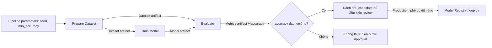

# Vertex AI Pipelines và tự động hóa quy trình ML

> **Chương:** Vertex AI và học máy  
> **Module:** CLOUD_PROVIDERS_GCP  
> **Phạm vi module:** Khám phá Google Cloud từ tổ chức project, IAM và VPC đến Compute Engine, GKE, Cloud Run, dịch vụ lưu trữ và cơ sở dữ liệu. Qua các tình huống triển khai, người học biết lựa chọn dịch vụ, bảo vệ tài nguyên, tự động hóa phát hành và theo dõi độ tin cậy cùng chi phí.

Một nhóm ML lặp lại việc lấy dữ liệu, huấn luyện, đánh giá và quyết định có đưa model mới sang bước phê duyệt. Nếu các bước chạy thủ công trên notebook, kết quả khó tái lập, thiếu thông tin nguồn gốc và dễ đưa nhầm model chưa đạt tiêu chí vào sản xuất. **Vertex AI Pipelines** tổ chức workflow thành các **components** có input/output rõ ràng, theo dõi trạng thái và lưu metadata/artifacts để có thể tự động chạy lại có kiểm soát.

Bài này sử dụng **Kubeflow Pipelines SDK (KFP v2)** để mô tả pipeline bằng Python, **compile thành pipeline spec** và, nếu đã được cho phép, chạy trên Vertex AI bằng **`google.cloud.aiplatform.PipelineJob`**. Ví dụ dùng **dữ liệu giả và model phân loại nhỏ**, có **quality gate** nhưng không tự triển khai model tới endpoint. Không chạy Python, tạo cloud resources hay huấn luyện thực tế trong bước biên soạn tài liệu.

## Mục tiêu học tập

Sau bài học, bạn có thể:

1. Giải thích sự khác biệt giữa **pipeline definition**, **PipelineJob run**, **component**, **task**, **artifact** và **pipeline parameter**.
2. Viết pipeline KFP v2 với phụ thuộc dạng **DAG**, outputs kiểu `Dataset`/`Model`/`Metrics` và một **điều kiện đánh giá chất lượng**.
3. Compile và kiểm tra spec cục bộ trước khi submit một run trên **project sandbox**.
4. Xác định IAM, service account, Cloud Storage `pipeline_root`, network, region và chi phí cho mỗi run.
5. Hiểu **execution caching**, versioning, **Vertex ML Metadata/lineage**, monitoring, retries và idempotency.
6. Lập lịch retraining có giới hạn số run, xử lý lỗi và dọn tài nguyên đúng phạm vi.

## 1. Vertex AI Pipelines là gì?

**Pipeline** là đồ thị công việc có hướng không chu trình (**DAG**). Mỗi **component** định nghĩa một bước có thể tái sử dụng; một lần gọi component trong pipeline tạo **task**. **Pipeline run** là một lần thực thi pipeline với tham số, image, artifacts và danh tính cụ thể.



**Quan trọng:** bước `approval` trong lab **chỉ ghi nhận kết quả kiểm tra**. Không có Model Registry upload, deployment, endpoint hay thay đổi traffic; trong hệ thống thật cần thêm phê duyệt, kiểm thử bảo mật, quy trình release và rollback.

### 1.1. Thành phần và đối tượng

| Đối tượng | Chức năng | Ví dụ trong bài |
|---|---|---|
| **Pipeline definition/spec** | DAG được compile từ KFP DSL ra YAML/JSON | `pipeline.json` |
| **Component** | Hợp đồng inputs/outputs và cách chạy | `prepare_dataset`, `train_model` |
| **Task** | Một bước xuất hiện trong DAG của run | `train_model(dataset=data.outputs["dataset"])` |
| **Parameter** | Giá trị nhỏ, có kiểu, điều chỉnh behavior | `seed=42`, `min_accuracy=0.80` |
| **Artifact** | Dữ liệu/model/file có URI và metadata | `Dataset`, `Model`, `Metrics` |
| **Pipeline root** | Vị trí Cloud Storage lưu output artifacts | `gs://.../pipelines/` |
| **PipelineJob** | Resource thực thi pipeline trên Vertex AI | Một run với trạng thái và lịch sử |
| **Vertex ML Metadata** | Metadata, parameters, artifacts, executions và lineage | Truy vết model nào đến từ dataset/run nào |

### 1.2. Pipelines so với các dịch vụ khác

| Lựa chọn | Nên dùng khi |
|---|---|
| **Vertex AI Pipelines** | Vòng đời ML nhiều bước, artifacts lineage, reusable training/evaluation components, retraining |
| **Vertex AI Custom Training Job** | Một job train độc lập; có thể gọi **bên trong** pipeline |
| **Cloud Workflows** | Điều phối nhiều API dịch vụ, nghiệp vụ không nhất thiết là ML, ít yêu cầu ML artifact lineage |
| **Cloud Composer (Airflow)** | Điều phối DAG dữ liệu/doanh nghiệp rộng, lịch nhiều dependencies; có thể gọi Vertex jobs |
| **Cloud Run Jobs** | Chạy một container batch, không tự quản lý ML graph/lineage |

Không dùng Pipelines chỉ vì một notebook chạy một lần. Càng nhiều bước độc lập, versioned artifacts, checkpoint và yêu cầu kiểm toán, lợi ích điều phối càng rõ.

## 2. Vòng đời từ code đến pipeline run

```text
Python source + KFP DSL / Google Cloud Pipeline Components
       │
       ├─ Compile (KHÔNG chạy cloud jobs)
       ▼
pipeline.json / pipeline.yaml  (pipeline spec)
       │
       ├─ Submit Vertex AI PipelineJob (CÓ thể phát sinh phí)
       ▼
Vertex AI Pipeline orchestrator
       │
       ├─ Chạy các component containers/managed jobs theo DAG
       ├─ Đọc/ghi artifacts trong Cloud Storage pipeline_root
       ├─ Lưu executions, parameters, lineage vào Vertex ML Metadata
       └─ Ghi trạng thái, logs, metrics, failure detail
```

**Compile không có nghĩa code đào tạo model đã chạy.** `@dsl.pipeline` mô tả phụ thuộc và parameters; compiler sinh spec để Vertex AI điều phối. Bên trong lightweight component, các thư viện Python và dữ liệu chỉ được sử dụng **khi task được thực thi**, không phải lúc compile.

### 2.1. Dùng KFP v2, không trộn cú pháp cũ

- KFP v2 dùng `@dsl.component`, `@dsl.pipeline`, `dsl.Input`, `dsl.Output` và `compiler.Compiler().compile(...)`.
- Các hướng dẫn KFP v1 cũ dùng `ContainerOp`/`kfp.Client().create_run_from_pipeline_func` có khác biệt lớn; không copy đoạn v1 rồi thay một tên import.
- **Google Cloud Pipeline Components (GCPC)** cung cấp components cho Vertex services như training, model upload, batch prediction; dùng đúng version package và xem input/output artifacts trong docs hiện hành.
- **Lightweight Python components** phù hợp minh họa và tasks đơn giản; workloads production cần xây **container images** có dependency pin/digest, chạy trong Artifact Registry và quét bảo mật.

## 3. Thiết kế pipeline ML an toàn

Một pipeline ML đáng tin không chỉ chạy cho ra file model mà còn phải kiểm soát dữ liệu, quá trình huấn luyện, chất lượng và khả năng sử dụng lại.

| Giai đoạn | Hợp đồng đầu vào/đầu ra | Kiểm soát cần có |
|---|---|---|
| **Prepare** | Source version → `Dataset` artifact | Schema, permissions, PII, split train/validation/test, leakage |
| **Train** | Dataset + config → `Model` artifact | Reproducible seed, image/dependency version, resource limits |
| **Evaluate** | Model + validation data → `Metrics` + score | Không đánh giá trên train set; thêm fairness/slices khi phù hợp |
| **Quality gate** | Score + threshold → go/no-go | Ngưỡng đo được, kiểm tra theo baseline; không tự deploy |
| **Release riêng** | Approved model → Model Registry/Endpoint | Human approval, security, latency, canary/rollback |
| **Monitor/retrain** | Production telemetry + data drift → run mới | Lịch có kiểm soát, freshness, cost và model ownership |

**Chống data leakage:** không làm sạch/thống kê trên toàn bộ dữ liệu nếu việc này vô tình dùng thông tin validation/test; fit preprocessors trên train split rồi áp transform tương ứng. Thước đo tổng như accuracy có thể đánh lừa khi class imbalance cao; production thường bổ sung precision/recall, threshold selection, fairness, calibration và business KPIs.

## 4. Lab A — Preflight dự án và quyền (chỉ đọc)

> **Điều kiện:** một project sandbox đã bật billing và được chủ sở hữu cho phép sử dụng Vertex AI; một **Cloud Storage bucket riêng đã có** ở location phù hợp; runtime service account có quyền đúng phạm vi. Nếu thiếu, chỉ làm **compile cục bộ** và bài tập — không tự tạo tài nguyên có phí.

Trong Cloud Shell/Bash hoặc terminal cá nhân, đặt biến:

```bash
PROJECT_ID="ml-pipelines-sandbox"
REGION="us-central1"  # Chỉ ví dụ: thay theo region được công ty phê duyệt
ARTIFACT_BUCKET="ml-pipelines-artifacts-sandbox" # Bucket ĐÃ tồn tại
PIPELINE_ROOT="gs://$ARTIFACT_BUCKET/vertex-pipelines"
PIPELINE_SA="pipeline-runtime@$PROJECT_ID.iam.gserviceaccount.com"

gcloud auth list --filter="status:ACTIVE"
gcloud projects describe "$PROJECT_ID" \
  --format="table(projectId,name,lifecycleState)"
gcloud services list --enabled --project="$PROJECT_ID" \
  --format="value(config.name)"

# Chỉ xem metadata, không tạo resources:
gcloud storage buckets describe "gs://$ARTIFACT_BUCKET"
gcloud iam service-accounts describe "$PIPELINE_SA" \
  --project="$PROJECT_ID"
```

**Preflight PASS** khi region được Vertex AI Pipelines hỗ trợ, bucket/dataset phù hợp data residency, billing/budget owner chấp thuận, các API cần thiết đã bật và runtime SA đã được cấp quyền. Nếu bucket/SA đã tồn tại nhưng **không rõ owner**, dừng để kiểm tra thay vì sử dụng tài nguyên của nhóm khác.

### 4.1. IAM: deployer khác runtime service account

| Principal | Phạm vi quyền |
|---|---|
| **Deployer (người submit run)** | `aiplatform.pipelineJobs.create` hoặc `roles/aiplatform.user` tương đương ở project chạy; **`iam.serviceAccounts.actAs`** trên runtime SA |
| **Pipeline runtime SA** | Quyền dùng Vertex Pipelines/Metadata, truy cập `pipeline_root` Cloud Storage, các API mà từng task thật cần |
| **Vertex AI service agent** | Google-managed identity được cấp role dịch vụ theo lifecycle, không dùng làm service account ứng dụng |
| **Component đọc dữ liệu thật** | Thêm quyền nhỏ nhất trên BigQuery/GCS/Vertex Model Registry theo task, **không** thừa hưởng IAM của deployer |

Theo hướng dẫn Google Cloud, role phổ biến cho runtime SA là `roles/aiplatform.user` và quyền **đọc/ghi objects trong bucket** ở phạm vi bucket. Có thể dùng **custom role** với quyền tối thiểu `aiplatform.metadataStores.get`, `storage.buckets.get`, `storage.objects.create/get` cùng các quyền cấp thêm cần thiết; project chạy lần đầu có thể cần `aiplatform.metadataStores.create`. **Đừng gán `roles/editor` hoặc SA key JSON** cho toàn bộ pipeline.

**Lưu ý:** Cloud Storage metadata store có thể được tự tạo lần đầu; IAM/KMS và quota phải đủ. Dùng **Workload Identity Federation/ADC** cho môi trường ngoài GCP theo chính sách, không commit credentials.

### 4.2. Networking, regions và chi phí

- **`pipeline_root`** là Cloud Storage URI, không phải thư mục local; bucket phải tồn tại và runtime SA có quyền truy cập.
- Container components có thể cần tải image từ Docker Hub/Artifact Registry và cài dependencies từ PyPI; **private VPC** cần đường đến registry/API đã được phê duyệt hoặc image đã bake sẵn.
- Nếu task gọi BigQuery/GCS/Vertex managed training/Prediction, kiểm tra region, VPC peering/PSC, CMEK, data residency và service agent.
- Pipeline run có thể phát sinh phí điều phối, component/container workloads, storage artifacts, metadata, logs, network và managed jobs khác. **Compile cục bộ chỉ cần máy phát triển**, không tạo cloud compute.

## 5. Lab B — KFP v2 pipeline với Dataset → Model → Metrics

**Mục tiêu:** tạo dữ liệu giả có seed, train Logistic Regression, đánh giá trên validation split, chỉ ghi nhận candidate khi **accuracy ≥ min_accuracy**. Không sử dụng dữ liệu thật, không tạo model serving endpoint.

### 5.1. Chuẩn bị môi trường cục bộ

Các lệnh này dành cho **người học** trong thư mục lab riêng, **không phải lệnh worker đã chạy**:

```bash
python3 -m venv .venv
source .venv/bin/activate
python -m pip install "kfp>=2,<3" "google-cloud-aiplatform>=1,<4"

# Ghi lại phiên bản sau khi kiểm thử và pin versions trong CI/prod.
python -m pip show kfp google-cloud-aiplatform
```

Với Windows PowerShell, activation sẽ khác (`.venv\Scripts\Activate.ps1`); có thể dùng Cloud Shell/Colab/Jupyter đã được công ty phê duyệt. KFP/compiler là dependency của **build environment**; các packages trong `@dsl.component(packages_to_install=...)` chỉ được cài **bên trong container khi task chạy**. Production nên pin phiên bản/digest thay vì dùng tag `latest`.

### 5.2. Tạo file `ml_pipeline.py` trong thư mục lab cá nhân

```python
import json
from kfp import compiler, dsl
from kfp.dsl import Dataset, Input, Metrics, Model, Output


@dsl.component(base_image="python:3.11-slim")
def prepare_dataset(seed: int, dataset: Output[Dataset]):
    """Dữ liệu phân loại nhị phân giả, deterministic theo seed."""
    import json
    import random

    rng = random.Random(seed)
    records = []
    for _ in range(400):
        x1 = rng.uniform(-2.0, 2.0)
        x2 = rng.uniform(-2.0, 2.0)
        label = int(1.3 * x1 + 0.8 * x2 > 0.2)
        records.append({"x": [x1, x2], "y": label})
    rng.shuffle(records)

    with open(dataset.path, "w", encoding="utf-8") as f:
        json.dump({"train": records[:320], "valid": records[320:]}, f)
    dataset.metadata["rows"] = len(records)
    dataset.metadata["seed"] = seed


@dsl.component(
    base_image="python:3.11-slim",
    packages_to_install=["scikit-learn==1.5.2"],
)
def train_model(dataset: Input[Dataset], model: Output[Model]):
    import json
    from sklearn.linear_model import LogisticRegression

    with open(dataset.path, "r", encoding="utf-8") as f:
        data = json.load(f)

    train = data["train"]
    clf = LogisticRegression(random_state=0, max_iter=200)
    clf.fit([r["x"] for r in train], [r["y"] for r in train])

    # JSON đơn giản để demo; không dùng pickle không rõ nguồn.
    with open(model.path, "w", encoding="utf-8") as f:
        json.dump({
            "weights": clf.coef_[0].tolist(),
            "bias": float(clf.intercept_[0]),
            "features": ["x1", "x2"],
        }, f)
    model.metadata["framework"] = "scikit-learn"
    model.metadata["type"] = "logistic-regression-demo"


@dsl.component(base_image="python:3.11-slim")
def evaluate_model(
    dataset: Input[Dataset],
    model: Input[Model],
    metrics: Output[Metrics],
) -> float:
    import json
    import math

    with open(dataset.path, "r", encoding="utf-8") as f:
        data = json.load(f)
    with open(model.path, "r", encoding="utf-8") as f:
        params = json.load(f)

    weights, bias = params["weights"], params["bias"]
    valid = data["valid"]
    correct = 0
    for row in valid:
        z = sum(w * x for w, x in zip(weights, row["x"])) + bias
        # Với dữ liệu nhỏ demo, z không gây overflow.
        probability = 1.0 / (1.0 + math.exp(-z))
        predicted = int(probability >= 0.5)
        correct += int(predicted == row["y"])

    accuracy = correct / len(valid)
    metrics.log_metric("validation_accuracy", accuracy)
    metrics.log_metric("validation_rows", len(valid))
    return accuracy


@dsl.component(base_image="python:3.11-slim")
def mark_candidate(accuracy: float):
    # Chỉ ghi nhận candidate đủ ngưỡng, KHÔNG upload/deploy.
    print(f"Candidate passed quality gate: accuracy={accuracy:.3f}")


@dsl.pipeline(name="vertex-ml-workflow-demo")
def ml_pipeline(seed: int = 42, min_accuracy: float = 0.80):
    data_task = prepare_dataset(seed=seed)
    train_task = train_model(dataset=data_task.outputs["dataset"])
    eval_task = evaluate_model(
        dataset=data_task.outputs["dataset"],
        model=train_task.outputs["model"],
    )

    with dsl.If(eval_task.output >= min_accuracy, name="quality-gate"):
        mark_candidate(accuracy=eval_task.output)


if __name__ == "__main__":
    # Compile cục bộ: không tạo PipelineJob, không phát sinh phí GCP.
    compiler.Compiler().compile(
        pipeline_func=ml_pipeline,
        package_path="pipeline.json",
    )
    print("Wrote pipeline.json")
```

**Giải thích trọng tâm:**

- `prepare_dataset` tạo `Dataset` artifact có file dữ liệu và metadata. Dữ liệu có seed để tái lập; train/validation tách trước huấn luyện.
- `train_model` đọc dataset và ghi model tham số vào `Model` artifact. Đây là **artifact KFP**, **không phải Vertex AI Model Registry model**.
- `evaluate_model` dùng validation split, ghi metrics có thể xem trong lineage, trả về **accuracy parameter** cho bước điều kiện.
- `dsl.If` chỉ tạo task `mark_candidate` khi score đạt ngưỡng. **Không tự deploy** và không dùng threshold này làm quality standard production.
- KFP tự truyền artifact URI/đường dẫn qua hệ thống runtime. **Đừng tự dùng một đường dẫn `/tmp` cố định để các tasks khác cùng đọc**; tasks là các containers độc lập.

**Giới hạn của ví dụ:** dữ liệu là tuyến tính, cân bằng và giả lập; accuracy cao chỉ chứng minh pipeline orchestration hoạt động, không chứng minh model phù hợp người dùng thật. Kết quả validation không phải chứng nhận fairness, data privacy, robustness hay drift resistance.

### 5.3. Compile và kiểm tra spec

```bash
# Lệnh người học tự chạy trong thư mục có ml_pipeline.py.
python ml_pipeline.py

# Chỉ đọc file spec được tạo tại máy phát triển:
ls -lh pipeline.json
python -m json.tool pipeline.json > /dev/null
```

**Kỳ vọng:** có `pipeline.json` hợp lệ chứa các component definitions, DAG, input parameters và artifact types. Không có dòng log Vertex AI remote run chỉ vì compile. Nếu import/compiler lỗi, kiểm tra KFP version và cách định nghĩa component; **không chạy `PipelineJob.submit()` chỉ để thử sửa lỗi compile**.

## 6. Lab C — Submit Vertex PipelineJob trên sandbox (tùy chọn có phí)

Chỉ tiếp tục khi **preflight PASS**, đã có `pipeline.json` và owner chấp thuận chạy **Vertex workloads có tính phí**. Với code trên, component chạy trong containers có thể cần Internet/API access để lấy `python:3.11-slim` và package `scikit-learn==1.5.2`.

### 6.1. File `submit_pipeline.py`

```python
import os
from google.cloud import aiplatform

project_id = os.environ["PROJECT_ID"]
region = os.environ["REGION"]
pipeline_root = os.environ["PIPELINE_ROOT"]  # gs://existing-bucket/prefix
runtime_sa = os.environ["PIPELINE_SA"]

aiplatform.init(project=project_id, location=region)

job = aiplatform.PipelineJob(
    display_name="vertex-ml-workflow-demo-sandbox",
    template_path="pipeline.json",
    pipeline_root=pipeline_root,
    parameter_values={"seed": 42, "min_accuracy": 0.80},
    enable_caching=True,
    labels={"env": "sandbox", "purpose": "learning"},
)

# GHI CLOUD RESOURCE VÀ CÓ PHÍ: chỉ khi được phê duyệt.
job.submit(service_account=runtime_sa)
print("PipelineJob:", job.resource_name)

# Nếu muốn theo dõi đồng bộ thay vì submit async, dùng:
# job.run(service_account=runtime_sa, sync=True)  # THAY vì submit
```

`job.submit` tạo một pipeline run rồi trả về, còn `job.run(..., sync=True)` chờ run hoàn tất. **Chỉ gọi một trong hai**, không gọi cả hai vì sẽ tạo nhiều runs/chi phí. Nếu code của nhóm cần network peering/CMEK, phải chỉ định đúng network/key theo quyền và tài liệu; không tự gỡ các rào cản egress hoặc IAM của project.

### 6.2. Tham số và môi trường

```bash
# Kế thừa các biến PROJECT_ID, REGION, PIPELINE_ROOT, PIPELINE_SA từ Lab A.
export PROJECT_ID REGION PIPELINE_ROOT PIPELINE_SA

# Chỉ sau khi owner đã phê duyệt run và có budget.
python submit_pipeline.py
```

**Kỳ vọng:** SDK in resource name dạng:

```text
projects/PROJECT_ID/locations/REGION/pipelineJobs/PIPELINE_JOB_ID
```

Ghi lại **ID thật** và người sở hữu trong run log; không tự chế ID từ display name. Trên Console, mở **Vertex AI → Pipelines → Runs** (tùy UI mới có tên *Gemini Enterprise Agent Platform Pipelines*) để xem DAG, từng task, logs, artifacts và metrics. Một run được SUBMITTED **không chứng minh SUCCESS**: đợi trạng thái terminal và kiểm tra task outputs.

### 6.3. Tiêu chí hoàn thành lab

| Bước | Dấu hiệu |
|---|---|
| `prepare_dataset` | SUCCEEDED, `Dataset` artifact có 400 rows/seed metadata |
| `train_model` | SUCCEEDED, `Model` artifact có file tham số |
| `evaluate_model` | SUCCEEDED, `validation_accuracy` và `validation_rows` được ghi |
| `quality-gate` | Chỉ chạy `mark_candidate` khi score ≥ threshold |
| PipelineJob | `PIPELINE_STATE_SUCCEEDED` nếu mọi task cần thiết thành công; xem actual state từ SDK/Console |

**Không có Vertex AI model đã deploy** và không phát sinh Vertex endpoint từ lab. Nếu accuracy không đạt, pipeline có thể vẫn **SUCCEEDED** vì nhánh `mark_candidate` bị skip có chủ đích — muốn policy coi *quality failure* là pipeline failure, cần thêm task kiểm tra/raise error phù hợp hoặc thiết kế gate governance riêng.

## 7. Thực thi có cache, versioning và tính tái lập

### 7.1. Execution caching hoạt động ra sao?

Khi bật caching, Vertex AI có thể **bỏ qua một task** nếu tìm được execution trước đó khớp **pipeline name, component spec, input parameters/artifact IDs và output definitions** trong Vertex ML Metadata. Kết quả artifacts của task cũ được tái sử dụng, giúp giảm chi phí và thời gian.

```text
Run 1: seed=42, code/image version A
  prepare → train → evaluate → gate

Run 2: seed=42, code/image version A
  prepare [CACHED] → train [CACHED] → evaluate [CACHED] → gate [?]

Run 3: seed=99 hoặc component spec khác
  cache key có thể đổi → bước liên quan cần chạy lại
```

**Không coi cache là “dữ liệu luôn mới”.** Cache không có TTL tự động; nếu component đọc GCS object qua đường dẫn **giữ nguyên nhưng nội dung đổi** mà version/checksum không nằm trong interface, cache có thể tái sử dụng kết quả **cũ**. Chọn:

- Dùng data **immutable version** (URI có version/hash/date) làm input parameter hoặc artifact.
- Đổi `seed`/image digest/code version khi kết quả thực sự thay đổi.
- Với task lấy dữ liệu mới theo ngày, gọi `task.set_caching_options(False)` hoặc `enable_caching=False` khi submit.
- Cache **không** thay thế kiểm tra correctness, drift hoặc lineage.

### 7.2. Pin dependency và model lineage

Đối với production:

1. Pin **KFP SDK, Vertex AI SDK, GCPC version**, container image **digest** và Python dependencies; tránh `:latest`.
2. Lưu **commit SHA**, source dataset version, feature schema, training config/seed và validation metrics vào metadata.
3. Dùng **artifact URI** để truyền datasets/models, thay vì tải files từ máy develop rồi dựa vào path tạm.
4. Tách immutable training set và holdout test; giữ khả năng chạy lại có kiểm toán.
5. Không dùng dữ liệu sensitive trong component logs, parameter strings, artifact names hoặc labels.

Vertex ML Metadata có thể giúp truy ra **model artifact được sinh bởi execution nào và input dataset nào**. Nhưng một `dsl.Model` artifact trong lab không tự đăng ký vào **Model Registry**; việc ModelUpload/Deploy phải có bước và quyền riêng.

## 8. Tự động hóa lịch chạy và retraining

Vertex AI Pipelines hỗ trợ **PipelineJob schedules** để tạo run một lần hoặc định kỳ. Với `PipelineJob.create_schedule(...)`, cron theo timezone rõ ràng và giới hạn số run/song song sẽ an toàn hơn “mỗi giờ tạo một pipeline” không giới hạn.

### 8.1. Ví dụ lịch minh họa

```python
from google.cloud import aiplatform

# Giả định job ở Lab C đã được cấu hình hợp lệ.
# THAO TÁC TẠO CLOUD SCHEDULE: không chạy nếu chưa được phê duyệt.
# schedule = job.create_schedule(
#     cron="TZ=Asia/Ho_Chi_Minh 0 2 * * 1",  # 02:00 thứ Hai
#     display_name="weekly-ml-retrain-sandbox",
#     max_concurrent_run_count=1,
#     max_run_count=4,
#     service_account=runtime_sa,
# )
```

**Tác động:** mỗi trigger có thể tạo **một run có phí**; nếu lịch không có `max_run_count`/end time, nó có thể tiếp tục chạy đến khi pause/delete. `max_concurrent_run_count=1` giúp tránh nhiều phiên retrain chạy song song nhưng **không** tự dừng writers/data pipelines bên ngoài.

### 8.2. Idempotency và sự cố

Workflow định kỳ cần:

- Dataset snapshot/version **theo lịch thực thi**, không chỉ “latest” thay đổi thầm lặng.
- **Run ID, event/schedule time, source version** làm khóa chống xử lý trùng.
- Task gây side effects (ghi BigQuery, upload Model Registry, deploy) có **idempotency guard**; retry sau timeout có thể thực hiện lại thao tác trước đó.
- Chỉ publish model khi evaluation đủ điều kiện **và** được phê duyệt; không gắn automation schedule thẳng đến production Endpoint nếu chưa có release gate.
- Khi muốn tạm dừng chi phí, **pause schedule trước**, rồi kiểm tra các pipeline runs đang RUNNING để quyết định hủy/chờ riêng. Pause schedule **không dừng run đã tạo**.

## 9. Observability, lineage và lỗi vận hành

### 9.1. Xem đúng tầng khi pipeline không chạy

| Nơi xem | Điều cần tìm |
|---|---|
| **Vertex AI Pipelines → Runs** | State DAG, task failures/skipped/cached, parameters, runtime SA |
| **Task logs / Cloud Logging** | Stack trace, dependency install, permission denied, IO/network errors |
| **Artifacts / Vertex ML Metadata** | Dataset/Model/Metrics URIs, lineage, cache hit và metadata |
| **Cloud Storage** | `pipeline_root`, object creation, retention, permission và CMEK |
| **Cloud Monitoring** | Resource utilization, failure rate, run duration, alert theo SLO |
| **Cloud Billing** | Pipeline orchestration, container/managed tasks, GCS, logs/network |

### 9.2. Thường gặp: compile được nhưng chạy lỗi

| Triệu chứng | Nguyên nhân điển hình | Cách xử lý |
|---|---|---|
| `ModuleNotFoundError` khi task chạy | Import nằm ngoài function component, dependency chưa có trong image | Đưa imports cần thiết **vào trong function**, khai báo `packages_to_install` hoặc bake image |
| `PERMISSION_DENIED` khi submit | Thiếu `aiplatform.pipelineJobs.create`/`actAs` | Kiểm tra deployer và runtime SA tách biệt |
| Task không ghi được `pipeline_root` | SA thiếu Storage object permissions/bucket location | Kiểm tra bucket IAM + GCS URL đúng |
| Component pull image/PyPI timeout | Private workers thiếu route/proxy/registry access | Bảo đảm network egress hoặc private Artifact Registry images |
| Metrics trống nhưng task SUCCEEDED | Chưa gọi `metrics.log_metric` hoặc không ghi artifact đúng | Kiểm tra `Output[Metrics]` và task logs |
| Model artifact trống | Code quên ghi vào `model.path` | Kiểm tra artifact path và serialize/close file |
| Task bị `CACHED` dù data gốc đã đổi | Input URI không versioned, cache key không đổi | Hash/version input hoặc tắt caching cho task |
| Quality gate không chạy | Score dưới ngưỡng, condition false | Kiểm tra metrics/threshold; không phải tất cả skipped là lỗi |
| Schedule tiếp tục tạo jobs | Lịch còn ACTIVE | Pause/delete schedule chính xác, kiểm tra run đang chạy |
| Pipeline fail khi hết quota | Region/quota/compute capacity | Giảm parallelism, xin quota hợp lệ, dùng retry có giới hạn |
| Run bị cancel nhưng tài nguyên phụ vẫn còn | Một số managed task tạo resource ngoài pipeline | Kiểm kê Model/Endpoint/CustomJob/GCS theo owner |

### 9.3. Retry, caching và failure policy

**Không retry mọi thứ bằng một cấu hình chung.** Transient API/network lỗi có thể retry với exponential backoff; data validation lỗi cần fail nhanh; side-effect tasks cần kiểm tra idempotency. KFP cho phép cấu hình retry cho task, ví dụ:

```python
# Ví dụ đặt trong @dsl.pipeline khi tạo train_task:
# train_task.set_retry(num_retries=2, backoff_duration="30s",
#                      backoff_factor=2.0)
```

**Failure policy:** chế độ `slow` (mặc định) có thể để các task không phụ thuộc lỗi tiếp tục; `fast` hạn chế scheduling task mới sau failure. Chọn theo chi phí và yêu cầu pipeline. Không nhầm **retry task** với **run lại toàn bộ pipeline**, cũng không tin `CACHED` đồng nghĩa thực thi lại kiểm tra dữ liệu.

## 10. Bảo mật và quản trị ML workflow

- **IAM và identity:** runtime SA riêng cho pipeline, phân quyền dataset/bucket/Vertex services theo nhu cầu; deployer chỉ có `actAs` trên SA được phép.
- **Data privacy:** xác định PII, consent/retention, kiểm tra mô hình dữ liệu trước khi đẩy sang Cloud Storage và logs. Không đưa raw PII vào metadata/metrics để rồi bị lộ qua UI.
- **Supply chain:** pin images/dependencies, quét vulnerabilities, ưu tiên private Artifact Registry cho production; lưu source commit digest.
- **Mã hóa:** mặc định Google-managed encryption; nếu CMEK, kiểm tra key location/IAM và cấu hình Metadata Store **ngay từ đầu** vì store tạo lần đầu có quy tắc khóa riêng.
- **Network:** kiểm tra region, VPC peering/PSC và egress cho GCS/Vertex APIs, package registry. Không mở 0.0.0.0/0 inbound để khắc phục lỗi task.
- **Chất lượng model:** thresholds, baseline comparison, fairness/slice metrics, reproducibility; muốn production deployment phải qua **review và rollback plan**.
- **Audit/cost:** run labels, ML Metadata, Cloud Audit Logs, ownership, budgets, GCS artifact lifecycle và lịch diễn tập recovery.

## 11. Bài tập và đáp án gợi ý

### Bài 1 — DAG hay script chạy một lần?

Notebook train xong rồi đánh giá ngay, không ghi data version/metrics, mỗi lần chạy dùng input `latest.csv`. Vertex AI Pipelines giúp điều gì?

**Đáp án:** biến các bước thành tasks có inputs/outputs, tạo artifacts/lineage, điều phối và quan sát runs. Nhưng **nếu vẫn đọc `latest.csv` thay đổi thầm lặng thì không tái lập được**; cần version dữ liệu và seed/dependency.

### Bài 2 — Compile vs submit

`python ml_pipeline.py` đã tạo `pipeline.json`. Có phát sinh Vertex AI training job và chi phí chưa?

**Đáp án:** chưa. Đây là **compile cục bộ**; muốn chạy cloud phải tạo/submit `PipelineJob` hoặc chạy từ Console/registry và có IAM/budget.

### Bài 3 — Component imports

Một component dùng `sklearn` nhưng import chỉ nằm ở top-level Python file, image chạy `python:3.11-slim` không có `sklearn`. Khi compile xong rồi submit, có thể gặp gì?

**Đáp án:** runtime lỗi `ModuleNotFoundError`; imports cần trong component function và thư viện phải có trong `packages_to_install` hoặc baked image. Không dùng environment cục bộ như bằng chứng container có dependency.

### Bài 4 — Caching dữ liệu cũ

Run thứ Hai đọc `gs://data/latest.csv`, thứ Ba file này đổi nhưng URI/parameters/component spec giữ nguyên và caching bật. Rủi ro?

**Đáp án:** cache có thể trả artifact **cũ**. Pin URI phiên bản/checksum vào inputs hoặc tắt cache cho bước ingestion; không có cache TTL tự động.

### Bài 5 — Accuracy 0.93 có nên deploy ngay?

Validation accuracy cao hơn ngưỡng 0.8. Có thể để `dsl.If` tự deploy model production không?

**Đáp án:** không chỉ dựa một score. Cần baseline, representative test, data leakage/fairness/security checks và approval release, canary/rollback. Gate trong lab chỉ **mark candidate**, không tạo endpoint.

### Bài 6 — PipelineJob và Model Registry

`train_model` ghi một `dsl.Model` artifact vào pipeline root. Model đó đã hiện thành Vertex AI Model Registry resource có thể deploy chưa?

**Đáp án:** chưa. Artifact KFP/ML Metadata chỉ mô tả output; cần bước **ModelUploadOp/SDK upload** với serving container/requirements phù hợp và quyền riêng.

### Bài 7 — Danh tính khi submit

Deployer có Vertex AI User nhưng submit với `PIPELINE_SA` bị `actAs denied`. Cấp Editor cho deployer có phải cách tốt?

**Đáp án:** không. Cấp quyền **`iam.serviceAccounts.actAs`** trên đúng runtime SA theo chính sách (thường qua `roles/iam.serviceAccountUser` ở scope SA), cùng quyền create PipelineJob. Runtime SA cũng cần storage/metadata permissions để thực thi.

### Bài 8 — Pipeline được lên lịch nhưng không có budget

Nhóm tạo lịch retrain mỗi ngày không có `max_run_count`, mỗi run có phí. Điều gì cần chỉnh?

**Đáp án:** budget owner/alerts, cadence đúng nhu cầu, `max_run_count` hoặc end time, `max_concurrent_run_count=1`, schedule owner và kill switch **pause**; cần kiểm tra runs đã tạo sau khi pause.

### Bài 9 — Quality gate bị skip

`evaluate_model` trả 0.72, min_accuracy=0.80. Bước `mark_candidate` bị skipped nhưng pipeline hiện SUCCEEDED. Có mâu thuẫn?

**Đáp án:** không. Nhánh conditional false thì step được bỏ qua có chủ đích; run có thể thành công về **orchestration** dù model không đạt ngưỡng. Nếu muốn run FAILED cho policy, thêm explicit failing validation step.

### Bài 10 — Concurrency và chi phí

Một lịch chạy mỗi giờ, training mất 90 phút. Nếu cho chạy đồng thời không giới hạn, điều gì xảy ra?

**Đáp án:** runs chồng nhau, tiêu tốn quota/compute và có thể tranh chấp model/data outputs. Giới hạn `max_concurrent_run_count`, dùng versioned output paths và ưu tiên trigger theo data readiness thay vì lịch cứng.

## 12. Checklist và cleanup

### 12.1. Trước khi đưa vào production

| Nhóm | Tiêu chí đạt |
|---|---|
| **Workflow** | DAG không vòng, dependencies/artifacts/parameters được review |
| **Data** | Dataset version, train/validation/test split, PII và data leakage |
| **Components** | KFP v2/GCPC pinned, image digests, imports/dependencies đầy đủ |
| **IAM** | Dedicated runtime SA, deployer actAs, bucket/API permissions tối thiểu |
| **Pipeline root** | GCS bucket riêng, region/retention/CMEK/quota phù hợp |
| **ML Metadata** | Artifacts/metrics/lineage/commit SHA đủ để audit |
| **Cache** | Versioned inputs hoặc tắt cache cho sources mutable |
| **Quality** | Threshold/baseline/slice metrics, không tự deploy từ demo gate |
| **Schedule** | Cron timezone, max concurrency, max run count/end time, pause runbook |
| **Monitoring** | Task errors, duration, retries, pipeline states, drift/quality |
| **Cost** | Per-run budget, managed components cost, GCS/Logging/metadata retention |
| **Recovery** | Idempotent side effects, cancellation/cleanup và incident owner |

### 12.2. Cleanup lab theo ownership

**Lab A chỉ đọc, Lab B compile cục bộ**: không tạo cloud resources. **Lab C submit** (nếu người học tự thực hiện) có thể tạo PipelineJob, artifacts trong GCS và metadata records.

1. Lưu **PipelineJob resource name**, owner và trạng thái terminal từ Console/SDK; nếu run đang RUNNING mà không còn cần, dùng quyền được phê duyệt để **Cancel** đúng run. Cancel là best effort và bất đồng bộ; kiểm tra lại state, đừng coi bấm Cancel là xong.
2. Nếu đã tạo schedule, **pause/delete đúng schedule riêng** để không tạo jobs mới; việc pause không hủy jobs đã chạy.
3. Kiểm tra artifacts/logs/metadata và retention; chỉ dọn **GCS prefix riêng của lab** theo chính sách. Không xóa bucket dùng chung, Vertex AI Metadata Store, Model Registry models hoặc project.
4. Kiểm tra Dataflow/CustomJobs/Endpoints nếu pipeline production khác dùng managed components; một số cloud resources có thể tồn tại độc lập sau job.
5. Đối chiếu Cloud Billing Reports: phí compute, artifact storage và logging có thể cập nhật trễ. Không dùng lệnh xóa đệ quy không giới hạn trong hướng dẫn.

**Không tạo hoặc xóa bất kỳ tài nguyên Google Cloud thật nào khi biên soạn bài**; những đoạn `submit`, `create_schedule` và `cancel` chỉ được thực hiện bởi người học có sandbox/ủy quyền, sau khi kiểm tra tác động và chi phí.

## Ghi nhớ

**Vertex AI Pipelines** biến vòng đời ML thành DAG có thể tái lập: **KFP components → compile spec → PipelineJob run → artifacts/ML Metadata → đánh giá và gate**. Thành công kỹ thuật của pipeline **không đồng nghĩa** model đạt chuẩn deploy. Caching giảm chi phí nhưng dễ tái sử dụng dữ liệu cũ nếu inputs không versioned; lịch chạy cần giới hạn, permissions và budget. Bắt đầu bằng compile cục bộ, chỉ submit trên **sandbox** khi IAM, `pipeline_root`, region và ownership đã rõ.

## Tài liệu tham khảo chính thức

- [Google Cloud — Introduction to Vertex AI Pipelines](https://cloud.google.com/vertex-ai/docs/pipelines/introduction)
- [Google Cloud — Configure project for pipelines](https://cloud.google.com/vertex-ai/docs/pipelines/configure-project)
- [Google Cloud — Build pipelines with KFP](https://cloud.google.com/vertex-ai/docs/pipelines/build-pipeline)
- [Google Cloud — Run a pipeline](https://cloud.google.com/vertex-ai/docs/pipelines/run-pipeline)
- [Google Cloud — Pipeline Components](https://cloud.google.com/vertex-ai/docs/pipelines/components-introduction)
- [Google Cloud — Configure execution caching](https://cloud.google.com/vertex-ai/docs/pipelines/configure-caching)
- [Google Cloud — Schedule a pipeline run](https://cloud.google.com/vertex-ai/docs/pipelines/schedule-pipeline-run)
- [Google Cloud — Track artifact lineage](https://cloud.google.com/vertex-ai/docs/pipelines/lineage)
- [Google Cloud — Monitor pipeline runs](https://cloud.google.com/vertex-ai/docs/pipelines/monitor-pipelines)
- [Google Cloud — Cancel pipeline runs](https://cloud.google.com/vertex-ai/docs/pipelines/cancel-pipeline-runs)
- [Google Cloud — Pipeline pricing](https://cloud.google.com/vertex-ai/pricing#pipelines)
- [Python SDK — PipelineJob](https://cloud.google.com/python/docs/reference/aiplatform/latest/google.cloud.aiplatform.PipelineJob)
- [Kubeflow Pipelines SDK — DSL reference](https://kubeflow-pipelines.readthedocs.io/en/stable/source/dsl.html)
