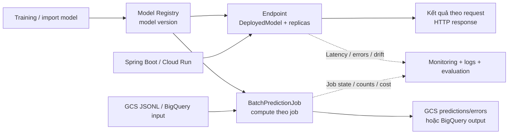
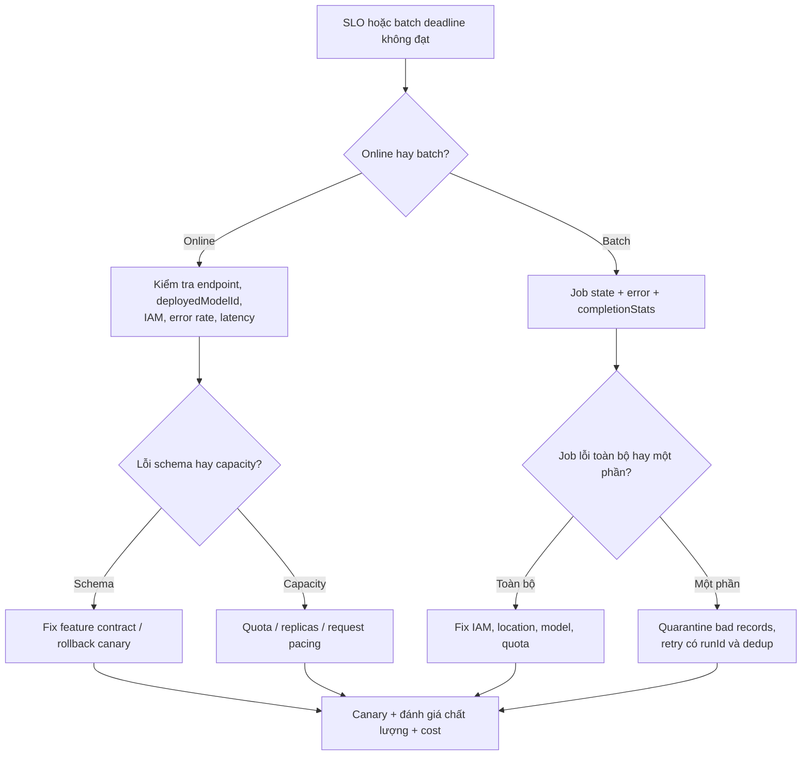

# Online endpoints, batch prediction và lựa chọn triển khai

## 1. Bối cảnh: mô hình đã huấn luyện, triển khai thế nào?

Một hệ thống **Java/Spring Boot** trên **Cloud Run** dùng mô hình ML đánh giá rủi ro giao dịch. Khi khách hàng gửi đơn hàng, API cần kết quả trong vài trăm mili-giây. Mỗi đêm, bộ phận vận hành lại cần chấm điểm **hàng triệu đơn lịch sử** để phân tích trên **BigQuery**. Dùng một luồng phục vụ cho cả hai có thể gây lãng phí hoặc không đạt SLO.

**Online prediction** là gọi mô hình qua **Vertex AI Endpoint** để nhận kết quả theo request (độ trễ thấp, workload liên tục hoặc theo đợt). **Batch prediction** là **BatchPredictionJob** đọc một tập dữ liệu đã có, chạy bất đồng bộ rồi ghi kết quả ra **Cloud Storage/BigQuery**. Cả hai có thể sử dụng **cùng một model version trong Model Registry**, nhưng có vòng đời tính phí, tài nguyên, độ trễ và cơ chế lỗi khác nhau.

Bài thuộc chương **Vertex AI và học máy** của mô-đun **CLOUD_PROVIDERS_GCP**. Mục đích là chọn hình thức triển khai hợp lý, bảo vệ tài nguyên bằng IAM/VPC, vận hành tin cậy và dự toán chi phí cho Java trên Google Cloud. Một số trang tài liệu mới có tên **Gemini Enterprise Agent Platform**, trong khi API/CLI cho custom model vẫn dùng `aiplatform.googleapis.com` và `gcloud ai`; cần phân biệt **custom trained models** với **Gemini managed generative models**.

**Mục tiêu học tập:**

1. Phân biệt **Model**, **Model version**, **Endpoint**, **DeployedModel** và **BatchPredictionJob**.
2. Chọn online, batch, hoặc kiến trúc lai theo **latency/SLO, dữ liệu, quy mô, freshness và chi phí**.
3. Tạo endpoint thử nghiệm, deploy/canary model và gọi `:predict` bằng CLI/REST/Java 21.
4. Tạo batch job từ **GCS JSON Lines** hoặc **BigQuery** và kiểm tra **predictions/errors**.
5. Thiết kế **schema/feature parity**, model version pinning, IAM, observability, drift và rollback.
6. Dọn tài nguyên đúng thứ tự, tránh phí replica và job chạy ngoài ý muốn.

> **An toàn:** hướng dẫn chỉ để thực hiện trên **project lab có Billing và quyền hợp lệ**. Tạo Endpoint và triển khai DeployedModel có thể **tính phí cho replica khi không có traffic**. Batch job, GCS/BigQuery, GPU, network và logging cũng có thể phát sinh phí. **Không deploy vào endpoint production, không dùng dữ liệu khách hàng và không xóa model/version được team khác sử dụng.** Không có model đã huấn luyện/import hợp lệ thì chỉ thực hiện phần kiểm kê và thiết kế, không tự tạo model giả để gọi.

## 2. Kiến trúc và các đối tượng cần phân biệt



| Đối tượng | Ý nghĩa | Vòng đời |
| --- | --- | --- |
| **Model** | Artifact và serving schema đã import/đăng ký | Lưu ở **Model Registry** trong location |
| **Model version** | Phiên bản cụ thể của model | Pin version khi so sánh, rollback, batch reproducibility |
| **Endpoint** | Tài nguyên nhận request online qua `:predict` hoặc `:rawPredict` | Có thể chứa nhiều deployed models và traffic split |
| **DeployedModel** | Một version triển khai với machine/GPU, min/max replicas, logging | Có tài nguyên phục vụ và phí tương ứng |
| **BatchPredictionJob** | Tác vụ bất đồng bộ với input/output, model, compute, state | Tạo → chạy → hoàn thành/lỗi/hủy |
| **Prediction instance** | Một hàng feature hoặc đối tượng cần dự đoán | Định dạng **theo model signature**, không phải JSON tùy ý |

**Điểm dễ nhầm:** upload model vào Model Registry **chưa tạo online server**; muốn `:predict` phải deploy vào Endpoint (trừ một số managed/publisher model API có cơ chế phục vụ riêng). Ngược lại, **custom-model batch job không cần** model đã có online endpoint; job tạo tài nguyên thực thi riêng và **không tự thay đổi traffic split của endpoint**.

## 3. Chọn online, batch hay giải pháp khác

| Tiêu chí | **Online Endpoint** | **BatchPredictionJob** |
| --- | --- | --- |
| Độ trễ kỳ vọng | Millisecond/giây theo model và network; gần thời gian thực | Phút/giờ, tính cả queue và khởi tạo tài nguyên |
| Nguồn | JSON request từ Java/API | GCS JSONL/CSV/TFRecord/file list hoặc BigQuery theo model |
| Kết quả | Trả trực tiếp `predictions[]` | Ghi file/table vào nơi chỉ định |
| Tài nguyên | Replicas được provision và autoscale; min replicas thường ≥1 | Compute được provision cho job, không cần endpoint phục vụ liên tục |
| Mở rộng | Theo QPS, CPU/GPU và giới hạn replicas | Theo khối lượng input, batch size và job replicas |
| Quản lý lỗi | HTTP timeout/429/5xx, request retry | Job state, `partialFailures`, per-instance errors |
| Phát hành | Traffic split/canary giữa deployed model IDs | Pin model version theo từng job, đối chiếu output |
| Chi phí nổi bật | Replica-hours kể cả idle, accelerator, logging | Compute trong thời gian batch + I/O, storage, BigQuery |
| Phù hợp | Chặn gian lận trong giao dịch, gợi ý tức thời | Chấm điểm đêm, backfill, phân loại kho dữ liệu |

**Các lựa chọn bổ sung:**

- **Gemini/managed publisher models:** dùng API inference/batch do model hỗ trợ, có **cách định giá, quota và payload riêng**; **không lấy** lệnh deploy custom model ra endpoint CPU/GPU để áp dụng máy móc cho Gemini.
- **Cloud Run custom inference:** phù hợp khi logic phục vụ rất nhẹ, team muốn tự quản container, hoặc quy trình đặc biệt; đổi lại tự lo concurrency, scaling, serving health và observability.
- **BigQuery ML `ML.PREDICT`:** phù hợp khi dữ liệu đã ở BigQuery và model/algorithm được hỗ trợ; không cần export từng dòng sang GCS, nhưng có hạn chế và cách tính phí riêng.
- **Dataflow + model inference:** phù hợp pipeline liên tục kết hợp feature engineering và sink; xem cơ chế gọi online service, batching, retries và hạn mức QPS.

**Quy tắc quyết định:** nếu **request người dùng phải chờ kết quả**, ưu tiên online với SLO và budget. Nếu dữ liệu **đã tích lũy, SLA tính bằng giờ**, ưu tiên batch. Nếu vừa cần realtime vừa cần chấm điểm hàng loạt, dùng **cùng contract + version quản lý**, nhưng **tách tài nguyên online và batch** để không tranh chấp capacity.

## 4. Sơ đồ dữ liệu và kiểm soát feature parity

Giả sử một **custom scikit-learn classifier** đã được đào tạo nhận **hai feature số** theo thứ tự cố định:

```text
features[0] = cartValueNormalized  (ví dụ 0.2)
features[1] = priorOrderRate       (ví dụ 1.3)
output      = class hoặc score, tùy model signature
```

Lệnh online `:predict` với một model **có input signature dạng mảng số** có thể là:

```json
{
  "instances": [
    [0.2, 1.3],
    [0.8, 0.4]
  ]
}
```

Với batch JSON Lines, **mỗi dòng là một instance**, không bọc `instances`:

```jsonl
[0.2, 1.3]
[0.8, 0.4]
```

**Định dạng chỉ đúng nếu Model/prediction container được cấu hình nhận vector hai số.** Model TensorFlow, PyTorch, AutoML hoặc custom handler có thể đòi **object với tên tensor/feature, shape khác và parameters**; model còn công bố `supportedInputStorageFormats`/`supportedOutputStorageFormats`. **Phải đọc schema và test một input trước khi gửi hàng triệu records**.

**Feature parity:** online Java service và batch SQL/ETL phải dùng **cùng thứ tự, đơn vị, chuẩn hóa, missing-value rules, categorical mapping, timezone và feature version**. Ví dụ amount bằng VND đã chuẩn hóa không được vô tình chuyển thành USD ở một luồng. Cần tạo **golden test cases** (cùng input → kết quả xấp xỉ/nhãn kỳ vọng) cho cả online và batch, ghi **model version, feature schema version, data snapshot ID** để đối soát.

Để liên kết output với input, giữ **business key bên ngoài feature tensor** (ví dụ id trong bảng nguồn hoặc custom `instanceConfig`). Không giả định các batch output shards có **cùng thứ tự** với input hoặc model trả ra input ID nếu container không được thiết kế như vậy.

## 5. Preflight IAM, region, model và quota

**Trước khi tạo bất cứ tài nguyên nào**, xác định chính xác:

1. **Project lab** có Billing/API `aiplatform.googleapis.com` và location được hỗ trợ (ví dụ `us-central1`).
2. Model đã import/train thành công, nằm trong **cùng location** dự kiến deploy/batch, với version và **container/prediction schema** hợp lệ.
3. Loại tài nguyên: CPU/GPU, loại máy, quota accelerators, disk, số replicas và khu vực data residency.
4. **Runtime identity:** Java service dùng ADC với quyền gọi predict; batch service agent và custom container SA (nếu khai báo) có quyền đọc/ghi đúng GCS/BigQuery.
5. **Điều khoản dữ liệu:** dữ liệu test là synthetic, không đưa PII, secrets hoặc dữ liệu bị hạn chế vào feature/logs.

### 5.1. Read-only inventory

```bash
gcloud config set project LAB_PROJECT_ID

gcloud ai models list \
  --project=LAB_PROJECT_ID --region=us-central1

gcloud ai endpoints list \
  --project=LAB_PROJECT_ID --region=us-central1

# Khi đã có MODEL_ID trong lab:
gcloud ai models describe MODEL_ID \
  --project=LAB_PROJECT_ID --region=us-central1
```

**Lưu ý:** `gcloud config set project` thay đổi context CLI cục bộ. Trước thao tác tạo/hủy, luôn thêm `--project` và kiểm tra identity/region để không nhầm production.

### 5.2. IAM ít quyền

| Danh tính | Vai trò/permission cần cân nhắc | Ghi nhớ |
| --- | --- | --- |
| Người quản lý endpoint/model | `roles/aiplatform.user` hoặc custom role có `aiplatform.endpoints.create/deploy` | Không cấp Owner chỉ để triển khai |
| Java online invoker | `aiplatform.endpoints.predict` qua role phù hợp (ví dụ `roles/aiplatform.user` hoặc custom role hẹp) | Chỉ cần gọi endpoint, không cần deploy quyền admin |
| Batch submitter | Quyền `aiplatform.batchPredictionJobs.create`, quyền đọc model, `iam.serviceAccounts.actAs` nếu dùng SA tùy chỉnh | Không dùng key JSON trong job |
| Vertex AI service agent | Quyền dịch vụ quản lý, GCS/BQ input/output theo tài nguyên | Khác SA ứng dụng Spring Boot |
| Model server custom SA | Quyền tối thiểu cho model container nếu cần đọc artifact/dependency | Tránh truy cập BigQuery/Cloud SQL không liên quan |

Trong các dự án tách môi trường, **model project**, **endpoint project**, **input data project** và **output project** có thể khác nhau theo tính năng được hỗ trợ; kiểm tra **IAM ở từng tài nguyên** thay vì suy “được Vertex AI User ở project A thì đọc được GCS của project B”.

## 6. Online lab: tạo Endpoint và deploy model đang có

Phần lab **chỉ áp dụng khi đã có MODEL_ID của custom trained model tương thích** trong project test. Không có model thì dừng ở bước inventory; **tài liệu không tạo hoặc giả mạo model**.

### 6.1. Bật API và tạo endpoint

```bash
# CHỈ project LAB được phê duyệt:
gcloud services enable aiplatform.googleapis.com \
  --project=LAB_PROJECT_ID

gcloud ai endpoints create \
  --project=LAB_PROJECT_ID \
  --region=us-central1 \
  --display-name=lab-scorer-endpoint

# Ghi Endpoint ID được tạo từ lệnh list:
gcloud ai endpoints list \
  --project=LAB_PROJECT_ID --region=us-central1
```

**Endpoint rỗng chưa phục vụ inference**. Endpoint API resource khác với DeployedModel resource; lấy `ENDPOINT_ID` chính xác từ CLI thay vì nhầm Model ID.

### 6.2. Deploy model với budget nhỏ

```bash
# CHỈ khi MODEL_ID thuộc LAB, model hỗ trợ serving trên CPU:
gcloud ai endpoints deploy-model ENDPOINT_ID \
  --project=LAB_PROJECT_ID \
  --region=us-central1 \
  --model=MODEL_ID \
  --display-name=lab-scorer-v1 \
  --machine-type=n1-standard-2 \
  --min-replica-count=1 \
  --max-replica-count=2 \
  --traffic-split=0=100

gcloud ai endpoints describe ENDPOINT_ID \
  --project=LAB_PROJECT_ID --region=us-central1
```

`0=100` biểu thị **100% traffic cho model mới được deploy** (ID tạm `0` chỉ trong lệnh); response của Endpoint có **deployedModelId thực**, phải ghi lại cho canary/cleanup. **Không dùng CPU machine type cho model đòi GPU**, hoặc đòi model cỡ lớn chạy trên máy thiếu RAM. `minReplicaCount=1` có nghĩa **ít nhất một replica đang tính phí** dù QPS = 0. Một số cơ chế **scale-to-zero** có điều kiện riêng, không phải mặc định cho mọi endpoint/custom model.

### 6.3. Predict bằng CLI

Tạo `request.json` trong thư mục lab (dùng payload đúng schema model):

```json
{"instances":[[0.2,1.3],[0.8,0.4]]}
```

```bash
gcloud ai endpoints predict ENDPOINT_ID \
  --project=LAB_PROJECT_ID \
  --region=us-central1 \
  --json-request=request.json
```

Nếu request hợp lệ, response chứa `predictions[]` và `deployedModelId`. **Không cố định class/score hay ngưỡng 0.5** khi model chưa được định nghĩa; chỉ giải thích output bằng **schema, labels và calibration** đã kiểm thử.

### 6.4. REST predict và gRPC/dedicated endpoint

```bash
curl --fail-with-body -X POST \
  -H "Authorization: Bearer $(gcloud auth print-access-token)" \
  -H "Content-Type: application/json" \
  --data @request.json \
  "https://us-central1-aiplatform.googleapis.com/v1/projects/LAB_PROJECT_ID/locations/us-central1/endpoints/ENDPOINT_ID:predict"
```

REST ở đây gọi **shared public service endpoint**; với **dedicated endpoint**, URL/DNS và giao thức có thể khác. `:rawPredict` chuyển payload tới container theo format tùy chỉnh, không cần chuẩn `instances` như `:predict`; **không dùng `:rawPredict` thay thế vô điều kiện** khi có schema/predict pipeline của model.

**Phân biệt access token và ID token:** Vertex AI `aiplatform.googleapis.com` là Google API dùng **OAuth access token/ADC**; gọi private Cloud Run bằng OIDC ID token là luồng xác thực khác.

## 7. Canary online: traffic split và rollback

Khi đã có `lab-scorer-v1` và một **MODEL_V2_ID** thực sự được kiểm thử, deploy v2 vào **cùng endpoint**, chuyển một phần traffic:

```bash
# Biết OLD_DEPLOYED_MODEL_ID từ endpoints describe; chỉ project LAB:
gcloud ai endpoints deploy-model ENDPOINT_ID \
  --project=LAB_PROJECT_ID \
  --region=us-central1 \
  --model=MODEL_V2_ID \
  --display-name=lab-scorer-v2 \
  --machine-type=n1-standard-2 \
  --min-replica-count=1 \
  --max-replica-count=2 \
  --traffic-split=0=10,OLD_DEPLOYED_MODEL_ID=90
```

`0` là **ID tạm của model mới** trong cú pháp CLI; endpoint traffic map sau deploy dùng **deployedModelIds thật**. Tổng các tỷ lệ phải bằng **100%**. Cả hai deployed models có thể có replicas tính phí trong thời gian canary. Không triển khai v2 khi chưa chứng minh **input/output schema tương thích** với Java caller.

**Một release tốt:** 0% shadow/offline compare (nếu được triển khai bằng một pipeline riêng) → 10% → 50% → 100%, với health check, SLO p95/error rate, response distribution, fairness/drift và owner approval. **Rollback** thường là chuyển traffic về v1 đã biết tốt trước khi undeploy v2; không xóa model version trong khi còn batch job hoặc endpoint khác sử dụng.

## 8. Java 21: gọi online prediction bằng ADC

Trong Spring Boot/Cloud Run, nên dùng **runtime service account + Application Default Credentials (ADC)**. Mã dưới đây là **một chương trình Java CLI độc lập**, minh họa transport HTTP với đầu vào synthetic hai feature; nó không phải Spring Boot controller hoàn chỉnh. API `:predict` dùng **OAuth access token**, không phải OIDC ID token của Cloud Run.

### 8.1. Maven `pom.xml` tối thiểu

```xml
<?xml version="1.0" encoding="UTF-8"?>
<project xmlns="http://maven.apache.org/POM/4.0.0"
         xmlns:xsi="http://www.w3.org/2001/XMLSchema-instance"
         xsi:schemaLocation="http://maven.apache.org/POM/4.0.0 https://maven.apache.org/xsd/maven-4.0.0.xsd">
  <modelVersion>4.0.0</modelVersion>
  <groupId>dev.example</groupId>
  <artifactId>vertex-inference-lab</artifactId>
  <version>1.0.0</version>
  <properties>
    <maven.compiler.release>21</maven.compiler.release>
    <project.build.sourceEncoding>UTF-8</project.build.sourceEncoding>
  </properties>
  <dependencies>
    <dependency>
      <groupId>com.google.auth</groupId>
      <artifactId>google-auth-library-oauth2-http</artifactId>
      <version>1.58.0</version>
    </dependency>
  </dependencies>
  <build>
    <plugins>
      <plugin>
        <groupId>org.apache.maven.plugins</groupId>
        <artifactId>maven-compiler-plugin</artifactId>
        <version>3.14.1</version>
      </plugin>
      <plugin>
        <groupId>org.codehaus.mojo</groupId>
        <artifactId>exec-maven-plugin</artifactId>
        <version>3.5.1</version>
      </plugin>
    </plugins>
  </build>
</project>
```

Phiên bản dependency là một ví dụ có thể pin; production cần BOM/lockfile, review dependency updates và kiểm tra security advisories.

### 8.2. `VertexOnlinePredict.java`

```java
package dev.example.vertex;

import com.google.auth.oauth2.GoogleCredentials;
import java.net.URI;
import java.net.http.HttpClient;
import java.net.http.HttpRequest;
import java.net.http.HttpResponse;
import java.nio.charset.StandardCharsets;
import java.time.Duration;
import java.util.List;

public final class VertexOnlinePredict {
    private static final HttpClient HTTP = HttpClient.newBuilder()
        .connectTimeout(Duration.ofSeconds(10))
        .build();

    public static void main(String[] args) throws Exception {
        if (args.length != 3) {
            throw new IllegalArgumentException(
                "Usage: PROJECT_ID LOCATION ENDPOINT_ID");
        }
        String project = args[0];
        String region = args[1];
        String endpoint = args[2];
        if (!region.matches("[a-z0-9-]+")
                || !endpoint.matches("[0-9]+")
                || !project.matches("[a-z0-9-]+")) {
            throw new IllegalArgumentException("Invalid resource argument");
        }

        GoogleCredentials credentials = GoogleCredentials
            .getApplicationDefault()
            .createScoped(List.of(
                "https://www.googleapis.com/auth/cloud-platform"));
        credentials.refreshIfExpired();

        String url = String.format(
            "https://%s-aiplatform.googleapis.com/v1/" +
            "projects/%s/locations/%s/endpoints/%s:predict",
            region, project, region, endpoint);

        // Bắt buộc khớp model signature; không nhập dữ liệu người dùng thật.
        String body = "{\"instances\":[[0.2,1.3]]}";
        HttpRequest request = HttpRequest.newBuilder(URI.create(url))
            .timeout(Duration.ofSeconds(30))
            .header("Authorization",
                "Bearer " + credentials.getAccessToken().getTokenValue())
            .header("Content-Type", "application/json")
            .POST(HttpRequest.BodyPublishers.ofString(
                body, StandardCharsets.UTF_8))
            .build();

        HttpResponse<String> response = HTTP.send(
            request, HttpResponse.BodyHandlers.ofString());
        if (response.statusCode() / 100 != 2) {
            // Tránh log payload trả về nếu có PII / model internals.
            throw new IllegalStateException(
                "Prediction HTTP status: " + response.statusCode());
        }
        // Chỉ in trong lab với model và dữ liệu synthetic.
        System.out.println(response.body());
    }
}
```

Trong thư mục Maven lab (không phải repo bài học):

```bash
gcloud auth application-default login
mvn -q clean compile
mvn -q exec:java \
  -Dexec.mainClass=dev.example.vertex.VertexOnlinePredict \
  -Dexec.args="LAB_PROJECT_ID us-central1 ENDPOINT_ID"
```

**Không đăng nhập ADC bằng key JSON trong image production.** Cloud Run/GKE nên dùng runtime identity và IAM tương ứng. Code demo không retry tự động; production cần **timeouts, circuit breaker, hạn chế concurrency, retry backoff có ngân sách cho 429/503** và metric p95/p99. Không retry vô hạn nếu endpoint không có capacity, không log raw features chứa PII.

### 8.3. Tích hợp vào REST API Java

Spring Boot `POST /score` thường nhận request nghiệp vụ, tra features đã được duyệt (Spanner/Cloud SQL/feature store), chuẩn hóa input và gọi Vertex AI. Không để client tự đẩy bất kỳ features tùy ý làm sai feature contract. Khi endpoint timeout, chính sách fallback phải rõ: **trả “pending/manual review”** nếu dự đoán ảnh hưởng giao dịch/tuân thủ, thay vì tự coi khách hàng là “an toàn”. Kết quả model là **ước lượng**, không phải quyết định có thể thiếu giải thích đối với tác vụ rủi ro cao.

## 9. Batch lab: GCS JSON Lines → BatchPredictionJob → GCS output

Batch job chạy **bất đồng bộ**, thường phù hợp chấm điểm hàng nghìn đến hàng triệu records không cần response HTTP tức thì. **Không dùng online endpoint để gửi hàng triệu request tuần tự** nếu có thể dùng batch phù hợp: sẽ tạo cạnh tranh QPS/chi phí với traffic realtime và khó quản lý lỗi một phần.

### 9.1. Chuẩn bị input, output và quyền

Điều kiện: **Model ID ở `us-central1`**, hỗ trợ **`jsonl`** input/output, container nhận **mỗi dòng là một vector hai số** như mục 4. Bucket lab có location tương thích model; trong hướng dẫn này cùng `us-central1`.

Tạo `input.jsonl`:

```jsonl
[0.2,1.3]
[0.8,0.4]
```

```bash
# Chỉ bucket test có quyền đọc/ghi và location tương thích.
gcloud storage cp input.jsonl \
  gs://UNIQUE_LAB_BUCKET/vertex-batch/input.jsonl

gcloud storage ls gs://UNIQUE_LAB_BUCKET/vertex-batch/
```

**Batch service agent** thực hiện nhiều thao tác đọc/ghi GCS/BigQuery; nếu dùng **custom service account cho inference container**, phải cấp quyền đúng riêng. Xác nhận service agent có thể **đọc input và ghi output** (đặc biệt khi bucket ở project khác), không mặc định quyền Vertex AI User của người submit là đủ.

### 9.2. Mô tả batch job bằng JSON

Trong `batch-job.json` của dự án lab:

```json
{
  "displayName": "lab-score-20261119",
  "model": "projects/LAB_PROJECT_ID/locations/us-central1/models/MODEL_ID",
  "inputConfig": {
    "instancesFormat": "jsonl",
    "gcsSource": {
      "uris": ["gs://UNIQUE_LAB_BUCKET/vertex-batch/input.jsonl"]
    }
  },
  "outputConfig": {
    "predictionsFormat": "jsonl",
    "gcsDestination": {
      "outputUriPrefix": "gs://UNIQUE_LAB_BUCKET/vertex-batch/output/"
    }
  },
  "dedicatedResources": {
    "machineSpec": {
      "machineType": "n1-standard-2"
    },
    "startingReplicaCount": 1,
    "maxReplicaCount": 2
  },
  "manualBatchTuningParameters": {
    "batchSize": 16
  },
  "labels": {
    "env": "lab",
    "service": "score-orders"
  }
}
```

**Máy và batch size chỉ là minh họa cho model CPU nhẹ.** Batch size quá lớn có thể gây out-of-memory hoặc model-server timeout; tăng replicas có thể làm job nhanh hơn nhưng tăng resource cost, quota và I/O. Chọn `Model` version cụ thể khi cần reproducibility; nếu để mặc định, khi default version thay đổi các job sau có thể cho kết quả khác.

### 9.3. Tạo job bằng REST

```bash
# HÀNH ĐỘNG CÓ THỂ TÍNH PHÍ — CHỈ LAB:
curl --fail-with-body -X POST \
  -H "Authorization: Bearer $(gcloud auth print-access-token)" \
  -H "Content-Type: application/json" \
  --data @batch-job.json \
  "https://us-central1-aiplatform.googleapis.com/v1/projects/LAB_PROJECT_ID/locations/us-central1/batchPredictionJobs"
```

Response trả **tên job đầy đủ**, ví dụ `projects/PROJECT_NUMBER/locations/us-central1/batchPredictionJobs/BATCH_JOB_ID`. Việc nhận `JOB_STATE_PENDING` chỉ nghĩa job đã **được tạo**, **chưa** có kết quả. Không gọi một batch job khác liên tục vì lần đầu đang pending.

### 9.4. Kiểm tra trạng thái, lỗi một phần và kết quả

```bash
# Read-only: thay BATCH_JOB_ID từ response thực:
curl --fail-with-body \
  -H "Authorization: Bearer $(gcloud auth print-access-token)" \
  "https://us-central1-aiplatform.googleapis.com/v1/projects/LAB_PROJECT_ID/locations/us-central1/batchPredictionJobs/BATCH_JOB_ID"

# Chỉ xem output sau khi job đã kết thúc:
gcloud storage ls gs://UNIQUE_LAB_BUCKET/vertex-batch/output/
```

Kiểm tra các trường **`state`, `error`, `partialFailures[]`, `completionStats.successfulCount/failedCount/incompleteCount`, `outputInfo.gcsOutputDirectory` và `resourcesConsumed.replicaHours`**. `JOB_STATE_SUCCEEDED` không nên được xem là đã chấm điểm đúng toàn bộ input nếu `failedCount > 0` hoặc output có errors.

**Output** có thể tạo nhiều `predictions_*.jsonl` và `errors_*.jsonl` trong một **thư mục con do dịch vụ sinh ra**; **không hard-code tên file** hay giả định thứ tự output giống input. Mỗi dòng output thành công thường chứa `instance` và `prediction`; dòng lỗi có thêm thông tin `error`. Đối soát **inputCount = successful + failed + incomplete** theo semantics job, không chỉ đếm mỗi `predictions`.

**Không để model tự xử lý retry nghiệp vụ:** khi job có `partialFailures`, cần phân loại schema/invalid input với lỗi tạm thời; tạo **một batch mới chỉ chứa các input thất bại đã xác minh** và gắn runId/input snapshot để tránh tính trùng ở bảng đích.

## 10. Batch với BigQuery: dữ liệu lớn và kết quả có thể truy vấn

Nếu nguồn dữ liệu đã là bảng BigQuery, thay GCS bằng URI `bq://PROJECT.DATASET.TABLE` và dùng BigQuery output:

```json
{
  "displayName": "lab-score-bq",
  "model": "projects/LAB_PROJECT_ID/locations/us-central1/models/MODEL_ID",
  "inputConfig": {
    "instancesFormat": "bigquery",
    "bigquerySource": {
      "inputUri": "bq://LAB_PROJECT_ID.features_lab.scoring_input"
    }
  },
  "outputConfig": {
    "predictionsFormat": "bigquery",
    "bigqueryDestination": {
      "outputUri": "bq://LAB_PROJECT_ID.predictions_lab"
    }
  }
}
```

**Đây là cấu hình thay thế, không chạy cùng lúc với GCS job**. Tài liệu custom model yêu cầu **BigQuery input và output dùng cùng định dạng**, phù hợp location model; có trường hợp **không hỗ trợ CMEK cho BigQuery input/output**. Với BigQuery, tài nguyên output có thể là **dataset và các bảng `predictions`/`errors` do job tạo**; sau khi chạy phải đọc **`outputInfo` thực tế**, đừng giả định tên bảng do người dùng gõ luôn được giữ nguyên.

**BigQuery input schema:** model có thể cần cột features đúng tên/kiểu hoặc mảng; `instanceConfig` có thể dùng `includedFields`/`excludedFields` và `instanceType` để bỏ business key trước khi gửi model. Không bịa field names, xác minh `PredictSchemata` và chạy thử 10 records. Với riêng một số model/feature, BigQuery input có thể bị giới hạn theo edition/region/encryption.

**Đối soát:** lưu `scoring_run_id`, `model_version`, `input_snapshot_time`, `record_key` trong pipeline/bảng output khi được hỗ trợ, rồi `MERGE` vào bảng phân tích theo khóa ổn định. **Không ghi chồng một bảng production không version** khi chưa xác minh số records, schema và chất lượng dự đoán.

## 11. Phân biệt batch custom model và batch Gemini

**Không dùng cùng payload hoặc cùng endpoint cho mọi model.**

| Nội dung | Custom/AutoML model trong Model Registry | Gemini/managed publisher model |
| --- | --- | --- |
| Online | Deploy Model vào Endpoint (nếu model thuộc loại custom/AutoML cần phục vụ) | Gọi model API managed theo model/version/quota |
| Batch | `BatchPredictionJob` với `Model`, input GCS/BQ và compute phù hợp | Batch API/model-specific job, ví dụ qua Generative AI SDK |
| Payload | Feature tensors theo PredictSchemata | Prompt/content/metadata theo model API |
| Giá | Replica/accelerator compute, job runtime/I/O | Pricing/token/request/batch discount theo model |
| Bảo mật | Inference container/worker service accounts | Managed model safety controls và dữ liệu request |

Không áp dụng `{"instances":[[0.2,1.3]]}` cho Gemini prompt hoặc dùng `--machine-type=n1-standard-2` để “deploy Gemini”. Khi mô hình/rule mới xuất hiện, kiểm tra **đúng tài liệu của model version**, quota, batch request schema và regional availability trước khi so chi phí.

## 12. Monitoring: performance ≠ model quality

Một Endpoint có **latency tốt và 0% HTTP errors** vẫn có thể trả dự đoán **kém chính xác** nếu dữ liệu hiện tại lệch khỏi dữ liệu huấn luyện. Cần theo dõi hai nhóm:

| Lớp | Chỉ số | Mục đích |
| --- | --- | --- |
| **Hệ thống online** | QPS, HTTP error %, p50/p95/p99 latency, overhead latency, model latency | Đạt SLO request |
| **Serving resources** | Replica count, CPU/GPU/memory, autoscaling, quota, container restarts | Có đủ capacity? |
| **Batch job** | `state`, duration, successful/failed/incomplete counts, replica-hours, output size | Dữ liệu đã được xử lý đủ? |
| **Features** | Schema validation, null rate, range/outliers, training-serving skew, drift | Input còn tương thích model? |
| **Chất lượng ML** | Precision/recall, calibration, fairness theo phân nhóm hợp lệ, delayed ground truth | Model có ích và công bằng? |
| **FinOps** | Replica-hours, batch machine-hours, GPU, GCS/BQ, Logging, egress | Chi phí trên mỗi 1.000 dự đoán hợp lệ |

**Cloud Monitoring** có metrics về predictions/sec, errors, model latency/overhead latency; tên metric cụ thể phụ thuộc model/endpoint và vùng. Cấu hình **alerts theo error budget và baseline**; đừng alert mọi biến động nhỏ ở QPS thấp.

**Logging có nhiều lớp:** container `stdout/stderr`, access log (timestamp/status/latency) và **request-response logging** lấy mẫu sang BigQuery nếu được bật. Trên API `v1`, container logging thường bật mặc định; **access logging mặc định tắt**. Request-response logging có thể lưu **toàn bộ features và predictions**, cần review PII, dataset IAM, retention và phí; không tự bật 100% sampling trong production.

**Model Monitoring** cho tabular/custom models có thể theo dõi **drift** và **training-serving skew** theo cách hỗ trợ; tính năng và mức độ hỗ trợ **online/batch** khác nhau. Drift là **tín hiệu đánh giá lại/retrain**, không tự chứng minh mô hình đã sai từng prediction. Khi label thật về muộn nhiều ngày, cần quy trình **delayed evaluation** đối chiếu prediction ID với ground truth; giám sát infrastructure không thay thế việc này.

## 13. Autoscaling, latency budget và tính chi phí

### 13.1. Capacity online

Nếu mỗi request trung bình xử lý 50 ms tại một replica, **giới hạn lý thuyết theo mô hình đơn giản** là:

```text
1 replica, giả định xử lý tuần tự:
  1 / 0,05 s = 20 requests/s (upper bound lý thuyết)

Để giữ p95 thấp khi lưu lượng tới ngẫu nhiên,
không thiết kế tại mức sử dụng 100% lý thuyết.
Đo throughput thực theo batch size, CPU/GPU, model size,
concurrency và payload shape.
```

Autoscaling cần **min/max replicas**, warm-up, quota và **traffic distribution**. Với endpoint dedicated bình thường, **min replicas ≥1**, nên trong thời gian ít traffic vẫn có **baseline resource cost**. Một số tính năng **scale-to-zero** là cơ chế riêng/được hỗ trợ theo điều kiện, có rủi ro cold-start latency; không giả định có sẵn hay cho SLO 100 ms.

### 13.2. Capacity batch

Batch job có **starting/max replica count** và `manualBatchTuningParameters.batchSize`. Tăng batch size thường cải thiện throughput khi model hưởng lợi từ vectorization, nhưng quá lớn gây **OOM/timeout**. Khi input có một vài records lỗi, job có thể có **partial failures**; xem cả **completionStats**.

Batch cũng có **thời gian startup/scheduling**, vì vậy không dùng một job mới cho từng request đồng bộ. Để đạt deadline 02:00–04:00 UTC, phải cộng **queue time + model load + execution + output validation**.

### 13.3. Ví dụ kinh tế — không phải bảng giá

```text
Online: minReplicaCount=1, chạy 24 giờ/ngày × 30 ngày
  = 720 replica-hours/tháng cho replica tối thiểu.

Batch: chấm điểm 1 triệu instances trong 2 giờ với 2 replicas
  = xấp xỉ 4 replica-hours (+ job/setup/I/O),
  nếu throughput và tài nguyên thực tế cho phép.

Nếu toàn hệ thống cần dự đoán tức thời mỗi phút,
batch một đêm không thay được endpoint realtime.
```

**Không lấy 720/4 = 180 rồi tuyên bố batch luôn rẻ 180 lần.** Hai workload có latency, throughput, GPU/CPU, setup, data egress, BigQuery/GCS, logging và độ phức tạp khác nhau; online có thể phục vụ rất nhiều requests trên cùng replica, batch có thể dùng nhiều máy hơn. Dự toán cần **giá machine/accelerator theo region, autoscaling thực tế, thời gian vận hành, storage, egress và tỷ lệ lỗi/retry**.

**Nhãn chi phí:** gắn `env=lab, service=score-orders, model_version=...` với cardinality vừa phải; dùng Billing Reports và Monitoring để tính **cost per valid prediction**, không dùng số requests đã submit khi batch có failures. **Budget alerts không tự undeploy endpoint** và không tự dừng batch job.

## 14. Bảo mật, network, dữ liệu và độ tin cậy

### 14.1. Phân vai và quyền

Người triển khai model, người gọi endpoint và service agent batch là **ba danh tính khác nhau**. Java Spring Boot chỉ nên có quyền `aiplatform.endpoints.predict`; không cấp Model Admin, quyền xóa endpoint hay quyền đọc mọi GCS/BQ. Để submit batch, cần `batchPredictionJobs.create`, quyền với model và IAM trên nguồn/đích; khi dùng custom service account cần quyền `iam.serviceAccounts.actAs` theo cấu hình. **Service agent** được dịch vụ dùng để quản lý các thao tác liên quan, không thay role của người dùng.

**Network:** API `aiplatform.googleapis.com` có endpoint region; chọn **private connectivity/Private Service Connect, VPC Service Controls, egress/firewall** nếu quy định tổ chức yêu cầu và loại serving endpoint hỗ trợ. Không mở public endpoint hoặc database IP chỉ để chữa `403`; lỗi **IAM** và lỗi **network** phải được điều tra riêng. Batch job phải có đường tới **GCS/BQ URI** tương thích region và policy.

### 14.2. Ngăn rò rỉ dữ liệu

- Không gửi PII không cần thiết (email, số thẻ, địa chỉ) qua feature vector hoặc lưu trong request-response logs.
- Chỉ log **correlation ID, endpoint/deployedModelId, model version, HTTP status, latency**, mã lỗi; không log OAuth token/raw features.
- Với dữ liệu nhạy cảm, kiểm tra **CMEK availability và giới hạn theo loại model/data source**, đặc biệt **BigQuery batch inputs/outputs** có điều kiện riêng.
- Xác minh **quyền sử dụng model**, regional availability, data retention của nhà cung cấp và tính phù hợp của mục đích dự đoán.
- Xây lộ trình **manual review/fallback** khi model không sẵn sàng hoặc dự đoán độ tin cậy thấp; không tự tạo quyết định gây hậu quả lớn chỉ từ score.

### 14.3. Retry và idempotency

Một online `:predict` thông thường là read-like operation, nhưng **ứng dụng Java** có thể sau đó ghi đơn hàng hoặc gọi thanh toán. **Không retry toàn bộ giao dịch** chỉ vì inference timeout: tách model call khỏi business mutation, dùng **idempotency key** ở lớp giao dịch. Batch replay cần `runId + inputSnapshot + modelVersion + recordKey` để tránh ghi trùng output. Không giả định việc hủy batch xóa mọi result shards đã sinh ra.

## 15. Runbook triển khai, xử lý lỗi và cleanup

### 15.1. Bảng chẩn đoán

| Triệu chứng | Nguyên nhân thường gặp | Việc kiểm tra |
| --- | --- | --- |
| `gcloud ai models list` không thấy model | Sai project/region hoặc chưa import | Model Registry, full resource name |
| Endpoint tạo được nhưng `:predict` lỗi | Chưa có DeployedModel hoặc traffic 0% | `endpoints describe`, traffic split |
| HTTP 403 | Java caller thiếu `aiplatform.endpoints.predict` hoặc ADC sai | Runtime SA/IAM, OAuth access token |
| HTTP 400/422 | Input shape/types sai model signature | `PredictSchemata`, mẫu request, preprocessing |
| HTTP 429/503 | QPS quota/capacity/replica chưa đủ, startup/warm-up | Endpoint metrics, quota, replicas, backoff |
| Online p95 tăng khi traffic tăng | Model chậm, CPU/GPU saturation, autoscale lag | Model vs overhead latency, replicas, inputs |
| Batch `JOB_STATE_PENDING` lâu | Quota/location/machine availability | Job details, quotas, service agent |
| Batch `FAILED` hoặc có partial failures | GCS permission, schema, malformed lines, OOM | `error`, `partialFailures`, `errors_*.jsonl` |
| GCS output không thấy | Job chưa xong, output prefix thay đổi | `outputInfo.gcsOutputDirectory` |
| Batch BQ lỗi | Dataset location/encryption/schema hoặc IAM | `bq://` URI, job/error details |
| Canaries cho prediction khác biệt | Feature drift/khác version hoặc model schema | Golden cases, deployedModelId, dataset |
| Hóa đơn vẫn tăng khi không có request | Replica min vẫn chạy, logging/storage | Endpoint deployment, Billing SKU |

### 15.2. Runbook



**Quy trình thay đổi production:** giữ artifact/model version và schema nguồn; canary 10% có so sánh accuracy/latency/fairness; chuyển traffic từng bước; rollback bằng traffic split nếu vi phạm SLO; không undeploy v1 trước khi v2 đạt điều kiện chấp nhận. Với batch, tạo **job mới cho input snapshot mới**, xác nhận output schema và **không dùng trạng thái SUCCEEDED làm kiểm toán duy nhất**.

### 15.3. Cleanup lab có kiểm tra ownership

```bash
# Các lệnh read-only trước khi dọn:
gcloud ai endpoints list \
  --project=LAB_PROJECT_ID --region=us-central1

gcloud ai endpoints describe ENDPOINT_ID \
  --project=LAB_PROJECT_ID --region=us-central1

gcloud storage ls gs://UNIQUE_LAB_BUCKET/vertex-batch/

# Chỉ sau khi owner xác nhận DeployedModel do bài lab tạo:
# gcloud ai endpoints undeploy-model ENDPOINT_ID \
#   --project=LAB_PROJECT_ID --region=us-central1 \
#   --deployed-model-id=DEPLOYED_MODEL_ID

# Endpoint phải không còn deployed models trước khi xóa:
# gcloud ai endpoints delete ENDPOINT_ID \
#   --project=LAB_PROJECT_ID --region=us-central1
```

**Undeploy** là bước quan trọng để dừng phí serving replicas; **xóa Endpoint rỗng** là bước khác. **Không xóa Model Registry version** khi batch/endpoint của team khác còn phụ thuộc nó. Với batch job đang chạy, dùng API **`batchPredictionJobs.cancel`** có quyền và phê duyệt; hủy không nhất thiết xóa output đã tạo. Chỉ xóa GCS/BQ dữ liệu lab đã đối chiếu quyền sở hữu, lưu lại log đánh giá cần thiết theo retention.

## 16. Bài tập và checklist tự đánh giá

### Bài A — Chọn kiểu phục vụ

Một API thanh toán cần score trong **300 ms p95**; một báo cáo đêm cần chấm điểm **2 triệu bản ghi trong 4 giờ**. Chọn online, batch hoặc kết hợp. Giải thích tác động đến SLO, dataset, compute, traffic contention và ngân sách.

### Bài B — Online Endpoint

Với một custom model đã có trong project test, dùng `gcloud ai models list/describe`, tạo Endpoint, deploy `minReplicaCount=1/maxReplicaCount=2` và gửi request đúng `PredictSchemata`. Ghi `ENDPOINT_ID, deployedModelId`, HTTP status và latency. Vì sao tạo Endpoint **không có nghĩa model đã sẵn sàng**?

### Bài C — Canary và rollback

Đã có model v1 hoạt động, team đưa v2 lên 10% traffic. Nêu điều kiện tăng lên 50%/100% và quy trình rollback khi p95 tăng hoặc calibration giảm. Vì sao canary làm tăng baseline replica cost?

### Bài D — Java ADC

Chạy `VertexOnlinePredict` với model lab: xác nhận permission `aiplatform.endpoints.predict`, region, endpoint và input tensor. Giải thích khác biệt giữa **OAuth access token** và ID token; điều gì xảy ra khi Java HTTP timeout nhưng API đã xử lý request?

### Bài E — Batch GCS và lỗi một phần

Tạo file JSONL 10 records synthetic, trong đó 1 record sai schema. Tạo batch job dùng GCS output, kiểm tra `state`, `partialFailures`, `successfulCount/failedCount/incompleteCount` và output/errors. Thiết kế cách rerun **chỉ các bản ghi lỗi** không tạo trùng.

### Bài F — BigQuery batch và feature parity

Mô tả bảng `features_lab.scoring_input` có `record_key` + feature columns; dùng `instanceConfig` tách key khỏi tensor. Thiết kế output có `modelVersion, runId, recordKey` và xác nhận input/output BQ location. Vì sao một lệch thứ tự features khiến mô hình dự đoán sai dù HTTP trả 200?

### Bài G — Chi phí và vận hành

Giả định online giữ **1 replica trong 30 ngày**: tính **720 replica-hours**. Một batch dùng **2 replicas trong 2 giờ**: tính **4 replica-hours**. Liệt kê chi phí/giới hạn khiến không thể kết luận batch rẻ hơn 180 lần. Đặt alerts cho p95, error rate, batch deadline và prediction data drift.

### Checklist trước production

- [ ] Tôi hiểu **Model, version, Endpoint, DeployedModel, BatchPredictionJob**.
- [ ] Tôi chọn online/batch theo **latency SLO, freshness, throughput, data volume, cost**.
- [ ] Tôi đã kiểm tra model location, signature, input/output formats, machine/GPU quota.
- [ ] Tôi dùng **runtime SA/ADC và quyền Invoke tối thiểu**, không có JSON key trong repo.
- [ ] Tôi pin version và giữ **feature parity** giữa Java online và SQL/ETL batch.
- [ ] Tôi có golden dataset, canary traffic split, rollback và monitoring chất lượng.
- [ ] Tôi kiểm tra batch **state, partialFailures, completionStats và outputInfo**.
- [ ] Tôi quản lý idempotency/retries, business keys, PII và model logging.
- [ ] Tôi theo dõi **replica-hours, GPU, I/O, Logging, Billing và cost/prediction**.
- [ ] Tôi có runbook, cleanup endpoint deployments và quản trị data retention.

**Kết luận:** **online endpoints** phù hợp dự đoán gắn với request Java cần phản hồi tức thời; **batch prediction** phù hợp chấm điểm dữ liệu lớn theo lịch và kết quả ghi GCS/BigQuery. Quyết định đúng không chỉ dựa vào tốc độ: cần **model contract, IAM, quotas, model versions, khả năng khôi phục, chất lượng dự đoán, bảo vệ dữ liệu và chi phí replica/job**.

## 17. Tài liệu chính thức tham khảo

- [Get online inferences from a custom trained model](https://docs.cloud.google.com/gemini-enterprise-agent-platform/machine-learning/predictions/get-online-predictions)
- [Deploy a model to an endpoint](https://docs.cloud.google.com/gemini-enterprise-agent-platform/machine-learning/predictions/deploy-model-api)
- [Configure compute resources for inference](https://docs.cloud.google.com/gemini-enterprise-agent-platform/machine-learning/predictions/configure-compute)
- [Get batch inferences from a custom trained model](https://docs.cloud.google.com/gemini-enterprise-agent-platform/machine-learning/predictions/get-batch-predictions)
- [BatchPredictionJob REST fields and completionStats](https://docs.cloud.google.com/gemini-enterprise-agent-platform/reference/rest/v1/projects.locations.batchPredictionJobs)
- [Predict API and Endpoint REST reference](https://docs.cloud.google.com/gemini-enterprise-agent-platform/reference/rest/v1/projects.locations.endpoints/predict)
- [Model Registry and model versions](https://docs.cloud.google.com/vertex-ai/docs/model-registry/introduction)
- [Online inference logs](https://docs.cloud.google.com/gemini-enterprise-agent-platform/machine-learning/predictions/online-prediction-logging)
- [Cloud Monitoring metrics for endpoints](https://docs.cloud.google.com/gemini-enterprise-agent-platform/machine-learning/general/monitoring-metrics)
- [Model Monitoring overview](https://docs.cloud.google.com/gemini-enterprise-agent-platform/machine-learning/model-monitoring/overview)
- [Batch model monitoring](https://docs.cloud.google.com/gemini-enterprise-agent-platform/machine-learning/model-monitoring/model-monitoring-batch-predictions)
- [Google Cloud SDK: create Endpoint](https://docs.cloud.google.com/sdk/gcloud/reference/ai/endpoints/create)
- [Google Cloud SDK: deploy Model](https://docs.cloud.google.com/sdk/gcloud/reference/ai/endpoints/deploy-model)
- [Google Cloud SDK: undeploy Model](https://docs.cloud.google.com/sdk/gcloud/reference/ai/endpoints/undeploy-model)
- [Vertex AI IAM roles](https://cloud.google.com/vertex-ai/docs/general/access-control)
- [Vertex AI pricing](https://cloud.google.com/vertex-ai/pricing)
- [Cloud Billing reports and budgets](https://cloud.google.com/billing/docs/how-to/reports)
