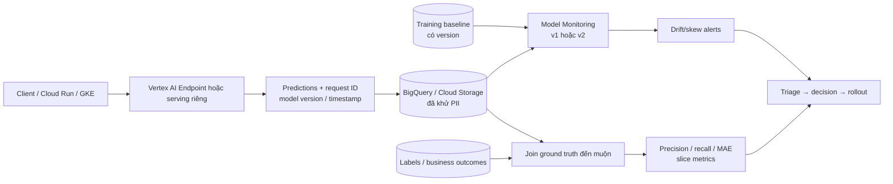
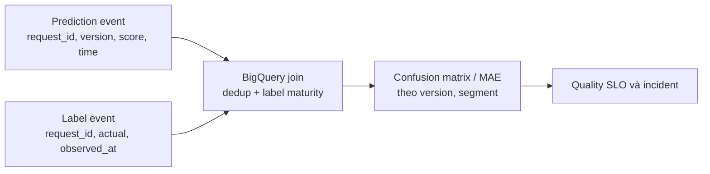
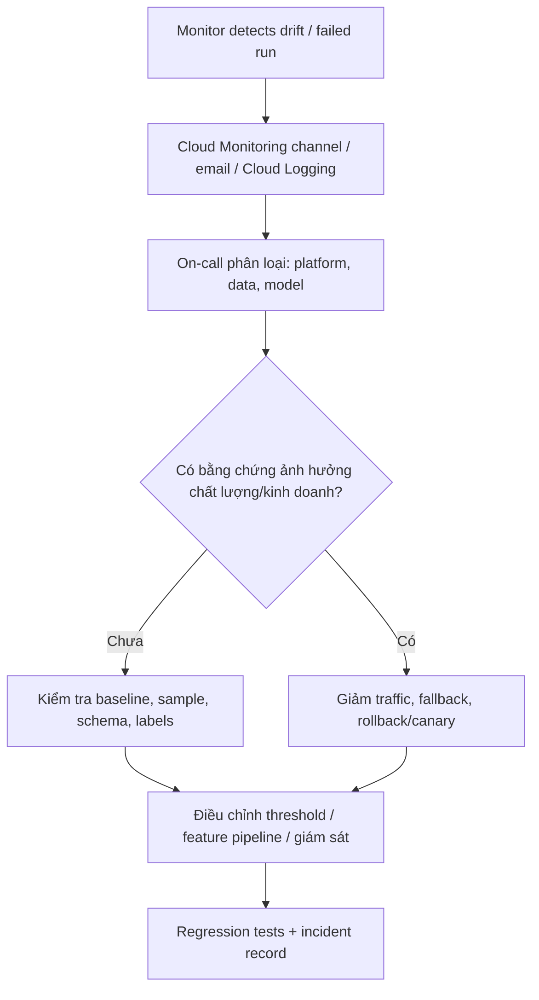

# Model monitoring và theo dõi chất lượng dự đoán

## 1. Vì sao một model tốt khi thử nghiệm vẫn có thể thất bại sau triển khai?

Một mô hình dự đoán khả năng khách hàng rời bỏ dịch vụ được huấn luyện trên dữ liệu sáu tháng trước và triển khai qua **Vertex AI Endpoint**. Sau khi ứng dụng thay giao diện, tỷ lệ người dùng mobile tăng mạnh; cùng lúc chính sách giá thay đổi. Endpoint vẫn trả HTTP 200 trong 120 ms, nhưng tỷ lệ dự đoán sai tăng lên vì **phân phối dữ liệu sản xuất đã khác** và quan hệ giữa input với kết quả kinh doanh thay đổi.

Cần quan sát ba khía cạnh độc lập:

- **Service health:** endpoint có nhận yêu cầu, phản hồi đủ nhanh, không lỗi hay quá tải không?
- **Model/data health:** đầu vào, đầu ra hoặc mức đóng góp của đặc trưng có **skew/drift**, giá trị thiếu, outlier hay lỗi schema không?
- **Prediction quality:** khi có **nhãn đúng (ground truth)**, precision/recall/F1, MAE/RMSE, calibration và chỉ số kinh doanh có đạt mục tiêu không?

Bài nằm trong chương **Vertex AI và học máy** của module **CLOUD_PROVIDERS_GCP**, nối nội dung IAM, VPC, Cloud Run, GKE, BigQuery, lưu trữ, phát hành tự động và theo dõi độ tin cậy/chi phí của hệ thống AI.

**Sau bài học, bạn có thể** phân biệt drift, skew và suy giảm chất lượng; chọn Model Monitoring v1/v2; cấu hình theo dõi dữ liệu tabular; kiểm chứng chất lượng khi ground truth đến muộn bằng BigQuery SQL; thiết kế ngưỡng cảnh báo, quy trình xử lý, IAM và ngân sách; tổ chức rollout/canary/rollback an toàn.

> **An toàn:** Project `acme-ml-lab`, model, endpoint và dataset đều là ví dụ. Không gửi PII thật vào logs hoặc dùng model học thử để đưa ra quyết định rủi ro cao. Việc bật prediction logging, chạy monitor, tạo BigQuery tables và giữ endpoint có thể phát sinh phí. Các câu lệnh ghi dữ liệu chỉ dùng với project lab được cấp quyền.

## 2. Bản đồ quan sát một ML service



**Một lần dự đoán phải truy được** `request_id`/`entity_id`, `model_id/version`, `prediction_at`, input feature schema/version và các output quan trọng. Nhãn đúng có thể chỉ xuất hiện nhiều giờ hoặc nhiều tuần sau, nên không đưa `actual_label` vào inference log như thể nó đã tồn tại tại thời điểm dự đoán.

| Tầng | Tín hiệu tiêu biểu | Bắt được gì? |
| --- | --- | --- |
| **Endpoint/infra** | QPS, 4xx/5xx, latency p95/p99, CPU/GPU, replica capacity | Sự cố kỹ thuật hoặc năng lực phục vụ |
| **Input** | Null rate, cardinality, numeric ranges, categorical distributions | Feature pipeline hỏng, skew/drift, schema mismatch |
| **Output** | Positive prediction rate, score quantiles, entropy, refusals nếu có | Phân phối dự đoán thay đổi, model collapse |
| **Ground truth** | Precision, recall, F1, accuracy, calibration, MAE/RMSE theo phiên bản/nhóm | Chất lượng dự đoán thực đo |
| **Business/safety** | Churn prevention lift, loss, complaint rate, fairness, policy violations | Model có tạo ra tác động đúng và chấp nhận được không? |

**Monitoring không tự sửa model**: cảnh báo là tín hiệu để xác minh nguyên nhân, cân nhắc dữ liệu/feature pipeline, re-calibration, threshold change, retraining hoặc rollback.

## 3. Phân biệt skew, drift, data quality và concept drift

| Hiện tượng | So với mốc nào? | Ví dụ | Có cần nhãn đúng? |
| --- | --- | --- | --- |
| **Training-serving skew** | Dữ liệu dùng train vs dữ liệu phục vụ | Train có 20% mobile, serving có 70% | **Không** |
| **Feature/data drift** | Serving hiện tại vs serving thời kỳ trước | Tuần này tuổi khách trung bình tăng đáng kể | **Không** |
| **Prediction/output drift** | Phân phối kết quả dự đoán hiện tại vs baseline | Tỷ lệ dự đoán `churn=1` tăng 12% → 40% | **Không** |
| **Data quality failure** | Schema/business constraints | `monthly_spend < 0`, 35% giá trị rỗng | **Không** |
| **Concept drift** | Quan hệ `P(y|X)` thay đổi | Hành vi churn khác sau khi công ty đổi gói giá | **Thường cần nhãn để xác nhận** |
| **Performance degradation** | Metrics hiện tại vs baseline/SLO | Recall từ 0,86 xuống 0,68 | **Có**, trừ proxy yếu |

**Điểm cốt lõi:** **data drift không chứng minh model sai**. Phân phối có thể đổi vì chiến dịch marketing hợp lệ mà accuracy vẫn tốt; ngược lại model có thể giảm recall dù feature distributions khá ổn định do **concept drift**. Chỉ xem drift alerts mà bỏ qua ground truth là chưa đủ.

### Một ví dụ

```text
Training:    mobile 25% | desktop 75%
Serving:     mobile 70% | desktop 30%
Distance L∞ = max(|0,70−0,25|; |0,30−0,75|) = 0,45
```

Nếu dùng threshold giả định `0.30` thì feature `device_type` cảnh báo. **0.30 là ngưỡng thống kê phải hiệu chỉnh theo dữ liệu**, không có nghĩa “accuracy giảm 30%”. Cần xem sample size, seasonality, phân bố theo tenant/region và tỷ lệ lỗi thực trước khi can thiệp.

## 4. Model Monitoring v1 và v2: chọn đúng thế hệ

Tài liệu Google Cloud hiện hành phân biệt **Model Monitoring v1 (GA)** và **Model Monitoring v2 (Preview)**. Tên giao diện có thể hiển thị trong phần **Vertex AI / Agent Platform**; hướng dẫn gốc được cập nhật ở tài liệu Google Cloud, không áp dụng một lệnh v1 cho resource v2.

| Tiêu chí | **v1 — endpoint monitoring** | **v2 — model/version monitoring** |
| --- | --- | --- |
| Mức độ cung cấp | **Generally Available** | **Preview/Pre-GA**, có thể thay đổi |
| Đối tượng gắn kết | **Vertex AI endpoint** và deployed models tại đó | **Model Registry version** và model monitor riêng |
| Data sources | Prediction inputs sampled từ endpoint; training reference nếu cấu hình | BigQuery, Cloud Storage CSV/JSONL, batch prediction, endpoint request-response logs; có thể theo dõi model phục vụ ở GKE/Cloud Run qua dữ liệu nguồn |
| Đối tượng thống kê | **Feature skew/drift**; attribution monitoring theo khả năng/giải thích được bật | **Input feature drift**, **prediction output drift**, **feature attribution drift** |
| Lịch chạy | Scheduled endpoint monitoring | On-demand hoặc scheduled **batch jobs** |
| Khi chọn | Cần support production GA trên Vertex AI Endpoint | Cần tách version, theo dõi offline/batch/ngoài Vertex AI và chấp nhận Preview |

**v1 không tự bị thay thế**: hệ thống đang sử dụng v1 có thể tiếp tục; nếu chuyển dần sang v2, chạy song song có kiểm soát để không mất monitoring coverage. Với model ngoài Vertex AI như GKE/Cloud Run, v2 **không tự thu prediction logs** từ workload của bạn: cần đưa input/output theo schema vào **BigQuery/Cloud Storage** hoặc nguồn được hỗ trợ.

**Giới hạn quan trọng:** v2 Preview tập trung vào **tabular models**. Theo dõi request latency/token usage của LLM/Generative AI, safety/grounding và chất lượng câu trả lời cần **bộ công cụ observability/evaluation dành cho generative AI**, không giả định v1/v2 tabular drift monitor hỗ trợ mọi dữ liệu đa phương thức.

## 5. Data reference, target, schema và cửa sổ so sánh

**Baseline/reference dataset** là phân phối dùng làm chuẩn; **target dataset** là dữ liệu gần đây cần kiểm tra. Những câu hỏi thiết kế:

| Lựa chọn | Ý nghĩa | Lỗi thường gặp |
| --- | --- | --- |
| **Training baseline** | Phát hiện training-serving skew | Dùng dữ liệu training đã được thay đổi mà không ghi version |
| **Historical serving baseline** | Phát hiện drift theo thời gian | So ngày lễ với ngày thường rồi coi mọi khác biệt là lỗi |
| **Target window** | Ví dụ 24 giờ gần nhất | Cửa sổ quá ngắn, sample nhỏ, nhiễu |
| **Segment/slice** | Region, platform, tenant tier, cohort | Metrics tổng tốt nhưng một nhóm bị hại |
| **Feature schema** | Kiểu number/category, missing values, nested fields | Trộn string với số, nested JSON chưa được flatten |
| **Model version** | Phiên bản đã tạo prediction | Gộp score của v1 và v2 làm baseline lẫn lộn |

Model Monitoring v2 hỗ trợ **BigQuery table/query**, **Cloud Storage CSV/JSONL**, **batch prediction jobs** và endpoint logging theo điều kiện hỗ trợ. Với **scheduled monitoring trên cửa sổ thời gian**, BigQuery/source endpoint logs cần một **timestamp field**; nên **partition BigQuery tables theo timestamp** để kiểm soát bytes đọc. Nested features thường phải được làm phẳng thành cột trước khi monitor.

### Schema record phục vụ để theo dõi

```json
{
  "request_id": "p-1001",
  "model_version": "churn-v3",
  "prediction_at": "2026-11-19T03:00:00Z",
  "region": "north",
  "device_type": "mobile",
  "age": 31,
  "monthly_spend": 120000,
  "churn_probability": 0.83,
  "predicted_label": 1
}
```

Đây là **schema chuẩn hóa minh họa**, không phải payload bắt buộc của `predict` API. **Không log email, phone, raw IP hay payment identifiers** khi không cần thiết; `request_id` nên là UUID không chứa PII. Nhãn đúng được join riêng sau.

## 6. Các độ đo phân phối: đọc đúng score

Google dùng các thống kê như **L-infinity distance** cho categorical và **Jensen–Shannon divergence (JSD)** cho numeric (v1) hoặc các metrics cấu hình được trong v2. Chúng **không phải accuracy/F1**.

**Categorical L∞:**

```text
D∞(P,Q) = max over categories c of |P(c) − Q(c)|

P(mobile)=0,25; Q(mobile)=0,70
P(desktop)=0,75; Q(desktop)=0,30
D∞ = 0,45
```

**Jensen–Shannon divergence:** đo khoảng cách giữa **hai phân phối xác suất đã được chuẩn hóa**, tính qua KL divergence đến phân phối trung bình. Numeric features thường được chia bins; **cách chia bins, missing values và sample size** ảnh hưởng kết quả. Không diễn giải score `0.2` thành “20% số người bị sai” hoặc so thẳng ngưỡng giữa những metric khác nhau.

**PSI (Population Stability Index)** đôi khi được team tự tính trong BigQuery/Python, nhưng **không mặc nhiên là metric được v1/v2 chọn trong mọi cấu hình**. Nếu dùng PSI song song, ghi rõ bins, smoothing/epsilon, threshold và chủ sở hữu.

### Chọn thresholds có kiểm định

1. Lấy nhiều cửa sổ serving **đã biết model ổn định**, gồm ngày thường/đầu tuần/cuối tuần.
2. Đo distribution metrics theo feature và segment, đặt threshold theo biến thiên chấp nhận được.
3. Thêm **minimum sample size** và điều kiện **N cửa sổ liên tiếp** nếu kiến trúc alert cho phép.
4. Xếp mức cảnh báo theo business impact, không chỉ thống kê: thay đổi `fraud_score` quan trọng hơn trường ít ảnh hưởng.
5. Đánh giá precision của alert và điều chỉnh sau các chiến dịch/seasonality; ghi version thresholds.

Ngưỡng `0.3` là mặc định thường thấy ở **v1** cho mỗi feature, **không phải ngưỡng “đúng cho mọi mô hình”**. Không copy nó cho toàn bộ mô hình tín dụng/y tế mà chưa kiểm thử.

## 7. Theo dõi phân phối chưa đủ: cần ground truth và nhãn đến muộn

Để đo precision/recall, cần **predicted label** và **actual outcome** cho **cùng thực thể/cùng mốc quyết định**.



| Bẫy | Ví dụ | Cách phòng |
| --- | --- | --- |
| **Delayed labels** | Churn chỉ biết sau 30 ngày | Đánh giá cohort đủ trưởng thành, không tính chưa có label là negative |
| **Selection bias** | Chỉ khách được gọi tư vấn mới có outcome | Báo cáo label coverage theo segment, đánh giá thiên lệch |
| **Data leakage** | Feature cập nhật sau khi prediction nhưng dùng hồi cứu | Point-in-time feature join đúng `prediction_at` |
| **Duplicate/retry** | Một request bị replay 3 lần | Idempotent request ID, versioned prediction events |
| **Feedback loop** | Model quyết định ai được ưu đãi nên tự thay đổi nhãn | Dùng experiment/control group, causal evaluation khi cần |
| **Model version mix** | Rollout 90/10 giữa v2/v3 | Report riêng theo `model_version`, traffic slice |

**Công thức phân loại nhị phân** (`TP`, `FP`, `TN`, `FN`):

```text
Precision = TP / (TP + FP)
Recall    = TP / (TP + FN)
Accuracy  = (TP + TN) / (TP + TN + FP + FN)
F1        = 2 × Precision × Recall / (Precision + Recall)
```

**Không dùng accuracy một mình** cho dữ liệu mất cân bằng như fraud detection. Hãy xem confusion matrix theo thresholds, precision-recall tradeoff, calibration, và metric chi phí sai lầm (false positives/negatives). Với regression dùng MAE/RMSE và phân phối residuals; với ranking/generative AI cần đánh giá chuyên biệt.

## 8. Lab A — tạo baseline và prediction events trên BigQuery

Lab này **không cần triển khai model lên Vertex AI**, giúp bạn phân biệt thống kê drift với đánh giá có nhãn. Các dữ liệu hoàn toàn giả định:

```text
Project:          acme-ml-lab
BigQuery dataset: monitoring_lab
Location:         asia-southeast1
Model version:    churn-v3
Baseline:         8 hàng training-reference
Serving:          10 dự đoán, chỉ 8 hàng đã có nhãn đúng
```

**Preflight:** BigQuery API/Billing đã bật; bạn có quyền tạo dataset/table và chạy query trên **project lab**, không dùng dataset production. Nếu dataset/table đã tồn tại, **không** chạy CREATE đè; dùng một dataset khác được cấp phép. Chạy trong Cloud Shell:

```bash
# THAY ĐỔI: tạo dataset LAB một lần
bq --project_id=acme-ml-lab mk \
  --dataset --location=asia-southeast1 \
  acme-ml-lab:monitoring_lab

# CHỈ ĐỌC
bq show --format=prettyjson acme-ml-lab:monitoring_lab
```

### 8.1. Training reference table

Chạy GoogleSQL trong BigQuery Studio hoặc `bq query --location=asia-southeast1 --use_legacy_sql=false`:

```sql
-- THAY ĐỔI: chỉ tạo mới một bảng giả trong dataset LAB.
CREATE TABLE `acme-ml-lab.monitoring_lab.training_reference` AS
SELECT * FROM UNNEST([
  STRUCT('north' AS region, 'web' AS device_type, 24 AS age),
  STRUCT('north', 'web', 35),
  STRUCT('north', 'web', 31),
  STRUCT('north', 'web', 46),
  STRUCT('north', 'web', 42),
  STRUCT('north', 'mobile', 54),
  STRUCT('south', 'web', 36),
  STRUCT('south', 'mobile', 47)
]);
```

Baseline có **north 6/8 = 75%**, **south 2/8 = 25%**. Đây là baseline minh họa, không đại diện dữ liệu dân số hoặc số khách hàng thật.

### 8.2. Serving predictions table (chỉ 10 events giả)

```sql
CREATE TABLE `acme-ml-lab.monitoring_lab.prediction_events`
PARTITION BY DATE(prediction_at)
CLUSTER BY model_version, region AS
SELECT * FROM UNNEST([
  STRUCT('p1' AS request_id, TIMESTAMP '2026-11-19 02:00:00+00' AS prediction_at,
         'churn-v3' AS model_version, 'north' AS region,
         'mobile' AS device_type, 25 AS age, 0.90 AS score, 1 AS predicted_label),
  STRUCT('p2', TIMESTAMP '2026-11-19 02:01:00+00', 'churn-v3', 'south', 'mobile', 46, 0.80, 1),
  STRUCT('p3', TIMESTAMP '2026-11-19 02:02:00+00', 'churn-v3', 'north', 'web',    35, 0.70, 1),
  STRUCT('p4', TIMESTAMP '2026-11-19 02:03:00+00', 'churn-v3', 'south', 'web',    22, 0.55, 1),
  STRUCT('p5', TIMESTAMP '2026-11-19 02:04:00+00', 'churn-v3', 'north', 'mobile', 31, 0.45, 0),
  STRUCT('p6', TIMESTAMP '2026-11-19 02:05:00+00', 'churn-v3', 'south', 'mobile', 67, 0.20, 0),
  STRUCT('p7', TIMESTAMP '2026-11-19 02:06:00+00', 'churn-v3', 'north', 'web',    54, 0.10, 0),
  STRUCT('p8', TIMESTAMP '2026-11-19 02:07:00+00', 'churn-v3', 'south', 'web',    42, 0.30, 0),
  STRUCT('p9', TIMESTAMP '2026-11-19 02:08:00+00', 'churn-v3', 'south', 'mobile', 60, 0.75, 1),
  STRUCT('p10', TIMESTAMP '2026-11-19 02:09:00+00','churn-v3', 'south', 'mobile', 30, 0.40, 0)
]);
```

Trên serving có **north 4/10 = 40%**, **south 6/10 = 60%**. Hai hàng `p9/p10` sẽ chưa có nhãn thật ở lab này; đó là dữ liệu **unlabeled**, không phải negative.

### 8.3. Labels đến sau prediction

```sql
CREATE TABLE `acme-ml-lab.monitoring_lab.observed_labels` AS
SELECT * FROM UNNEST([
  STRUCT('p1' AS request_id, 1 AS actual_label,
         TIMESTAMP '2026-11-19 08:00:00+00' AS observed_at),
  STRUCT('p2', 0, TIMESTAMP '2026-11-19 08:00:00+00'),
  STRUCT('p3', 1, TIMESTAMP '2026-11-19 08:00:00+00'),
  STRUCT('p4', 1, TIMESTAMP '2026-11-19 08:00:00+00'),
  STRUCT('p5', 0, TIMESTAMP '2026-11-19 08:00:00+00'),
  STRUCT('p6', 1, TIMESTAMP '2026-11-19 08:00:00+00'),
  STRUCT('p7', 0, TIMESTAMP '2026-11-19 08:00:00+00'),
  STRUCT('p8', 0, TIMESTAMP '2026-11-19 08:00:00+00')
]);
```

**Thực tế:** dùng ID ổn định và thời điểm nhãn đúng được xác nhận từ CRM, giao dịch hoặc thiết bị đo. Một request có thể bị gửi lại; production phải deduplicate theo `request_id` và business outcome/version, không join dữ liệu tùy tiện chỉ theo khách hàng.

## 9. Lab B — tính feature drift bằng BigQuery SQL

Đếm tỷ trọng mỗi category trong baseline/serving, sau đó tính **L∞**:

```sql
WITH baseline AS (
  SELECT region, COUNT(*) AS n
  FROM `acme-ml-lab.monitoring_lab.training_reference`
  GROUP BY region
), serving AS (
  SELECT region, COUNT(*) AS n
  FROM `acme-ml-lab.monitoring_lab.prediction_events`
  WHERE prediction_at >= TIMESTAMP '2026-11-19 00:00:00+00'
    AND prediction_at < TIMESTAMP '2026-11-20 00:00:00+00'
    AND model_version = 'churn-v3'
  GROUP BY region
), aligned AS (
  SELECT
    COALESCE(b.region, s.region) AS region,
    IFNULL(b.n, 0) AS baseline_n,
    IFNULL(s.n, 0) AS serving_n
  FROM baseline AS b FULL OUTER JOIN serving AS s USING (region)
)
SELECT region,
  SAFE_DIVIDE(baseline_n, (SELECT COUNT(*) FROM `acme-ml-lab.monitoring_lab.training_reference`))
    AS baseline_share,
  SAFE_DIVIDE(serving_n, (SELECT COUNT(*) FROM `acme-ml-lab.monitoring_lab.prediction_events`))
    AS serving_share,
  ABS(
    SAFE_DIVIDE(baseline_n, (SELECT COUNT(*) FROM `acme-ml-lab.monitoring_lab.training_reference`))
    - SAFE_DIVIDE(serving_n, (SELECT COUNT(*) FROM `acme-ml-lab.monitoring_lab.prediction_events`))
  ) AS absolute_share_diff
FROM aligned
ORDER BY region;
```

**Kỳ vọng:** `north`: baseline 0,75 vs serving 0,40, difference 0,35; `south`: 0,25 vs 0,60, difference 0,35; vậy **L∞ = 0,35**. Nếu threshold lab = 0,30, cả hai categories vượt ngưỡng và feature `region` được đánh dấu cần kiểm tra.

**Giới hạn cố ý của lab:** serving table chỉ có 10 hàng của một ngày nên truy vấn tổng serving cũng đúng trong ví dụ. Trong production, phải áp **cùng time filter và model version** ở cả numerator/denominator; nếu dùng COUNT(*) cả bảng dài hạn cho denominator thì tỷ lệ sẽ sai. Không dùng 10 bản ghi để đặt threshold production.

## 10. Lab C — confusion matrix và precision/recall/F1

```sql
WITH confusion AS (
  SELECT
    COUNTIF(p.predicted_label = 1 AND l.actual_label = 1) AS tp,
    COUNTIF(p.predicted_label = 1 AND l.actual_label = 0) AS fp,
    COUNTIF(p.predicted_label = 0 AND l.actual_label = 1) AS fn,
    COUNTIF(p.predicted_label = 0 AND l.actual_label = 0) AS tn
  FROM `acme-ml-lab.monitoring_lab.prediction_events` AS p
  JOIN `acme-ml-lab.monitoring_lab.observed_labels` AS l
    USING (request_id)
  WHERE p.model_version = 'churn-v3'
    AND p.prediction_at >= TIMESTAMP '2026-11-19 00:00:00+00'
    AND p.prediction_at <  TIMESTAMP '2026-11-20 00:00:00+00'
    AND l.observed_at <= TIMESTAMP '2026-11-19 09:00:00+00'
)
SELECT tp, fp, fn, tn,
  SAFE_DIVIDE(tp + tn, tp + fp + fn + tn) AS accuracy,
  SAFE_DIVIDE(tp, tp + fp) AS precision,
  SAFE_DIVIDE(tp, tp + fn) AS recall,
  SAFE_DIVIDE(2 * tp, 2 * tp + fp + fn) AS f1
FROM confusion;
```

**Kỳ vọng:** TP=3, FP=1, FN=1, TN=3; accuracy=0,75, precision=0,75, recall=0,75, F1=0,75. **Chỉ 8/10 dự đoán có nhãn**: báo cáo thêm **label coverage=80%** và cẩn thận với selection bias. Thống kê của tám nhãn này không phải performance của toàn bộ 10 predictions nếu hai nhãn còn thiếu có phân phối khác.

### So chất lượng theo segment

```sql
WITH joined AS (
  SELECT p.region, p.model_version, p.predicted_label, l.actual_label
  FROM `acme-ml-lab.monitoring_lab.prediction_events` AS p
  JOIN `acme-ml-lab.monitoring_lab.observed_labels` AS l
    USING (request_id)
  WHERE p.prediction_at >= TIMESTAMP '2026-11-19 00:00:00+00'
    AND p.prediction_at < TIMESTAMP '2026-11-20 00:00:00+00'
)
SELECT region, model_version, COUNT(*) AS labeled_n,
  SAFE_DIVIDE(COUNTIF(predicted_label = actual_label), COUNT(*)) AS accuracy
FROM joined
GROUP BY region, model_version
ORDER BY region;
```

**Lưu ý:** group nhỏ có nhiều nhiễu và có thể làm lộ dữ liệu cá nhân nếu chia quá chi tiết. Đặt **minimum cohort size** và kiểm định thống kê/đạo đức phù hợp trước khi diễn giải fairness hoặc quyết định retrain.

### Kiểm tra coverage trước khi tin metric

```sql
SELECT
  COUNT(*) AS total_predictions,
  COUNTIF(l.request_id IS NOT NULL) AS labeled_predictions,
  SAFE_DIVIDE(COUNTIF(l.request_id IS NOT NULL), COUNT(*)) AS label_coverage
FROM `acme-ml-lab.monitoring_lab.prediction_events` AS p
LEFT JOIN `acme-ml-lab.monitoring_lab.observed_labels` AS l
  USING (request_id)
WHERE p.model_version = 'churn-v3';
```

Với hệ thống thật, cần chống trùng trong bảng labels để một `request_id` không tạo nhiều hàng khi JOIN. Có thể dùng `ROW_NUMBER() OVER (PARTITION BY request_id ORDER BY observed_at DESC) = 1` để lấy bản nhãn hợp lệ mới nhất, nhưng chỉ khi nghiệp vụ cho phép nhãn cập nhật.

## 11. Lab D — cấu hình v2 Model Monitor bằng giao diện (Preview)

**Điều kiện:** model **tabular** đã được đăng ký trong **Model Registry** cùng **version**, dù inference chạy trên Vertex AI Endpoint, Cloud Run/GKE hay batch. Nếu chạy ngoài Vertex AI, chỉ cần **reference model** theo tài liệu; không nhất thiết upload model artifact, nhưng phải tự lưu dữ liệu inference vào BigQuery/Cloud Storage đúng schema.

1. Mở Google Cloud Console → **Model Monitoring / Agent Platform** tại project/region được cấp quyền; chọn **Configure monitoring**.
2. Chọn **model + model version**; khai báo schema tương ứng fields `region`, `device_type`, `age`, `score`, `predicted_label` (gán numeric/categorical đúng).
3. Chọn **baseline BigQuery** `training_reference` và **target BigQuery** `prediction_events` hoặc curated queries chỉ chọn đúng feature columns. Dùng `prediction_at` làm **timestamp field** khi cấu hình scheduled windows.
4. Bật objective **Input feature drift**, chọn `L-infinity` cho categorical và `Jensen–Shannon divergence` cho numeric, đặt threshold theo dữ liệu lab (ví dụ 0,30 cho `region`).
5. Nếu có output schema, thêm **Prediction output drift**; feature attribution chỉ khi model/explanation hỗ trợ và có đủ dữ liệu giải thích. **Không bật attribution rồi mong có SHAP cho reference model** nếu feature không được hỗ trợ.
6. Đặt email hoặc Cloud Monitoring notification channel của **người nhận thực được phê duyệt**, chọn bucket xuất kết quả phù hợp nếu cần, và chạy **Run now**.
7. Xem run status, metric distributions, anomaly alerts, source time range và output storage; ghi lại model version và monitoring job ID.
8. Nếu lab yêu cầu theo dõi định kỳ, dùng **Schedule a recurring run** với cron/timezone và time-window; **hủy schedule sau lab** để tránh phí.

**Không nhầm continuous monitoring với stream processing từng request**: v2 **chạy các batch monitoring jobs theo lịch**. Bảng BigQuery phục vụ time-window cần timestamp field và dữ liệu đã về đủ; job vừa chạy xong không đảm bảo tất cả inference của cùng giây đã được ghi.

### Khai báo schema bằng SDK (mẫu để đọc, không tự chạy)

```python
# Python SDK v2 Preview; dùng khi tổ chức đã xác nhận version SDK.
# Đây là cấu trúc schema, KHÔNG phải đoạn tạo monitor đầy đủ.
from vertexai.resources.preview import ml_monitoring

monitor_schema = ml_monitoring.spec.ModelMonitoringSchema(
    feature_fields=[
        ml_monitoring.spec.FieldSchema(name="region", data_type="string"),
        ml_monitoring.spec.FieldSchema(name="device_type", data_type="string"),
        ml_monitoring.spec.FieldSchema(name="age", data_type="integer"),
    ],
    prediction_fields=[
        ml_monitoring.spec.FieldSchema(name="score", data_type="float"),
        ml_monitoring.spec.FieldSchema(name="predicted_label", data_type="integer"),
    ],
)
```

Đoạn code **chỉ minh họa ModelMonitoringSchema**, còn tạo model monitor và run cần resource IDs, datasets, IAM/output spec, objectives và SDK phù hợp; xem **tài liệu v2 notebook chính thức** thay vì đoán API thay đổi trong Preview.

## 12. Lab E — Model Monitoring v1 trên Vertex AI Endpoint (GA)

**Điều kiện:** bạn đã có một **Vertex AI Endpoint** chứa model **tabular** được triển khai, có đủ request traffic, quyền quản trị monitor và được phép bật sampling/logging. Lab SQL ở các mục trước **không tự tạo Endpoint**. Ví dụ bên dưới chỉ dùng khi project lab đã triển khai endpoint test theo hướng dẫn mô hình riêng.

### 12.1. Kiểm tra model và endpoint trước (chỉ đọc)

```bash
PROJECT="acme-ml-lab"
REGION="asia-southeast1"
ENDPOINT_ID="REPLACE_WITH_TEST_ENDPOINT_ID"

gcloud ai endpoints list \
  --project="$PROJECT" --region="$REGION"

gcloud ai endpoints describe "$ENDPOINT_ID" \
  --project="$PROJECT" --region="$REGION"

gcloud ai model-monitoring-jobs list \
  --project="$PROJECT" --region="$REGION"
```

**Đừng lấy endpoint ID từ production** chỉ vì thấy danh sách hiện ra. Xem deployed models, traffic splits, network/access conditions và yêu cầu chi phí trước khi bật logging. **v1 áp dụng cấu hình monitoring chung ở cấp endpoint** cho sampling/schedule/loại detection, nhưng một số thresholds được cấu hình theo model/feature.

### 12.2. Tạo monitoring job minh họa

```bash
# THAY ĐỔI: tạo Model Monitoring v1 job và theo dõi prediction inputs.
# Chỉ chạy với endpoint TABULAR LAB, sau khi thay email bằng người thật có quyền.
gcloud ai model-monitoring-jobs create \
  --project="$PROJECT" \
  --region="$REGION" \
  --display-name="churn-v1-drift-lab" \
  --endpoint="$ENDPOINT_ID" \
  --emails="ml-oncall@example.org" \
  --prediction-sampling-rate=0.2 \
  --monitoring-frequency=24 \
  --feature-thresholds="region=0.3,age=0.3"
```

Với v1, **khi không cung cấp training reference**, mục tiêu phù hợp là **prediction feature drift**; để giám sát **training-serving skew**, phải cung cấp training source (BigQuery/GCS/managed dataset), target/label field và schema theo đúng loại model. **Không copy một baseline bảng thiếu target field rồi bật skew**: API có thể từ chối hoặc phân tích sai mục đích. Đọc hướng dẫn `gcloud ai model-monitoring-jobs create --help` và [monitor feature skew and drift](https://docs.cloud.google.com/gemini-enterprise-agent-platform/machine-learning/model-monitoring/using-model-monitoring) cho cấu hình theo loại model.

**Ví dụ này không bắt buộc chạy** để hoàn thành bài. Khi tạo monitor thật cần prediction traffic để xác định schema/phân phối đầu vào; kết quả không xuất hiện lập tức chỉ vì có một resource ở trạng thái `ACTIVE`. `--monitoring-frequency=24` nghĩa là khoảng đánh giá theo giờ ở lệnh v1, không có nghĩa có kết quả sau mỗi request.

### 12.3. Xem trạng thái và dừng lab

```bash
# CHỈ ĐỌC: lấy JOB_ID thật từ list
gcloud ai model-monitoring-jobs list \
  --project="$PROJECT" --region="$REGION"

gcloud ai model-monitoring-jobs describe JOB_ID \
  --project="$PROJECT" --region="$REGION"

# THAY ĐỔI: tạm dừng ĐÚNG monitoring job do lab tạo
gcloud ai model-monitoring-jobs pause JOB_ID \
  --project="$PROJECT" --region="$REGION"
```

Để tiết kiệm phí sau lab, **xóa monitor test hoặc endpoint test chỉ sau khi xác minh không còn người dùng phụ thuộc**, theo quy trình approval. Đừng xóa baseline BigQuery/endpoint production hoặc tài khoản phục vụ model chỉ để “dọn demo”.

## 13. Thu thập prediction logs và lưu dữ liệu an toàn

Để theo dõi dữ liệu **thực sự được model nhìn thấy**, nguồn inference cần đủ trường, đúng schema, cùng version:

| Trường | Vì sao cần? | Bảo vệ |
| --- | --- | --- |
| `request_id` | Join prediction với ground truth; dedup retries | UUID ngẫu nhiên, không chứa PII |
| `model_version`, `endpoint_id` | So rollout/canary/rollback | Immutable version; traffic split |
| `prediction_at` | Cửa sổ thời gian và data freshness | UTC timestamp chuẩn |
| `feature_fields` | Input drift/skew | Mask/hash/minimize PII, không lưu secrets |
| `score`/`predicted_label` | Output drift, calibration, quality khi có labels | Chặn export trái phép |
| `logging_time` | Phân biệt event time và ingestion delay | Lag alerts |
| `ground_truth`/`observed_at` | Đánh giá supervised khi nhãn đến | Store riêng; audit, lineage, hạn chế quyền |

Vertex AI Endpoint có nhiều loại logging **độc lập**:

- **Container logging:** stdout/stderr của inference container để debug.
- **Access logging:** request metadata như status/latency; không phải đầy đủ model features.
- **Request-response logging:** lấy mẫu inputs/outputs vào **BigQuery** theo endpoint settings; cần bật rõ và đánh giá privacy/cost.

Với **Model Monitoring v2** dùng endpoint logging, **request-response logging phải được bật**. Endpoint private không hỗ trợ nguồn logging này theo tài liệu v2; thay bằng **BigQuery/Cloud Storage input** tự xây nếu phù hợp. Với **Cloud Run/GKE serving riêng**, logging phải được instrument trong ứng dụng, chẳng hạn Pub/Sub → Dataflow → BigQuery, và có idempotency.

### Mẫu schema cho production

```text
ml_observability.predictions
  request_id            STRING
  event_at              TIMESTAMP
  ingestion_at          TIMESTAMP
  model_version         STRING
  source_service        STRING
  segment               STRING
  feature_age           INT64
  feature_device_type   STRING
  score                 FLOAT64
  predicted_label       INT64

ml_observability.labels
  request_id            STRING
  observed_at           TIMESTAMP
  actual_label          INT64
  label_source          STRING
```

**Production:** partition theo `event_at`/`observed_at`, cluster theo `model_version/segment` nếu workload truy vấn theo hai cột ấy. Tách **feature logging** khỏi **business personal data**; logs có lifecycle, access policy, CMEK/VPC Service Controls nếu yêu cầu và audit đối với hành động xuất dữ liệu. Không dùng `allow all` cho buckets ghi prediction logs.

## 14. Alerting: kết hợp model/data health với service health

Model Monitoring đưa ra kết quả **thống kê theo cửa sổ**; Cloud Monitoring và Cloud Logging theo dõi **endpoint/workload**. Dùng cả hai để phân biệt model issue và infrastructure issue.

| Nhóm | Tín hiệu gợi ý | Cửa sổ/SLO ví dụ (do team tự đặt) |
| --- | --- | --- |
| **Availability** | Inference 5xx, request failures | 5xx dưới 0,5% trên 5 phút |
| **Latency** | p95/p99 inference latency | p95 dưới 300 ms |
| **Data drift** | L∞ của `region`, JSD của `age` | Vượt threshold 2 batch runs liên tiếp |
| **Input quality** | Missing/invalid feature rate | `age` null dưới 1% |
| **Output drift** | Positive prediction rate / score distribution | Điều tra khi lệch đáng kể khỏi baseline |
| **Label quality** | Label coverage/maturity | Coverage cao hơn 90% sau 14 ngày |
| **Supervised quality** | Recall/precision/calibration theo cohort | Recall cohort trưởng thành trên 0,80 |
| **Business** | Cost per save, churn reduction, customer complaints | Theo business owner/holdout |
| **Ops** | Monitor run failures, sampling gaps, ETL lag | Không bỏ quá hai scheduled runs |

**Tất cả thresholds ở bảng là minh họa**, không phải Google Cloud SLA hoặc ngưỡng khuyến nghị chung cho mọi mô hình. Với class imbalance, xem sample count/confidence interval trước khi gửi incident mức cao.

### Luồng cảnh báo



Với v1, thông báo email cho các thay đổi job/run failure và cảnh báo skew/drift không phải lúc nào là cùng một loại notification; **kiểm tra loại alert, Cloud Logging event, notification channel và webhook routing thực tế** trước khi vận hành. Chỉ cấu hình email chưa đủ để chứng minh hệ thống on-call sẽ nhận và xử lý được incident vào ban đêm.

## 15. Giải thích model và attribution drift

**Feature attribution** mô tả đóng góp của mỗi feature vào prediction theo phương pháp giải thích đang dùng (ví dụ SHAP). Một feature thay đổi mức độ ảnh hưởng có thể là tín hiệu quan trọng **ngay cả khi raw feature distribution không đổi nhiều**.

Ví dụ model cũ dự đoán churn dựa vào `monthly_spend`, model mới phụ thuộc quá nhiều vào `device_type`. Cần hỏi:

- Dữ liệu training bị leak hoặc feature pipeline thay đổi không?
- Attribution shift đến từ **model version mới** hay từ **dữ liệu người dùng**?
- Model có bắt đầu dùng proxy cho nhóm nhạy cảm, vi phạm chính sách fairness không?
- Metrics supervised theo segment và calibration có suy giảm không?

**Attributions không là quan hệ nhân quả**, không chứng minh việc thay feature sẽ thay outcome tương ứng. Với **reference model** trong v2, feature-attribution monitoring không được hỗ trợ theo tài liệu; chỉ cấu hình khi serving/explanation method cung cấp đủ thông tin và kiểm chứng đầu ra.

## 16. Root-cause và quyết định retrain, rollback hay điều chỉnh ngưỡng

| Quan sát | Giả thuyết | Quyết định phù hợp |
| --- | --- | --- |
| Drift tăng, quality stable | Chiến dịch mới, shift hợp lệ | Ghi baseline mới có phê duyệt; tiếp tục giám sát |
| Null spike ngay sau deploy feature pipeline | Schema/parsing/ETL lỗi | **Sửa pipeline**, backfill, có thể rollback ingestion |
| Recall giảm với nhãn trưởng thành | Concept drift, threshold, label bias | Phân tích slices; thử recalibration/retrain/canary |
| Endpoint 5xx/p95 tăng, quality chưa đổi | Infra/quotas/model serving | Sửa capacity/routing, không retrain theo phản xạ |
| New model v4 tệ hơn v3 | Data leakage/training issue hoặc model regression | Chuyển traffic về v3 theo rollback plan |
| Alert liên tục nhưng ít tác động | Threshold sai, sample nhỏ, seasonality | Re-estimate baseline/threshold, đừng tắt monitoring toàn bộ |

**Retrain không phải response tức thời cho mọi drift**. Với những quyết định ảnh hưởng tài chính/sức khỏe/cơ hội của người dùng, cần có phê duyệt, dữ liệu được phép dùng, đánh giá công bằng và kiểm thử độc lập trước rollout. Nếu nhãn cần 30 ngày mới trưởng thành, không được “tuyên bố model mới đã tốt hơn” dựa trên một buổi thử và số click proxy chưa được kiểm chứng.

## 17. Canary, traffic splitting và phiên bản mô hình

Một Model Registry có thể lưu nhiều model versions. Khi triển khai một version mới lên endpoint, đội vận hành có thể dùng **traffic split** và rollback theo khả năng phục vụ của endpoint. Nhưng **monitoring phải gắn các metrics với đúng version**:

```text
Vertex AI Endpoint
  ├── deployed model churn-v3: 90% traffic
  └── deployed model churn-v4: 10% traffic

Prediction logs: request_id + deployed_model_id/version + model_config
                 ↓
Quality dashboard theo version + segment + time window
                 ↓
Decision: tăng traffic, giữ canary hoặc rollback về v3
```

**Khi so model v3 và v4**, 10% traffic có thể là một nhóm người dùng không đồng đều nếu routing chưa random hợp lý; không lấy accuracy của toàn bộ v4 test cases so trực tiếp v3 khác thời kỳ mà kết luận v4 tốt hơn. Cân nhắc **A/B test với control group**, confidence intervals, label maturity và chỉ số kinh doanh.

### Gate phát hành

1. **Offline evaluation** trên dataset tách biệt, kiểm tra baseline, fairness, leakage và calibration.
2. **Shadow testing** khi có thể, không cho prediction mới tác động người dùng; kiểm tra logs và chi phí.
3. **Canary rollout** với traffic nhỏ, kiểm tra p95/5xx, drift, output distribution và downstream business failures.
4. **Delayed-label evaluation** theo cohort trưởng thành, đối soát với version hiện hành.
5. **Increase traffic/rollback** theo điều kiện SLO và phê duyệt; ghi runbook/decision owner.
6. Khi retire model version, giữ **lineage và metrics** đủ phục vụ audit; không xóa logs/labels ngay.

**Không gọi “model tốt hơn” chỉ vì endpoint mới có p95 thấp hơn**; latency là service metric, không phải prediction quality metric.

## 18. Bảo mật, IAM, dữ liệu và trách nhiệm vận hành

| Principal | Nhiệm vụ | Quyền cấp theo phạm vi |
| --- | --- | --- |
| **ML platform admin** | Tạo/cấu hình Model Registry, endpoint và monitors | Các permission Vertex AI cần thiết, hạn chế quyền deploy production |
| **Monitoring service agent** | Đọc data input, ghi kết quả v2 vào bucket | Quyền **BigQuery/GCS đúng nguồn**, quyền ghi **output bucket** |
| **Prediction service account** | Phục vụ model và gọi nguồn feature | Tách khỏi admin/deployer; không dùng project Owner |
| **ETL/feature pipeline SA** | Ghi inference logs/labels, sửa pipeline | Chỉ dataset/bucket và Pub/Sub topics được phép |
| **Analyst/incident responder** | Xem dashboard, drift scores, quality và logs | Read-only theo mức dữ liệu đã khử PII |

**v2 service agent** có dạng `service-PROJECT_NUMBER@gcp-sa-vertex-mm.iam.gserviceaccount.com`; nếu chọn Cloud Storage bucket tùy chỉnh làm monitoring output, cần **quyền ghi** phù hợp. Đừng cấp `storage.admin` cho toàn bộ tổ chức. Vertex AI endpoint resource/service agents, BigQuery execution identity và người dùng Cloud Console không phải luôn là cùng principal.

### Dữ liệu nhạy cảm

- Chỉ log feature cần để giám sát; **không gửi raw tên, email, số điện thoại, access token hoặc nội dung nhạy cảm** lên Logs/BigQuery nếu không cần.
- Định nghĩa **retention/lifecycle** cho prediction logs, label datasets, model metadata và monitoring results theo chính sách; có thể dùng CMEK và VPC Service Controls khi được hỗ trợ và phù hợp.
- Hạn chế quyền export BigQuery/Cloud Storage; review jobs có thể đọc dữ liệu training, inference và ground truth.
- Các bảng theo **segment nhân khẩu/nhóm nhỏ** có thể làm lộ danh tính; đặt minimum cohort size, aggregation threshold và kiểm tra quy định pháp lý/đạo đức.
- Với **private serving/GKE/Cloud Run**, bảo đảm đường network đến Google APIs, IAM BigQuery/GCS, Private Google Access/NAT/Private Service Connect và VPC SC theo topology thực; đừng mở public endpoint chỉ để monitor đọc được dữ liệu.

**Bảo mật model monitoring là bảo mật dữ liệu sản xuất.** V1/v2 kiểm tra phân phối không tự ẩn danh records hoặc kiểm tra quyền của những dashboard tự xây.

## 19. Chi phí, tần suất và dữ liệu lấy mẫu

**V2 Preview theo tài liệu hiện hành không tính phí trực tiếp Model Monitoring v2**, nhưng các dịch vụ đi kèm **vẫn có chi phí**: BigQuery reads/storage, Cloud Storage, request-response logging, Explainable AI, batch inference, Cloud Logging/Monitoring và endpoints. Chính sách giá Preview có thể thay đổi khi GA, phải kiểm tra trang pricing trước mỗi đợt triển khai. **V1** có chi phí monitoring và infrastructure/logging theo SKU tương ứng.

| Đòn bẩy | Lợi ích | Đánh đổi |
| --- | --- | --- |
| **Prediction sample rate** | Giảm logs, BigQuery/storage và monitoring workload | Hiếm gặp lỗi ở segment nhỏ; sampling bias |
| **Monitoring frequency** | Giảm các batch jobs và số lần đọc dữ liệu | Phát hiện drift chậm hơn |
| **Window size** | Tăng ổn định thống kê khi sample nhỏ | Có thể che spike ngắn |
| **BigQuery partition pruning** | Giảm bytes scanned cho cửa sổ thời gian | Cần filter thực, partition schema đúng |
| **Selected features** | Giảm PII và overhead | Có thể bỏ sót feature gây lỗi |
| **Attribution monitoring** | Phát hiện feature contribution shift | Chi phí giải thích cao, chỉ hỗ trợ một số model |

### Ví dụ ngân sách log (ước tính thô)

```text
Endpoint phục vụ:       500.000 predictions/ngày
Sampling rate:          20% = 100.000 mẫu/ngày
Payload đã khử PII:     1,5 KiB/mẫu (giả định)
Bytes thô/ngày:         150.000 KiB ≈ 146,5 MiB
Bytes thô/30 ngày:      khoảng 4,29 GiB
```

Đây **không phải hóa đơn**: nhiều samples có schema khác, compression, metadata/replication, BigQuery storage, query bytes, logging charges, response/feature attributions và endpoints chi phối chi phí. Trên mô hình high-volume, monitor **mẫu ngẫu nhiên** cần phân tầng theo tenant/region hoặc bổ sung targeted alerts để không bỏ sót nhóm nhỏ quan trọng.

**Không giảm sampling xuống quá thấp chỉ để tiết kiệm** khi chất lượng chưa quan sát được: có thể mất tín hiệu sớm và tăng thiệt hại nghiệp vụ. Dùng budget alerts, quota và tính chi phí tác động sai quyết định để đặt mức tối ưu hợp lý.

## 20. Troubleshooting và runbook khi model alert

| Triệu chứng | Khả năng cao | Kiểm tra |
| --- | --- | --- |
| Monitoring job mới tạo nhưng chưa có biểu đồ | Chưa đủ prediction requests, scheduled run chưa chạy | Job state, sample count, inference traffic |
| v2 monitor lỗi source | BigQuery table/query sai, schema không khớp, quyền đọc thiếu | Dataset location, IAM, timestamp field, nested columns |
| v2 endpoint source không có data | Request-response logging chưa bật hoặc private endpoint không hỗ trợ | Endpoint logging settings, BigQuery logged table |
| Training-serving skew rất lớn ngay từ ngày đầu | Sai training baseline, preprocessing train/serve khác | Feature transformations, schema, train artifact version |
| Drift ở tất cả features cùng lúc | Ingestion/feature pipeline bug, schema cast, missing values | Raw vs curated, NULL/error rate, recent deployments |
| Model quality giảm nhưng drift không tăng | Concept drift, label shift, wrong threshold hoặc bias | Mature labels, slices, calibration, threshold policy |
| v1 không gửi email như dự kiến | Sai job emails/notification channel, log alerts chưa cấu hình | Job config, Cloud Logging, channel test |
| Recall bằng 0 sau một ngày | Labels đến muộn, cohort chưa trưởng thành hoặc real incident | Label coverage/maturity, confusion matrix |
| Query BigQuery quá đắt | Scan toàn bộ log history, không partition pruning | Event timestamp filter, clustered columns, query plan |
| Sau deploy có hai versions nhưng metric trộn | Inference logs không ghi `model_version` | Deployed model mapping, traffic split, event lineage |
| Cảnh báo lặp hàng giờ không ai nhận xử lý | Threshold nhạy, window nhỏ hoặc routing on-call sai | Alert frequency, low-count guardrail, owner/runbook |
| Endpoint 503/latency tăng | Replica/capacity/quota/network, không phải data drift | Cloud Monitoring p95/5xx, deployed model health |

### Runbook 8 bước

1. **Xác định phạm vi:** project, region, endpoint, model/version, monitoring job ID, data source và alert window.
2. **Đánh giá dịch vụ:** QPS, p95/p99, 5xx, resource saturation, lỗi mạng và endpoint traffic split.
3. **Kiểm tra nguồn dữ liệu:** schema, sample count, ingestion lag, missing values, duplicates, timestamps và quyền IAM.
4. **So baseline/target:** feature nào lệch, metric nào, threshold nào, đủ mẫu chưa, mùa vụ hoặc chiến dịch hợp lệ không?
5. **Đối soát ground truth:** nhãn đã trưởng thành? coverage có đều theo segment? confusion matrix của **đúng version** thế nào?
6. **Xác định tác động:** khi data quality hoặc supervised quality thật sự xấu, xác nhận ảnh hưởng đến business/safety; ưu tiên fallback/rollback có kiểm soát nếu mức độ nghiêm trọng.
7. **Khắc phục nguyên nhân:** pipeline, mapping feature, threshold/calibration hoặc retrain với offline validation; chạy canary trước tăng traffic.
8. **Lưu bằng chứng:** logs/trends/data version, incident timeline, phương án rollback, cost, chủ sở hữu và cải tiến alert.

**Không tự xóa monitor hoặc tắt logging khi có sự cố** vì sẽ mất bằng chứng. Nếu dữ liệu chứa thông tin nhạy cảm, cô lập quyền truy cập/sửa cấu hình logging theo quy trình incident bảo mật.

## 21. Ba tình huống triển khai

### 21.1. Churn prediction từ Cloud Run đến Vertex AI Endpoint

**Bối cảnh:** Cloud Run gọi Vertex AI Endpoint `churn-v3`, nhiều người dùng mobile mới khiến drift `device_type` tăng.

**Thiết kế:** v1 endpoint monitoring (GA) theo sampling; lưu request ID/version; BigQuery nhãn churn chỉ có sau 30 ngày. Alert drift cần điều tra cả product campaign và recall của cohort **đã trưởng thành**; không retrain dựa trên 24 giờ chưa có nhãn.

**Tiêu chí đạt:** phát hiện drift đúng, không log PII, có data freshness và báo cáo recall theo platform/version.

### 21.2. Batch fraud model chạy trên GKE/Dataproc

**Bối cảnh:** Fraud model dự đoán lô giao dịch mỗi đêm, không phục vụ trực tiếp trên Vertex AI Endpoint.

**Thiết kế:** ghi features/predictions ở BigQuery partitioned theo `prediction_at`, đăng ký model version trong Model Registry, thử **v2 Preview** với BigQuery baseline và scheduled jobs; chỗ cần support GA phải cân nhắc monitoring tự xây bằng BigQuery/Cloud Monitoring. Ground truth fraud xác nhận muộn và mất cân bằng nghiêm trọng nên theo dõi **recall và false-positive impact** theo cohort đủ nhãn.

**Tiêu chí đạt:** giám sát riêng dữ liệu drift và kết quả fraud thực, có fallback khi model hoặc monitor hỏng, đáp ứng policy về bảo mật tài chính.

### 21.3. Canary model mới sau feature pipeline migration

**Bối cảnh:** chuyển feature source từ Cloud SQL sang BigQuery, chạy v4 trên 10% traffic, v3 giữ 90%.

**Thiết kế:** theo dõi null-rate, numeric range và skew trước/sau migration; log phiên bản model/feature pipeline; đo supervised quality trên cùng thời kỳ/cohort. Nếu `monthly_spend` bị scale sai, rollback feature pipeline trước khi cho v4 nhận traffic cao hơn.

**Tiêu chí đạt:** canary gates có owner, query theo version hoạt động, không mất logs và kết quả v3/v4 được đối soát công bằng.

## 22. Bài tập và câu hỏi tự kiểm chứng

1. **Ba lớp giám sát:** Endpoint có p95=100 ms, 5xx=0 nhưng churn recall giảm. Service health có thay prediction quality không? **Không**, chúng đo hai khía cạnh khác nhau.
2. **Skew vs drift:** So feature của training và serving là gì? **Skew**; so serving tuần này với tuần trước là **drift**.
3. **Concept drift:** Input `age` và `device_type` có phân phối như cũ nhưng quan hệ với churn thay đổi. Drift monitor có chắc bắt được không? **Không**; cần nhãn đúng để kiểm tra suy giảm.
4. **L∞:** Baseline mobile=25%, serving=70%, desktop chiếm phần còn lại. Tính L∞. **Đáp án:** 0,45.
5. **Threshold:** L∞=0,35 và threshold=0,30. Điều gì chắc chắn? **Có vượt ngưỡng thống kê**, chưa chứng minh accuracy giảm.
6. **v1/v2:** Vì sao tổ chức yêu cầu GA support trên endpoint có thể chọn v1? **Đáp án:** v1 GA; v2 còn Preview ở tài liệu hiện hành.
7. **Model ngoài Vertex AI:** Cloud Run custom model có thể dùng v2 không? **Có nếu đã đăng ký reference model và cung cấp data source được hỗ trợ**, không tự lấy request logs.
8. **V2 scheduling:** Một monitor chạy theo lịch mỗi giờ có kiểm tra từng prediction ngay tức thì không? **Không**; là các batch monitoring jobs theo windows.
9. **Label delay:** Sau 2 giờ chưa biết khách churn hay không. Có thể gán `actual_label=0` cho tất cả không? **Không**; phải chờ nhãn trưởng thành.
10. **Confusion matrix:** Với TP=3, FP=1, FN=1, TN=3, tính precision/recall/F1. **Đáp án:** đều 0,75.
11. **Label coverage:** Có 10 predictions, 8 labels. Coverage là bao nhiêu, có đủ tin accuracy toàn bộ không? **80%; chưa đủ nếu nhãn thiếu không ngẫu nhiên**.
12. **Nhãn bị trùng:** `observed_labels` có 2 dòng cho request `p1`. Vì sao JOIN làm sai metric? **Gợi ý:** nhân số record; deduplicate theo policy.
13. **Sampling:** Mô hình 500.000 requests/ngày, sample 20%. Bao nhiêu mẫu? **100.000/ngày** nếu sampling tuân theo tỷ lệ dự kiến.
14. **Canary:** v4 nhận 10% traffic, có tỷ lệ positive tăng. Có nên rollback chỉ vì output distribution khác không? **Chưa chắc**; kiểm tra cohorts, quality, business cost và gate đã định.
15. **Bảo mật:** Tại sao request-response logging chứa email/raw IP có rủi ro? Đề xuất một cách giảm thiểu. **Gợi ý:** data minimization/hash, hạn chế IAM/retention, kiểm thử xuất dữ liệu.
16. **Lab tổng hợp:** Trong `acme-ml-lab.monitoring_lab`, tạo ba tables, chạy SQL drift/quality; lập bảng `model_version, feature_distance, label_coverage, precision, recall, decision`. Giải thích khi nào phải sửa feature pipeline, điều chỉnh threshold hoặc làm canary retrain.

## 23. Checklist production

- [ ] Phân biệt **service health, feature/input drift và supervised quality**; không gộp thành một chỉ số.
- [ ] Chọn v1 (GA/endpoint) hay v2 (Preview/model version) đúng deployment và support requirements.
- [ ] Source predictions/baseline có **schema, owner, version, timestamp, IAM** và data retention.
- [ ] v2 external serving (GKE/Cloud Run) có đường BigQuery/GCS logging được xây đúng, không kỳ vọng tự instrument.
- [ ] Source baseline training không lẫn dữ liệu serving hoặc label leakage; có reproducible dataset version.
- [ ] Target windows đủ mẫu, xét seasonality và segment nhỏ; BigQuery time partitions lọc được.
- [ ] Thresholds L∞/JSD được hiệu chỉnh và versioned, không diễn giải chúng như accuracy.
- [ ] Có kiểm tra missing/null/outlier/schema/data freshness trước khi kết luận concept drift.
- [ ] Có `request_id`/`model_version`/`prediction_at` và label maturity/coverage cho supervised metrics.
- [ ] Dedup prediction/ground truth, không cho point-in-time leakage trong đánh giá.
- [ ] Đo precision/recall/F1 hoặc MAE/RMSE, calibration và business outcomes theo slices.
- [ ] Kết hợp Cloud Monitoring endpoint latency/5xx với model drift và monitor job failures.
- [ ] Kiểm thử notification channels, on-call ownership, escalation và runbook incident.
- [ ] Quyền IAM của endpoint, model monitor service agent, BigQuery/GCS được tách rõ.
- [ ] Dữ liệu nhạy cảm được tối thiểu hóa, mask, hạn chế export, có lifecycle và audit.
- [ ] Có kiểm soát BigQuery/logging/Explainable AI/monitoring cost và sampling tradeoffs.
- [ ] Rollout model có offline tests, canary, version-specific metrics, safe fallback và rollback.
- [ ] Chạy recovery drill khi logs thiếu, nhãn đến muộn, monitor không chạy và endpoint lỗi.

## 24. Tài liệu Google Cloud chính thức

1. [Model Monitoring introduction — v1 vs v2](https://docs.cloud.google.com/gemini-enterprise-agent-platform/machine-learning/model-monitoring/overview).
2. [Set up Model Monitoring v2](https://docs.cloud.google.com/gemini-enterprise-agent-platform/machine-learning/model-monitoring/set-up-model-monitoring).
3. [Run v2 monitoring jobs on demand or schedule](https://docs.cloud.google.com/gemini-enterprise-agent-platform/machine-learning/model-monitoring/run-monitoring-job).
4. [Monitor skew and drift with v1](https://docs.cloud.google.com/gemini-enterprise-agent-platform/machine-learning/model-monitoring/using-model-monitoring).
5. [v1 feature attribution skew/drift](https://docs.cloud.google.com/gemini-enterprise-agent-platform/machine-learning/model-monitoring/monitor-explainable-ai).
6. [gcloud ai model-monitoring-jobs create](https://docs.cloud.google.com/sdk/gcloud/reference/ai/model-monitoring-jobs/create).
7. [gcloud ai model-monitoring-jobs command group](https://docs.cloud.google.com/sdk/gcloud/reference/ai/model-monitoring-jobs).
8. [Online inference logging](https://docs.cloud.google.com/gemini-enterprise-agent-platform/machine-learning/predictions/online-prediction-logging).
9. [Model Registry and version management](https://cloud.google.com/vertex-ai/docs/model-registry/introduction).
10. [Monitoring infrastructure for Vertex AI resources](https://cloud.google.com/vertex-ai/docs/general/monitoring).
11. [Model evaluation overview](https://cloud.google.com/vertex-ai/docs/evaluation/introduction).
12. [Explainable AI overview](https://cloud.google.com/vertex-ai/docs/explainable-ai/overview).
13. [BigQuery ML model monitoring](https://docs.cloud.google.com/bigquery/docs/model-monitoring-overview).
14. [BigQuery partitioned tables](https://cloud.google.com/bigquery/docs/partitioned-tables).
15. [BigQuery INFORMATION_SCHEMA.JOBS](https://cloud.google.com/bigquery/docs/information-schema-jobs).
16. [Vertex AI IAM](https://cloud.google.com/vertex-ai/docs/general/access-control).
17. [Vertex AI pricing](https://cloud.google.com/vertex-ai/pricing).
18. [Cloud Logging pricing](https://cloud.google.com/stackdriver/pricing).
19. [BigQuery pricing](https://cloud.google.com/bigquery/pricing).

**Ghi nhớ:** **Model Monitoring phát hiện các dịch chuyển thống kê**, không tự kết luận model đang dự đoán đúng/sai. Chất lượng production được kiểm chứng bằng **ground truth đã trưởng thành**, metrics theo **model version/segment**, dịch vụ serving khỏe và tác động nghiệp vụ. Quy trình đúng là **quan sát → điều tra → đánh giá → canary/rollback hoặc retrain**, có kiểm soát bảo mật, chi phí và quyền phê duyệt.
