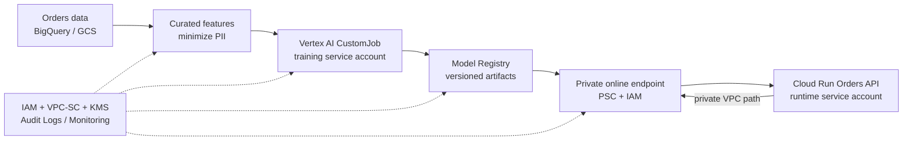
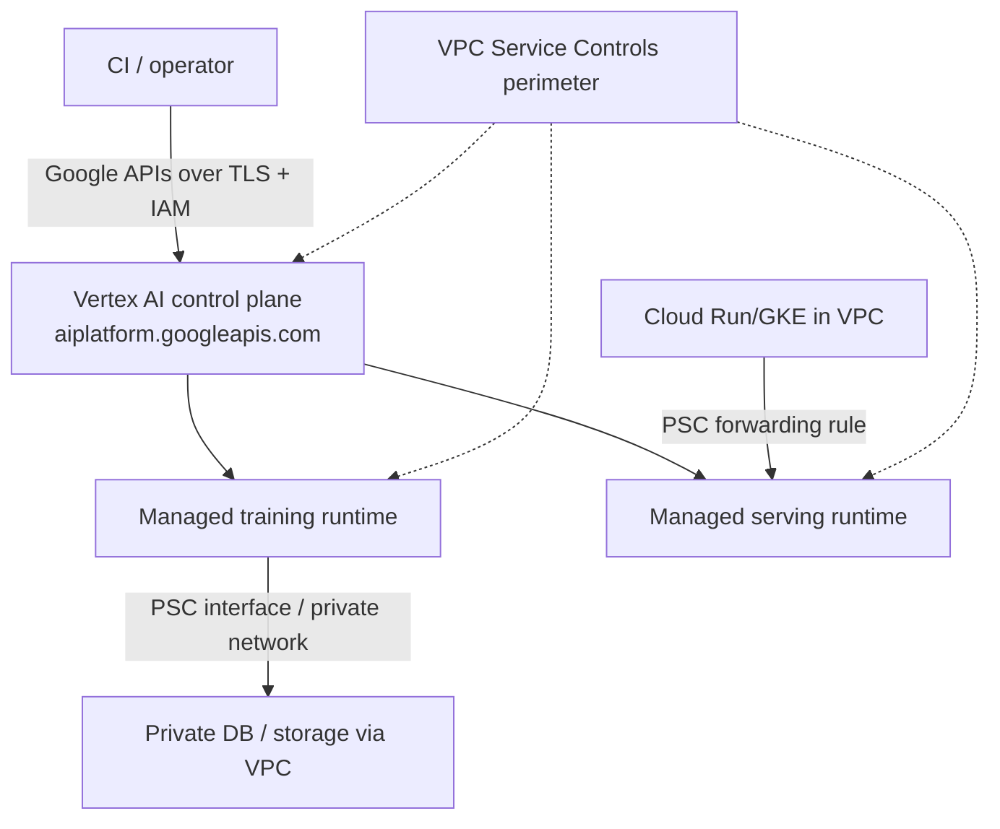
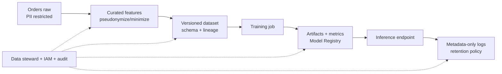

# IAM, mạng riêng và bảo vệ dữ liệu ML

Một doanh nghiệp dùng **Vertex AI** để huấn luyện mô hình dự báo đơn hàng từ dữ liệu BigQuery/Cloud Storage rồi phục vụ dự đoán cho ứng dụng Cloud Run. Dữ liệu gồm lịch sử giao dịch có thông tin khách hàng; nếu huấn luyện bằng danh tính có quyền quá rộng, mở endpoint công khai hoặc log toàn bộ request/response, mô hình chạy đúng vẫn có thể gây sự cố bảo mật. Bài này thiết kế một đường đi **dữ liệu → training → model registry → inference** có kiểm soát quyền, mạng và vòng đời dữ liệu.

Bài thuộc chương **Vertex AI và học máy**, module `CLOUD_PROVIDERS_GCP`. Những khái niệm IAM, tổ chức project, VPC, Cloud Run/GKE, Cloud Storage, BigQuery, theo dõi độ tin cậy và chi phí được kết hợp thành một hệ thống ML thực hành. Trong tài liệu Google Cloud mới, nhiều trang Vertex AI được trình bày dưới tên **Gemini Enterprise Agent Platform**; các API `aiplatform.googleapis.com` và nhiều role `aiplatform.*` vẫn là những khái niệm kỹ thuật cần biết.

> Project, endpoint, KMS key, bucket và datasets bên dưới đều là **ví dụ**. Các thao tác cấp IAM, tạo job/endpoints, thay VPC-SC, bật logging hoặc CMEK có thể làm thay đổi quyền truy cập, phát sinh phí hoặc gián đoạn hệ thống. Chỉ thực hiện trong sandbox được phê duyệt. Không dùng dữ liệu khách hàng thật để thử chính sách bảo vệ.

## 1. Kết quả học tập

Sau bài này, bạn có thể:

1. Phân biệt **người triển khai**, **runtime service account**, **Vertex AI service agent** và **ứng dụng gọi inference**.
2. Cấp IAM theo nguyên tắc least privilege cho training data, model artifacts và endpoint; nhận diện rủi ro quyền tạo custom jobs.
3. Phân biệt **Private Google Access**, **Private Service Connect (PSC) interface cho training**, **PSC private endpoints cho online prediction**, và VPC Service Controls.
4. Thiết kế nguồn dữ liệu ML với phân loại PII, encryption/CMEK, residency, secrets và retention.
5. Kiểm tra quyền bằng `gcloud`, khai báo CustomJob với service account riêng, lên cấu hình private endpoint và audit.
6. Theo dõi truy cập/lỗi, thử nghiệm negative access và lập runbook xử lý rò rỉ dữ liệu.

## 2. Threat model và kiến trúc nhiều lớp



| Tài sản cần bảo vệ | Rủi ro | Lớp bảo vệ ưu tiên |
| --- | --- | --- |
| Dữ liệu huấn luyện / labels | Truy cập trái phép, export PII | Dataset/bucket IAM, curated data, VPC-SC, retention |
| Training code/container | Mã độc đọc dữ liệu rồi gửi ra ngoài | Trusted images, Artifact Registry, review, restricted egress |
| Model weights/artifacts | Copy model hoặc thay phiên bản | Model Registry IAM, GCS IAM, provenance và signing theo quy trình |
| Online prediction endpoint | Người ngoài gọi mô hình, DoS, lộ request | Endpoint IAM, PSC/private networking, quotas, auth |
| Prompts, features và dự đoán | Lộ PII qua request logs hoặc responses | Data minimization, redaction, log controls, policy |
| IAM / service agents / KMS keys | Privilege escalation, không giải mã được dữ liệu | Least privilege, separation of duties, Audit Logs |

**Phân biệt bốn câu hỏi:** *Ai* được phép gọi dịch vụ (IAM)? *Từ mạng nào* kết nối được (VPC/PSC)? *Dữ liệu được di chuyển đến đâu* (VPC-SC/egress policy)? *Ai có quyền giải mã hay đọc payload* (KMS + quyền dữ liệu)? **Không một công cụ riêng lẻ trả lời được cả bốn.**

## 3. IAM: danh tính nào thực sự thực hiện hành động?

Trong Vertex AI, có ít nhất **ba loại principal** khác nhau:

- **Caller/deployer**: người hoặc CI tạo training jobs, models, endpoints; cần quyền Vertex AI API và `iam.serviceAccounts.actAs` trên runtime service account được gắn.
- **Runtime service account**: danh tính của **training code** hoặc ứng dụng Cloud Run, nên chỉ được đọc đúng GCS bucket/BigQuery dataset và ghi đúng output destination.
- **Google-managed service agent**: danh tính do Vertex AI sử dụng để quản lý tài nguyên thay bạn; điển hình `service-PROJECT_NUMBER@gcp-sa-aiplatform.iam.gserviceaccount.com`, thường có `roles/aiplatform.serviceAgent` trong project.

**Service agent role không dành cho người dùng hoặc app service account.** Gỡ mặc định vai trò agent một cách tùy tiện có thể làm dịch vụ ngừng hoạt động; ngược lại, cấp `roles/aiplatform.serviceAgent` cho developer là sai mô hình an toàn.

### 3.1. Ma trận quyền tối thiểu theo quy trình

| Danh tính | Quyền thường dùng | Phạm vi |
| --- | --- | --- |
| CI tạo CustomJob | `aiplatform.customJobs.create` (ví dụ `roles/aiplatform.user` nếu phù hợp), `roles/iam.serviceAccountUser` trên training SA | Project Vertex AI + đúng SA |
| Training SA | `roles/storage.objectViewer`, `roles/bigquery.dataViewer`, `roles/bigquery.jobUser`, Object Creator ở bucket output nếu cần | **Từng bucket/dataset/job project** |
| Model deployer | Quyền upload/deploy model và endpoint cần thiết | Model/endpoint/project theo giới hạn API |
| Cloud Run inference caller | Quyền prediction trên endpoint (role/custom role phù hợp, có `aiplatform.endpoints.predict`) | Endpoint/model project |
| Vertex AI service agent | Service-agent role được Google cấp tự động; Cloud KMS quyền trên key nếu bật CMEK | Dịch vụ và resource cụ thể |
| Security reviewer | IAM Policy Viewer, Audit Logs Viewer/Logging Viewer theo phạm vi | Chỉ đọc cấu hình và bằng chứng |

**Quyền tạo custom training job là quyền nhạy cảm**: tùy cấu hình, người tạo job có thể chạy container code và tiếp cận dữ liệu dưới danh tính thực thi; tài liệu Google Cloud cảnh báo quyền `aiplatform.customJobs.create` có thể dẫn tới quyền trên các dịch vụ khác nếu dùng service agent mặc định rộng. Vì thế bắt buộc kiểm soát `actAs`, chọn runtime SA riêng, review images/commands và tránh cho người dùng tùy ý chọn service account đặc quyền.

### 3.2. Lớp IAM không thay database/bucket security

Ví dụ CI có quyền tạo CustomJob **không** có nghĩa nó được phép đọc `gs://orders-ml-private` hoặc mọi bảng BigQuery. Các công việc do Vertex AI thực thi chỉ đọc được dữ liệu trong phạm vi IAM của runtime/service agent đang sử dụng. Với GCS dùng bucket IAM; BigQuery cần phân biệt **quyền chạy job** ở job project và **quyền đọc table/view** ở dataset; row-level security, column-level policy tags và masking vẫn quan trọng.

### 3.3. Service accounts giữa các projects

Trong mô hình ML platform project tách data project, cần kiểm tra **IAM ở cả hai phía**: Vertex AI project cho phép tạo job, training SA có quyền dữ liệu ở data project, org policy cho phép cross-project service account usage nếu cần, và service agent có quyền được tài liệu yêu cầu. **Không xóa org policy bảo vệ cross-project SA chỉ để vượt lỗi 403**; xin security approval và kiểm tra theo runbook.

## 4. Phân biệt đường quản lý (control plane) và đường dữ liệu (data plane)



**API request tới control plane** (tạo job, khai báo endpoint, xem models) và **traffic tới code trong training/serving environment** không đi chung một đường mạng trong mọi cấu hình. Có VPC riêng cho Cloud Run không tự đặt runtime của Vertex AI vào subnet đó. Hãy xác định **luồng chính xác**, nguồn/dích và loại API trước khi chọn PSC, private services access hay firewall rules.

### 4.1. Private Google Access / restricted.googleapis.com

VM/GKE không có external IP có thể truy cập **Google APIs** qua Private Google Access kết hợp DNS/route/firewall phù hợp. Trong VPC-SC, `restricted.googleapis.com` cho các API hỗ trợ là lựa chọn phổ biến để giới hạn đường Google APIs theo perimeter. Cách này **không tự tạo một Vertex AI private prediction endpoint** và không thay quyền IAM. Nơi dùng Cloud Run Direct VPC egress hoặc Serverless VPC Access phải kiểm tra cách route đến private Google APIs theo triển khai thực tế.

### 4.2. PSC interface dành cho **training egress**

Với Vertex AI CustomJob cần đọc Cloud SQL/private Redis hoặc máy chủ nội bộ, có thể cấu hình **Private Service Connect interface**:

1. Network team tạo VPC, subnet và **network attachment** trong project chứa VPC.
2. Cho phép producer được kết nối qua network attachment theo cơ chế accept/auto-accept.
3. Truyền full network attachment resource name qua `jobSpec.pscInterfaceConfig.networkAttachment` khi tạo CustomJob.
4. Bổ sung Cloud DNS peering khi training code cần resolve private names trong VPC.
5. Test kết nối đến private destination và giới hạn đường outbound qua VPC/firewall/egress policy.

**PSC interface là đường egress từ Vertex AI training runtime vào VPC**, không phải một public REST endpoint để ứng dụng gọi predict. Tài liệu Google Cloud hiện khuyến nghị PSC interface thay cho VPC Network Peering ở một số training workloads vì giảm rủi ro cạn IP và hỗ trợ kết nối mạng linh hoạt. **Không áp dụng tự động cho mọi loại model/tuning/pipeline**; xem danh sách feature được hỗ trợ.

### 4.3. PSC private endpoint dành cho **online prediction ingress**

Với **custom-trained/AutoML model** được phục vụ qua endpoint riêng, có thể tạo **Private Service Connect endpoint** và cung cấp kết nối từ một hay nhiều VPC consumer thông qua forwarding rules/PSC automation; endpoint có **project allowlist**. Chỉ máy ở mạng được cấu hình và principal có quyền prediction mới thực hiện dự đoán.

| Đặc điểm | PSC training interface | PSC private online endpoint |
| --- | --- | --- |
| Chiều traffic | Runtime training **đi ra** VPC/data source | Application **đi vào** model serving |
| Tài nguyên mạng chính | Network attachment, subnet, DNS | Service attachment + forwarding rule/PSC automation |
| Danh tính | Training runtime SA | Prediction caller SA/IAM + network |
| Tính năng | CustomJob/persistent resources theo hỗ trợ | Custom-trained/AutoML online inference theo hỗ trợ |
| Mục đích | Đọc nguồn private/ghi artifacts | Giảm bề mặt truy cập model online |

**Đừng chọn PSC endpoint nếu mục tiêu là model gọi private database từ bên trong serving container**: PSC online inference có giới hạn **không hỗ trợ private egress từ container qua endpoint đó**. Tuned Gemini models, một số Model Garden/Generative AI workflows có **endpoint và điều kiện riêng**; không giả định mọi Gemini model có thể deploy lên loại PSC endpoint của custom models.

## 5. VPC Service Controls: chống di chuyển dữ liệu sai biên

**VPC Service Controls (VPC-SC)** đặt **service perimeter** quanh các project/services được bảo vệ, bổ sung lớp kiểm soát **ngữ cảnh và luồng dữ liệu giữa biên** bên cạnh IAM. Ví dụ một training job có quyền đọc bucket chứa PII nhưng bị ngăn xuất sang một Cloud Storage bucket không được phép nằm ngoài perimeter.

| Kiểm soát | Mục tiêu | Không giải quyết |
| --- | --- | --- |
| IAM | Principal được gọi resource/API nào | Đường data exfiltration qua một principal đã được cấp quá rộng |
| Private networking | Kết nối qua mạng nào, không yêu cầu public endpoint | Truy cập từ tài khoản bị đánh cắp đang ở mạng được phép |
| VPC-SC | Chặn đường API/service-to-service vượt perimeter không được duyệt | Mã training tự in dữ liệu nhạy cảm ra log hoặc mọi rò rỉ qua kênh được allow |
| Cloud KMS / CMEK | Điều khiển khóa mã hóa dữ liệu at rest | Lộ plaintext khi identity hợp lệ đã giải mã dữ liệu |
| DLP/column policies | Giảm/che dữ liệu nhạy cảm ở nguồn | Ngăn hoàn toàn suy luận từ dữ liệu được phép |

### 5.1. Quy trình đưa Vertex AI vào perimeter

1. Kiểm kê **projects** chứa Vertex AI, Cloud Storage, BigQuery, Artifact Registry, KMS và các services ML đang dùng; phân biệt control plane/data plane.
2. Kiểm tra **danh sách APIs được VPC-SC hỗ trợ** và các ngoại lệ cho feature thực tế (custom training, pipelines, GenAI, vector search…).
3. Tạo perimeter ở **dry-run mode**, thêm restricted services và projects theo thiết kế an ninh.
4. Kiểm thử luồng hợp lệ: CI tạo job, training đọc input, ghi artifacts, inference được gọi từ Cloud Run; kiểm tra luồng không hợp lệ ra ngoài perimeter.
5. Dựa vào **VPC-SC violation audit logs**, tạo **ingress/egress rules tối thiểu** cho các luồng phải đi qua biên; sau khi có bằng chứng mới chuyển enforcement.

**VPC-SC không tự tạo mạng riêng.** Với PSC interface, một số Vertex AI workloads bên trong perimeter cần cấu hình bổ sung: network attachment, DNS, restricted Google APIs và/hoặc đường egress. Mở quá rộng vì một lệnh training thất bại sẽ vô hiệu hóa mục tiêu kiểm soát xuất dữ liệu.

### 5.2. Một phép thử phòng ngừa exfiltration

Thiết lập sandbox bucket **bên trong** perimeter và bucket **bên ngoài** perimeter thuộc tổ chức thử nghiệm. Dùng SA có đủ IAM để thử copy nhưng **không có VPC-SC egress exception**. Kết quả kỳ vọng: phép copy bị VPC-SC từ chối, có thông tin violation trong audit logs. Đối chiếu với phép đọc/ghi **cùng perimeter** vẫn thành công.

Đây là **bài kiểm thử có kiểm soát**: không chạy với data thật; nếu thao tác bị từ chối, điều tra rule và identity thay vì tự động cấp `allUsers`, `roles/owner` hoặc tắt perimeter.

## 6. Quản trị vòng đời dữ liệu huấn luyện và dự đoán

Một pipeline ML không chỉ lưu “file train”:



| Giai đoạn | Kiểm soát cần có | Bằng chứng |
| --- | --- | --- |
| Ingest & classification | Phân loại PII/financial/sensitive fields, xác định mục đích | Catalog, owner, policy tags, DLP results |
| Feature engineering | Minimize, mask/pseudonymize, tránh label leakage | SQL/pipeline code review, schema assertions |
| Training snapshot | Dataset version, hash/manifest, quyền/retention | GCS generation/BigQuery snapshot reference, run metadata |
| Training code | Image digest, vulnerability scanning, dependency policy | Artifact Registry scanning, build provenance |
| Model Registry | Version, evaluation, approver, training-data lineage | Model metadata, approval ticket |
| Serving | Request validation, caller IAM, endpoint exposure policy | Endpoint config, tests, traffic metrics |
| Monitoring & cleanup | Không log PII, retention và delete requests | Logging settings, TTL/lifecycle, deletion audit |

**Pseudonymization không đồng nghĩa anonymization.** Hash một email với thuật toán công khai vẫn có thể bị dò; dùng tokenization/salted keyed mapping khi phù hợp và quản lý secret tách biệt. Dữ liệu tổng hợp nhỏ vẫn có thể cho phép suy luận riêng tư; đánh giá privacy của feature set và đầu ra dự đoán.

### 6.1. Không cho một model học từ dữ liệu không được phép

Data owner cần phê duyệt nguồn, độ chính xác labels và mục đích sử dụng. Trong BigQuery, training SA dùng view/dataset **curated** đã lọc cột, row policies/policy tags khi cần, không cấp quyền BigQuery Data Owner/Viewer trên toàn bộ raw project. Với GCS, tách `raw/`, `training/`, `artifacts/` thành **buckets** hoặc ranh giới IAM được thiết kế để cấp đúng quyền; chỉ dùng prefix trong một bucket **không mặc nhiên tạo IAM boundary độc lập**, trừ khi cấu hình cơ chế hỗ trợ quyền theo prefix phù hợp.

Không để dữ liệu thô trong Docker image, notebook outputs, TensorBoard metrics, Git repository hoặc model metadata. Nếu cần debugging, dùng synthetic samples đã được duyệt. Kiểm tra cả feature store, vector index, embeddings và RAG documents: **embeddings/weights không được coi là chắc chắn không chứa thông tin nhạy cảm**.

### 6.2. Training data và nội dung inference GenAI là các lớp khác nhau

Với nền tảng Generative AI/Model Garden, kiểm tra **Service Specific Terms và security controls theo đúng model, location, API, feature GA/Preview**. Không khẳng định mọi model, phiên bản và bên thứ ba đều có cùng chính sách giữ/log prompt hoặc dùng dữ liệu. Một số chức năng deferred/store/context caching hay request-response logging có thể **lưu trạng thái/nội dung**; monitoring metadata không chứa prompt có thể được bật riêng.

Không truyền secrets, JWTs, thẻ thanh toán hay PII không cần thiết vào prompt/feature request. Nếu ứng dụng sử dụng external tools/agents, phân quyền tool riêng, giới hạn data retrieval và kiểm tra prompt injection; private endpoint/IAM chỉ xác thực caller, **không chứng minh nội dung đầu vào là an toàn**.

## 7. Mã hóa dữ liệu ML bằng CMEK và Cloud KMS

Google Cloud mã hóa dữ liệu at rest mặc định. **CMEK** cho phép tổ chức quản lý khóa qua Cloud KMS (rotation, IAM, audit, disable), nhưng **mức hỗ trợ không giống nhau cho từng loại Vertex AI resource**.

| Tài nguyên | Câu hỏi cần xác minh |
| --- | --- |
| GCS training bucket | Bucket có default CMEK hoặc per-object key? Đúng location? |
| BigQuery dataset/table | CMEK của dataset/table và quyền BigQuery service agent trên key? |
| Vertex AI CustomJob / Model | Feature có hỗ trợ CMEK cho VM boot disk, training outputs, uploaded models? |
| Online endpoint / generative service | Resource/model cụ thể có hỗ trợ CMEK không, phần nào được mã hóa? |
| Logging/metadata | Có dữ liệu nào **không** được bảo vệ bởi cùng CMEK? |

**Không nói “đã bật CMEK cho Vertex AI nên toàn bộ ML lifecycle đều dùng khóa đó”.** Đối với training, khóa có thể bảo vệ VM boot disks chứa code/data tạm; GCS và BigQuery dùng các cấu hình KMS **riêng**. Một số endpoints, batch prediction/tuning/genAI functions có hạn chế hoặc không hỗ trợ CMEK. Dùng [Vertex AI CMEK support matrix](https://cloud.google.com/vertex-ai/docs/general/cmek) cho phiên bản và loại resource đang sử dụng.

### 7.1. Service agent cần quyền trên KMS key

Ví dụ (chỉ áp dụng khi key `ml-key` và key ring `ml-ring` đã tồn tại):

```bash
# THAY ĐỔI IAM TRÊN KMS KEY. Chỉ chạy khi có security approval.
PROJECT_ID="orders-ml-sandbox"
KMS_PROJECT="orders-ml-keys"
KMS_LOCATION="asia-southeast1"
KEY_RING="ml-ring"
KEY_NAME="ml-key"
PROJECT_NUMBER="$(gcloud projects describe "$PROJECT_ID" \
  --format='value(projectNumber)')"
VERTEX_AGENT="service-$PROJECT_NUMBER@gcp-sa-aiplatform.iam.gserviceaccount.com"

gcloud kms keys add-iam-policy-binding "$KEY_NAME" \
  --project="$KMS_PROJECT" \
  --location="$KMS_LOCATION" \
  --keyring="$KEY_RING" \
  --member="serviceAccount:$VERTEX_AGENT" \
  --role="roles/cloudkms.cryptoKeyEncrypterDecrypter"
```

Quyền này **chỉ cho đúng Google-managed service agent** trên key đã duyệt, không cấp cho toàn bộ training developers. Tùy resource, **các service agents khác** (GCS, BigQuery, Compute Engine) cũng có thể cần quyền trên những keys liên quan; kiểm tra theo tài liệu sản phẩm. Key location phải tương thích resource location. Không chia sẻ KMS crypto key giữa môi trường dev/prod chỉ để tiện cấu hình.

**KMS key bị disable/thu hồi quyền** có thể khiến resource không đọc/ghi được hoặc job fail với `FAILED_PRECONDITION`. Rotate/revoke theo runbook có kiểm thử và rollback, không disable key production để test giả định “không ai đọc được” mà không tính tới availability.

## 8. Lab: service account riêng cho training job

Giả định sandbox đã có project `orders-ml-sandbox`, input bucket `gs://orders-ml-training` với **dữ liệu giả**, BigQuery dataset curated và container image đã được CI kiểm tra trong Artifact Registry. Lab dùng `asia-southeast1` làm ví dụ; **kiểm tra availability của CustomJob và machine type trong region** trước khi chạy.

### 8.1. Đọc danh tính và tài nguyên hiện có

```bash
PROJECT_ID="orders-ml-sandbox"
REGION="asia-southeast1"
TRAINING_SA="ml-trainer@$PROJECT_ID.iam.gserviceaccount.com"
TRAINING_BUCKET="gs://orders-ml-training"

# CHỈ ĐỌC; các lệnh sau chưa khởi chạy job và không cấp quyền.
gcloud config get-value project
gcloud services list --enabled --project="$PROJECT_ID" \
  --filter="config.name:aiplatform.googleapis.com"
gcloud iam service-accounts list --project="$PROJECT_ID"
gcloud storage buckets get-iam-policy "$TRAINING_BUCKET"
gcloud ai custom-jobs list --project="$PROJECT_ID" --region="$REGION"
gcloud ai endpoints list --project="$PROJECT_ID" --region="$REGION"
```

Nếu training data ở BigQuery, kiểm tra **dataset-level permissions và row/column policies** theo identity thực thi; chỉ có BigQuery Job User trên project là chưa đủ để SELECT dữ liệu.

### 8.2. Cấp quyền tối thiểu cho training SA

```bash
# THAY ĐỔI: chỉ làm nếu SA chưa tồn tại, trong sandbox được duyệt.
gcloud iam service-accounts create ml-trainer \
  --project="$PROJECT_ID" \
  --display-name="Scoped Orders model training"

# THAY ĐỔI: chỉ cấp quyền đọc đúng bucket đã được data owner duyệt.
gcloud storage buckets add-iam-policy-binding "$TRAINING_BUCKET" \
  --member="serviceAccount:$TRAINING_SA" \
  --role="roles/storage.objectViewer"

# CHỈ ĐỌC: xác minh policy có principal vừa được cấp.
gcloud storage buckets get-iam-policy "$TRAINING_BUCKET"
```

Nếu job dùng BigQuery, cấp `roles/bigquery.jobUser` trên **job project** và `roles/bigquery.dataViewer` hoặc quyền hẹp hơn trên **curated dataset** qua IAM/SQL governance được duyệt. Nếu model ghi artifacts vào bucket khác, cấp quyền tạo objects theo prefix/bucket policy phù hợp; **không cấp Storage Admin toàn project**. Người/CI khởi tạo job cần `iam.serviceAccounts.actAs`, thường qua `roles/iam.serviceAccountUser` **trên đúng `ml-trainer` SA**, cùng quyền tạo CustomJob.

### 8.3. Tạo CustomJob có gắn runtime identity

```bash
# CHỈ LÀ MẪU: image phải do CI của bạn build, scan và tồn tại thật.
TRAINING_IMAGE="asia-southeast1-docker.pkg.dev/orders-ml-sandbox/ml-images/train-orders:v1"

# THAY ĐỔI / TÍNH PHÍ COMPUTE: chỉ chạy khi image, IAM, budget đã sẵn.
gcloud ai custom-jobs create \
  --project="$PROJECT_ID" \
  --region="$REGION" \
  --display-name="orders-train-synthetic" \
  --service-account="$TRAINING_SA" \
  --worker-pool-spec="replica-count=1,machine-type=n2-standard-4,container-image-uri=$TRAINING_IMAGE"
```

Lệnh này **khởi chạy job ngay khi tạo**, không chỉ kiểm tra cấu hình. Image `:v1` là placeholder nghiệp vụ, không có sẵn trong Google Cloud; **không chạy khi chưa có image thực**. Trong production pin image bằng **digest** thay vì mutable tags. Training code cần đọc dữ liệu qua ADC; không truyền service-account JSON key hoặc OAuth token dưới dạng `--args`/env variables rồi ghi vào logs.

Nếu image cần Private Service Connect interface, `gcloud ai custom-jobs create` flags thông dụng **không tương đương** cấu hình PSC interface. Dùng REST/SDK với `pscInterfaceConfig` của `CustomJobSpec`, network attachment đã chuẩn bị và permissions đúng, như mục 9.

## 9. Lab: private training egress và private online inference

### 9.1. PSC interface trong CustomJob

Đây là **trích đoạn của CustomJobSpec gửi qua REST**, không phải file YAML của `gcloud ai custom-jobs create --config`. Network attachment phải được Network team tạo trước ở cùng region theo tài liệu hỗ trợ:

```json
{
  "displayName": "orders-private-training",
  "jobSpec": {
    "serviceAccount": "ml-trainer@orders-ml-sandbox.iam.gserviceaccount.com",
    "workerPoolSpecs": [
      {
        "machineSpec": {"machineType": "n2-standard-4"},
        "replicaCount": "1",
        "containerSpec": {
          "imageUri": "asia-southeast1-docker.pkg.dev/orders-ml-sandbox/ml-images/train-orders:v1"
        }
      }
    ],
    "pscInterfaceConfig": {
      "networkAttachment": "projects/orders-network-sandbox/regions/asia-southeast1/networkAttachments/ml-training"
    }
  }
}
```

Body này dùng camelCase theo protobuf JSON REST; **nếu training code cần DNS private zone**, cần thêm `dnsPeeringConfigs` theo cấu hình mạng đã tạo. Trên một số triển khai, VPC-SC còn yêu cầu cấu hình đường đến restricted Google APIs. Đừng truyền IP tĩnh thay cho network attachment hoặc nhầm với trường `network` của VPC peering truyền thống.

Kiểm tra network attachment trong Console → Network Connectivity → Private Service Connect; verify accept list, subnet/routing/DNS và firewall. **Không kết luận mạng riêng an toàn chỉ vì ping kết nối được**: thử một đích được phép và một đích không được phép, kiểm tra VPC Flow Logs/firewall audit khi có.

### 9.2. Tạo PSC endpoint cho custom model online serving

Mẫu REST tạo một **Vertex AI Endpoint resource** với PSC enabled và project allowlist. **Chưa triển khai model**, nên việc endpoint có tồn tại không chứng minh inference hoạt động:

```bash
# THAY ĐỔI: tạo Vertex AI endpoint; triển khai model sau đó có phí serving.
PROJECT_ID="orders-ml-sandbox"
REGION="asia-southeast1"
ACCESS_TOKEN="$(gcloud auth print-access-token)"

curl -sS -X POST \
  "https://$REGION-aiplatform.googleapis.com/v1/projects/$PROJECT_ID/locations/$REGION/endpoints" \
  -H "Authorization: Bearer $ACCESS_TOKEN" \
  -H "Content-Type: application/json" \
  -d '{
    "displayName": "orders-private-predict",
    "privateServiceConnectConfig": {
      "enablePrivateServiceConnect": true,
      "projectAllowlist": ["orders-ml-sandbox", "orders-api-sandbox"]
    }
  }'
```

Google Cloud có hai đường cấu hình PSC forwarding rule: **tự động thông qua service connection policy** khi được hỗ trợ, hoặc **thủ công với service attachment URI** sau khi endpoint được tạo. Các bước VPC forwarding rule, reserved internal IP, target service attachment và DNS phải phù hợp provider/consumer projects. **Không gửi inference request tới URL điều khiển `.../v1/projects/.../endpoints` như thể đó là PSC data-plane IP**.

**Lưu ý:** `projectAllowlist` của PSC endpoint có hạn chế thay đổi sau khi tạo theo tài liệu hiện hành; lên danh sách projects trước. Một số custom model serving features hoặc tuned Gemini models không hỗ trợ loại PSC endpoint này. Nếu không có yêu cầu riêng, chỉ nên dùng mẫu như tham chiếu kiến trúc; triển khai private endpoint **cần bài kiểm thử mạng, quyền prediction và vận hành riêng**.

### 9.3. Kiểm thử ba tuyến độc lập

| Kiểm thử | Điều kiện | Kết quả kỳ vọng |
| --- | --- | --- |
| Training SA đọc `training/` | IAM và mạng đúng | Thành công |
| Training SA đọc `restricted-raw/` | Không có bucket/data grant | `PERMISSION_DENIED` |
| Client trong allowlisted VPC + có prediction IAM | PSC forwarding rule hoạt động | Dự đoán thành công, p95 đo được |
| Client ngoài allowlisted VPC | Không có PSC attachment/route | Không kết nối được tới endpoint riêng |
| Client có mạng nhưng thiếu prediction IAM | Chỉ có kết nối, không có permission | 403/permission denied |
| Principal có IAM nhưng API call vượt VPC-SC perimeter | Không có ingress/egress exception | Violation/denied và audit record |

Khi kiểm thử mạng, dùng dữ liệu giả không nhạy cảm. **403 không luôn là lỗi IAM**; VPC-SC có thể chặn một request dù principal có IAM đúng. Đọc đúng failure reason trong response và audit logs.

## 10. Logging, Monitoring và privacy của inference

Vertex AI hỗ trợ nhiều loại log với ranh giới dữ liệu khác nhau. **Bật logging không nên đồng nghĩa ghi toàn bộ payload**.

| Loại log/tín hiệu | Có thể chứa gì? | Chính sách khuyến nghị |
| --- | --- | --- |
| Cloud Audit Logs (Admin Activity/Data Access) | Ai tạo/sửa model, endpoint, IAM; gọi APIs | Bật/kiểm tra Data Access log theo chính sách, hạn chế quyền xem |
| Custom training container logs | `stdout/stderr` do mã training in ra | Chỉ log metadata, không in rows/features/credentials |
| Online prediction access logging | Thời gian, status, latency, metadata request | Giữ theo retention/SLO cần thiết |
| Online prediction request-response logging | **Input và output** mẫu ghi sang BigQuery theo tính năng | Chỉ bật sau privacy review, redaction và quyền BigQuery |
| Generative AI inference metadata logging | Model, region, token counts, latency, error code | Tách riêng prompt/response content; kiểm tra product-specific settings |
| Cloud Monitoring | QPS, p95/p99, errors, CPU/GPU, quota | Alert khi inference 5xx, latency hoặc chi phí vượt ngưỡng |

**Mặc định logging không đồng nhất** giữa `v1`/`v1beta1` và các loại models; kiểm tra cấu hình cụ thể. Với custom model online inference, request-response logging có thể ghi dữ liệu vào BigQuery nếu bật; BigQuery dataset đó phải có IAM, retention, encryption và vùng dữ liệu phù hợp. Với GenAI, chính sách lưu request, context cache, deferred tasks hoặc abuse monitoring phụ thuộc model/điều khoản — không mặc định zero retention cho tất cả.

### 10.1. Kiểm tra audit và cấu hình trước khi bật logging nhạy cảm

```bash
# CHỈ ĐỌC: các audit log entries của Vertex AI, không xem payload đào tạo.
PROJECT_ID="orders-ml-sandbox"
gcloud logging read \
  'protoPayload.serviceName="aiplatform.googleapis.com"' \
  --project="$PROJECT_ID" \
  --limit=20 \
  --format="table(timestamp,protoPayload.methodName,protoPayload.authenticationInfo.principalEmail)"

# CHỈ ĐỌC: endpoints đang tồn tại (không có model/prediction nào được tạo).
gcloud ai endpoints list --project="$PROJECT_ID" --region="asia-southeast1"
```

Các logs cần bật Data Access audit theo cấu hình và permission đúng; không thấy log **không đồng nghĩa** không có truy cập. Với VPC-SC violations, lọc audit entries theo thông tin `VPC_SERVICE_CONTROLS`, resource và caller identity; IAM denies và network timeouts không luôn xuất hiện cùng một mẫu.

### 10.2. SLO và chi phí của hệ ML bảo mật

| SLO/tín hiệu | Ví dụ | Phản ứng |
| --- | --- | --- |
| Inference availability | 99,9% requests hợp lệ không 5xx | Kiểm tra endpoint health/replica autoscale, PSC |
| Prediction latency p95 | Dưới 400 ms cho Orders scoring | Phân biệt network, model serving, cold starts |
| Data freshness | Features của ngày D có mặt trước 06:00 D+1 | Alert pipeline, không tự dùng dữ liệu sai kỳ |
| Unauthorized access | 0 successful requests từ principal chưa được duyệt | Negative access tests, IAM audit |
| Perimeter violations | Không có luồng ra khỏi policy; có alert trên denies mới | Triage VPC-SC logs, rule review |
| Data quality / model drift | Feature schema và distribution trong ngưỡng | Quarantine inputs, rollback model |
| Cost | Training VM/GPU hours, deployed endpoint replicas, tokens, KMS/logs | Budgets, quota, tắt môi trường thử nghiệm |

**Private endpoint không miễn phí**: deployed model replicas/GPUs có thể tính phí liên tục dù ít request. Training jobs, pipelines, Model Registry/Artifact Registry storage, GCS/BigQuery, Cloud KMS calls, PSC networking, logging và model-monitoring phát sinh phí riêng. Với endpoint phục vụ lưu lượng thấp, so sánh các kiểu serving hợp lệ theo chi phí/SLO thay vì giữ GPU luôn bật mặc định.

## 11. Case study Orders: mô hình dự đoán nhu cầu có dữ liệu nhạy cảm

Nhóm Orders dự đoán nhu cầu nhập hàng từ dữ liệu mua sắm và danh mục sản phẩm. Security yêu cầu **không xuất email/số điện thoại**, training code không được truy cập payment tables, chỉ Orders API gọi prediction trong mạng private và kiểm tra được lịch sử triển khai.

### 11.1. Thiết kế bảo vệ

1. **Data owner** tạo BigQuery curated view/partitioned tables chỉ chứa features cần thiết; khóa PII qua masking/policy tags và loại dữ liệu không phục vụ mục đích huấn luyện.
2. **ML pipeline** chốt snapshot version, dataset schema, kiểm tra null/leakage, lưu metadata run và nguồn model vào Registry.
3. **Training SA** chỉ có quyền đọc curated dataset, ghi model artifacts vào bucket riêng; người tạo jobs có `actAs` đúng SA, code image qua CI scanning.
4. **PSC training interface** kết nối tới private feature store nếu cần; không mở public SQL endpoint để container thuận tiện truy cập.
5. **CMEK** được áp theo khả năng của từng resource; Cloud KMS IAM cấp cho service agents đúng quyền, có phương án key availability.
6. **Inference** deploy custom model lên PSC private endpoint; allowlist đúng client project, Cloud Run service account có permission prediction.
7. **Observability** ghi model/version, latency, QPS, error/correlation ID; không log orders/PII; alert khi access denied mới, 5xx hoặc data freshness sai.

### 11.2. Ba sự cố và cách ứng phó

**Sự cố A — Training job trả 403 khi đọc bucket.** Kiểm tra job có thực sự gắn `ml-trainer` SA chưa, bucket IAM trên resource đúng, org policies, VPC-SC violation và data location. Không cấp Owner/Storage Admin toàn project để “sửa nhanh”. Nếu 403 do perimeter, xử lý theo policy, không gỡ perimeter.

**Sự cố B — Cloud Run gọi endpoint không được.** Phân biệt lỗi DNS/PSC forwarding rule/allowlisted project với OAuth/IAM `aiplatform.endpoints.predict`. Test kết nối private path và access token từ **đúng Cloud Run service account**. Nếu là 429 do quota, kiểm tra capacity và rate limits; không cho backend tự động gửi dữ liệu sang endpoint công khai khác.

**Sự cố C — Training container ghi email ra stdout.** Tạm dừng/pause job hoặc log sink liên quan theo runbook, hạn chế quyền đọc logs, xác minh phạm vi và retention; thực hiện incident response/privacy notification nếu cần. Vá mã training để chỉ log aggregate metrics, redact dữ liệu, và kiểm thử lại. VPC-SC/CMEK **không ngăn việc mã hợp lệ in plaintext ra Cloud Logging**.

## 12. Troubleshooting theo lớp

| Biểu hiện | Nguyên nhân có thể | Kiểm tra ưu tiên |
| --- | --- | --- |
| Tạo CustomJob lỗi `PERMISSION_DENIED` | Thiếu `aiplatform.customJobs.create` hoặc `iam.serviceAccounts.actAs` | IAM caller, SA gắn và org policy |
| Training đọc GCS/BigQuery bị 403 | Runtime SA thiếu data grant, job project khác, VPC-SC | Actual principal, bucket/dataset policy, perimeter logs |
| Container có thể đọc dữ liệu ngoài dự kiến | Runtime SA/service agent quyền rộng | Giảm scope, kiểm tra customJobs creator/actAs |
| Training không tới private database | Chưa PSC interface, sai attachment/subnet/DNS/route | PSC configs, firewall, VPC Flow Logs |
| PSC prediction endpoint không kết nối | Thiếu forwarding rule, allowlist sai, DNS sai | PSC connection status, network policy |
| Có route tới endpoint nhưng predict trả 403 | Thiếu prediction IAM, token/audience không hợp | Caller SA, role trên resource/project, API error |
| Predict 429/503 | Quota/capacity, model replicas quá ít, service lỗi | Monitoring, autoscale, retries giới hạn |
| API call bị VPC-SC chặn | Service perimeter thiếu rule cho cross-project path | Audit violation, service/identity/egress policy |
| Model/endpoint không dùng được sau đổi KMS key | Key disabled, sai key location/IAM | KMS audit, `cryptoKeyEncrypterDecrypter` service agent |
| Có prompt/feature trong log | Request-response logging hoặc code tự log body | Cấu hình log, data classification, retention |
| Model bị thay thế không qua review | Deployment privileges quá rộng, pipeline promotion thiếu gate | IAM, model lineage, audit changes, approvals |
| Hóa đơn tăng khi không có requests | Deployed model replicas/GPUs hoặc training jobs | Vertex AI Billing SKUs, endpoint replicas, budgets |

**Trình tự điều tra:** xác định resource/project/region và principal → tách control plane/data plane → IAM → route/DNS/PSC → VPC-SC → KMS/key state → application/model logs, quotas và billing. Không khắc phục bằng cách bỏ private endpoint, gỡ perimeter, in credentials hay mở quyền toàn project.

## 13. Bài tập thực hành

### Bài A — Phân tách danh tính và quyền

Đội có ba danh tính: CI triển khai training, training runtime và Cloud Run phục vụ khách hàng. Lập bảng IAM trong đó CI chỉ tạo CustomJob/`actAs` đúng training SA, training SA chỉ đọc curated dataset và ghi artifacts, Cloud Run chỉ có quyền predict. Giải thích vì sao không được cấp `roles/aiplatform.serviceAgent` cho bất kỳ danh tính nào trong ba nhóm.

### Bài B — Negative IAM test

Trên sandbox dữ liệu giả, cấp `ml-trainer` quyền Object Viewer ở bucket `training` nhưng không ở bucket `restricted-raw`. Dùng một CustomJob với SA đó và kiểm tra đọc bucket thứ nhất thành công, bucket thứ hai bị từ chối. Nêu cách chứng minh request thực sự chạy dưới đúng runtime SA, không phải user đang đăng nhập `gcloud`.

### Bài C — Phân biệt hai loại PSC

Một training job cần đọc Cloud SQL private IP, còn Cloud Run cần predict qua network private. Chọn **PSC interface** hay **PSC online prediction endpoint** cho từng chiều traffic. Vẽ network attachment, forwarding rule, Service Attachment, VPC và danh tính. Vì sao một PSC prediction endpoint không tự cho training code private egress?

### Bài D — Thiết kế VPC-SC

Tổ chức có `ml-project`, `data-project` và `public-analytics-project`. Lập service perimeter bảo vệ dữ liệu ở hai project đầu, cho CI tạo job được duyệt, nhưng ngăn copy data sang public project. Mô tả dry-run, audit violations, ingress/egress exception tối thiểu và negative test. Vì sao **có quyền IAM** vẫn có thể bị VPC-SC từ chối?

### Bài E — CMEK và key availability

Training data nằm trên GCS, features trên BigQuery, model artifacts trên Vertex AI và Cloud KMS key ở project khác. Chỉ ra **dịch vụ/service agent** cần quyền KMS cho từng loại tài nguyên; xác định key location và cách thử failover/rotate mà không tắt khóa production. Điều gì xảy ra khi quyền decrypt bị thu hồi bất ngờ?

### Bài F — Bảo mật logs và inference

Một đội muốn bật request-response logging để debug kết quả suy luận đơn hàng. Dữ liệu request có order amount và email. Đề xuất cách redaction, sampling, BigQuery destination IAM, retention, audit, kiểm tra quyền truy cập. So sánh với metadata-only logging và giải thích vì sao VPC-SC không tự ngăn plaintext xuất hiện trong logs.

### Bài G — Incident response

Ngày 1, monitoring phát hiện 1.500 request từ project chưa được duyệt; ngày 2, training container in một giá trị PII. Viết runbook cho từng trường hợp: thu thập bằng chứng, isolate, IAM/PSC allowlist/perimeter checks, containment, cleanup, policy notification và regression test. Không xóa audit trail trước khi điều tra.

### Bài H — Kiến trúc và chi phí sản phẩm ML

Thiết kế pipeline Orders: curated BigQuery → CustomJob → Model Registry → PSC endpoint → Cloud Run. Đặt tối đa tám SLI/SLO, ma trận IAM, vị trí KMS/logging/retention và ước tính các **nhóm chi phí** (VM/GPU, deployed replicas, BigQuery/GCS, network, KMS/logs). Nếu QPS dự đoán thấp, đề xuất cách giảm chi phí mà vẫn giữ yêu cầu bảo mật.

### Câu hỏi tự kiểm tra

1. Khác nhau giữa caller IAM, runtime SA và Vertex AI service agent?
2. Vì sao `iam.serviceAccounts.actAs` là quyền phải giới hạn khi tạo CustomJob?
3. Private Google Access có tự tạo private prediction endpoint không?
4. PSC interface cho training là ingress hay egress từ training runtime?
5. Một principal có IAM hợp lệ có thể bị VPC-SC từ chối không?
6. CMEK trên training job có mã hóa luôn BigQuery source table và Cloud Logging không?
7. Private endpoint có tự bảo đảm prompt và model response không chứa PII không?
8. Vì sao request-response logging cần privacy review riêng?
9. Nếu training image đọc được dữ liệu ngoài phạm vi duyệt, cần rà lại những lớp nào?
10. Khi endpoint ở mạng private nhưng Cloud Run bị 403, nên điều tra gì trước khi đổi network?

## 14. Checklist và tài liệu chính thức

- [ ] Data contract phân loại PII/labels, retention và model ownership; training dataset có phiên bản, lineage.
- [ ] CI, training runtime, serving caller và Google-managed service agents dùng **đúng identities**, không cấp roles vượt phạm vi.
- [ ] CustomJob được kiểm soát quyền tạo/`actAs` và image provenance; không lưu credentials tĩnh trong container.
- [ ] Nguồn private có network attachment/PSC interface khi cần; endpoint inference private dùng PSC forwarding rule và IAM.
- [ ] VPC-SC perimeter đã thử dry-run, negative tests và audit; không có egress rule rộng không cần thiết.
- [ ] CMEK support matrix được đối chiếu cho từng resource; service agents có đúng key permissions và kế hoạch key availability.
- [ ] Inference logs/metadata, data masking và retention được review; không vô tình log PII.
- [ ] Cloud Monitoring có latency/5xx/429/freshness/unauthorized usage và Billing alerts.
- [ ] Khi điều chỉnh policy, chạy cả **positive và negative access tests** từ principal/mạng thật.

Tài liệu Google Cloud để tra cứu khi triển khai:

- [Vertex AI/Agent Platform access control](https://cloud.google.com/vertex-ai/docs/general/access-control)
- [Use custom service accounts for Vertex AI resources](https://cloud.google.com/vertex-ai/docs/general/custom-service-account)
- [IAM predefined roles and permissions](https://cloud.google.com/iam/docs/roles-permissions/aiplatform)
- [Use Private Service Connect interface for training](https://cloud.google.com/vertex-ai/docs/training/psc-i-egress)
- [Dedicated private endpoints with Private Service Connect](https://cloud.google.com/vertex-ai/docs/predictions/private-service-connect)
- [Private services access endpoints for prediction](https://cloud.google.com/vertex-ai/docs/predictions/using-private-endpoints)
- [VPC Service Controls with Vertex AI](https://cloud.google.com/vertex-ai/docs/general/vpc-service-controls)
- [VPC Service Controls overview](https://cloud.google.com/vpc-service-controls/docs/overview)
- [CMEK support for Vertex AI](https://cloud.google.com/vertex-ai/docs/general/cmek)
- [Cloud KMS CMEK overview](https://cloud.google.com/kms/docs/cmek)
- [Vertex AI online prediction logging](https://cloud.google.com/vertex-ai/docs/predictions/online-prediction-logging)
- [Vertex AI/Agent Platform security controls](https://cloud.google.com/vertex-ai/docs/security-controls)
- [Google Cloud Audit Logs](https://cloud.google.com/logging/docs/audit)
- [gcloud ai custom-jobs create reference](https://cloud.google.com/sdk/gcloud/reference/ai/custom-jobs/create)
- [Vertex AI pricing](https://cloud.google.com/vertex-ai/pricing)

**Ghi nhớ:** Bảo mật ML phải theo **toàn bộ đường đi của dữ liệu và mô hình**, không chỉ IAM trên endpoint. Phân quyền đúng service accounts/service agents, hiểu hướng mạng của **PSC training interface** và **PSC inference endpoint**, dùng VPC-SC để kiểm soát di chuyển dữ liệu, CMEK theo khả năng của từng resource, và giám sát logs mà không làm lộ nội dung nhạy cảm. Mọi chính sách cần được chứng minh bằng **cả phép thử thành công lẫn phép thử phải bị từ chối**.
